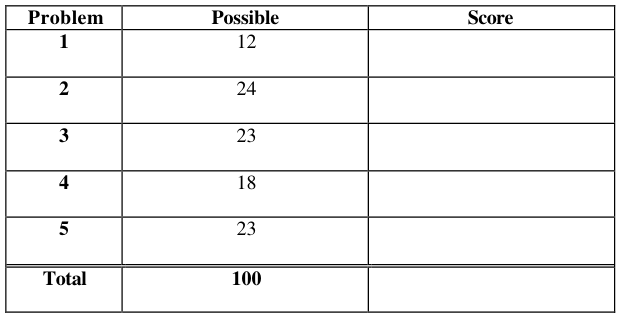
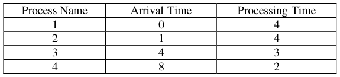
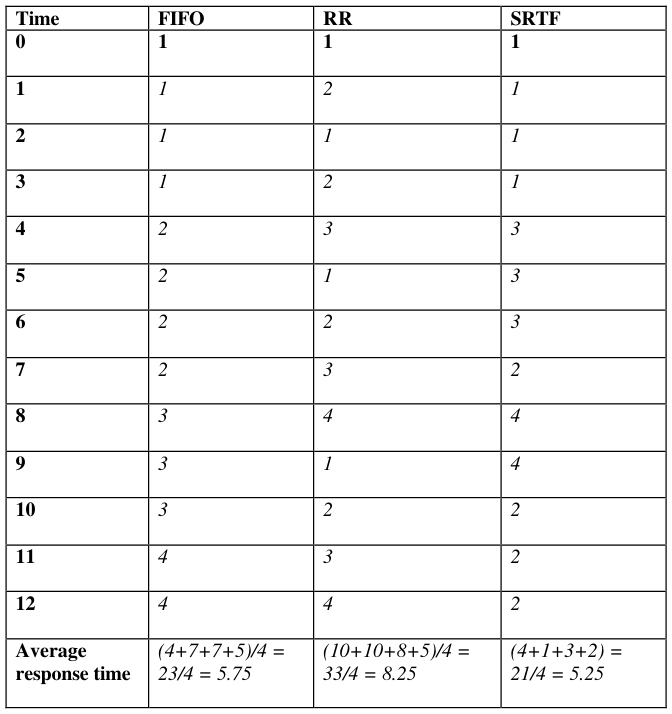
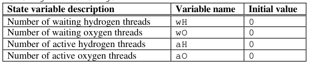
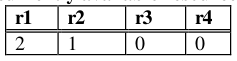
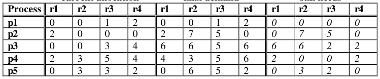

# Berkeley CS162 Spring 2001: Midterm 1: Official solutions

> Copied from the original: <https://hkn.eecs.berkeley.edu/exams/course/cs/162>. Text and figures are taken from the PDF as is; nothing was answered or rewritten. The original PDF is in this folder.

---

**Page 1**

&emsp;&emsp;&emsp;&emsp;&emsp;&emsp;&emsp;&emsp;University of California, Berkeley 
&emsp;&emsp;&emsp;&emsp;&emsp;&emsp;&emsp;&emsp;College of Engineering 
&emsp;&emsp;&emsp;&emsp;&emsp;&emsp;&emsp;&emsp;Computer Science Division – EECS 
Spring 2001                                     Anthony D. Joseph 
&emsp;&emsp;&emsp;&emsp;&emsp;&emsp;&emsp;&emsp;**Midterm Exam Solutions** 
&emsp;&emsp;&emsp;&emsp;&emsp;&emsp;&emsp;&emsp;March 7, 2001 
&emsp;&emsp;&emsp;&emsp;&emsp;&emsp;&emsp;&emsp;CS162 Operating Systems

General Information: 
This is a **closed book and notes** examination. You have ninety minutes to answer as many 
questions as possible.  The number in parentheses at the beginning of each question indicates the 
number of points given to the question; there are 100 points in all. You should read **all** of the 
questions before starting the exam, as some of the questions are substantially more time 
consuming. 
Write all of your answers directly on this paper.  **Make your answers as concise as possible.** If there 
is something in a question that you believe is open to interpretation, then please ask us about it! 
&emsp;&emsp;&emsp;&emsp;&emsp;&emsp;&emsp;&emsp;**Good Luck!!**

Page 1/10

---

**Page 2**

CS 162 Spring 2001 Midterm Exam        March 7, 2001 
Solutions

1\. (12 points total) “Lightweight” versus “Heavyweight” processes – Pros and Cons: 
&emsp;a. (4 points) List one advantage of running several single-threaded applications as 
&emsp;&emsp;“heavyweight” processes over running the applications as multiple “lightweight” 
&emsp;&emsp;processes, all in one address space. Be explicit, but concise, in your answers. 
&emsp;&emsp;i) 
&emsp;&emsp;&emsp;&emsp;&emsp;4 points for saying fault tolerance because of protection, 3 points for 
&emsp;&emsp;&emsp;&emsp;&emsp;saying simple to implement and debug without saying why, 2 points for 
&emsp;&emsp;&emsp;&emsp;&emsp;saying no synchronization needed without shared memory (with some 
&emsp;&emsp;&emsp;&emsp;&emsp;justification), and 0 points for saying no synchronization needed without 
&emsp;&emsp;&emsp;&emsp;&emsp;justification.

&emsp;b. (8 points) List two reasons why lightweight processes are better than heavyweight 
&emsp;&emsp;ones. 
&emsp;&emsp;i) 
&emsp;&emsp;&emsp;&emsp;&emsp;4 points for each of the following reasons: 
&emsp;&emsp;&emsp;&emsp;&emsp;&emsp;&emsp;•    Easier to share data between threads in the same address 
&emsp;&emsp;&emsp;&emsp;&emsp;&emsp;&emsp;&emsp;space than between processes 
&emsp;&emsp;&emsp;&emsp;&emsp;&emsp;&emsp;•    Faster to switch between threads than between processes 
&emsp;&emsp;&emsp;&emsp;&emsp;&emsp;&emsp;•    Sharing of code portion (or other portions) of applications 
&emsp;&emsp;&emsp;&emsp;&emsp;&emsp;&emsp;&emsp;possible versus heavyweight processes (not covered yet) 
&emsp;&emsp;&emsp;&emsp;&emsp;2 points for modularity, 1 point for less system resources (w/o significant 
&emsp;&emsp;&emsp;&emsp;&emsp;specific advantages) or other minor advantages, and 0 points for 
&emsp;&emsp;&emsp;&emsp;&emsp;concurrency or other statements not specific to lightweight processes.

&emsp;&emsp;ii)

2\. (24 points total) Suppose that we have a multiprogrammed computer in which each job 
&emsp;has identical characteristics. In one computation period, T, for a job, half the time is 
&emsp;spent in I/O and the other half in processor activity. Each job runs for a total of N 
&emsp;periods. Assume that a simple round-robin scheduling scheme is used and that I/O 
&emsp;operations can overlap with processor operation. We define the following quantities: 
&emsp;•    Turnaround time = actual time to complete a job. 
&emsp;•    Processor utilization = percentage of time that the processor is active (not waiting). 
&emsp;For large N, compute approximate values for these quantities for one, two, and four 
&emsp;simultaneous jobs, assuming that the period T is distributed in each of the following 
&emsp;ways:

Page 2/10

---

**Page 3**

CS 162 Spring 2001 Midterm Exam        March 7, 2001 
Solutions 
&emsp;a. (15 points) I/O first half, processor second half. 
&emsp;&emsp;i) 1 job, Turnaround time and Processor utilization: 
&emsp;&emsp;&emsp;5 points, 3 for correct answer for TAT and 2 for correct utilization. 
&emsp;&emsp;&emsp;TAT = NT, CPU utilization = 50%. 
&emsp;&emsp;&emsp;For the turnaround time, we accepted anything that was the correct answer 
&emsp;&emsp;&emsp;plus or minus constant (dependent on T) factors. If you had any fraction of NT 
&emsp;&emsp;&emsp;other than the correct answer (2/3 NT) this is **wrong**. 
&emsp;&emsp;&emsp;Where we could follow your logic, we gave credit for answers that were left 
&emsp;&emsp;&emsp;unreduced. Many people left very complex expressions like: (7/4NT + 5/4NT + 
&emsp;&emsp;&emsp;3/4NT + 1/4NT) / 4. If we could see that it evaluated to the correct answer, 
&emsp;&emsp;&emsp;they received credit. Most of these did not evaluate to the correct answer. 
&emsp;&emsp;&emsp;Please actually read the question in the future. We were looking for 
&emsp;&emsp;&emsp;APPROXIMATE values for large N. 
&emsp;&emsp;&emsp;We subtracted one point if the correct answers was given except that you wrote 
&emsp;&emsp;&emsp;T or N instead of NT. "N periods" received full credit. 
&emsp;&emsp;&emsp;For utilization, we accepted any ratio that evaluated to the correct % as N 
&emsp;&emsp;&emsp;goes to infinity. We accepted 99% for 100%, even though this is not truly 
&emsp;&emsp;&emsp;correct. We saw a lot of answers like "utilization = NT". Yes, the CPU spends 
&emsp;&emsp;&emsp;NT in computation (for 2 threads), but the question asks for percentage very 
&emsp;&emsp;&emsp;clearly. We accepted (1 - t/n)% because we could see what they meant, even 
&emsp;&emsp;&emsp;those this too is incorrect. 
&emsp;&emsp;&emsp;We rejected any answers that had two different values for the same quantity, 
&emsp;&emsp;&emsp;even if one of them is right. Several people wrote multiple answers, such as 
&emsp;&emsp;&emsp;"NT or 5/4 NT”. If you guess, you have a 50% chance of getting it right. If you 
&emsp;&emsp;&emsp;write them both, it's wrong. 
&emsp;&emsp;&emsp;Common errors: 
&emsp;&emsp;&emsp;The most common error was NT, 2NT, 4NT, with 50% utilization for all. If you 
&emsp;&emsp;&emsp;did this, you ended up with a total of 8 points. The next most common error 
&emsp;&emsp;&emsp;was just getting the wrong numbers (e.g., 7/4NT for 4 threads). Many people 
&emsp;&emsp;&emsp;wrote completely impossible answers: NT for one thread, 2/3NT for two 
&emsp;&emsp;&emsp;threads.

&emsp;&emsp;ii) 2 jobs, Turnaround time and Processor utilization: 
&emsp;&emsp;&emsp;TAT = NT, CPU utilization = 100%.

Page 3/10

---

**Page 4**

CS 162 Spring 2001 Midterm Exam        March 7, 2001 
Solutions

&emsp;&emsp;iii) 4 jobs, Turnaround time and Processor utilization: 
&emsp;&emsp;&emsp;TAT = (2N – 1)T, CPU utilization = 100%. We also accepted 2NT for TAT.

&emsp;b. (9 points) I/O first and fourth quarters, processor second and third quarters. 
&emsp;&emsp;i) 1 job, Turnaround time and Processor utilization: 
&emsp;&emsp;&emsp;2 points for TAT and 1 for utilization. Same answer as part a for 1 job.

&emsp;&emsp;ii) 2 jobs, Turnaround time and Processor utilization: 
&emsp;&emsp;&emsp;&emsp;&emsp;Same answer as above for part a for 2 jobs.

&emsp;&emsp;iii) 4 jobs, Turnaround time and Processor utilization: 
&emsp;&emsp;&emsp;&emsp;&emsp;Same answer as above for part a for 4 jobs.

3\. (23 points total) CPU scheduling. 
&emsp;a. (8 points) Given CPU-bound tasks and a choice between FIFO and Round-Robin 
&emsp;&emsp;scheduling algorithms, choose the best algorithm for each of the following 
&emsp;&emsp;systems and specify why you chose the algorithm. 
&emsp;&emsp;i) Multiprogrammed batch system: 
&emsp;&emsp;&emsp;2 points for correct answer, 2 points for good reason, 1 point for mediocre 
&emsp;&emsp;&emsp;reason. FIFO is the optimal choice, since in a batch system, the primary 
&emsp;&emsp;&emsp;concern is with throughput, and the less context switching, the more 
&emsp;&emsp;&emsp;processing time is available for the process. Policies that minimize context 
&emsp;&emsp;&emsp;switching are best. 
&emsp;&emsp;&emsp;We awarded 1 point for swapped incorrect answers for each part, IF there 
&emsp;&emsp;&emsp;was a reasonable justification that indicated the student understood the 
&emsp;&emsp;&emsp;tradeoffs involved. 
&emsp;&emsp;ii) Interactive, time-sharing system: 
&emsp;&emsp;&emsp;Round-robin is the optimal choice, since the primary concern is with 
&emsp;&emsp;&emsp;turnaround time. Time-slicing is preferred because it gives all the processes 
&emsp;&emsp;&emsp;access to the processor over a short period of time.

Page 4/10

---

**Page 5**

CS 162 Spring 2001 Midterm Exam        March 7, 2001 
Solutions 
&emsp;b. (15 points) Consider the following processes, arrival times, and CPU processing 
&emsp;&emsp;requirements:

&emsp;&emsp;For each of the following scheduling algorithms, fill in the table with the process 
&emsp;&emsp;that is running on the CPU. Assume a 1 unit timeslice for timeslice-based 
&emsp;&emsp;algorithms. For RR, assume that an arriving thread runs at the beginning of its 
&emsp;&emsp;arrival time.

Page 5/10

---

**Page 6**

CS 162 Spring 2001 Midterm Exam        March 7, 2001 
Solutions 
We awarded 5 points per column (scheduling policy). We subtracted 1 point for an error in each 
entry and 1 point for incorrectly choosing the run next job to run. Note that we only subtracted 1 
point if you had consecutive errors in cells because of an error made in a previous cell. 
A lot of people did not follow the statement: "For RR, assume that an arriving thread runs at the 
beginning of its arrival time". Also, the definition of SRTF states that if the arriving thread has 
less remaining time, it runs first. 
&emsp;&emsp;Many people also made addition mistakes, but we did not take off points if you had the 
correct response times. Note that the definition of Response Time is Finish time – Arrival time.

Page 6/10

---

**Page 7**

CS 162 Spring 2001 Midterm Exam        March 7, 2001 
Solutions 
No Credit – Problem X: (000000000000 points)

&emsp;&emsp;&emsp;&emsp;&emsp;Late Night Fun in the Labs (don’t try this tonight) 
From a student in CS ###: 
For a computer programming class, I sat directly across from someone, and our 
computers were facing away from each other.  A few minutes into the class, he got up to 
leave the room.  I reached between our computers and switched the inputs for the 
keyboards.  He came back and started typing and immediately got a distressed look on his 
face. 
He called the Lab TA over and explained that no matter what he typed, nothing would 
happen.  The TA tried everything.  By this time I was hiding behind my monitor and 
quaking red-faced. 
I started to type, “Leave me alone!” 
They both jumped back, silenced.  “What the #$?!#$” the TA said. 
I typed, “I said leave me alone!” 
The student got real upset.  “I didn't do anything to it, I swear!” It was all I could do to 
keep from laughing out loud.  The conversation between them and HAL 2000 went on for 
an amazing five minutes. 
Me: “Don't touch me!” 
Student: “I’m sorry, I didn't mean to hit your keys that hard.” 
Me: “Who do you think you are anyway?!” Etc.  Finally, I couldn’t contain myself any 
longer and fell out of my chair laughing. 
After they had realized what I had done, they both turned beet red. 
Funny, I never got more than a C- in that class.

Page 7/10

---

**Page 8**

CS 162 Spring 2001 Midterm Exam        March 7, 2001 
Solutions

4\. (18 points total) Concurrency problem: Building H2O. 
&emsp;The goal of this exercise is for you to create a monitor with methods `Hydrogen()` 
&emsp;and `Oxygen()`, which wait until a water molecule can be formed and then return. 
&emsp;Don’t worry about actually creating the water molecule; instead only need to wait 
&emsp;until two hydrogen threads and one oxygen thread can be grouped together. For 
&emsp;example, if two threads call Hydrogen, and then a third thread calls Oxygen, the third 
&emsp;thread should wake up the first two threads and they should then all return. 
&emsp;a. (6 points) Specify the correctness constraints. Be succinct and explicit in your 
&emsp;&emsp;answer. 
&emsp;&emsp;1\) Each hydrogen thread waits to be grouped with one other hydrogen and 
&emsp;&emsp;&emsp;oxygen before returning. 
&emsp;&emsp;2\) Each oxygen thread waits for two other hydrogens before returning. 
&emsp;&emsp;3\) Only one thread access shared state at a time 
&emsp;&emsp;3 good answers received 2 points each. One point for partially correct. Full four 
&emsp;&emsp;points if the two correctness constraints for hydrogen and oxygen were 
&emsp;&emsp;CORRECTLY combined into one constraint. 
&emsp;b. (12 points) Observe that there is only one condition any thread will wait for (i.e., a 
&emsp;&emsp;water molecule being formed). However, it will be necessary to signal hydrogen 
&emsp;&emsp;and oxygen threads independently, so we choose to use two condition variables, 
&emsp;&emsp;`waitingH` and `waitingO`.

You start with the following code: 
&emsp;`Hydrogen() {` 
&emsp;`wH++;` 
&emsp;`lock.acquire();` 
&emsp;`while (aH == 0) {` 
&emsp;`if (wH >= 2 && wO >= 1) {` 
&emsp;`wH-=2; aH+=2;` 
&emsp;`wO-=1; aO+=1;` 
&emsp;`waitingH.broadcast();` 
&emsp;`waitingO.signal();` 
&emsp;`} else {` 
&emsp;`lock.release();` 
&emsp;`waitingH.wait();` 
&emsp;`lock.acquire();` 
&emsp;`}` 
&emsp;`}` 
&emsp;`lock.release();` 
&emsp;`aH--;` 
&emsp;`}`

Page 8/10

---

**Page 9**

CS 162 Spring 2001 Midterm Exam        March 7, 2001 
Solutions

&emsp;`Oxygen() {` 
&emsp;`wO++;` 
&emsp;`while (aO == 0) {` 
&emsp;`if (wH >= 2 && wO >= 1) {` 
&emsp;`wH-=2; aH+=2;` 
&emsp;`wO-=1; aO+=1;` 
&emsp;`waitingH.signal();` 
&emsp;`waitingH.signal();` 
&emsp;`} else {` 
&emsp;`waitingO.broadcast();` 
&emsp;`}` 
&emsp;`}` 
&emsp;`aO--;` 
&emsp;`}` 
&emsp;For each method, say whether the implementation either (i) works, (ii) doesn’t work, 
&emsp;or (iii) is dangerous – that is, sometimes works and sometimes doesn’t.  If the 
&emsp;implementation does not work or is dangerous, explain why (there maybe several 
&emsp;errors) and show how to fix it so it does work. Also, list and fix any inefficiencies. 
&emsp;&emsp;&emsp;&emsp;&emsp;`i.`    `Hydrogen()` 
&emsp;&emsp;Seven points total: 1 for say the routine is (iii) dangerous or (ii) doesn’t work (the 
&emsp;&emsp;latter is acceptable only if one of the bugs in the student’s answer is that the OS 
&emsp;&emsp;would crash if we called wait() after releasing the lock, since that’s what Nachos 
&emsp;&emsp;does). Two points for each of three bugs and associated fixes (if the bugs 
&emsp;&emsp;mentioned implied a fix, then full credit was given): 
&emsp;&emsp;1\. Starvation may occur because the method releases the lock before waiting. 
&emsp;&emsp;2\. The state variables wH and aO are modified outside of critical sections 
&emsp;&emsp;3\. Inefficient: The broadcast should be a signal. 
&emsp;&emsp;We awarded full credit to students that said you cannot wait on a condition variable without 
&emsp;&emsp;originally holding the lock, in place of saying that the lock release before the wait would 
&emsp;&emsp;cause starvation. 
&emsp;&emsp;We took off 1 point for any additional bugs, since there were no others (except for a complete 
&emsp;&emsp;rewrite of the implementation – which wasn’t what we were looking for).

&emsp;&emsp;&emsp;&emsp;&emsp;`ii. Oxygen()` 
&emsp;&emsp;Five points total: One point for (ii) doesn’t work. 
&emsp;&emsp;Two points for each reason: 
&emsp;&emsp;1\. The broadcast should be a wait. 
&emsp;&emsp;2\. No locks around state variables.

Page 9/10

---

**Page 10**

CS 162 Spring 2001 Midterm Exam        March 7, 2001 
Solutions 
5\.  (23 points) Deadlock: 
Consider the following snapshot of a system with five processes (p1, ... p5) and four 
resources (r1, ... r4). There are no current outstanding queued unsatisfied requests. 
**currently available resources**

**current allocation**             **max demand**               **still needs**

a. (5 points) Compute what each process still might request and fill in the “still needs” 
&emsp;columns. 
&emsp;One point for each correct row. 
b. (8 points) Is this system currently deadlocked, or will any process become 
&emsp;deadlocked? Why or why not? If not, give an execution order. 
&emsp;Four points for correct answer: not deadlocked and will not become deadlocked. 
&emsp;Four points for using the Banker’s algorithm, to determine the process finishing 
&emsp;order: p1, p4, p5, p2, p3.

c. (10 points) If a request from p3 arrives for (0, 1, 0, 0), can that request be safely 
&emsp;granted immediately? In what state (deadlocked, safe, unsafe) would immediately 
&emsp;granting the whole request leave the system? Which processes, if any, are or may 
&emsp;become deadlocked if this whole request is granted immediately? 
&emsp;Change available to (2, 0, 0, 0) and p3’s row of “still needs” to (6, 5, 2, 2). Now p1, 
&emsp;p4, and p5 can finish, but with available now (4, 6, 9, 8) neither p2 nor p3’s “still 
&emsp;needs” can be satisfied. So, it is not safe to grant p3’s request. Correct answer NO (2 
&emsp;points). State is unsafe (4 points) as the system may or may not deadlock. Processes 
&emsp;p2 and p3 may deadlock (4 points, each incorrect one was –2 points).

Page 10/10

