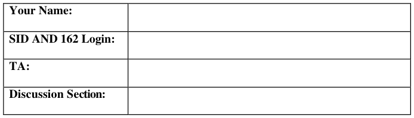

# Berkeley CS162 Spring 2002: Midterm 1: Official solutions

> Copied from the original: <https://hkn.eecs.berkeley.edu/exams/course/cs/162>. Text and figures are taken from the PDF as is; nothing was answered or rewritten. The original PDF is in this folder.

---

**Page 1**

&emsp;&emsp;&emsp;&emsp;&emsp;&emsp;&emsp;&emsp;University of California, Berkeley 
&emsp;&emsp;&emsp;&emsp;&emsp;&emsp;&emsp;&emsp;College of Engineering 
&emsp;&emsp;&emsp;&emsp;&emsp;&emsp;&emsp;&emsp;Computer Science Division – EECS 
Spring 2002                                     Anthony D. Joseph 
&emsp;&emsp;&emsp;&emsp;&emsp;&emsp;&emsp;&emsp;**Midterm Exam Solutions** 
&emsp;&emsp;&emsp;&emsp;&emsp;&emsp;&emsp;&emsp;March 13, 2002 
&emsp;&emsp;&emsp;&emsp;&emsp;&emsp;&emsp;&emsp;CS162 Operating Systems

General Information: 
This is a **closed book and notes** examination. You have ninety minutes to answer as many 
questions as possible.  The number in parentheses at the beginning of each question indicates the 
number of points given to the question; there are 100 points in all. You should read **all** of the 
questions before starting the exam, as some of the questions are substantially more time 
consuming. 
Write all of your answers directly on this paper.  **Make your answers as concise as possible.** If there 
is something in a question that you believe is open to interpretation, then please ask us about it! 
&emsp;&emsp;&emsp;&emsp;&emsp;&emsp;&emsp;&emsp;**Good Luck!!**

Page 1/10

---

**Page 2**

CS 162 Spring 2002 Midterm Exam        March 13, 2002 
Solutions 
1\. (20 points total) Short answer questions: 
&emsp;a. (8 points) What are the two main functions of an operating system? 
&emsp;&emsp;i) 
&emsp;&emsp;&emsp;&emsp;&emsp;(a) Coordinator and traffic cop: Resource allocation and control. 
&emsp;&emsp;&emsp;&emsp;&emsp;(b) Standard services. 
&emsp;&emsp;&emsp;&emsp;&emsp;4 points for each. 2 points for partial answers.

&emsp;&emsp;ii)

&emsp;b. (12 points) Which of the following instructions should be allowed only in kernel 
&emsp;&emsp;mode? State whether it is or not (circle one) **and** why. 
&emsp;&emsp;i) Disable all interrupts. 
&emsp;&emsp;&emsp;**Kernel**                            **Kernel and User** 
&emsp;&emsp;&emsp;Why? 
&emsp;&emsp;&emsp;&emsp;&emsp;Kernel only, otherwise a user could take control of the machine. 
&emsp;&emsp;&emsp;&emsp;&emsp;2 points for each answer and 2 points for reason.

&emsp;&emsp;ii) Read the time-of-day clock. 
&emsp;&emsp;&emsp;**Kernel**                            **Kernel and User** 
&emsp;&emsp;&emsp;Why? 
&emsp;&emsp;&emsp;&emsp;&emsp;Kernel and User, doesn’t affect anything because the operation is read- 
&emsp;&emsp;&emsp;&emsp;&emsp;only. We deducted 2 points if the answer did not mention the read-only 
&emsp;&emsp;&emsp;&emsp;&emsp;nature of the operation

&emsp;&emsp;iii) Set the time-of-day clock. 
&emsp;&emsp;&emsp;**Kernel**                            **Kernel and User** 
&emsp;&emsp;&emsp;Why? 
&emsp;&emsp;&emsp;&emsp;&emsp;Kernel only, could affect scheduling, other processes, and the kernel. 
&emsp;&emsp;&emsp;&emsp;&emsp;Several students mentioned changing their machine’s timezone, however, 
&emsp;&emsp;&emsp;&emsp;&emsp;the access should still be allowed only in the kernel and use a system call.

Page 2/10

---

**Page 3**

CS 162 Spring 2002 Midterm Exam        March 13, 2002 
Solutions

2\. (33 points total) CPU Scheduling. 
&emsp;a. (5 points) The CDC 6600 computers could handle up to 10 I/O processes 
&emsp;&emsp;simultaneously on a single CPU using an interesting form of round-robin 
&emsp;&emsp;scheduling called **processor sharing**. A context switch occurred after each 
&emsp;&emsp;instruction, so instruction 1 came from process 1, instruction 2 came from process 
&emsp;&emsp;2, etc. The context switching was done by special hardware, and the overhead was 
&emsp;&emsp;zero. If a process needed T seconds to complete in the absence of competition, 
&emsp;&emsp;what is the maximum amount of time it would need if processor sharing were 
&emsp;&emsp;used with N processes? Assume there are less than 10 processes waiting to run.

&emsp;&emsp;It will need NT seconds. 
&emsp;&emsp;Common minor errors (-2 points) included (N-1)T, and anything else that only 
&emsp;&emsp;changed the answer by a constant factor. All other values were given 0 points.

&emsp;b. (20 points) Five batch jobs A through E, arrive at a computer center at almost the 
&emsp;&emsp;same time. They have estimated running times of A:10, B:6, C:2, D:4, and E:8 
&emsp;&emsp;minutes. Their (externally determined) priorities are A:3, B:5, C:2, D:1, and E:4, 
&emsp;&emsp;respectively, with 5 being the highest priority. For each of the following 
&emsp;&emsp;scheduling algorithms, determine the mean process turnaround time (average 
&emsp;&emsp;response time). Ignore context switching overhead. **For partial credit, you** 
&emsp;&emsp;**should list the finishing times.** 
&emsp;&emsp;i) Round-Robin (the timeslice size is not important, so assume a timeslice of 1 
&emsp;&emsp;&emsp;millisecond). 
&emsp;&emsp;&emsp;During the first 10 minutes, each job gets 1/5 of the CPU. At the end of 10 
&emsp;&emsp;&emsp;minutes, C finishes. During the next 8 minutes, each job gets 1/4 of the CPU, 
&emsp;&emsp;&emsp;after which time D finishes. Then each of the three remaining jobs gets 1/3 of 
&emsp;&emsp;&emsp;the CPU for 6 minutes, until B finishes, and so on. The finishing times for the 
&emsp;&emsp;&emsp;five jobs are 10, 18, 24, 28, and 30, for an average of 22 minutes. 
&emsp;&emsp;&emsp;There were many varieties of incorrect answers for this one. The most 
&emsp;&emsp;&emsp;common mistake was to compute the TAT for round-robin with a time slice of 
&emsp;&emsp;&emsp;1 minute, instead of 1 millisecond. This resulted in 3 incorrect finishing times, 
&emsp;&emsp;&emsp;so 2 points of partial credit were awarded. 
&emsp;&emsp;&emsp;General part (b) grading info: If mean turnaround time was incorrect, 1 point 
&emsp;&emsp;&emsp;of partial credit was awarded for each correct finishing time, up to a total of 4 
&emsp;&emsp;&emsp;points (-1 for incorrect TAT). 
&emsp;&emsp;&emsp;-1 point for grievous arithmetic errors. 
&emsp;&emsp;&emsp;-1 point per section if all finishing times were off by 1. 
&emsp;&emsp;ii) Priority scheduling. 
&emsp;&emsp;&emsp;B is run first. After 6 minutes, it is finished. The other jobs finish at 14, 24, 26, 
&emsp;&emsp;&emsp;and 30, for an average of 20 minutes.

Page 3/10

---

**Page 4**

CS 162 Spring 2002 Midterm Exam        March 13, 2002 
Solutions

&emsp;&emsp;iii) First-come, First-served (run in order 10, 6, 2, 4, 8). 
&emsp;&emsp;&emsp;If the jobs run in the order A through E, they finish at 10, 16, 18, 22, and 30, 
&emsp;&emsp;&emsp;for an average of 19.2 minutes.

&emsp;&emsp;iv) Shortest Job First. 
&emsp;&emsp;&emsp;Finish times are 2, 6, 12, 20, and 30, for an average of 14 minutes.

&emsp;c. (8 points) Five jobs are waiting to be run. Their expected running times are 9, 6, 3, 
&emsp;&emsp;5, and X. In what order should they be run to minimize average response time? 
&emsp;&emsp;State the scheduling algorithm that should be used AND the order in which the 
&emsp;&emsp;jobs should be run.  (Your answer will depend on X). 
&emsp;&emsp;&emsp;Shortest job first is the way to minimize average response time (we also 
&emsp;&emsp;&emsp;accepted Shorted Remaining Time to Completion First). 
&emsp;&emsp;&emsp;0 \< X \<= 3: X, 3, 5, 6, 9. 
&emsp;&emsp;&emsp;3 \< X \<= 5: 3, X, 5, 6, 9. 
&emsp;&emsp;&emsp;5 \< X \<= 6: 3, 5, X, 6, 9. 
&emsp;&emsp;&emsp;6 \< X \<= 9: 3, 5, 6, X, 9. 
&emsp;&emsp;&emsp;X\> 9: X, 3, 5, 6, 9, X. 
&emsp;&emsp;&emsp;3 points for correct scheduling algorithm. 
&emsp;&emsp;&emsp;1 points for each correct range. 
&emsp;&emsp;&emsp;For the job orderings, accepted both an explicit list of the possible orderings, 
&emsp;&emsp;&emsp;as well as a general description of where to put X. 
&emsp;&emsp;&emsp;-1 point for descriptions that were judged too vague. 
&emsp;&emsp;&emsp;-1 point for each ordering omitted. This included not placing X between 5 and 
&emsp;&emsp;&emsp;6, since we don't specify that the running times must be integer values. 
&emsp;&emsp;&emsp;Answers stating that the scheduling algorithm used would change based on 
&emsp;&emsp;&emsp;the value of X were graded on a case-by-case basis. In general, if a solution 
&emsp;&emsp;&emsp;mentioned SJF, it received 2 points. Otherwise, 0 points were awarded.

Page 4/10

---

**Page 5**

CS 162 Spring 2002 Midterm Exam        March 13, 2002 
Solutions 
**No Credit – Problem X: (000000000000 points)**

The following is an excerpt from a Wall Street Journal article: 
1\. A man called the Canon help desk with a problem with his printer.  The tech asked him 
&emsp;if he was running it under “Windows.” The man responded, “No, my desk is next to 
&emsp;the door. But that is a good point. The woman sitting in the cubicle next to me is 
&emsp;under a window and her printer is working fine.” 
2\. An AST customer was asked to send a copy of her defective diskettes. A few days later 
&emsp;a letter arrived from the customer along with photocopies of the floppies. 
3\. A Dell customer called to say he couldn't get his computer to fax anything. After 40 
&emsp;minutes of troubleshooting, the technician discovered the man was trying to fax a 
&emsp;piece of paper by holding it in front of the monitor screen and hitting the “send” key. 
4\. A Dell technician received a call from a customer who was enraged because his 
&emsp;computer had told him he was “bad and an invalid.” The tech explained that the 
&emsp;computer's “bad command” and “invalid” response's shouldn't be taken personally. 
5\. A confused caller to IBM was having troubles printing documents. He told the 
&emsp;technician that the computer had said it “couldn’t find printer.”  The user had also 
&emsp;tried turning the computer screen to face the printer but that his computer still 
&emsp;couldn’t “see” the printer. 
6\. An exasperated caller to Dell Computer Tech Support couldn't get her new Dell 
&emsp;Computer to turn on. After ensuring the computer was plugged in, the technician 
&emsp;asked her what happened when she pushed the power button. Her response, “I pushed 
&emsp;and pushed on this foot pedal and nothing happens.” The “foot pedal” turned out to be 
&emsp;the computer's mouse. 
7\. Another customer called Compaq tech support to say his brand-new computer 
&emsp;wouldn’t work. He said he unpacked the unit, plugged it in and sat there for 20 
&emsp;minutes waiting for something to happen. When asked what happened when he 
&emsp;pressed the power switch, he asked, “What power switch?” 
8\. True story from a Novell NetWire Sysop: 
&emsp;Tech: “Hello, this Tech Support. How may I help you?” 
&emsp;Caller: “The cup holder on my PC is broken and I am within my warranty period. 
&emsp;&emsp;&emsp;How do I go about getting that fixed?” 
&emsp;Tech: “I’m sorry, but did you say a cup holder?” 
&emsp;Caller: “Yes, it’s attached to the front of my computer.” 
&emsp;Tech: “Please excuse me. If I seem a bit stumped, it’s because I am. Did you receive 
&emsp;&emsp;&emsp;this as part of a promotional at a trade show? How did you get this cup 
&emsp;&emsp;&emsp;holder? Does it have any trademark on it?” 
&emsp;Caller: It came with my computer. I don’t know anything about a promotional. It just 
&emsp;&emsp;&emsp;has ‘4X’ on it.” 
&emsp;At this point, the Tech Rep had to mute the caller because he couldn’t stand it. He 
&emsp;&emsp;&emsp;was laughing too hard. The caller had been using the load drawer of the CD- 
&emsp;&emsp;&emsp;ROM drive as a cup holder and snapped it off the drive.

Page 5/10

---

**Page 6**

CS 162 Spring 2002 Midterm Exam        March 13, 2002 
Solutions

3\. (24 points total) Concurrency problem: Dining Philosophers. 
&emsp;The goal of this exercise is to implement a solution to the Dining Philosophers 
&emsp;problem using monitors instead of semaphores. Create a method `Dine()`, which 
&emsp;waits until a diner has two chopsticks and can eat, then calls `Eat()`, and then releases 
&emsp;the chopsticks before returning. Your solution should allow multiple philosophers to 
&emsp;eat at the same time (as long as there are sufficient chopsticks in a pile in the middle 
&emsp;of the table). 
&emsp;a. (4 points) Specify the correctness constraints. Be succinct and explicit in your 
&emsp;&emsp;answer. 
&emsp;&emsp;1\) A diner waits for two chopsticks. 
&emsp;&emsp;2\) Only one thread accesses shared state at a time 
&emsp;&emsp;2 points for each correct constraint.

&emsp;b. (20 points) Implement the `Dine()` method. Specify any state variables that you 
&emsp;&emsp;use: 
&emsp;`State variables:` 
&emsp;`chopsticks`    `Number of chopsticks left`    `Initial value N` 
&emsp;`Monitor: waitingP` 
&emsp;`Lock: lock` 
&emsp;`Dine() {` 
&emsp;`lock.acquire();` 
&emsp;`while (chopsticks < 2) {` 
&emsp;`waitingP.wait()` 
&emsp;`}` 
&emsp;`chopsticks -= 2;` 
&emsp;`lock.release();` 
&emsp;`Eat();` 
&emsp;`lock.acquire();` 
&emsp;`chopsticks +=2;` 
&emsp;`waitingP.broadcast(); or signal` 
&emsp;`lock.release();` 
&emsp;`}`

Page 6/10

---

**Page 7**

CS 162 Spring 2002 Midterm Exam        March 13, 2002 
Solutions 
This page intentionally left blank as scratch space. 
We gave zero credit for solutions based on semaphores or that did not use condition 
variables. 
We subtracted points for various mistakes as follows: 
&emsp;-3 points for unnecessary wait operations 
&emsp;-2 points for not releasing the lock 
&emsp;-8 points for code that may deadlock 
&emsp;-2 points for unreachable code 
&emsp;-4 points for too many copies of the same code 
&emsp;-5 points for busy waiting 
&emsp;-4 points for unclear usage of state variables 
&emsp;-6 points for not using chopsticks 
&emsp;-5 points for using chopsticks outside a lock 
&emsp;-2 points for holding the lock in Eat() 
&emsp;-3 points for incorrect while 
&emsp;-2 points for grabbing or releasing chopsticks 
&emsp;-2 points for signaling more than once 
&emsp;-3 points for signaling or waiting without holding lock 
&emsp;-5 points for no call to Eat() 
&emsp;-2 points for no signal 
&emsp;-3 points for signaling at the wrong time 
&emsp;-3 points for unnecessary lock.acquire() calls 
&emsp;-3 points for infinite loops 
&emsp;-4 points for mis-matched lock.acquire() 
&emsp;s 
&emsp;each answer and 2 points for reason. of two reasons.

Page 7/10

---

**Page 8**

CS 162 Spring 2002 Midterm Exam        March 13, 2002 
Solutions

4\. (10 points) Deadlock: 
Consider a system that starts with a total of 150 units of memory, which is then allocated 
to three processes as shown in the following table of processes, their maximum resource 
requirements, and their current allocations:

Determine whether it would be safe to grant each of the following requests. If YES, give 
an execution order that could be guaranteed possible. If NO, show the resulting allocation 
table. 
a. (5 points) A fourth process arrives, with a maximum memory need of 60 and an 
&emsp;initial request for 25 units. 
&emsp;YES, safe. 25 units will be left after the allocation for P4, so there is sufficient 
&emsp;memory to guarantee the termination of either P1 or P2. After that, the remaining 
&emsp;three jobs can be completed in any order. 
&emsp;2 points for correct answer, 3 points for correct logic and order

b. (5 points) Using the original table above, a fourth process arrives, with a maximum 
&emsp;memory need of 60 and an initial request for 35 units. 
&emsp;NO, unsafe. 15 units will be left after the allocation for P4, so there is insufficient 
&emsp;memory to guarantee the termination of any process. 
&emsp;2 points for correct answer, 3 points for correct logic. 
&emsp;For logic, we accepted the resulting allocation table AND saying that the available 
&emsp;resource is 15 or another CLEAR logical explanation. 
&emsp;-1 point if the table is present, but explanation is missing or available resources = 15 
&emsp;statement is missing.

Page 8/10

---

**Page 9**

CS 162 Spring 2002 Midterm Exam        March 13, 2002 
Solutions 
5\.  (13 points) Deadlock: 
a. (6 points) Three processes share four resource units that can be reserved and released 
&emsp;only one at a time. Each process needs a maximum of two units. Show that a 
&emsp;deadlock cannot occur. 
&emsp;Deadlock occurs if all resource units are reserved while one or more processes are 
&emsp;waiting indefinitely for more units. But, if all four units are reserved, at least one 
&emsp;process has acquired two units. Therefore that process will be able to complete its 
&emsp;work and release both units, thus enabling another process to continue.

b. (7 points) Evaluate the Banker’s algorithm for its usefulness in real life. Give at least 
&emsp;two reasons to justify your choice. 
&emsp;It is unrealistic: don’t know max demands in advance, number of processes can 
&emsp;change over time, number of resources can change over time (something can break). 
&emsp;Most OS’s ignore deadlock. 
&emsp;3 points for correct answer 
&emsp;2 points for each reason

Page 9/10

---

**Page 10**

CS 162 Spring 2002 Midterm Exam        March 13, 2002 
Solutions 
This page intentionally left blank as scratch space. 
&emsp;&emsp;&emsp;&emsp;&emsp;&emsp;&emsp;**Do not write answers on this page**

&emsp;&emsp;&emsp;&emsp;&emsp;&emsp;&emsp;**Do not write answers on this page**

Page 10/10

