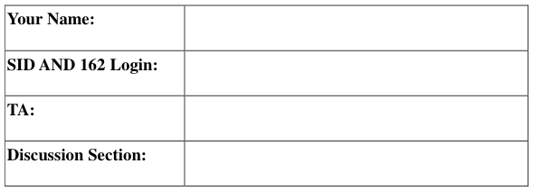
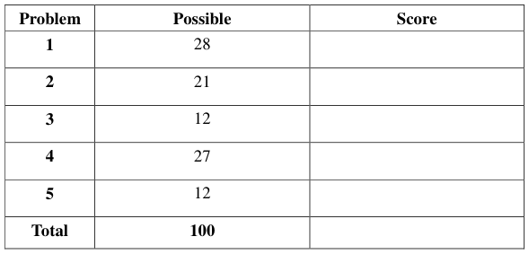
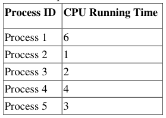
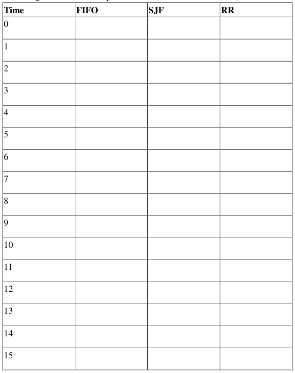
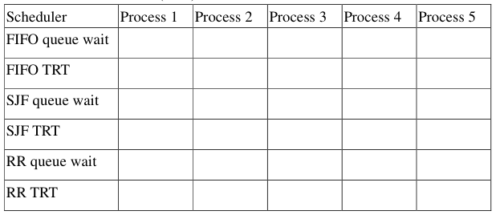

# Berkeley CS162 Spring 2003: Midterm 1: Questions

> Copied from the original: <https://hkn.eecs.berkeley.edu/exams/course/cs/162>. Text and figures are taken from the PDF as is; nothing was answered or rewritten. The original PDF is in this folder.

---

**Page 1**

CS162 Spring 2003 Midterm Exam                                         March 13, 2003

&emsp;&emsp;&emsp;&emsp;&emsp;&emsp;&emsp;&emsp;University of California 
&emsp;&emsp;&emsp;&emsp;&emsp;&emsp;&emsp;&emsp;College of Engineering 
&emsp;&emsp;&emsp;&emsp;&emsp;&emsp;&emsp;&emsp;Computer Science Division- EECS 
Spring 2003 
&emsp;&emsp;&emsp;&emsp;&emsp;&emsp;&emsp;&emsp;Anthony D. Joseph 
&emsp;&emsp;&emsp;&emsp;&emsp;&emsp;&emsp;&emsp;**Midterm Exam** 
&emsp;&emsp;&emsp;&emsp;&emsp;&emsp;&emsp;&emsp;March 13, 2003 
&emsp;&emsp;&emsp;&emsp;&emsp;&emsp;&emsp;&emsp;CS162 Operating Systems

General Information: 
This is a **closed book and notes** examination. You have two hours to answer as many questions as 
possible. The number in parentheses at the beginning of each question indicates the number of points 
given to the question; there are 100 points in all. You should read **all** of the questions before starting the 
exam, as some of the questions are substantially more time consuming.

Write all of your answers directly on this paper. Make your answers as concise as possible. If there is 
something in a question that you believe is open to interpretation, then please ask us about it! 
&emsp;&emsp;&emsp;&emsp;&emsp;&emsp;&emsp;&emsp;**Good Luck!!**

Page 1/10

---

**Page 2**

CS162 Spring 2003 Midterm Exam                                         March 13, 2003

1\. (28 points total) Short answer questions: 
&emsp;a. (9 points) List any THREE major components of most modern operating 
&emsp;&emsp;systems (e.g., Unix, Solaris, WindowsNT, Windows2000, or WindowsXP) 
&emsp;&emsp;and briefly describe their role of each.

&emsp;i)

&emsp;ii)

&emsp;iii)

&emsp;b. (9 points) Give a definition of a counting semaphore, and list and describe 
&emsp;&emsp;the valid operations.

&emsp;c. (4 points) List the conditions for deadlock.

Page 2/10

---

**Page 3**

CS162 Spring 2003 Midterm Exam                                         March 13, 2003

&emsp;d. (6 points) Provide definitions for internal and external fragmentation. Draw a 
&emsp;&emsp;picture show internal fragmentation in a pure paging system (not paged 
&emsp;&emsp;segmentation or segmented paging, but only paging.) Draw a picture showing 
&emsp;&emsp;external fragmentation in a pure segmentation system.

Page 3/10

---

**Page 4**

CS162 Spring 2003 Midterm Exam                                         March 13, 2003

2\. (21 points total)  Processor Scheduling. Here is a table of processes and their 
associated running times. All of the processes arrive in numerical order at time 0.

&emsp;a. (9 points) Show the scheduling order for these processes under 
&emsp;First-In-First-Out (FIFO), Shortest-Job First (SIF), and Round-Robin (RR) 
&emsp;scheduling with a timeslice quantum = 1 time unit.

Page 4/10

---

**Page 5**

CS162 Spring 2003 Midterm Exam                                         March 13, 2003

&emsp;b. (12 points) For each process in each schedule above, indicate the queue wait 
&emsp;time and turnaround time (TRT).

&emsp;&emsp;&emsp;The queue wait time is the total time a thread spends in the wait queue.

3\.    (12 points total) Two-level Virtual Memory. For each of the following two-level 
&emsp;virtual memory addressing schemes, explain, in one or two sentences how the 
&emsp;scheme works. 
&emsp;a.    Virtual address format: 
&emsp;&emsp;&emsp;&emsp;&emsp;&emsp;&emsp;&emsp;Paging Level 1 Paging Level 2 Offset

&emsp;b.    Virtual address format: 
&emsp;&emsp;&emsp;&emsp;&emsp;&emsp;&emsp;&emsp;Paging Level 1 Segment Level 2 Offset

&emsp;c.    Virtual address format: 
&emsp;&emsp;&emsp;&emsp;&emsp;&emsp;&emsp;&emsp;Segment Level 1 Paging Level 2 Offset

&emsp;d.    Virtual address format: 
&emsp;&emsp;&emsp;&emsp;&emsp;&emsp;&emsp;&emsp;Segment Level 1 Segment Level 2 Offset

Page 5/10

---

**Page 6**

CS162 Spring 2003 Midterm Exam                                         March 13, 2003

4\.    (27 points total) Two-Level Page-based virtual Addressing. Consider a 32-bit 
&emsp;machine with a multi-level virtual memory system with 32-bit pointers and 
&emsp;4096-byte pages that supports two-levels of page tables. All Page Table Entries 
&emsp;(PTEs) are 4 bytes.

&emsp;a.    (6 points) Show the complete format of a virtual address.

&emsp;b.    (6 points) Explain the steps the hardware takes in translating a virtual 
&emsp;&emsp;&emsp;address to a physical address for this scheme (do not worry about 
&emsp;&emsp;&emsp;supporting paging to disk).

&emsp;c.    (3 points) How many memory operations are required to read or write a 
&emsp;&emsp;&emsp;single 32-bit word?

Page 6/10

---

**Page 7**

CS162 Spring 2003 Midterm Exam                                         March 13, 2003

&emsp;d.    (4 points) List the fields of a Page Table Entry (PTE).

&emsp;e.    (6 points) How much physical memory is needed for a process with one 
&emsp;&emsp;&emsp;page of virtual memory?

&emsp;f.    (2 points) What happens in the virtual memory subsystem on a context 
&emsp;&emsp;&emsp;switch?

Page 7/10

---

**Page 8**

CS162 Spring 2003 Midterm Exam                                         March 13, 2003

&emsp;&emsp;&emsp;&emsp;&emsp;&emsp;**The Overwhelming Might of the US Military**

The flowing is the transcript of an actual radio conversation that took place in 
October 1995, off the coast pf England. The British Ministry of Defense recently 
released the transcript:

**British:** Calling unknown radar constant at position \*\*\*\*\*, please divert your course 
&emsp;&emsp;&emsp;150 to the south to avoid a collision.

**Americans:** Recommend you divert your course 150 to the north to avoid a collision.

**British:** Negative. Yu will have to divert your course 150 to avoid a collision.

**Americans:** This is the Captain of a US Navy ship. I say again, divert your course 
&emsp;&emsp;&emsp;&emsp;north.

**British:** Negative, I say again. You will have to divert your course.

**Americans:** This is the captain of the aircraft carrier USS Lincoln, the second largest 
&emsp;&emsp;&emsp;&emsp;ship in the United States’ Atlantic Fleet. Wee are accompanied by 
&emsp;&emsp;&emsp;&emsp;numerous support vessels. I demand that you change your course 150 
&emsp;&emsp;&emsp;&emsp;north. That’s 150 north, or countermeasures will be undertaken to ensure 
&emsp;&emsp;&emsp;&emsp;the safety of this ship.

**British:** This is a lighthouse. Your move …

We can only assume that the US ships adjusted their course south.

Page 8/10

---

**Page 9**

CS162 Spring 2003 Midterm Exam                                         March 13, 2003

5\.    (12 points total) Concurrency problem: In parallel programs (one multi-threaded 
&emsp;process), a common design methodology is to perform processing in sequential 
&emsp;stages. All of the threads work independently during each stage, but they must 
&emsp;synchronize at the end of each stage at a synchronization point called a barrier. 
&emsp;If a thread reaches the barrier before all other threads have arrived, ii waits. 
&emsp;When all threads reach the barrier, they are notified and can begin execution on 
&emsp;the next phase of the computation.

&emsp;There are three complications to barriers. First there is no master thread that 
&emsp;controls the threads, waits for each of them to reach the barrier, and then tells 
&emsp;them to re-start. Instead the threads must monitor themselves and determine 
&emsp;when they should wait or proceed. Second, for many dynamics programs, the 
&emsp;number of threads that will be created during the lifetime of the parallel program 
&emsp;is unknown in advance, since a thread can spawn another thread, which will start 
&emsp;in the same program stage as the thread that created it. Third, a thread may end 
&emsp;before the barrier. In all cases, all threads must synchronize at the barrier before 
&emsp;the processing is allowed to proceed to the next phase.

&emsp;a.    (10 points) Provide the pseudo-code for a monitor class called Barrier that 
&emsp;&emsp;&emsp;enables this style of barrier synchronization. Your solution must support 
&emsp;&emsp;&emsp;creation of a new thread (an additional thread that needs to synchronize), 
&emsp;&emsp;&emsp;termination of a thread (one less thread that needs to synchronize), waiting 
&emsp;&emsp;&emsp;when a thread reaches the barrier early, and releasing waiting threads when 
&emsp;&emsp;&emsp;the last thread reaches the barrier. Implement your solution using monitoring 
&emsp;&emsp;&emsp;(e.g., wait( ), signal( ), and signalAll( )).

&emsp;Your class must implement the following three methods: threadCreated(), 
&emsp;threadEnd(), barrierReached(). 
&emsp;Hint: this concept is very similar to Java synchronized objects.

Page 9/10

---

**Page 10**

CS162 Spring 2003 Midterm Exam                                         March 13, 2003

&emsp;b. (2 points) In your barrierReached method, which conditional statement (i.e., 
&emsp;if, or while) did you use and why?

Page 10/10

