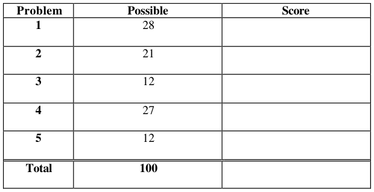
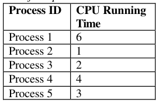
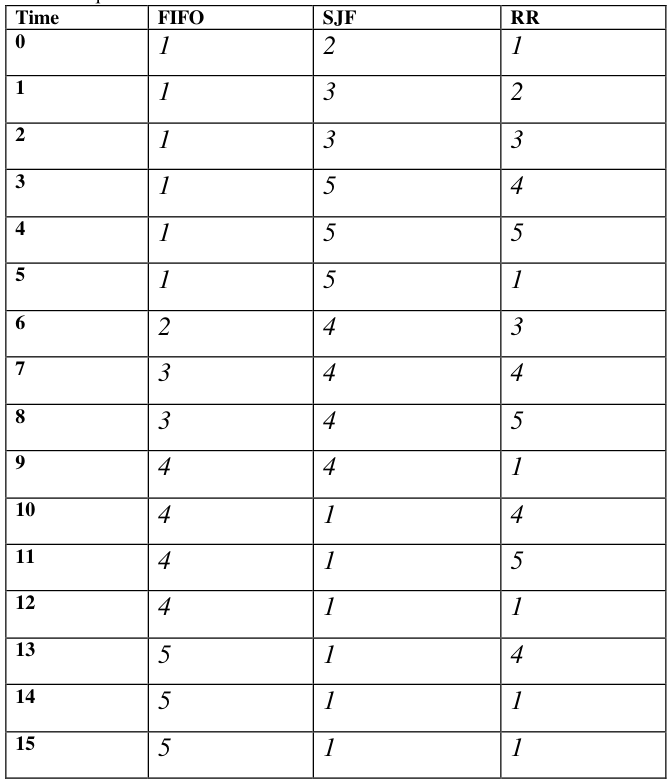
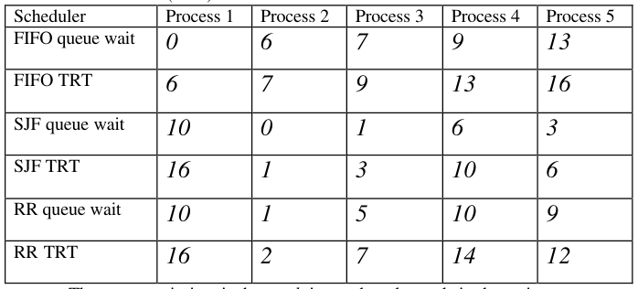
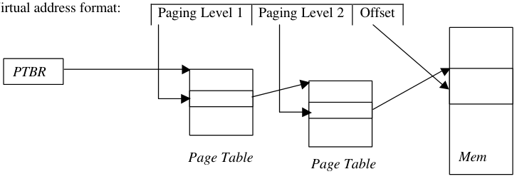
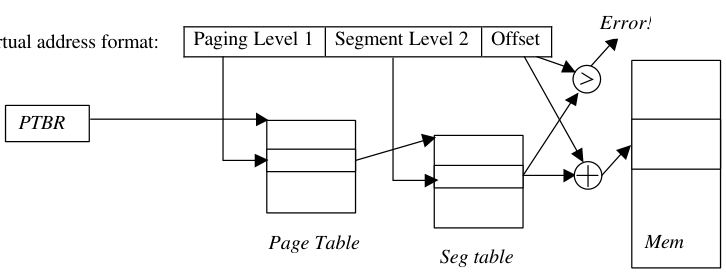
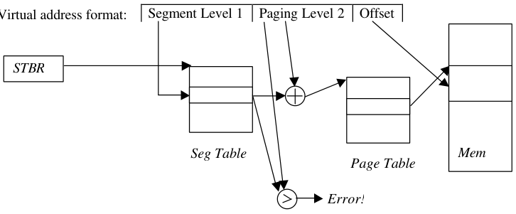
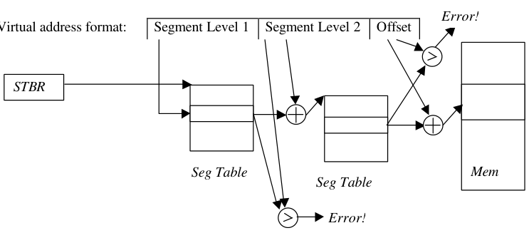

# Berkeley CS162 Spring 2003: Midterm 1: Official solutions

> Copied from the original: <https://hkn.eecs.berkeley.edu/exams/course/cs/162>. Text and figures are taken from the PDF as is; nothing was answered or rewritten. The original PDF is in this folder.

---

**Page 1**

&emsp;&emsp;&emsp;&emsp;&emsp;&emsp;&emsp;&emsp;University of California, Berkeley 
&emsp;&emsp;&emsp;&emsp;&emsp;&emsp;&emsp;&emsp;College of Engineering 
&emsp;&emsp;&emsp;&emsp;&emsp;&emsp;&emsp;&emsp;Computer Science Division – EECS 
Spring 2003                                     Anthony D. Joseph 
&emsp;&emsp;&emsp;&emsp;&emsp;&emsp;&emsp;&emsp;**Midterm Exam Solutions** 
&emsp;&emsp;&emsp;&emsp;&emsp;&emsp;&emsp;&emsp;March 13, 2003 
&emsp;&emsp;&emsp;&emsp;&emsp;&emsp;&emsp;&emsp;CS162 Operating Systems

General Information: 
This is a **closed book and notes** examination. You have two hours to answer as many questions 
as possible.  The number in parentheses at the beginning of each question indicates the number of 
points given to the question; there are 100 points in all. You should read **all** of the questions 
before starting the exam, as some of the questions are substantially more time consuming. 
Write all of your answers directly on this paper. **Make your answers as concise as possible.** If 
there is something in a question that you believe is open to interpretation, then please ask us about 
it! 
&emsp;&emsp;&emsp;&emsp;&emsp;&emsp;&emsp;&emsp;**Good Luck!!**

Page 1/12

---

**Page 2**

CS 162 Spring 2003 Midterm Exam        March 13, 2003 
Solutions

1\. (28 points total) Short answer questions: 
&emsp;a. (9 points) List any THREE major components of most modern operating systems 
&emsp;&emsp;(e.g., Unix , Solaris, WindowsNT, Windows2000, or WindowsXP) and briefly 
&emsp;&emsp;describe their role of each. 
&emsp;&emsp;i) 
&emsp;&emsp;3 points for each, 1 points for name and 2 points for role. Memory management, 
&emsp;&emsp;process management, file management, I/O system management, networking, 
&emsp;&emsp;scheduling, etc. No credit was given for OS functions (e.g., government).

&emsp;&emsp;ii)

&emsp;&emsp;iii)

&emsp;b. (9 points) Give a definition of a counting semaphore, and list and describe the valid 
&emsp;&emsp;operations. 
&emsp;&emsp;&emsp;&emsp;&emsp;3 points for definition, 2 points for each operation. A counting semaphore 
&emsp;&emsp;&emsp;&emsp;&emsp;is a synchronization data structure that can be used to control or limit the 
&emsp;&emsp;&emsp;&emsp;&emsp;number of processes that can access to a critical region. There are three 
&emsp;&emsp;&emsp;&emsp;&emsp;operations that are allowed on a semaphore: 
&emsp;&emsp;&emsp;&emsp;&emsp;1\. Setting the initial value of the semaphore (number of concurrent 
&emsp;&emsp;&emsp;&emsp;&emsp;accesses allowed). 
&emsp;&emsp;&emsp;&emsp;&emsp;2\. P() decrements the semaphore’s counter and either causes the process 
&emsp;&emsp;&emsp;&emsp;&emsp;to wait until the resource is available or allocates the process the 
&emsp;&emsp;&emsp;&emsp;&emsp;resource. 
&emsp;&emsp;&emsp;&emsp;&emsp;3\. V() increments the semaphore’s counter, releasing a waiting process (if 
&emsp;&emsp;&emsp;&emsp;&emsp;any is waiting).

Page 2/12

---

**Page 3**

CS 162 Spring 2003 Midterm Exam        March 13, 2003 
Solutions

&emsp;c. (4 points) List the conditions for deadlock. 
&emsp;&emsp;1 point for each. Limited access, circular chain of requests, no preemption, and 
&emsp;&emsp;multiple independent requests (or “hold and wait”).

&emsp;d. (6 points) Provide definitions for internal and external fragmentation. Draw a 
&emsp;&emsp;picture show internal fragmentation in a pure paging system (not paged 
&emsp;&emsp;segmentation or segmented paging, but only paging). Draw a picture showing 
&emsp;&emsp;external fragmentation in a pure segmentation system. 
&emsp;&emsp;2 points for each definition, 1 point for each picture. Internal fragmentation: 
&emsp;&emsp;space inside allocated memory that is wasted, typically occurs in paging systems. 
&emsp;&emsp;External fragmentation: space outside of allocated memory that is too small to be 
&emsp;&emsp;used for another process, typically occurs in segmented systems.

Page 3/12

---

**Page 4**

CS 162 Spring 2003 Midterm Exam        March 13, 2003 
Solutions 
2\.  (21 points total) Processor Scheduling. Here is a table of processes and their 
&emsp;associated running times. All of the processes arrive in numerical order at time 0.

&emsp;a. (9 points) Show the scheduling order for these processes under First-In-First-Out 
&emsp;&emsp;(FIFO), Shortest-Job First (SJF), and Round-Robin (RR) scheduling with a 
&emsp;&emsp;timeslice quantum = 1 time unit.

Page 4/12

---

**Page 5**

CS 162 Spring 2003 Midterm Exam        March 13, 2003 
Solutions 
&emsp;b. (12 points) For each process in each schedule above, indicate the queue wait time 
&emsp;&emsp;and turnaround time (TRT).

&emsp;&emsp;&emsp;&emsp;&emsp;The queue wait time is the total time a thread spends in the wait queue. 
&emsp;Part a) 3 points per column, part b) 2 points per row. 
3\. (12 points total) Two-level Virtual Memory. For each of the following two-level virtual 
&emsp;memory addressing schemes, explain, in one or two sentences, how the scheme works.

&emsp;&emsp;&emsp;3 points for each. 1 point for basic concept, -1 for minor errors, -1 for answers 
&emsp;&emsp;&emsp;that are too long. For top-level paging schemes, -1 point for no mention of 
&emsp;&emsp;&emsp;Page Table Base Register.

Page 5/12

---

**Page 6**

CS 162 Spring 2003 Midterm Exam        March 13, 2003 
Solutions

Page 6/12

---

**Page 7**

CS 162 Spring 2003 Midterm Exam        March 13, 2003 
Solutions

4\. (27 points total) Two-Level Page-based Virtual Addressing. Consider a 32-bit machine 
&emsp;with a multi-level virtual memory system with 32-bit pointers and 4096-byte pages 
&emsp;that supports two-levels of page tables. All Page Table Entries (PTEs) are 4 bytes. 
&emsp;a. (6 points) Show the complete format of a virtual address. 
&emsp;&emsp;Each address is broken up into three parts: 
&emsp;&emsp;&emsp;&emsp;&emsp;Page Level 1 – 10 bits    Page Level 2 – 10 bits    Offset – 12 bits 
&emsp;&emsp;1 point for each field, 1 point for correct bit length of each field. 
&emsp;&emsp;This is a multi-level scheme using two sets of page tables for **each** process: an 
&emsp;&emsp;“outer” one and an “inner” one. PL 1 is an index into the outer page table, 
&emsp;&emsp;containing PTE’s that contain pointers to the inner page table (which can be 
&emsp;&emsp;paged). In other words, the inner page table is broken up into pages that do not 
&emsp;&emsp;have to be stored contiguously. 
&emsp;&emsp;The PTE at outer \[PL 1\] contains a pointer to the PL 1th page in the inner page 
&emsp;&emsp;table. PL 2 is an index into the PL 1th page in the inner page table. PTE's are 4 
&emsp;&emsp;bytes, so there are 1,024 PTE's per page. Thus, PL 2 must be exactly 10 bits. The 
&emsp;&emsp;index at PL 2 points to the page that holds virtual addresses starting with PL 1 
&emsp;&emsp;PL 2. The particular byte is the dth byte in that page. Since pages are 4K bytes, d 
&emsp;&emsp;must be exactly 12 bits. Since d is 12 bits and PL 2 is 10 bits, PL 1 must be 10 
&emsp;&emsp;bits.

&emsp;b. (6 points) Explain the steps the hardware takes in translating a virtual address to a 
&emsp;&emsp;physical address for this scheme (do not worry about supporting paging to disk).

&emsp;&emsp;See Problem 3a for the picture of the steps that are taken. The PTBR is used to 
&emsp;&emsp;locate the outer page table **in physical memory**. PL 1 is used to index into the 
&emsp;&emsp;outer page table. As above, the PTE at this index points to a page in the inner 
&emsp;&emsp;page table. PL 2 is used to index in this inner page table, and the PTE in the inner 
&emsp;&emsp;page table points to the physical page. Offset is a location on the physical page. If 
&emsp;&emsp;you didn’t mention the PTBR, we subtracted one point. 
&emsp;&emsp;Note that each PTE should have a valid bit and several protection bits – e.g., 
&emsp;&emsp;read, write, execute, valid. The memory operation (load, store, load for execution) 
&emsp;&emsp;must agree with these bits in both sets of PTE's (inner and outer). Otherwise the 
&emsp;&emsp;hardware will generate an interrupt. If you didn’t mention the role of the valid bit 
&emsp;&emsp;or the protection bits, we subtracted one point for each missing role. 
&emsp;&emsp;If you missed a level, we subtracted one point for each level missed. If you 
&emsp;&emsp;included an incorrect step, we subtracted one point.

Page 7/12

---

**Page 8**

CS 162 Spring 2003 Midterm Exam        March 13, 2003 
Solutions

&emsp;c. (3 points) How many memory operations are required to read or write a single 32- 
&emsp;&emsp;bit word? 
&emsp;&emsp;Without extra hardware, performing a memory operation takes 3 actual memory 
&emsp;&emsp;operations: two page table lookups in addition to the desired memory operation. 
&emsp;&emsp;We did not award partial credit for this problem.

&emsp;d. (4 points) List the fields of a Page Table Entry (PTE). 
&emsp;&emsp;Each PTE will have a pointer to the proper page (two points) plus several bits – 
&emsp;&emsp;read, write, execute, (1 point for protection bits), and valid (one point). This 
&emsp;&emsp;information can all fit into 4 bytes, since if physical memory is 232 bytes, then 20 
&emsp;&emsp;bits will be needed to point to the proper page, leaving ample space (12 bits) for 
&emsp;&emsp;the information bits. 
&emsp;&emsp;If you didn't mention the valid and protection bits, then you lost 2 points. If you 
&emsp;&emsp;added incorrect fields, we subtracted one point for each incorrect field.

&emsp;e. (6 points) How much physical memory is needed for a process with one page of 
&emsp;&emsp;virtual memory? 
&emsp;&emsp;Three pages are needed: one for the outer page table, one for one page of the 
&emsp;&emsp;inner page table, and one for the process’ single page. 
&emsp;&emsp;Note that the inner page table does not need 4M (210 \* 4K), because the outer 
&emsp;&emsp;page table enables you to only have inner page table pages for those pages that 
&emsp;&emsp;are part of the process's virtual address space. 
&emsp;&emsp;For partially correct answers, we subtracted three points for the wrong total and 
&emsp;&emsp;one point for each incorrect page level. Answers that stated that only enough 
&emsp;&emsp;memory was needed for a PTE at the outer and inner levels (instead of an entire 
&emsp;&emsp;page), were penalized at least three points.

&emsp;f. (2 points) What happens in the virtual memory subsystem on a context switch? 
&emsp;&emsp;On a context switch, the PTBR of the new process must be loaded. 
&emsp;&emsp;Note that it is not necessary to save the PTBR of the outgoing process as that does 
&emsp;&emsp;not change on a context switch, as it is already stored in the process’ control 
&emsp;&emsp;block. We did not give partial credit for answers that only saved the PTBR.

Page 8/12

---

**Page 9**

CS 162 Spring 2003 Midterm Exam        March 13, 2003 
Solutions 
&emsp;&emsp;No Credit – Problem X: (000000000000 points)

&emsp;&emsp;&emsp;&emsp;&emsp;**The Overwhelming Might of the US Military**

The following is the transcript of an actual radio conversation that took place in October 
1995, off the coast of England. The British Ministry of Defence recently released the 
transcript:

**British:** Calling unknown radar contact at position \*\*\*\*\*, please divert your course 15° 
&emsp;&emsp;&emsp;to the south to avoid a collision. 
**Americans:** Recommend you divert your course 15° to the north to avoid a collision. 
**British:** Negative. You will have to divert your course 15° to the south to avoid a 
&emsp;&emsp;&emsp;collision. 
**Americans:** This is the Captain of a US Navy ship. I say again, divert your course north. 
**British:** Negative, I say again. You will have to divert your course. 
**Americans:** This is the captain of the aircraft carrier USS Lincoln, the second largest 
&emsp;&emsp;&emsp;&emsp;ship in the United States' Atlantic Fleet. We are accompanied by numerous 
&emsp;&emsp;&emsp;&emsp;support vessels. I demand that you change your course 15° north. That's 15° 
&emsp;&emsp;&emsp;&emsp;north, or countermeasures will be undertaken to ensure the safety of this 
&emsp;&emsp;&emsp;&emsp;ship. 
**British:** This is a lighthouse. Your move …

We can only assume that the US ships adjusted their course south.

Page 9/12

---

**Page 10**

CS 162 Spring 2003 Midterm Exam        March 13, 2003 
Solutions

5\. (12 points total) Concurrency problem: In parallel programs (one multi-threaded 
&emsp;process), a common design methodology is to perform processing in sequential 
&emsp;stages. All of the threads work independently during each stage, but they must 
&emsp;synchronize at the end of each stage at a synchronization point called a barrier. If a 
&emsp;thread reaches the barrier before all other threads have arrived, it waits. When all 
&emsp;threads reach the barrier, they are notified and can begin execution on the next phase 
&emsp;of the computation. 
&emsp;There are three complications to barriers. First, there is no master thread that controls 
&emsp;the threads, waits for each of them to reach the barrier, and then tells them to re-start. 
&emsp;Instead, the threads must monitor themselves and determine when they should wait or 
&emsp;proceed. Second, for many dynamic programs, the number of threads that will be 
&emsp;created during the lifetime of the parallel program is unknown in advance, since a 
&emsp;thread can spawn another thread, which will start in the same program stage as the 
&emsp;thread that created it. Third, a thread may end before the barrier. In all cases, all 
&emsp;threads must synchronize at the barrier before the processing is allowed to proceed to 
&emsp;the next phase. 
&emsp;a. (10 points) Provide the pseudo-code for a monitor class called `Barrier` that 
&emsp;&emsp;enables this style of barrier synchronization. Your solution must support creation 
&emsp;&emsp;of a new thread (an additional thread that needs to synchronize), termination of a 
&emsp;&emsp;thread (one less thread that needs to synchronize), waiting when a thread reaches 
&emsp;&emsp;the barrier early, and releasing waiting threads when the last thread reaches the 
&emsp;&emsp;barrier. Implement your solution using monitors (e.g., `wait()`, `signal()`, and 
&emsp;&emsp;`signalAll())`. 
&emsp;&emsp;Your class must implement the following three methods: `threadCreated`(), 
&emsp;&emsp;`threadEnd`(), `barrierReached`(). 
&emsp;&emsp;Hint: this concept is very similar to Java `synchronized` objects.

Page 10/12

---

**Page 11**

CS 162 Spring 2003 Midterm Exam        March 13, 2003 
Solutions 
&emsp;&emsp;&emsp;&emsp;&emsp;Class Barrier () { 
&emsp;&emsp;&emsp;&emsp;&emsp;&emsp;&emsp;ConditionVar barrier; Lock lock = FREE; 
&emsp;&emsp;&emsp;&emsp;&emsp;&emsp;&emsp;Int numThreads = 0; Int numThreadsAtBarrier = 0; 
&emsp;&emsp;&emsp;&emsp;&emsp;&emsp;&emsp;threadCreated() { 
&emsp;&emsp;&emsp;&emsp;&emsp;&emsp;&emsp;&emsp;lock.acquire(); 
&emsp;&emsp;&emsp;&emsp;&emsp;&emsp;&emsp;&emsp;numThreads ++ 
&emsp;&emsp;&emsp;&emsp;&emsp;&emsp;&emsp;&emsp;lock.release(); 
&emsp;&emsp;&emsp;&emsp;&emsp;&emsp;&emsp;} 
&emsp;&emsp;&emsp;&emsp;&emsp;&emsp;&emsp;threadEnd() { 
&emsp;&emsp;&emsp;&emsp;&emsp;&emsp;&emsp;&emsp;lock.acquire(); 
&emsp;&emsp;&emsp;&emsp;&emsp;&emsp;&emsp;&emsp;numThreads--; 
&emsp;&emsp;&emsp;&emsp;&emsp;&emsp;&emsp;&emsp;if (numThreadsAtBarrier == numThreads) { 
&emsp;&emsp;&emsp;&emsp;&emsp;&emsp;&emsp;&emsp;numThreadsAtBarrier = 0; 
&emsp;&emsp;&emsp;&emsp;&emsp;&emsp;&emsp;&emsp;barrier.signalAll(); 
&emsp;&emsp;&emsp;&emsp;&emsp;&emsp;&emsp;&emsp;} 
&emsp;&emsp;&emsp;&emsp;&emsp;&emsp;&emsp;&emsp;lock.release(); 
&emsp;&emsp;&emsp;&emsp;&emsp;&emsp;&emsp;} 
&emsp;&emsp;&emsp;&emsp;&emsp;&emsp;&emsp;barrierReached() { 
&emsp;&emsp;&emsp;&emsp;&emsp;&emsp;&emsp;&emsp;lock.acquire(); 
&emsp;&emsp;&emsp;&emsp;&emsp;&emsp;&emsp;&emsp;numThreadsAtBarrier++; 
&emsp;&emsp;&emsp;&emsp;&emsp;&emsp;&emsp;&emsp;if (numThreadsAtBarrier \< numThreads) { 
&emsp;&emsp;&emsp;&emsp;&emsp;&emsp;&emsp;&emsp;barrier.wait(); 
&emsp;&emsp;&emsp;&emsp;&emsp;&emsp;&emsp;&emsp;} else { 
&emsp;&emsp;&emsp;&emsp;&emsp;&emsp;&emsp;&emsp;numThreadsAtBarrier = 0; 
&emsp;&emsp;&emsp;&emsp;&emsp;&emsp;&emsp;&emsp;barrier.signalAll(); 
&emsp;&emsp;&emsp;&emsp;&emsp;&emsp;&emsp;&emsp;} 
&emsp;&emsp;&emsp;&emsp;&emsp;&emsp;&emsp;&emsp;lock.release(); 
&emsp;&emsp;&emsp;&emsp;&emsp;&emsp;&emsp;} 
&emsp;&emsp;&emsp;&emsp;&emsp;} 
&emsp;&emsp;We subtracted points as follow: 
&emsp;&emsp;&emsp;•    Answers with semaphores received no credit 
&emsp;&emsp;&emsp;•    Answers without locks lost 5 points, incorrect lock use lost 1 point for 
&emsp;&emsp;&emsp;&emsp;&emsp;each error (max –5 points) 
&emsp;&emsp;&emsp;•    If your threadEnd procedure didn’t check the ending thread was the last 
&emsp;&emsp;&emsp;&emsp;&emsp;one not at the barrier, you lost 2 points 
&emsp;&emsp;&emsp;•    If you created a thread in threadCreatED, you lost 1 to 3 points 
&emsp;&emsp;&emsp;•    If threads could slip through your barrierReached, you lost 3 to 5 points 
&emsp;&emsp;&emsp;•    If not all threads were released after the barrier, you lost 4 points 
&emsp;&emsp;&emsp;•    Excessive thread wakeups (e.g., in threadEnd) cost you one point 
&emsp;&emsp;&emsp;•    Answers with indefinite waiting (never finishing the barrier) lost 5 points 
&emsp;&emsp;&emsp;•    Answers with busy waiting lost 5 points

Page 11/12

---

**Page 12**

CS 162 Spring 2003 Midterm Exam        March 13, 2003 
Solutions 
&emsp;b. (2 points) In your `barrierReached` method, which conditional statement (i.e., 
&emsp;&emsp;`if`, or `while`) did you use and why? 
&emsp;&emsp;The correct choice for most solutions was an if statement. Using a while was an 
&emsp;&emsp;extra, unnecessary check for most solutions, thus we gave no credit or partial 
&emsp;&emsp;credit for answers based on using Mesa-style monitors. If you said you needed a 
&emsp;&emsp;while because new threads could be created while all threads were waiting at the 
&emsp;&emsp;barrier, we subtracted one point, as no new threads can be created by the threads 
&emsp;&emsp;(since they’re all waiting at the barrier). 
&emsp;&emsp;However some solutions that checked for all threads at the barrier in threadEnd 
&emsp;&emsp;required a while statement. We gave full credit in such cases. 
&emsp;&emsp;We gave no credit for stating that you used a while with Hoare-style monitors, as 
&emsp;&emsp;such monitors are extremely difficult to implement in practice.

Page 12/12

