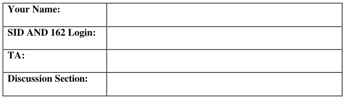
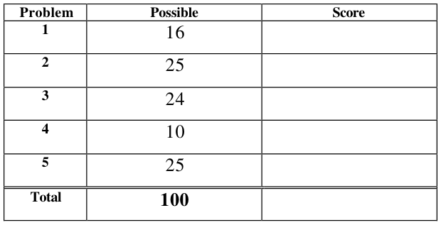
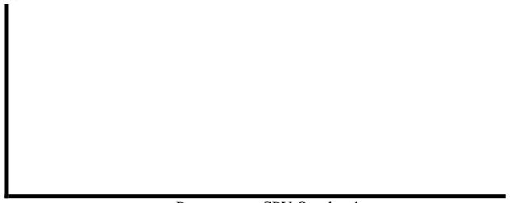

# Berkeley CS162 Spring 2003: Midterm 2: Questions

> Copied from the original: <https://hkn.eecs.berkeley.edu/exams/course/cs/162>. Text and figures are taken from the PDF as is; nothing was answered or rewritten. The original PDF is in this folder.

---

**Page 1**

&emsp;&emsp;&emsp;&emsp;&emsp;&emsp;&emsp;&emsp;University of California, Berkeley 
&emsp;&emsp;&emsp;&emsp;&emsp;&emsp;&emsp;&emsp;College of Engineering 
&emsp;&emsp;&emsp;&emsp;&emsp;&emsp;&emsp;&emsp;Computer Science Division – EECS 
Spring 2003                                     Anthony D. Joseph 
&emsp;&emsp;&emsp;&emsp;&emsp;&emsp;&emsp;&emsp;**Midterm Exam #2** 
&emsp;&emsp;&emsp;&emsp;&emsp;&emsp;&emsp;&emsp;April 29, 2003 
&emsp;&emsp;&emsp;&emsp;&emsp;&emsp;&emsp;&emsp;CS162 Operating Systems

General Information: 
This is a **closed book and notes** examination. You have two hours to answer as many questions 
as possible.  The number in parentheses at the beginning of each question indicates the number of 
points given to the question; there are 100 points in all. You should read **all** of the questions 
before starting the exam, as some of the questions are substantially more time consuming. 
Write all of your answers directly on this paper. **Make your answers as concise as possible.** If 
there is something in a question that you believe is open to interpretation, then please ask us about 
it! 
&emsp;&emsp;&emsp;&emsp;&emsp;&emsp;&emsp;&emsp;**Good Luck!!**

Page 1/10

---

**Page 2**

CS 162 Spring 2003 Midterm Exam #2        April 29, 2003

1\. (16 points total) Short answer questions: 
&emsp;a. (2 points) What UNIX structure is used to keep track of the sectors allocated to a 
&emsp;&emsp;given file?

&emsp;b. (2 points) What is the smallest addressable piece of data on a disk drive?

&emsp;c. (2 points) What is a persistent, named collection of data?

&emsp;d. (2 points) What is a piece of hardware that caches virtual page → physical page 
&emsp;&emsp;mappings?

&emsp;e. (8 points) Consider two processes P and Q that are communicating using 
&emsp;&emsp;mailboxes. From P → Q they use mailbox A, and from Q → P they use mailbox 
&emsp;&emsp;B. Assume both mailboxes are currently empty and the communication link 
&emsp;&emsp;between P and Q is reliable. If P now wants to determine that Q has terminated, 
&emsp;&emsp;what is the sequence of instructions that P should execute? 
&emsp;&emsp;You may only use the following blocking instructions: `send`, `reply`, `re-send`, 
&emsp;&emsp;`receive`, `deleteMailbox`, `createMailbox`, and `setAlarm`. Note that 
&emsp;&emsp;an alarm will interrupt a blocking instruction.

Page 2/10

---

**Page 3**

CS 162 Spring 2003 Midterm Exam #2        April 29, 2003

2\.  (25 points total) Disk Drives and File Systems. 
&emsp;a. (6 points) Itsy Bitsy Machines Corporation develops a new disk drive that has a 
&emsp;&emsp;separate read/write head for each track and thus its disk heads don’t move. Which 
&emsp;&emsp;of the following file-system features are no longer important? 
&emsp;&emsp;State whether the feature is useful or not useful and **in 1 – 2 sentences** explain 
&emsp;&emsp;why or why not. 
&emsp;&emsp;i) Cylinder groups (e.g., Unix 4.2 BSD):

&emsp;&emsp;ii) A bitmap free list (e.g., Unix 4.2 BSD)

&emsp;b. (10 points) List the set of disk blocks that must be read into memory in order to 
&emsp;&emsp;read the file `/home/cs162/test.doc` in its entirety from a UNIX BSD 4.2 
&emsp;&emsp;filesystem. Assume the file is 15,234 bytes long and that disk blocks are 1,024 
&emsp;&emsp;bytes long. Assume that the directories in question all fit into a single disk block 
&emsp;&emsp;each. Note that this is not always true in reality.

Page 3/10

---

**Page 4**

CS 162 Spring 2003 Midterm Exam #2        April 29, 2003

### Problem 2 (cont’d)

&emsp;c.  (9 Points) Suppose a file system can have three disk allocation strategies, 
&emsp;&emsp;contiguous, linked, and indexed. We have just read the information for a file from 
&emsp;&emsp;its parent directory. For contiguous and linked allocation, this gives the address of 
&emsp;&emsp;the first block, and for indexed allocation this gives the address of the index 
&emsp;&emsp;block. Now we want to read the 10th data block into the memory. How many disk 
&emsp;&emsp;blocks (R) do we have to read for each of the allocation strategies? For partial 
&emsp;&emsp;credit, explicitly list which block(s) you have to read. 
&emsp;&emsp;&emsp;&emsp;&emsp;Contiguous allocation: 
&emsp;&emsp;&emsp;&emsp;&emsp;&emsp;&emsp;R =

&emsp;&emsp;&emsp;&emsp;&emsp;Linked allocation: 
&emsp;&emsp;&emsp;&emsp;&emsp;&emsp;&emsp;R =

&emsp;&emsp;&emsp;&emsp;&emsp;Indexed allocation: 
&emsp;&emsp;&emsp;&emsp;&emsp;&emsp;&emsp;R =

Page 4/10

---

**Page 5**

CS 162 Spring 2003 Midterm Exam #2        April 29, 2003

3\.  (24 points total) Adding Links to a File System. 
&emsp;This design question asks you to consider adding links to a file system. **This is a** 
&emsp;**design question; you should not write code.** 
&emsp;The first set of questions is about adding **hard** links to the file system. 
&emsp;a.  (4 points) What changes would you make to the internals (directory, fileheader, 
&emsp;&emsp;free map, etc.) of the filesystem to support hard links?

&emsp;b.  (5 points) How do the semantics of the `Remove` system call change, and how do 
&emsp;&emsp;you implement that change to `Remove` and any other affected system calls?

&emsp;c. (3 points) What new system calls, if any, must be added to the system? Give the C 
&emsp;&emsp;language-style signature of any new calls, e.g., `int Open(char *file)`. 
&emsp;&emsp;List the signature and give a one sentence definition of each argument and return 
&emsp;&emsp;value.

Page 5/10

---

**Page 6**

CS 162 Spring 2003 Midterm Exam #2        April 29, 2003

### Problem 3 (cont’d).

&emsp;This set of questions is about adding **soft** links to the file system. Soft links are also 
&emsp;called symbolic links. 
&emsp;d. (4 points) What changes would you make to the internals (directory, fileheader, 
&emsp;&emsp;free map, etc.) of the filesystem to support soft links?

&emsp;e. (5 points) What existing system calls have to be modified and how to support soft 
&emsp;&emsp;links?

&emsp;f. (3 points) What new system calls, if any, must be added to the system? Give the C 
&emsp;&emsp;language-style signature of any new calls, e.g., `int Open(char *file)`. 
&emsp;&emsp;List the signature and give a one sentence definition of each argument and return 
&emsp;&emsp;value.

Page 6/10

---

**Page 7**

CS 162 Spring 2003 Midterm Exam #2        April 29, 2003

4\.  (10 points total) Interactions between Operating System Components. 
&emsp;Generally we’ve talked about each operating system component in isolation. This 
&emsp;question asks you to think about ways in which they interoperate. For each pair of 
&emsp;systems below, **in four sentences or less**, give a specific way that they interact (or 
&emsp;that they could interact). 
&emsp;Writing that the file system and I/O system interact because they both use the disk is 
&emsp;not worth more than a point, and may be worth none. Writing that the file system and 
&emsp;I/O system interact when they determine the mapping from logical blocks → physical 
&emsp;blocks which impacts the size of file system structures, and the efficiency of the disk 
&emsp;usage because larger logical blocks imply more internal fragmentation on the disk is a 
&emsp;more complete answer. 
&emsp;a. (6 points) How does a demand paged, lazy-loaded virtual memory system and the 
&emsp;&emsp;file system interact?

&emsp;b. (4 points) How do the security system (e.g., file permissions) and the virtual 
&emsp;&emsp;memory system?

Page 7/10

---

**Page 8**

CS 162 Spring 2003 Midterm Exam #2        April 29, 2003

No Credit – Problem X: (000000000000 points)

&emsp;&emsp;&emsp;&emsp;&emsp;&emsp;&emsp;&emsp;**The Story of Modern Math**

&emsp;&emsp;Found on the Internet: 
&emsp;&emsp;Mathematics in 1950: 
&emsp;&emsp;&emsp;&emsp;&emsp;**Question:** A logger sells a truckload of lumber for $100. His cost of 
&emsp;&emsp;&emsp;&emsp;&emsp;production is 4/5 of the price. What is his profit? 
&emsp;&emsp;Mathematics in 1960: 
&emsp;&emsp;&emsp;&emsp;&emsp;**Question:** A logger sells a truckload of lumber for $100. His cost of 
&emsp;&emsp;&emsp;&emsp;&emsp;production is 4/5 of the price, or $80. What is his profit? 
&emsp;&emsp;Mathematics in 1970: 
&emsp;&emsp;&emsp;&emsp;&emsp;**Question:** A logger exchanges a set “L” of lumber for a set “M” of 
&emsp;&emsp;&emsp;&emsp;&emsp;money. The cardinality of set “M” is 100. Each element is worth one 
&emsp;&emsp;&emsp;&emsp;&emsp;dollar. Make 100 dots representing the elements of the set “M.” Set “C,” 
&emsp;&emsp;&emsp;&emsp;&emsp;the cost of production, contains 20 fewer points than set “M.” Represent 
&emsp;&emsp;&emsp;&emsp;&emsp;set “C” as a subset of set “M” and answer the following question: What is 
&emsp;&emsp;&emsp;&emsp;&emsp;the cardinality of the set “P” of profits? 
&emsp;&emsp;Mathematics in 1980: 
&emsp;&emsp;&emsp;&emsp;&emsp;**Question:** A logger sells a truckload of lumber for $100. His cost of 
&emsp;&emsp;&emsp;&emsp;&emsp;production is $80 and his profit is $20. Your assignment: Underline the 
&emsp;&emsp;&emsp;&emsp;&emsp;number 20. 
&emsp;&emsp;Mathematics in 1990: 
&emsp;&emsp;&emsp;&emsp;&emsp;**Question:** By cutting down beautiful forest trees, the logger makes $20. 
&emsp;&emsp;&emsp;&emsp;&emsp;What do you think of this way of making a living? Topic for class 
&emsp;&emsp;&emsp;&emsp;&emsp;participation after answering the question: How did the forest’s birds and 
&emsp;&emsp;&emsp;&emsp;&emsp;squirrels feel as the logger cut down the trees? There are no wrong 
&emsp;&emsp;&emsp;&emsp;&emsp;answers. 
&emsp;&emsp;Mathematics in 2002: 
&emsp;&emsp;&emsp;&emsp;&emsp;**Question:** A logger sells a truckload of lumber for $100. His cost of 
&emsp;&emsp;&emsp;&emsp;&emsp;production is $120. How does Arthur Andersen determine that the 
&emsp;&emsp;&emsp;&emsp;&emsp;logger’s profit margin is $60? 
&emsp;&emsp;&emsp;&emsp;&emsp;**Bonus points:** Explain how an Enron accountant can double this profit by 
&emsp;&emsp;&emsp;&emsp;&emsp;selling the lumber to an out-of-state friend, repurchasing it, and selling it 
&emsp;&emsp;&emsp;&emsp;&emsp;to the State of California.

Page 8/10

---

**Page 9**

CS 162 Spring 2003 Midterm Exam #2        April 29, 2003

5\.  (25 points total) Network Performance. 
&emsp;a. (9 points) Consider a TCP network connection with a current window size for 
&emsp;&emsp;unacknowledged bytes of 1,000 bytes, over a cross-country link with a one-way 
&emsp;&emsp;latency of 50 milliseconds, and a link bandwidth of 100 Mbit/second. You may 
&emsp;&emsp;assume that no packets are lost for this particular problem, and that the size of an 
&emsp;&emsp;acknowledgement is essentially 0 bytes long. 
&emsp;&emsp;How long does it take TCP to transmit 100,000 bytes across the link? That is, how 
&emsp;&emsp;much time elapses from when the first byte is sent by the sender to when the 
&emsp;&emsp;sender knows that the receiver has received the last byte?

&emsp;b. (6 points) Sketch a rough graph (“back of the envelope”) illustrating effective 
&emsp;&emsp;network bandwidth as a function of per-message CPU overhead. Indicate any 
&emsp;&emsp;important relative values. 
Effective BW

&emsp;&emsp;&emsp;&emsp;&emsp;&emsp;&emsp;&emsp;Per-message CPU Overhead

Page 9/10

---

**Page 10**

CS 162 Spring 2003 Midterm Exam #2        April 29, 2003

### Problem 5 (cont’d)

&emsp;c. (6 points) Assume that the receiver can process incoming data at greater than 100 
&emsp;&emsp;Mbit/s, what is the optimal window size that the receiver should advertise?

&emsp;d.  (4 points) If the link is shared by N pairs of senders and receivers, does your 
&emsp;&emsp;answer for part (c) change? If so, how? If not, why?

Page 10/10

