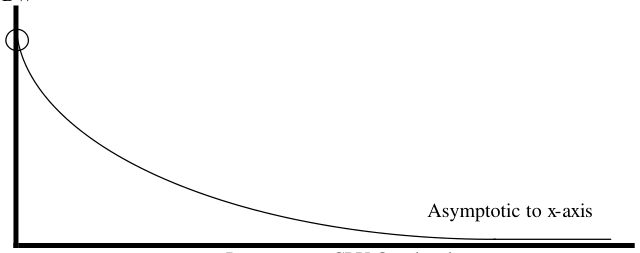
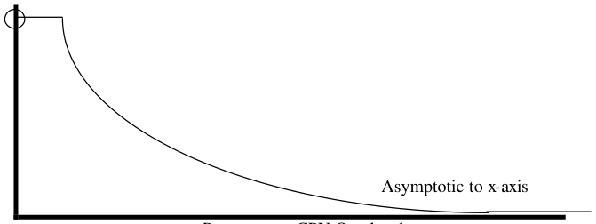

# Berkeley CS162 Spring 2003: Midterm 2: Official solutions

> Copied from the original: <https://hkn.eecs.berkeley.edu/exams/course/cs/162>. Text and figures are taken from the PDF as is; nothing was answered or rewritten. The original PDF is in this folder.

---

**Page 1**

&emsp;&emsp;&emsp;&emsp;&emsp;&emsp;&emsp;&emsp;University of California, Berkeley 
&emsp;&emsp;&emsp;&emsp;&emsp;&emsp;&emsp;&emsp;College of Engineering 
&emsp;&emsp;&emsp;&emsp;&emsp;&emsp;&emsp;&emsp;Computer Science Division – EECS 
Spring 2003                                     Anthony D. Joseph 
&emsp;&emsp;&emsp;&emsp;&emsp;&emsp;&emsp;&emsp;**Midterm Exam #2 Solutions** 
&emsp;&emsp;&emsp;&emsp;&emsp;&emsp;&emsp;&emsp;April 29, 2003 
&emsp;&emsp;&emsp;&emsp;&emsp;&emsp;&emsp;&emsp;CS162 Operating Systems

General Information: 
This is a **closed book and notes** examination. You have two hours to answer as many questions 
as possible.  The number in parentheses at the beginning of each question indicates the number of 
points given to the question; there are 100 points in all. You should read **all** of the questions 
before starting the exam, as some of the questions are substantially more time consuming. 
Write all of your answers directly on this paper. **Make your answers as concise as possible.** If 
there is something in a question that you believe is open to interpretation, then please ask us about 
it! 
&emsp;&emsp;&emsp;&emsp;&emsp;&emsp;&emsp;&emsp;**Good Luck!!**

Page 1/11

---

**Page 2**

CS 162 Spring 2003 Midterm Exam #2        April 29, 2003 
Solutions 
1\. (16 points total) Short answer questions: 
&emsp;a. (2 points) What UNIX structure is used to keep track of the sectors allocated to a 
&emsp;&emsp;given file? 
&emsp;&emsp;&emsp;&emsp;&emsp;i-node, file header, or index block

&emsp;b. (2 points) What is the smallest addressable piece of data on a disk drive? 
&emsp;&emsp;&emsp;&emsp;&emsp;Disk sector or block

&emsp;c. (2 points) What is a persistent, named collection of data? 
&emsp;&emsp;&emsp;&emsp;&emsp;File or directory

&emsp;d. (2 points) What is a piece of hardware that caches virtual page → physical page 
&emsp;&emsp;mappings? 
&emsp;&emsp;&emsp;&emsp;&emsp;Translation lookaside buffer or associative memory

&emsp;e. (8 points) Consider two processes P and Q that are communicating using 
&emsp;&emsp;mailboxes. From P → Q they use mailbox A, and from Q → P they use mailbox 
&emsp;&emsp;B. Assume both mailboxes are currently empty and the communication link 
&emsp;&emsp;between P and Q is reliable. If P now wants to determine that Q has terminated, 
&emsp;&emsp;what is the sequence of instructions that P should execute? 
&emsp;&emsp;You may only use the following blocking instructions: `send`, `reply`, `re-send`, 
&emsp;&emsp;`receive`, `deleteMailbox`, `createMailbox`, and `setAlarm`. Note that 
&emsp;&emsp;an alarm will interrupt a blocking instruction. 
&emsp;&emsp;`P` 
&emsp;&emsp;`send(A, msg);` 
&emsp;&emsp;`setAlarm(timeout);` 
&emsp;&emsp;`receive(B, msg);` 
&emsp;&emsp;`if timeout then Q has terminated` 
&emsp;&emsp;We awarded 2 points for each part of the solution. We took off 2 points if you had 
&emsp;&emsp;an infinite loop or placed the `setAlarm` after the `receive` statement.

Page 2/11

---

**Page 3**

CS 162 Spring 2003 Midterm Exam #2        April 29, 2003 
Solutions

2\.  (25 points total) Disk Drives and File Systems. 
&emsp;a. (6 points) Itsy Bitsy Machines Corporation develops a new disk drive that has a 
&emsp;&emsp;separate read/write head for each track and thus its disk heads don’t move. Which 
&emsp;&emsp;of the following file-system features are no longer important? 
&emsp;&emsp;State whether the feature is useful or not useful and **in 1 – 2 sentences** explain 
&emsp;&emsp;why or why not. 
&emsp;&emsp;i) Cylinder groups (e.g., Unix 4.2 BSD): 
&emsp;&emsp;&emsp;Not useful. The purpose of cylinder groups is to group data together so as to 
&emsp;&emsp;&emsp;reduce disk-head movement – minimize seeks. Since the disk heads don’t 
&emsp;&emsp;&emsp;move, cylinder groups aren’t useful. 
&emsp;&emsp;&emsp;The answer was worth 2 points and the explanation was worth 1 point.

&emsp;&emsp;ii) A bitmap free list (e.g., Unix 4.2 BSD) 
&emsp;&emsp;&emsp;Useful. This structure allows us to allocate space for contiguous regions of a 
&emsp;&emsp;&emsp;file in contiguous disk locations. This type of allocation then makes it possible 
&emsp;&emsp;&emsp;to read and write such regions in a single operation instead of multiple 
&emsp;&emsp;&emsp;operations (with seek and rotation gaps between them). Thus a bitmap free list 
&emsp;&emsp;&emsp;is still useful with our modified disk drive. 
&emsp;&emsp;&emsp;The answer was worth 2 points and the explanation was worth 1 point.

&emsp;b. (10 points) List the set of disk blocks that must be read into memory in order to 
&emsp;&emsp;read the file `/home/cs162/test.doc` in its entirety from a UNIX BSD 4.2 
&emsp;&emsp;filesystem. Assume the file is 15,234 bytes long and that disk blocks are 1,024 
&emsp;&emsp;bytes long. Assume that the directories in question all fit into a single disk block 
&emsp;&emsp;each. Note that this is not always true in reality. 
&emsp;&emsp;1\. Read in file header for root (always at fixed spot on disk). 
&emsp;&emsp;2\. Read in first data block for root (`/`). 
&emsp;&emsp;3\. Read in file header for `home`. 
&emsp;&emsp;4\. Read in first data block for `home`. 
&emsp;&emsp;5\. Read in file header for `cs162`. 
&emsp;&emsp;6\. Read in first data block for `cs162`. 
&emsp;&emsp;7\. Read in file header for `test.doc`. 
&emsp;&emsp;8\. Read in first data block for `test.doc`. 
&emsp;&emsp;9\. – 17. Read in second through 10th data blocks for `test.doc`. 
&emsp;&emsp;18\. Read in indirect block pointed to by the 11th entry in `test.doc`’s file header. 
&emsp;&emsp;19\. – 23. Read in 11th – 15th `test.doc` data blocks. The 15th data block is 
&emsp;&emsp;&emsp;partially full. An incorrect number of blocks cost 1 point, missing all data 
&emsp;&emsp;&emsp;blocks cost 3 points. 
&emsp;&emsp;Missing the read of an individual component cost 1 point, missing directories cost 
&emsp;&emsp;5 points.

Page 3/11

---

**Page 4**

CS 162 Spring 2003 Midterm Exam #2        April 29, 2003 
Solutions

### Problem 2 (cont’d)

&emsp;c.  (9 Points) Suppose a file system can have three disk allocation strategies, 
&emsp;&emsp;contiguous, linked, and indexed. We have just read the information for a file from 
&emsp;&emsp;its parent directory. For contiguous and linked allocation, this gives the address of 
&emsp;&emsp;the first block, and for indexed allocation this gives the address of the index 
&emsp;&emsp;block. Now we want to read the 10th data block into the memory. How many disk 
&emsp;&emsp;blocks (R) do we have to read for each of the allocation strategies? For partial 
&emsp;&emsp;credit, explicitly list which block(s) you have to read. 
&emsp;&emsp;&emsp;&emsp;&emsp;Contiguous allocation: 
&emsp;&emsp;&emsp;&emsp;&emsp;&emsp;&emsp;R = 
&emsp;&emsp;&emsp;&emsp;&emsp;&emsp;&emsp;1 block 
&emsp;&emsp;&emsp;&emsp;&emsp;&emsp;&emsp;We took off one point if you included reading a file header. 
&emsp;&emsp;&emsp;&emsp;&emsp;&emsp;&emsp;For major errors, we deducted two points.

&emsp;&emsp;&emsp;&emsp;&emsp;Linked allocation: 
&emsp;&emsp;&emsp;&emsp;&emsp;&emsp;&emsp;R = 
&emsp;&emsp;&emsp;&emsp;&emsp;&emsp;&emsp;10 blocks 
&emsp;&emsp;&emsp;&emsp;&emsp;&emsp;&emsp;We took off one point if you included reading a file header.

&emsp;&emsp;&emsp;&emsp;&emsp;Indexed allocation: 
&emsp;&emsp;&emsp;&emsp;&emsp;&emsp;&emsp;R = 
&emsp;&emsp;&emsp;&emsp;&emsp;&emsp;&emsp;2 blocks 
&emsp;&emsp;&emsp;&emsp;&emsp;&emsp;&emsp;We took off one point if you did not read the index block. We took 
&emsp;&emsp;&emsp;&emsp;&emsp;&emsp;&emsp;off two points if you assumed the index block was already in 
&emsp;&emsp;&emsp;&emsp;&emsp;&emsp;&emsp;memory.

Page 4/11

---

**Page 5**

CS 162 Spring 2003 Midterm Exam #2        April 29, 2003 
Solutions

3\.  (24 points total) Adding Links to a File System. 
&emsp;This design question asks you to consider adding links to a file system. **This is a** 
&emsp;**design question; you should not write code.** 
&emsp;The first set of questions is about adding **hard** links to the file system. 
&emsp;a.  (4 points) What changes would you make to the internals (directory, fileheader, 
&emsp;&emsp;free map, etc.) of the filesystem to support hard links? 
&emsp;&emsp;You would have to add a link count to the file header. No partial credit.

&emsp;b.  (5 points) How do the semantics of the `Remove` system call change, and how do 
&emsp;&emsp;you implement that change to `Remove` and any other affected system calls? 
&emsp;&emsp;`Remove` must decrement the link count (2 points) and check the on disk link 
&emsp;&emsp;count (3 points). No other system calls are affected and we deducted up to two 
&emsp;&emsp;points if you included other system calls.

&emsp;c. (3 points) What new system calls, if any, must be added to the system? Give the C 
&emsp;&emsp;language-style signature of any new calls, e.g., `int Open(char *file)`. 
&emsp;&emsp;List the signature and give a one sentence definition of each argument and return 
&emsp;&emsp;value. 
&emsp;&emsp;Add a `int Link(char *src, char *dest)` or `int Link(int` 
&emsp;&emsp;`inodeNumber, char *dest)` to create a new link to an existing file.

Page 5/11

---

**Page 6**

CS 162 Spring 2003 Midterm Exam #2        April 29, 2003 
Solutions

### Problem 3 (cont’d).

&emsp;This set of questions is about adding **soft** links to the file system. Soft links are also 
&emsp;called symbolic links. 
&emsp;d. (4 points) What changes would you make to the internals (directory, fileheader, 
&emsp;&emsp;free map, etc.) of the filesystem to support soft links? 
&emsp;&emsp;Add a new type of file to the directory or the file header (2 points), and store the 
&emsp;&emsp;soft link’s pathname in a file (2 points).

&emsp;e. (5 points) What existing system calls have to be modified and how to support soft 
&emsp;&emsp;links? 
&emsp;&emsp;`Open` needs to be changed to implement the recursive lookup implied by soft 
&emsp;&emsp;links (1 point). If the file being opened resolves to a soft link, `Open` must open 
&emsp;&emsp;the file pointed to by the soft link (3 points). The dereferencing operation should 
&emsp;&emsp;count the number of dereference operations to prevent an error from loops (1 
&emsp;&emsp;point). `Remove` must be modified in a minor way to remove soft links correctly. 
&emsp;&emsp;If you removed the target of a link (instead of the link), we deducted 2 points. If 
&emsp;&emsp;you said that system calls use file descriptors instead of names, we deducted 2 
&emsp;&emsp;points.

&emsp;f. (3 points) What new system calls, if any, must be added to the system? Give the C 
&emsp;&emsp;language-style signature of any new calls, e.g., `int Open(char *file)`. 
&emsp;&emsp;List the signature and give a one sentence definition of each argument and return 
&emsp;&emsp;value. 
&emsp;&emsp;Add a `int SymLink(char *src, char *dest)` to create a new 
&emsp;&emsp;symbolic link to an existing file. No partial credit.

Page 6/11

---

**Page 7**

CS 162 Spring 2003 Midterm Exam #2        April 29, 2003 
Solutions

4\.  (10 points total) Interactions between Operating System Components. 
&emsp;Generally we’ve talked about each operating system component in isolation. This 
&emsp;question asks you to think about ways in which they interoperate. For each pair of 
&emsp;systems below, **in four sentences or less**, give a specific way that they interact (or 
&emsp;that they could interact). 
&emsp;Writing that the file system and I/O system interact because they both use the disk is 
&emsp;not worth more than a point, and may be worth none. Writing that the file system and 
&emsp;I/O system interact when they determine the mapping from logical blocks → physical 
&emsp;blocks which impacts the size of file system structures, and the efficiency of the disk 
&emsp;usage because larger logical blocks imply more internal fragmentation on the disk is a 
&emsp;more complete answer. 
&emsp;a. (6 points) How does a demand paged, lazy-loaded virtual memory system and the 
&emsp;&emsp;file system interact? 
&emsp;&emsp;&emsp;The VM system may page executables directly from the file system, which 
&emsp;&emsp;&emsp;requires coordination to make sure that users cannot write to files being used 
&emsp;&emsp;&emsp;as backing store and that deletion of such files is disallowed or handled 
&emsp;&emsp;&emsp;properly. The advantage is that pages swapped from the file system do not 
&emsp;&emsp;&emsp;need to be copied to swap space. 
&emsp;&emsp;&emsp;Swap files can generally be put in the file system, but if so, the VM and file 
&emsp;&emsp;&emsp;systems need to coordinate such use (maybe with a quota system) to prevent 
&emsp;&emsp;&emsp;the swap files from running the file system out of room. Using the file system 
&emsp;&emsp;&emsp;interface simplifies the VM system, but adds per-swap file overhead. 
&emsp;&emsp;&emsp;In a system that allows memory mapped files, the two systems have to interact 
&emsp;&emsp;&emsp;closely to guarantee consistency between the file cache and the VM allocated 
&emsp;&emsp;&emsp;to a memory mapped file. 
&emsp;&emsp;&emsp;We subtracted 2 points for overly long answers. We gave credit for answers 
&emsp;&emsp;&emsp;that provided a higher level analysis of how you might change the block size 
&emsp;&emsp;&emsp;or use a different allocation policy.

&emsp;b. (4 points) How do the security system (e.g., file permissions) and the virtual 
&emsp;&emsp;memory system? 
&emsp;&emsp;This one’s deliberately tricky. If the OS allows memory mapping of files, the 
&emsp;&emsp;memory mapping interface has to respect file system permissions - potentially 
&emsp;&emsp;every time that the file is read or written. This is a potentially very complex 
&emsp;&emsp;interaction. Answers that discussed caching files and the need to keep permission 
&emsp;&emsp;bits correct were worth one point.

Page 7/11

---

**Page 8**

CS 162 Spring 2003 Midterm Exam #2        April 29, 2003 
Solutions 
No Credit – Problem X: (000000000000 points)

&emsp;&emsp;&emsp;&emsp;&emsp;&emsp;&emsp;&emsp;**The Story of Modern Math**

&emsp;&emsp;Found on the Internet: 
&emsp;&emsp;Mathematics in 1950: 
&emsp;&emsp;&emsp;&emsp;&emsp;**Question:** A logger sells a truckload of lumber for $100. His cost of 
&emsp;&emsp;&emsp;&emsp;&emsp;production is 4/5 of the price. What is his profit? 
&emsp;&emsp;Mathematics in 1960: 
&emsp;&emsp;&emsp;&emsp;&emsp;**Question:** A logger sells a truckload of lumber for $100. His cost of 
&emsp;&emsp;&emsp;&emsp;&emsp;production is 4/5 of the price, or $80. What is his profit? 
&emsp;&emsp;Mathematics in 1970: 
&emsp;&emsp;&emsp;&emsp;&emsp;**Question:** A logger exchanges a set “L” of lumber for a set “M” of 
&emsp;&emsp;&emsp;&emsp;&emsp;money. The cardinality of set “M” is 100. Each element is worth one 
&emsp;&emsp;&emsp;&emsp;&emsp;dollar. Make 100 dots representing the elements of the set “M.” Set “C,” 
&emsp;&emsp;&emsp;&emsp;&emsp;the cost of production, contains 20 fewer points than set “M.” Represent 
&emsp;&emsp;&emsp;&emsp;&emsp;set “C” as a subset of set “M” and answer the following question: What is 
&emsp;&emsp;&emsp;&emsp;&emsp;the cardinality of the set “P” of profits? 
&emsp;&emsp;Mathematics in 1980: 
&emsp;&emsp;&emsp;&emsp;&emsp;**Question:** A logger sells a truckload of lumber for $100. His cost of 
&emsp;&emsp;&emsp;&emsp;&emsp;production is $80 and his profit is $20. Your assignment: Underline the 
&emsp;&emsp;&emsp;&emsp;&emsp;number 20. 
&emsp;&emsp;Mathematics in 1990: 
&emsp;&emsp;&emsp;&emsp;&emsp;**Question:** By cutting down beautiful forest trees, the logger makes $20. 
&emsp;&emsp;&emsp;&emsp;&emsp;What do you think of this way of making a living? Topic for class 
&emsp;&emsp;&emsp;&emsp;&emsp;participation after answering the question: How did the forest’s birds and 
&emsp;&emsp;&emsp;&emsp;&emsp;squirrels feel as the logger cut down the trees? There are no wrong 
&emsp;&emsp;&emsp;&emsp;&emsp;answers. 
&emsp;&emsp;Mathematics in 2002: 
&emsp;&emsp;&emsp;&emsp;&emsp;**Question:** A logger sells a truckload of lumber for $100. His cost of 
&emsp;&emsp;&emsp;&emsp;&emsp;production is $120. How does Arthur Andersen determine that the 
&emsp;&emsp;&emsp;&emsp;&emsp;logger’s profit margin is $60? 
&emsp;&emsp;&emsp;&emsp;&emsp;**Bonus points:** Explain how an Enron accountant can double this profit by 
&emsp;&emsp;&emsp;&emsp;&emsp;selling the lumber to an out-of-state friend, repurchasing it, and selling it 
&emsp;&emsp;&emsp;&emsp;&emsp;to the State of California.

Page 8/11

---

**Page 9**

CS 162 Spring 2003 Midterm Exam #2        April 29, 2003 
Solutions

5\.  (25 points total) Network Performance. 
&emsp;a. (9 points) Consider a TCP network connection with a current window size for 
&emsp;&emsp;unacknowledged bytes of 1,000 bytes, over a cross-country link with a one-way 
&emsp;&emsp;latency of 50 milliseconds, and a link bandwidth of 100 Mbit/second. You may 
&emsp;&emsp;assume that no packets are lost for this particular problem, and that the size of an 
&emsp;&emsp;acknowledgement is essentially 0 bytes long. 
&emsp;&emsp;How long does it take TCP to transmit 100,000 bytes across the link? That is, how 
&emsp;&emsp;much time elapses from when the first byte is sent by the sender to when the 
&emsp;&emsp;sender knows that the receiver has received the last byte? 
&emsp;&emsp;A TCP transmission window size of 1000 implies that the sender can send 1000 
&emsp;&emsp;bytes before having to wait for an ACK message from the receiver that will allow 
&emsp;&emsp;it to continue sending again. 
&emsp;&emsp;Then the sequence of messages sent is: 
&emsp;&emsp;1\.  1000 bytes from sender to receiver: requires 50 ms for first byte to get there 
&emsp;&emsp;&emsp;and another 1000/(100 Mbps / 8 bytes/bit) secs for the rest of the 1000 bytes 
&emsp;&emsp;&emsp;to get there after that. 
&emsp;&emsp;2\.  ACK msg from receiver to sender: requires 50 ms to get there. 
&emsp;&emsp;3\.  To send 100,000 bytes will require 100 round trips of this kind. 
&emsp;&emsp;The total time required is: 
&emsp;&emsp;100 \* (2 \* 50 ms + 1000/(100,000,000/8)) = 100 \* (100 ms + 0.08 ms) 
&emsp;&emsp;&emsp;&emsp;&emsp;= 10008 ms 
&emsp;&emsp;&emsp;&emsp;&emsp;= 10.008 seconds 
&emsp;&emsp;We subtracted 2 points for math errors and subtracted 3 points for each missing 
&emsp;&emsp;component of the total time.

Page 9/11

---

**Page 10**

CS 162 Spring 2003 Midterm Exam #2        April 29, 2003 
Solutions

&emsp;b. (6 points) Sketch a rough graph (“back of the envelope”) illustrating effective 
&emsp;&emsp;network bandwidth as a function of per-message CPU overhead. Indicate any 
&emsp;&emsp;important relative values. 
Effective BW

&emsp;Max 
&emsp;Link 
&emsp;BW

&emsp;&emsp;&emsp;&emsp;&emsp;&emsp;&emsp;&emsp;Per-message CPU Overhead

&emsp;&emsp;We subtracted 2 points if you didn’t indicate the maximum link bandwidth. If your 
&emsp;&emsp;curve was close to the correct shape, we subtracted 2 points. If your curve was 
&emsp;&emsp;partially  incorrect (e.g., intersected the x-axis), we subtracted 4 points. 
&emsp;&emsp;Depending on the x-axis timescale, your graph could look like this: 
Effective BW

&emsp;Max 
&emsp;Link 
&emsp;BW

&emsp;&emsp;&emsp;&emsp;&emsp;&emsp;&emsp;&emsp;Per-message CPU Overhead

Page 10/11

---

**Page 11**

CS 162 Spring 2003 Midterm Exam #2        April 29, 2003 
Solutions

### Problem 5 (cont’d)

&emsp;c. (6 points) Assume that the receiver can process incoming data at greater than 100 
&emsp;&emsp;Mbit/s, what is the optimal window size that the receiver should advertise? 
&emsp;&emsp;The optimal window size will keep the “pipe” full during the time it takes for the 
&emsp;&emsp;data to arrive at the receiver and the ACK to arrive back at the sender. Thus, the 
&emsp;&emsp;receiver should advertise the Bandwidth Delay Product: 
&emsp;&emsp;&emsp;&emsp;&emsp;(2 x 50 milliseconds x100 Mbit/s) = 10 Mbits or 1.25 Mbytes. 
&emsp;&emsp;We subtracted 3 points for answers that used only the one way latency, and we 
&emsp;&emsp;subtracted 3 points for extra terms. For minor math errors, we subtracted 2 
&emsp;&emsp;points. Note that saying the window size should be infinite or 100 Mbits is 
&emsp;&emsp;incorrect, as that size would yield a sending rate of 1 Gbit/s (100 Mbits sent in 0.1 
&emsp;&emsp;seconds) leading to packets being dropped by the network or being queued by the 
&emsp;&emsp;sender’s network driver and then dropped when the queue overflow).

&emsp;d.  (4 points) If the link is shared by N pairs of senders and receivers, does your 
&emsp;&emsp;answer for part (c) change? If so, how? If not, why? 
&emsp;&emsp;To fairly share the link, the window size for each pair would be 1/N times the 
&emsp;&emsp;answer from (c). We subtracted 2 points if you said the answer changed but didn’t 
&emsp;&emsp;indicate the amount of change.

Page 11/11

