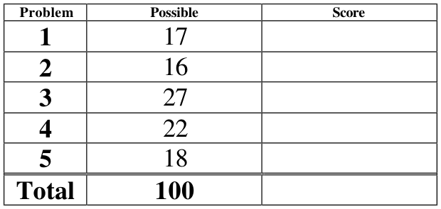
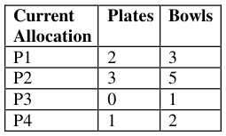
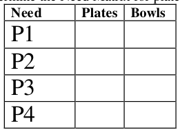
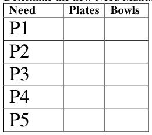

# Berkeley CS162 Spring 2004: Midterm 1: Questions

> Copied from the original: <https://hkn.eecs.berkeley.edu/exams/course/cs/162>. Text and figures are taken from the PDF as is; nothing was answered or rewritten. The original PDF is in this folder.

---

**Page 1**

&emsp;&emsp;&emsp;&emsp;&emsp;&emsp;&emsp;&emsp;University of California, Berkeley 
&emsp;&emsp;&emsp;&emsp;&emsp;&emsp;&emsp;&emsp;College of Engineering 
&emsp;&emsp;&emsp;&emsp;&emsp;&emsp;&emsp;&emsp;Computer Science Division – EECS 
Spring 2004                                     Anthony D. Joseph 
&emsp;&emsp;&emsp;&emsp;&emsp;&emsp;&emsp;&emsp;**Midterm Exam** 
&emsp;&emsp;&emsp;&emsp;&emsp;&emsp;&emsp;&emsp;March 18, 2004 
&emsp;&emsp;&emsp;&emsp;&emsp;&emsp;&emsp;&emsp;CS162 Operating Systems

General Information: 
This is a **closed book and notes** examination. You have 120 minutes to answer as many 
questions as possible.  The number in parentheses at the beginning of each question indicates the 
number of points given to the question; there are 100 points in all. You should read **all** of the 
questions before starting the exam, as some of the questions are substantially more time 
consuming. 
Write all of your answers directly on this paper.  **Make your answers as concise as possible.** If there 
is something in a question that you believe is open to interpretation, then please ask us about it! 
&emsp;&emsp;&emsp;&emsp;&emsp;&emsp;&emsp;&emsp;**Good Luck!!**

Page 1/10

---

**Page 2**

CS 162 Spring 2004 Midterm Exam        March 18, 2004

1\. (17 points total) Short answer questions: 
&emsp;a. (12 points) True/False and Why? 
&emsp;&emsp;i) (4 points) Because of the overhead of context switching, programs that use 
&emsp;&emsp;&emsp;threads will always take longer to execute than programs that do not use 
&emsp;&emsp;&emsp;threads. 
&emsp;&emsp;&emsp;&emsp;&emsp;TRUE                    FALSE 
&emsp;&emsp;&emsp;&emsp;&emsp;Why?

&emsp;&emsp;ii) (4 points) Protection and isolation between applications and between 
&emsp;&emsp;&emsp;applications and the operating system can be provided without hardware 
&emsp;&emsp;&emsp;support. 
&emsp;&emsp;&emsp;&emsp;&emsp;TRUE                    FALSE 
&emsp;&emsp;&emsp;&emsp;&emsp;Why?

&emsp;&emsp;iii) (4 points) After a UNIX fork operation, the parent and new child process are 
&emsp;&emsp;&emsp;identical in all respects. 
&emsp;&emsp;&emsp;&emsp;&emsp;TRUE                    FALSE 
&emsp;&emsp;&emsp;&emsp;&emsp;Why?

&emsp;b. (5 points) Consider a system with a mixture of I/O bound processes and CPU 
&emsp;&emsp;bound processes 
&emsp;&emsp;i) (3 points) Explain how this mixture of processes maximizes system utilization:

&emsp;&emsp;ii) (2 points) Explain why this combination is more important in batch systems 
&emsp;&emsp;&emsp;than it is on most computers sitting around in our department:

Page 2/10

---

**Page 3**

CS 162 Spring 2004 Midterm Exam        March 18, 2004

2\. (16 points total) CPU Scheduling. 
&emsp;a. (6 points) 5 identical jobs are run once on a non-preemptive scheduler, and then 
&emsp;&emsp;again on a preemptive scheduler using a round robin scheduling discipline. The 
&emsp;&emsp;jobs are purely computational - they do almost no I/O. On the non-preemptive 
&emsp;&emsp;scheduler it takes 24 hours for all 5 of them to complete; on the preemptive one it 
&emsp;&emsp;takes 24 hours and 2 minutes for all 5 of them. If the time quantum of the 
&emsp;&emsp;preemptive scheduler is 0.05 sec (50 milliseconds), how long does a context switch 
&emsp;&emsp;take? (Show **all** your work; it’s OK to leave the answer in symbolic / long form).

&emsp;b. (4 points) Name 2 things that need to be saved on a context switch.

&emsp;c. (6 points) Suppose that a scheduling algorithm (at the level of short-term CPU 
&emsp;&emsp;scheduling) favors those processes that have used the least processor time in the 
&emsp;&emsp;recent past. Why will this algorithm favor I/O-bound processes and yet not 
&emsp;&emsp;permanently starve CPU-bound processes?

Page 3/10

---

**Page 4**

CS 162 Spring 2004 Midterm Exam        March 18, 2004

No Credit – **Problem X** (000000000000 points) 
The following is an excerpt from The Washington Post's Style Invitational invitation to 
readers to: take any word from the dictionary, alter it by adding, subtracting, or 
changing one letter, and supply a new definition. 
Here are this year's winners: 
1\. Reintarnation: Coming back to life as a hillbilly. 
2\. Bozone (n.): The substance surrounding stupid people that stops bright ideas from 
penetrating. The bozone layer, unfortunately, shows little sign of breaking down in the 
near future. 
3\. Giraffiti: Vandalism spray-painted very, very high. 
4\. Sarchasm: The gulf between the author of sarcastic wit and the person who doesn’t get 
it. 
5\. Inoculatte: To take coffee intravenously when you are running late. 
6\. Hipatitis: Terminal coolness. 
7\. Osteopornosis: A degenerate disease. (This one got extra credit.) 
8\.  Karmageddon: It's like, when everybody is sending off all these really bad vibes, 
right? And then, like, the Earth explodes and it's like, wow, a serious bummer. 
9\. Decafalon (n.): The grueling event of getting through the day consuming only things 
&emsp;that are good for you. 
10\. Glibido: All talk and no action. 
11\. Dopeler effect: The tendency of stupid ideas to seem smarter when they come at you 
&emsp;rapidly. 
12\. Arachnoleptic fit (n.): The frantic dance performed just after you’ve accidentally 
&emsp;walked through a spider web. 
13\. Beelzebug (n.): Satan in the form of a mosquito that gets into your bedroom at three 
&emsp;in the morning and cannot be cast out. 
And the pick of the literature: 
14\. Caterpallor (n.): The color you turn after finding half a grub in the fruit you’re eating.

Page 4/10

---

**Page 5**

CS 162 Spring 2004 Midterm Exam        March 18, 2004

3\. (27 points total) Concurrency problem: Implementing Semaphores. 
&emsp;You are programming on a multiprocessor system using threads. The system includes 
&emsp;monitors and condition variables, with the following classes and methods: 
&emsp;public class Monitor {     public class ConditionVariable { 
&emsp;&emsp;&emsp;public Monitor() {    public ConditionVariable(Monitor mon) { 
&emsp;&emsp;&emsp;&emsp;&emsp;&emsp;/\* Creates a new monitor \*/    /\* Creates a condition variable 
&emsp;&emsp;&emsp;&emsp;&emsp;&emsp;…    associated with monitor mon \*/ 
&emsp;&emsp;&emsp;}    … 
&emsp;&emsp;&emsp;} 
&emsp;&emsp;&emsp;public void Enter() {    public void Wait() { 
&emsp;&emsp;&emsp;&emsp;&emsp;&emsp;/\* Enters the monitor \*/    /\* Blocks on the condition variable \*/ 
&emsp;&emsp;&emsp;&emsp;&emsp;&emsp;…    … 
&emsp;&emsp;&emsp;}    } 
&emsp;&emsp;&emsp;public void Notify() { 
&emsp;&emsp;&emsp;public void Exit() {    /\* Wakes up one thread waiting on 
&emsp;&emsp;&emsp;&emsp;&emsp;&emsp;/\* Exits the monitor \*/    cv, if there is such a thread \*/ 
&emsp;&emsp;&emsp;&emsp;&emsp;&emsp;…    … 
&emsp;&emsp;&emsp;&emsp;&emsp;&emsp;}    } 
&emsp;}    public void Broadcast() { 
&emsp;/\* Wakes up all threads waiting on cv, 
&emsp;if there are such threads \*/ 
&emsp;… 
&emsp;} 
&emsp;} 
&emsp;Provide an implementation of general semaphores using this system. In other words, 
&emsp;write the file Semaphore.java, implementing the following methods: 
&emsp;&emsp;public class  Semaphore { 
&emsp;&emsp;&emsp;&emsp;&emsp;public Semaphore(int initialValue) { 
&emsp;&emsp;&emsp;&emsp;&emsp;&emsp;&emsp;/\* Create and return a semaphore with initial value: initialValue\*/ 
&emsp;&emsp;&emsp;&emsp;&emsp;&emsp;&emsp;… 
&emsp;&emsp;&emsp;&emsp;&emsp;&emsp;&emsp;} 
&emsp;&emsp;&emsp;&emsp;&emsp;public P() { 
&emsp;&emsp;&emsp;&emsp;&emsp;&emsp;&emsp;/\* Call P() on the semaphore \*/ 
&emsp;&emsp;&emsp;&emsp;&emsp;&emsp;&emsp;… 
&emsp;&emsp;&emsp;&emsp;&emsp;} 
&emsp;&emsp;&emsp;&emsp;&emsp;public V() { 
&emsp;&emsp;&emsp;&emsp;&emsp;&emsp;&emsp;/\* Call V() on the semaphore \*/ 
&emsp;&emsp;&emsp;&emsp;&emsp;&emsp;&emsp;… 
&emsp;&emsp;&emsp;&emsp;&emsp;} 
&emsp;&emsp;} 
&emsp;Write your solution on the following page.

Page 5/10

---

**Page 6**

CS 162 Spring 2004 Midterm Exam        March 18, 2004

3\. (continued) Concurrency problem: Implementing Semaphores. 
&emsp;**Write your solution here:** 
&emsp;&emsp;public class Semaphore {

Page 6/10

---

**Page 7**

CS 162 Spring 2004 Midterm Exam        March 18, 2004

4\. (22 points) Deadlock: 
A restaurant would like to serve four dinner parties, P1 through P4. The restaurant has 
a total of 8 plates and 12 bowls. Assume that each group of diners will stop eating and 
wait for the waiter to bring a requested item (plate or bowl) to the table when it is 
required. Assume that the diners don't mind waiting. The maximum request and 
current allocation tables are shown as follows:

&emsp;&emsp;a. (4 points) Determine the Need Matrix for plates and bowls.

&emsp;&emsp;b. (7 points) Will the restaurant be able to feed all four parties successfully? 
&emsp;&emsp;&emsp;Clearly explain your answer – specifically, why no or why/how there is a safe 
&emsp;&emsp;&emsp;serving order.

Page 7/10

---

**Page 8**

CS 162 Spring 2004 Midterm Exam        March 18, 2004

4\. (continued) Deadlock 
&emsp;&emsp;c. (11 points) Assume a new dinner party, P5, comes to the restaurant at this 
&emsp;&emsp;&emsp;time. Their maximum needs are 5 plates and 3 bowls. Initially, the waiter 
&emsp;&emsp;&emsp;brings 2 plates to them. In order to be able to feed all five parties successfully, 
&emsp;&emsp;&emsp;the restaurant needs more plates. 
&emsp;&emsp;&emsp;&emsp;i.    (2 points) Determine the new Need Matrix for plates and bowls.

&emsp;&emsp;&emsp;ii.    (6 points) At least how many plates would the restaurant need to add?

&emsp;&emsp;&emsp;iii.    (3 points) Show a safe serving sequence.

Page 8/10

---

**Page 9**

CS 162 Spring 2004 Midterm Exam        March 18, 2004

5\. (18 points) Paging: 
&emsp;Suppose you have a system with 32-bit pointers and 4 megabytes of physical memory 
&emsp;that is partitioned into 8192-byte pages. The system uses an Inverted Page Table 
&emsp;(IPT). Assume that there is no page sharing between processes. 
&emsp;a.  (8 points) Describe what page table entries should look like. Specifically, how 
&emsp;&emsp;many bits should be in each page table entry, and what are they for? Also, how 
&emsp;&emsp;many page table entries should there be in the page table?

&emsp;b. (5 points) Describe how an IPT is used to translate a virtual address into a 
&emsp;&emsp;physical address.

&emsp;c. (3 points) How can you make an IPT more efficient? Explain your solution and 
&emsp;&emsp;how it works in detail.

&emsp;d. (2 points) What effect, if any, does your solution in part (c) have on what happens 
&emsp;&emsp;on a context switch?

Page 9/10

---

**Page 10**

CS 162 Spring 2004 Midterm Exam        March 18, 2004

This page intentionally left blank as scratch space. 
&emsp;&emsp;&emsp;&emsp;&emsp;&emsp;&emsp;**Do not write answers on this page**

&emsp;&emsp;&emsp;&emsp;&emsp;&emsp;&emsp;**Do not write answers on this page**

Page 10/10

