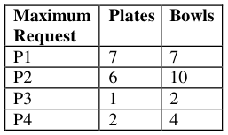
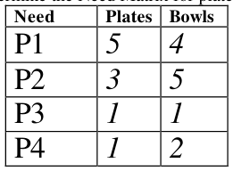
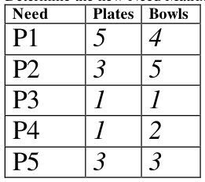
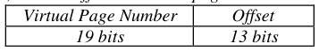

# Berkeley CS162 Spring 2004: Midterm 1: Official solutions

> Copied from the original: <https://hkn.eecs.berkeley.edu/exams/course/cs/162>. Text and figures are taken from the PDF as is; nothing was answered or rewritten. The original PDF is in this folder.

---

**Page 1**

&emsp;&emsp;&emsp;&emsp;&emsp;&emsp;&emsp;&emsp;University of California, Berkeley 
&emsp;&emsp;&emsp;&emsp;&emsp;&emsp;&emsp;&emsp;College of Engineering 
&emsp;&emsp;&emsp;&emsp;&emsp;&emsp;&emsp;&emsp;Computer Science Division – EECS 
Spring 2004                                     Anthony D. Joseph 
&emsp;&emsp;&emsp;&emsp;&emsp;&emsp;&emsp;&emsp;**Midterm Exam Solutions** 
&emsp;&emsp;&emsp;&emsp;&emsp;&emsp;&emsp;&emsp;March 18, 2004 
&emsp;&emsp;&emsp;&emsp;&emsp;&emsp;&emsp;&emsp;CS162 Operating Systems

General Information: 
This is a **closed book and notes** examination. You have 120 minutes to answer as many 
questions as possible.  The number in parentheses at the beginning of each question indicates the 
number of points given to the question; there are 100 points in all. You should read **all** of the 
questions before starting the exam, as some of the questions are substantially more time 
consuming. 
Write all of your answers directly on this paper.  **Make your answers as concise as possible.** If there 
is something in a question that you believe is open to interpretation, then please ask us about it! 
&emsp;&emsp;&emsp;&emsp;&emsp;&emsp;&emsp;&emsp;**Good Luck!!**

Page 1/13

---

**Page 2**

CS 162 Spring 2004 Midterm Exam        March 18, 2004 
Solutions

1\. (17 points total) Short answer questions: 
&emsp;a. (12 points) True/False and Why? 
&emsp;&emsp;i) (4 points) Because of the overhead of context switching, programs that use 
&emsp;&emsp;&emsp;threads will always take longer to execute than programs that do not use 
&emsp;&emsp;&emsp;threads. 
&emsp;&emsp;&emsp;&emsp;&emsp;TRUE                    FALSE 
&emsp;&emsp;&emsp;&emsp;&emsp;Why? 
&emsp;&emsp;&emsp;&emsp;&emsp;**FALSE**. Threading allows I/O to be overlapped with computation which 
&emsp;&emsp;&emsp;&emsp;&emsp;can provide substantial performance improvements. 
&emsp;&emsp;&emsp;&emsp;&emsp;4 points for each. 2 points for partial answers.

&emsp;&emsp;ii) (4 points) Protection and isolation between applications and between 
&emsp;&emsp;&emsp;applications and the operating system can be provided without hardware 
&emsp;&emsp;&emsp;support. 
&emsp;&emsp;&emsp;&emsp;&emsp;TRUE                    FALSE 
&emsp;&emsp;&emsp;&emsp;&emsp;Why? 
&emsp;&emsp;&emsp;&emsp;&emsp;**TRUE**. Using strong typing or software fault isolation can provide the 
&emsp;&emsp;&emsp;&emsp;&emsp;same protection and isolation capabilities as hardware.

&emsp;&emsp;iii) (4 points) After a UNIX fork operation, the parent and new child process are 
&emsp;&emsp;&emsp;identical in all respects. 
&emsp;&emsp;&emsp;&emsp;&emsp;TRUE                    FALSE 
&emsp;&emsp;&emsp;&emsp;&emsp;Why? 
&emsp;&emsp;&emsp;&emsp;&emsp;**FALSE**. One register is different between the parent and child, and is 
&emsp;&emsp;&emsp;&emsp;&emsp;used to determine which process is the parent and which is the child..

&emsp;b. (5 points) Consider a system with a mixture of I/O bound processes and CPU 
&emsp;&emsp;bound processes 
&emsp;&emsp;i) (3 points) Explain how this mixture of processes maximizes system utilization: 
&emsp;&emsp;&emsp;We want to keep all parts of the system busy by overlapping I/O operations 
&emsp;&emsp;&emsp;with CPU operations. Overall, if we have some processes using the CPU 
&emsp;&emsp;&emsp;while others are waiting on I/O, then the system will be more utilized.

Page 2/13

---

**Page 3**

CS 162 Spring 2004 Midterm Exam        March 18, 2004 
Solutions

&emsp;&emsp;ii) (2 points) Explain why this combination is more important in batch systems 
&emsp;&emsp;&emsp;than it is on most computers sitting around in our department: 
&emsp;&emsp;&emsp;In general, our systems are underutilized (there are a lot of wasted cycles both 
&emsp;&emsp;&emsp;on I/O devices as well as CPU), and user interaction is more important. Batch 
&emsp;&emsp;&emsp;systems were expensive systems that were busy all the time.

2\. (16 points total) CPU Scheduling. 
&emsp;a. (6 points) 5 identical jobs are run once on a non-preemptive scheduler, and then 
&emsp;&emsp;again on a preemptive scheduler using a round robin scheduling discipline. The 
&emsp;&emsp;jobs are purely computational - they do almost no I/O. On the non-preemptive 
&emsp;&emsp;scheduler it takes 24 hours for all 5 of them to complete; on the preemptive one it 
&emsp;&emsp;takes 24 hours and 2 minutes for all 5 of them. If the time quantum of the 
&emsp;&emsp;preemptive scheduler is 0.05 sec (50 milliseconds), how long does a context switch 
&emsp;&emsp;take? (Show **all** your work; it’s OK to leave the answer in symbolic / long form). 
&emsp;&emsp;The non-preemptive time is 5y + 4x = 24 \* 60 \* 60, or y = (-4/5 x + 24 \* 60 \* 12) 
&emsp;&emsp;The preemptive time is (y/0.05 \* 5 – 1) \* x + 5y = (24 \* 60 + 2) \* 60 
&emsp;&emsp;Over the 24 hour period there are 24 hrs \* 60 min/hr \* 60 sec/min \* 20 
&emsp;&emsp;switches/sec = 1728000 context switches. These take 120 seconds. Each context 
&emsp;&emsp;switch takes 120 / 1728000 sec = 1/14400 sec = 69.4 microseconds 
&emsp;&emsp;We took off four points if you left out the 20 switches/sec. We deducted six points if 
&emsp;&emsp;you mixed up the 24 hours with 2 minutes, deducted two points for subtracting 5 
&emsp;&emsp;from something incorrect, and took off two points for the inverse answer. 
&emsp;&emsp;We subtracted two points if you had 0.05 and 20 in the wrong places. 
&emsp;&emsp;If you skipped the context switches, we subtracted 5 points

&emsp;b. (4 points) Name 2 things that need to be saved on a context switch. 
&emsp;&emsp;CPU registers, Program Counter, Stack Pointer, Page Table Base Register, 
&emsp;&emsp;Segment Table 
&emsp;&emsp;We subtracted one point for saving the ppn or vpn, one point for saving the page 
&emsp;&emsp;table, one point for saving the stack space, 2 points for saving the address space, 
&emsp;&emsp;and two points for saving thread states

Page 3/13

---

**Page 4**

CS 162 Spring 2004 Midterm Exam        March 18, 2004 
Solutions

&emsp;c. (6 points) Suppose that a scheduling algorithm (at the level of short-term CPU 
&emsp;&emsp;scheduling) favors those processes that have used the least processor time in the 
&emsp;&emsp;recent past. Why will this algorithm favor I/O-bound processes and yet not 
&emsp;&emsp;permanently starve CPU-bound processes? 
&emsp;&emsp;We awarded three points for saying that I/O bound processes generally sit idle for 
&emsp;&emsp;relatively long periods of time. When they finally get their I/O, they will not have 
&emsp;&emsp;run for a long time and will therefore be favored in scheduling relative to 
&emsp;&emsp;processes which have just been running. We awarded an additional three points 
&emsp;&emsp;for saying that if CPU-bound processes get blocked long enough by I/O-bound 
&emsp;&emsp;processes, they too will eventually not have run for a long time and they will be 
&emsp;&emsp;scheduled. Also, if there aren't too many I/O-bound processes, the CPU-bound 
&emsp;&emsp;ones will get to run when the I/O-bound ones are blocked. 
&emsp;&emsp;We subtracted two points for not explicitly stating that I/O uses less CPU, 
&emsp;&emsp;subtracted two points for saying that the CPU-bound processes won’t run until the 
&emsp;&emsp;end, and subtracted two points for saying that round robin scheduling was the 
&emsp;&emsp;reason. 
&emsp;&emsp;We deducted three points for saying that you have to wait until all I/O-bound 
&emsp;&emsp;processes finish, subtracted three points for saying that the CPU-bound processes 
&emsp;&emsp;run because of interrupts, subtracted three points for saying that **at first** CPU- 
&emsp;&emsp;bound process get to run. 
&emsp;&emsp;We took off two points for saying that the minimum priority process gets CPU 
&emsp;&emsp;time.

Page 4/13

---

**Page 5**

CS 162 Spring 2004 Midterm Exam        March 18, 2004 
Solutions 
No Credit – **Problem X** (000000000000 points) 
The following is an excerpt from The Washington Post's Style Invitational invitation to 
readers to: take any word from the dictionary, alter it by adding, subtracting, or 
changing one letter, and supply a new definition. 
Here are this year's winners: 
1\. Reintarnation: Coming back to life as a hillbilly. 
2\. Bozone (n.): The substance surrounding stupid people that stops bright ideas from 
penetrating. The bozone layer, unfortunately, shows little sign of breaking down in the 
near future. 
3\. Giraffiti: Vandalism spray-painted very, very high. 
4\. Sarchasm: The gulf between the author of sarcastic wit and the person who doesn’t get 
it. 
5\. Inoculatte: To take coffee intravenously when you are running late. 
6\. Hipatitis: Terminal coolness. 
7\. Osteopornosis: A degenerate disease. (This one got extra credit.) 
8\.  Karmageddon: It's like, when everybody is sending off all these really bad vibes, 
right? And then, like, the Earth explodes and it's like, wow, a serious bummer. 
9\. Decafalon (n.): The grueling event of getting through the day consuming only things 
&emsp;that are good for you. 
10\. Glibido: All talk and no action. 
11\. Dopeler effect: The tendency of stupid ideas to seem smarter when they come at you 
&emsp;rapidly. 
12\. Arachnoleptic fit (n.): The frantic dance performed just after you’ve accidentally 
&emsp;walked through a spider web. 
13\. Beelzebug (n.): Satan in the form of a mosquito that gets into your bedroom at three 
&emsp;in the morning and cannot be cast out. 
And the pick of the literature: 
14\. Caterpallor (n.): The color you turn after finding half a grub in the fruit you’re eating.

Page 5/13

---

**Page 6**

CS 162 Spring 2004 Midterm Exam        March 18, 2004 
Solutions 
3\. (27 points total) Concurrency problem: Implementing Semaphores. 
&emsp;You are programming on a multiprocessor system using threads. The system includes 
&emsp;monitors and condition variables, with the following classes and methods: 
&emsp;public class Monitor {     public class ConditionVariable { 
&emsp;&emsp;&emsp;public Monitor() {    public ConditionVariable(Monitor mon) { 
&emsp;&emsp;&emsp;&emsp;&emsp;&emsp;/\* Creates a new monitor \*/    /\* Creates a condition variable 
&emsp;&emsp;&emsp;&emsp;&emsp;&emsp;…    associated with monitor mon \*/ 
&emsp;&emsp;&emsp;}    … 
&emsp;&emsp;&emsp;} 
&emsp;&emsp;&emsp;public void Enter() {    public void Wait() { 
&emsp;&emsp;&emsp;&emsp;&emsp;&emsp;/\* Enters the monitor \*/    /\* Blocks on the condition variable \*/ 
&emsp;&emsp;&emsp;&emsp;&emsp;&emsp;…    … 
&emsp;&emsp;&emsp;}    } 
&emsp;&emsp;&emsp;public void Notify() { 
&emsp;&emsp;&emsp;public void Exit() {    /\* Wakes up one thread waiting on 
&emsp;&emsp;&emsp;&emsp;&emsp;&emsp;/\* Exits the monitor \*/    cv, if there is such a thread \*/ 
&emsp;&emsp;&emsp;&emsp;&emsp;&emsp;…    … 
&emsp;&emsp;&emsp;&emsp;&emsp;&emsp;}    } 
&emsp;}    public void Broadcast() { 
&emsp;/\* Wakes up all threads waiting on cv, 
&emsp;if there are such threads \*/ 
&emsp;… 
&emsp;} 
&emsp;} 
&emsp;Provide an implementation of general semaphores using this system. In other words, 
&emsp;write the file Semaphore.java, implementing the following methods: 
&emsp;&emsp;public class  Semaphore { 
&emsp;&emsp;&emsp;&emsp;&emsp;public Semaphore(int initialValue) { 
&emsp;&emsp;&emsp;&emsp;&emsp;&emsp;&emsp;/\* Create and return a semaphore with initial value: initialValue\*/ 
&emsp;&emsp;&emsp;&emsp;&emsp;&emsp;&emsp;… 
&emsp;&emsp;&emsp;&emsp;&emsp;&emsp;&emsp;} 
&emsp;&emsp;&emsp;&emsp;&emsp;public P() { 
&emsp;&emsp;&emsp;&emsp;&emsp;&emsp;&emsp;/\* Call P() on the semaphore \*/ 
&emsp;&emsp;&emsp;&emsp;&emsp;&emsp;&emsp;… 
&emsp;&emsp;&emsp;&emsp;&emsp;} 
&emsp;&emsp;&emsp;&emsp;&emsp;public V() { 
&emsp;&emsp;&emsp;&emsp;&emsp;&emsp;&emsp;/\* Call V() on the semaphore \*/ 
&emsp;&emsp;&emsp;&emsp;&emsp;&emsp;&emsp;… 
&emsp;&emsp;&emsp;&emsp;&emsp;} 
&emsp;&emsp;} 
&emsp;Write your solution on the following page.

Page 6/13

---

**Page 7**

CS 162 Spring 2004 Midterm Exam        March 18, 2004 
Solutions 
3\. (continued) Concurrency problem: Implementing Semaphores. 
&emsp;**Write your solution here:** 
&emsp;&emsp;public class Semaphore { 
&emsp;&emsp;Semaphores can be implemented with a monitor and a condition variable. The 
&emsp;&emsp;monitor protects access to the semaphore's value, and the condition variable lets 
&emsp;&emsp;you block/wakeup threads. Note too the \< 0 in Semaphore.P() and =0 in 
&emsp;&emsp;Semaphore.V(). You can argue that the conditional in Semaphore.V() is 
&emsp;&emsp;unnecessary, for if the value is greater than zero, there will be no threads waiting 
&emsp;&emsp;on the conditional variable. 
&emsp;&emsp;public class  Semaphore { 
&emsp;&emsp;&emsp;&emsp;&emsp;private Monitor mon = null; 
&emsp;&emsp;&emsp;&emsp;&emsp;private ConditionVariable  cv = null; 
&emsp;&emsp;&emsp;&emsp;&emsp;int value; 
&emsp;&emsp;&emsp;&emsp;&emsp;public Semaphore(int initialValue) throws InvalidInitValue{ 
&emsp;&emsp;&emsp;&emsp;&emsp;&emsp;&emsp;/\* Create and return a semaphore with initial value: initialValue\*/ 
&emsp;&emsp;&emsp;&emsp;&emsp;&emsp;&emsp;if (initialValue \< 0) throw InvalidInitValue; 
&emsp;&emsp;&emsp;&emsp;&emsp;&emsp;&emsp;mon = new Monitor(); 
&emsp;&emsp;&emsp;&emsp;&emsp;&emsp;&emsp;cv = new ConditionVariable(); 
&emsp;&emsp;&emsp;&emsp;&emsp;&emsp;&emsp;value = initialValue; 
&emsp;&emsp;&emsp;&emsp;&emsp;} 
&emsp;&emsp;&emsp;&emsp;&emsp;public P() { 
&emsp;&emsp;&emsp;&emsp;&emsp;&emsp;&emsp;/\* Call P() on the semaphore \*/ 
&emsp;&emsp;&emsp;&emsp;&emsp;&emsp;&emsp;mon.Enter(); 
&emsp;&emsp;&emsp;&emsp;&emsp;&emsp;&emsp;value--; 
&emsp;&emsp;&emsp;&emsp;&emsp;&emsp;&emsp;if (value \< 0) cv.Wait(); 
&emsp;&emsp;&emsp;&emsp;&emsp;&emsp;&emsp;/\* OR “while (value \<= 0) cv.Wait();   value--;” \*/ 
&emsp;&emsp;&emsp;&emsp;&emsp;&emsp;&emsp;mon.Exit(); 
&emsp;&emsp;&emsp;&emsp;&emsp;} 
&emsp;&emsp;&emsp;&emsp;&emsp;public V() { 
&emsp;&emsp;&emsp;&emsp;&emsp;&emsp;&emsp;/\* Call V() on the semaphore \*/ 
&emsp;&emsp;&emsp;&emsp;&emsp;&emsp;&emsp;mon.Enter(); 
&emsp;&emsp;&emsp;&emsp;&emsp;&emsp;&emsp;value++; 
&emsp;&emsp;&emsp;&emsp;&emsp;&emsp;&emsp;cv.Notify();  /\* You could optionally include “if (value \<= 0)” \*/ 
&emsp;&emsp;&emsp;&emsp;&emsp;&emsp;&emsp;mon.exit(); 
&emsp;&emsp;&emsp;&emsp;&emsp;} 
&emsp;} 
&emsp;• We gave you one point for each correct class variable, but subtracted one point 
&emsp;&emsp;for each extraneous class variable Each of the three procedures in the class was 
&emsp;&emsp;worth 8 points, subject to deductions for errors. 
&emsp;• If you omitted monitors entirely, you received 0 points, or if you used interrupts or 
&emsp;&emsp;locks in a procedure, you received 0 points for the procedure (up to 16 points 
&emsp;&emsp;subtracted).

Page 7/13

---

**Page 8**

CS 162 Spring 2004 Midterm Exam        March 18, 2004 
Solutions 
&emsp;• We deducted three points if you did not sanity check the semaphore’s initial value, 
&emsp;&emsp;deducted 6 points if you limited the initial value of the semaphore to a strict 
&emsp;&emsp;subset of ? , and deducted 8 points(from V)  if you placed a max value on the 
&emsp;&emsp;semaphore. 
&emsp;• We deducted 16 points (8 each for P and V)  if you used two monitors (one for 
&emsp;&emsp;condition variables and one for synchronization/mutual exclusion). 
&emsp;• If you accessed the queues of the condition variables, we deducted 12 points (6 
&emsp;&emsp;each for P and V). If you accessed the private variables or methods of the monitor 
&emsp;&emsp;or condition variables, we deducted 2 points for each occurrence. If you violated 
&emsp;&emsp;the semantics of condition variables or monitors, we deducted 4 points for each 
&emsp;&emsp;violation. 
&emsp;• If you had an extra counter and incremented or decremented it out of order, we 
&emsp;&emsp;subtracted 2 points for each error. We deducted four points for not decrementing 
&emsp;&emsp;when value is 0. 
&emsp;• We deducted 1 point for each unnecessary check, 2 points for each extra or 
&emsp;&emsp;missing synchronization construct, 8 points for each non-atomic P() or V(). 
&emsp;• If you used a while instead of an if in P(), we deducted three points. But, if the 
&emsp;&emsp;check is **before** the decrement and value is 0, then you must do a while **before** the 
&emsp;&emsp;else (otherwise, we deducted 3 points). 
&emsp;• If you waited in V(), we deducted 8 points). If you decremented after calling wait() 
&emsp;&emsp;in P() (and it's protected by value \< 0), we deducted 6 points. If you mixed up 
&emsp;&emsp;your \< and \<=’s, we deducted 4 points. 
&emsp;• If you used a broadcast without using a while(), we deducted 6 points, or if you 
&emsp;&emsp;used a broadcast with a while(), we deducted 3 points. We deducted 3 points for 
&emsp;&emsp;each unnecessary notify. If you inadvertently forgot a monitor enter or exit, we 
&emsp;&emsp;deducted 3 points. If you consistently forgot to include monitor enter and exits, we 
&emsp;&emsp;deducted four points. 
&emsp;• If you made minor Java mistakes, we deducted 3 points, for major Java mistakes, 
&emsp;&emsp;we deducted six points. 
&emsp;• If your answer didn't really make any sense, but you had the class set up right, we 
&emsp;&emsp;only gave you points for the class variables.

Page 8/13

---

**Page 9**

CS 162 Spring 2004 Midterm Exam        March 18, 2004 
Solutions

4\. (22 points) Deadlock: 
A restaurant would like to serve four dinner parties, P1 through P4. The restaurant has 
a total of 8 plates and 12 bowls. Assume that each group of diners will stop eating and 
wait for the waiter to bring a requested item (plate or bowl) to the table when it is 
required. Assume that the diners don't mind waiting. The maximum request and 
current allocation tables are shown as follows:

&emsp;&emsp;a. (4 points) Determine the Need Matrix for plates and bowls.

&emsp;&emsp;b. (7 points) Will the restaurant be able to feed all four parties successfully? 
&emsp;&emsp;&emsp;Clearly explain your answer – specifically, why no or why/how there is a safe 
&emsp;&emsp;&emsp;serving order. 
&emsp;&emsp;&emsp;The vector of available resources is A = (2, 1). 
&emsp;&emsp;&emsp;First, serve P3, and A will be (2, 2). 
&emsp;&emsp;&emsp;Then, serve P4, and A will be (3, 4). 
&emsp;&emsp;&emsp;There are not enough resources available to serve P1 or P2. Therefore, the 
&emsp;&emsp;&emsp;original resource allocation state is **unsafe**. The restaurant cannot feed all 
&emsp;&emsp;&emsp;four parties successfully. 
&emsp;&emsp;&emsp;If you did not say that the allocation is unsafe, we deducted one point. 
&emsp;&emsp;&emsp;If you said “yes” or safe, we deducted 4 points. 
&emsp;&emsp;&emsp;If you said that there was deadlock or starvation, we deducted 3 points 
&emsp;&emsp;&emsp;(saying you can’t finish ever, cost2 points). 
&emsp;&emsp;&emsp;If your solution did not include the Banker’s Algorithm or you were not 
&emsp;&emsp;&emsp;specific in your explanation, we deducted 2 points

Page 9/13

---

**Page 10**

CS 162 Spring 2004 Midterm Exam        March 18, 2004 
Solutions 
4\. (continued) Deadlock 
&emsp;&emsp;c. (11 points) Assume a new dinner party, P5, comes to the restaurant at this 
&emsp;&emsp;&emsp;time. Their maximum needs are 5 plates and 3 bowls. Initially, the waiter 
&emsp;&emsp;&emsp;brings 2 plates to them. In order to be able to feed all five parties successfully, 
&emsp;&emsp;&emsp;the restaurant needs more plates. 
&emsp;&emsp;&emsp;&emsp;i.    (2 points) Determine the new Need Matrix for plates and bowls.

&emsp;&emsp;&emsp;ii.    (6 points) At least how many plates would the restaurant need to add? 
&emsp;&emsp;&emsp;&emsp;&emsp;&emsp;&emsp;If add 1 plate, there are 9 plates and 12 bowls totally. 
&emsp;&emsp;&emsp;&emsp;&emsp;&emsp;&emsp;Initially, A = (1, 1). 
&emsp;&emsp;&emsp;&emsp;&emsp;&emsp;&emsp;Serve P3, A = (1, 2). 
&emsp;&emsp;&emsp;&emsp;&emsp;&emsp;&emsp;Serve P4, A = (2, 4). 
&emsp;&emsp;&emsp;&emsp;&emsp;&emsp;&emsp;So there are not enough resources for serving the 5 parties. 
&emsp;&emsp;&emsp;&emsp;&emsp;&emsp;&emsp;If add 2 plates, there are 10 plates and 12 bowls totally. 
&emsp;&emsp;&emsp;&emsp;&emsp;&emsp;&emsp;Initially, A = (2, 1). 
&emsp;&emsp;&emsp;&emsp;&emsp;&emsp;&emsp;Serve P3, A = (2, 2). 
&emsp;&emsp;&emsp;&emsp;&emsp;&emsp;&emsp;Serve P4, A = (3, 4). 
&emsp;&emsp;&emsp;&emsp;&emsp;&emsp;&emsp;Serve P5, A = (5, 4). 
&emsp;&emsp;&emsp;&emsp;&emsp;&emsp;&emsp;Serve P1, A = (7, 7). 
&emsp;&emsp;&emsp;&emsp;&emsp;&emsp;&emsp;Serve P2, A = (10, 12). 
&emsp;&emsp;&emsp;&emsp;&emsp;&emsp;&emsp;Therefore, at least 2 plates are needed. 
&emsp;&emsp;&emsp;&emsp;&emsp;&emsp;&emsp;We treated parts (ii) and (iii) as a combined 9 points. 
&emsp;&emsp;&emsp;&emsp;&emsp;&emsp;&emsp;If you had an incorrect number of plates, but the correct ordering, 
&emsp;&emsp;&emsp;&emsp;&emsp;&emsp;&emsp;we deducted 5 points. 
&emsp;&emsp;&emsp;&emsp;&emsp;&emsp;&emsp;If you had an incorrect number of bowls, but the correct number of 
&emsp;&emsp;&emsp;&emsp;&emsp;&emsp;&emsp;plates, and an incorrect ordering, we deducted 4 points. 
&emsp;&emsp;&emsp;&emsp;&emsp;&emsp;&emsp;If your had the correct number of plates, but an incorrect ordering, 
&emsp;&emsp;&emsp;&emsp;&emsp;&emsp;&emsp;we deducted 6 points.

&emsp;&emsp;&emsp;iii.    (3 points) Show a safe serving sequence. 
&emsp;&emsp;&emsp;&emsp;A safe serving sequence is P3-P4-P5-P1-P2.

Page 10/13

---

**Page 11**

CS 162 Spring 2004 Midterm Exam        March 18, 2004 
Solutions 
5\. (18 points) Paging: 
&emsp;Suppose you have a system with 32-bit pointers and 4 megabytes of physical memory 
&emsp;that is partitioned into 8192-byte pages. The system uses an Inverted Page Table 
&emsp;(IPT). Assume that there is no page sharing between processes. 
&emsp;a.  (8 points) Describe what page table entries should look like. Specifically, how 
&emsp;&emsp;many bits should be in each page table entry, and what are they for? Also, how 
&emsp;&emsp;many page table entries should there be in the page table? 
&emsp;&emsp;Virtual addresses are 32 bits, and split into two parts. The page number is the 
&emsp;&emsp;first 19 bits, and the offset within the page is the last 13 bits (213 = 8,192).

&emsp;&emsp;The inverted page table is a mapping of physical addresses to virtual addresses. 
&emsp;&emsp;Memory is 4 megabytes, partitioned into 512 pages. Therefore the inverted page 
&emsp;&emsp;table will consist of 512 entries. Each of these entries must have: 
&emsp;&emsp;&emsp;&emsp;&emsp;19 bits for the virtual page number of the physical page. 
&emsp;&emsp;&emsp;&emsp;&emsp;Some number of bits (16 in Unix) for the processs ID of the process that 
&emsp;&emsp;&emsp;&emsp;&emsp;owns the page. 
&emsp;&emsp;&emsp;&emsp;&emsp;Protection bits (r/w/x) 
&emsp;&emsp;&emsp;&emsp;&emsp;We awarded two points each for: the correct number of IPT entries, 
&emsp;&emsp;&emsp;&emsp;&emsp;storing the virtual page number in the IPT, storing the process ID in the 
&emsp;&emsp;&emsp;&emsp;&emsp;IPT, and storing the protection bits(any reasonable set was accepted) in 
&emsp;&emsp;&emsp;&emsp;&emsp;the IPT. 
&emsp;&emsp;&emsp;&emsp;&emsp;We subtracted one point for each extraneous item that you stored in the 
&emsp;&emsp;&emsp;&emsp;&emsp;IPT, and subtracted one point for storing the physical page number 
&emsp;&emsp;&emsp;&emsp;&emsp;instead of the virtual page number in the IPT.

&emsp;b. (5 points) Describe how an IPT is used to translate a virtual address into a 
&emsp;&emsp;physical address. 
&emsp;&emsp;A virtual address is translated to a physical address hashing virtual addresses 
&emsp;&emsp;(worth two points). Thus, in the normal case, the translation may be found in a 
&emsp;&emsp;few memory lookups rather than an entire table traversal. If it is found, and the 
&emsp;&emsp;owning process is equal to the current running process (owning PID check is 
&emsp;&emsp;worth 2 points), then its index in the table is the frame number of the physical 
&emsp;&emsp;page. If it is not found, then a memory fault must occur (not found fault is worth 1 
&emsp;&emsp;point). 
&emsp;&emsp;We also accepted a general search of the IPT, as described in the book and 
&emsp;&emsp;midterm review session.

Page 11/13

---

**Page 12**

CS 162 Spring 2004 Midterm Exam        March 18, 2004 
Solutions 
&emsp;c. (3 points) How can you make an IPT more efficient? Explain your solution and 
&emsp;&emsp;how it works in detail. 
&emsp;&emsp;Add a Translation Lookaside Buffer (TLB), an associative memory that can 
&emsp;&emsp;perform fast lookup on virtual addresses and provide the translation in much less 
&emsp;&emsp;time than it takes to perform a memory access. TLB's are effective, especially 
&emsp;&emsp;when combined with caches, because programs tend to have locality in accessing 
&emsp;&emsp;pages. The use of a TLB was worth one point, the explanation was worth two 
&emsp;&emsp;points. 
&emsp;&emsp;Alternatively, if you used the book solution for part (b), we accepted a hash-based 
&emsp;&emsp;enhancement for this part.

&emsp;d. (2 points) What effect, if any, does your solution in part (c) have on what happens 
&emsp;&emsp;on a context switch? 
&emsp;&emsp;On a context switch, the TLB must be flushed. That's it. 
&emsp;&emsp;Alternatively, if you used the book solution for part (b) and a hash enhancement 
&emsp;for part (c), then we accepted the answer “nothing” for this part.

Page 12/13

---

**Page 13**

CS 162 Spring 2004 Midterm Exam        March 18, 2004 
Solutions

This page intentionally left blank as scratch space. 
&emsp;&emsp;&emsp;&emsp;&emsp;&emsp;&emsp;**Do not write answers on this page**

&emsp;&emsp;&emsp;&emsp;&emsp;&emsp;&emsp;**Do not write answers on this page**

Page 13/13

