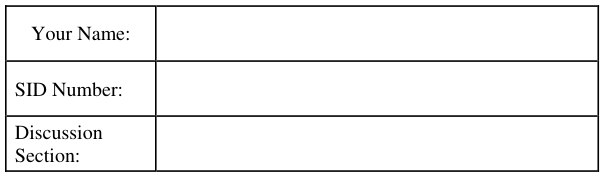
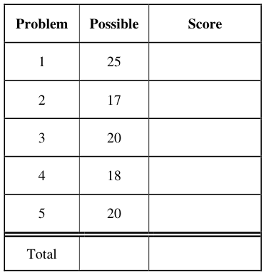
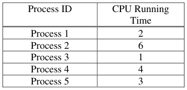
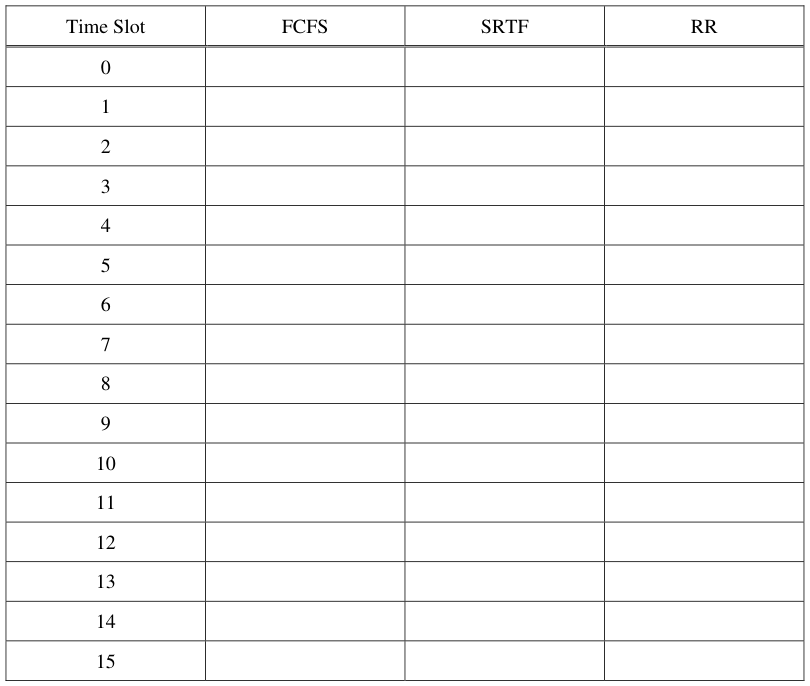
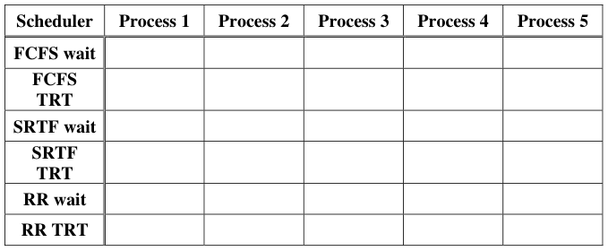
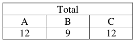
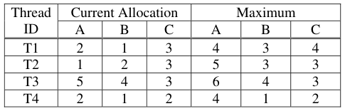

# Berkeley CS162 Fall 2005: Midterm 1: Questions

> Copied from the original: <https://hkn.eecs.berkeley.edu/exams/course/cs/162>. Text and figures are taken from the PDF as is; nothing was answered or rewritten. The original PDF is in this folder.

---

**Page 1**

&emsp;&emsp;&emsp;&emsp;&emsp;&emsp;&emsp;&emsp;University of California, Berkeley 
&emsp;&emsp;&emsp;&emsp;&emsp;&emsp;&emsp;&emsp;College of Engineering 
&emsp;&emsp;&emsp;&emsp;&emsp;&emsp;&emsp;&emsp;Computer Science Division ⎯ EECS 
&emsp;Fall 2005                John Kubiatowicz 
&emsp;&emsp;&emsp;&emsp;&emsp;&emsp;&emsp;&emsp;Midterm I 
&emsp;&emsp;&emsp;&emsp;&emsp;&emsp;&emsp;&emsp;October 12th, 2005 
&emsp;&emsp;&emsp;&emsp;&emsp;&emsp;&emsp;CS162: Operating Systems and Systems Programming

General Information: 
This is a **closed book** exam.  You are allowed 1 page of **hand-written** notes (both sides).  You 
have 3 hours to complete as much of the exam as possible. Make sure to read all of the questions 
first, as some of the questions are substantially more time consuming. 
Write all of your answers directly on this paper.  Make your answers as concise as possible. On 
programming questions, we will be looking for performance as well as correctness, so think through 
your answers carefully.  If there is something about the questions that you believe is open to 
interpretation, please ask us about it!

&emsp;Page 1/20

---

**Page 2**

CS 162 Fall 2005 Midterm Exam I        October 12, 2005

&emsp;&emsp;&emsp;&emsp;&emsp;&emsp;&emsp;&emsp;\[ This page left for π \]

&emsp;&emsp;&emsp;&emsp;3.141592653589793238462643383279502884197169399375105820974944

Page 2/20

---

**Page 3**

CS 162 Fall 2005 Midterm Exam I        October 12, 2005

### Problem 1: Short Answer

### **Problem 1a\[2pts\]:**  Suppose a thread is running in a critical section of code, meaning that it has

acquired all the locks through proper arbitration.  Can it get context switched? Why or why not?

### **Problem 1b\[3pts\]:** What are some of the hardware differences between kernel mode and user

mode?  Name at least three.

### **Problem 1c\[3pts\]:** Name three ways in which the processor can transition from user mode to

kernel mode.  Can the user execute arbitrary code after transitioning?

### **Problem 1d\[3pts\]:** What is a thread?  What is a process?  Describe how to create each of these.

Page 3/20

---

**Page 4**

CS 162 Fall 2005 Midterm Exam I        October 12, 2005

### **Problem 1e\[3pts\]:**  Suppose that we have a two-level page translation scheme with 4K-byte pages

and 4-byte page table entries (includes a valid bit, a couple permission bits, and a pointer to another 
page/table entry).  What is the format of a 32-bit virtual address?  Sketch out the format of a 
complete page table.

### **Problem 1f\[2pts\]:** What needs to be saved and restored on a context switch between two threads in

the same process?  What if the two threads are in different processes?  Be explicit.

### **Problem 1g\[1pt\]:** What is a thread-join operation?

Page 4/20

---

**Page 5**

CS 162 Fall 2005 Midterm Exam I        October 12, 2005

### **Problem 1h\[3pts\]:** Name at least three ways in which context-switching can happen in a non-

preemptive scheduler.

### **Problem 1i\[3pts\]:** Name three ways in which processes on the same processor can communicate

with one another. If any of the techniques you name require hardware support, explain.

### **Problem 1j\[2pts\]:** What is an interrupt?  What happens when an interrupt occurs?  What is the

function of an interrupt controller?

Page 5/20

---

**Page 6**

CS 162 Fall 2005 Midterm Exam I        October 12, 2005

&emsp;&emsp;&emsp;&emsp;&emsp;&emsp;&emsp;&emsp;\[ This page intentionally left blank \]

Page 6/20

---

**Page 7**

CS 162 Fall 2005 Midterm Exam I        October 12, 2005

### Problem 2: Monitors

### **Problem 2a\[2pts\]:** What is a monitor?

### **Problem 2b\[5pts\]:** Provide Java class definitions for each of the components of a monitor.  Include

specifications for local data and methods (names and arguments, not implementation); method 
names should adhere to the interface defined in class.  Make sure to document each method by 
saying what it should do.  Be brief!  Hint: you should have two different object classes.

### **Problem 2c\[2pts\]:** What is the difference between Mesa and Hoare scheduling for monitors?

Page 7/20

---

**Page 8**

CS 162 Fall 2005 Midterm Exam I        October 12, 2005

### **Problem 2d\[8pts\]:**  In parallel programs (one multi-threaded process), a common design

methodology is to perform processing in sequential stages. All of the threads work independently 
during each stage, but they must synchronize at the end of each stage at a synchronization point 
called a barrier. If a thread reaches the barrier before all other threads have arrived, it waits.  When 
all threads reach the barrier, they are notified and can begin execution on the next phase of the 
computation. 
Example: 
While (true) { 
Compute stuff; 
BARRIER(); 
Read other threads results; 
} 
There are three complications to barriers.  First, there is no master thread that controls the threads, 
waits for each of them to reach the barrier, and then tells them to restart. Instead, the threads must 
monitor themselves and determine when they should wait or proceed. Second, for many dynamic 
programs, the number of threads that will be created during the lifetime of the parallel program is 
unknown in advance, since a thread can spawn another thread, which will start in the same program 
stage as the thread that created it.  Third, a thread may end before the barrier.  In all cases, all 
threads must wait at the barrier for all other threads before anyone is allowed to proceed. 
Provide the pseudo-code for a monitor class called **Barrier** that enables this style of barrier 
synchronization.  Your solution must support creation of a new thread (an additional thread that 
needs to synchronize), termination of a thread (one less thread that needs to synchronize), waiting 
when a thread reaches the barrier early, and releasing waiting threads when the last thread reaches 
the barrier.  Implement your solution using monitors. You should never busy-wait; threads waiting 
at a barrier should be sleeping. 
Your    class    must    implement    the    following    three    methods:    `threadCreated(),` 
`threadEnd(), and enterBarrier()`.  Think carefully about efficiency and avoid 
unnecessary looping.  Feel free to utilize space on the next page.

Page 8/20

---

**Page 9**

CS 162 Fall 2005 Midterm Exam I        October 12, 2005

&emsp;&emsp;&emsp;&emsp;&emsp;&emsp;&emsp;&emsp;\[ This page intentionally left blank \]

Page 9/20

---

**Page 10**

CS 162 Fall 2005 Midterm Exam I        October 12, 2005

### Problem 3: Lock-Free Queue

An object such as a queue is considered “lock-free” if multiple processes can operate on this object 
simultaneously without requiring the use of locks, busy-waiting, or sleeping. In this problem, we 
are going to construct a lock-free FIFO queue using an atomic “swap” operation. This queue needs 
both an `Enqueue` and `Dequeue` method. 
We are going to do this in a slightly different way than normally.  Rather than `Head` and `Tail` 
pointers, we are going to have “`PrevHead`” and `Tail` pointers.  `PrevHead` will point at the last 
object returned from the queue.  Thus, we can find the head of the queue (for dequing). Here are the 
basic class definitions (assuming that only one thread accesses the queue at a time):

`// Holding cell for an entry` 
`class QueueEntry {` 
`QueueEntry next = null;` 
`Object stored;` 
`int taken = 0;`

`QueueEntry(Object newobject) {` 
`stored = newobject;` 
`}` 
`}` 
`// The actual Queue (not yet lock free!)` 
`class Queue {` 
`QueueEntry prevHead = new QueueEntry(null);` 
`QueueEntry tail = prevHead;`

`void Enqueue(Object newobject)  {` 
`newEntry = new QueueEntry(newobject);` 
`tail.next = newEntry;` 
`tail = newEntry;` 
`}`

`Object Dequeue() {` 
`QueueEntry nextEntry = prevHead.next;` 
`While ((nextEntry != null) && nextEntry.taken == 1) {` 
`nextEntry = nextEntry.next;` 
`}` 
`if (nextEntry == null) {` 
`return null;` 
`} else {` 
`nextEntry.taken = 1;` 
`prevHead = nextEntry;` 
`return nextEntry.stored;` 
`}` 
`}` 
`}`

Page 10/20

---

**Page 11**

CS 162 Fall 2005 Midterm Exam I        October 12, 2005

### **Problem 3a\[10pts\]:**

Suppose that we have an atomic swap instruction.  This instruction takes a local variable (register) 
and a memory location and swaps the contents.  Although Java doesn’t contain pointers, we might 
describe this as follows: 
O`bject AtomicSwap(variable addr, Object newValue) {` 
`object result = *addr``;`   `// get old object stored in addr` 
`*addr` `=` `newValue``;`        `// store new object into addr` 
`return result;`         `// Return old contents of addr` 
`}` 
With this primitive, we might build a test-and-set lock as follows: 
`int mylock = 0;`

`// grab lock` 
`while (AtomicSwap(mylock,1) == 1);` 
`// got lock` 
Rewrite code for `Enqueue()`, using the `AtomicSwap()` operation, such that it will work for any number 
of  simultaneous Enqueue and Dequeue operations.  You should never need to busy wait.  **Do not use** 
**locking (i.e. don’t use a test-and-set lock).** The solution is tricky but can be done in a few lines. We will be 
grading on conciseness. Hint: during simultaneous insertions, objects may be temporarily disconnected from 
the queue (i.e. the set of entries reachable by `nextEntry = nextEntry.next`  starting from 
`prevEntry`); but eventually the queue needs to be connected.

Page 11/20

---

**Page 12**

CS 162 Fall 2005 Midterm Exam I        October 12, 2005

### **Problem 3b\[10pts\]:**

Rewrite code for Dequeue() such that it will work for any number of simultaneous threads working 
at once.  **Again, do not use locking.** You should never need to busy wait. The solution is tricky but 
can be done by modifying a small number of lines. We will be grading on conciseness.  Hint: 
before grabbing a queue entry, make sure that you “take” it atomically. You are striving for 
correctness. If you can explain why it is ok, you can allow prevHead to get temporarily out of date, 
but try to avoid letting prevHead get too far behind the actual head of the list.

Page 12/20

---

**Page 13**

CS 162 Fall 2005 Midterm Exam I        October 12, 2005

### Problem 4: Scheduling

### **Problem 4a\[2pts\]:**

Six jobs are waiting to be run. Their expected running times are 10, 8, 6, 3, 1, and X. In what order 
should they be run to minimize average completion time? State the scheduling algorithm that 
should be used AND the order in which the jobs should be run. (Your answer will depend on X).

### **Problem 4b\[4pts\]:**

Name and describe 4 different scheduling algorithms. What are the advantages and disadvantages 
of each?

Page 13/20

---

**Page 14**

CS 162 Fall 2005 Midterm Exam I        October 12, 2005

### **Problem 4c\[3pts\]:**

Here is a table of processes and their associated running times. All of the processes arrive in 
numerical order at time 0.

Show the scheduling order for these processes under 3 policies: First Come First Serve (FCFS), 
Shortest-Remaining-Time-First (SRTF), Round-Robin (RR) with timeslice quantum = 1

Page 14/20

---

**Page 15**

CS 162 Fall 2005 Midterm Exam I        October 12, 2005

### **Problem 4d\[3pts\]:**

For each process in each schedule above, indicate the queue wait time and completion time 
(otherwise known as turnaround time, TRT).  Note that wait time is the total time spend waiting in 
queue (all the time in which the task is not running):

### **Problem 4e\[3pts\]:**

Suppose that the context-switch time is 0.5 units.  Assume that there is no context switch at time 
zero. Fill out this table again:

### **Problem 4f\[3pts\]:**

The SRTF algorithm requires knowledge of the future.  Why is that?  Name two ways to 
approximate the information required to implement this algorithm.

Page 15/20

---

**Page 16**

CS 162 Fall 2005 Midterm Exam I        October 12, 2005

&emsp;&emsp;&emsp;&emsp;&emsp;&emsp;&emsp;&emsp;\[ This page intentionally left blank \]

Page 16/20

---

**Page 17**

CS 162 Fall 2005 Midterm Exam I        October 12, 2005

### Problem 5: Deadlock

### **Problem 5a\[2pts\]:**

List the conditions for deadlock.

### **Problem 5b\[3pts\]:**

What are three methods of dealing with the possibility of deadlock?  Explain each method and its 
consequences to programmer of applications.

### **Problem 5c\[3pts\]:**

Suppose that we have several processes and several resources.  Name three ways of preventing 
deadlock between these processes

Page 17/20

---

**Page 18**

CS 162 Fall 2005 Midterm Exam I        October 12, 2005

### **Problem 5d\[5pts\]:**

Suppose that we have the following resources: A, B, C and threads T1, T2, T3, T4.  The total 
number of each resource is:

Further, assume that the processes have the following maximum requirements and current 
allocations:

Is the system potentially deadlocked (i.e. unsafe)?  In making this conclusion, you must show all 
your steps, intermediate matrices, etc.

Page 18/20

---

**Page 19**

CS 162 Fall 2005 Midterm Exam I        October 12, 2005

### **Problem 5e\[3pts\]:**

Assuming the allocations in (5d), suppose that T1 asks for 2 more copies of A.  Can the system 
grant this or not?  Explain.

### **Problem 5f\[4pts\]:**

Assuming the allocations in (5d), what is the maximum number of additional copies of resources 
(A, B, and C) that T1 can be granted in a single request without risking deadlock? Explain.

Page 19/20

---

**Page 20**

CS 162 Fall 2005 Midterm Exam I        October 12, 2005

&emsp;&emsp;&emsp;&emsp;&emsp;&emsp;&emsp;&emsp;**\[ This page intentionally left blank \]**

Page 20/20

