# Berkeley CS162 Fall 2005: Midterm 1: Official solutions

> Copied from the original: <https://hkn.eecs.berkeley.edu/exams/course/cs/162>. Text and figures are taken from the PDF as is; nothing was answered or rewritten. The original PDF is in this folder.

---

**Page 1**

&emsp;&emsp;&emsp;&emsp;&emsp;&emsp;&emsp;&emsp;University of California, Berkeley 
&emsp;&emsp;&emsp;&emsp;&emsp;&emsp;&emsp;&emsp;College of Engineering 
&emsp;&emsp;&emsp;&emsp;&emsp;&emsp;&emsp;&emsp;Computer Science Division ⎯ EECS 
&emsp;Fall 2005                John Kubiatowicz 
&emsp;&emsp;&emsp;&emsp;&emsp;&emsp;&emsp;&emsp;Midterm I 
&emsp;&emsp;&emsp;&emsp;&emsp;&emsp;&emsp;&emsp;SOLUTIONS 
&emsp;&emsp;&emsp;&emsp;&emsp;&emsp;&emsp;&emsp;October 12th, 2005 
&emsp;&emsp;&emsp;&emsp;&emsp;&emsp;&emsp;CS162: Operating Systems and Systems Programming

General Information: 
This is a **closed book** exam.  You are allowed 1 page of **hand-written** notes (both sides).  You 
have 3 hours to complete as much of the exam as possible. Make sure to read all of the questions 
first, as some of the questions are substantially more time consuming. 
Write all of your answers directly on this paper.  Make your answers as concise as possible. On 
programming questions, we will be looking for performance as well as correctness, so think through 
your answers carefully.  If there is something about the questions that you believe is open to 
interpretation, please ask us about it!

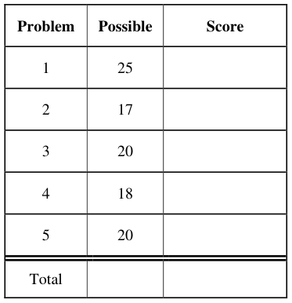

&emsp;Page 1/20

---

**Page 2**

CS 162 Fall 2005 Midterm Exam I        October 12, 2005

&emsp;&emsp;&emsp;&emsp;&emsp;&emsp;&emsp;&emsp;\[ This page left for π \]

&emsp;&emsp;&emsp;&emsp;3.141592653589793238462643383279502884197169399375105820974944

Page 2/20

---

**Page 3**

CS 162 Fall 2005 Midterm Exam I        October 12, 2005

### Problem 1: Short Answer

### **Problem 1a\[2pts\]:**  Suppose a thread is running in a critical section of code, meaning that it has

acquired all the locks through proper arbitration.  Can it get context switched? Why or why not? 
&emsp;Yes it can get context switched. Locks (especially user-level locks) are independent of the 
&emsp;scheduler. ( Note that threads running in the kernel with interrupts disabled would not get 
&emsp;context-switched. ) 
&emsp;&emsp;Grading Scheme: One point for the correct answer and one point for the explanation

### **Problem 1b\[3pts\]:** What are some of the hardware differences between kernel mode and user

mode?  Name at least three. 
There are many differences.  They all involve protection.  Here are a few possible answers: 
&emsp;&emsp;1\) There is a bit in a control register that is different (say 0=kernel, 1=user). 
&emsp;&emsp;2\) Hardware access to devices is usually unavailable in user mode. 
&emsp;&emsp;3\) Some instructions are available only in kernel mode. 
&emsp;&emsp;4\) Modifications to the page tables are only possible in kernel mode. 
&emsp;&emsp;5\) The interrupt controller can only be modified in kernel mode. 
&emsp;&emsp;6\) Other hardware control registers (such as system time, timer control, etc) are available 
&emsp;&emsp;&emsp;only in kernel mode. 
&emsp;&emsp;7\) Kernel memory is not available to users in user mode. 
&emsp;&emsp;Grading Scheme:  One point for each of the three differences

### **Problem 1c\[3pts\]:** Name three ways in which the processor can transition from user mode to

kernel mode.  Can the user execute arbitrary code after transitioning? 
&emsp;&emsp;1\) The user program can execute a trap instruction (for a system call) 
&emsp;&emsp;2\) The user program can perform a synchronous exception (bad address, bad instruction, 
&emsp;&emsp;&emsp;etc) 
&emsp;&emsp;3\) The processor transitions into kernel mode when responding to an interrupt. 
&emsp;The user cannot execute arbitrary code because entry to kernel mode is through a restricted set 
&emsp;of routines in the kernel – not in the user’s program. 
&emsp;Grading Scheme: ½  points for each of the different methods and then 1½ points for saying 
&emsp;you couldn't run arbitrary code after you switch.

### **Problem 1d\[3pts\]:** What is a thread?  What is a process?  Describe how to create each of these.

&emsp;A thread is a piece of an executing program.  It  contains a program counter (PC), processor 
&emsp;registers and a stack. A process consists of one or more threads in an address space. 
&emsp;&emsp;Threads are created by allocating a new stack and TCB, initializing the registers in the TCB 
&emsp;properly (so that the thread will execute, for instance, the ThreadRoot function), then placing 
&emsp;the new TCB on the ready queue. 
&emsp;&emsp;A process is created by allocating a new PCB, address space descriptor/page tables, and a 
&emsp;new thread.  In UNIX, processes are created by a fork() system call which also creates a 
&emsp;complete copy of the parent process for the new (child) process. 
&emsp;&emsp;Grading Scheme: One point for what is a thread, one point for what is a process, and one 
&emsp;point for how to create each of these.

Page 3/20

---

**Page 4**

CS 162 Fall 2005 Midterm Exam I        October 12, 2005

### **Problem 1e\[3pts\]:**  Suppose that we have a two-level page translation scheme with 4K-byte

&emsp;pages and 4-byte page table entries (includes a valid bit, a couple permission bits, and a pointer 
&emsp;to another page/table entry).  What is the format of a 32-bit virtual address?  Sketch out the 
&emsp;format of a complete page table. 
**12 bits10 bits10 bits12 bits10 bits10 bits**    **10 bits**   **10 bits**   **12 bits**

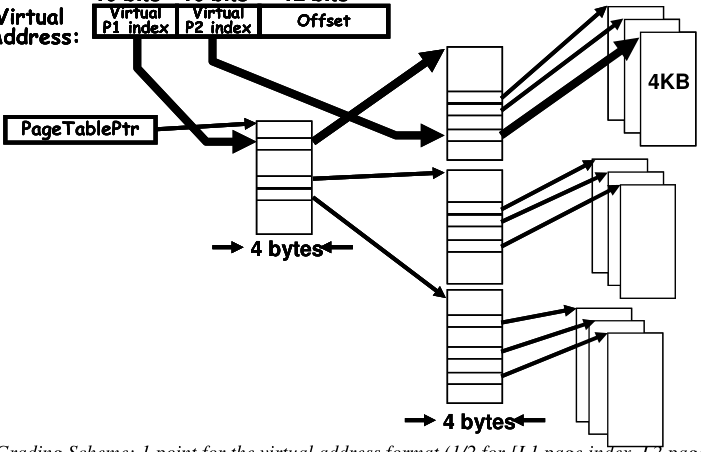

&emsp;Grading Scheme: 1 point for the virtual address format (1/2 for \[L1 page index, L2 page index, 
&emsp;offset\] and 1/2 point for # bits = 10,10,12) , 1 point for picture of single level page table, 
&emsp;1 point for multiple page tables linked together correctly

### **Problem 1f\[2pts\]:** What needs to be saved and restored on a context switch between two threads in

the same process?  What if the two threads are in different processes?  Be explicit. 
&emsp;Need to save the processor registers, stack pointer, program counter into the TCB of the thread 
&emsp;that is no longer running.  Need to reload the same things from the TCB of the new thread. 
&emsp;&emsp;When the threads are from different processes, need to not only save and restore what was 
&emsp;given above, but you also need to load the pointer for the top-level page-table of the new 
&emsp;address space.  You don’t need to save the old pointer, since this will not change and is 
&emsp;already stored in the PCB. 
&emsp;&emsp;Grading Scheme: 1 point for within process save/restore registers, stack pointer and PC 
&emsp;separate processes 1/2 point for same as "within process" + 1/2 for also need to save/restore 
&emsp;virtual memory info (page table base register)

### **Problem 1g\[1pt\]:** What is a thread-join operation?

&emsp;Thread-join is issued by one thread when it wants to stop and wait for the termination of 
&emsp;another thread. On termination of the target thread, the original thread resumes execution. 
&emsp;&emsp;Grading Scheme: 1 point for this thread waits for the joined-to thread to finish

Page 4/20

---

**Page 5**

CS 162 Fall 2005 Midterm Exam I        October 12, 2005

### **Problem 1h\[3pts\]:** Name at least three ways in which context-switching can happen in a non-

&emsp;preemptive scheduler. 
&emsp;1\) The user code can execute a yield() system call. 
&emsp;2\) The user code can request an I/O operation. 
&emsp;3\) The user code can request a wait() operation for another thread (such as thread-join). 
&emsp;Grading Scheme: 1 point per correct answer.  People who said traps/exceptions got no points 
&emsp;unless they somehow mentioned that it could be possible for a process to get killed by the OS. 
&emsp;Thereby, the OS would context-switch to a new thread because the old process had been 
&emsp;killed.  In this special case weI gave ½ point because the old process isn't context-switching so 
&emsp;much as it just gets killed.

### **Problem 1i\[3pts\]:** Name three ways in which processes on the same processor can communicate

with one another. If any of the techniques you name require hardware support, explain. 
&emsp;1\) Shared memory.  This requires translation hardware (segments or page tables) in order to 
&emsp;&emsp;&emsp;map a shared piece of DRAM into two different address spaces. 
&emsp;2\) Message passing.  Doesn’t require hardware support. 
&emsp;3\) Through the file system.  Doesn’t require hardware support (other than the support that 
&emsp;&emsp;&emsp;was already there for the file system). 
&emsp;Grading Scheme: 1 point per correct answer.  If other answers were given they had to be 
&emsp;explained fully to get any kind of credit - for example, some students mentioned Unix pipes 
&emsp;and communication by stdin/stdout, but this had to be explained fully to get credit.

### **Problem 1j\[2pts\]:** What is an interrupt?  What happens when an interrupt occurs?  What is the

function of an interrupt controller? 
&emsp;An interrupt is an external signal.  When interrupt occurs and is enabled (which means that it 
&emsp;is not masked off and the primary interrupt bit in the processor is turned on), then the 
&emsp;processor will stop the current running code, save the PC, disable interrupts, and jump to an 
&emsp;appropriate interrupt handler.  The function of the interrupt controller is to provide some 
&emsp;control over which hardware interrupt signals are enabled and what their priority is. 
&emsp;Grading Scheme: ½ point for giving the correct definition of an interrupt.  1 point for what 
&emsp;happens when an interrupt occurs.  Credit was not given for saying a context switch occurs. 
&emsp;To get full credit, you should have also mentioned something about an interrupt handler.  ½ 
&emsp;point for the correct definition of an interrupt controller.

Page 5/20

---

**Page 6**

CS 162 Fall 2005 Midterm Exam I        October 12, 2005

&emsp;&emsp;&emsp;&emsp;&emsp;&emsp;&emsp;&emsp;\[ This page intentionally left blank \]

Page 6/20

---

**Page 7**

CS 162 Fall 2005 Midterm Exam I        October 12, 2005

### Problem 2: Monitors

### **Problem 2a\[2pts\]:** What is a monitor?

A monitor is a synchronization mechanism (as well as a style of programming) that abstracts 
away protection and scheduling access to shared data through the use of a lock and zero or 
more condition variables.

### **Problem 2b\[5pts\]:** Provide Java class definitions for each of the components of a monitor.  Include

specifications for local data and methods (names and arguments, not implementation); method 
names should adhere to the interface defined in class.  Make sure to document each method by 
saying what it should do.  Be brief!  Hint: you should have two different object classes.

`Class Lock {`    `Class ConditionVar {` 
`ThreadQueue Q;`       `ThreadQueue Q;` 
`Acquire(); //fun to acquire lock`       `Sleep(Lock lock); /* sleep` 
`Release(); //fun to release lock`    `thread until someone wakes` 
`}`    `it up */` 
`Wake(); /* wake one sleeping` 
`thread */` 
`WakeAll(); /* wake all` 
`sleeping threads */` 
`}` 
`Also accepted:` 
`Wait(Lock lock);` 
`Signal();` 
`Broadcast();` 
1pt for each of the functions. A lot of students decided to give the usage for a monitor. If you had 
methods like “enqueue and dequeue or something like that we gave 1 point if it looked reasonable 
and you showed an understanding of monitors. An answer that used locks and condition variables 
properly (i.e. writing out enqueue and dequeue for a protected queue) got 2pts. We were very 
generous here even though we explicitly said give class definitions and not implementations!

### **Problem 2c\[2pts\]:** What is the difference between Mesa and Hoare scheduling for monitors?

In a mesa scheduling, the thread that is doing the signaling retains the lock after the signal is done. 
The signaled thread is just put on the ready queue. However, in Hoare scheduling the thread that is 
doing the signaling atomically transfers the lock to the signaling thread and it gets to start running 
right away. When the signalee is done running it gives the lock back to the signaler when it is done. 
One point for each. We took of 0.5 points if you neglected to mention the that the signalee gives the 
lock back. Most of the students in the class forgot this.

Page 7/20

---

**Page 8**

CS 162 Fall 2005 Midterm Exam I        October 12, 2005

### **Problem 2d\[8pts\]:**  In parallel programs (one multi-threaded process), a common design methodology

is to perform processing in sequential stages. All of the threads work independently during each stage, 
but they must synchronize at the end of each stage at a synchronization point called a barrier. If a 
thread reaches the barrier before all other threads have arrived, it waits.  When all threads reach the 
barrier, they are notified and can begin execution on the next phase of the computation. 
Example: 
While (true) { 
Compute stuff; 
BARRIER(); 
Read other threads results; 
} 
There are three complications to barriers.  First, there is no master thread that controls the threads, 
waits for each of them to reach the barrier, and then tells them to restart. Instead, the threads must 
monitor themselves and determine when they should wait or proceed. Second, for many dynamic 
programs, the number of threads that will be created during the lifetime of the parallel program is 
unknown in advance, since a thread can spawn another thread, which will start in the same program 
stage as the thread that created it.  Third, a thread may end before the barrier.  In all cases, all threads 
must wait at the barrier for all other threads before anyone is allowed to proceed. 
Provide the pseudo-code for a monitor class called **Barrier** that enables this style of barrier 
synchronization.  Your solution must support creation of a new thread (an additional thread that needs 
to synchronize), termination of a thread (one less thread that needs to synchronize), waiting when a 
thread reaches the barrier early, and releasing waiting threads when the last thread reaches the barrier. 
Implement your solution using monitors. You should never busy-wait; threads waiting at a barrier 
should be sleeping. 
Your class must implement the following three methods: `threadCreated(), threadEnd(),` 
`and enterBarrier()`.  Think carefully about efficiency and avoid unnecessary looping.  Feel 
free to utilize space on the next page.

&emsp;&emsp;&emsp;&emsp;&emsp;&emsp;&emsp;&emsp;Solution: See next page

Page 8/20

---

**Page 9**

CS 162 Fall 2005 Midterm Exam I        October 12, 2005

&emsp;&emsp;&emsp;&emsp;&emsp;&emsp;&emsp;&emsp;\[ This page intentionally left blank \] 
&emsp;&emsp;`Class Barrier() {`

&emsp;&emsp;`int numWaiting = 0;`    `// Initially, no one at barrier` 
&emsp;&emsp;`int numExpected = 0;`    `// Initially, no one expected`

&emsp;&emsp;`Lock L;` 
&emsp;&emsp;`ConditionVar CV;`

&emsp;&emsp;`threadCreated() {` 
&emsp;&emsp;`L.Acquire();` 
&emsp;&emsp;`numExpected++;`    `// Increase expected number` 
&emsp;&emsp;`L.Release();` 
&emsp;&emsp;`}`

&emsp;&emsp;`threadEnd() {` 
&emsp;&emsp;`L.Acquire();` 
&emsp;&emsp;`numExpected--;`    `// Decrease expected number` 
&emsp;&emsp;`if (numExpected == numWaiting) { // If we are last at barrier` 
&emsp;&emsp;`numWaiting=0;`    `// Reset barrier and wake threads` 
&emsp;&emsp;`CV.broadcast();` 
&emsp;&emsp;`}` 
&emsp;&emsp;`L.Release();` 
&emsp;&emsp;`}`

&emsp;&emsp;`enterBarrier() {` 
&emsp;&emsp;`L.Acquire();` 
&emsp;&emsp;`numWaiting++;`    `// We are one more waiter` 
&emsp;&emsp;`if (numExpected == numWaiting) { // If we are the last` 
&emsp;&emsp;`numWaiting = 0;`    `// Reset barrier and wake threads` 
&emsp;&emsp;&emsp;`CV.broadcast();` 
&emsp;&emsp;`} else {` 
&emsp;&emsp;`CV.sleep(L);`     `// Else, put us to sleep` 
&emsp;&emsp;`}` 
&emsp;&emsp;`L.Release()` 
&emsp;&emsp;`}` 
&emsp;&emsp;`}` 
Previous solutions said while loops were ok for the condition check in enter barrier. This is NOT true. 
While loops break the code from working with back-to-back barriers. And we took of 2 points. 
The points were taken off as follows: 
If you forgot to reset the numWaiting we took off a point since it wouldn’t work for back-to-back 
barriers (but it wasn’t a big mistake). 
If you forgot to make the check in threadEnd to broadcast we took off a point 
If your code didn’t work for multiple back-to-back barriers then we took of 2 points. 
If your code had bad synchronization (i.e. no locking or the use of interrupts) we took of 4 points. 
&emsp;If the solution was headed in the right direction but was obviously flawed we gave 1 to 2 points 
(depending on how much it was headed in the right direction and how clear your explanation was).

Page 9/20

---

**Page 10**

CS 162 Fall 2005 Midterm Exam I        October 12, 2005

### Problem 3: Lock-Free Queue

An object such as a queue is considered “lock-free” if multiple processes can operate on this object 
simultaneously without requiring the use of locks, busy-waiting, or sleeping. In this problem, we are 
going to construct a lock-free FIFO queue using an atomic “swap” operation. This queue needs both 
an `Enqueue` and `Dequeue` method. 
We are going to do this in a slightly different way than normally.  Rather than `Head` and `Tail` 
pointers, we are going to have “`PrevHead`” and `Tail` pointers.  `PrevHead` will point at the last 
object returned from the queue.  Thus, we can find the head of the queue (for dequing). Here are the 
basic class definitions (assuming that only one thread accesses the queue at a time):

`// Holding cell for an entry` 
`class QueueEntry {` 
`QueueEntry next = null;` 
`Object stored;` 
`int taken = 0;`

`QueueEntry(Object newobject) {` 
`stored = newobject;` 
`}` 
`}` 
`// The actual Queue (not yet lock free!)` 
`class Queue {` 
`QueueEntry prevHead = new QueueEntry(null);` 
`QueueEntry tail = prevHead;`

`void Enqueue(Object newobject)  {` 
`QueueEntry newEntry = new QueueEntry(newobject);` 
`tail.next = newEntry;` 
`tail = newEntry;` 
`}`

`Object Dequeue() {` 
`QueueEntry nextEntry = prevHead.next;` 
`While ((nextEntry != null) && nextEntry.taken == 1) {` 
`nextEntry = nextEntry.next;` 
`}` 
`if (nextEntry == null) {` 
`return null;` 
`} else {` 
`nextEntry.taken = 1;` 
`prevHead = nextEntry;` 
`return nextEntry.stored;` 
`}` 
`}` 
`}`

Page 10/20

---

**Page 11**

CS 162 Fall 2005 Midterm Exam I        October 12, 2005

### **Problem 3a\[10pts\]:**

Suppose that we have an atomic swap instruction.  This instruction takes a local variable (register) and 
a memory location and swaps the contents.  Although Java doesn’t contain pointers, we might describe 
this as follows: 
O`bject AtomicSwap(variable addr, Object newValue) {` 
`object result = *addr``;`   `// get old object stored in addr` 
`*addr` `=` `newValue``;`        `// store new object into addr` 
`return result;`         `// Return old contents of addr` 
`}` 
With this primitive, we might build a test-and-set lock as follows: 
`int mylock = 0;` 
`// grab lock` 
`while (AtomicSwap(mylock,1) == 1);` 
`// got lock` 
Rewrite code for `Enqueue()`, using the `AtomicSwap()` operation, such that it will work for any number of 
simultaneous Enqueue and Dequeue operations.  You should never need to busy wait.  **Do not use locking (i.e.** 
**don’t use a test-and-set lock).** The solution is tricky but can be done in a few lines. We will be grading on 
conciseness. Hint: during simultaneous insertions, objects may be temporarily disconnected from the queue (i.e. 
the set of entries reachable by `nextEntry = nextEntry.next`  starting from `prevEntry`); but 
eventually the queue needs to be connected. 
Solution: One of the most important things about this solution is that it still has to work for single- 
threaded execution!!!! We were not very forgiving of solutions that produced loops and other 
anomalies when running single-threaded. 
The key to this solution is to atomically insert the new element at the tail of the list. What it 
means to be at the “tail of the list” is that new elements will be added after you. We need to make 
sure that the system presents a single insertion order within the queue (i.e. no reordering after 
insertion), since Dequeue operations are occurring in parallel with insertions. Technique: we use a 
single AtomicSwap to set our insertion order, then reconnect the queue afterwards using a single 
store operation. 
`void Enqueue(Object newobject)  {` 
&emsp;&emsp;&emsp;`QueueEntry newEntry = new QueueEntry(newobject);` 
&emsp;&emsp;&emsp;`QueueEntry oldTail = AtomicSwap(tail,newEntry);` 
&emsp;&emsp;&emsp;`oldTail.next = newEntry;` 
`}` 
Further explanation: After the swap, the new entry is not yet attached to the beginning of the list, 
but has become the new tail (and may get new items added to it). To reconnect the list, we merely 
need to store our identity into the next field of the old tail (the element that was the tail when we 
performed our swap). Until we reconnect the list, Dequeue() operations may free everything up to 
and including the oldTail.  However, they will go no further (since the next field of the oldTail is 
null up to the moment that the new element is added to the end). 
&emsp;&emsp;Sample grading constraints: Wrong AtomicSwap: -4, (although some close results got -2), 
Ignoring return from AtomicSwap: -3 (unless you were otherwise really close), Solution not 
working for single-threaded: discount up to -6, depending on circumstances. Tail not updated 
correctly: -3

Page 11/20

---

**Page 12**

CS 162 Fall 2005 Midterm Exam I        October 12, 2005

### **Problem 3b\[10pts\]:**

Rewrite code for Dequeue() such that it will work for any number of simultaneous threads working at 
once.  **Again, do not use locking.** You should never need to busy wait. The solution is tricky but can 
be done by modifying a small number of lines. We will be grading on conciseness.  Hint: before 
grabbing a queue entry, make sure that you “take” it atomically. You are striving for correctness. If 
you can explain why it is ok, you can allow prevHead to get temporarily out of date, but try to avoid 
letting prevHead get too far behind the actual head of the list. 
Solution: Once again, your solution must work single-threaded! 
&emsp;Carefully compare the solution to the original: very little has changed! (other than the prevHead 
update code). The key here is walking down the list, starting at `prevHead.next` and trying to 
atomically set the taken variable to one. Only one lucky thread will get the privilege of setting the 
taken variable of a particular entry to 1 (as indicated by a return of zero from the AtomicSwap). 
Once we have succeeded in acquiring an entry, we can take our time actually using it. 
&emsp;Although we could set `prevHead=nextEntry` and be done with it, this would not guarantee 
that `prevHead` wasn’t set backwards by some parallel dequeueing thread. Note also that we have 
to be very careful not to set prevHead to null, since our queue interface assumes at least one entry 
always present. Our solution is to set the prevHead variable to be equal to the last QueueEntry with 
a taken value of 1. The important sequence is to first set prevHead, then check for additional entries. 
Given that ordering, we know that, when we stop setting prevHead, it is truly the most recent entry 
for a brief moment. 
&emsp;&emsp;`Object Dequeue() {` 
&emsp;&emsp;`QueueEntry nextEntry = prevHead.next;` 
&emsp;&emsp;`While ((nextEntry != null) && AtomicSwap(nextEntry.taken,1) == 1){` 
&emsp;&emsp;`nextEntry = nextEntry.next;` 
&emsp;&emsp;`}` 
&emsp;&emsp;`if (nextEntry == null) {` 
&emsp;&emsp;`return null;` 
&emsp;&emsp;`} else {` 
&emsp;&emsp;`Object stored = nextEntry.stored;`

&emsp;&emsp;`// Do our best to set prevHead to last taken entry` 
&emsp;&emsp;`// Order here is important (set prevHead, then check)` 
&emsp;&emsp;`do {` 
&emsp;&emsp;`prevHead = nextEntry;` 
&emsp;&emsp;`nextEntry = nextEntry.next;` 
&emsp;&emsp;`} until (nextEntry == null || nextEntry.taken == 0);`

&emsp;&emsp;`return stored;` 
&emsp;&emsp;`}` 
&emsp;&emsp;`}` 
Sample grading constraints: Wrong AtomicSwap: -4, (although some close results got -2), Ignoring 
return from AtomicSwap: -3 (unless you were otherwise really close), Solution not working for 
single-threaded: discount up to -6, depending on circumstances. Not getting the prevHead update as 
shown above: -1 (not really very bad). 
&emsp;&emsp;Several people mixed up types! They ignored the queueEntry type and assumed that the objects 
being    stored    on    the    queue    had    “.next”    elements.    Or,    they    did    something    like: 
`AtomicSwap(prevHead,nextEntry.stored)`: these two items are very different! 
Page 12/20

---

**Page 13**

CS 162 Fall 2005 Midterm Exam I        October 12, 2005

### Problem 4: Scheduling

### **Problem 4a\[2pts\]:**

Six jobs are waiting to be run. Their expected running times are 10, 8, 6, 3, 1, and X. In what order 
should they be run to minimize average completion time? State the scheduling algorithm that should 
be used AND the order in which the jobs should be run. (Your answer will depend on X). 
Shortest Job First or Shortest Remaining Processing Time 
X \<= 1       X, 1, 3, 6, 8, 10    Answers that mentioned something about scheduling X by 
1 \< X \<= 3    1, X, 3, 6, 8, 10    ordering the processes in ascending order by running times 
3 \< X \<= 6    1, 3, X, 6, 8, 10    were accepted. 
6 \< X \<= 8    1, 3, 6, X, 8, 10 
8 \< X \<= 10 1, 3, 6, 8, X, 10 
X \> 10     1, 3, 6, 8, 10, X

### **Problem 4b\[4pts\]:**

Name and describe 4 different scheduling algorithms. What are the advantages and disadvantages of 
each? 
FCFC (FIFO) – The first process that arrives gets to run all the way to completion 
\+ Simple and quick to choose the next thread 
\+ Fair in the sense that jobs run in the order they arrived 
\- Long wait times for short jobs that get stuck behind long jobs 
\- Not fair for jobs that can finish very quickly but must wait a long time 
Round Robin – Scheduler rotates through all threads, allowing each to run for some time quantum 
\+ Fair because gives every thread a chance to run 
\- Potentially large overhead from frequent context switching 
\- Can result in large completion times, especially for threads with similar run times 
Shortest Job First – Scheduler runs the shortest job first, non-preemptive 
\+ Results in low average completion time 
\- Long jobs can et stuck behind short jobs 
\- Requires knowledge of the future, hard to predict 
Shortest Remaining Processing Time – Works like SJF, but preemptive 
+/- Same as SJF 
Priority Scheduler – Assign threads different priorities, run them in order of priority 
\+ Important threads get run first 
\- Low priority threads can starve 
Lottery Scheduler – Give threads tickets and hold a lottery to pick the next thread to run 
\+ Allows high priority threads to run quickly, but low priority threads still make progress 
\- More difficult to implement, may take longer to pick next thread than other algorithms 
You needed to have the description of the scheduler, one advantage, and one disadvantage to get full 
credit.

Page 13/20

---

**Page 14**

CS 162 Fall 2005 Midterm Exam I        October 12, 2005

### **Problem 4c\[3pts\]:**

Here is a table of processes and their associated running times. All of the processes arrive in numerical 
order at time 0.

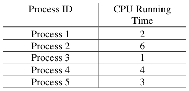

Show the scheduling order for these processes under 3 policies: First Come First Serve (FCFS), 
Shortest-Remaining-Time-First (SRTF), Round-Robin (RR) with timeslice quantum = 1

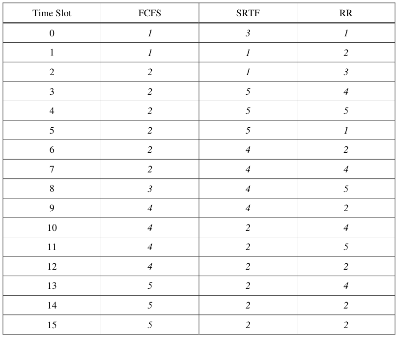

Page 14/20

---

**Page 15**

CS 162 Fall 2005 Midterm Exam I        October 12, 2005

### **Problem 4d\[3pts\]:**

For each process in each schedule above, indicate the queue wait time and completion time (otherwise 
known as turnaround time, TRT).  Note that wait time is the total time spend waiting in queue (all the 
time in which the task is not running):

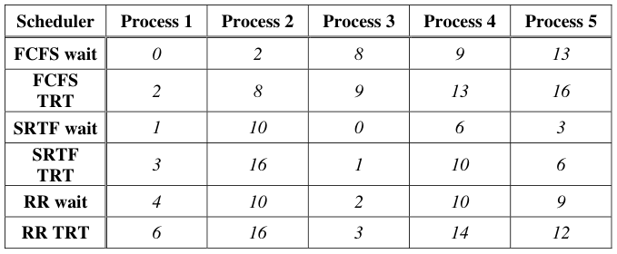

### **Problem 4e\[3pts\]:**

Suppose that the context-switch time is 0.5 units.  Assume that there is no context switch at time zero. 
Fill out this table again:

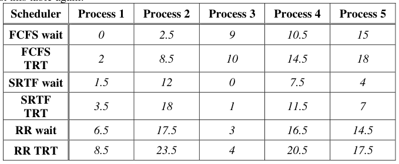

### **Problem 4f\[3pts\]:**

The SRTF algorithm requires knowledge of the future.  Why is that?  Name two ways to approximate 
the information required to implement this algorithm. 
SRTF needs to know the future so it can choose the thread with the shortest processing time as the next 
thread to run.  This can be approximated by having processes state what their approximate running 
times are when created.  Past behavior can also be used to approximate the future – CPU bursts, 
average running time for a process, etc.  Multi-level feedback queues can also be used to approximate 
the behavior of SRTF by penalizing threads that run a long time and rewarding threads that finish 
quickly.

Page 15/20

---

**Page 16**

CS 162 Fall 2005 Midterm Exam I        October 12, 2005

&emsp;&emsp;&emsp;&emsp;&emsp;&emsp;&emsp;&emsp;\[ This page intentionally left blank \]

Page 16/20

---

**Page 17**

CS 162 Fall 2005 Midterm Exam I        October 12, 2005

### Problem 5: Deadlock

### **Problem 5a\[2pts\]:**

List the conditions for deadlock. 
&emsp;**(½ point each)** 
&emsp;Hold & wait 
&emsp;Circular dependency/circular wait 
&emsp;No preemption of resources 
&emsp;Mutual exclusion

### **Problem 5b\[3pts\]:**

What are three methods of dealing with the possibility of deadlock?  Explain each method and its 
consequences to programmer of applications. 
&emsp;**(1 point each)** 
&emsp;Ignore it – do nothing about it.  Application programmers have to deal with deadlock or not care 
&emsp;if it happens 
&emsp;Prevent it – use Banker’s Algorithm and only allow allocations that cannot possibly lead to 
&emsp;deadlock.  Application programmer has to specify maximum possible resource needs 
&emsp;Detect it and recover – check dependency graph for cycles and kill a thread in the cycle. 
&emsp;Application programmer has to deal with their threads possibly getting killed. 
&emsp;**Many lost 1 point total for skipping all of the “consequences to the programmer of** 
&emsp;**applications”.** 
&emsp;**A common mistake was to say what the OS programmer had to do.**

### **Problem 5c\[3pts\]:**

Suppose that we have several processes and several resources.  Name three ways of preventing 
deadlock between these processes 
&emsp;**(1 point each)** 
&emsp;Atomically acquire all resources at the start of execution 
&emsp;Use the Banker’s Algorithm 
&emsp;Acquire all resources in a specified order 
&emsp;**Many other possible answers**

Page 17/20

---

**Page 18**

CS 162 Fall 2005 Midterm Exam I        October 12, 2005

### **Problem 5d\[5pts\]:**

Suppose that we have the following resources: A, B, C and threads T1, T2, T3, T4.  The total number 
of each resource is:

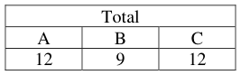

Further, assume that the processes have the following maximum requirements and current allocations:

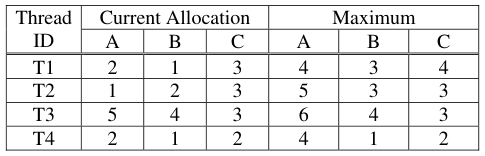

Is the system potentially deadlocked (i.e. unsafe)?  In making this conclusion, you must show all your 
steps, intermediate matrices, etc. 
Solution: part of “showing the steps” involved producing intermediate matrices: 
&emsp;**(1 point)**    **(1 point)** 
&emsp;Available:    Need:

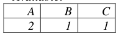

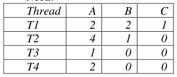

&emsp;**(1 point for “No”, 2 points for explanation)** 
&emsp;No.  Running the Banker’s Algorithm, we see that we can give T4 all the resources it might need 
&emsp;and run it to completion.  After T4, we do the same for T3, then T2, then T1 
&emsp;Available after running:

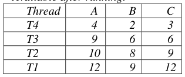

&emsp;Many other orderings are possible (T3 or T4 first, then basically any order after that)

Page 18/20

---

**Page 19**

CS 162 Fall 2005 Midterm Exam I        October 12, 2005

### **Problem 5e\[3pts\]:**

Assuming the allocations in (5d), suppose that T1 asks for 2 more copies of A.  Can the system 
grant this or not?  Explain. 
Solution: 
No, if we allocate two more A to T1, then    and T1’s new need is

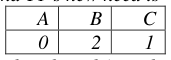

the available resources are:

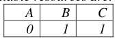

&emsp;&emsp;&emsp;&emsp;&emsp;&emsp;&emsp;&emsp;(other threads’ needs are the same)

Because we need more B to guarantee that T1 can run, and we need more A to guarantee that 
T2, T3, or T4 can run, this is an unsafe state 
**(1 point for “No”)** 
**(1 point for T1’s new need vector or explanation of T1’s new need)** 
**(1 point for “No thread can meet it’s need now”)** 
**Alternate (mostly wrong) answer:** 
**(1 point for “Yes, because there are enough A available”)**

### **Problem 5f\[4pts\]:**

Assuming the allocations in (5d), what is the maximum number of additional copies of resources 
(A, B, and C) that T1 can be granted in a single request without risking deadlock? Explain. 
Solution: the following is the max possible:

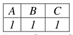

&emsp;&emsp;&emsp;&emsp;&emsp;&emsp;&emsp;&emsp;enough resources to run each of the other 
&emsp;&emsp;&emsp;&emsp;&emsp;&emsp;&emsp;&emsp;threads in turn, therefore no deadlock can 
From 5e, we know that we cannot grant 2A.  occur. 
This is thus the max we might be able to **2 points for**

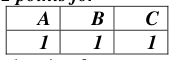

allocate (because only 1B and 1C are even 
available).  If we grant 1A, 1B, and 1C to T1, 
we can see the new need vector for T1 is    **-1 point for one number being off by one,**

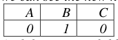

&emsp;&emsp;&emsp;&emsp;&emsp;&emsp;&emsp;&emsp;**except**

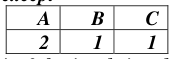

And the new available resources vector is

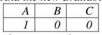

&emsp;&emsp;&emsp;&emsp;&emsp;&emsp;&emsp;&emsp;**is -2 for just being the same as avail** 
This is enough resources to grant T3 its max **1 point for “We can run T3”** 
and run it to completion (thus freeing its **1 point for “After running T3, we have** 
resources).  After finishing T3, we have **enough resources to run the rest”**

Page 19/20

---

**Page 20**

CS 162 Fall 2005 Midterm Exam I        October 12, 2005

&emsp;&emsp;&emsp;&emsp;&emsp;&emsp;&emsp;&emsp;**\[ This page intentionally left blank \]**

Page 20/20

