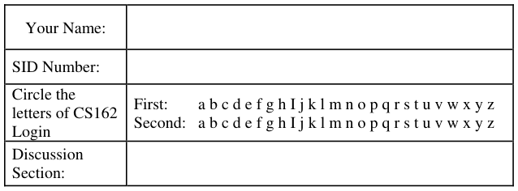
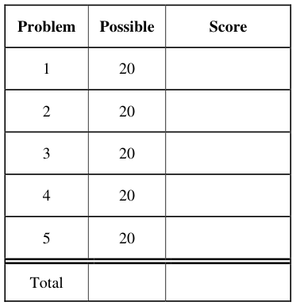
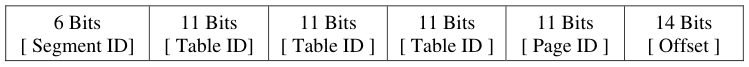
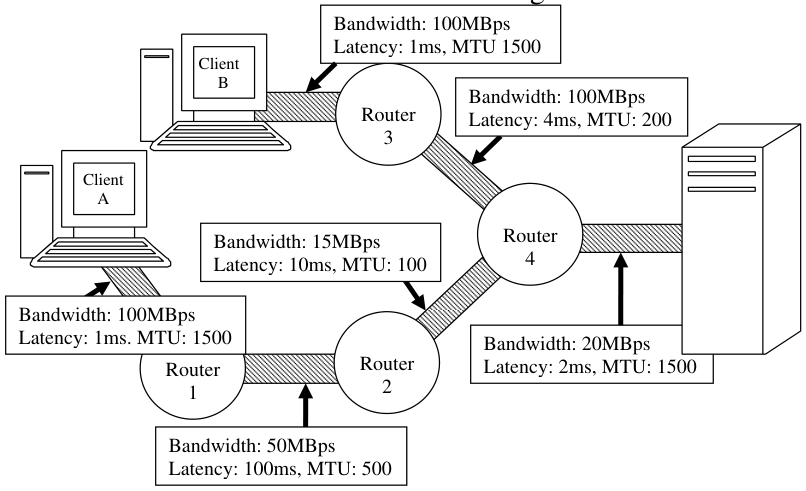

# Berkeley CS162 Fall 2005: Midterm 2: Questions

> Copied from the original: <https://hkn.eecs.berkeley.edu/exams/course/cs/162>. Text and figures are taken from the PDF as is; nothing was answered or rewritten. The original PDF is in this folder.

---

**Page 1**

&emsp;&emsp;&emsp;&emsp;&emsp;&emsp;&emsp;&emsp;University of California, Berkeley 
&emsp;&emsp;&emsp;&emsp;&emsp;&emsp;&emsp;&emsp;College of Engineering 
&emsp;&emsp;&emsp;&emsp;&emsp;&emsp;&emsp;&emsp;Computer Science Division ⎯ EECS 
&emsp;Fall 2005                John Kubiatowicz 
&emsp;&emsp;&emsp;&emsp;&emsp;&emsp;&emsp;&emsp;Midterm II 
&emsp;&emsp;&emsp;&emsp;&emsp;&emsp;&emsp;&emsp;December 5th, 2005 
&emsp;&emsp;&emsp;&emsp;&emsp;&emsp;&emsp;CS162: Operating Systems and Systems Programming

General Information: 
This is a **closed book** exam.  You are allowed 1 page of **hand-written** notes (both sides).  You 
have 3 hours to complete as much of the exam as possible. Make sure to read all of the questions 
first, as some of the questions are substantially more time consuming. 
Write all of your answers directly on this paper.  Make your answers as concise as possible. On 
programming questions, we will be looking for performance as well as correctness, so think through 
your answers carefully.  If there is something about the questions that you believe is open to 
interpretation, please ask us about it!

&emsp;Page 1/15

---

**Page 2**

CS 162 Fall 2005 Midterm Exam II December 5th, 2005

&emsp;&emsp;&emsp;&emsp;&emsp;&emsp;&emsp;&emsp;\[ This page left for π \]

&emsp;&emsp;&emsp;&emsp;3.141592653589793238462643383279502884197169399375105820974944

Page 2/15

---

**Page 3**

CS 162 Fall 2005 Midterm Exam II December 5th, 2005

### Problem 1: True/False

In the following, it is important that you EXPLAIN your answer in TWO SENTENCES OR LESS 
(Answers longer than this may not get credit!).  Also, answers without an explanation GET NO 
CREDIT.

### **Problem 1a\[2pts\]:**  In a modern operating system using memory protection through virtual

memory, the hardware registers of a memory-mapped I/O device can only be accessed by the 
kernel. 
&emsp;&emsp;True / False 
Explain:

### **Problem 1b\[2pts\]:** Using the TCP/IP protocol over an unreliable network, the receiver can receive

the same IP packet multiple times. 
&emsp;&emsp;True / False 
Explain:

### **Problem 1c\[2pts\]:** With the NFS distributed file system, it is possible for one client to write a value

into a file that is not seen by another client when reading that file. 
&emsp;&emsp;True / False 
Explain:

### **Problem 1d\[2pts\]:**  The fastest way to send a large document securely to a third party that you

have not interacted with yet is to encrypt it with their public key. Assume you know everyone’s 
public key. 
&emsp;&emsp;True / False 
Explain:

### **Problem 1e\[2pts\]:** The IP-v4 standard permits 232 different hosts to talk directly with one another

without requiring any network address translation. 
&emsp;&emsp;True / False 
Explain:

Page 3/15

---

**Page 4**

CS 162 Fall 2005 Midterm Exam II December 5th, 2005

### **Problem 1f\[2pts\]:** A “broadcast network” is one which uses radio-frequency transmissions to send

data from one party to another. 
&emsp;&emsp;True / False 
Explain:

### **Problem 1g\[2pts\]:** The best way to correct virtual memory thrashing is to increase the overlap

between I/O and computation, namely by increasing the number of runnable threads. 
&emsp;&emsp;True / False 
Explain:

### **Problem 1h\[2pts\]:** A Remote Procedure Call (RPC) can be used to call a procedure in another

process on the same machine. 
&emsp;&emsp;True / False 
Explain:

### **Problem 1i\[2pts\]:** The complexity of handling software TLB faults increases when exceptions are

imprecise. 
&emsp;&emsp;True / False 
Explain:

### **Problem 1j\[2pts\]:** TCP/IP must wait for a timeout in order to start retransmitting lost data, since it

has insufficient information about which packets are lost before then. 
&emsp;&emsp;True / False 
Explain:

Page 4/15

---

**Page 5**

CS 162 Fall 2005 Midterm Exam II December 5th, 2005

### Problem 2: Paging and Virtual Memory

Suppose that we have a 64-bit virtual address split as follows:

### **Problem 2a\[2pts\]:** How big is a page in this system?  Explain in one sentence.

### **Problem 2b\[2pts\]:** How many segments are in this system? Explain in one sentence.

### **Problem 2c\[2pts\]:** Assume that the page tables are divided into page-sized chunks (so that they can

be paged to disk).  How much space have we allowed for a PTE in this system?  Explain in one 
sentence.

### **Problem 2d\[2pts\]:** Show the format of a page table entry, complete with bits required to support

the clock algorithm and copy-on-write optimizations.

### **Problem 2e\[2pts\]:** Assume that a particular user is given a maximum-sized segment full of data.

How much space is taken up by the page tables for this segment?  Explain. Note: you should leave 
this number as sums and products of powers of 2!

Page 5/15

---

**Page 6**

CS 162 Fall 2005 Midterm Exam II December 5th, 2005

### **Problem 2f\[4pts\]:** Suppose the system has 16 Gigabytes of DRAM and that we use an inverted

page table instead of a forward page table.   Also, assume a 14-bit process ID. If we use a minimum- 
sized page table for this system, how many entries are there in this table?  **Explain.** What does a 
page-table entry look like?  (round to nearest byte, but support clock algorithm and copy on write).

### **Problem 2g\[2pts\]:** As mentioned in one of the lectures on distributed security, a common attack

point for Internet worms is to exploit a buffer-overrun bug to execute code on the stack of the 
victim program. What can we add to the PTE to prevent this problem and how should we use it (use 
no more than two sentences)?

### **Problem 2h\[4pts\]:** What is the FIFO page replacement algorithm?  Explain in one or two sentences

why this is a bad algorithm for page replacement. Explain what makes the  clock algorithm 
different from a FIFO page replacement algorithm (even though pages are examined for 
replacement in order) and how it is superior to FIFO.

Page 6/15

---

**Page 7**

CS 162 Fall 2005 Midterm Exam II December 5th, 2005

### Problem 3: Disk Subsystem

Suppose that we build a disk subsystem to handle a high rate of I/O by coupling many disks 
together.  Properties of this system are as follows: 
&emsp;• Uses 10GB disks that rotate at 10,000 RPM, have a data transfer rate of 10 MBytes/s (for 
&emsp;&emsp;each disk), and have an 8 ms average seek time, 32 KByte block size 
&emsp;• Has a SCSI interface with a 2ms controller command time. 
&emsp;• Is limited only by the disks (assume that no other factors affect performance). 
&emsp;• Has a total of 20 disks 
Each disk can handle only one request at a time, but each disk in the system can be handling a 
different request.  The data is not striped (all I/O for each request has to go to one disk).

### **Problem 3a\[4pts\]:** What is the average service time to retrieve a single disk block from a random

location on a single disk, assuming no queuing time (i.e. the unloaded request time)?  Hint: there 
are four terms in this service time!

### **Problem 3b\[3pts\]:** Assume that the OS is not particularly clever about disk scheduling and passes

requests to the disk in the same order that it receives them from the application (FIFO). If the 
application requests are randomly distributed over a single disk, what is the bandwidth (bytes/sec) 
that can be achieved?

### **Problem 3c\[2pts\]:** Suppose that the application has requests outstanding for all disks (but they are

still randomly distributed, handed FIFO to disks), what is the maximum number of I/Os per second 
(IOPS) for the whole disk subsystem (an “I/O” here is a block request)?

Page 7/15

---

**Page 8**

CS 162 Fall 2005 Midterm Exam II December 5th, 2005

### **Problem 3d\[4pts\]:** Assume that the application cannot alter the random nature of its disk requests.

Explain how the operating system could use scheduling to increase the IOPS. What does the 
application have to do in order to allow this type of optimization?

### **Problem 3e\[2pts\]:** Taking this idea of (3d) to its limit, what is the absolute maximum number of

IOPS that we could ever hope to get (this will be an upper bound, not really reachable)

### **Problem 3f\[5pts\]:** Treat the entire system as an M/M/m queue (that is, a system with m servers

rather than one), where each disk is a server.  All requests are in a single queue.  Assume that the 
system receives an average of 800 I/O requests per second. For simplicity, assume that any disk can 
service any request.  Assuming FIFO scheduling by the OS again, what is the mean response time 
of the system?  You might find the following equation for an M/M/m queue useful: 
&emsp;&emsp;&emsp;&emsp;&emsp;&emsp;&emsp;&emsp;λTime 
&emsp;&emsp;&emsp;&emsp;&emsp;ζλ==×Server Utilization ()server 
&emsp;&emsp;&emsp;&emsp;&emsp;&emsp;&emsp;&emsp;1   m 
&emsp;&emsp;&emsp;&emsp;&emsp;&emsp;&emsp;&emsp;Time/m 
&emsp;&emsp;&emsp;&emsp;&emsp;&emsp;&emsp;&emsp;server 
&emsp;&emsp;&emsp;&emsp;&emsp;&emsp;&emsp;&emsp;⎡⎤ 
&emsp;&emsp;&emsp;&emsp;&emsp;&emsp;&emsp;&emsp;ζ 
&emsp;&emsp;&emsp;&emsp;&emsp;=×TimeTime 
&emsp;&emsp;&emsp;&emsp;&emsp;&emsp;&emsp;&emsp;⎢⎣)⎥⎦ 
&emsp;&emsp;&emsp;&emsp;&emsp;&emsp;&emsp;queueserver( 
&emsp;&emsp;&emsp;&emsp;&emsp;&emsp;&emsp;&emsp;ζm1   −

Page 8/15

---

**Page 9**

CS 162 Fall 2005 Midterm Exam II December 5th, 2005

&emsp;&emsp;&emsp;&emsp;&emsp;&emsp;&emsp;&emsp;\[ This page intentionally left blank \]

Page 9/15

---

**Page 10**

CS 162 Fall 2005 Midterm Exam II December 5th, 2005

### Problem 4: Potpourri

Please keep your answers short (one or two sentences per question-mark). We may not give credit 
for long answers.

### **Problem 4a\[2pts\]:** Under what circumstances would you use Byzantine Agreement instead of two-

phase commit?

### **Problem 4b\[4pts\]:** Assume that you have a RAID-5 system with five disks.  One of the disks fails.

Explain how the operating system can continue to satisfy block reads for that disk. Can the system 
deal with two failures?  Why or why not?

### **Problem 4c\[3pts\]:** Given the RAID system of (4b), suppose that the bad disk is replaced by a new

disk. What must be done to get the system back to the way it was before the disk went bad?

Page 10/15

---

**Page 11**

CS 162 Fall 2005 Midterm Exam II December 5th, 2005

### **Problem 4d\[3pts\]:** How can you use public key encryption to securely distribute a secret key (for

symmetric key encryption) between two parties?

### **Problem 4e\[4pts\]:** The UNIX BSD 4.1 inode structure is intended to support both small files (e.g.

a couple of KB) and large files (e.g. up to some number of GB). Briefly describe the mechanism 
employed to achieve this. Are small files or large files handled more efficiently?

### **Problem 4f\[4pts\]:** Suppose that the primary access pattern for files is sequential, large file access.

If the primary goal is to access these files at the highest possible rate, explain (1) how files should 
be constructed from blocks and (2) how blocks of the file should be laid out on the disk.

Page 11/15

---

**Page 12**

CS 162 Fall 2005 Midterm Exam II December 5th, 2005

&emsp;&emsp;&emsp;&emsp;&emsp;&emsp;&emsp;&emsp;\[ This page intentionally left blank \]

Page 12/15

---

**Page 13**

CS 162 Fall 2005 Midterm Exam II December 5th, 2005

### Problem 5: Networking

The above figure illustrates a network in which two clients (Client A and Client B) route packets 
through the network to the server. Each link is characterized by its Bandwidth, one-way Latency, 
and Maximum Transfer Unit (MTU). All links are full-duplex (can handle traffic in both directions 
at full bandwidth).

### **Problem 5a\[4pts\]:** Under ideal circumstances, what is the maximum bandwidth that Client A can

send data to the server without causing packets to be dropped (Assuming that the headers are of 
zero length)?  How about Client B?  Explain.

### **Problem 5b\[4pts\]:** Keeping in mind that TCP/IP involves a total header size of 40 bytes (for TCP

\+ IP), what is the maximum data bandwidth that Client A could send to the server through TCP/IP? 
Explain.

Page 13/15

---

**Page 14**

CS 162 Fall 2005 Midterm Exam II December 5th, 2005

### **Problem 5c\[4pts\]:** Assume that Client A sends a continuous stream of packets to the server (and no

other clients are talking to the server). How big should the send window be so that the TCP/IP 
algorithm will achieve maximum bandwidth without dropping packets?  Explain.  Hint: don’t forget 
to account for the 40 bytes of header.

### **Problem 5d\[4pts\]:** Assume that Clients A and B both send a continuous stream of packets to the

server simultaneously.  Assume that Bandwidth is shared equally on shared links. What must the 
sizes of their send windows be so that packets are not dropped?  Explain.

### **Problem 5e\[4pts\]:** Consider the situation of (5d). If the server is sending data back to Clients A and

B at full rate, do the acknowledgements for data headed to the clients decrease the bandwidth in the 
forward direction (clients→server)? State your assumptions and explain your answer.

Page 14/15

---

**Page 15**

CS 162 Fall 2005 Midterm Exam II December 5th, 2005

&emsp;&emsp;&emsp;&emsp;&emsp;&emsp;&emsp;&emsp;**\[ This page intentionally left blank \]**

Page 15/15

