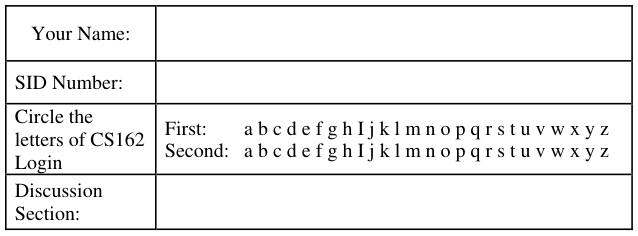
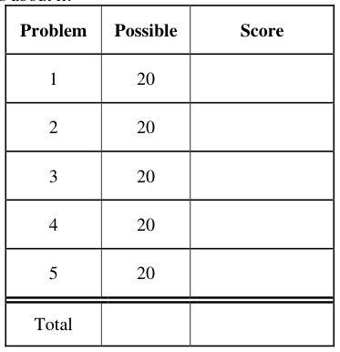
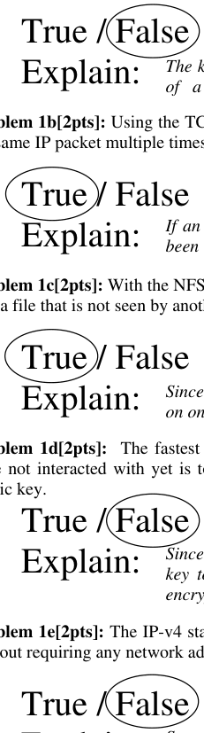
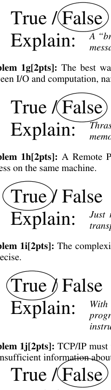
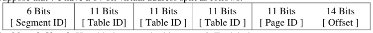
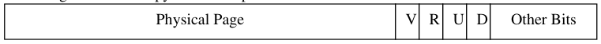
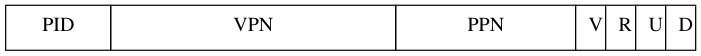
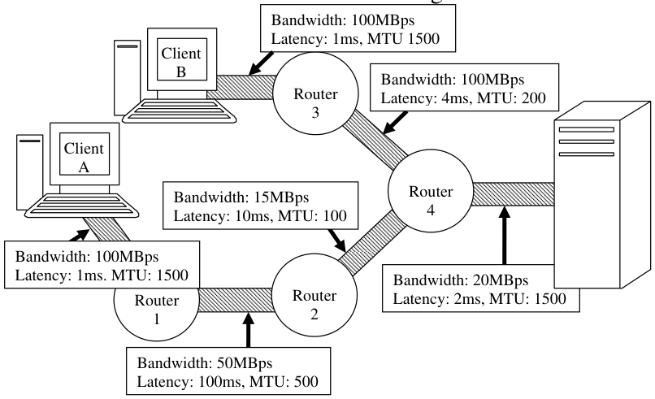

# Berkeley CS162 Fall 2005: Midterm 2: Official solutions

> Copied from the original: <https://hkn.eecs.berkeley.edu/exams/course/cs/162>. Text and figures are taken from the PDF as is; nothing was answered or rewritten. The original PDF is in this folder.

---

**Page 1**

&emsp;&emsp;&emsp;&emsp;&emsp;&emsp;&emsp;&emsp;University of California, Berkeley 
&emsp;&emsp;&emsp;&emsp;&emsp;&emsp;&emsp;&emsp;College of Engineering 
&emsp;&emsp;&emsp;&emsp;&emsp;&emsp;&emsp;&emsp;Computer Science Division ⎯ EECS 
&emsp;Fall 2005                John Kubiatowicz 
&emsp;&emsp;&emsp;&emsp;&emsp;&emsp;&emsp;&emsp;Midterm II 
&emsp;&emsp;&emsp;&emsp;&emsp;&emsp;&emsp;&emsp;SOLUTIONS 
&emsp;&emsp;&emsp;&emsp;&emsp;&emsp;&emsp;&emsp;December 5th, 2005 
&emsp;&emsp;&emsp;&emsp;&emsp;&emsp;&emsp;CS162: Operating Systems and Systems Programming

General Information: 
This is a **closed book** exam.  You are allowed 1 page of **hand-written** notes (both sides).  You 
have 3 hours to complete as much of the exam as possible. Make sure to read all of the questions 
first, as some of the questions are substantially more time consuming. 
Write all of your answers directly on this paper.  Make your answers as concise as possible. On 
programming questions, we will be looking for performance as well as correctness, so think through 
your answers carefully.  If there is something about the questions that you believe is open to 
interpretation, please ask us about it!

&emsp;Page 1/17

---

**Page 2**

CS 162 Fall 2005 Midterm Exam II December 5th, 2005

&emsp;&emsp;&emsp;&emsp;&emsp;&emsp;&emsp;&emsp;\[ This page left for π \]

&emsp;&emsp;&emsp;&emsp;3.141592653589793238462643383279502884197169399375105820974944

Page 2/17

---

**Page 3**

CS 162 Fall 2005 Midterm Exam II December 5th, 2005

### Problem 1: True/False

In the following, it is important that you EXPLAIN your answer in TWO SENTENCES OR LESS 
(Answers longer than this may not get credit!).  Also, answers without an explanation GET NO 
CREDIT.

### **Problem 1a\[2pts\]:**  In a modern operating system using memory protection through virtual

memory, the hardware registers of a memory-mapped I/O device can only be accessed by the 
kernel.

&emsp;&emsp;&emsp;&emsp;&emsp;&emsp;&emsp;&emsp;The kernel can map the I/O space of the device into the memory space 
&emsp;&emsp;&emsp;&emsp;&emsp;&emsp;&emsp;&emsp;of   a user program, thereby allowing user threads to access the device.

### **Problem 1b\[2pts\]:** Using the TCP/IP protocol over an unreliable network, the receiver can receive

If an ACK is lost, the sender must assume that the packet could have 
&emsp;&emsp;&emsp;&emsp;&emsp;&emsp;&emsp;&emsp;been lost.  As a result, it will resend the packet.

### **Problem 1c\[2pts\]:** With the NFS distributed file system, it is possible for one client to write a value

&emsp;&emsp;&emsp;&emsp;&emsp;&emsp;&emsp;&emsp;Since NFS only checks every 30 seconds or so, it is possible for a write 
&emsp;&emsp;&emsp;&emsp;&emsp;&emsp;&emsp;&emsp;on one client to go unnoticed by another client for a bit.

### **Problem 1d\[2pts\]:**  The fastest way to send a large document securely to a third party that you

have not interacted with yet is to encrypt it with their public key. Assume you know everyone’s

Since public key encryption is so slow, it is much faster to use the public 
&emsp;&emsp;&emsp;&emsp;&emsp;&emsp;&emsp;&emsp;key to exchange a secret key with the receiver, then use private-key 
&emsp;&emsp;&emsp;&emsp;&emsp;&emsp;&emsp;&emsp;encryption for the bulk of the document.

### **Problem 1e\[2pts\]:** The IP-v4 standard permits 232 different hosts to talk directly with one another

Explain:    Some of the 232 addresses are “private” and “unrouteable”; thus not 
&emsp;&emsp;&emsp;&emsp;&emsp;&emsp;&emsp;&emsp;all possible IP addresses can be assigned to hosts directly on the net

Page 3/17

---

**Page 4**

CS 162 Fall 2005 Midterm Exam II December 5th, 2005

### **Problem 1f\[2pts\]:** A “broadcast network” is one which uses radio-frequency transmissions to send

data from one party to another.

A “broadcast network” is one in which multiple receivers can receive a 
&emsp;&emsp;&emsp;&emsp;&emsp;&emsp;&emsp;&emsp;message at the same time from a single sender.

### **Problem 1g\[2pts\]:** The best way to correct virtual memory thrashing is to increase the overlap

between I/O and computation, namely by increasing the number of runnable threads.

Thrashing results when the working sets of running threads don’t fit in 
&emsp;&emsp;&emsp;&emsp;&emsp;&emsp;&emsp;&emsp;memory; you must decrease running threads to free up memory.

### **Problem 1h\[2pts\]:** A Remote Procedure Call (RPC) can be used to call a procedure in another

Just make the client and server addresses to be the same. Location 
&emsp;&emsp;&emsp;&emsp;&emsp;&emsp;&emsp;&emsp;transparency is a fundamental aspect of RPC.

### **Problem 1i\[2pts\]:** The complexity of handling software TLB faults increases when exceptions are

&emsp;&emsp;&emsp;&emsp;&emsp;&emsp;&emsp;&emsp;With imprecise exceptions, it is much harder to restart the user 
&emsp;&emsp;&emsp;&emsp;&emsp;&emsp;&emsp;&emsp;program after handling the TLB fault since there is not a single 
&emsp;&emsp;&emsp;&emsp;&emsp;&emsp;&emsp;&emsp;instruction at which the program can continue.

### **Problem 1j\[2pts\]:** TCP/IP must wait for a timeout in order to start retransmitting lost data, since it

has insufficient information about which packets are lost before then. 
Explain: 
&emsp;&emsp;&emsp;&emsp;&emsp;&emsp;&emsp;&emsp;The sender can notice the arrival of multiple identical acks and use this 
&emsp;&emsp;&emsp;&emsp;&emsp;&emsp;&emsp;&emsp;to conclude that a packet was lost at the acknowledgement point. 
Answers that did not include an explanation got +0.  You had to demonstrate some knowledge of 
why the answer was true or false to get any credit.  There were a few cases where an explanation 
did not coincide with what the student marked as true or false.  In these cases, some partial credit 
may have been rewarded if the explanation was well stated and reasonable even if the wrong T/F 
was marked.  Other cases had the correct T/F marked, but an explanation which was incorrect or 
contradictory.

Page 4/17

---

**Page 5**

CS 162 Fall 2005 Midterm Exam II December 5th, 2005

### Problem 2: Paging and Virtual Memory

Suppose that we have a 64-bit virtual address split as follows:

### **Problem 2a\[2pts\]:** How big is a page in this system?  Explain in one sentence.

&emsp;Since the offset is 14 bits, the page is 214=16384 bytes or 16KB 
&emsp;1pt for the answer, 1pt for some explanation (which may have just been showing their math) 
&emsp;-1/2 pt for 16Kb instead of 16KB

### **Problem 2b\[2pts\]:** How many segments are in this system? Explain in one sentence.

&emsp;Since there is a 6-bit segment ID, there are 26=64 possible segments. 
&emsp;1pt for the answer, 1pt for some explanation (which may have just been showing their math)

### **Problem 2c\[2pts\]:** Assume that the page tables are divided into page-sized chunks (so that they can

be paged to disk).  How much space have we allowed for a PTE in this system?  Explain in one 
sentence. 
&emsp;Since leaves of page table contain 11 bits to point at pages (the field marked “Page ID”), a 
&emsp;214 bit page must contain 211 PTEs, which means that a PTE is simply 214-11=8 bytes in size. 
&emsp;1pt for the answer, 1pt for some explanation (which may have just been showing their math) 
&emsp;-1/2 pt for correct math but wrong units (bits instead of bytes)

### **Problem 2d\[2pts\]:** Show the format of a page table entry, complete with bits required to support

the clock algorithm and copy-on-write optimizations.

1 bit 1 bit 1 bit 1 bit  50 bits    10 bits 
&emsp;Need as many bits of physical page address as virtual (non-offset) page address.  So, physical 
&emsp;page is 50 bits.  For clock algorithm, need valid (V), Use (U), Dirty (D). For copy-on-write, 
&emsp;need Read-only bit (R). Note that V and D are needed for pretty much any paging algorithm. 
&emsp;1pt for PPN and size, 1 pt for other 4 bits 
&emsp;-1/2 pt for PPN that is too small (I saw 4, 8, 11, etc frequently) 
&emsp;-1/2 pt for one or two of the 4 bits being wrong

### **Problem 2e\[2pts\]:** Assume that a particular user is given a maximum-sized segment full of data.

How much space is taken up by the page tables for this segment?  Explain. Note: you should leave 
this number as sums and products of powers of 2! 
Full page table will be a tree-like structure. Top-page entry (1) will point at 211page entries, each 
of which will point at 211 page entries, each of which will point at 211 page entries, each of which 
finally points at 211 pages. Of course, all of these are a full page in size (214). 
So, Answer (just page tables) = 214× ( 1 + 211 + 211×211 + 211× 211× 211) = 214× (1 + 211 + 222 + 233) 
1/2 pt for using pagesize = 16KB, 1/2 pt for counting lowest level of pages (233) 
1/2 pt for counting the rest of the pages (1 + 211 + 222) , 1/2 pt slop for other random things

Page 5/17

---

**Page 6**

CS 162 Fall 2005 Midterm Exam II December 5th, 2005

### **Problem 2f\[4pts\]:** Suppose the system has 16 Gigabytes of DRAM and that we use an inverted

page table instead of a forward page table.   Also, assume a 14-bit process ID. If we use a minimum- 
sized page table for this system, how many entries are there in this table?  **Explain.** What does a 
page-table entry look like?  (round to nearest byte, but support clock algorithm and copy on write). 
A minimum-sized page table requires one entry per physical page.  16GB=234 so # of pages = 
234-14= 220.  Thus, a minimum, we need enough entries to cover one per page, namely 220. 
A page table entry needs to have a TAG (for matching the virtual page against) and a PID (to 
support multiprogramming). Thus, we need at least this:

&emsp;&emsp;&emsp;14 bits 50 bits 20 bits    1 bit   1 bit   1 bit   1 bit 
A complete solution would require some decision on how to implement the actual hash table. 
For instance, you may need another 20bit field to allow you to link entries together (to connect 
the various entries in a hash bit).  Etc. 
1pt for 14-bit PID, 1pt for 50-bit VPN, 1pt for 20-bit PPN, 1pt for other 4 bits 
lost up to a total of 1pt for wrong field sizes 
putting \[PID, VPN\] and calling that the hash key, or something along those lines, was sufficient 
for those 2 points. Also, "page tag" was not acceptable unless they put VPN

### **Problem 2g\[2pts\]:** As mentioned in one of the lectures on distributed security, a common attack

point for Internet worms is to exploit a buffer-overrun bug to execute code on the stack of the 
victim program. What can we add to the PTE to prevent this problem and how should we use it (use 
no more than two sentences)? 
Solution: Add an “Execute” bit to the PTE.  Unless this bit is set, the processor will refuse to 
execute code in the given page. We prevent the buffer-overrun attack by clearing the Execute bit 
for any PTEs associated with stack pages. 
1pt for "execute bit,"  1pt for "set to false for stack pages"

### **Problem 2h\[4pts\]:** What is the FIFO page replacement algorithm?  Explain in one or two sentences

why this is a bad algorithm for page replacement. Explain what makes the  clock algorithm 
different from a FIFO page replacement algorithm (even though pages are examined for 
replacement in order) and how it is superior to FIFO. 
The FIFO page replacement algorithm treats all pages as entries in a FIFO queue. When 
brining in a new page from disk, you replace the page at the head of the FIFO (oldest page) and 
put the new page at the tail. FIFO is a bad algorithm because the oldest page might be 
frequently used – thus it replaces a frequent page. 
The Clock algorithm is different because, although it goes through pages one at a time looking 
for victims (like FIFO), it  has the ability to skip over a page that was used recently. Thus, it 
won’t replace frequently used pages like FIFO. 
1pt for description of FIFO, 1pt for why FIFO is bad, 1pt for how clock is different, 1pt for how 
clock is better

Page 6/17

---

**Page 7**

CS 162 Fall 2005 Midterm Exam II December 5th, 2005

### Problem 3: Disk Subsystem

Suppose that we build a disk subsystem to handle a high rate of I/O by coupling many disks 
together.  Properties of this system are as follows: 
&emsp;• Uses 10GB disks that rotate at 10,000 RPM, have a data transfer rate of 10 MBytes/s (for 
&emsp;&emsp;each disk), and have an 8 ms average seek time, 32 KByte block size 
&emsp;• Has a SCSI interface with a 2ms controller command time. 
&emsp;• Is limited only by the disks (assume that no other factors affect performance). 
&emsp;• Has a total of 20 disks 
Each disk can handle only one request at a time, but each disk in the system can be handling a 
different request.  The data is not striped (all I/O for each request has to go to one disk).

### **Problem 3a\[4pts\]:** What is the average service time to retrieve a single disk block from a random

location on a single disk, assuming no queuing time (i.e. the unloaded request time)?  Hint: there 
are four terms in this service time! 
Timeservice = Timecontroller + Timeseek + Timerotational + Timetransfer 
Timecontoller  = 2ms 
Timeseek = 8ms 
Timerotational = ½ Timerotation = ½ × \[(60 s/M) / (10000 RPM) \] = 0.003 s = 3ms 
Timetransfer = (32×1024 bytes) / (10×106 bytes/sec) = 0.0032768 s = 3.2768ms 
Timeservice = 2+8+3+3.28 ms = 16.28ms 
1pt for each term in the sum.

### **Problem 3b\[3pts\]:** Assume that the OS is not particularly clever about disk scheduling and passes

requests to the disk in the same order that it receives them from the application (FIFO). If the 
application requests are randomly distributed over a single disk, what is the bandwidth (bytes/sec) 
that can be achieved? 
Answer: It can get 1 block every Timeservice period. 
So: BW = 32768 bytes/0.01628s = 2.013MB/s 
1pt for blocksize (consistent with a) , 2pt for dividing blocksize by Tser from part 3A

### **Problem 3c\[2pts\]:** Suppose that the application has requests outstanding for all disks (but they are

still randomly distributed, handed FIFO to disks), what is the maximum number of I/Os per second 
(IOPS) for the whole disk subsystem (an “I/O” here is a block request)? 
Answer: For one disk, we can get 1 I/O every Timeservice times.  For 20 disks, we get 20 times as 
many IOPS. 
IOPSsubsystem  = 20 × IOPSdisk = 20× (1/0.01628s) = 1229 IOPS 
1pt for computing IOPS\_disk,, pt for multiplying by 20 
-1/2 if you multiplied by 10 (but stated 10 disks =\> 10X IOPS) 
-1 if you multiplied by anything else

Page 7/17

---

**Page 8**

CS 162 Fall 2005 Midterm Exam II December 5th, 2005

### **Problem 3d\[4pts\]:** Assume that the application cannot alter the random nature of its disk requests.

Explain how the operating system could use scheduling to increase the IOPS. What does the 
application have to do in order to allow this type of optimization? 
Answer: The Operating system needs to queue a bunch of requests so that it can use something like 
the elevator algorithm (SCAN) to reschedule the requests. In order to allow this optimization, the 
application must be able to have multiple requests outstanding (i.e. it needs to give a bunch of 
requests to the operating system without getting any responses).

### **Problem 3e\[2pts\]:** Taking this idea of (3d) to its limit, what is the absolute maximum number of

IOPS that we could ever hope to get (this will be an upper bound, not really reachable) 
One idea would be that the OS waits for so many requests that the disk never has to seek or wait for 
rotation (or does so very rarely). 
Then, Timeservice ≈ Timecontroller + Timetransfer = 2ms+3.28ms = 5.28ms 
Total IOPS = 20/0.00528s = 3788 IOPS 
Perhaps we can’t really get rid of the rotational time (because we miss the start of a block)). 
Then Timeservice ≈ Timecontroller + Timerotational+Timetransfer=2ms+3ms+3.28ms=8.28ms 
Total IOPS = 20/0.00828s = 2415 IOPS 
Either of these answers would be ok.

### **Problem 3f\[5pts\]:** Treat the entire system as an M/M/m queue (that is, a system with m servers

rather than one), where each disk is a server.  All requests are in a single queue.  Assume that the 
system receives an average of 800 I/O requests per second. For simplicity, assume that any disk can 
service any request.  Assuming FIFO scheduling by the OS again, what is the mean response time 
of the system?  You might find the following equation for an M/M/m queue useful: 
&emsp;&emsp;&emsp;&emsp;&emsp;&emsp;&emsp;&emsp;λ   Time 
&emsp;&emsp;&emsp;&emsp;&emsp;Server Utilization ()ζλ==×   server 
&emsp;&emsp;&emsp;&emsp;&emsp;&emsp;&emsp;&emsp;1   m 
&emsp;&emsp;&emsp;&emsp;&emsp;&emsp;&emsp;&emsp;Time/m 
&emsp;&emsp;&emsp;&emsp;&emsp;&emsp;&emsp;&emsp;server 
&emsp;&emsp;&emsp;&emsp;&emsp;&emsp;&emsp;&emsp;ζ⎡⎤ 
&emsp;&emsp;&emsp;&emsp;&emsp;TimeTime=× 
&emsp;&emsp;&emsp;&emsp;&emsp;&emsp;&emsp;&emsp;(⎢⎣)⎥⎦ 
&emsp;&emsp;&emsp;&emsp;&emsp;&emsp;&emsp;m1queueserverζ−

Answer: Don’t forget that the mean response time is Timequeue + Timeserver, since each request must 
first get through the queue, then be satisfied at the server.  Here, Timeserver is the time for a single 
disk. 
So:  ζ = 800 × 0.01628 / 20 = 0.6512 
&emsp;&emsp;Timequeue = 16.28ms× \[0.6512/ 20\*(1-0.6512)\] = 0.0152s = 1.52ms 
&emsp;&emsp;Timeresponse=Timequeue+Timeserver = 1.52+16.28 = 17.8ms

Page 8/17

---

**Page 9**

CS 162 Fall 2005 Midterm Exam II December 5th, 2005

&emsp;&emsp;&emsp;&emsp;&emsp;&emsp;&emsp;&emsp;\[ This page intentionally left blank \]

Page 9/17

---

**Page 10**

CS 162 Fall 2005 Midterm Exam II December 5th, 2005

### Problem 4: Potpourri

Please keep your answers short (one or two sentences per question-mark). We may not give credit 
for long answers.

### **Problem 4a\[2pts\]:** Under what circumstances would you use Byzantine Agreement instead of two-

phase commit? 
Solution: You would use Byzantine Agreement when you were interested in making a distributed 
decision, but some of the nodes making the decision were potentially malicious. 
2pts for "malicious servers", 1pt for a few other answers

### **Problem 4b\[4pts\]:** Assume that you have a RAID-5 system with five disks.  One of the disks fails.

Explain how the operating system can continue to satisfy block reads for that disk. Can the system 
deal with two failures?  Why or why not? 
Assume that data on disk 5 is generated as the parity of data on disks 1-4.  Then, for each block 
Bx, we have B5 = B1⊕ B2 ⊕ B3 ⊕ B4 . ⇒ B1⊕ B2 ⊕ B3 ⊕ B4⊕ B5=0. 
Data from any block on disk can be recovered by XOR-ing together data from parallel blocks on 
the other 4 disks (or above: one equation, one unknown). The system cannot deal with 2 failures, 
because there isn’t enough information to recover 2 disks worth of data (or above: one equation, 
two unknowns). 
Another way to put this is that for every five blocks (one from each disk), we have four blocks full 
of data and one redundant block (the parity). If we have 4 working disks, we have arranged it so 
that we can recover 4 actual data blocks.  If we only have three working disks, there is not 
enough information in three disks to generate 4 disks worth of actual data. 
1pt for "regenerate/recover data from other/parity disks" 
1pt for actually saying this recover is XOR 
1pt for "no, this cannot handle two failures" 
1pt for why

### **Problem 4c\[3pts\]:** Given the RAID system of (4b), suppose that the bad disk is replaced by a new

disk. What must be done to get the system back to the way it was before the disk went bad? 
For each block on the new disk, read parallel blocks on the other four disk, XOR them together, 
and write it back to the new disk. 
1pt for "regenerate/recover data from other/parity disks" 
1pt for actually saying this recover is XOR 
1pt for "and write this onto the new disk"

Page 10/17

---

**Page 11**

CS 162 Fall 2005 Midterm Exam II December 5th, 2005

### **Problem 4d\[3pts\]:** How can you use public key encryption to securely distribute a secret key (for

symmetric key encryption) between two parties?

At one side, pick a random number for the new key.  Encrypt it with the public key of the other side, 
then send it to the other side. Only the other side will be able to decrypt it.

### **Problem 4e\[4pts\]:** The UNIX BSD 4.1 inode structure is intended to support both small files (e.g.

a couple of KB) and large files (e.g. up to some number of GB). Briefly describe the mechanism 
employed to achieve this. Are small files or large files handled more efficiently? 
The UNIX BSD inode structure contains 10 direct pointers to blocks, 1 pointer to a block of 
pointers (i.e. an “indirect block”), 1 pointer to a doubly-indirect block, and 1 pointer to a triply- 
indirect block. Small files are supported efficiently with the direct pointers, while large files are 
supported through all the levels of indirection. Small files are handled more efficiently (can read 
blocks directly, given the inode structure).

### **Problem 4f\[4pts\]:** Suppose that the primary access pattern for files is sequential, large file access.

If the primary goal is to access these files at the highest possible rate, explain (1) how files should 
be constructed from blocks and (2) how blocks of the file should be laid out on the disk. 
(1) Since you are only interested in reading the files sequentially, the simplest thing to do is to link 
each block to the next. \[putting pointers in index blocks leads to needing to seek back to the index 
blocks as you read the data\] (2) lay out blocks sequentially on the disk to get the highest bandwidth.

Page 11/17

---

**Page 12**

CS 162 Fall 2005 Midterm Exam II December 5th, 2005

&emsp;&emsp;&emsp;&emsp;&emsp;&emsp;&emsp;&emsp;\[ This page intentionally left blank \]

Page 12/17

---

**Page 13**

CS 162 Fall 2005 Midterm Exam II December 5th, 2005

### Problem 5: Networking

The above figure illustrates a network in which two clients (Client A and Client B) route packets 
through the network to the server. Each link is characterized by its Bandwidth, one-way Latency, 
and Maximum Transfer Unit (MTU). All links are full-duplex (can handle traffic in both directions 
at full bandwidth).

### **Problem 5a\[4pts\]:** Under ideal circumstances, what is the maximum bandwidth that Client A can

send data to the server without causing packets to be dropped (Assuming that the headers are of 
zero length)?  How about Client B?  Explain. 
&emsp;Here we are looking for the bottlenecks in the bandwidth and all we need to do is find the 
&emsp;minimum bandwidth along the paths from the clients to the server. For A the minimum along 
&emsp;its path to the server is 15MBps.  And for B it is 20MBps 
&emsp;&emsp;We gave 2 points per correct answer (and took off 0.5 points if you swapped A & B) 
&emsp;A lot of people tried to add in a lot of fancy stuff here, but there wasn’t anything more 
&emsp;complicated than finding bottlenecks.

### **Problem 5b\[4pts\]:** Keeping in mind that TCP/IP involves a total header size of 40 bytes (for TCP

\+ IP), what is the maximum data bandwidth that Client A could send to the server through TCP/IP? 
Explain. 
&emsp;Here the interesting part was noticing that we had to take the minimum MTU to tell us what 
&emsp;the largest packet we can create is. We see that A→S has a min MTU of 100 bytes of which 
&emsp;40bytes are used for header. This leaves us with 60 useable bytes of payload. Thus only 
&emsp;(100-40)/100 = 60% of the bandwidth will be useful data bandwidth. 
&emsp;Leaving us with 60% × 15MBps = 9MBps

Page 13/17

---

**Page 14**

CS 162 Fall 2005 Midterm Exam II December 5th, 2005

&emsp;&emsp;We gave 1 point for realizing that the min MTU was 100 bytes. 
&emsp;1 point for correctly seeing that only 60% of the bandwidth was usable 
&emsp;and 2 points for multiplying the 60% with the correct bandwidth to give the maximum data 
&emsp;bandwidth. 
&emsp;&emsp;Note: if you assume that the sender is not using an algorithm to avoid fragmentation, then 
&emsp;they may try to send packets of size 1500. These will get fragmented into 15 IP packets when 
&emsp;they cross the “MTU bottleneck”. So, we will have 15×20 (IP header size) + 20 (TCP header 
&emsp;size) overhead = 320/1500 ⇒ (1500-320) /1500 data = 59/75 data.

### **Problem 5c\[4pts\]:** Assume that Client A sends a continuous stream of packets to the server (and no

other clients are talking to the server). How big should the send window be so that the TCP/IP 
algorithm will achieve maximum bandwidth without dropping packets?  Explain.  Hint: don’t forget 
to account for the 40 bytes of header. 
&emsp;Remember that the optimal window size = roundtrip latency × effective bandwidth 
&emsp;&emsp;The roundtrip latency along A’s path to the server was (1+100+10+2)×2 = 226ms. The 
&emsp;effective bandwidth from part b was 9MBps so the total was 9MBps × 0.226s = 2.034 MB 
&emsp;We gave 2 points for noticing telling us how to correctly calculate the correct window size 
&emsp;1 point for giving the right latency term and 1 point for the calculation itself.

### **Problem 5d\[4pts\]:** Assume that Clients A and B both send a continuous stream of packets to the

server simultaneously.  Assume that Bandwidth is shared equally on shared links. What must the 
sizes of their send windows be so that packets are not dropped?  Explain. 
&emsp;Now the link between router 4 and the server gets shared equally between A and B and thus the 
&emsp;bandwidth for each of them drops to 10MBps. 
&emsp;&emsp;From part b we know that the MTU is still 100 bytes and therefore we can at most get 60% 
&emsp;of the bandwidth so A’s window size is 106 bytes/s × 0.226 ms × 0.6 = **1.356 MB** 
&emsp;&emsp;For B we need to calculate its effective bandwidth. We see that the min MTU is 200 bytes 
&emsp;and therefore (200-40)/200 tells us that we can achieve 80% of the bandwidth. We also notice 
&emsp;that B’s roundtrip latency to the server is only 2×(1+4+2)=14ms. So running the same 
&emsp;calculation as A we get B’s window size is 106 bytes/s × 0.014s × 0.8 = **112kB** 
&emsp;There were two points to each part and were distributed according to same ratios as part (c)

### **Problem 5e\[4pts\]:** Consider the situation of (5d). If the server is sending data back to Clients A and

B at full rate, do the acknowledgements for data headed to the clients decrease the bandwidth in the 
forward direction (clients→server)? State your assumptions and explain your answer. 
&emsp;There were two answers here we accepted. The correct answer is that it doesn’t affect the 
&emsp;bandwidth because the acks are piggy backed on the reverse data packets and therefore the 
&emsp;there is no loss of bandwidth for the acks.

Page 14/17

---

**Page 15**

CS 162 Fall 2005 Midterm Exam II December 5th, 2005

&emsp;If the acks are separate packets (such as the Nachos Transport Protocol) there would be a 
&emsp;slowdown since part of the reverse bandwidth is shared by Acks and data and therefore the 
&emsp;acks arrive slower and thus affecting how fast we can send data in the forward direction. 
&emsp;However in order for to get credit for this you must have stated that you assume acks are in 
&emsp;their own packet since real TCP doesn’t assume this. 
&emsp;A lot of people didn’t say anything about data going back and forth along with the acks. If we 
&emsp;saw that you gave a reasonable answer but assumed data only flowed in one direction you got 
&emsp;two points. (this was being very lenient) 
&emsp;Another common mistake was observing that the forward data affects the bandwidth of the 
&emsp;reverse data (without mentioning data flowing along with the acks). We took off points for this 
&emsp;since we explicitly said that the links were full duplex.

Page 15/17

---

**Page 16**

CS 162 Fall 2005 Midterm Exam II December 5th, 2005

Page 16/17

