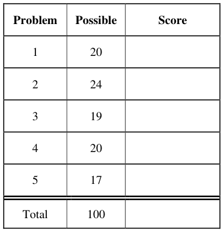
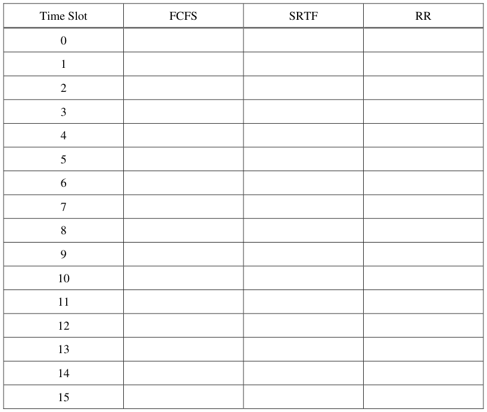
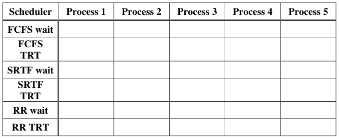
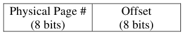
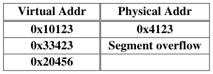
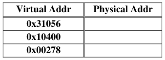
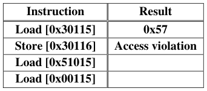
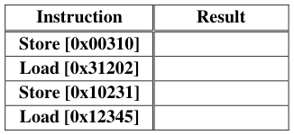
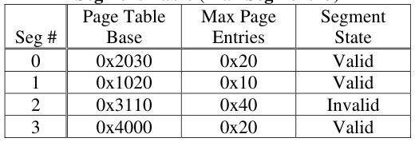

# Berkeley CS162 Fall 2006: Midterm 1: Questions

> Copied from the original: <https://hkn.eecs.berkeley.edu/exams/course/cs/162>. Text and figures are taken from the PDF as is; nothing was answered or rewritten. The original PDF is in this folder.

---

**Page 1**

&emsp;&emsp;&emsp;&emsp;&emsp;&emsp;&emsp;&emsp;University of California, Berkeley 
&emsp;&emsp;&emsp;&emsp;&emsp;&emsp;&emsp;&emsp;College of Engineering 
&emsp;&emsp;&emsp;&emsp;&emsp;&emsp;&emsp;&emsp;Computer Science Division ⎯ EECS 
&emsp;Fall 2006                John Kubiatowicz 
&emsp;&emsp;&emsp;&emsp;&emsp;&emsp;&emsp;&emsp;Midterm I 
&emsp;&emsp;&emsp;&emsp;&emsp;&emsp;&emsp;&emsp;October 11th, 2006 
&emsp;&emsp;&emsp;&emsp;&emsp;&emsp;&emsp;CS162: Operating Systems and Systems Programming

General Information: 
This is a **closed book** exam.  You are allowed 1 page of **hand-written** notes (both sides).  You 
have 3 hours to complete as much of the exam as possible. Make sure to read all of the questions 
first, as some of the questions are substantially more time consuming. 
Write all of your answers directly on this paper.  Make your answers as concise as possible. On 
programming questions, we will be looking for performance as well as correctness, so think through 
your answers carefully.  If there is something about the questions that you believe is open to 
interpretation, please ask us about it!

&emsp;Page 1/19

---

**Page 2**

CS 162 Fall 2006 Midterm Exam I        October 11, 2006

&emsp;&emsp;&emsp;&emsp;&emsp;&emsp;&emsp;&emsp;\[ This page left for π \]

&emsp;&emsp;&emsp;&emsp;3.141592653589793238462643383279502884197169399375105820974944

Page 2/19

---

**Page 3**

CS 162 Fall 2006 Midterm Exam I        October 11, 2006

### Problem 1: Short Answer \[20pts\]

### **Problem 1a\[2pts\]:**  What is a virtual machine?

### **Problem 1b\[2pts\]:** Does a cyclic dependency always lead to deadlock?  Why or why not?

### **Problem 1c\[2pts\]:**  What are exceptions? Name two different types of exceptions and give an

example of each type:

### **Problem 1d\[2pts\]:** List two reasons why overuse of threads is bad (i.e. using too many threads for

different tasks). Be explicit in your answers.

Page 3/19

---

**Page 4**

CS 162 Fall 2006 Midterm Exam I        October 11, 2006

### **Problem 1e\[3pts\]:**  For each of the following thread state transitions, say whether the transition is

legal and how the transition occurs or why itcannot.  Assume Mesa-style monitors. 
&emsp;1). Change from thread state BLOCKED to thread state RUNNING

&emsp;2). Change from thread state RUNNING to thread state BLOCKED

&emsp;3). Change from thread state RUNNABLE to thread state BLOCKED

### **Problem 1f\[4pts\]:** Consider the Dining Lawyers problem, in which a set of lawyers sit around a

table with one chopstick between each of them.  Let the lawyers be numbered from 0 to n-1 and be 
represented by separate threads. Each lawyer executes `Dine(i)`, where “`i`” is the lawyer’s 
number. Assume that there is an array of semaphores, `Chop[i]` that represents the chopstick to the 
left of lawyer `i.` These semaphores are initialized to 1.

`void Dine(int i) {` 
`Chop[i].P();`        `/* Grab left chopstick */` 
`Chop[(i+1)%n].P();`    `/* Grab right chopstick */` 
`EatAsMuchAsYouCan();` 
`Chop[i].V();`        `/* Release left chopstick */` 
`Chop[(i+1)%n].V();`    `/* Release right chopstick */` 
`}` 
This solution can deadlock.  Assume that it does.  List the four conditions of deadlock and explain 
why each of them is satisfied during the deadlock:

Page 4/19

---

**Page 5**

CS 162 Fall 2006 Midterm Exam I        October 11, 2006

### **Problem 1g\[3pt\]:** Pick one of the above four conditions and rewrite the code to eliminate it.

Identify the condition you chose carefully and explain why your code doesn’t deadlock:

### **Problem 1h\[2pts\]:** The Banker’s algorithm is said to keep the system in a “safe” state. Describe

what a “safe” state is and explain how the Banker’s algorithm keeps the system in a safe state. 
Keep your answer short.

**EXTRA CREDIT**

### **Problem 1i\[2pts\]:** Describe what “core” memory is and how it looks.

Page 5/19

---

**Page 6**

CS 162 Fall 2006 Midterm Exam I        October 11, 2006

### Problem 2: Synchronization \[24pts\]

Assume that you are programming a multiprocessor system using threads.  In class, we talked about 
two different synchronization primitives: Semaphores and Monitors. 
The interface for a Semaphore is as follows: 
`public class Semaphore {` 
`public Semaphore(int initialValue) {` 
`/* Create and return a semaphore with initial value: initialValue */` 
`…` 
`}` 
`public P() {` 
`/* Call P() on the semaphore */` 
`…` 
`}` 
`public V() {` 
`/* Call V() on the semaphore */` 
`}` 
`}` 
As we mentioned in class, a Monitor consists of a Lock and one or more Condition Variables. The 
interfaces for these two types of objects are as follows:

`public class Lock {`    `public class CondVar {` 
`public Lock() {`        `public CondVar(Lock lock) {` 
`/* Create new Lock */`            `/* Creates a condition variable` 
`…`                `associated with Lock lock. */` 
`}`                 `…` 
`}` 
`public void Acquire() {`        `public void Wait() {` 
`/* Acquire Lock */`            `/* Block on condition variable *’/` 
`…`             `…` 
`}`             `}` 
`public void Release() {`        `public void Signal() {` 
`/* Release Lock */`            `/* Wake one thread (if it exists) */` 
`…`             `…` 
`}`             `}` 
`}`                 `public void Broadcast() {` 
`/* Wake up all threads waiting on cv*/` 
`…` 
`}` 
`}` 
Monitors and Semaphores can be used for a variety of things. In fact, each can be implemented with 
the other. In this problem, we will show their equivalence.

### **Problem 2a\[2pts\]:** What is the difference between Mesa and Hoare scheduling for monitors?

Page 6/19

---

**Page 7**

CS 162 Fall 2006 Midterm Exam I        October 11, 2006

### **Problem 2b\[5pts\]:** Show how to implement the Semaphore class using Monitors (i.e. the Lock and

CondVar classes).  Make sure to implement all three methods, Semaphore(), P(), and V(). None of 
the methods should require more than five lines.  Assume that Monitors are Mesa scheduled.

&emsp;`public class Semaphore {`

`public Semaphore(int initialValue) {`

`}` 
`public P() {`

`}` 
`public V() {`

`}` 
`}`

### **Problem 2c\[3pts\]:** Show how to implement the Lock class using Semaphores.  Make sure to

implement the Lock(), Acquire(), and Release() methods.  None of the methods should require 
more than five lines. 
&emsp;`public class Lock {`

&emsp;`public Lock() {`

&emsp;&emsp;`}` 
&emsp;&emsp;`public void Acquire() {`

`}` 
`public void Release() {`

`}` 
`}`

Page 7/19

---

**Page 8**

CS 162 Fall 2006 Midterm Exam I        October 11, 2006

### **Problem 2d\[2pts\]:**    Explain    the    difference    in    behavior    between    Semaphore.V()    and

CondVar.Signal() when no threads are waiting in the corresponding semaphore or condition 
variable:

### **Problem 2e\[12pts\]:** Show how to implement the Condition Variable class using Semaphores (and

your Lock class from 2c).  Assume that you are providing Mesa scheduling. Be very careful to 
consider the semantics of CondVar.Signal() as discussed in (2d).  Hint: the Semaphore interface 
does not allow querying of the size of its waiting queue; you may need to track this yourself. None 
of the methods should require more than five lines.

&emsp;`public class CondVar {`

`public CondVar(Lock lock) {`

`}` 
`public void Wait() {`

`}` 
`public void Signal() {`

`}` 
`public void Broadcast() {`

`}` 
`}`

Page 8/19

---

**Page 9**

CS 162 Fall 2006 Midterm Exam I        October 11, 2006

### Problem 3: Critical Sections \[19 pts\]

For each of the following techniques for synchronization, assume that there are two threads 
competing to execute a critical section.  Further, assume that: 
&emsp;1\. A critical section is “protected” if only one thread can enter the critical section at a time. 
&emsp;2\. The synchronization is “fair” if, when each thread attempts to acquire the critical section 
&emsp;&emsp;repeadedly, then each thread will enter the critical section about the same number of times. 
Note: Assume that all flags start out “false”.  Also assume that store is atomic. 
**Synchronization technique #1:** Suppose each thread does the following: 
1\.     `while (flag == true)` 
`2.`      `do nothing;` 
`3. flag = true;` 
`4.` `Execute Critical Section;` 
`5. flag = false;`

### **Problem 3a\[2pts\]:** Will this protect the critical section?   If “yes”, explain why.  If “no”, give an

example interleaving that will fail to protect the critical section.

### **Problem 3b\[2pts\]:** Assume this code protects the critical section.  Is this code “fair”?   Explain.

**Synchronization technique #2:** Suppose we have different code for each thread: 
`THREAD A`        `THREAD B` 
`A1. flag_A = true;`    `B1. flag_B = true;` 
`A2. while (flag_B == true)`     `B2. if (flag_A == false)` 
`A3.`     `do nothing;`    `B3.`     `Execute Critical Section;` 
`A4``. Execute Critical Section;` `B4``.` `flag_B = false;` 
`A5. flag_A = false;`

### **Problem 3c\[2pts\]:** Will this protect the critical section?   If “yes”, explain why.  If “no”, give an

example interleaving that will fail to protect the critical section.

### **Problem 3d\[2pts\]:** Assume this code protects the critical section.  Is this code “fair”?  Explain.

Page 9/19

---

**Page 10**

CS 162 Fall 2006 Midterm Exam I        October 11, 2006

**Synchronization technique #3:** Suppose each thread does the following: 
1\.    `while (TestAndSet(flag) == false)` 
`2.`     `do nothing;` 
`3.` `Execute Critical Section;` 
`4. flag = false;`

### **Problem 3e\[3pts\]:** Will this protect the critical section?   If “yes”, explain why.  If “no”, explain

and explain how to fix it.

### **Problem 3f\[2pts\]:** Assume the above code (or your fixed version).  Will this code be “fair”?

Explain.

**Synchronization technique #4:** Suppose we have different code for each thread: 
`THREAD A`        `THREAD B` 
`A1. flag_A = true;`    `B1. flag_B = true;` 
`A2. while (flag_B == true)`    `B2. while (flag_A == true)` 
`A3.`     `do nothing;`     `B3.`     `do nothing;` 
`A4.` `Execute Critical Section;` `B4.` `Execute Critical Section;` 
`A5. flag_A = false;`    `B5``.` `flag_B = false;`

### **Problem 3g\[3pts\]:** Will this protect the critical section?   If “yes”, explain why.  If “no”, explain

and explain how to fix it.  Note that this question is only about protecting the critical section!

### **Problem 3h\[3pts\]:** Explain why this code (or your fixed version) would not be a particularly good

mechanism for synchronizing threads A and B.  (hint: imagine that threads A and B repeatedly try 
to acquire the critical section).  After describing the problem, explain how to fix the problem by 
replacing the “do nothing” with no more than three lines inside each while loop above.

Page 10/19

---

**Page 11**

CS 162 Fall 2006 Midterm Exam I        October 11, 2006

### Problem 4: Scheduling \[20pts\]

### **Problem 4a\[2pts\]:**

Describe one way to predict the burst runtime (time between I/O operations) for a thread.

### **Problem 4b\[3pts\]:**

What is priority inversion? Explain how a priority scheduler could be modified to avoid priority 
inversion.

### **Problem 4c\[3pts\]:**

Explain what a multi-level feedback scheduler is and why it approximates SRTF.

### **Problem 4d\[2pts\]:** Explain how to fool the multi-level feedback scheduler’s heuristics into giving

a long-running task more CPU cycles.

Page 11/19

---

**Page 12**

CS 162 Fall 2006 Midterm Exam I        October 11, 2006

### **Problem 4e\[5pts\]:**

Here is a table of processes and their associated arrival and running times.

Show the scheduling order for these processes under 3 policies: First Come First Serve (FCFS), 
Shortest-Remaining-Time-First (SRTF), Round-Robin (RR) with timeslice quantum = 1. Assume 
that context switch overhead is 0 and that new processes are added to the **head** of the queue except 
for FCFS, where they are added to the tail.

Page 12/19

---

**Page 13**

CS 162 Fall 2006 Midterm Exam I        October 11, 2006

### **Problem 4f\[3pts\]:**

For each process in each schedule above, indicate the queue wait time and completion time 
(otherwise known as turnaround time, TRT).  Note that wait time is the total time spend waiting in 
queue (all the time in which the task is not running), while TRT is the total time from when the 
process arrives in the queue until it is completed.

### **Problem 4g\[2pts\]:**

Assume that we could have an oracle perform the best possible scheduling to reduce average wait 
time. What would be the optimal average wait time, and which of the above three schedulers would 
come closest to optimal?  Explain.

Page 13/19

---

**Page 14**

CS 162 Fall 2006 Midterm Exam I        October 11, 2006

&emsp;&emsp;&emsp;&emsp;&emsp;&emsp;&emsp;&emsp;\[ This page intentionally left blank \]

Page 14/19

---

**Page 15**

CS 162 Fall 2006 Midterm Exam I        October 11, 2006

### Problem 5: Address Translation \[17 pts\]

### **Problem 5a\[2 pts\]:**

Explain how Address Translation can protect processes from one another.

### **Problem 5b\[3pts\]:**

Suppose we have a memory system with 32-bit virtual addresses and 4 KB pages. If the page table 
is full (with 220 pages), show that a 20-level page table consumes approximately twice the space of 
a single level page table. Hint: try drawing it out and summing a series.

### **Problem 5c\[2pts\]:**

Problem (5b) showed that, in a full page table, increasing the number of levels of indirection 
increases the page table size.  Show that this is not necessarily true for a sparse page table (i.e. one 
in which not all entries are in use).

Page 15/19

---

**Page 16**

CS 162 Fall 2006 Midterm Exam I        October 11, 2006

Consider a multi-level memory management scheme using the following format for virtual 
addresses:

Virtual addresses are translated into physical addresses of the following form:

### **Problem 5d\[4pts\]:** For the following Virtual Addresses, translate them into Physical Addresses.

Use the Segment Table and Physical Memory table given on the next page.  Segment entries point 
to page tables in memory.  A page table consists of a series of 16 bit page table entries (PTEs). The 
format of a PTE is given on the next page. Briefly, the first byte of the PTE is an 8-bit physical 
page #, and the second byte is an 8-bit flags field with one of the following values: 
&emsp;&emsp;&emsp;&emsp;&emsp;0x00 (Invalid), 0x06 (Valid, RO), 0x07 (Valid, R/W). 
If there is an error during translation, make sure to say what the error is.  Errors can be 
“**bad segment error**” (undefined or invalid segment), “**segment overflow error**” (address outside 
range of segment), or “**access violation error**” (page invalid, or attempt to write a read only (RO) 
page).  Two answers are given:

### **Problem 5e\[6pts\]:** Consider the same multi-level memory management scheme.  Please return the

results from the following load/store instructions.  Addresses are virtual. The return value for load 
is an 8-bit data value or an error, while the return value for a store is either “**ok**” or an error.  For 
errors, please specify which type of error (from the above set). Two answers are given:

Page 16/19

---

**Page 17**

CS 162 Fall 2006 Midterm Exam I        October 11, 2006

&emsp;&emsp;&emsp;&emsp;&emsp;&emsp;&emsp;&emsp;**Virtual Address Format**

&emsp;&emsp;&emsp;&emsp;&emsp;&emsp;&emsp;&emsp;**Segment Table (Max Segment=3)**

&emsp;&emsp;&emsp;&emsp;&emsp;&emsp;&emsp;&emsp;**Page Table Entry**

&emsp;&emsp;&emsp;&emsp;&emsp;&emsp;&emsp;&emsp;**Physical Memory**

Page 17/19

---

**Page 18**

CS 162 Fall 2006 Midterm Exam I        October 11, 2006

&emsp;&emsp;&emsp;&emsp;&emsp;&emsp;&emsp;&emsp;**\[ This page intentionally left blank \]**

Page 18/19

---

**Page 19**

CS 162 Fall 2006 Midterm Exam I        October 11, 2006

&emsp;&emsp;&emsp;&emsp;&emsp;&emsp;&emsp;&emsp;**\[ Scratch Sheet (Feel free to remove) \]**

Page 19/19

