# Berkeley CS162 Fall 2006: Midterm 1: Official solutions

> Copied from the original: <https://hkn.eecs.berkeley.edu/exams/course/cs/162>. Text and figures are taken from the PDF as is; nothing was answered or rewritten. The original PDF is in this folder.

---

**Page 1**

&emsp;&emsp;&emsp;&emsp;&emsp;&emsp;&emsp;&emsp;hUniversity of California, Berkeley 
&emsp;&emsp;&emsp;&emsp;&emsp;&emsp;&emsp;&emsp;College of Engineering 
&emsp;&emsp;&emsp;&emsp;&emsp;&emsp;&emsp;&emsp;Computer Science Division ⎯ EECS 
&emsp;Fall 2006                John Kubiatowicz 
&emsp;&emsp;&emsp;&emsp;&emsp;&emsp;&emsp;&emsp;Midterm I 
&emsp;&emsp;&emsp;&emsp;&emsp;&emsp;&emsp;&emsp;SOLUTIONS 
&emsp;&emsp;&emsp;&emsp;&emsp;&emsp;&emsp;&emsp;October 11th, 2006 
&emsp;&emsp;&emsp;&emsp;&emsp;&emsp;&emsp;CS162: Operating Systems and Systems Programming

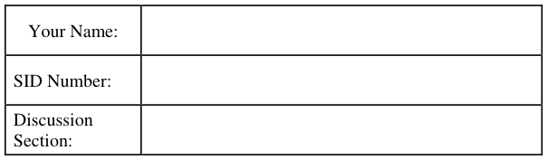

General Information: 
This is a **closed book** exam.  You are allowed 1 page of **hand-written** notes (both sides).  You 
have 3 hours to complete as much of the exam as possible. Make sure to read all of the questions 
first, as some of the questions are substantially more time consuming. 
Write all of your answers directly on this paper.  Make your answers as concise as possible. On 
programming questions, we will be looking for performance as well as correctness, so think through 
your answers carefully.  If there is something about the questions that you believe is open to 
interpretation, please ask us about it!

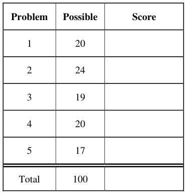

&emsp;Page 1/18

---

**Page 2**

CS 162 Fall 2006 Midterm Exam I        October 11, 2006

&emsp;&emsp;&emsp;&emsp;&emsp;&emsp;&emsp;&emsp;\[ This page left for π \]

&emsp;&emsp;&emsp;&emsp;3.141592653589793238462643383279502884197169399375105820974944

Page 2/18

---

**Page 3**

CS 162 Fall 2006 Midterm Exam I        October 11, 2006

### Problem 1: Short Answer \[20pts\]

### **Problem 1a\[2pts\]:**  What is a virtual machine?

&emsp;A virtual machine is a software emulation of an abstract machine. It can be used to present an 
&emsp;idealized execution environment to software, prevent malicious software from compromising the 
&emsp;underlying operating system, and permit multiple operating systems to run on a single 
&emsp;hardware base simultaneously.

### **Problem 1b\[2pts\]:** Does a cyclic dependency always lead to deadlock?  Why or why not?

&emsp;No.  If there are multiple equivalent resources, then a cycle could exist that wasn’t a deadlock: 
&emsp;The reason is that some thread that wasn’t a part of the cycle could release a resource needed 
&emsp;by a thread in the cycle, thereby breaking the cycle.

### **Problem 1c\[2pts\]:**  What are exceptions? Name two different types of exceptions and give an

example of each type: 
&emsp;Exceptions are events that stop normal execution, switch the execution mode into kernel mode, 
&emsp;and begin execution at special locations within the kernel.  Exceptions can be either 
&emsp;synchronous or asynchronous.  Examples of synchronous exceptions are system calls, divide by 
&emsp;zero errors, illegal instructions, and page faults. Asynchronous exceptions are also called 
&emsp;interrupts, such as timer interrupts, network interrupts, and disk interrupts.

### **Problem 1d\[2pts\]:** List two reasons why overuse of threads is bad (i.e. using too many threads for

different tasks). Be explicit in your answers. 
&emsp;Here are a few: 
&emsp;&emsp;• Can significantly decrease throughput as the number of context switches increases. 
&emsp;&emsp;• Significant space overhead from TCBs and other thread-related data structures. 
&emsp;&emsp;• Dividing a problem into an increasing number of threads is very difficult and can 
&emsp;&emsp;&emsp;&emsp;introduce significant synchronization overhead. 
&emsp;&emsp;• Getting synchronization correct can become difficult leading to incorrect behavior or 
&emsp;&emsp;&emsp;&emsp;deadlock.

Page 3/18

---

**Page 4**

CS 162 Fall 2006 Midterm Exam I        October 11, 2006

### **Problem 1e\[3pts\]:**  For each of the following thread state transitions, say whether the

&emsp;transition is legal and how the transition occurs or why it cannot.  Assume Mesa-style 
&emsp;monitors. 
&emsp;1). Change from thread state BLOCKED to thread state RUNNING 
&emsp;&emsp;NOT legal in most operating systems: running threads must be selected from the list of 
&emsp;&emsp;ready (or runnable) threads.  If Hoare-style monitors are used, however, threads blocked on 
&emsp;&emsp;a lock can transition directly to RUNNING. 
&emsp;2). Change from thread state RUNNING to thread state BLOCKED 
&emsp;&emsp;Legal: a running thread can become blocked when it requests a resource (disk I/O, a lock, 
&emsp;&emsp;etc), synchronizes with a join() operation, etc 
&emsp;3). Change from thread state RUNNABLE to thread state BLOCKED 
&emsp;&emsp;NOT legal: a thread can only transition to BLOCKED from RUNNING. It must execute 
&emsp;&emsp;some action that causes it to block, and it cannot do this unless it is RUNNING.

### **Problem 1f\[4pts\]:** Consider the Dining Lawyers problem, in which a set of lawyers sit around a

table with one chopstick between each of them.  Let the lawyers be numbered from 0 to n-1 and be 
represented by separate threads. Each lawyer executes `Dine(i)`, where “`i`” is the lawyer’s 
number. Assume that there is an array of semaphores, `Chop[i]` that represents the chopstick to the 
left of lawyer `i.` These semaphores are initialized to 1.

`void Dine(int i) {` 
`Chop[i].P();`        `/* Grab left chopstick */` 
`Chop[(i+1)%n].P();`    `/* Grab right chopstick */` 
`EatAsMuchAsYouCan();` 
`Chop[i].V();`        `/* Release left chopstick */` 
`Chop[(i+1)%n].V();`    `/* Release right chopstick */` 
`}` 
This solution can deadlock.  Assume that it does.  List the four conditions of deadlock and explain 
why each of them is satisfied during the deadlock: 
&emsp;• mutual exclusion – semaphores are initialized to 1; consequently, each chopstick can only 
&emsp;&emsp;be held by one thread at a time. 
&emsp;• no preemption – the chopsticks cannot be taken away from a task without violating the 
&emsp;&emsp;semantics of semaphores and hence the assumptions of the code. 
&emsp;• hold and wait – during a deadlock, the second P() call above causes the thread to wait while 
&emsp;&emsp;it is holding another chopstick (first P() call). 
&emsp;• circular wait – Lawyer i grabs Chop\[i\] and waits for lawyer (i+1)%n to release 
&emsp;&emsp;Chop\[(i+1)%n\].  This is a cycle since lawyer n – 1 completes the cycle by grabbing 
&emsp;&emsp;Chop\[n-1\] and waiting for lawyer 0 to release Chop\[0\].

Page 4/18

---

**Page 5**

CS 162 Fall 2006 Midterm Exam I        October 11, 2006

### **Problem 1g\[3pt\]:** Pick one of the above four conditions and rewrite the code to eliminate it.

Identify the condition you chose carefully and explain why your code doesn’t deadlock: 
**Circular wait: Several options here** 
&emsp;&emsp;• Always request the resources in increasing order. There can never be a circular wait – 
&emsp;&emsp;&emsp;such a cycle would imply that someone requested a high chopstick first, then a low one.

&emsp;&emsp;&emsp;`void Dine(int i) {` 
&emsp;&emsp;&emsp;`if (i==n-1) {` 
&emsp;&emsp;&emsp;`Chop[0].P();`        `/* Grab right chopstick */` 
&emsp;&emsp;&emsp;`Chop[n-1].P();`     `/* Grab left chopstick */` 
&emsp;&emsp;&emsp;`} else {` 
&emsp;&emsp;&emsp;`Chop[i].P();`        `/* Grab left chopstick */` 
&emsp;&emsp;&emsp;`Chop[(i+1)%n].P();`    `/* Grab right chopstick */` 
&emsp;&emsp;&emsp;`}` 
&emsp;&emsp;&emsp;`EatAsMuchAsYouCan();` 
&emsp;&emsp;&emsp;`Chop[i].V();`        `/* Release left chopstick */` 
&emsp;&emsp;&emsp;`Chop[(i+1)%n].V();`    `/* Release right chopstick */` 
&emsp;&emsp;&emsp;`}` 
&emsp;&emsp;• Odd diners request left chopstick first while even diners request right chopstick first. 
&emsp;&emsp;&emsp;Any deadlock would involve all lawyers holding one chopstick but waiting on another. 
&emsp;&emsp;&emsp;This cannot happen because pairs of an odd lawyer and following even lawyers (say 1 
&emsp;&emsp;&emsp;and 2) would be waiting for each other in order to get the chopstick between them.  But 
&emsp;&emsp;&emsp;at least one of them would actually get the chopstick and be able to eat.

&emsp;&emsp;&emsp;`void Dine(int i) {` 
&emsp;&emsp;&emsp;`if (i%2==1) {` 
&emsp;&emsp;&emsp;`Chop[i].P();`        `/* Grab left chopstick */` 
&emsp;&emsp;&emsp;`Chop[(i+1)%n].P();`    `/* Grab right chopstick */` 
&emsp;&emsp;&emsp;`} else {` 
&emsp;&emsp;&emsp;`Chop[(i+1)%n].P();`    `/* Grab right chopstick */` 
&emsp;&emsp;&emsp;`Chop[i].P();`        `/* Grab left chopstick */` 
&emsp;&emsp;&emsp;`}` 
&emsp;&emsp;&emsp;`EatAsMuchAsYouCan();` 
&emsp;&emsp;&emsp;`Chop[i].V();`        `/* Release left chopstick */` 
&emsp;&emsp;&emsp;`Chop[(i+1)%n].V();`    `/* Release right chopstick */` 
&emsp;&emsp;&emsp;`}` 
&emsp;&emsp;• Use a lock to guard the two picks. Consequently, no more than one lawyer can be stuck 
&emsp;&emsp;&emsp;in the critical section waiting for chopsticks. The remaining lawyers will either have two 
&emsp;&emsp;&emsp;chopsticks (and can proceed) or have no chopsticks and will be waiting on the lock 
&emsp;&emsp;&emsp;holder.  This resulting wait graph is acyclic (has no cycles).

&emsp;&emsp;`Lock lock;            //global variable shared by all threads` 
&emsp;&emsp;`void Dine(int i) {` 
&emsp;&emsp;`lock.Acquire();` 
&emsp;&emsp;`Chop[i].P();` 
&emsp;&emsp;`Chop[(i+1)%n].P();` 
&emsp;&emsp;`Lock.Release();` 
&emsp;&emsp;`EatAsMuchAsYouCan();` 
&emsp;&emsp;`Chop[i].V();` 
&emsp;&emsp;`Chop[(i+1)%n].V();` 
&emsp;&emsp;&emsp;`}`

Page 5/18

---

**Page 6**

CS 162 Fall 2006 Midterm Exam I        October 11, 2006

&emsp;&emsp;**Hold and wait: Remove this condition by never holding resources and waiting.** 
&emsp;&emsp;`//global variables shared by all threads` 
&emsp;&emsp;`Lock lock;` 
&emsp;&emsp;`Boolean[n] inUse;` 
&emsp;&emsp;`void Dine(int i) {` 
&emsp;&emsp;`Boolean success = false;` 
&emsp;&emsp;`while (!success) {` 
&emsp;&emsp;`lock.Acquire();` 
&emsp;&emsp;if  (!`inUse[i] && !inUse[(i+1)%n]) { /* Can get both! */` 
&emsp;&emsp;`Chop[i].P();` 
&emsp;&emsp;`Chop[(i+1)%n].P();` 
&emsp;&emsp;`inUse[i] = true;` 
&emsp;&emsp;`inUse[(i+1)%n] = true;` 
&emsp;&emsp;`success=true;` 
&emsp;&emsp;`} else {` 
&emsp;&emsp;`Yield();`        `/* Cannot get both – wait */` 
&emsp;&emsp;`Lock.Release();` 
&emsp;&emsp;`}` 
&emsp;&emsp;`EatAsMuchAsYouCan();` 
&emsp;&emsp;`Chop[i].V();` 
&emsp;&emsp;`Chop[(i+1)%n].V();` 
&emsp;&emsp;`inUse[i] = false;` 
&emsp;&emsp;`inUse[[(i+1)%n] = false;` 
&emsp;&emsp;&emsp;`}` 
&emsp;&emsp;**Mutual exclusion and/or No Preemption:** 
&emsp;&emsp;Cannot be prevented because of semaphore semantics.

### **Problem 1h\[2pts\]:** The Banker’s algorithm is said to keep the system in a “safe” state. Describe

what a “safe” state is and explain how the Banker’s algorithm keeps the system in a safe state. 
Keep your answer short. 
&emsp;In a safe state, there is some ordering of the threads in the system such that threads can 
&emsp;complete, one after another without deadlocking and without requiring threads to give up 
&emsp;resources that they already have. On every request for resources, the Banker’s algorithm 
&emsp;simulates granting those resources and determines whether or not the simulated state is safe. 
&emsp;The resources are granted only if the simulated state is safe. 
**EXTRA CREDIT**

### **Problem 1i\[2pts\]:** Describe what “core” memory is and how it looks.

&emsp;Core memory is a technology in which each bit of memory was stored as a magnetic field in a 
&emsp;round iron ring.  A core memory looked like a large woven tapestry made from these rings. 
&emsp;Each core had had horizontal and vertical wires running through it for read and writing.

Page 6/18

---

**Page 7**

CS 162 Fall 2006 Midterm Exam I        October 11, 2006

### Problem 2: Synchronization \[24pts\]

Assume that you are programming a multiprocessor system using threads.  In class, we talked about 
two different synchronization primitives: Semaphores and Monitors. 
The interface for a Semaphore is as follows: 
`public class Semaphore {` 
`public Semaphore(int initialValue) {` 
`/* Create and return a semaphore with initial value: initialValue */` 
`…` 
`}` 
`public P() {` 
`/* Call P() on the semaphore */` 
`…` 
`}` 
`public V() {` 
`/* Call V() on the semaphore */` 
`}` 
`}` 
As we mentioned in class, a Monitor consists of a Lock and one or more Condition Variables. The 
interfaces for these two types of objects are as follows:

`public class Lock {`    `public class CondVar {` 
`public Lock() {`        `public CondVar(Lock lock) {` 
`/* Create new Lock */`            `/* Creates a condition variable` 
`…`                `associated with Lock lock. */` 
`}`                 `…` 
`}` 
`public void Acquire() {`        `public void Wait() {` 
`/* Acquire Lock */`            `/* Block on condition variable *’/` 
`…`             `…` 
`}`             `}` 
`public void Release() {`        `public void Signal() {` 
`/* Release Lock */`            `/* Wake one thread (if it exists) */` 
`…`             `…` 
`}`             `}` 
`}`                 `public void Broadcast() {` 
`/* Wake up all threads waiting on cv*/` 
`…` 
`}` 
`}` 
Monitors and Semaphores can be used for a variety of things. In fact, each can be implemented with 
the other. In this problem, we will show their equivalence.

### **Problem 2a\[2pts\]:** What is the difference between Mesa and Hoare scheduling for monitors?

&emsp;Mesa: signaler keeps lock and processor; waiter placed on ready queue and does not run 
&emsp;immediately 
&emsp;Hoare: signal gives lock and CPU to waiter; waiter runs immediately; waiter gives lock and 
&emsp;processor back to signaler when it exits critical section or waits again.

Page 7/18

---

**Page 8**

CS 162 Fall 2006 Midterm Exam I        October 11, 2006

### **Problem 2b\[5pts\]:** Show how to implement the Semaphore class using Monitors (i.e. the Lock

&emsp;and CondVar classes).  Make sure to implement all three methods, Semaphore(), P(), and V(). 
&emsp;None of the methods should require more than five lines.  Assume that Monitors are Mesa 
&emsp;scheduled.

&emsp;`public class Semaphore {` 
`Lock lock;`         `// Every Monitor has a lock and CondVar` 
`CondVar c;` 
`Int value;`         `// Semaphores have an integer value` 
`public Semaphore(int initialValue) {` 
`value = initialValue;` 
`lock = new Lock();` 
`c = new CondVar(lock);` 
`}` 
`public P() {` 
`lock.Acquire();` 
`while (value == 0)` 
`c.Wait();` 
`value--;` 
`lock.Release();` 
`}` 
`public V() {` 
`lock.Acquire();` 
`value++;` 
`c.Signal();` 
`lock.Release();` 
`}` 
`}`

### **Problem 2c\[3pts\]:** Show how to implement the Lock class using Semaphores.  Make sure to

implement the Lock(), Acquire(), and Release() methods.  None of the methods should require 
more than five lines. 
&emsp;`public class Lock {` 
`Semaphore s;`

&emsp;`public Lock() {` 
`s = new Semaphore(1);`

&emsp;&emsp;`}` 
&emsp;&emsp;`public void Acquire() {` 
`s.P();`

`}` 
`public void Release() {` 
`s.V();` 
`}` 
`}`

Page 8/18

---

**Page 9**

CS 162 Fall 2006 Midterm Exam I        October 11, 2006

### **Problem 2d\[2pts\]:**    Explain    the    difference    in    behavior    between    Semaphore.V()    and

CondVar.Signal() when no threads are waiting in the corresponding semaphore or condition 
variable: 
Semaphore.V() increments the Semaphore value, while CondVar.Signal() does nothing.

### **Problem 2e\[12pts\]:** Show how to implement the Condition Variable class using Semaphores (and

your Lock class from 2c).  Assume that you are providing Mesa scheduling. Be very careful to 
consider the semantics of CondVar.Signal() as discussed in (2d).  Hint: the Semaphore interface 
does not allow querying of the size of its waiting queue; you may need to track this yourself. None 
of the methods should require more than five lines. 
// Note that this solution only works with Mesa scheduling.  See book for Hoare version 
// (much more complex!) 
`public class CondVar {` 
`Lock lock;` 
`Semaphore s;` 
`int queueLength;`

`public CondVar(Lock lock) {` 
`s = new Semaphore(0);` 
`this.lock = lock;` 
`queueLength = 0;` 
`}` 
`public void Wait() {` 
`// IMPORTANT: WE ARE IN THE CRITICAL SECTION (LOCK IS ACQUIRED)` 
`// Before releasing lock, make sure to increment queueLength.` 
`// This is important for the Signal() method.` 
`queueLength++;` 
`lock.Release();` 
`s.P();` 
`lock.Acquire();` 
`}` 
`public void Signal() {` 
`// Note that we are in the critical section.` 
`if (queueLength > 0) {` 
`s.V();` 
`queueLength--;` 
`}` 
`}` 
`public void Broadcast() {` 
`// Note that we are in the critical section.` 
`while (queueLength > 0) {` 
`s.V();` 
`queueLength--;` 
`}` 
`}` 
`}`

Page 9/18

---

**Page 10**

CS 162 Fall 2006 Midterm Exam I        October 11, 2006

### Problem 3: Critical Sections \[19 pts\]

For each of the following techniques for synchronization, assume that there are two threads 
competing to execute a critical section.  Further, assume that: 
&emsp;1\. A critical section is “protected” if only one thread can enter the critical section at a time. 
&emsp;2\. The synchronization is “fair” if, when each thread attempts to acquire the critical section 
&emsp;&emsp;repeadedly, then each thread will enter the critical section about the same number of times. 
Note: Assume that all flags start out “false”.  Also assume that store is atomic. 
**Synchronization technique #1:** Suppose each thread does the following: 
1\.     `while (flag == true)` 
`2.`      `do nothing;` 
`3. flag = true;` 
`4.` `Execute Critical Section;` 
`5. flag = false;`

### **Problem 3a\[2pts\]:** Will this protect the critical section?   If “yes”, explain why.  If “no”, give an

example interleaving that will fail to protect the critical section. 
&emsp;No.  Thread A runs line 1, determines flag is false, and is context-switched.  Then, thread B runs 
&emsp;line 1 and also determines flag is false.  Now threads A and B can both access critical section.

### **Problem 3b\[2pts\]:** Assume this code protects the critical section.  Is this code “fair”?   Explain.

&emsp;Yes. This code is symmetric so will each thread has an equal chance. 
**Synchronization technique #2:** Suppose we have different code for each thread: 
`THREAD A`        `THREAD B` 
`A1. flag_A = true;`    `B1. flag_B = true;` 
`A2. while (flag_B == true)`     `B2. if (flag_A == false)` 
`A3.`     `do nothing;`    `B3.`     `Execute Critical Section;` 
`A4``. Execute Critical Section;` `B4``.` `flag_B = false;` 
`A5. flag_A = false;`

### **Problem 3c\[2pts\]:** Will this protect the critical section?   If “yes”, explain why.  If “no”, give an

example interleaving that will fail to protect the critical section. 
&emsp;Yes, thread A only enters the critical section when flag\_B is false (this is satisfied only while 
&emsp;thread B is executing before B1 or after B4).  Thread B only enters the critical section when 
&emsp;flag\_A is false (this is satisfied only while thread A is executing before A1 or after A5).

### **Problem 3d\[2pts\]:** Assume this code protects the critical section.  Is this code “fair”?  Explain.

&emsp;No.  Thread A always gets a chance to run the critical section  during an execution of A1-A5. 
&emsp;On the other hand, Thread B will be prevented from running the critical section whenever 
&emsp;Thread A is in that region.  If A and B are running in a tight loop, Thread B only gets to run the 
&emsp;critical section if it is lucky enough to execute  B2 between the execution of A5 and the next 
&emsp;execution of A1.

Page 10/18

---

**Page 11**

CS 162 Fall 2006 Midterm Exam I        October 11, 2006

&emsp;**Synchronization technique #3:** Suppose each thread does the following: 
1\.    `while (TestAndSet(flag) == false)` 
`2.`     `do nothing;` 
`3.` `Execute Critical Section;` 
`4. flag = false;`

### **Problem 3e\[3pts\]:** Will this protect the critical section?   If “yes”, explain why.  If “no”, explain

and explain how to fix it. 
&emsp;No.  Since TestAndSet sets a memory location to 1 (true), the locked condition is indicated by 
&emsp;the value of flag == true.  Hence, the above code doesn’t wait when the lock is already taken. 
&emsp;Hence, it doesn’t protect the critical section.  To fix the code, replace TestAndSet(flag) == false 
&emsp;with TestAndSet(flag) == true.

### **Problem 3f\[2pts\]:** Assume the above code (or your fixed version).  Will this code be “fair”?

Explain. 
&emsp;Yes. This code is symmetric so will each thread has an equal chance. 
**Synchronization technique #4:** Suppose we have different code for each thread: 
`THREAD A`        `THREAD B` 
`A1. flag_A = true;`    `B1. flag_B = true;` 
`A2. while (flag_B == true)`    `B2. while (flag_A == true)` 
`A3.`     `do nothing;`     `B3.`     `do nothing;` 
`A4.` `Execute Critical Section;` `B4.` `Execute Critical Section;` 
`A5. flag_A = false;`    `B5``.` `flag_B = false;`

### **Problem 3g\[3pts\]:** Will this protect the critical section?   If “yes”, explain why.  If “no”, explain

and explain how to fix it.  Note that this question is only about protecting the critical section! 
&emsp;Yes, thread A only enters the critical section when flag\_B is false (this is satisfied only while 
&emsp;thread B is executing before B1 or after B5).  Thread B only enters the critical section when 
&emsp;flag\_A is false (this is satisfied only while thread A is executing before A1 or after A5).

### **Problem 3h\[3pts\]:** Explain why this code (or your fixed version) would not be a particularly good

mechanism for synchronizing threads A and B.  (hint: imagine that threads A and B repeatedly try 
to acquire the critical section).  After describing the problem, explain how to fix the problem by 
replacing the “do nothing” with no more than three lines inside each while loop above. 
&emsp;This is not a good mechanism, since there is a chance of deadlock occurring.  Imagine that 
&emsp;Thread A executes A1 (setting flag\_A→true), just before system context-switches to Thread B. 
&emsp;Then, Thread B executes B1 (setting flag\_B→true). Now system is deadlocked. 
&emsp;For Thread A replace “do nothing” with “flag\_A=false; yield(); flag\_A=true” and for Thread 
&emsp;B replace “do nothing” with “flag\_B=false; yield(); flag\_B=true”.  This will prevent deadlock 
&emsp;while retaining the critical section protection.

Page 11/18

---

**Page 12**

CS 162 Fall 2006 Midterm Exam I        October 11, 2006

### Problem 4: Scheduling \[20pts\]

### **Problem 4a\[2pts\]:**

Describe one way to predict the burst runtime (time between I/O operations) for a thread. 
&emsp;By predicting the future burst runtimes based on a set of past runtimes.  The simplest version is 
&emsp;to use a exponential averaging with a single sample point: each new estimate is computed as a 
&emsp;linear combination of the previous estimate and the most recent actual burst time: 
&emsp;Estimate\[t\] = α Estimate\[t-1\] + (1-α) Burst\[t-1\]

### **Problem 4b\[3pts\]:**

What is priority inversion? Explain how a priority scheduler could be modified to avoid priority 
inversion. 
&emsp;Priority inversion is a situation in which a high priority thread is waiting on a low priority 
&emsp;thread (e.g. waiting for a lock or some resource held by the low priority thread), and there is a 
&emsp;medium priority thread on the ready queue.  In this situation, the high priority thread is always 
&emsp;waiting, and the medium priority thread is running. 
&emsp;Can be fixed with priority donation – the low priority thread is granted priority by the high 
&emsp;priority thread.

### **Problem 4c\[3pts\]:**

Explain what a multi-level feedback scheduler is and why it approximates SRTF. 
&emsp;A multi-level feedback scheduler is a scheduler with multiple queues, each with a different 
&emsp;priority and its own scheduling algorithm. 
&emsp;If the time quantum expires, drop the thread one queue level, else push the thread up one queue 
&emsp;level. Using this algorithm, short-running CPU jobs stay near the top, and CPU-bound jobs 
&emsp;drop toward the bottom.  Assuming that the high queue levels are given more priority than the 
&emsp;lower ones, this tends to approximate SRTF because it gives more CPU cycles to jobs with short 
&emsp;bursts.

### **Problem 4d\[2pts\]:** Explain how to fool the multi-level feedback scheduler’s heuristics into giving

a long-running task more CPU cycles. 
&emsp;&emsp;Place unnecessary I/O calls in code to keep burst time shorter than time quantum.

Page 12/18

---

**Page 13**

CS 162 Fall 2006 Midterm Exam I        October 11, 2006

### **Problem 4e\[5pts\]:**

Here is a table of processes and their associated arrival and running times.

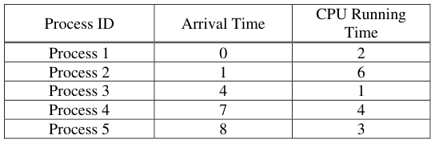

Show the scheduling order for these processes under 3 policies: First Come First Serve (FCFS), 
Shortest-Remaining-Time-First (SRTF), Round-Robin (RR) with timeslice quantum = 1. Assume 
that context switch overhead is 0 and that new processes are added to the **head** of the queue except 
for FCFS, where they are added to the tail.

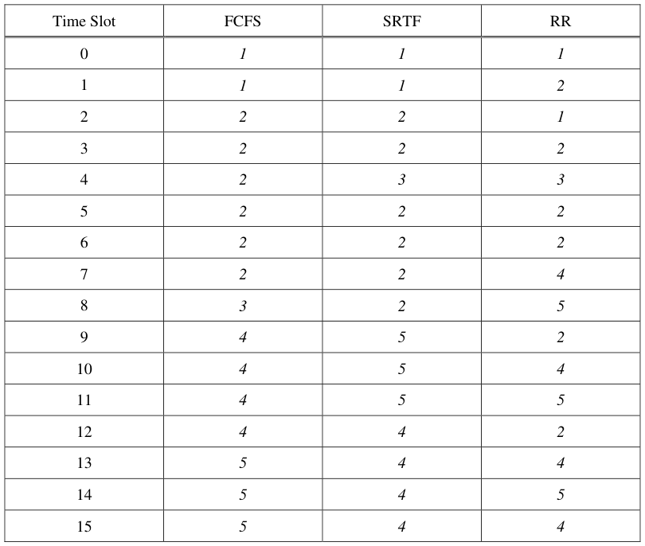

Page 13/18

---

**Page 14**

CS 162 Fall 2006 Midterm Exam I        October 11, 2006

### **Problem 4f\[3pts\]:**

For each process in each schedule above, indicate the queue wait time and completion time 
(otherwise known as turnaround time, TRT).  Note that wait time is the total time spend waiting in 
queue (all the time in which the task is not running), while TRT is the total time from when the 
process arrives in the queue until it is completed.

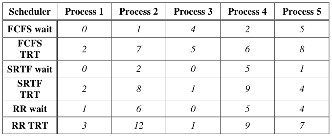

### **Problem 4g\[2pts\]:**

Assume that we could have an oracle perform the best possible scheduling to reduce average wait 
time. What would be the optimal average wait time, and which of the above three schedulers would 
come closest to optimal?  Explain.

&emsp;Since SRTF is optimal, we just look at the average wait time from the above table in the SRTF 
&emsp;line: Optimal average wait time is 1.6.

Page 14/18

---

**Page 15**

CS 162 Fall 2006 Midterm Exam I        October 11, 2006

### Problem 5: Address Translation \[17 pts\]

### **Problem 5a\[2 pts\]:**

Explain how Address Translation can protect processes from one another. 
&emsp;When setting up the address mappings for each process, the kernel can make sure that the same 
&emsp;physical page is never available to two different processes.  As a result, it is impossible for any 
&emsp;process to access the physical memory of another process or to interfere with another process 
&emsp;in this way. Since only the kernel can reconfigure the mapping from virtual addresses to 
&emsp;physical addresses, translation protects processes from one another.

### **Problem 5b\[3pts\]:**

Suppose we have a memory system with 32-bit virtual addresses and 4 KB pages. If the page table 
is full (with 220 pages), show that a 20-level page table consumes approximately twice the space of 
a single level page table. Hint: try drawing it out and summing a series. 
&emsp;A 4KB page ⇒ 12 bits of offset. So, there are 20 bits to address pages.  We have a full page 
&emsp;table, so that we know that there must be 220 pages and that the table has 220 pages. 
&emsp;Since there are only 20 bits to address pages, we know that, a 20-level page table would mean 
&emsp;that each level is addressed with only 1 bit.  This means that each single level has only 2 
&emsp;entries. To support all 220 pages, we need to build a complete 20-level binary tree.  This tree 
&emsp;&emsp;&emsp;&emsp;&emsp;&emsp;&emsp;&emsp;20   20 
&emsp;= 2 (would have 2 + 4 + … + 2   2    – 1) entries, approximately twice that of the single- 
&emsp;level page table.

### **Problem 5c\[2pts\]:**

Problem (5b) showed that, in a full page table, increasing the number of levels of indirection 
increases the page table size.  Show that this is not necessarily true for a sparse page table (i.e. one 
in which not all entries are in use). 
&emsp;Consider a process currently using only one page at the top of the address range. 
&emsp;&emsp;&emsp;&emsp;&emsp;&emsp;&emsp;&emsp;20 
&emsp;The single-level page table still has    2    entries for every possible virtual address. 
&emsp;The 20-level page table now only needs one page table (each with two entries) in each level 
&emsp;giving a total of only 40 entries.

Page 15/18

---

**Page 16**

CS 162 Fall 2006 Midterm Exam I        October 11, 2006

&emsp;Consider a multi-level memory management scheme using the following format for virtual 
&emsp;addresses:

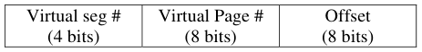

Virtual addresses are translated into physical addresses of the following form:

### **Problem 5d\[4pts\]:** For the following Virtual Addresses, translate them into Physical Addresses.

Use the Segment Table and Physical Memory table given on the next page.  Segment entries point 
to page tables in memory.  A page table consists of a series of 16 bit page table entries (PTEs). The 
format of a PTE is given on the next page. Briefly, the first byte of the PTE is an 8-bit physical 
page #, and the second byte is an 8-bit flags field with one of the following values: 
&emsp;&emsp;&emsp;&emsp;&emsp;0x00 (Invalid), 0x06 (Valid, RO), 0x07 (Valid, R/W). 
If there is an error during translation, make sure to say what the error is.  Errors can be 
“**bad segment error**” (undefined or invalid segment), “**segment overflow error**” (address outside 
range of segment), or “**access violation error**” (page invalid, or attempt to write a read only (RO) 
page).  Two answers are given:

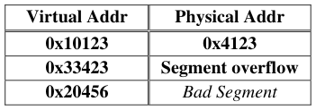

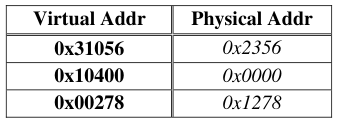

### **Problem 5e\[6pts\]:** Consider the same multi-level memory management scheme.  Please return the

results from the following load/store instructions.  Addresses are virtual. The return value for load 
is an 8-bit data value or an error, while the return value for a store is either “**ok**” or an error.  For 
errors, please specify which type of error (from the above set). Two answers are given:

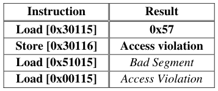

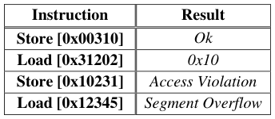

Page 16/18

---

**Page 17**

CS 162 Fall 2006 Midterm Exam I        October 11, 2006

&emsp;&emsp;&emsp;&emsp;&emsp;&emsp;&emsp;&emsp;**Virtual Address Format**

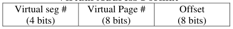

&emsp;&emsp;&emsp;&emsp;&emsp;&emsp;&emsp;&emsp;**Segment Table (Max Segment=3)**

&emsp;&emsp;&emsp;&emsp;&emsp;&emsp;&emsp;&emsp;**Page Table Entry**

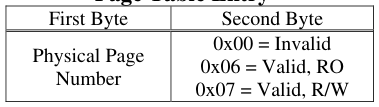

&emsp;&emsp;&emsp;&emsp;&emsp;&emsp;&emsp;&emsp;**Physical Memory**

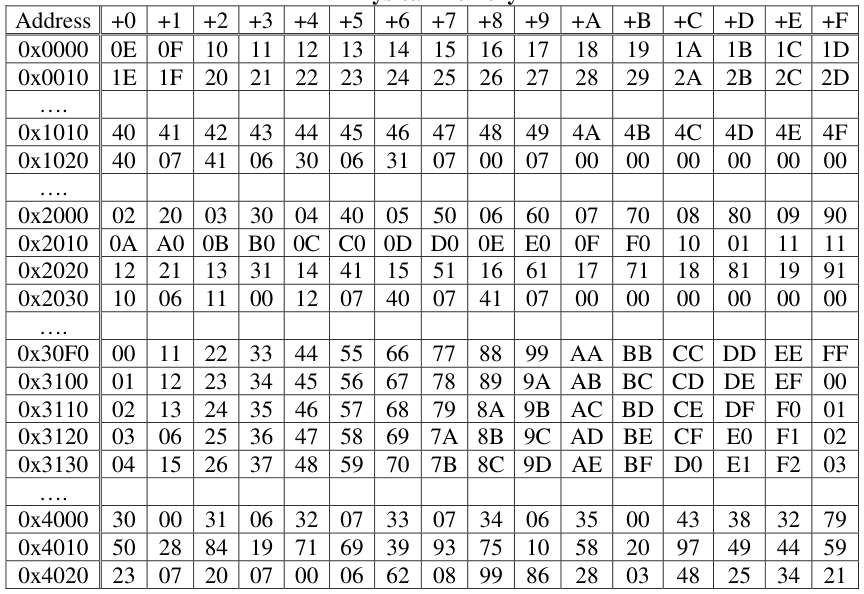

Page 17/18

---

**Page 18**

CS 162 Fall 2006 Midterm Exam I        October 11, 2006

&emsp;&emsp;&emsp;&emsp;&emsp;&emsp;&emsp;&emsp;**\[ This page intentionally left blank \]**

Page 18/18

