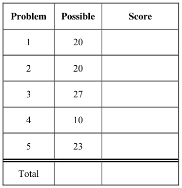
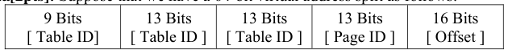
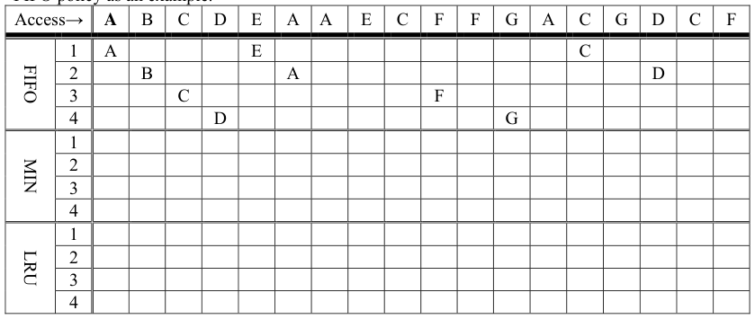
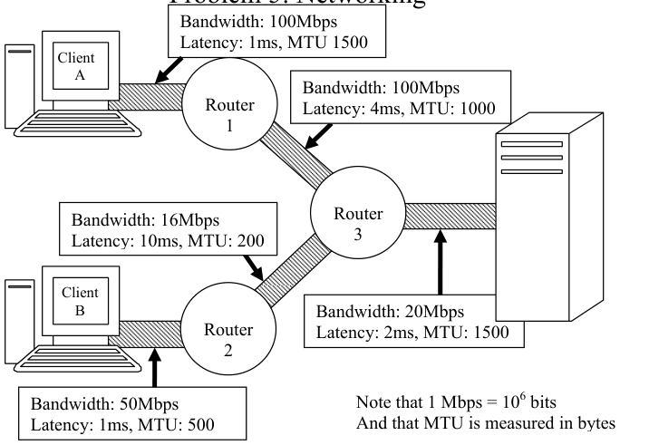

# Berkeley CS162 Fall 2006: Midterm 2: Questions

> Copied from the original: <https://hkn.eecs.berkeley.edu/exams/course/cs/162>. Text and figures are taken from the PDF as is; nothing was answered or rewritten. The original PDF is in this folder.

---

**Page 1**

&emsp;&emsp;&emsp;&emsp;&emsp;&emsp;&emsp;&emsp;University of California, Berkeley 
&emsp;&emsp;&emsp;&emsp;&emsp;&emsp;&emsp;&emsp;College of Engineering 
&emsp;&emsp;&emsp;&emsp;&emsp;&emsp;&emsp;&emsp;Computer Science Division ⎯ EECS 
&emsp;Fall 2006                John Kubiatowicz 
&emsp;&emsp;&emsp;&emsp;&emsp;&emsp;&emsp;&emsp;Midterm II 
&emsp;&emsp;&emsp;&emsp;&emsp;&emsp;&emsp;&emsp;December 4th, 2006 
&emsp;&emsp;&emsp;&emsp;&emsp;&emsp;&emsp;CS162: Operating Systems and Systems Programming

General Information: 
This is a **closed book** exam.  You are allowed 1 page of **hand-written** notes (both sides).  You 
have 3 hours to complete as much of the exam as possible. Make sure to read all of the questions 
first, as some of the questions are substantially more time consuming. 
Write all of your answers directly on this paper.  Make your answers as concise as possible. On 
programming questions, we will be looking for performance as well as correctness, so think through 
your answers carefully.  If there is something about the questions that you believe is open to 
interpretation, please ask us about it!

&emsp;Page 1/15

---

**Page 2**

CS 162 Fall 2006 Midterm Exam II December 4th, 2006

&emsp;&emsp;&emsp;&emsp;&emsp;&emsp;&emsp;&emsp;\[ This page left for π \]

&emsp;&emsp;&emsp;&emsp;3.141592653589793238462643383279502884197169399375105820974944

Page 2/15

---

**Page 3**

CS 162 Fall 2006 Midterm Exam II December 4th, 2006

### Problem 1: True/False

In the following, it is important that you EXPLAIN your answer in TWO SENTENCES OR LESS 
(Answers longer than this may not get credit!).  Also, answers without an explanation GET NO 
CREDIT.

### **Problem 1a\[2pts\]:**  Memory Mapped I/O devices are accessed with special instructions not used

for normal computation. 
&emsp;&emsp;True / False 
Explain:

### **Problem 1b\[2pts\]:** A single file server can be constructed with a Byzantine Agreement algorithm

such that clients are protected against break-ins to the server. 
&emsp;&emsp;True / False 
Explain:

### **Problem 1c\[2pts\]:** When initiating a secure communication over the web (such as for a bank), you

need to trust the public key of a certificate authority that is compiled into your browser. 
&emsp;&emsp;True / False 
Explain:

### **Problem 1d\[2pts\]:**  The limitation in TCP for 65536 ports is due to hardware limitations.

&emsp;&emsp;True / False 
Explain:

### **Problem 1e\[2pts\]:** Randomness is essential to achieving good performance from the Ethernet

communication algorithm (CSMA/CD). 
&emsp;&emsp;True / False 
Explain:

Page 3/15

---

**Page 4**

CS 162 Fall 2006 Midterm Exam II December 4th, 2006

### **Problem 1f\[2pts\]:** “Marshalling” is the process by which Byzantine Generals are forced into

making good decisions. 
&emsp;&emsp;True / False 
Explain:

### **Problem 1g\[2pts\]:** RAID-5 is 5 times more reliable than RAID-1.

&emsp;&emsp;True / False 
Explain:

### **Problem 1h\[2pts\]:** One advantage of a software TLB is that the same hardware platform can

support both forward and inverse page tables. 
&emsp;&emsp;True / False 
Explain:

### **Problem 1i\[2pts\]:** The Use bit in the PTE is required for implementing the Second Chance List

algorithm. 
&emsp;&emsp;True / False 
Explain:

### **Problem 1j\[2pts\]:** The difference between a computer Worm and a computer Virus is that a Virus

requires human action to spread. 
&emsp;&emsp;True / False 
Explain:

Page 4/15

---

**Page 5**

CS 162 Fall 2006 Midterm Exam II December 4th, 2006

### Problem 2: Virtual Memory, Paging, and Disks

### **Problem 2a\[2pts\]:** Suppose that we have a 64-bit virtual address split as follows:

Show the format of a PTE complete with bits required to support the clock algorithm, sharing of 
dynamic libraries, and copy-on-write optimizations.

### **Problem 2b\[3pts\]:** Explain how to implement the clock algorithm (not the Second Chance List

algorithm) if the hardware does not directly support use bits or dirty bits.

### **Problem 2c\[4pts\]:** For the following problem, assume a hypothetical machine with 4 pages

of physical memory and 7 pages of virtual memory. Given the access pattern: 
&emsp;&emsp;`A B C D E A A E C F F G A C G D C F` 
Indicate in the following table which pages are mapped to which physical pages for each of the 
following policies.  Assume that a blank box matches the element to the left. We have given the 
FIFO policy as an example.

Page 5/15

---

**Page 6**

CS 162 Fall 2006 Midterm Exam II December 4th, 2006

### **Problem 2d\[4pts\]:** Suppose that we have a disk with the following parameters:

&emsp;• 750GB in size 
&emsp;• 12000 RPM, Data transfer rate of 40 Mbytes/s (40 × 106 bytes/sec) 
&emsp;• Average seek time of 8ms 
&emsp;• ATA Controller with 2ms controller initiation time 
&emsp;• A block size of 4Kbytes (4096 bytes) 
What is the average time to read a random block from the disk (assuming no queueing at the 
controller). Show your work.  Hint: there are 4 terms here.

### **Problem 2e\[2pts\]:** Given the same parameters from above, assume that the operating system has

exploited locality by grouping related blocks together in the filesystem.  As a result, the typical 
access pattern is not as random as in 2d.  It typically retrieves 10 blocks sequentially at a time and 
spends only 1 ms for each seek.  What is the average time to read a single block now?  Show your 
work.

Page 6/15

---

**Page 7**

CS 162 Fall 2006 Midterm Exam II December 4th, 2006

### **Problem 2f\[5pts\]:** Assume that there is a queue in front of the controller.  Assume that the

operating system behaves as in (2e), and that the distribution of service times has C = 1.5 (i.e. not 
quite memoryless).  Also assume that requests for blocks arrive via an exponential (memoryless) 
process with an average arrival rate of λ blocks/second. What is the arrival rate λ such that the 
queue has an average length of 10 blocks?  You don’t need to actually compute this number as long 
as you given an explicit equation for  λ. Hint: use Little’s law: Lq=λTq and solve for utilization. 
&emsp;&emsp;&emsp;&emsp;&emsp;&emsp;&emsp;&emsp;2 − 
&emsp;&emsp;&emsp;&emsp;&emsp;&emsp;&emsp;&emsp;4BB−±   AC 
Also, remember from basic algebra that Ax2+Bx+C=0 ⇒ x=   . 
&emsp;&emsp;&emsp;&emsp;&emsp;&emsp;&emsp;&emsp;2A

Page 7/15

---

**Page 8**

CS 162 Fall 2006 Midterm Exam II December 4th, 2006

### Problem 3: File Systems

Please keep your answers short (one or two sentences per question-mark). We may not give credit 
for long answers.

### **Problem 3a\[3pts\]:** Rather than writing updated files to disk immediately when they are closed,

many UNIX systems use a delayed write-behind policy in which dirty disk blocks are flushed to 
disk once every 30 seconds.   List two advantages and one disadvantage of such a scheme: 
Advantage 1: 
Advantage 2: 
Disadvantage:

### **Problem 3b\[2pts\]:** Describe a technique that can be used to mitigate the disadvantage of (3a)

without losing the advantages of (3a).  Be explicit here.

### **Problem 3c\[4pts\]:** In the following, compare the performance of a FAT file system to a more

primitive system that uses “linked allocation” (where file blocks are linked together via pointers in 
each block) with respect to number of disk accesses.  Be sure to state any assumptions that you are 
making in terms of what (if anything) is memory resident. 
&emsp;&emsp;a) Which is faster for random access?  Explain. (Assume the file in question is large):

&emsp;&emsp;b) Which is faster for sequential access?  Explain.  (Again assume a large file):

Page 8/15

---

**Page 9**

CS 162 Fall 2006 Midterm Exam II December 4th, 2006

### **Problem 3d\[4pts\]:** Consider a file system with 4096 byte blocks and 32-bit disk and file block

pointers. Each file has 13 direct pointers, 4 singly-indirect pointers, a doubly-indirect pointer, and a 
triply-indirect pointer. In the following be explicit about your work: 
&emsp;&emsp;a) What is the maximum disk size that can be supported? Explain.

&emsp;&emsp;b) What is the maximum file size?  Explain.

&emsp;&emsp;c) Give some reasonable assumptions and compute the number of **inodes** that can fit into a 
&emsp;&emsp;&emsp;disk block.

### **Problem 3e\[4\]:** The Fast File System (FFS) of BSD 4.2 introduced several mechanisms for

improving performance of the BSD 4.1 system.  Name 2 of these and explain why they improve 
performance:

### **Problem 3g\[3pts\]:** On a single UNIX machine, if some program B reads a block of a file after it

has been updated by another program A, the copy of the file block B reads will include A’s updates. 
In NFS this behavior is not guaranteed.  Assuming that there are no failures, why doesn’t NFS 
necessarily provide such update semantics when A and B are run on different machines?  What 
semantics does it provide instead?

Page 9/15

---

**Page 10**

CS 162 Fall 2006 Midterm Exam II December 4th, 2006

### **Problem 3h\[3pts\]:** The Andrew File System (AFS) solves  the above problem (3g) using state

information it maintains at the server.  What state is kept? How is that state used to solve the 
problem?

### **Problem 3i\[4pts\]:** At time XZ, the request queue for a disk contains the following requests in

\[track:sector\] form: 
**\[10:5\], \[22:9\], \[20:21\], \[21:9\], \[2:10\], \[40:45\], \[6:7\], \[38:9\] ….** (in this order). 
Assume that the disk head is currently positioned over cylinder 20. What is the sequence of reads 
under the following head scheduling algorithms? 
&emsp;&emsp;a) Shortest Seek Time First:

&emsp;&emsp;b) SCAN (initially moving upwards):

Page 10/15

---

**Page 11**

CS 162 Fall 2006 Midterm Exam II December 4th, 2006

### Problem 4: Security

### **Problem 4a\[3pts\]:** Assume Alice and Bob have never met. Explain how Alice can use a public key

infrastructure (PKI) to prove her identity to Bob. Hint: make sure to prevent replay attacks.

### **Problem 4b\[3pts\]:** Explain how to utilize a PKI to establish a private session key between two

parties for fast symmetric encryption.

### **Problem 4c\[4pts\]:** What are two desirable properties for secure hash functions (ignoring the

property where half the bits change for small changes in input).  Why are these properties important 
for signatures?

Page 11/15

---

**Page 12**

CS 162 Fall 2006 Midterm Exam II December 4th, 2006

### Problem 5: Networking

The above figure illustrates a network in which two clients (Client A and Client B) route packets 
through the network to the server and to each other. Each link is characterized by its Bandwidth, 
one-way Latency, and Maximum Transfer Unit (MTU) in bytes. All links are full-duplex (can 
handle traffic in both directions at full bandwidth). 
To send data packets, a user-level process on one of the Clients issue a system call.  As a result, the 
OS copies the data first to a kernel buffer, then uses DMA to copy the data to the network controller 
board. Immediately after receiving all of the data, the network controller generates one or more 
packets and sends them.  A router fully receives a packet, after which it takes 1ms to begin 
forwarding the packet to the next hop.  Assume that no packets will be lost unless otherwise noted. 
At the destination, the receiving network controller DMAs the received data to memory.  When the 
last bit arrives, it interrupts the CPU, which copies the data to user space. The CPU then sends back 
a one-byte acknowledgement to the sending OS. For simplicity, you may treat acknowledgements 
as if they are zero bytes long. Assume that a sender uses a window-based protocol unless noted. 
Assume that all DMA operations can overlap with processor actions such as copying and interrupt 
handling.  Also assume that DMA operations do not have to generate interrupts on completion. 
System Parameters: 
&emsp;• Time to process an interrupt, Tint=100 μs 
&emsp;• Time to copy or DMA one byte, Tcopy= 100 ns 
&emsp;• Retransmission timeout, Tretran= 400 ms

Page 12/15

---

**Page 13**

CS 162 Fall 2006 Midterm Exam II December 4th, 2006

### **Problem 5a\[4pts\]:** Under ideal circumstances (and ignoring interrupt and copying overheads and

window size), what is the maximum bandwidth that Client A can send data to the server without 
causing packets to be dropped (Assuming that the headers are of zero length and that routers can 
handle data at wire speed)?  How about Client B?  Explain.

### **Problem 5b\[4pts\]:** Keeping in mind that TCP/IP involves a total header size of 40 bytes (for TCP

\+ IP), what is the maximum data bandwidth that Client A could send to the server through TCP/IP? 
Explain. What about Client B? Explain. Again, ignore interrupt and copying overheads.  Hint: 
Assume that a sender runs a protocol that computes the proper maximum packet size to avoid 
fragmentation within the network.

### **Problem 5c\[6pts\]:** Now, assume that copying and interrupt overheads impact the maximum rate at

which data can be sent or received at the endpoints (clients or servers).  Routers continue to be fully 
pipelined and senders avoid fragmentation as in 5b. What is the maximum data bandwidth that 
Client A can transfer to the server without dropping packets?  Explain.  What about Client B? Hint: 
make sure to account for the impact of the 40 byte TCP/IP header.

Page 13/15

---

**Page 14**

CS 162 Fall 2006 Midterm Exam II December 4th, 2006

### **Problem 5d\[5pts\]:** Now, accounting for copying and interrupt overheads, what is the total time to

reliably send a single maximal-sized packet from Client A to a user-level process on the server 
without fragmentation?  Account for all latencies (including the reception of an ACK, which can be 
assumed to be zero length but which will generate an interrupt).  Explain your work.

### **Problem 5e\[4pts\]:** Assume the conditions from 5d. Client A sends a continuous stream of packets

to the server (and no other clients are talking to the server). How big should the send window be so 
that the TCP/IP algorithm will achieve maximum bandwidth without dropping packets?  Explain. 
Hint: don’t forget to account for the 40 bytes of header.

Page 14/15

---

**Page 15**

CS 162 Fall 2006 Midterm Exam II December 4th, 2006

&emsp;&emsp;&emsp;&emsp;&emsp;&emsp;&emsp;&emsp;**\[ This page intentionally left blank \]**

Page 15/15

