# Berkeley CS162 Fall 2006: Midterm 2: Official solutions

> Copied from the original: <https://hkn.eecs.berkeley.edu/exams/course/cs/162>. Text and figures are taken from the PDF as is; nothing was answered or rewritten. The original PDF is in this folder.

---

**Page 1**

&emsp;&emsp;&emsp;&emsp;&emsp;&emsp;&emsp;&emsp;University of California, Berkeley 
&emsp;&emsp;&emsp;&emsp;&emsp;&emsp;&emsp;&emsp;College of Engineering 
&emsp;&emsp;&emsp;&emsp;&emsp;&emsp;&emsp;&emsp;Computer Science Division ⎯ EECS 
&emsp;Fall 2006                John Kubiatowicz 
&emsp;&emsp;&emsp;&emsp;&emsp;&emsp;&emsp;&emsp;Midterm II 
&emsp;&emsp;&emsp;&emsp;&emsp;&emsp;&emsp;&emsp;SOLUTIONS 
&emsp;&emsp;&emsp;&emsp;&emsp;&emsp;&emsp;&emsp;December 4th, 2006 
&emsp;&emsp;&emsp;&emsp;&emsp;&emsp;&emsp;&emsp;CS162: Operating Systems and Systems Programming

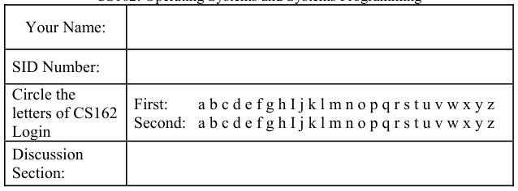

General Information: 
This is a **closed book** exam.  You are allowed 1 page of **hand-written** notes (both sides).  You 
have 3 hours to complete as much of the exam as possible. Make sure to read all of the questions 
first, as some of the questions are substantially more time consuming. 
Write all of your answers directly on this paper.  Make your answers as concise as possible. On 
programming questions, we will be looking for performance as well as correctness, so think through 
your answers carefully.  If there is something about the questions that you believe is open to 
interpretation, please ask us about it!

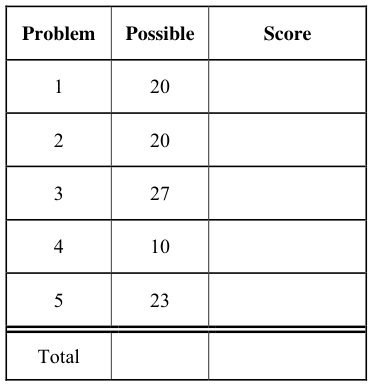

&emsp;Page 1/15

---

**Page 2**

CS 162 Fall 2006 Midterm Exam II December 4th, 2006

&emsp;&emsp;&emsp;&emsp;&emsp;&emsp;&emsp;&emsp;\[ This page left for π \]

&emsp;&emsp;&emsp;&emsp;3.141592653589793238462643383279502884197169399375105820974944

Page 2/15

---

**Page 3**

CS 162 Fall 2006 Midterm Exam II December 4th, 2006

### Problem 1: True/False

In the following, it is important that you EXPLAIN your answer in TWO SENTENCES OR LESS 
(Answers longer than this may not get credit!).  Also, answers without an explanation GET NO 
CREDIT.

### **Problem 1a\[2pts\]:**  Memory Mapped I/O devices are accessed with special instructions not used

for normal computation.

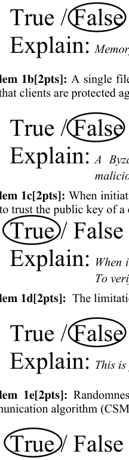

Explain: Memory Mapped I/O devices are accessed with normal loads and stores

### **Problem 1b\[2pts\]:** A single file server can be constructed with a Byzantine Agreement algorithm

Explain: A Byzantine Agreement algorithm requires 3f+1 nodes to tolerate f 
&emsp;&emsp;&emsp;&emsp;&emsp;&emsp;&emsp;&emsp;malicious faults. A single file server couldn’t tolerate any malicious faults.

### **Problem 1c\[2pts\]:** When initiating a secure communication over the web (such as for a bank), you

need to trust the public key of a certificate authority that is compiled into your browser. 
Explain: When initiating, the server sends a certificate that contains its public key. 
&emsp;&emsp;&emsp;&emsp;&emsp;&emsp;&emsp;&emsp;To verify this certificate (and public key), you use the public key of the CA.

### **Problem 1d\[2pts\]:**  The limitation in TCP for 65536 ports is due to hardware limitations.

Explain: This is purely a software convention (format of TCP and UDP header)

### **Problem 1e\[2pts\]:** Randomness is essential to achieving good performance from the Ethernet

Explain: Randomness is required to break up collisions so that they are eventually 
&emsp;&emsp;&emsp;&emsp;&emsp;&emsp;&emsp;&emsp;resolved.

Page 3/15

---

**Page 4**

CS 162 Fall 2006 Midterm Exam II December 4th, 2006

### **Problem 1f\[2pts\]:** “Marshalling” is the process by which Byzantine Generals are forced into

making good decisions.

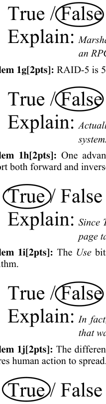

Explain: Marshalling is the process of packaging data items (such as arguments for 
&emsp;&emsp;&emsp;&emsp;&emsp;&emsp;&emsp;&emsp;an RPC) into a network message.

### **Problem 1g\[2pts\]:** RAID-5 is 5 times more reliable than RAID-1.

Explain: Actually, the numbers have nothing to do with the level of reliability.  Both 
&emsp;&emsp;&emsp;&emsp;&emsp;&emsp;&emsp;&emsp;systems can handle a single disk failure.

### **Problem 1h\[2pts\]:** One advantage of a software TLB is that the same hardware platform can

Explain: Since TLB faults are handled in software, the OS can choose to implement 
&emsp;&emsp;&emsp;&emsp;&emsp;&emsp;&emsp;&emsp;page tables in any way desired.

### **Problem 1i\[2pts\]:** The Use bit in the PTE is required for implementing the Second Chance List

algorithm.

Explain: In fact, the Second Chance List algorithm was developed for a machine 
&emsp;&emsp;&emsp;&emsp;&emsp;&emsp;&emsp;&emsp;that was missing the Use bit in its PTE.

### **Problem 1j\[2pts\]:** The difference between a computer Worm and a computer Virus is that a Virus

Explain: This is the standard definition – Viruses are often transported as 
&emsp;&emsp;&emsp;&emsp;&emsp;&emsp;&emsp;&emsp;attachments in email or on a floppy boot track and require someone to 
&emsp;&emsp;&emsp;&emsp;&emsp;&emsp;&emsp;&emsp;actually click on the attachment or boot the disk to start. Worms can 
&emsp;&emsp;&emsp;&emsp;&emsp;&emsp;&emsp;&emsp;arrive all by themselves, via security flaws in the OS.

Page 4/15

---

**Page 5**

CS 162 Fall 2006 Midterm Exam II December 4th, 2006

### Problem 2: Virtual Memory, Paging, and Disks

### **Problem 2a\[2pts\]:** Suppose that we have a 64-bit virtual address split as follows:

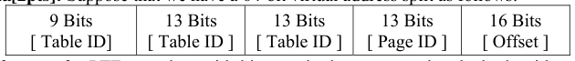

Show the format of a PTE complete with bits required to support the clock algorithm, sharing of 
dynamic libraries, and copy-on-write optimizations.

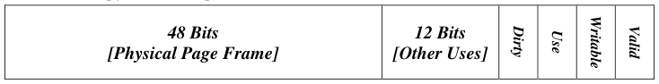

Answer:

### **Problem 2b\[3pts\]:** Explain how to implement the clock algorithm (not the Second Chance List

algorithm) if the hardware does not directly support use bits or dirty bits. 
&emsp;We assume that the Valid and Writable bits exist in hardware.  Since the Use and Dirty bits 
&emsp;don’t exist, we need to emulate them in software. First, we use two spare bits in the PTE to 
&emsp;represent our emulated versions of Use and Dirty. Second, we use another two spare bits in the 
&emsp;PTE to track whether a page is actually valid or writable.  On each pass of the clock hand, we 
&emsp;check the (software) Use bit as usual. If Use is clear, we recycle the page. If Use is set, we clear 
&emsp;it **and** set the page to invalid. On the next use of the page, we get a page fault (telling us the 
&emsp;page is in use).  We use this page fault to set the software Use bit **and** to set the page to read- 
&emsp;only. If the application tries to write the page, we get a page fault and can set the software Dirty 
&emsp;bit **and** set the page to read-write.

### **Problem 2c\[4pts\]:** For the following problem, assume a hypothetical machine with 4 pages

of physical memory and 7 pages of virtual memory. Given the access pattern: 
&emsp;&emsp;`A B C D E A A E C F F G A C G D C F` 
Indicate in the following table which pages are mapped to which physical pages for each of the 
following policies.  Assume that a blank box matches the element to the left. We have given the 
FIFO policy as an example.

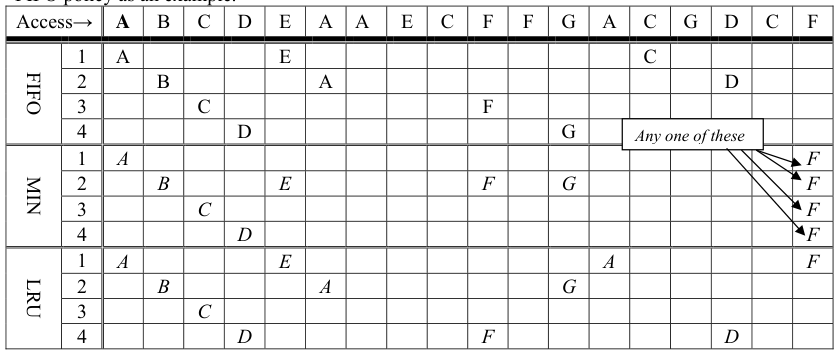

Page 5/15

---

**Page 6**

CS 162 Fall 2006 Midterm Exam II December 4th, 2006

### **Problem 2d\[4pts\]:** Suppose that we have a disk with the following parameters:

&emsp;• 750GB in size 
&emsp;• 12000 RPM, Data transfer rate of 40 Mbytes/s (40 × 106 bytes/sec) 
&emsp;• Average seek time of 8ms 
&emsp;• ATA Controller with 2ms controller initiation time 
&emsp;• A block size of 4Kbytes (4096 bytes) 
What is the average time to read a random block from the disk (assuming no queueing at the 
controller). Show your work.  Hint: there are 4 terms here. 
We need to be careful to get all of our units correct.  I am going to stick with milliseconds. 
Tread  = Controller + Seek + Rotational + Xfer Time 
&emsp;&emsp;&emsp;&emsp;&emsp;&emsp;&emsp;&emsp;ms⎛⎞ 
&emsp;&emsp;&emsp;&emsp;&emsp;&emsp;&emsp;&emsp;60000⎜⎟ 
&emsp;&emsp;&emsp;&emsp;&emsp;&emsp;&emsp;&emsp;14096bytes 
&emsp;&emsp;&emsp;&emsp;&emsp;&emsp;&emsp;&emsp;⎜min   ⎟ 
+++28ms        =   ms    = 12.6024 ms 
&emsp;&emsp;&emsp;&emsp;&emsp;&emsp;&emsp;&emsp;2bytess⎜⎜⎟⎟revolutions⎛⎞⎛⎞ 
&emsp;&emsp;&emsp;&emsp;&emsp;&emsp;&emsp;&emsp;401010−⎜⎝⎟⎠⎜⎝1200063   ⎟⎠ 
&emsp;&emsp;&emsp;&emsp;&emsp;&emsp;&emsp;&emsp;×× 
&emsp;&emsp;&emsp;&emsp;&emsp;&emsp;&emsp;&emsp;min⎝⎠ 
&emsp;&emsp;&emsp;&emsp;&emsp;&emsp;&emsp;&emsp;sms 
Tread =12.6024ms

### **Problem 2e\[2pts\]:** Given the same parameters from above, assume that the operating system has

exploited locality by grouping related blocks together in the filesystem.  As a result, the typical 
access pattern is not as random as in 2d.  It typically retrieves 10 blocks sequentially at a time and 
spends only 1 ms for each seek.  What is the average time to read a single block now?  Show your 
work. 
The key insight here is to compute the time for 10 block reads (since there is only 1 seek and 1 
rotational for those 10), then divide by 10 for a single block read. Also, the seek is shorter. Since 
there is no queuing, each request is treated separately – thus leading to 1 controller timer/request. 
Tread10 = 10×Controller + Seek + Rotational + 10×Xfer Time 
&emsp;&emsp;&emsp;&emsp;&emsp;&emsp;&emsp;&emsp;ms⎛⎞ 
&emsp;&emsp;&emsp;&emsp;&emsp;&emsp;&emsp;&emsp;60000⎜⎟ 
&emsp;&emsp;&emsp;&emsp;&emsp;&emsp;&emsp;&emsp;14096bytes 
&emsp;&emsp;&emsp;&emsp;&emsp;&emsp;&emsp;&emsp;⎜min   ⎟ 
×+++×1021ms        =   ms   10   =24.524 
&emsp;&emsp;&emsp;&emsp;&emsp;&emsp;&emsp;&emsp;2bytess⎜⎜⎟⎟revolutions⎛⎞⎛⎞ 
&emsp;&emsp;&emsp;&emsp;&emsp;&emsp;&emsp;&emsp;401010−⎜⎝⎟⎠⎜⎝1200063   ⎟⎠ 
&emsp;&emsp;&emsp;&emsp;&emsp;&emsp;&emsp;&emsp;×× 
&emsp;&emsp;&emsp;&emsp;&emsp;&emsp;&emsp;&emsp;min⎝⎠ 
&emsp;&emsp;&emsp;&emsp;&emsp;&emsp;&emsp;&emsp;sms 
Thus, Tread= Tread10/10 = 2.4524ms. 
Note that other arguments are possible here – state your assumptions.

Page 6/15

---

**Page 7**

CS 162 Fall 2006 Midterm Exam II December 4th, 2006

### **Problem 2f\[5pts\]:** Assume that there is a queue in front of the controller.  Assume that the

operating system behaves as in (2e), and that the distribution of service times has C = 1.5 (i.e. not 
quite memoryless).  Also assume that requests for blocks arrive via an exponential (memoryless) 
process with an average arrival rate of λ blocks/second. What is the arrival rate λ such that the 
queue has an average length of 10 blocks?  You don’t need to actually compute this number as long 
as you given an explicit equation for  λ. Hint: use Little’s law: Lq=λTq and solve for utilization. 
&emsp;&emsp;&emsp;&emsp;&emsp;&emsp;&emsp;&emsp;2 − 
&emsp;&emsp;&emsp;&emsp;&emsp;&emsp;&emsp;&emsp;−±4BBAC 
Also, remember from basic algebra that Ax2+Bx+C=0 ⇒ x=   . 
&emsp;&emsp;&emsp;&emsp;&emsp;&emsp;&emsp;&emsp;2A 
&emsp;This is just a straightforward use of the M/G/1 queue formula from class: 
&emsp;&emsp;&emsp;&emsp;&emsp;1u 
&emsp;&emsp;&emsp;&emsp;&emsp;&emsp;(   ) 
&emsp;×+×1Tser    Tq=   C 
&emsp;&emsp;&emsp;&emsp;&emsp;−21u 
&emsp;Where Tser is the service time from 2g, C=1.5, and u=λ×Tser. 
&emsp;Solving simply (for a queue-length of 10): 
&emsp;Lq=10 =λ×Tq                   (Little’s Law) 
&emsp;&emsp;&emsp;&emsp;&emsp;&emsp;&emsp;&emsp;11uu2 
&emsp;&emsp;&emsp;&emsp;&emsp;&emsp;&emsp;&emsp;(   )   (   ) 
&emsp;&emsp;&emsp;&emsp;&emsp;λ×+×=+×11TserC=   C       (Substituting and rearranging) 
&emsp;&emsp;&emsp;&emsp;&emsp;&emsp;&emsp;&emsp;−−2121uu 
&emsp;Now, we just solve for u (and remembering that C=1.5): 
&emsp;&emsp;&emsp;&emsp;u12 
&emsp;&emsp;&emsp;&emsp;&emsp;2⇒(   )   ⇒   2 
&emsp;=+×−=+−=Cuuuu1014040588    0 
&emsp;&emsp;&emsp;&emsp;−21   u

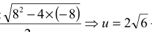

&emsp;&emsp;&emsp;&emsp;&emsp;&emsp;&emsp;&emsp;−8   ± 
&emsp;=−uSo, using quadratic formula:    4 
&emsp;&emsp;&emsp;&emsp;&emsp;&emsp;&emsp;&emsp;2 
&emsp;Since u=λ×Tser⇒ λ= (   )   (   ) 
&emsp;&emsp;&emsp;&emsp;&emsp;&emsp;&emsp;&emsp;−−264264 
&emsp;&emsp;&emsp;&emsp;&emsp;&emsp;&emsp;&emsp;=.367 requests/ms=367 requests/sec 
&emsp;&emsp;&emsp;&emsp;&emsp;&emsp;&emsp;&emsp;= 
&emsp;&emsp;&emsp;&emsp;&emsp;&emsp;&emsp;&emsp;.24524Tserms

Page 7/15

---

**Page 8**

CS 162 Fall 2006 Midterm Exam II December 4th, 2006

### Problem 3: File Systems

Please keep your answers short (one or two sentences per question-mark). We may not give credit 
for long answers.

### **Problem 3a\[3pts\]:** Rather than writing updated files to disk immediately when they are closed,

many UNIX systems use a delayed write-behind policy in which dirty disk blocks are flushed to 
disk once every 30 seconds.   List two advantages and one disadvantage of such a scheme: 
Advantage 1:  The disk scheduling algorithm (i.e. SCAN) has more dirty blocks to work 
with at any one time and can thus do a better job of scheduling the disk arm. 
Advantage 2:  Temporary files may be written and deleted before they ever get to disk. 
Disadvantage:  File data may be lost if the computer crashes before data is written to disk.

### **Problem 3b\[2pts\]:** Describe a technique that can be used to mitigate the disadvantage of (3a)

without losing the advantages of (3a).  Be explicit here. 
&emsp;&emsp;Use an NVRAM (Non volatile RAM).  The idea here is that data which is written is placed in 
&emsp;&emsp;the NVRAM right away, before telling the user that it has been written. Since this process is 
&emsp;&emsp;as fast (or nearly so) as writing to RAM and doesn’t involve moving the disk arm, both of 
&emsp;&emsp;the above advantages remain.  Since it is nonvolatile, a disk crash will not lose data.

### **Problem 3c\[4pts\]:** In the following, compare the performance of a FAT file system to a more

primitive system that uses “linked allocation” (where file blocks are linked together via pointers in 
each block) with respect to number of disk accesses.  Be sure to state any assumptions that you are 
making in terms of what (if anything) is memory resident. 
&emsp;&emsp;a) Which is faster for random access?  Explain. (Assume the file in question is large): 
&emsp;&emsp;&emsp;&emsp;&emsp;The FAT file system is much faster for random access.  You read the FAT (once), 
&emsp;&emsp;&emsp;&emsp;&emsp;trace through the links in memory to find the desired block, then read the block from 
&emsp;&emsp;&emsp;&emsp;&emsp;memory (effectively 2 disk accesses).  With the linked-allocation, you need to read 
&emsp;&emsp;&emsp;&emsp;&emsp;through (n-1) blocks to randomly access the nth block of the file. 
&emsp;&emsp;b) Which is faster for sequential access?  Explain.  (Again assume a large file): 
&emsp;&emsp;&emsp;&emsp;&emsp;This depends on your assumptions. If you are unable to keep the FAT in memory, the 
&emsp;&emsp;&emsp;&emsp;&emsp;linked allocation is faster, since the next block is contained in the previous block.  If, 
&emsp;&emsp;&emsp;&emsp;&emsp;on the other hand you assume that the FAT stays in memory, then these two 
&emsp;&emsp;&emsp;&emsp;&emsp;techniques are of equal performance or the FAT could be faster if requests were 
&emsp;&emsp;&emsp;&emsp;&emsp;queued enough to allow better disk scheduling. Note that you needed to state your 
&emsp;&emsp;&emsp;&emsp;&emsp;assumptions to get full credit here.

Page 8/15

---

**Page 9**

CS 162 Fall 2006 Midterm Exam II December 4th, 2006

### **Problem 3d\[4pts\]:** Consider a file system with 4096 byte blocks and 32-bit disk and file block

pointers. Each file has 13 direct pointers, 4 singly-indirect pointers, a doubly-indirect pointer, and a 
triply-indirect pointer. In the following be explicit about your work: 
&emsp;&emsp;a) What is the maximum disk size that can be supported? Explain. 
&emsp;&emsp;&emsp;&emsp;&emsp;Since block pointers are 32 bits, total size = 232×4096 = 244 bytes maximum. 
&emsp;&emsp;b) What is the maximum file size?  Explain. 
&emsp;&emsp;&emsp;&emsp;&emsp;Since pointers are 32 bits (4 bytes), one indirect block can address 1024 blocks. 
&emsp;&emsp;&emsp;&emsp;&emsp;Thus, maximum file= 4096×(13 + 4×1024 + 10242 + 10243)=4402358308864 bytes 
&emsp;&emsp;c) Give some reasonable assumptions and compute the number of **inodes** that can fit into a 
&emsp;&emsp;&emsp;disk block. 
&emsp;&emsp;&emsp;&emsp;&emsp;An inode has 13 + 4 + 1 + 1=19 pointers = 76bytes.  Assuming various other file 
&emsp;&emsp;&emsp;&emsp;&emsp;information such as ACLs, etc, we round up to 128bytes and can fit 32 inodes/block

### **Problem 3e\[4\]:** The Fast File System (FFS) of BSD 4.2 introduced several mechanisms for

improving performance of the BSD 4.1 system.  Name 2 of these and explain why they improve 
performance: 
&emsp;&emsp;&emsp;&emsp;1\. Data from files allocated to be mostly sequential by looking for large chunks of 
&emsp;&emsp;&emsp;&emsp;&emsp;empty blocks within a cylinder; this optimization requires blocks to be kept in 
&emsp;&emsp;&emsp;&emsp;&emsp;reserve in order to perform this optimization. This improves performance because 
&emsp;&emsp;&emsp;&emsp;&emsp;sequential file access translates to sequential access on disk (fast). 
&emsp;&emsp;&emsp;&emsp;2\. Placing of inodes for a file in the same cylinder group as the data⇒means that 
&emsp;&emsp;&emsp;&emsp;&emsp;finding successive sequential chunks for files is quick. 
&emsp;&emsp;&emsp;&emsp;**3.** inodes and data for files within a directory placed in same cylinder group⇒means 
&emsp;&emsp;&emsp;&emsp;&emsp;that operations to files within a directory (such as listing, etc) are fast.

### **Problem 3g\[3pts\]:** On a single UNIX machine, if some program B reads a block of a file after it

has been updated by another program A, the copy of the file block B reads will include A’s updates. 
In NFS this behavior is not guaranteed.  Assuming that there are no failures, why doesn’t NFS 
necessarily provide such update semantics when A and B are run on different machines?  What 
semantics does it provide instead? 
&emsp;&emsp;In NFS (versions through 3), cached data is updated only periodically.  Thus it is possible 
&emsp;&emsp;that B could read old data for a while after A has finished updating it. The semantics are 
&emsp;&emsp;those of “weak coherence”. Just telling us what would happen here is sufficient.

Page 9/15

---

**Page 10**

CS 162 Fall 2006 Midterm Exam II December 4th, 2006

### **Problem 3h\[3pts\]:** The Andrew File System (AFS) solves  the above problem (3g) using state

information it maintains at the server.  What state is kept? How is that state used to solve the 
problem? 
&emsp;&emsp;An AFS server keeps track of which clients have read-only copies of particular files.  Thus, 
&emsp;&emsp;when one client writes data (and closes the file so that the data is flushed to the server), the 
&emsp;&emsp;server contacts each of the clients that have cached copies of the file and tells them to 
&emsp;&emsp;invalidate the file.

### **Problem 3i\[4pts\]:** At time XZ, the request queue for a disk contains the following requests in

\[track:sector\] form: 
**\[10:5\], \[22:9\], \[20:21\], \[21:9\], \[2:10\], \[40:45\], \[6:7\], \[38:9\] ….** (in this order). 
Assume that the disk head is currently positioned over cylinder 20. What is the sequence of reads 
under the following head scheduling algorithms? 
&emsp;&emsp;a) Shortest Seek Time First: 
&emsp;&emsp;&emsp;&emsp;&emsp;Only the track numbers matter here (since you can’t really do inter-track 
&emsp;&emsp;&emsp;&emsp;&emsp;optimization). So: 
&emsp;&emsp;&emsp;&emsp;&emsp;\[20:21\], \[21:9\], \[22:9\], \[10:5\], \[6:7\], \[2:10\], \[38:9\], \[40:45\]

&emsp;&emsp;b) SCAN (initially moving upwards): 
&emsp;&emsp;&emsp;&emsp;&emsp;Moving initially upwards (increasing tracks), we have: 
&emsp;&emsp;&emsp;&emsp;&emsp;\[20:21\], \[21:9\], \[22:9\], \[38:9\], \[40:45\], \[10:5\], \[6:7\], \[2:10\]

Page 10/15

---

**Page 11**

CS 162 Fall 2006 Midterm Exam II December 4th, 2006

### Problem 4: Security

### **Problem 4a\[3pts\]:** Assume Alice and Bob have never met. Explain how Alice can use a public key

infrastructure (PKI) to prove her identity to Bob. Hint: make sure to prevent replay attacks. 
&emsp;&emsp;The essential insight here is that Alice needs to sign something with her private key that can 
&emsp;&emsp;be verified with her public key.  To prove to Bob what her public key is, she has a certificate 
&emsp;&emsp;authority sign her public key. This is the PKI. 
&emsp;&emsp;Once Bob is certain of Alice’s public key, proving her identity is easy:she signs a message 
&emsp;&emsp;(like “Hi! I’m Alice”) with her private key asserting that she is Alice. To avoid replay 
&emsp;&emsp;attacks, she asks Bob for a random value which she also includes in that message.

### **Problem 4b\[3pts\]:** Explain how to utilize a PKI to establish a private session key between two

parties for fast symmetric encryption. 
&emsp;&emsp;Both parties use the PKI to make sure that they have each other’s appropriate public key. 
&emsp;&emsp;Then, they each choose a random number, encrypt it with the public key of the other party, 
&emsp;&emsp;and send it off. Now, both of them have the same two random numbers (which are private). 
&emsp;&emsp;They can combine them anyway they like, then use the result as a private session key.

### **Problem 4c\[4pts\]:** What are two desirable properties for secure hash functions (ignoring the

property where half the bits change for small changes in input).  Why are these properties important 
for signatures? 
&emsp;&emsp;&emsp;1\. Given message M1 with hash h1=h(M1), it is computationally infeasible to find 
&emsp;&emsp;&emsp;&emsp;&emsp;another message M2 such that h1=h(M2) 
&emsp;&emsp;&emsp;2\. Further, it is computationally infeasible to find any two messages MA and MB such 
&emsp;&emsp;&emsp;&emsp;&emsp;that h(MA)=h(MB). 
&emsp;&emsp;&emsp;The type of signature discussed in class involves encrypting the hash of a document with 
&emsp;&emsp;&emsp;the private key of the signer. The properties above prevent the possibility of a single 
&emsp;&emsp;&emsp;signature from referring to multiple documents (which would defeat the purpose of a 
&emsp;&emsp;&emsp;signature).

Page 11/15

---

**Page 12**

CS 162 Fall 2006 Midterm Exam II December 4th, 2006

### Problem 5: Networking

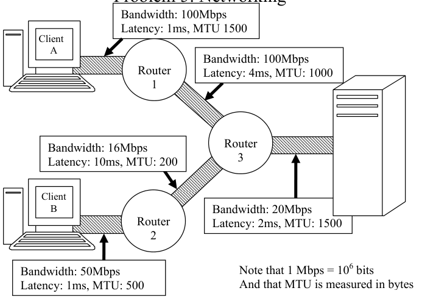

The above figure illustrates a network in which two clients (Client A and Client B) route packets 
through the network to the server and to each other. Each link is characterized by its Bandwidth, 
one-way Latency, and Maximum Transfer Unit (MTU) in bytes. All links are full-duplex (can 
handle traffic in both directions at full bandwidth). 
To send data packets, a user-level process on one of the Clients issue a system call.  As a result, the 
OS copies the data first to a kernel buffer, then uses DMA to copy the data to the network controller 
board. Immediately after receiving all of the data, the network controller generates one or more 
packets and sends them.  A router fully receives a packet, after which it takes 1ms to begin 
forwarding the packet to the next hop.  Assume that no packets will be lost unless otherwise noted. 
At the destination, the receiving network controller DMAs the received data to memory.  When the 
last bit arrives, it interrupts the CPU, which copies the data to user space. The CPU then sends back 
a one-byte acknowledgement to the sending OS. For simplicity, you may treat acknowledgements 
as if they are zero bytes long. Assume that a sender uses a window-based protocol unless noted. 
Assume that all DMA operations can overlap with processor actions such as copying and interrupt 
handling.  Also assume that DMA operations do not have to generate interrupts on completion. 
System Parameters: 
&emsp;• Time to process an interrupt, Tint=100 μs 
&emsp;• Time to copy or DMA one byte, Tcopy= 100 ns 
&emsp;• Retransmission timeout, Tretran= 400 ms

Page 12/15

---

**Page 13**

CS 162 Fall 2006 Midterm Exam II December 4th, 2006

### **Problem 5a\[4pts\]:** Under ideal circumstances (and ignoring interrupt and copying overheads and

window size), what is the maximum bandwidth that Client A can send data to the server without 
causing packets to be dropped (Assuming that the headers are of zero length and that routers can 
handle data at wire speed)?  How about Client B?  Explain. 
&emsp;&emsp;This is simply a matter of finding the slowest link (bottleneck) along the path. 
&emsp;&emsp;So: Client A, maximum bandwidth available is 20Mbps (bottleneck from router 3→server) 
&emsp;&emsp;Client B, maximum bandwidth available is 16Mbps (bottleneck from router 2→3)

### **Problem 5b\[4pts\]:** Keeping in mind that TCP/IP involves a total header size of 40 bytes (for TCP

\+ IP), what is the maximum data bandwidth that Client A could send to the server through TCP/IP? 
Explain. What about Client B? Explain. Again, ignore interrupt and copying overheads.  Hint: 
Assume that a sender runs a protocol that computes the proper maximum packet size to avoid 
fragmentation within the network. 
&emsp;&emsp;Here, the key is to compute the minimum MTU along each path.  This gives the packet size 
&emsp;&emsp;that we will be using as a result.  Then, the data bandwidth needs to be scaled back by 
&emsp;&emsp;subtracting 40 bytes for every packet. 
&emsp;&emsp;&emsp;&emsp;&emsp;&emsp;&emsp;&emsp;−100040 
&emsp;&emsp;×MbpsA→server: min MTU=1000bytes.  Thus, bandwidth=   20   =19.2 Mbps 
&emsp;&emsp;&emsp;&emsp;&emsp;&emsp;&emsp;&emsp;1000 
&emsp;&emsp;&emsp;&emsp;&emsp;&emsp;&emsp;&emsp;−20040 
&emsp;&emsp;×Mbps16B→server: min MTU=200bytes.  Thus, bandwidth=   =12.8  Mbps 
&emsp;&emsp;&emsp;&emsp;&emsp;&emsp;&emsp;&emsp;200

### **Problem 5c\[6pts\]:** Now, assume that copying and interrupt overheads impact the maximum rate at

which data can be sent or received at the endpoints (clients or servers).  Routers continue to be fully 
pipelined and senders avoid fragmentation as in 5b. What is the maximum data bandwidth that 
Client A can transfer to the server without dropping packets?  Explain.  What about Client B? Hint: 
make sure to account for the impact of the 40 byte TCP/IP header. 
Since DMA can be overlapped with the CPU, the key is to see what bottlenecks prevent the CPU 
from acting.  At the sender, we have one data copy from user→kernel space and one interrupt 
(ACK).  At the destination, we have one interrupt (packet arrival) and one data copy from 
kernel→user space.  Thus, we have the same constraints on both sides. Notice that only the data 
portion of the packet is copied to and from user space. 
Client A→Server overhead/packet = copy+ interrupt = (960 bytes × 100ns/byte)+100μs=196μs 
&emsp;&emsp;Without network limits. Client A→Server =(960bytes×8bits/byte)/196μs=38.4Mbps.

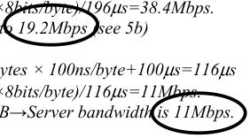

&emsp;&emsp;However, network limits Client A→Server bandwidth to 19.2Mbps (see 5b) 
Client B→Server overhead/packet = copy+ interrupt = 160 bytes × 100ns/byte+100μs=116μs 
&emsp;&emsp;Without network limits. Client B→Server =(160bytes×8bits/byte)/116μs=11Mbps. 
&emsp;&emsp;Since network permits 12.8Mpbs (see 5b), max Client B→Server bandwidth is 11Mbps.

Page 13/15

---

**Page 14**

CS 162 Fall 2006 Midterm Exam II December 4th, 2006

### **Problem 5d\[5pts\]:** Now, accounting for copying and interrupt overheads, what is the total time to

reliably send a single maximal-sized packet from Client A to a user-level process on the server 
without fragmentation?  Account for all latencies (including the reception of an ACK, which can be 
assumed to be zero length but which will generate an interrupt).  Explain your work. 
We need to compute the path from A to server with the data as well as the time back for the ACK. 
Note that the data involves raw latency, in addition to copying, DMA, and transfer time along the 
ling.  The ACK has only latency elements. Note that the Copies between user space and kernel 
space involve the data payload (packet size – 40 bytes).  We will assume that the DMAs involve the 
complete packet (although this is perhaps open to interpretation).  Note that we convert everything 
to ms.  We could easily have converted to seconds instead…. 
Client A→Server: Copy + DMA + \[A→R1\]Latency +\[A→R1\]Xfertime + R1Latency +\[R1→R2\]Latency + 
\[R1→R2\]Xfertime + R2Latency + \[R2→Ser\]Latency + \[R2→Ser\]Xfertime + 
DMA + Int + Copy 
Server→Client A:   \[Ser→R2\]Latency + R2Latency + \[R2→R1\]Xfertime + R1Latency + \[R1→A\]Latency + Int 
Total= 2×(Copy+DMA+Int)+ 
2× (\[A→R1\]Latency+R1Latency+\[R1→R2\]Latency+R2Latency+\[R2→Ser\]Latency)+ 
\[A→R1\]Xfertime+\[R1→R2\]Xfertime+\[R2→Ser\]Xfertime= 
=  2×(960bytes×100ns/byte×10-6ms/ns + 1000bytes×100ns/byte×10-6ms/ns + 100μs×10-3ms/ns)+ 
&emsp;2×(1ms + 1ms + 4ms + 1ms + 2ms) + 
&emsp;1000bytes/(100×106bytes/sec×10-3s/ms) + 1000bytes/(100×106bytes/sec×10-3s/ms) + 
&emsp;1000bytes/(20×106bytes/sec×10-3s/ms) 
= 2×(.296ms) + 2×(9ms) + .01ms + .01ms + .05ms = 18.662ms

### **Problem 5e\[4pts\]:** Assume the conditions from 5d. Client A sends a continuous stream of packets

to the server (and no other clients are talking to the server). How big should the send window be so 
that the TCP/IP algorithm will achieve maximum bandwidth without dropping packets?  Explain. 
Hint: don’t forget to account for the 40 bytes of header. 
&emsp;&emsp;We merely need to compute the (bandwidth×latency) product, since this is the amount of 
&emsp;&emsp;data we need outstanding to completely fill up the pipeline without putting too much into the 
&emsp;&emsp;network.  Since the send window is for real data (not headers), we use the bandwidth 
&emsp;&emsp;numbers from 5c with the latency from 5d. We need to make sure to cancel terms (watch out 
&emsp;&emsp;for seconds vs ms!). Note: Technically speaking, the user copy doesn’t really impact the 
&emsp;&emsp;window.  So, you should really ignore the term of 2×(.096ms) in the answer to 5d, yielding a 
&emsp;&emsp;correct window of: 
&emsp;&emsp;&emsp;&emsp;&emsp;&emsp;&emsp;&emsp;1 bytes/bit\] ×  \[18.47ms× (10-3s/ms)\] = 4432 8.8 bytes 
&emsp;&emsp;Send window =\[19.2 × 106 bits/s × 8

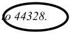

&emsp;&emsp;Since a fraction of a byte doesn’t make sense, we round down to 44328. 
&emsp;&emsp;Note that we also gave you full credit if you simply multiplied answer from 5d with 19.2Mbps 
&emsp;&emsp;(which would be correct if window handled by user—not really true): 
&emsp;&emsp;&emsp;&emsp;&emsp;&emsp;&emsp;&emsp;1 bytes/bit\] ×  \[18.662ms× (10-3s/ms)\] = 44788.8 bytes 
&emsp;&emsp;Send window =\[19.2 × 106 bits/s × 8 
&emsp;&emsp;We can round down 44788 bytes.

Page 14/15

---

**Page 15**

CS 162 Fall 2006 Midterm Exam II December 4th, 2006

&emsp;&emsp;&emsp;&emsp;&emsp;&emsp;&emsp;&emsp;**\[ This page intentionally left blank \]**

Page 15/15

