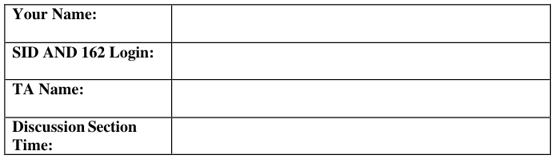
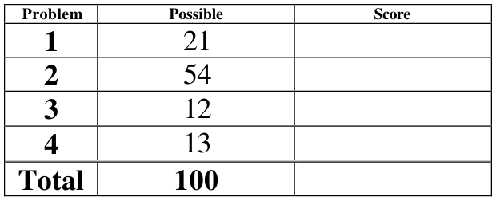
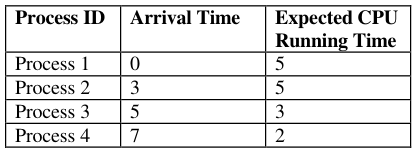
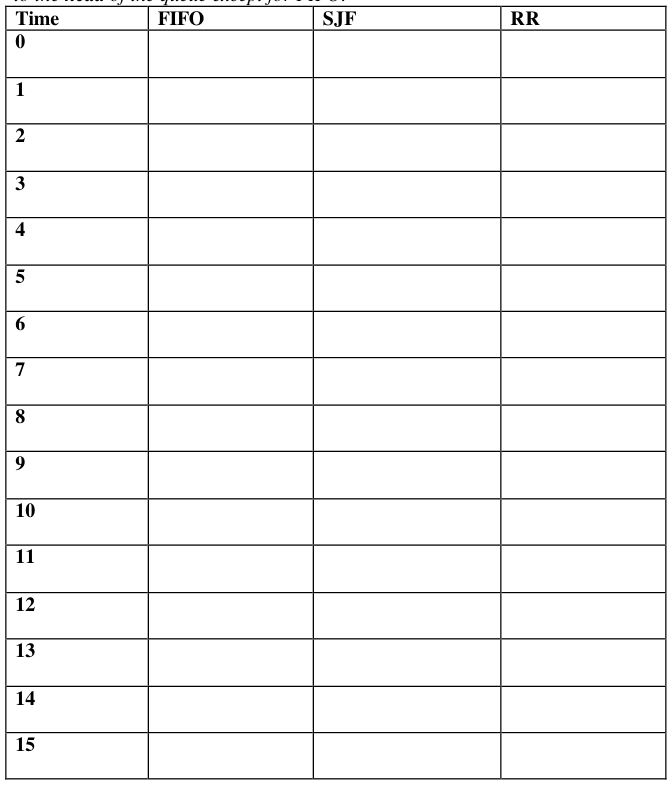
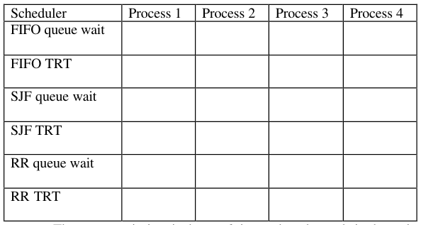

# Berkeley CS162 Spring 2006: Midterm 1: Questions

> Copied from the original: <https://hkn.eecs.berkeley.edu/exams/course/cs/162>. Text and figures are taken from the PDF as is; nothing was answered or rewritten. The original PDF is in this folder.

---

**Page 1**

&emsp;&emsp;&emsp;&emsp;&emsp;&emsp;&emsp;&emsp;University of California, Berkeley 
&emsp;&emsp;&emsp;&emsp;&emsp;&emsp;&emsp;&emsp;College of Engineering 
&emsp;&emsp;&emsp;&emsp;&emsp;&emsp;&emsp;&emsp;Computer Science Division – EECS 
Spring 2006                                     Anthony D. Joseph 
&emsp;&emsp;&emsp;&emsp;&emsp;&emsp;&emsp;&emsp;**Midterm Exam** 
&emsp;&emsp;&emsp;&emsp;&emsp;&emsp;&emsp;&emsp;March 8, 2006 
&emsp;&emsp;&emsp;&emsp;&emsp;&emsp;&emsp;&emsp;CS162 Operating Systems

General Information: 
This is a **closed book and notes** examination. You have 90 minutes to answer as many questions 
as possible.  The number in parentheses at the beginning of each question indicates the number of 
points given to the question; there are 100 points in all. You should read **all** of the questions 
before starting the exam, as some of the questions are substantially more time consuming. 
Write all of your answers directly on this paper.  **Make your answers as concise as possible.** If there 
is something in a question that you believe is open to interpretation, then please ask us about it! 
&emsp;&emsp;&emsp;&emsp;&emsp;&emsp;&emsp;&emsp;**Good Luck!!**

Page 1/10

---

**Page 2**

CS 162 Spring 2006 Midterm Exam        March 8, 2006

1\. (21 points total) Short answer questions: 
&emsp;a. (4 points) True/False and Why? 
&emsp;&emsp;Lottery scheduling can be used to implement any other scheduling algorithm. 
&emsp;&emsp;&emsp;&emsp;&emsp;TRUE                    FALSE 
&emsp;&emsp;&emsp;&emsp;&emsp;Why?

&emsp;b.  (5 points) Inverted Page Tables: 
&emsp;&emsp;i) (3 points) Give a two to three sentence description of an inverted page table.

&emsp;&emsp;ii) (2 points) Briefly (2-3 sentences) state the problem it is intended to solve.

&emsp;c. (4 points) Why would two processes want to use shared memory for 
&emsp;&emsp;communication instead of using message passing? Your answer should be brief 
&emsp;&emsp;(no more than 5 sentences).

Page 2/10

---

**Page 3**

CS 162 Spring 2006 Midterm Exam        March 8, 2006

&emsp;d. (4 points) We say that the operating system is an “illusionist”. Name two illusions 
&emsp;&emsp;that it provides: 
&emsp;&emsp;i) (2 points) Illusion #1:

&emsp;&emsp;ii) (2 points) Illusion #2:

&emsp;e. (4 points) For system calls, we explained that arguments are sanity checked twice. 
&emsp;&emsp;i) (2 points) When is each check performed?

&emsp;&emsp;ii) (2 points) Why is this redundancy important?

Page 3/10

---

**Page 4**

CS 162 Spring 2006 Midterm Exam        March 8, 2006

2\. (54 points total) CPU Scheduling. Here is a table of processes and their associated 
&emsp;arrival and running times.

&emsp;a. (15 points) Show the scheduling order for these processes under First-In-First-Out 
&emsp;&emsp;(FIFO), Shortest-Job First (SJF), and Round-Robin (RR) with a quantum = 1 time 
&emsp;&emsp;unit. Assume that the context switch overhead is 0 and new processes are added 
&emsp;&emsp;to the **head** of the queue except for FIFO.

Page 4/10

---

**Page 5**

CS 162 Spring 2006 Midterm Exam        March 8, 2006

&emsp;b. (18 points) For each process in each schedule above, indicate the queue wait time 
&emsp;&emsp;and turnaround time (TRT).

&emsp;&emsp;&emsp;&emsp;&emsp;The queue wait time is the total time a thread spends in the wait queue. 
&emsp;&emsp;&emsp;&emsp;&emsp;The turnaround time is defined as the time a process takes to complete 
&emsp;&emsp;&emsp;&emsp;&emsp;after it arrives.

Page 5/10

---

**Page 6**

CS 162 Spring 2006 Midterm Exam        March 8, 2006

&emsp;c. (6 points) Approximate Shortest Remaining Time First. 
&emsp;&emsp;i) (3 points) How can you approximate Shortest Remaining Time First scheduling 
&emsp;&emsp;&emsp;without knowing how long a job takes ahead of time?

&emsp;&emsp;ii) (3 points) How would you implement this approximation in a Lottery 
&emsp;&emsp;&emsp;Scheduler?

&emsp;d. (15 points) Scheduling Algorithm Pros and Cons. For each of the four algorithms 
&emsp;&emsp;discussed in class, list the pros and cons of the algorithm, and give one example 
&emsp;&emsp;situation where each algorithm would be a bad choice. 
&emsp;&emsp;i) (3 points) First-Come, First-Served. 
&emsp;&emsp;&emsp;(1) Pros:

&emsp;&emsp;&emsp;(2) Cons:

&emsp;&emsp;&emsp;(3) Bad choice example:

Page 6/10

---

**Page 7**

CS 162 Spring 2006 Midterm Exam        March 8, 2006

&emsp;&emsp;ii) (3 points) Round Robin. 
&emsp;&emsp;&emsp;(1)  Pros:

&emsp;&emsp;&emsp;(2) Cons: 
&emsp;&emsp;&emsp;(3) Bad choice example:

&emsp;&emsp;iii) (3 points) Shortest Job First/Shortest Remaining Time First 
&emsp;&emsp;&emsp;(1) Pros: 
&emsp;&emsp;&emsp;(2) Cons:

&emsp;&emsp;&emsp;(3) Bad choice example:

&emsp;&emsp;iv) (3 points) Lottery 
&emsp;&emsp;&emsp;(1) Pros:

&emsp;&emsp;&emsp;(2) Cons: 
&emsp;&emsp;&emsp;(3) Bad choice example:

Page 7/10

---

**Page 8**

CS 162 Spring 2006 Midterm Exam        March 8, 2006

No Credit – **Problem X** (000000000000 points) 
**The 2005 Ig Nobel Prize Winners** 
The 2005 Ig Nobel Prizes were awarded on Thursday October 6, 2005 at the 15th First Annual Ig Nobel 
Prize Ceremony, at Harvard's Sanders Theatre. 
AGRICULTURAL HISTORY: James Watson of Massey University, New Zealand, for his scholarly study, 
"The Significance of Mr. Richard Buckley’s Exploding Trousers." 
REFERENCE: "The Significance of Mr. Richard Buckley’s Exploding Trousers: Reflections on an Aspect 
of Technological Change in New Zealand Dairy -Farming between the World Wars," James Watson, 
Agricultural History, vol. 78, no. 3, Summer 2004, pp. 346-60. 
PHYSICS: John Mainstone and the late Thomas Parnell of the University of Queensland, Australia, for 
patiently conducting an experiment that began in the year 1927 – in which a glob of congealed black tar has 
been slowly, slowly dripping through a funnel, at a rate of approximately one drop every nine years. 
REFERENCE: "The Pitch Drop Experiment," R. Edgeworth, B.J. Dalton and T. Parnell, European Journal 
of Physics, 1984, pp. 198-200. 
MEDICINE: Gregg A. Miller of Oak Grove, Missouri, for inventing Neuticles – artificial replacement 
testicles for dogs, which are available in three sizes, and three degrees of firmness. 
REFERENCES: US Patent #5868140, and the book Going Going NUTS!, by Gregg A. Miller, 
PublishAmerica, 2004, ISBN 1413753167. 
LITERATURE: The Internet entrepreneurs of Nigeria, for creating and then using e-mail to distribute a 
bold series of short stories, thus introducing millions of readers to a cast of rich characters – General Sani 
Abacha, Mrs. Mariam Sanni Abacha, Barrister Jon A Mbeki Esq., and others -- each of whom requires just 
a small amount of expense money so as to obtain access to the great wealth to which they are entitled and 
which they would like to share with the kind person who assists them. 
PEACE: Claire Rind and Peter Simmons of Newcastle University, in the U.K., for electrically monitoring 
the activity of a brain cell in a locust while that locust was watching selected highlights from the movie 
"Star Wars." 
REFERENCE: "Orthopteran DCMD Neuron: A Reevaluation of Responses to Moving Objects. I. Selective 
Responses to Approaching Objects," F.C. Rind and P.J. Simmons, Journal of Neurophysiology, vol. 68, no. 
5, November 1992, pp. 1654-66. 
ECONOMICS: Gauri Nanda of the Massachusetts Institute of Technology, for inventing an alarm clock 
that runs away and hides, repeatedly, thus ensuring that people DO get out of bed, and thus theoretically 
adding many productive hours to the workday. 
CHEMISTRY: Edward Cussler of the University of Minnesota and Brian Gettelfinger of the University of 
Minnesota and the University of Wisconsin, for conducting a careful experiment to settle the longstanding 
scientific question: can people swim faster in syrup or in water? 
REFERENCE: "Will Humans Swim Faster or Slower in Syrup?" American Institute of Chemical Engineers 
NUTRITION: Dr. Yoshiro Nakamats of Tokyo, Japan, for photographing and retrospectively analyzing 
every meal he has consumed during a period of 34 years (and counting). 
FLUID DYNAMICS: Victor Benno Meyer-Rochow of International University Bremen, Germany and the 
University of Oulu , Finland; and Jozsef Gal of Loránd Eötvös University, Hungary, for using basic 
principles of physics to calculate the pressure that builds up inside a penguin, as detailed in their report 
"Pressures Produced When Penguins Pooh -- Calculations on Avian Defaecation." 
PUBLISHED IN: Polar Biology, vol. 27, 2003, pp. 56-8.

Page 8/10

---

**Page 9**

CS 162 Spring 2006 Midterm Exam        March 8, 2006

3\. (12 points total) Concurrency problem: Dining Philosophers. 
&emsp;The goal of this exercise is to implement a solution to the Dining Philosophers 
&emsp;problem using only semaphores (your solution may not use locks, monitors, or other 
&emsp;synchronization primitives). Create a method `Dine()`, which waits until a diner has 
&emsp;two chopsticks and can eat, then calls `Eat()`, and then releases the chopsticks before 
&emsp;returning. Your solution should allow multiple philosophers to eat at the same time 
&emsp;(as long as there are sufficient chopsticks in a pile in the middle of the table). Assume 
&emsp;you are given the variable, `chopsticks`, which starts off initialized to the total 
&emsp;number of chopsticks available. Your solution should avoid deadlock. 
&emsp;a. (4 points) Specify the correctness constraints. Be succinct and explicit in your 
&emsp;&emsp;answer.

&emsp;b. (8 points) Implement the `Dine()` method.

Page 9/10

---

**Page 10**

CS 162 Spring 2006 Midterm Exam        March 8, 2006

4\. (13 points) Virtual Memory. 
The Lemon company has hired you to design the virtual memory system for their new 
line of desktop computers, the iniM caM. Each computer will have 32 bit virtual and 
physical addresses, and memory will be allocated in 2 KByte pages. 
&emsp;a. (4 points) For a single-level page table, how many bits will be used to index the 
&emsp;&emsp;page, and how many will be the offset within the page? 
&emsp;&emsp;i) (2 points) Number of bits for page number?

&emsp;&emsp;ii) (2 points) Number of bits for offset within the page?

&emsp;b. (5 points) Each page table entry will also include three bits for bookkeeping (Valid, 
&emsp;&emsp;Read, and Write bits). 
&emsp;&emsp;i) (2 points) How many bytes are required for each page table entry?

&emsp;&emsp;ii) (3 points) How much physical memory is required to store the table?

&emsp;c. (4 points) If the iniM caM has 16 megabytes or less of physical memory, we can 
&emsp;&emsp;use 24 bit physical addresses (and still have 32 bit virtual addresses).  How large 
&emsp;&emsp;would each page table entry and the entire table be now?

Page 10/10

