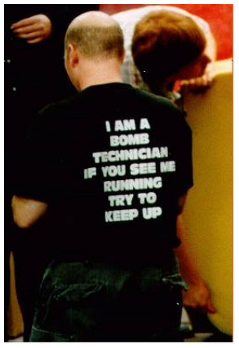

# Berkeley CS162 Spring 2006: Midterm 2: Questions

> Copied from the original: <https://hkn.eecs.berkeley.edu/exams/course/cs/162>. Text and figures are taken from the PDF as is; nothing was answered or rewritten. The original PDF is in this folder.

---

**Page 1**

&emsp;&emsp;&emsp;&emsp;&emsp;&emsp;&emsp;&emsp;University of California, Berkeley 
&emsp;&emsp;&emsp;&emsp;&emsp;&emsp;&emsp;&emsp;College of Engineering 
&emsp;&emsp;&emsp;&emsp;&emsp;&emsp;&emsp;&emsp;Computer Science Division – EECS 
Spring 2006                                     Anthony D. Joseph 
&emsp;&emsp;&emsp;&emsp;&emsp;&emsp;&emsp;&emsp;**Midterm #2 Exam** 
&emsp;&emsp;&emsp;&emsp;&emsp;&emsp;&emsp;&emsp;April 26, 2006 
&emsp;&emsp;&emsp;&emsp;&emsp;&emsp;&emsp;&emsp;CS162 Operating Systems

General Information: 
This is a **closed book and notes** examination. You have 90 minutes to answer as many questions 
as possible.  The number in parentheses at the beginning of each question indicates the number of 
points given to the question; there are 100 points in all. You should read **all** of the questions 
before starting the exam, as some of the questions are substantially more time consuming. 
Write all of your answers directly on this paper.  **Make your answers as concise as possible.** If there 
is something in a question that you believe is open to interpretation, then please ask us about it! 
&emsp;&emsp;&emsp;&emsp;&emsp;&emsp;&emsp;&emsp;**Good Luck!!**

Page 1/10

---

**Page 2**

CS 162 Spring 2006 Midterm #2 Exam        April 26, 2006

1\. (19 points total) Short answer questions: 
&emsp;a. (11 points) Translation Look-Aside Buffers: 
&emsp;&emsp;i)  (6 points) On a TLB miss in Nachos, what data structures should you check to 
&emsp;&emsp;&emsp;find a previously referenced page? List the data structures in the order that 
&emsp;&emsp;&emsp;they should be checked.

&emsp;&emsp;ii)  (3 points) Give a two to three sentence description of “precise exceptions”.

&emsp;&emsp;iii)  (2 points) Briefly (1-2 sentences) say why precise exceptions are nice to have.

&emsp;b. (4 points) Networking: 
&emsp;&emsp;i)  (2 points) The current version of IP uses 32-bit addresses. List one reason that 
&emsp;&emsp;&emsp;we cannot use all 232 addresses.

Page 2/10

---

**Page 3**

CS 162 Spring 2006 Midterm #2 Exam        April 26, 2006

&emsp;&emsp;ii)  (2 points) List one reason why it would still be possible to connect more than 
&emsp;&emsp;&emsp;232 computers to the Internet.

&emsp;c. (4 points) Caching: 
&emsp;&emsp;i)  (2 points) What are the two types of locality exploited by caching?

&emsp;&emsp;ii)  (2 points) Which kind of locality makes large cache lines a good idea, and 
&emsp;&emsp;&emsp;why?

2\. (36 points) File Systems and Disks. 
&emsp;a.  (8 points) Consider a file system with 2048 byte blocks and 32-bit disk and file 
&emsp;&emsp;block pointers. Each file has 12 direct pointers, a singly-indirect pointer, a 
&emsp;&emsp;doubly-indirect pointer, and a triply-indirect pointer. 
&emsp;&emsp;Express your answers in symbolic form for partial credit. 
&emsp;&emsp;i)  (4 points) How large of a disk can this file system support?

Page 3/10

---

**Page 4**

CS 162 Spring 2006 Midterm #2 Exam        April 26, 2006

&emsp;&emsp;ii)  (4 points) What is the maximum file size?

&emsp;b. (12 points) Disk requests come into the disk driver for cylinders: 10, 22, 20, 2, 40, 
&emsp;&emsp;6, and 38, in that order. The disk head is currently positioned over cylinder 20. A 
&emsp;&emsp;seek takes 6 milliseconds per cylinder moved. What is the sequence of reads and 
&emsp;&emsp;total seek time using each of the following algorithms? 
&emsp;&emsp;i)  (4 points) First-come, first-served:

&emsp;&emsp;ii)  (4 points) Shortest Seek Time First:

&emsp;&emsp;iii)  (4 points) SCAN (initially moving upwards):

&emsp;c. (2 points) Briefly (2-3 sentences) state the difference between a hard link and a soft 
&emsp;&emsp;link.

Page 4/10

---

**Page 5**

CS 162 Spring 2006 Midterm #2 Exam        April 26, 2006

&emsp;d. (7 points) Read-ahead. 
&emsp;&emsp;i) (3 points) Give a brief (2-3 sentences) description of read-ahead.

&emsp;&emsp;ii) (2 points) Briefly (2-3 sentences) state why read-ahead is useful.

&emsp;&emsp;iii) (2 points) Briefly (2-3 sentences) state what happens if you read ahead too 
&emsp;&emsp;&emsp;much.

&emsp;e. (7 points) RAID 
&emsp;&emsp;i)  (3 points) Give a brief (2-3 sentences) description of RAID 5.

&emsp;&emsp;ii)  (2 points) How many disk failures can RAID 5 tolerate without losing data?

&emsp;&emsp;iii)  (2 points) How would you reconstruct a failed disk?

Page 5/10

---

**Page 6**

CS 162 Spring 2006 Midterm #2 Exam        April 26, 2006

No Credit – **Problem X** (000000000000 points) 
**The importance of**

**synchronization… or You're** 
**first – after me (This Only** 
**Happens in New York City).**

**Race Condition**

Page 6/10

---

**Page 7**

CS 162 Spring 2006 Midterm #2 Exam        April 26, 2006

3\. (23 points total) Reliable Peer-to-Peer (P2P) File Sharing. 
&emsp;Two computers running a P2P application using TCP/IP for connections are 
&emsp;connected via a router (see below). To write data packets to the network, the P2P 
&emsp;application issues a system call, and the OS copies the data first to a kernel buffer and 
&emsp;then uses DMA to copy the data to the network controller board. Immediately after 
&emsp;receiving the data, the controller generates one or more packets and sends them. 
&emsp;The packets travel one hop to router RTR, which will in turn forward the packets to 
&emsp;their final destination. Assume that no packets will be lost, and assume that the 
&emsp;processing time at the router is negligible, and a router must wait for the entire 
&emsp;packet to arrive before forwarding it. 
&emsp;The receiving network controller uses DMA to copy the data it receives to memory, 
&emsp;and when the last bit arrives and is transferred, it interrupts the CPU. The OS copies 
&emsp;the data to the P2P application’s buffer in user space. After the copy completes, the 
&emsp;OS sends back a one-byte acknowledgement to the sending OS. For simplicity, you 
&emsp;may treat acknowledgements as if they are zero bytes long. Assume that a sender uses 
&emsp;a send window-based acknowledgement protocol.

&emsp;System Parameters: 
&emsp;• Time to process an interrupt, Tint = 1.5 millisecond 
&emsp;• CPU cycle time, TCPU = 10 nanoseconds 
&emsp;• Packet size, Npkt = 1,000 bytes (ignore headers) 
&emsp;• Time to copy or DMA one byte, Tcopy = 1 microsecond 
&emsp;• Latency of a link, Tlink = 3 milliseconds 
&emsp;• Bandwidth of links, B = 8,000,000 bit/sec 
&emsp;• Send window Nwin = 1 packet 
&emsp;• Retransmission timeout, Tretran = 400 milliseconds 
&emsp;a.  (7 points) Compute Tpkt, the time to reliably send a single packet from a P2P 
&emsp;&emsp;application on computer 2 to a P2P application on computer 1 over a link with no 
&emsp;&emsp;losses.

Page 7/10

---

**Page 8**

CS 162 Spring 2006 Midterm #2 Exam        April 26, 2006

&emsp;b.  (3 points) What is the maximum or peak rate at which one process can reliably 
&emsp;&emsp;send data to another process?

&emsp;c. (4 points) In terms of Tpkt, how long does it take to reliably send an .mp3 file from 
&emsp;&emsp;computer 2 to computer 1 if the file is 4,000,000 bytes in size (assuming the links 
&emsp;&emsp;have no losses)?

&emsp;d.  (5 points) If we use a send window of 40 outstanding packets instead, what is the 
&emsp;&emsp;maximum rate at which one process can reliably send data to another process 
&emsp;&emsp;(assuming the links have no losses)?

&emsp;e. (4 points) If we use a send window of 40 outstanding packets instead, how long 
&emsp;&emsp;does it take to reliably send an .mp3 file from computer 2 to computer 1 if the file 
&emsp;&emsp;is 4,000,000 bytes in size (assuming the links have no losses)?

Page 8/10

---

**Page 9**

CS 162 Spring 2006 Midterm #2 Exam        April 26, 2006

4\. (22 points total) Read-only Page Sharing. 
&emsp;To more efficiently use the physical memory allocated to processes, modern 
&emsp;operating systems share read-only pages of different running instances of the same 
&emsp;application (e.g., multiple Emacs processes). Your task is to implement this 
&emsp;functionality for Nachos – sharing of read-only COFF pages in Nachos memory. 
&emsp;Since we don’t have actual inodes in Nachos, it’s hard to have a real unique file 
&emsp;handle, so it is sufficient if your answer provides a file name. 
&emsp;a. (6 points) List the data structures that you would need to add to the kernel:

&emsp;b. (4 points) Name all the place where would you have to update these data 
&emsp;&emsp;structures:

&emsp;c. (12 points) Design the function `load_coff_page()` that takes an executable 
&emsp;&emsp;name and virtual page number, and returns a physical page number if that COFF 
&emsp;&emsp;page is already in memory, or -1 if it must be loaded from disk. 
&emsp;&emsp;`int load_coff_page( String exec_name, int vpn ) {`

Page 9/10

---

**Page 10**

CS 162 Spring 2006 Midterm #2 Exam        April 26, 2006

&emsp;&emsp;&emsp;&emsp;&emsp;&emsp;&emsp;&emsp;**This page intentionally left blank**

Page 10/10

