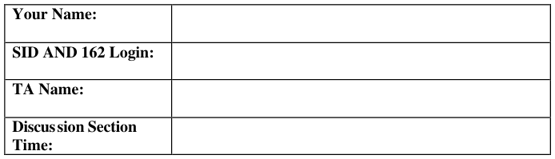
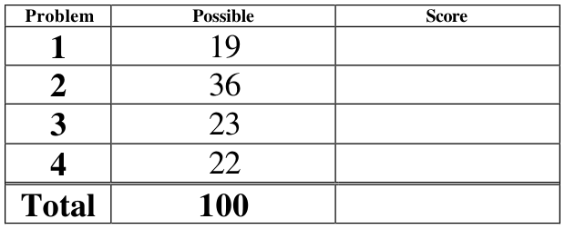
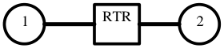

# Berkeley CS162 Spring 2006: Midterm 2: Official solutions

> Copied from the original: <https://hkn.eecs.berkeley.edu/exams/course/cs/162>. Text and figures are taken from the PDF as is; nothing was answered or rewritten. The original PDF is in this folder.

---

**Page 1**

&emsp;&emsp;&emsp;&emsp;&emsp;&emsp;&emsp;&emsp;University of California, Berkeley 
&emsp;&emsp;&emsp;&emsp;&emsp;&emsp;&emsp;&emsp;College of Engineering 
&emsp;&emsp;&emsp;&emsp;&emsp;&emsp;&emsp;&emsp;Computer Science Division – EECS 
Spring 2006                                     Anthony D. Joseph 
&emsp;&emsp;&emsp;&emsp;&emsp;&emsp;&emsp;&emsp;**Midterm #2 Exam Solutions** 
&emsp;&emsp;&emsp;&emsp;&emsp;&emsp;&emsp;&emsp;April 26, 2006 
&emsp;&emsp;&emsp;&emsp;&emsp;&emsp;&emsp;&emsp;CS162 Operating Systems

General Information: 
This is a **closed book and notes** examination. You have 90 minutes to answer as many questions 
as possible.  The number in parentheses at the beginning of each question indicates the number of 
points given to the question; there are 100 points in all. You should read **all** of the questions 
before starting the exam, as some of the questions are substantially more time consuming. 
Write all of your answers directly on this paper.  **Make your answers as concise as possible.** If there 
is something in a question that you believe is open to interpretation, then please ask us about it! 
&emsp;&emsp;&emsp;&emsp;&emsp;&emsp;&emsp;&emsp;**Good Luck!!**

Page 1/12

---

**Page 2**

CS 162 Spring 2006 Midterm #2 Exam        April 26, 2006 
Solutions

1\. (19 points total) Short answer questions: 
&emsp;a. (11 points) Translation Look-Aside Buffers: 
&emsp;&emsp;i)  (6 points) On a TLB miss in Nachos, what data structures should you check to 
&emsp;&emsp;&emsp;find a previously referenced page? List the data structures in the order that 
&emsp;&emsp;&emsp;they should be checked. 
&emsp;&emsp;&emsp;&emsp;&emsp;First, you should check the Inverted Page Table, then the swap file, and 
&emsp;&emsp;&emsp;&emsp;&emsp;finally the application COFF file. Each correct answer was worth two 
&emsp;&emsp;&emsp;&emsp;&emsp;points. We subtracted one point for each incorrect answer or wrong order.

&emsp;&emsp;ii)  (3 points) Give a two to three sentence description of “precise exceptions”. 
&emsp;&emsp;&emsp;When a precise exception occurs, the Program Counter cleanly divides the 
&emsp;&emsp;&emsp;fully executed and non-executed instructions – there are no partially executed 
&emsp;&emsp;&emsp;instructions.

&emsp;&emsp;iii)  (2 points) Briefly (1-2 sentences) say why precise exceptions are nice to have. 
&emsp;&emsp;&emsp;With precise exceptions, there are no side effects or instructions for the 
&emsp;&emsp;&emsp;exception handler to undo or rollback, making the OS simpler.

Page 2/12

---

**Page 3**

CS 162 Spring 2006 Midterm #2 Exam        April 26, 2006 
Solutions 
&emsp;b. (4 points) Networking: 
&emsp;&emsp;i)  (2 points) The current version of IP uses 32-bit addresses. List one reason that 
&emsp;&emsp;&emsp;we cannot use all 232 addresses. 
&emsp;&emsp;&emsp;Two reasons: the hierarchical name allocation yields internal fragmentation 
&emsp;&emsp;&emsp;of network address space, and some of the address are reserved for private 
&emsp;&emsp;&emsp;networks or other purposes (e.g., x.y.z.0, 127.0.0.1, or localhost).

&emsp;&emsp;ii)  (2 points) List one reason why it would still be possible to connect more than 
&emsp;&emsp;&emsp;232 computers to the Internet. 
&emsp;&emsp;&emsp;Two reasons: Network Address Translation allows multiple computers to be 
&emsp;&emsp;&emsp;connected using a single IP address, and IP addresses can be time-shared 
&emsp;&emsp;&emsp;using the Dynamic Host Configuration Protocol.

&emsp;c. (4 points) Caching: 
&emsp;&emsp;i)  (2 points) What are the two types of locality exploited by caching? 
&emsp;&emsp;&emsp;Spatial locality and temporal locality.

&emsp;&emsp;ii)  (2 points) Which kind of locality makes large cache lines a good idea, and 
&emsp;&emsp;&emsp;why? 
&emsp;&emsp;&emsp;Spatial locality makes large cache lines a good idea because it relies on 
&emsp;&emsp;&emsp;memory references being to regions near each other.

Page 3/12

---

**Page 4**

CS 162 Spring 2006 Midterm #2 Exam        April 26, 2006 
Solutions

2\. (36 points) File Systems and Disks. 
&emsp;a.  (8 points) Consider a file system with 2048 byte blocks and 32-bit disk and file 
&emsp;&emsp;block pointers. Each file has 12 direct pointers, a singly-indirect pointer, a 
&emsp;&emsp;doubly-indirect pointer, and a triply-indirect pointer. 
&emsp;&emsp;Express your answers in symbolic form for partial credit. 
&emsp;&emsp;i)  (4 points) How large of a disk can this file system support? 
&emsp;&emsp;&emsp;232 blocks x 211 bytes/block = 243 = 8 Terabytes.

&emsp;&emsp;ii)  (4 points) What is the maximum file size? 
&emsp;&emsp;&emsp;There are 512 pointers per block, so: 2048 x (12 + 512 + 5122 + 5123) = 238 
&emsp;&emsp;&emsp;\+ 229 + 220 + 24k = 256G + 513 M + 24 K. We gave subtracted 1 point each 
&emsp;&emsp;&emsp;if you did not include the 2K block size, the powers of 512 for indirect 
&emsp;&emsp;&emsp;pointers, or the overall multiplication

&emsp;b. (12 points) Disk requests come into the disk driver for cylinders: 10, 22, 20, 2, 40, 
&emsp;&emsp;6, and 38, in that order. The disk head is currently positioned over cylinder 20. A 
&emsp;&emsp;seek takes 6 milliseconds per cylinder moved. What is the sequence of reads and 
&emsp;&emsp;total seek time using each of the following algorithms? 
&emsp;&emsp;i)  (4 points) First-come, first-served: 
&emsp;&emsp;&emsp;10, 22, 20, 2, 40, 6, 38 
&emsp;&emsp;&emsp;10 + 12 + 2 + 18 + 38 + 34 +32 = 146 cylinders = 876 milliseconds. 
&emsp;&emsp;&emsp;We subtracted 1 point for missing the first reference (to 20), and 1 point for 
&emsp;&emsp;&emsp;not writing out the sequence of accesses.

Page 4/12

---

**Page 5**

CS 162 Spring 2006 Midterm #2 Exam        April 26, 2006 
Solutions

&emsp;&emsp;ii)  (4 points) Shortest Seek Time First: 
&emsp;&emsp;&emsp;20, 22, 10, 6, 2, 38, 40 
&emsp;&emsp;&emsp;0 + 2 + 12 + 4 + 4 + 36 + 2 = 60 cylinders = 360 milliseconds.

&emsp;&emsp;iii)  (4 points) SCAN (initially moving upwards): 
&emsp;&emsp;&emsp;20, 22, 38, 40, 10, 6, 2 
&emsp;&emsp;&emsp;0 + 2 + 16 + 2 + 30 + 4 + 4 = 58 cylinders = 348 milliseconds.

&emsp;c. (2 points) Briefly (2-3 sentences) state the difference between a hard link and a soft 
&emsp;&emsp;link. 
&emsp;&emsp;Hard links point to the same inode, while soft links simply list a directory entry. 
&emsp;&emsp;Hard links use reference counting. Soft links do not and may have problems with 
&emsp;&emsp;dangling references if the referenced file is moved or deleted. Soft links can span 
&emsp;&emsp;file systems, while hard links are limited to the same file system.

&emsp;d. (7 points) Read-ahead. 
&emsp;&emsp;i) (3 points) Give a brief (2-3 sentences) description of read-ahead. 
&emsp;&emsp;Prefetching subsequent blocks on the same cylinder when a request is received. 
&emsp;&emsp;We subtracted 1-2 points if your answer didn’t clearly state that subsequent 
&emsp;&emsp;blocks were read.

&emsp;&emsp;ii) (2 points) Briefly (2-3 sentences) state why read-ahead is useful. 
&emsp;&emsp;An application with spatial locality will read the prefetched data (1 pt), avoiding 
&emsp;&emsp;rotational delay and reducing the number of I/O operations (1 pt). We subtracted 
&emsp;&emsp;1 point if you didn’t explicitly state that there are fewer I/O operations.

Page 5/12

---

**Page 6**

CS 162 Spring 2006 Midterm #2 Exam        April 26, 2006 
Solutions

&emsp;&emsp;iii) (2 points) Briefly (2-3 sentences) state what happens if you read ahead too 
&emsp;&emsp;&emsp;much. 
&emsp;&emsp;&emsp;Other normal reads can be delayed by prefetching (1 pt), and prefetched data 
&emsp;&emsp;&emsp;may not be used (1 pt). Also, prefetching replaces blocks in the buffer cache 
&emsp;&emsp;&emsp;that may be being used, and some files are not sequential, so they won’t 
&emsp;&emsp;&emsp;benefit from prefetching.

&emsp;e. (7 points) RAID 
&emsp;&emsp;i)  (3 points) Give a brief (2-3 sentences) description of RAID 5. 
&emsp;&emsp;Redundant Array of Inexpensive Disks level 5 stripes(1 point) blocks of data 
&emsp;&emsp;across at least three drives (1 point) along with an interleaved XOR-based parity 
&emsp;&emsp;block for each stripe set (1 point).

&emsp;&emsp;ii)  (2 points) How many disk failures can RAID 5 tolerate without losing data? 
&emsp;&emsp;One.

&emsp;&emsp;iii)  (2 points) How would you reconstruct a failed disk? 
&emsp;&emsp;&emsp;Read blocks from the other drives (1 point) and use an XOR (1 point) of their 
&emsp;&emsp;&emsp;blocks to reconstruct the data.

Page 6/12

---

**Page 7**

CS 162 Spring 2006 Midterm #2 Exam        April 26, 2006 
Solutions

No Credit – **Problem X** (000000000000 points) 
**The importance of**

**synchronization… or You're** 
**first – after me (This Only** 
**Happens in New York City).**

**Race Condition**

Page 7/12

---

**Page 8**

CS 162 Spring 2006 Midterm #2 Exam        April 26, 2006 
Solutions

3\. (23 points total) Reliable Peer-to-Peer (P2P) File Sharing. 
&emsp;Two computers running a P2P application using TCP/IP for connections are 
&emsp;connected via a router (see below). To write data packets to the network, the P2P 
&emsp;application issues a system call, and the OS copies the data first to a kernel buffer and 
&emsp;then uses DMA to copy the data to the network controller board. Immediately after 
&emsp;receiving the data, the controller generates one or more packets and sends them. 
&emsp;The packets travel one hop to router RTR, which will in turn forward the packets to 
&emsp;their final destination. Assume that no packets will be lost, and assume that the 
&emsp;processing time at the router is negligible, and a router must wait for the entire 
&emsp;packet to arrive before forwarding it. 
&emsp;The receiving network controller uses DMA to copy the data it receives to memory, 
&emsp;and when the last bit arrives and is transferred, it interrupts the CPU. The OS copies 
&emsp;the data to the P2P application’s buffer in user space. After the copy completes, the 
&emsp;OS sends back a one-byte acknowledgement to the sending OS. For simplicity, you 
&emsp;may treat acknowledgements as if they are zero bytes long. Assume that a sender uses 
&emsp;a send window-based acknowledgement protocol.

&emsp;System Parameters: 
&emsp;• Time to process an interrupt, Tint = 1.5 millisecond 
&emsp;• CPU cycle time, TCPU = 10 nanoseconds 
&emsp;• Packet size, Npkt = 1,000 bytes (ignore headers) 
&emsp;• Time to copy or DMA one byte, Tcopy = 1 microsecond 
&emsp;• Latency of a link, Tlink = 3 milliseconds 
&emsp;• Bandwidth of links, B = 8,000,000 bit/sec 
&emsp;• Send window Nwin = 1 packet 
&emsp;• Retransmission timeout, Tretran = 400 milliseconds 
&emsp;a.  (7 points) Compute Tpkt, the time to reliably send a single packet from a P2P 
&emsp;&emsp;application on computer 2 to a P2P application on computer 1 over a link with no 
&emsp;&emsp;losses. 
&emsp;&emsp;&emsp;Tpkt = (4 x Npkt x Tcopy) +  2 x Tint  +  4 x Tlink  + (8 x Npkt) / B 
&emsp;&emsp;&emsp;Each packet is  copied 4 times (user-level buffer to kernel buffer, kernel to 
&emsp;&emsp;&emsp;network card, network card to kernel, and kernel to user-level), which takes 4 
&emsp;&emsp;&emsp;ms (4 x Npkt x Tcopy). There are 2 interrupts (2 x Tint) for receiving the 
&emsp;&emsp;&emsp;packet/acknowledgement. Finally, the two-way transmission time is 14 
&emsp;&emsp;&emsp;milliseconds (6 ms between RTR and the sender, 1 ms each to receive the 
&emsp;&emsp;&emsp;packet at RTR and other host, and 6 ms between RTR and the other host) for a 
&emsp;&emsp;&emsp;total of 21 milliseconds per 1,000 bytes. We subtracted 1 pt each for math 
&emsp;&emsp;&emsp;errors and each mistake or extra term.

Page 8/12

---

**Page 9**

CS 162 Spring 2006 Midterm #2 Exam        April 26, 2006 
Solutions

&emsp;b.  (3 points) What is the maximum or peak rate at which one process can reliably 
&emsp;&emsp;send data to another process? 
&emsp;&emsp;&emsp;Tpkt = 21 milliseconds per 1,000 bytes. The maximum rate is N/Tpkt  = 47,619 
&emsp;&emsp;&emsp;byte/sec or 476,190 bit/sec.

&emsp;c. (4 points) In terms of Tpkt, how long does it take to reliably send an .mp3 file from 
&emsp;&emsp;computer 2 to computer 1 if the file is 4,000,000 bytes in size (assuming the links 
&emsp;&emsp;have no losses)? 
&emsp;&emsp;&emsp;4 million bytes equals 4,000 packets. So, T = (4,000 x Tpkt). At 21 milliseconds 
&emsp;&emsp;&emsp;per packet it will take 84 seconds.

Page 9/12

---

**Page 10**

CS 162 Spring 2006 Midterm #2 Exam        April 26, 2006 
Solutions

&emsp;d.  (5 points) If we use a send window of 40 outstanding packets instead, what is the 
&emsp;&emsp;maximum rate at which one process can reliably send data to another process 
&emsp;&emsp;(assuming the links have no losses)? 
&emsp;&emsp;&emsp;If we can have outstanding acks, then the sending rate is gated by the copying 
&emsp;&emsp;&emsp;overhead at the sender from user to kernel and then kernel to network card 
&emsp;&emsp;&emsp;(the receiver’s overhead is symmetric) = (2 x Npkt x Tcopy) or 2 milliseconds 
&emsp;&emsp;&emsp;per 1,000 bytes sent. This yields a peak data rate of 500,000 bytes/sec or 
&emsp;&emsp;&emsp;4,000,000 bit/sec. Now we need to compare the bandwidth delay product 
&emsp;&emsp;&emsp;using this rate to the send window, since it could be a potential bottleneck. 
&emsp;&emsp;&emsp;Using Tpkt  as the baseline, the bandwidth delay product is 21 milliseconds x 
&emsp;&emsp;&emsp;4,000,000 bit/sec or 84,000 bits. The sending window is 40 packets x 8 bits x 
&emsp;&emsp;&emsp;1,000 characters or 320,000 bits. So, the limiting factor is the copying 
&emsp;&emsp;&emsp;overhead, and not the sending window. The correct answer is 4,000,000 
&emsp;&emsp;&emsp;bit/sec.

&emsp;e. (4 points) If we use a send window of 40 outstanding packets instead, how long 
&emsp;&emsp;does it take to reliably send an .mp3 file from computer 2 to computer 1 if the file 
&emsp;&emsp;is 4,000,000 bytes in size (assuming the links have no losses)? 
&emsp;&emsp;&emsp;4 million bytes equals 4,000 packets, and at 2 milliseconds per packet it will 
&emsp;&emsp;&emsp;take 8 seconds. We gave partial credit for answers that were consistent with 
&emsp;&emsp;&emsp;part d, and subtract 1 pt each for minor errors or using Tpkt from part a. We 
&emsp;&emsp;&emsp;did not give credit for answers that were the same as part c.

Page 10/12

---

**Page 11**

CS 162 Spring 2006 Midterm #2 Exam        April 26, 2006 
Solutions

4\. (22 points total) Read-only Page Sharing. 
&emsp;To more efficiently use the physical memory allocated to processes, modern 
&emsp;operating systems share read-only pages of different running instances of the same 
&emsp;application (e.g., multiple Emacs processes). Your task is to implement this 
&emsp;functionality for Nachos – sharing of read-only COFF pages in Nachos memory. 
&emsp;Since we don’t have actual inodes in Nachos, it’s hard to have a real unique file 
&emsp;handle, so it is sufficient if your answer provides a file name. 
&emsp;a. (6 points) List the data structures that you would need to add to the kernel: 
&emsp;&emsp;We generally looked for data structures that mapped executable name to physical 
&emsp;&emsp;memory page number (ppn). Example: open\_execs: exec\_name-\>Coff\_Info 
&emsp;&emsp;object. Each Coff\_Info has file handle/process name, table mapping COFF pages 
&emsp;&emsp;to ppn. 
&emsp;&emsp;If the data structures were only partially sufficient, we subtracted 3 points.

&emsp;b. (4 points) Name all the place where would you have to update these data 
&emsp;&emsp;structures: 
&emsp;&emsp;When you page in/out COFF pages (3 pts) and when you load/unload an 
&emsp;&emsp;application (1 pt).

&emsp;c. (12 points) Design the function `load_coff_page()` that takes an executable 
&emsp;&emsp;name and virtual page number, and returns a physical page number if that COFF 
&emsp;&emsp;page is already in memory, or -1 if it must be loaded from disk. 
&emsp;&emsp;`int load_coff_page( String exec_name, int vpn ) {` 
&emsp;&emsp;&emsp;&emsp;&emsp;coff\_info = open\_execs.get( exec\_name ); 
&emsp;&emsp;&emsp;&emsp;&emsp;if (coff\_info == NULL) 
&emsp;&emsp;&emsp;&emsp;&emsp;return -1; 
&emsp;&emsp;&emsp;&emsp;&emsp;else 
&emsp;&emsp;&emsp;&emsp;&emsp;return coff\_info\[vpn\]; 
&emsp;&emsp;} 
&emsp;&emsp;We subtracted 6 pts  if the answer missed a main point, 2 pts if the answer was 
&emsp;&emsp;inefficient, and 8 pts if the answer had major flaws.

Page 11/12

---

**Page 12**

CS 162 Spring 2006 Midterm #2 Exam        April 26, 2006 
Solutions

&emsp;&emsp;&emsp;&emsp;&emsp;&emsp;&emsp;&emsp;**This page intentionally left blank**

Page 12/12

