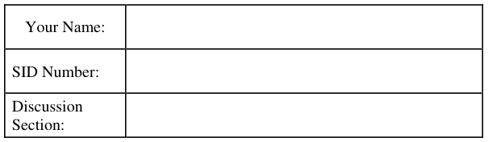
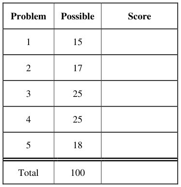
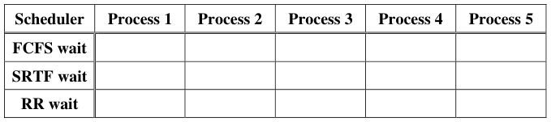

# Berkeley CS162 Fall 2007: Midterm 1: Questions

> Copied from the original: <https://hkn.eecs.berkeley.edu/exams/course/cs/162>. Text and figures are taken from the PDF as is; nothing was answered or rewritten. The original PDF is in this folder.

---

**Page 1**

&emsp;&emsp;&emsp;&emsp;&emsp;&emsp;&emsp;&emsp;University of California, Berkeley 
&emsp;&emsp;&emsp;&emsp;&emsp;&emsp;&emsp;&emsp;College of Engineering 
&emsp;&emsp;&emsp;&emsp;&emsp;&emsp;&emsp;&emsp;Computer Science Division ⎯ EECS 
&emsp;Fall 2007                John Kubiatowicz 
&emsp;&emsp;&emsp;&emsp;&emsp;&emsp;&emsp;&emsp;Midterm I 
&emsp;&emsp;&emsp;&emsp;&emsp;&emsp;&emsp;&emsp;October 10th, 2007 
&emsp;&emsp;&emsp;&emsp;&emsp;&emsp;&emsp;CS162: Operating Systems and Systems Programming

General Information: 
This is a **closed book** exam.  You are allowed 1 page of **hand-written** notes (both sides).  You 
have 3 hours to complete as much of the exam as possible. Make sure to read all of the questions 
first, as some of the questions are substantially more time consuming. 
Write all of your answers directly on this paper.  Make your answers as concise as possible. On 
programming questions, we will be looking for performance as well as correctness, so think through 
your answers carefully.  If there is something about the questions that you believe is open to 
interpretation, please ask us about it!

&emsp;Page 1/18

---

**Page 2**

CS 162 Fall 2007 Midterm Exam I        October 10, 2007

&emsp;&emsp;&emsp;&emsp;&emsp;&emsp;&emsp;&emsp;\[ This page left for π \]

&emsp;&emsp;&emsp;&emsp;3.141592653589793238462643383279502884197169399375105820974944

Page 2/18

---

**Page 3**

CS 162 Fall 2007 Midterm Exam I        October 10, 2007

### Problem 1: Short Answer \[15pts\]

### **Problem 1a\[2pts\]:** Name two ways in which processes on the same processor can communicate

with one another. If any of the techniques you name require hardware support, explain.

### **Problem 1b\[2pts\]:** What is an interrupt? What is the function of an interrupt controller?

### **Problem 1c\[3pts\]:**  Suppose that we have a two-level page translation scheme with 4K-byte pages

and 4-byte page table entries (includes a valid bit, a couple permission bits, and a pointer to another 
page/table entry).  What is the format of a 32-bit virtual address?  Sketch out the format of a 
complete page table.

Page 3/18

---

**Page 4**

CS 162 Fall 2007 Midterm Exam I        October 10, 2007

### **Problem 1d\[2pts\]:** Which company was the first to develop a workstation with a mouse and

overlapping windows?

### **Problem 1e\[2pt\]:** What is a thread-join operation?

### **Problem 1f\[2pts\]: True or False:** When designing a multithreaded application, you must use

synchronization primitives to make sure that the threads do not overwrite each other’s registers. 
Explain.

### **Problem 1g\[2pts\]: True or False:** A system that provides segmentation without paging puts holes

in the physical address space, forcing the operating system to waste physical memory. Explain.

Page 4/18

---

**Page 5**

CS 162 Fall 2007 Midterm Exam I        October 10, 2007

### Problem 2: Multithreading \[17 pts\]

Consider the following two threads, to be run concurrently in a shared memory (all variables are 
shared between the two threads):

Assume a single-processor system, that load and store are atomic, that x is initialized to 0 before 
either thread starts, and that x must be loaded into a register before being incremented (and stored 
back to memory afterwards).  The following questions consider the final value of x after both 
threads have completed.

### **Problem 2a\[2 pts\]:** Give a concise proof why `x≤15` when both threads have completed.

### **Problem 2b\[4 pts\]:** Give a concise proof why `x≠1` when both threads have completed.

### **Problem 2c\[3pts\]:** Suppose we replace ‘**x = x+2**’ in Thread B with an atomic double increment

operation **atomicIncr2(x)** that cannot be preempted while being executed.  What are all the possible 
final values of `x`?  Explain.

Page 5/18

---

**Page 6**

CS 162 Fall 2007 Midterm Exam I        October 10, 2007

### **Problem 2d\[3pts\]:** What needs to be saved and restored on a context switch between two threads in

the same process?  What if the two threads are in different processes?  Be explicit.

### **Problem 2e\[2pts\]:** Under what circumstances can a multithreaded program complete more quickly

than a non-multithreaded program? Keep in mind that multithreading has context-switch overhead 
associated with it.

### **Problem 2f\[3pts\]:** What is simultaneous multithreading (or “Hyperthreading”)?  Name two ways in

which this differs from the type of multithreading done by the operating system.

Page 6/18

---

**Page 7**

CS 162 Fall 2007 Midterm Exam I        October 10, 2007

### Problem 3: Hoare Scheduling \[25pts\]

Assume that you are programming a multiprocessor system using threads.  In class, we talked about 
two different synchronization primitives: Semaphores and Monitors.  In this problem, we are going 
to implement Monitors with Hoare scheduling by using Semaphores 
The interface for a Semaphore is as follows: 
`public class Semaphore {` 
`public Semaphore(int initialValue) {` 
`/* Create and return a semaphore with initial value: initialValue */` 
`…` 
`}` 
`public P() {` 
`/* Call P() on the semaphore */` 
`…` 
`}` 
`public V() {` 
`/* Call V() on the semaphore */` 
`}` 
`}` 
As we mentioned in class, a Monitor consists of a Lock and one or more Condition Variables. The 
interfaces for these two types of objects are as follows:

`public class Lock {`    `public class CondVar {` 
`public Lock() {`        `public CondVar(Lock lock) {` 
`/* Create new Lock */`            `/* Creates a condition variable` 
`…`                `associated with Lock lock. */` 
`}`                 `…` 
`}` 
`public void Acquire() {`        `public void Wait() {` 
`/* Acquire Lock */`            `/* Block on condition variable *’/` 
`…`             `…` 
`}`             `}` 
`public void Release() {`        `public void Signal() {` 
`/* Release Lock */`            `/* Wake one thread (if it exists) */` 
`…`             `…` 
`}`             `}` 
`}`             `}`

### **Problem 3a\[3pts\]:** What is the difference between Mesa and Hoare scheduling for monitors? Focus

your answer on what happens during the execution of Signal(). Hint: Mesa scheduling requires all 
conditional wait statements to be wrapped in “while” loops (see 3b).

Page 7/18

---

**Page 8**

CS 162 Fall 2007 Midterm Exam I        October 10, 2007

### **Problem 3b\[2pts\]:** When programming with a Mesa-scheduled monitor, the programmer must

enclose all conditional wait operations with a while loop like this:

&emsp;`while (condition unsatisfied)` 
`C.Wait();` 
What might happen if they did not do this?  How might this happen?

### **Problem 3c\[2pts\]:** Explain why a Hoare-scheduled monitor allows the programmer to replace the

“while” statement in (3b) with an “if”.

### **Problem 3d\[3pts\]:** Assume that we implement a Hoare-scheduled monitor with semaphores.

Clearly, we will need one semaphore to implement mutual exclusion. Further, each condition 
variable will utilize a semaphore to hold its queue of sleeping threads. Give at least 3 reasons why 
the following implementation of wait() and signal() is incorrect:

&emsp;&emsp;`wait() { CVSemi.p(); }` 
&emsp;&emsp;`signal() {CVSemi.v(); }`

Page 8/18

---

**Page 9**

CS 162 Fall 2007 Midterm Exam I        October 10, 2007

### **Problem 3e\[3pts\]:** Explain why we need an additional semaphore to implement `signal()` under

Hoare scheduling as you describe in problem (3a). Hint: when a waiting thread (T1) is signaled by 
another thread (T2), something special must happen immediately and something else must happen 
when this signaled thread either releases the monitor lock or executes `wait()`…

### **Problem 3f\[6pts\]:** Given your answer to (3e), show how to implement the Lock class for a Hoare-

scheduled monitor using Semaphores.  Let us call the additional semaphore from (3e) the SDefer 
semaphore. If if helps you think about the problem, you can assume that the SDefer.v() operation 
wakes up sleepers from SDefer.p() operations in Last-in-First-Out (LIFO) order, although this is 
not strictly necessary. Note that this semaphore (and possibly one other variable) may be referenced 
from within the condition variable implementation you will write in (3g).  However, these are not 
part of the public interface. In the following, make sure to implement the HoareLock(), Acquire(), 
and Release() methods. HoareLock() is the initialization method and should not be empty!  Hint: 
the Semaphore interface does not allow querying of the size of its waiting queue; you may need to 
track this yourself.  None of the methods should require more than five lines. 
`public class HoareLock {` 
`Semaphore SDefer = null;` 
&emsp;&emsp;`Semaphore SLock = null;`

&emsp;`public HoareLock() {`

`}` 
`public void Acquire() {`

`}` 
`public void Release() {`

`}` 
`}`

Page 9/18

---

**Page 10**

CS 162 Fall 2007 Midterm Exam I        October 10, 2007

### **Problem 3g\[6pts\]:** Show how to implement the Condition Variable class for a Hoare-schedule

monitor using Semaphores (and your HoareLock class from 3f).  Be very careful to consider the 
semantics of signal() as discussed in your answers to (3a) and (3c).  Hint: consider what happens 
when (1) you signal without a waiting thread and (2) signal with a waiting thread. You may need to 
refer to methods and/or variables within the lock object. Also, remember that the Semaphore 
interface does not allow querying of the size of its waiting queue; you may need to track this 
yourself. None of the methods should require more than five lines.

&emsp;`public class HoareCondVar {` 
`Semaphore SCondVar = null;`

`public HoareCondVar(HoareLock lock) {`

`}` 
`public void Wait() {`

`}` 
`public void Signal() {`

`}` 
&emsp;`}`

Page 10/18

---

**Page 11**

CS 162 Fall 2007 Midterm Exam I        October 10, 2007

### Problem 4: Deadlock \[25pts\]

### **Problem 4a\[3pts\]:** What is the difference between deadlock, livelock, and starvation?

### **Problem 4b\[2pts\]:** Suppose a thread is running in a critical section of code, meaning that it has

acquired all the locks through proper arbitration.  Can it get context switched? Why or why not?

### **Problem 4c\[3pts\]:** What is priority donation and why is it important? Under what circumstances

would an operating system need to implement priority donation?

### **Problem 4d\[3pts\]:** Does a cyclic dependency always lead to deadlock?  Explain

Page 11/18

---

**Page 12**

CS 162 Fall 2007 Midterm Exam I        October 10, 2007

### **Problem 4e\[8pts\]:** Consider a large table with multi-armed lawyers. In the center is a pile of

chopsticks.  In order to eat, a lawyer must have one chopstick in each hand. The lawyers are so busy 
talking that they can only grab one chopstick at a time. Design a BankerTable object using monitors 
that tracks resources via the Bankers algorithm. It should have public methods GrabOne() that 
allows a lawyer to grab one chopstick and ReleaseAll() that allows a lawyer to release all 
chopsticks that he. The GrabOne() method should put a lawyer to sleep if they cannot be granted a 
chopstick without potentially deadlocking the system. The ReleaseAll() method should wake up 
lawyers that can proceed. Assume a BankerCheck() method that takes a Lawer number, checks 
resources, and returns true if a given lawyer can be granted one new chopstick (you will implement 
this in 4g). Assume Mesa scheduling and that your condition variable has a broadcast() method. No 
method should have more than six (6) lines!

&emsp;`public class BankerTable {` 
`Lock lock = new Lock();` 
`Condition CV = new Condition(lock);`

`public BankerTable(int NumLawyers, int NumArms, int NumChopsticks) {`

`}` 
`public void GrabOne(int Lawyer) {`

`}` 
`public void ReleaseAll(int Lawyer) {`

`}`

Page 12/18

---

**Page 13**

CS 162 Fall 2007 Midterm Exam I        October 10, 2007

### **Problem 4f\[3pts\]:** In its general form, the Banker’s algorithm makes multiple passes through the

set of resource takers (think of the deadlock detection algorithm on which it is based). Explain why 
this particular application allows the BankerCheck method to implement the Banker’s algorithm by 
taking a single pass though the Lawyers’ allocations.

### **Problem 4g\[3pts\]:** Implement the BankerCheck method of the BankerTable Object. This method

should implement the Banker’s algorithm: return true if the given Lawyer can be granted one 
additional chopstick without taking the system out of a SAFE state. Do not blindly implement the 
Banker’s algorithm: this method only needs to have the same external behavior as the Banker’s 
algorithm for this application. This method can be written with as few as 7 lines.  We will give full 
credit for a solution that takes a single pass through the lawyers, partial credit for a working 
solution, and no credit for a solution with more than 10 lines. Note that this method is part of the 
BankerTable Object and thus has access to local variables of that object…

`boolean BankerCheck(int Lawyer) {` 
`/*` 
`* This method implements the bankers algorithm for the` 
`* multi-armed laywer problem. It should return true if the` 
`* given lawyer can be granted one chopstick.` 
`*/`

`}` 
&emsp;`}`

Page 13/18

---

**Page 14**

CS 162 Fall 2007 Midterm Exam I        October 10, 2007

&emsp;&emsp;&emsp;&emsp;&emsp;&emsp;&emsp;&emsp;**\[ This page intentionally left blank \]**

Page 14/18

---

**Page 15**

CS 162 Fall 2007 Midterm Exam I        October 10, 2007

### Problem 5: Scheduling \[18pts\]

### **Problem 5a\[2pts\]:** Can Lottery scheduling be used to provide strict priority scheduling?  Why or

why not?

### **Problem 5b\[2pts\]:** Can any of the three scheduling schemes (FCFS, SRTF, or RR) result in

starvation?  If so, how might you fix this?

### **Problem 5c\[2pts\]:** Suppose your notion of fairness was to give every thread in a multithreaded

system an equal portion of the CPU.  Could you do this with strictly user-level threads (every 
process has only one kernel thread but multiple user-level threads)?  Explain.

### **Problem 5d\[2pts\]:** Explain how to fool the multi-level feedback scheduler’s heuristics into giving

a long-running task more CPU cycles.

Page 15/18

---

**Page 16**

CS 162 Fall 2007 Midterm Exam I        October 10, 2007

### **Problem 5e\[5pts\]:**

Here is a table of processes and their associated arrival and running times.

Show the scheduling order for these processes under 3 policies: First Come First Serve (FCFS), 
Shortest-Remaining-Time-First (SRTF), Round-Robin (RR) with timeslice quantum = 1. Assume 
that context switch overhead is 0 and that new RR processes are added to the **head** of the queue and 
new FCFS processes are added to the **tail** of the queue.

Page 16/18

---

**Page 17**

CS 162 Fall 2007 Midterm Exam I        October 10, 2007

### **Problem 5f\[3pts\]:**

For each process in each schedule above, indicate the queue wait time.  Note that wait time is the 
total time spend waiting in queue (all the time in which the task is not running).

### **Problem 5g\[2pts\]:**

Assume that we could have an oracle perform the best possible scheduling to reduce average wait 
time. What would be the optimal average wait time, and which of the above three schedulers would 
come closest to optimal?  Explain.

Page 17/18

---

**Page 18**

CS 162 Fall 2007 Midterm Exam I        October 10, 2007

&emsp;&emsp;&emsp;&emsp;&emsp;&emsp;&emsp;&emsp;\[ This page intentionally left blank \]

Page 18/18

