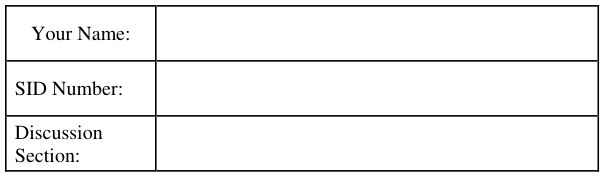
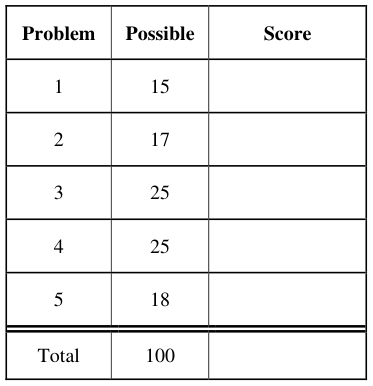
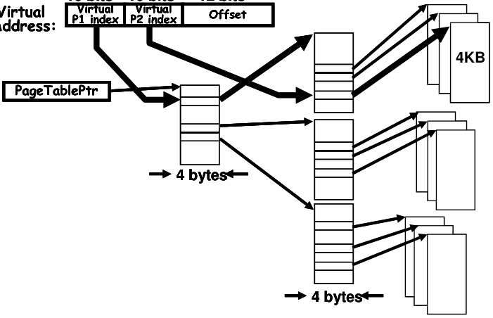
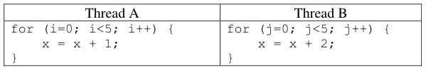
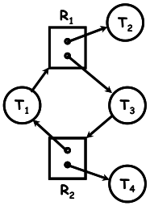
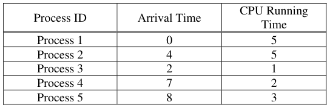
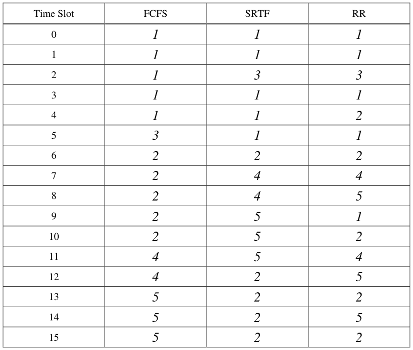
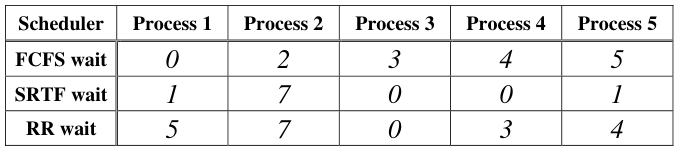

# Berkeley CS162 Fall 2007: Midterm 1: Official solutions

> Copied from the original: <https://hkn.eecs.berkeley.edu/exams/course/cs/162>. Text and figures are taken from the PDF as is; nothing was answered or rewritten. The original PDF is in this folder.

---

**Page 1**

&emsp;&emsp;&emsp;&emsp;&emsp;&emsp;&emsp;&emsp;University of California, Berkeley 
&emsp;&emsp;&emsp;&emsp;&emsp;&emsp;&emsp;&emsp;College of Engineering 
&emsp;&emsp;&emsp;&emsp;&emsp;&emsp;&emsp;&emsp;Computer Science Division ⎯ EECS 
&emsp;Fall 2007                John Kubiatowicz 
&emsp;&emsp;&emsp;&emsp;&emsp;&emsp;&emsp;&emsp;Midterm I 
&emsp;&emsp;&emsp;&emsp;&emsp;&emsp;&emsp;&emsp;SOLUTIONS 
&emsp;&emsp;&emsp;&emsp;&emsp;&emsp;&emsp;&emsp;October 10th, 2007 
&emsp;&emsp;&emsp;&emsp;&emsp;&emsp;&emsp;CS162: Operating Systems and Systems Programming

General Information: 
This is a **closed book** exam.  You are allowed 1 page of **hand-written** notes (both sides).  You 
have 3 hours to complete as much of the exam as possible. Make sure to read all of the questions 
first, as some of the questions are substantially more time consuming. 
Write all of your answers directly on this paper.  Make your answers as concise as possible. On 
programming questions, we will be looking for performance as well as correctness, so think through 
your answers carefully.  If there is something about the questions that you believe is open to 
interpretation, please ask us about it!

&emsp;Page 1/18

---

**Page 2**

CS 162 Fall 2007 Midterm Exam I        October 10, 2007

&emsp;&emsp;&emsp;&emsp;&emsp;&emsp;&emsp;&emsp;\[ This page left for π \]

&emsp;&emsp;&emsp;&emsp;3.141592653589793238462643383279502884197169399375105820974944

Page 2/18

---

**Page 3**

CS 162 Fall 2007 Midterm Exam I        October 10, 2007

### Problem 1: Short Answer \[15pts\]

### **Problem 1a\[2pts\]:** Name two ways in which processes on the same processor can communicate

with one another. If any of the techniques you name require hardware support, explain. 
&emsp;&emsp;1\) Shared memory. Typically requires hardware support for cache coherence and 
&emsp;&emsp;&emsp;translation mechanisms (page tables). 
&emsp;&emsp;2\) Message passing. Done through kernel, typically doesn’t require much hardware 
&emsp;&emsp;&emsp;support. 
&emsp;&emsp;3\) File System. Hardware support might include the disk, although this is necessary for 
&emsp;&emsp;&emsp;other uses as well.

### **Problem 1b\[2pts\]:** What is an interrupt? What is the function of an interrupt controller?

&emsp;&emsp;An interrupt is an electrical signal that causes the processor to stop the current execution 
&emsp;&emsp;and begin to execute interrupt handler code. The interrupt controller is a component 
&emsp;&emsp;between I/O devices and the processor that filters incoming interrupt signals on their way to 
&emsp;&emsp;the processor; among other things, it allows the operating system to mask out certain 
&emsp;&emsp;interrupts to enable the establishment of interrupt priority.

### **Problem 1c\[3pts\]:**  Suppose that we have a two-level page translation scheme with 4K-byte pages

and 4-byte page table entries (includes a valid bit, a couple permission bits, and a pointer to another 
page/table entry).  What is the format of a 32-bit virtual address?  Sketch out the format of a 
complete page table. 
**12 bits10 bits10 bits12 bits10 bits10 bits**    **10 bits**   **10 bits**   **12 bits**

Page 3/18

---

**Page 4**

CS 162 Fall 2007 Midterm Exam I        October 10, 2007

### **Problem 1d\[2pts\]:** Which company was the first to develop a workstation with a mouse and

overlapping windows? 
&emsp;&emsp;**Xerox (The Xerox PARC research lab)**

### **Problem 1e\[2pt\]:** What is a thread-join operation?

&emsp;&emsp;**A thread-join operation allows a thread to wait for another thread to finish. It puts the** 
&emsp;&emsp;**calling thread to sleep and wakes when the target thread exits.**

### **Problem 1f\[2pts\]: True or False:** When designing a multithreaded application, you must use

synchronization primitives to make sure that the threads do not overwrite each other’s registers. 
Explain. 
&emsp;&emsp;FALSE. The thread scheduler is responsible for making sure that each thread has its own 
&emsp;&emsp;set of register values (stored in the TLB). A TLB is never shared between threads.

### **Problem 1g\[2pts\]: True or False:** A system that provides segmentation without paging puts holes

in the physical address space, forcing the operating system to waste physical memory. Explain. 
&emsp;&emsp;FALSE. Segmentation potentially puts holes in the VIRTUAL space, but doesn’t require 
&emsp;&emsp;holds in the physical address space, since the segmentation mapping is free to use any 
&emsp;&emsp;contiguous blocks of memory.

Page 4/18

---

**Page 5**

CS 162 Fall 2007 Midterm Exam I        October 10, 2007

### Problem 2: Multithreading \[17 pts\]

Consider the following two threads, to be run concurrently in a shared memory (all variables are 
shared between the two threads):

Assume a single-processor system, that load and store are atomic, that x is initialized to 0 before 
either thread starts, and that x must be loaded into a register before being incremented (and stored 
back to memory afterwards).  The following questions consider the final value of x after both 
threads have completed.

### **Problem 2a\[2 pts\]:** Give a concise proof why `x≤15` when both threads have completed.

&emsp;&emsp;Each x=x+1 statement can either do nothing (if erased by Thread B) or increase x by 1. 
&emsp;&emsp;Each x=x+2 statement can either do nothing (if erased by Thread A) or increase x by 2. 
&emsp;&emsp;Since there are 5 of each type, and since x starts at 0, x is ¥ 0 and x§ (5μ1)+(5μ2)=15

### **Problem 2b\[4 pts\]:** Give a concise proof why `x≠1` when both threads have completed.

&emsp;&emsp;Every store into x from either Thread A or B is ¥ 0, and once x becomes ¥ 0, it stays ¥ 0. 
&emsp;&emsp;The only way for x=1 is for the last x=x+1 statement in Thread A to load a zero and store a 
&emsp;&emsp;one. However, there are at least four stores from Thread A previous to the load for the last 
&emsp;&emsp;statement, meaning that it couldn’t have loaded a zero.

### **Problem 2c\[3pts\]:** Suppose we replace ‘**x = x+2**’ in Thread B with an atomic double increment

operation **atomicIncr2(x)** that cannot be preempted while being executed.  What are all the possible 
final values of `x`?  Explain. 
&emsp;&emsp;Final values are 5, 7, 9, 11, 13, or 15.  The x=x+2 statements can be “erased” by being 
&emsp;&emsp;between the load and store of an x=x+1 statement.  However, since the x=x+2 statements 
&emsp;&emsp;are atomic, the x=x+1 statements can never be “erased” because the load and store phases 
&emsp;&emsp;of x=x+2 cannot be separated. Thus, our final value is at least 5 (from Thread A) with from 
&emsp;&emsp;0 to 5 successful updates of x=x+2.

Page 5/18

---

**Page 6**

CS 162 Fall 2007 Midterm Exam I        October 10, 2007

### **Problem 2d\[3pts\]:** What needs to be saved and restored on a context switch between two threads in

the same process?  What if the two threads are in different processes?  Be explicit. 
&emsp;Need to save the processor registers, stack pointer, program counter into the TCB of the 
&emsp;thread that is no longer running.  Need to reload the same things from the TCB of the new 
&emsp;thread. 
&emsp;&emsp;When the threads are from different processes, need to not only save and restore what was 
&emsp;given above, but you also need to load the pointer for the top-level page-table of the new 
&emsp;address space.  You don’t need to save the old pointer, since this will not change and is 
&emsp;already stored in the PCB.

### **Problem 2e\[2pts\]:** Under what circumstances can a multithreaded program complete more quickly

than a non-multithreaded program? Keep in mind that multithreading has context-switch overhead 
associated with it. 
&emsp;&emsp;When there is a lot of blocking that may occur (such as for I/O) and parts of the program 
&emsp;&emsp;can still make progress while other parts are blocked.

### **Problem 2f\[3pts\]:** What is simultaneous multithreading (or “Hyperthreading”)?  Name two ways in

which this differs from the type of multithreading done by the operating system. 
&emsp;&emsp;Simultaneous multithreading utilizes spare issue slots in a superscalar processor to support 
&emsp;&emsp;multithreading. It allows multiple threads to be loaded into the processor simultaneously. 
&emsp;&emsp;Simultaneous multithreading differs from the type of multithreading done by the operating 
&emsp;&emsp;system in several ways: (1) the multiplexing is done in hardware rather than software, (2) 
&emsp;&emsp;the multiplexing can interleave threads on an instruction by instruction basis, whereas the 
&emsp;&emsp;operating system interleaves with a 10ms (or more) quantum (3) the overhead for switching 
&emsp;&emsp;between threads is a single cycle in simultaneous multithreading rather than many cycles in 
&emsp;&emsp;the operating system (4) simultaneous multithreading can only handle a small number of 
&emsp;&emsp;threads at a time, whereas the operating system can handle many threads.

Page 6/18

---

**Page 7**

CS 162 Fall 2007 Midterm Exam I        October 10, 2007

### Problem 3: Hoare Scheduling \[25pts\]

Assume that you are programming a multiprocessor system using threads.  In class, we talked about 
two different synchronization primitives: Semaphores and Monitors.  In this problem, we are going 
to implement Monitors with Hoare scheduling by using Semaphores 
The interface for a Semaphore is as follows: 
`public class Semaphore {` 
`public Semaphore(int initialValue) {` 
`/* Create and return a semaphore with initial value: initialValue */` 
`…` 
`}` 
`public P() {` 
`/* Call P() on the semaphore */` 
`…` 
`}` 
`public V() {` 
`/* Call V() on the semaphore */` 
`}` 
`}` 
As we mentioned in class, a Monitor consists of a Lock and one or more Condition Variables. The 
interfaces for these two types of objects are as follows:

`public class Lock {`    `public class CondVar {` 
`public Lock() {`        `public CondVar(Lock lock) {` 
`/* Create new Lock */`            `/* Creates a condition variable` 
`…`                `associated with Lock lock. */` 
`}`                 `…` 
`}` 
`public void Acquire() {`        `public void Wait() {` 
`/* Acquire Lock */`            `/* Block on condition variable *’/` 
`…`             `…` 
`}`             `}` 
`public void Release() {`        `public void Signal() {` 
`/* Release Lock */`            `/* Wake one thread (if it exists) */` 
`…`             `…` 
`}`             `}` 
`}`             `}`

### **Problem 3a\[3pts\]:** What is the difference between Mesa and Hoare scheduling for monitors? Focus

your answer on what happens during the execution of Signal(). Hint: Mesa scheduling requires all 
conditional wait statements to be wrapped in “while” loops (see 3b). 
&emsp;&emsp;With Mesa scheduling, the signaling thread keeps the lock and CPU and puts the signaled 
&emsp;&emsp;thread on the ready queue for later execution. With Hoare scheduling, the signaling thread 
&emsp;&emsp;gives the lock and CPU to the signaled thread and sleeps. Later, when the signaled thread 
&emsp;&emsp;executes wait() or releases the lock, it returns the lock to the signaled thread and wakes it. 
&emsp;&emsp;Note that we didn’t give full credit for answers that said that the signaled thread runs 
&emsp;&emsp;immediately without also saying either that the signaling thread sleeps or that the signaling 
&emsp;&emsp;thread gives the CPU to the signaled thread.

Page 7/18

---

**Page 8**

CS 162 Fall 2007 Midterm Exam I        October 10, 2007

### **Problem 3b\[2pts\]:** When programming with a Mesa-scheduled monitor, the programmer must

enclose all conditional wait operations with a while loop like this:

&emsp;`while (condition unsatisfied)` 
`C.Wait();` 
What might happen if they did not do this?  How might this happen? 
&emsp;&emsp;If they only checked the condition once, then it is possible that the thread would exit wait() 
&emsp;&emsp;with the condition unsatisfied.  This might happen because a signaled thread is only placed 
&emsp;&emsp;on the ready queue, not run immediately; hence another thread could change the condition 
&emsp;&emsp;between the time that the signaled thread was placed on the ready queue and the time that it 
&emsp;&emsp;exited wait(). 
&emsp;&emsp;Note that we did not give full credit if you didn’t mention an intervening thread changing 
&emsp;&emsp;the condition. We also did not give full credit to people who claimed that multiple threads 
&emsp;&emsp;would enter the critical section at the same time – this is not true.

### **Problem 3c\[2pts\]:** Explain why a Hoare-scheduled monitor allows the programmer to replace the

“while” statement in (3b) with an “if”. 
&emsp;&emsp;Since the signaled thread is run immediately after being signaled, there is no chance for 
&emsp;&emsp;another thread to change the condition before the first thread can deal with it.

### **Problem 3d\[3pts\]:** Assume that we implement a Hoare-scheduled monitor with semaphores.

Clearly, we will need one semaphore to implement mutual exclusion. Further, each condition 
variable will utilize a semaphore to hold its queue of sleeping threads. Give at least 3 reasons why 
the following implementation of wait() and signal() is incorrect:

&emsp;&emsp;`wait() { CVSemi.p(); }` 
&emsp;&emsp;`signal() {CVSemi.v(); }` 
&emsp;&emsp;There are many answers here.  A few are as follows: 
&emsp;&emsp;1\) calling of signal() when no waiting threads will cause subsequent call of wait() to exit 
&emsp;&emsp;&emsp;without waiting. 
&emsp;&emsp;2\) wait() neglects to release lock, hence causing deadlock. 
&emsp;&emsp;3\) Signal doesn’t put signaling thread to sleep 
&emsp;&emsp;4\) Wait does not wake sleeping signaler, if there is one 
&emsp;&emsp;We did not accept claims that there is no lock in the above implementation; the lock is 
&emsp;&emsp;implemented outside wait and signal.  We also did not accept comments that the lock was 
&emsp;&emsp;not properly acquired and released in wait() and signal(); the lock is acquired and released 
&emsp;&emsp;in code that surrounds the calling of wait and signal – not in the implementation of wait and 
&emsp;&emsp;signal.

Page 8/18

---

**Page 9**

CS 162 Fall 2007 Midterm Exam I        October 10, 2007

### **Problem 3e\[3pts\]:** Explain why we need an additional semaphore to implement `signal()` under

Hoare scheduling as you describe in problem (3a). Hint: when a waiting thread (T1) is signaled by 
another thread (T2), something special must happen immediately and something else must happen 
when this signaled thread either releases the monitor lock or executes `wait()`… 
&emsp;&emsp;We need an additional semaphore on which the signaler (T2) can sleep and which can be 
&emsp;&emsp;used to cause the signaler to wake up and continue later. People who didn’t explicitly 
&emsp;&emsp;mention that the signaler must sleep on this semaphore didn’t get full credit.

### **Problem 3f\[6pts\]:** Given your answer to (3e), show how to implement the Lock class for a Hoare-

scheduled monitor using Semaphores.  Let us call the additional semaphore from (3e) the SDefer 
semaphore. If if helps you think about the problem, you can assume that the SDefer.v() operation 
wakes up sleepers from SDefer.p() operations in Last-in-First-Out (LIFO) order, although this is 
not strictly necessary. Note that this semaphore (and possibly one other variable) may be referenced 
from within the condition variable implementation you will write in (3g).  However, these are not 
part of the public interface. In the following, make sure to implement the HoareLock(), Acquire(), 
and Release() methods. HoareLock() is the initialization method and should not be empty!  Hint: 
the Semaphore interface does not allow querying of the size of its waiting queue; you may need to 
track this yourself.  None of the methods should require more than five lines. 
`public class HoareLock {` 
`Semaphore SDefer = null;` 
`Semaphore SLock = null;` 
int deferredCount = 0;         /\* Count number of threads waiting on SDefer \*/

&emsp;`public HoareLock() {` 
&emsp;SDefer = new Semaphore(0);    /\* Used to put threads to sleep: all .p()’s sleep \*/ 
SLock = new Semaphore(1);    /\* Used for mutual exclusion: only on .p() gets to run \*/ 
`}` 
`public void Acquire() {` 
SLock.p();             /\* Acquire lock \*/ 
`}` 
`public void Release() {` 
&emsp;&emsp;if (deferredCount \> 0) { 
deferredCount--;        /\* Decrement deferred count\*/ 
SDefer.v();            /\* Signaler waiting, wake/pass lock\*/ 
} else 
SLock.();            /\* No signaler waiting, unlock lock \*/ 
`}` 
`}` 
Notes: People made the basic lock Acquire() and Release() very complex.  It is not. Also, many 
people tried to count number of waiters on the lock by executing things like “variable++” before 
SLock.p(). This is bad coding and suffers from the same problem mentioned in Prob 2. Note that we 
only release the actual lock in Release() if we are not giving it back to a deferred thread. Also, a 
number of people didn’t get the initial value correct for the “new Semaphore()” statements: these 
two semaphores are used for fundamentally different things and are thus initialized differently! 
Note that we need to count # threads sleeping on SDefer to decide whether to wake one or not 
during Release(). Also, notice that the “deferredCount--” statement could be in signal() \[next page\] 
instead; if here, however, it must be before SDefer.v() to avoid race condition (imagine that 
deferred thread runs immediately after SDefer.v() and runs until it executes “Release()”).

Page 9/18

---

**Page 10**

CS 162 Fall 2007 Midterm Exam I        October 10, 2007

### **Problem 3g\[6pts\]:** Show how to implement the Condition Variable class for a Hoare-schedule

monitor using Semaphores (and your HoareLock class from 3f).  Be very careful to consider the 
semantics of signal() as discussed in your answers to (3a) and (3c).  Hint: consider what happens 
when (1) you signal without a waiting thread and (2) signal with a waiting thread. You may need to 
refer to methods and/or variables within the lock object. Also, remember that the Semaphore 
interface does not allow querying of the size of its waiting queue; you may need to track this 
yourself. None of the methods should require more than five lines.

&emsp;`public class HoareCondVar {` 
`Semaphore SCondVar = null;` 
HoareLock lock;    /\* Must save lock from initializer for use later \*/ 
int waitCount = 0;    /\* Count of threads waiting on CV \*/

`public HoareCondVar(HoareLock lock) {` 
&emsp;SCondVar = new Semaphore(0);    /\* Used to put threads to sleep: all .p()’s sleep \*/ 
this.lock = lock; 
`}` 
`public void Wait() {` 
&emsp;waitCount++;    /\* Keep track of number of waiters\*/ 
lock.Release();    /\* Release lock or wake up signaler \*/ 
SCondVar.p();    /\* Sleep on conditional variable \*/ 
`}` 
`public void Signal() {` 
if (waitCount \> 0) {    /\* Waiter exists, do something \*/ 
waitCount--;    /\* avoid race cond by decrementing count \*/ 
lock.deferredCount++;    /\* indicate that signaler deferred. \*/ 
SCondVar.v();    /\* Wake up waiter/transfer lock \*/ 
Lock.SDefer.p();    /\* Defer signaler until woken \*/ 
} 
`}` 
`}`

&emsp;Notes: Many people missed the fact that you need to preserve the incoming value of “lock” 
&emsp;from the initializer if you want to use it later.  Hence, the “this.lock=lock” statement. Make sure 
&emsp;to look at the initial value in the “new Semaphore()” statement for SCondVar; this value is used 
&emsp;because we are putting threads to sleep on that semaphore. Further, note that you must track 
&emsp;the number of waiting threads on SCondVar.v() to know whether or not signal() needs to wake 
&emsp;one up (same as the SDefer semaphore from the HoareLock implementation). Also, a number of 
&emsp;people didn’t understand the fact that we transfer the lock from signaler to signaled and back. 
&emsp;See definition in (3a). Doing this is simple: we don’t release the lock in signal(), rather just 
&emsp;wake up the waiter and put the signaler to sleep. Then the waiter wakes up with the lock 
&emsp;acquired. Further, when the waiter executes either Release() or wait(), we simply leave the lock 
&emsp;acquired for use by the signaler. Finally, notice that both the “waitCount--” and 
&emsp;lock.deferredCount++” ops must occur before SCondVar.v() in signal() to avoid race condition 
&emsp;(imagine that the SCondVar.v() causes waiter to start executing immediately and that the waiter 
&emsp;executes either Release() or Signal().); alternatively, “waitCount--” could be the last statement 
&emsp;of wait() without problem.

Page 10/18

---

**Page 11**

CS 162 Fall 2007 Midterm Exam I        October 10, 2007

### Problem 4: Deadlock \[25pts\]

### **Problem 4a\[3pts\]:** What is the difference between deadlock, livelock, and starvation?

&emsp;&emsp;Deadlock and Livelock are types of Starvation. Starvation is a lack of forward progress. 
&emsp;&emsp;Deadlock is a lack of forward progress that will never resolve because it involves a cyclic 
&emsp;&emsp;dependency. Livelock is a lack of forward progress that could go away – typically it 
&emsp;&emsp;involves higher priority jobs continually taking resources away from lower-priority jobs.

### **Problem 4b\[2pts\]:** Suppose a thread is running in a critical section of code, meaning that it has

acquired all the locks through proper arbitration.  Can it get context switched? Why or why not? 
&emsp;&emsp;Yes. Grabbing a lock is different from disabling interrupts (and thus preventing context 
&emsp;&emsp;switching).  The important thing here is that the acquisition of the lock prevents other 
&emsp;&emsp;threads from running in the same critical section at the same time; it does not generically 
&emsp;&emsp;prevent other threads from running.

### **Problem 4c\[3pts\]:** What is priority donation and why is it important? Under what circumstances

would an operating system need to implement priority donation? 
&emsp;&emsp;Priority donation is the process of donating priority from a high priority job to a low 
&emsp;&emsp;priority job. When a high priority job sleeps waiting for a lock held by a low priority job, 
&emsp;&emsp;the high-priority job may be delayed behind a medium priority job, thus violating the 
&emsp;&emsp;priority scheduling. The only way to fix this is to temporarily raise priority of the low 
&emsp;&emsp;priority job to that of the waiting job; this is priority donation.

### **Problem 4d\[3pts\]:** Does a cyclic dependency always lead to deadlock?  Explain

&emsp;&emsp;No. The cycle dependency may only be temporary (eventually resolve itself).  Here is an 
&emsp;&emsp;example given in class that has a cyclic dependency by is not deadlocked:

Page 11/18

---

**Page 12**

CS 162 Fall 2007 Midterm Exam I        October 10, 2007

### **Problem 4e\[8pts\]:** Consider a large table with multi-armed lawyers. In the center is a pile

&emsp;&emsp;of chopsticks.  In order to eat, a lawyer must have one chopstick in each hand. The lawyers 
&emsp;&emsp;are so busy talking that they can only grab one chopstick at a time. Design a BankerTable 
&emsp;&emsp;object using monitors that tracks resources via the Bankers algorithm. It should have public 
&emsp;&emsp;methods GrabOne() that allows a lawyer to grab one chopstick and ReleaseAll() that allows 
&emsp;&emsp;a lawyer to release all chopsticks that he. The GrabOne() method should put a lawyer to 
&emsp;&emsp;sleep if they cannot be granted a chopstick without potentially deadlocking the system. The 
&emsp;&emsp;ReleaseAll() method should wake up lawyers that can proceed. Assume a BankerCheck() 
&emsp;&emsp;method that takes a Lawer number, checks resources, and returns true if a given lawyer can 
&emsp;&emsp;be granted one new chopstick (you will implement this in 4g). Assume Mesa scheduling and 
&emsp;&emsp;that your condition variable has a broadcast() method. No method should have more than 
&emsp;&emsp;six (6) lines!

&emsp;`public class BankerTable {` 
`Lock lock = new Lock();` 
`Condition CV = new Condition(lock);` 
&emsp;&emsp;int\[\] AllocTable;                /\* Keep track of allocations \*/ 
&emsp;&emsp;int NumArms, NumChopsticks;                /\* Keep other info \*/

`public BankerTable(int NumLawyers, int NumArms, int NumChopsticks) {` 
&emsp;&emsp;&emsp;AllocTable = new int\[NumLawyers\];            /\* Array of allocations (init 0)\*/ 
this.NumArms = NumArms;                /\* Remember # arms/lawyer \*/ 
this.NumChopsticks = NumChopsticks;         /\* Remember # chopstocks/table \*/ 
`}` 
`public void GrabOne(int Lawyer) {` 
&emsp;&emsp;&emsp;lock.Acquire(); 
/\* Use banker algorithm to check whether allocation is ok \*/ 
while (!BankerCheck(Lawyer)) 
CV.wait(); 
/\* Move one chopstick from table to lawyer \*/ 
NumChopsticks--; 
AllocTable\[Lawyer\]++; 
Lock.Release(); 
`}` 
`public void ReleaseAll(int Lawyer) {` 
&emsp;&emsp;&emsp;lock.Acquire(); 
&emsp;&emsp;&emsp;NumChopsticks += AllocTable\[Lawyer\]; /\* Put chopsticks back on table\*/ 
AllocTable\[Lawyer\] = 0;                /\* Lawyer has none left \*/ 
lock.Release(); 
`}`

Page 12/18

---

**Page 13**

CS 162 Fall 2007 Midterm Exam I        October 10, 2007

### **Problem 4f\[3pts\]:** In its general form, the Banker’s algorithm makes multiple passes through the

set of resource takers (think of the deadlock detection algorithm on which it is based). Explain why 
this particular application allows the BankerCheck method to implement the Banker’s algorithm by 
taking a single pass though the Lawyers’ allocations. 
&emsp;The  Banker’s algorithm only needs a single pass because every resource taker has identical 
&emsp;properties: every Lawyer has the same maximum allocation.  As a result, if we can find a single 
&emsp;Lawyer that can finish, given the remaining resources, we know that all Lawyers can finish. 
&emsp;Reason: once that Lawyer finishes and returns their resources we know that there will be at 
&emsp;least NumArms chopsticks on the table – hence everyone else can potentially finish. Thus, we 
&emsp;don’t have to go through the exercise of returning resources and reexamining the remaining 
&emsp;Lawyers (as in the general specification of the Banker’s algorithm).

### **Problem 4g\[3pts\]:** Implement the BankerCheck method of the BankerTable Object. This method

should implement the Banker’s algorithm: return true if the given Lawyer can be granted one 
additional chopstick without taking the system out of a SAFE state. Do not blindly implement the 
Banker’s algorithm: this method only needs to have the same external behavior as the Banker’s 
algorithm for this application. This method can be written with as few as 7 lines.  We will give full 
credit for a solution that takes a single pass through the lawyers, partial credit for a working 
solution, and no credit for a solution with more than 10 lines. Note that this method is part of the 
BankerTable Object and thus has access to local variables of that object…

`boolean BankerCheck(int Lawyer) {` 
`/*` 
`* This method implements the bankers algorithm for the` 
`* multi-armed laywer problem. It should return true if the` 
`* given lawyer can be granted one chopstick.` 
`*/` 
&emsp;&emsp;&emsp;&emsp;int i; 
&emsp;&emsp;&emsp;&emsp;AllocTable\[Lawyer\]++;         /\* Hypothetically give chopstick to lawyer \*/ 
&emsp;&emsp;&emsp;&emsp;for (i = 0; i \< AllocTable.length; i++) 
&emsp;&emsp;&emsp;&emsp;/\* Is current number on table (NumChopsticks-1)  enough to let Lawyer i eat? \*/ 
&emsp;&emsp;&emsp;&emsp;if ((AllocTable\[i\] + (NumChopsticks - 1)) \>= NumArms) 
&emsp;&emsp;&emsp;&emsp;break;    /\* Yes! Break early \*/ 
&emsp;&emsp;&emsp;&emsp;AllocTable\[Lawyer\]--;    /\* Take away hypothetical \*/ 
&emsp;&emsp;&emsp;&emsp;Return (i \< AllocTable.length);    /\* Returns true if we broke at any time \*/ 
`}` 
`}` 
&emsp;Notes: We don’t have to check for the case in which NumChopsticks == 0, since this would 
&emsp;mean that (NumChopsticks-1) == -1, and the “if” statement would be self correcting, assuming 
&emsp;no lawyer would have \> NumArms: the if statement would always fail – exactly what we would 
&emsp;want to do when NumChopsticks == 0.

Page 13/18

---

**Page 14**

CS 162 Fall 2007 Midterm Exam I        October 10, 2007

&emsp;&emsp;&emsp;&emsp;&emsp;&emsp;&emsp;&emsp;**\[ This page intentionally left blank \]**

Page 14/18

---

**Page 15**

CS 162 Fall 2007 Midterm Exam I        October 10, 2007

### Problem 5: Scheduling \[18pts\]

### **Problem 5a\[2pts\]:** Can Lottery scheduling be used to provide strict priority scheduling?  Why or

why not? 
&emsp;&emsp;No. By definition, every thread in the lottery scheduler has at least one token and will thus 
&emsp;&emsp;get some of the CPU under all circumstances. In a strict priority scheduler, the higher 
&emsp;&emsp;priority threads get CPU cycles exclusively at the expense of  the low priority threads.

### **Problem 5b\[2pts\]:** Can any of the three scheduling schemes (FCFS, SRTF, or RR) result in

starvation?  If so, how might you fix this? 
&emsp;&emsp;Yes.  The SRTF algorithm can result starvation of long tasks if short tasks keep arriving. 
&emsp;&emsp;The FCFS algorithm will result in starvation only if some thread runs forever. Finally, RR 
&emsp;&emsp;does not result in starvation, since all threads get some of the CPU. To fix SRTF, we might 
&emsp;&emsp;add some priority mechanism to make sure that threads that have waited for a long time 
&emsp;&emsp;without running get at least some of the CPU now and then (priority increments when 
&emsp;&emsp;threads don’t get to run). The multi-level scheduler is a good approximation to SRTF that 
&emsp;&emsp;can be designed to avoid starvation. (the result wouldn’t be quite SRTF any more). 
&emsp;&emsp;To fix FCFS, we would need to find some way of preempting threads that have run forever, 
&emsp;&emsp;possibly by giving some CPU to other threads.  Effectively, this would add elements of RR 
&emsp;&emsp;or multi-level scheduling into FCFS (it wouldn’t be quite FCFS any more).

### **Problem 5c\[2pts\]:** Suppose your notion of fairness was to give every thread in a multithreaded

system an equal portion of the CPU.  Could you do this with strictly user-level threads (every 
process has only one kernel thread but multiple user-level threads)?  Explain. 
&emsp;&emsp;We accepted two answers here (with justification!): (1) yes. In this case, since the total 
&emsp;&emsp;number of user-level threads are unknown to the kernel, we would need to introduce some 
&emsp;&emsp;sort of system call that allowed a process to tell the kernel how many user-level threads it 
&emsp;&emsp;was running. This would allow the kernel to adjust the fraction of CPU given to each 
&emsp;&emsp;process so that all user-level threads got an equal amount of the CPU. (2) no. Since the 
&emsp;&emsp;kernel doesn’t know how many user-level threads each process has, it can’t adjust priority 
&emsp;&emsp;accordingly. Note that, while answer (1) says how to fix this, it is subject to malicious 
&emsp;&emsp;manipulation by a user-level process, and hence may not be considered feasible from a 
&emsp;&emsp;security standpoint.

### **Problem 5d\[2pts\]:** Explain how to fool the multi-level feedback scheduler’s heuristics into giving

a long-running task more CPU cycles. 
&emsp;&emsp;By periodically doing I/O (such as a bunch of print statements), a given long-running 
&emsp;&emsp;process can keep its burst-length short and hence its priority high in the multi-level 
&emsp;&emsp;feedback scheduler.

Page 15/18

---

**Page 16**

CS 162 Fall 2007 Midterm Exam I        October 10, 2007

### **Problem 5e\[5pts\]:**

Here is a table of processes and their associated arrival and running times.

Show the scheduling order for these processes under 3 policies: First Come First Serve (FCFS), 
Shortest-Remaining-Time-First (SRTF), Round-Robin (RR) with timeslice quantum = 1. Assume 
that context switch overhead is 0 and that new RR processes are added to the **head** of the queue and 
new FCFS processes are added to the **tail** of the queue.

Page 16/18

---

**Page 17**

CS 162 Fall 2007 Midterm Exam I        October 10, 2007

### **Problem 5f\[3pts\]:**

For each process in each schedule above, indicate the queue wait time.  Note that wait time is the 
total time spend waiting in queue (all the time in which the task is not running).

### **Problem 5g\[2pts\]:**

Assume that we could have an oracle perform the best possible scheduling to reduce average wait 
time. What would be the optimal average wait time, and which of the above three schedulers would 
come closest to optimal?  Explain. 
&emsp;&emsp;Since SRTF is optimal, taking the future into account (i.e. as an oracle), just need to use the 
&emsp;&emsp;SRTF average.  Average wait time in this case would be: (1+7+0+0+1)/5 = 1.8

Page 17/18

---

**Page 18**

CS 162 Fall 2007 Midterm Exam I        October 10, 2007

&emsp;&emsp;&emsp;&emsp;&emsp;&emsp;&emsp;&emsp;**\[ This page intentionally left blank \]**

Page 18/18

