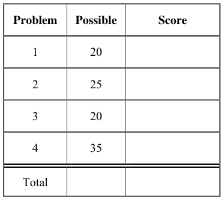
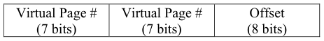
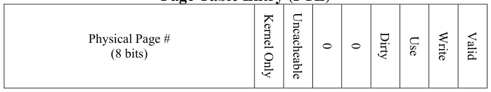
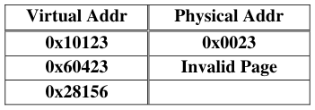
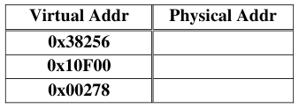
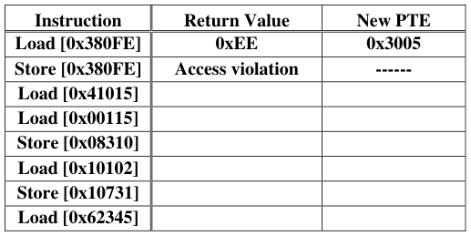
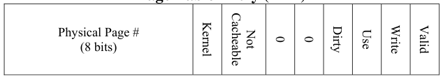
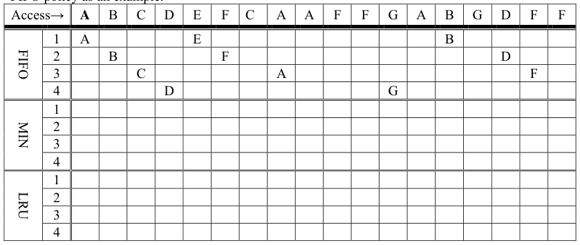
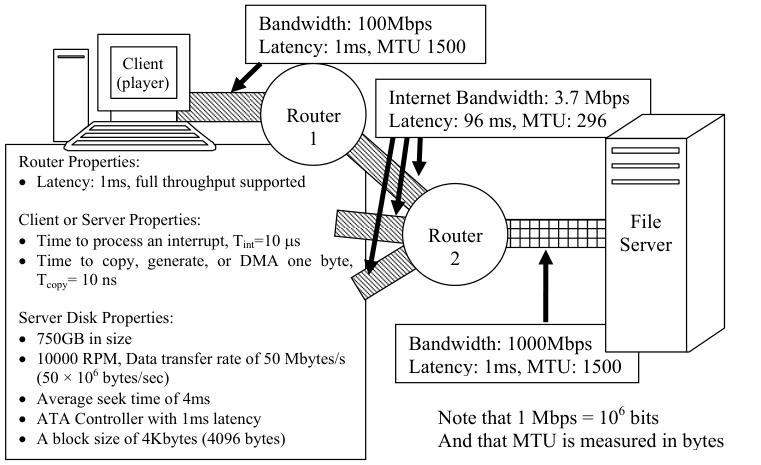

# Berkeley CS162 Fall 2007: Midterm 2: Questions

> Copied from the original: <https://hkn.eecs.berkeley.edu/exams/course/cs/162>. Text and figures are taken from the PDF as is; nothing was answered or rewritten. The original PDF is in this folder.

---

**Page 1**

&emsp;&emsp;&emsp;&emsp;&emsp;&emsp;&emsp;&emsp;University of California, Berkeley 
&emsp;&emsp;&emsp;&emsp;&emsp;&emsp;&emsp;&emsp;College of Engineering 
&emsp;&emsp;&emsp;&emsp;&emsp;&emsp;&emsp;&emsp;Computer Science Division ⎯ EECS 
&emsp;Fall 2007                John Kubiatowicz 
&emsp;&emsp;&emsp;&emsp;&emsp;&emsp;&emsp;&emsp;Midterm II 
&emsp;&emsp;&emsp;&emsp;&emsp;&emsp;&emsp;&emsp;December 3rd, 2007 
&emsp;&emsp;&emsp;&emsp;&emsp;&emsp;&emsp;CS162: Operating Systems and Systems Programming

General Information: 
This is a **closed book** exam.  You are allowed 1 page of **hand-written** notes (both sides).  You 
have 3 hours to complete as much of the exam as possible. Make sure to read all of the questions 
first, as some of the questions are substantially more time consuming. 
Write all of your answers directly on this paper.  Make your answers as concise as possible. On 
programming questions, we will be looking for performance as well as correctness, so think through 
your answers carefully.  If there is something about the questions that you believe is open to 
interpretation, please ask us about it!

&emsp;Page 1/17

---

**Page 2**

CS 162 Fall 2007 Midterm Exam II December 3rd, 2007

&emsp;&emsp;&emsp;&emsp;&emsp;&emsp;&emsp;&emsp;\[ This page left for π \]

&emsp;&emsp;&emsp;&emsp;3.141592653589793238462643383279502884197169399375105820974944

Page 2/17

---

**Page 3**

CS 162 Fall 2007 Midterm Exam II December 3rd, 2007

### Problem 1: True/False \[20 pts\]

In the following, it is important that you EXPLAIN your answer in TWO SENTENCES OR LESS 
(Answers longer than this may not get credit!).  Also, answers without an explanation GET NO 
CREDIT.

### **Problem 1a\[2pts\]:**  The Clock Algorithm requires hardware support for a “use” bit in the PTE.

&emsp;&emsp;True / False 
Explain:

### **Problem 1b\[2pts\]:** The Aloha algorithm for broadcast networking permitted a new transmitter to

interrupt a message that was already partially transmitted. 
&emsp;&emsp;True / False 
Explain:

### **Problem 1c\[2pts\]:** Memory mapped I/O devices cannot be accessed by user-level threads.

&emsp;&emsp;True / False 
Explain:

### **Problem 1d\[2pts\]:**  It is possible to make Remote Procedure Calls (RPCs) with integer arguments

between clients that use big-endian integers and servers that use little-endian integers. 
&emsp;&emsp;True / False 
Explain:

### **Problem 1e\[2pts\]:** A dictionary attack could be used against a publicly readable password file that

contains encrypted passwords. 
&emsp;&emsp;True / False 
Explain:

Page 3/17

---

**Page 4**

CS 162 Fall 2007 Midterm Exam II December 3rd, 2007

### **Problem 1f\[2pts\]:** The rate of page faults in a virtual memory system can always be reduced by

adding more memory. 
&emsp;&emsp;True / False 
Explain:

### **Problem 1g\[2pts\]:** Compulsory misses in a cache can be reduced with prefetching.

&emsp;&emsp;True / False 
Explain:

### **Problem 1h\[2pts\]:** A “memoryless” probability distribution provides a poor model for any real

sources of events. 
&emsp;&emsp;True / False 
Explain:

### **Problem 1i\[2pts\]:** Nonvolatile Ram (NVRAM) can improve the durability of a file system that

uses delayed writes. 
&emsp;&emsp;True / False 
Explain:

### **Problem 1j\[2pts\]:**  Because of the 32-bit IP-V4 address space, it is impossible for more than 232

computers to communicate over the internet. 
&emsp;&emsp;True / False 
Explain:

Page 4/17

---

**Page 5**

CS 162 Fall 2007 Midterm Exam II December 3rd, 2007

### Problem 2: Virtual Memory and Paging \[25pts\]

Consider a two-level memory management scheme on 22-bit virtual addresses using the following 
format for virtual addresses:

Virtual addresses are translated into 16-bit physical addresses of the following form:

Page table entries are 16 bits in the following format, stored in big-endian form in memory (i.e. the 
MSB is first byte in memory). 
&emsp;&emsp;&emsp;&emsp;&emsp;&emsp;&emsp;&emsp;**Page Table Entry (PTE)**

Note that a virtual-physical translation can fail at any point if an incompatible PTE is encountered. 
Two types of errors can occur during translation: “invalid page” (page is not mapped at all) or 
“access violation” (page exists, but access was illegal).

### **Problem 2a\[2pts\]:** Can you give a logical reason why the designer might have made the virtual

page # fields 7 bits each?

### **Problem 2b\[2pts\]:** What is the maximum amount of physical memory addressable by this system?

Can you think of a way to increase the amount of available physical memory without altering the 
widths of the virtual addresses or PTEs?

### **Problem 3c\[2pts\]:** How many total bits of storage will each entry of the TLB consume (including

the tag and/or other fields)? Explain.

Page 5/17

---

**Page 6**

CS 162 Fall 2007 Midterm Exam II December 3rd, 2007

### **Problem 2d\[4pts\]:**  The contents of physical memory are given on the next page. Assume that the

page-table base pointer = 0x2000, and that the CPU is in user-mode. Translate the following 
virtual addresses. If there is an error during translation, make sure to say what the error is.  Errors 
can be either “invalid page” or “access violation”.  Two answers are give. Hint: be careful to look 
at the virtual address format!

### **Problem 2e\[6pts\]:** Consider the same multi-level memory management scheme. Once again,

assume that the page-table base pointer = 0x2000 and that the CPU is in user-mode. Please return 
the results from the following load/store instructions.  Addresses are virtual. The return value for 
load is an 8-bit data value or an error, while the return value for a store is either “**ok**” or an error. 
For errors, please specify which type of error (either “invalid page” or “access violation”). When 
the result is not an error, indicate the new value for the PTE after the access is complete. The first 
two results are given:

### **Problem 2f\[2pts\]:** Suppose that there are two processes loaded on the ready queue. Process A has

page-table base pointer = 0x2000.  Process B has page-table base pointer = 0x2F00. Give the 
physical address of a data page that is shared read-write (RW) between processes A and B? Is this 
data page mapped at the same place in the virtual address spaces of the two processes?  Explain.

Page 6/17

---

**Page 7**

CS 162 Fall 2007 Midterm Exam II December 3rd, 2007

&emsp;&emsp;&emsp;&emsp;&emsp;&emsp;&emsp;&emsp;**Virtual Address Format**

&emsp;&emsp;&emsp;&emsp;&emsp;&emsp;&emsp;&emsp;**Page Table Entry (PTE)**

&emsp;&emsp;&emsp;&emsp;&emsp;&emsp;&emsp;&emsp;**Physical Memory**

Page 7/17

---

**Page 8**

CS 162 Fall 2007 Midterm Exam II December 3rd, 2007

### **Problem 2g\[4pts\]:** For the following problem, assume a hypothetical machine with 4 pages

of physical memory and 7 pages of virtual memory. Given the access pattern: 
&emsp;&emsp;`A B C D E F C A A F F G A B G D F F` 
Indicate in the following table which pages are mapped to which physical pages for each of the 
following policies.  Assume that a blank box matches the element to the left. We have given the 
FIFO policy as an example.

### **Problem 2i\[3pts\]:** What is a precise exception and why would we want a software TLB fault to

generate a precise exception?

Page 8/17

---

**Page 9**

CS 162 Fall 2007 Midterm Exam II December 3rd, 2007

### Problem 3: File Systems \[20pts\]

Please keep your answers short (one or two sentences per question-mark). We may not give credit 
for long answers.

### **Problem 3a\[2pts\]:** What is spatial locality and which type of file access pattern exploits spatial

locality?

### **Problem 3b\[2pts\]:** Which component of disk access time is the disk scheduling algorithm trying to

minimize?

### **Problem 3c\[3pts\]:** How does a Journaled file system improve the durability of data on disk? Give

two reasons why a journaled file system would have higher performance than a file system that 
forced every block to the disk immediately, while at the same time giving the same or better 
durability.

### **Problem 3d\[2pts\]:** Name at least two ways in which the buffer cache is used to improve

performance for file systems.

Page 9/17

---

**Page 10**

CS 162 Fall 2007 Midterm Exam II December 3rd, 2007

### **Problem 3e\[2pts\]:** The Fast File System (FFS) of Berkeley 4.2 Unix utilized “Skip Sector

Positioning” to improve performance. Explain what “Skip Sector Positioning” is and why this 
optimization may no longer be important.

### **Problem 3f\[3pts\]:** The Network File System (NFS) uses a “stateless” protocol between clients and

servers. What does this mean? Name one advantage and one disadvantage of stateless filesystem 
protocols.

### **Problem 3j\[6pts\]:** Suppose that a new disk technology provided access times that are of the same

order of magnitude as memory access times.  What, if anything, must be changed in the following 
three OS components to take advantage of the quicker access time?  If something doesn’t change, 
be very specific why it doesn’t change.  If it will change, contrast these changes with current 
implementation and be as specific as possible in your answers (i.e. identify what would change and 
why). 
&emsp;1\. Process Scheduler

&emsp;2\. Memory Management

&emsp;3\. Device Driver for the new disk

Page 10/17

---

**Page 11**

CS 162 Fall 2007 Midterm Exam II December 3rd, 2007

&emsp;&emsp;&emsp;&emsp;&emsp;&emsp;&emsp;&emsp;**\[ This page intentionally left blank \]**

Page 11/17

---

**Page 12**

CS 162 Fall 2007 Midterm Exam II December 3rd, 2007

### Problem 4: Network File Server \[35 pts\]

&emsp;The above figure illustrates a network in which one client interacts with a server to display 
video files. Each link is characterized by its Bandwidth, one-way Latency (for the first bit to arrive), 
and Maximum Transfer Unit (MTU) in bytes. All links are full-duplex (can handle traffic in both 
directions at full bandwidth). Each router is highly pipelined and will start forwarding a packet to 
an output port 1ms after it receives the first bit of the packet.  Assume that no packets will be lost. 
&emsp;Both the video player (on the client) and file server run at user level.  To display a video, the 
client opens a TCP connection to the server, sends multiple requests, then waits for the response. 
Assume that the time to setup the connection is negligible relative to the overall viewing time. 
&emsp;To send data over the network, a user-level process issues a write system call on a socket.  The 
OS will copy the data to a kernel buffer (inside the socket). Then, the TCP routines generate 
headers (by copying them from templates) and use DMA to copy the completed packet to the 
network controller. Immediately after receiving all of the data for a packet, the network controller 
sends it. Afterwards, it generates an interrupt (one per packet). 
&emsp;At the destination, the network controller DMAs the packet to memory, then interrupts the 
CPU. Subsequently, the TCP routines transmit an acknowledgement (ACK) back to the sender. For 
simplicity, you may treat ACKs as if they are zero bytes long. After sending an ACK, the OS copies 
the received data into user-level buffer of the receiving user-level process. 
&emsp;A user-level process reads data from the disk by executing a read() system call with a user-level 
buffer for the results. The OS splits read requests into chunks that consist of sequential blocks on 
the same track and that are 16 blocks or less in size.  It queues requests in the device driver request 
queue (DDRQ). Whenever the disk controller finishes reading a chunk of data into kernel memory, 
the controller generates an interrupt, causing the OS to dequeue the next request from the DDQ. 
The OS then copies data from kernel memory into the user’s buffer and returns from read().

Page 12/17

---

**Page 13**

CS 162 Fall 2007 Midterm Exam II December 3rd, 2007

### **Problem 4a\[3pts\]:** What is the maximum amount of data that the client or server can send in each

packet while avoiding fragmentation along the way?  Remember that the TCP+IP header is 40 
bytes. Explain.

### **Problem 4b\[2pts\]:** Explain how the client or server could automatically discover the answer to 4a:

### **Problem 4c\[2pts\]:** Under ideal circumstances (and ignoring interrupt and copying overheads and

window sizes), what is the maximum data bandwidth that could be sent from the server to the client 
without dropping packets, assuming that the server utilizes the mechanism in 4b? Explain.

### **Problem 4d\[3pts\]:** Assume that a maximal sized packet (as in 4a) is sent from the TCP send buffer

of the server to the TCP receive buffer of the client. Compute the total roundtrip latency from the 
point at which the server invokes the device driver to send the packet until it receive the ACK via 
an interrupt. Hint: don’t forget the interrupt at the receiving side and the DMA mechanism into and 
out of the network.

Page 13/17

---

**Page 14**

CS 162 Fall 2007 Midterm Exam II December 3rd, 2007

### **Problem 4e\[3pts\]:** What TCP window size is necessary to achieve the bandwidth of 4c without

dropping packets in the network? Use simple constants and values that you computed for 4a-4d. 
Explain.  Make sure that you correct for units.

### **Problem 4f\[6pts\]:** Suppose that video files are laid out in 64K (65536 bytes) chunks on the disk

(i.e. 64K in successive sectors on a track). Compute the overhead for reading such a 64K chunk 
from a random place on the disk.  Assume that the disk controller automatically DMAs the data to 
kernel memory in a fashion that is overlapped with reading it from the disk (so that you do not have 
to worry about DMA for this operation). After finishing, the controller generates an interrupt; the 
interrupt routine may submit another request to the controller (if one is queued on the DDRQ). 
Assume the disk parameters given above (repeated here): 
&emsp;• 750GB in size 
&emsp;• 10000 RPM, Data transfer rate of 50 Mbytes/s (50 × 106 bytes/sec) 
&emsp;• Average seek time of 4ms 
&emsp;• ATA Controller with 1ms controller initiation time 
&emsp;• A block size of 4Kbytes (4096 bytes) 
What is the total time to read 64K chunk from a random place on the disk into memory including 
the interrupt? Hint: there are 5 terms here including the interrupt!

Page 14/17

---

**Page 15**

CS 162 Fall 2007 Midterm Exam II December 3rd, 2007

### **Problem 4g\[3pts\]:** Now, assume that the video player works by sending requests for 64KB

(=65536 bytes) at a time to the video server.  Assuming that these requests are pipelined for 
maximum bandwidth, at what rate must it send these requests to achieve the bandwidth of 4c?

### **Problem 4h\[4pts\]:** Compute the total processor overhead for satisfying a 64K request at the server.

Processor overhead includes (1) interrupts, (2) header generation overhead and (3) copying 
overhead.  Note that generating a byte of header is as expensive as copying.   Processor overhead 
does not include DMA or disk controller actions since these are overlapped with the CPU.  The data 
portion of a request message is 16 bytes.

### **Problem 4i\[4pts\]:** Suppose that we wanted to handle 300 clients each at a request rate as given in

(4g).  Assume that multiple clients connect through network resources that are independent up to 
router #2. Each client would have its own user-level process working on its behalf. How many disks 
would we need to handle this rate? What else would need to be upgraded to handle this rate?

Page 15/17

---

**Page 16**

CS 162 Fall 2007 Midterm Exam II December 3rd, 2007

### **Problem 4j\[5pts\]:** Returning to our single-disk server, assume that 15 clients connect through

network resources that are independent up to router #2.  Each client has its own user-level process 
working on its behalf. Assume that all 15 clients send requests at a rate of (4g). If the disk response 
distribution can be described with C=1.5 and the aggregate network request rate can be described as 
exponential, what is the average length of  the disk device driver request queue (DDRQ)?  Hint: the 
service time for the disk is the time between requests to the disk controller when the DDRQ is full. 
Possibly useful formulas include: 
&emsp;&emsp;&emsp;&emsp;&emsp;&emsp;&emsp;&emsp;1   1 
&emsp;&emsp;&emsp;&emsp;&emsp;&emsp;&emsp;&emsp;∑=∑=   (   ) 
&emsp;&emsp;&emsp;&emsp;&emsp;&emsp;&emsp;&emsp;=−=n   n   2 
&emsp;&emsp;TVariance:     TTMean Service: σ2   T 
&emsp;&emsp;&emsp;&emsp;&emsp;&emsp;&emsp;&emsp;iserveri   server 
&emsp;&emsp;&emsp;&emsp;&emsp;&emsp;&emsp;&emsp;nni   1   i   1 
&emsp;&emsp;&emsp;&emsp;&emsp;&emsp;&emsp;&emsp;1Cu⎞⎛⎛+   ⎞ 
&emsp;&emsp;TT⎜⎟⎜⎟M/G/1 queue: =××   Little’s law:  Lq=λ × Tq 
&emsp;&emsp;&emsp;&emsp;&emsp;&emsp;&emsp;&emsp;21u⎝⎠⎝qserver   −   ⎠

Page 16/17

---

**Page 17**

CS 162 Fall 2007 Midterm Exam II December 3rd, 2007

&emsp;&emsp;&emsp;&emsp;&emsp;&emsp;&emsp;&emsp;**\[ Scratch Page (feel free to remove) \]**

Page 17/17

