# Berkeley CS162 Fall 2007: Midterm 2: Official solutions

> Copied from the original: <https://hkn.eecs.berkeley.edu/exams/course/cs/162>. Text and figures are taken from the PDF as is; nothing was answered or rewritten. The original PDF is in this folder.

---

**Page 1**

&emsp;&emsp;&emsp;&emsp;&emsp;&emsp;&emsp;&emsp;University of California, Berkeley 
&emsp;&emsp;&emsp;&emsp;&emsp;&emsp;&emsp;&emsp;College of Engineering 
&emsp;&emsp;&emsp;&emsp;&emsp;&emsp;&emsp;&emsp;Computer Science Division ⎯ EECS 
&emsp;Fall 2007                John Kubiatowicz 
&emsp;&emsp;&emsp;&emsp;&emsp;&emsp;&emsp;&emsp;Midterm II 
&emsp;&emsp;&emsp;&emsp;&emsp;&emsp;&emsp;&emsp;December 3rd, 2007 
&emsp;&emsp;&emsp;&emsp;&emsp;&emsp;&emsp;CS162: Operating Systems and Systems Programming

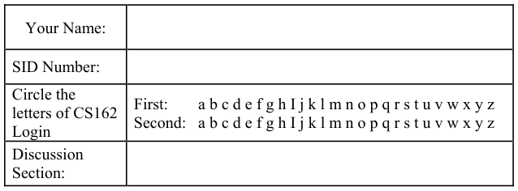

General Information: 
This is a **closed book** exam.  You are allowed 1 page of **hand-written** notes (both sides).  You 
have 3 hours to complete as much of the exam as possible. Make sure to read all of the questions 
first, as some of the questions are substantially more time consuming. 
Write all of your answers directly on this paper.  Make your answers as concise as possible. On 
programming questions, we will be looking for performance as well as correctness, so think through 
your answers carefully.  If there is something about the questions that you believe is open to 
interpretation, please ask us about it!

&emsp;Page 1/17

---

**Page 2**

CS 162 Fall 2007 Midterm Exam II December 3rd, 2007

&emsp;&emsp;&emsp;&emsp;&emsp;&emsp;&emsp;&emsp;\[ This page left for π \]

&emsp;&emsp;&emsp;&emsp;3.141592653589793238462643383279502884197169399375105820974944

Page 2/17

---

**Page 3**

CS 162 Fall 2007 Midterm Exam II December 3rd, 2007

### Problem 1: True/False \[20 pts\]

In the following, it is important that you EXPLAIN your answer in TWO SENTENCES OR LESS 
(Answers longer than this may not get credit!).  Also, answers without an explanation GET NO 
CREDIT.

### **Problem 1a\[2pts\]:**  The Clock Algorithm requires hardware support for a “use” bit in the PTE.

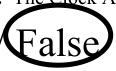

Explain: When a hardware use bit is not available, the PTEs can be set to invalid when 
they are unused, so that when the page is accessed, a trap will occur, and the operating system can set the 
use bit in software.

### **Problem 1b\[2pts\]:** The Aloha algorithm for broadcast networking permitted a new transmitter to

interrupt a message that was already partially transmitted.

&emsp;&emsp;True / False 
Explain: Yes, because Aloha sends blindly without checking to see if there are any ongoing 
communications (it relies on retransmissions after detecting garbled packets).

### **Problem 1c\[2pts\]:** Memory mapped I/O devices cannot be accessed by user-level threads.

Explain: Memory-mapped I/O is accomplished using load/store instructions to a special 
region of memory; a user-level thread can access this region if the user’s page table has a mapping for it.

### **Problem 1d\[2pts\]:**  It is possible to make Remote Procedure Calls (RPCs) with integer arguments

between clients that use big-endian integers and servers that use little-endian integers.

&emsp;&emsp;True / False 
Explain: The marshalling/unmarshalling code of RPC will automatically convert between 
network and host byte orders, thus accommodating any combination of host byte orders.

### **Problem 1e\[2pts\]:** A dictionary attack could be used against a publicly readable password file that

contains encrypted passwords.

&emsp;&emsp;True / False 
Explain: An attacker could encrypt every word in the dictionary and compare against the 
encrypted passwords stored in the publicly readable file. Note that the “encryption” used the UNIX 
password file acts as a one-way function.

Page 3/17

---

**Page 4**

CS 162 Fall 2007 Midterm Exam II December 3rd, 2007

### **Problem 1f\[2pts\]:** The rate of page faults in a virtual memory system can always be reduced by

adding more memory.

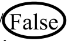

Explain: There are circumstances in which adding memory can actually increase the 
number of faults. Specifically: Belady’s anomaly can come into play for a FIFO replacement policy and 
certain access patterns.

### **Problem 1g\[2pts\]:** Compulsory misses in a cache can be reduced with prefetching.

&emsp;&emsp;True / False 
Explain: If the data is prefetched, it will already be in memory, so when that data is 
accessed the first time, there will not be a compulsory miss.

### **Problem 1h\[2pts\]:** A “memoryless” probability distribution provides a poor model for any real

sources of events.

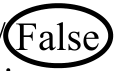

Explain: When events from many independent sources are combined together the result 
can often be well approximated by a memoryless distribution—even if the individual sources are not 
memoryless.

### **Problem 1i\[2pts\]:** Nonvolatile Ram (NVRAM) can improve the durability of a file system that

uses delayed writes.

&emsp;&emsp;True / False 
Explain: Data that has been buffered for delayed writes can be stored in NVRAM.  If a 
power failure occurs before the data is written out to disk, the data can be recovered from the NVRAM.

### **Problem 1j\[2pts\]:**  Because of the 32-bit IP-V4 address space, it is impossible for more than 232

computers to communicate over the internet.

Explain: Network Address Translation allows a single IP address to be used by several 
computers.

Page 4/17

---

**Page 5**

CS 162 Fall 2007 Midterm Exam II December 3rd, 2007

### Problem 2: Virtual Memory and Paging \[25pts\]

Consider a two-level memory management scheme on 22-bit virtual addresses using the following 
format for virtual addresses:

Virtual addresses are translated into 16-bit physical addresses of the following form:

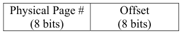

Page table entries are 16 bits in the following format, stored in big-endian form in memory (i.e. the 
MSB is first byte in memory). 
&emsp;&emsp;&emsp;&emsp;&emsp;&emsp;&emsp;&emsp;**Page Table Entry (PTE)**

Note that a virtual-physical translation can fail at any point if an incompatible PTE is encountered. 
Two types of errors can occur during translation: “invalid page” (page is not mapped at all) or 
“access violation” (page exists, but access was illegal).

### **Problem 2a\[2pts\]:** Can you give a logical reason why the designer might have made the virtual

page # fields 7 bits each? 
&emsp;With a 7 bit virtual page #, the size of each page table is equal to the size of one page of memory. 
&emsp;27 entries/table \* 2 bytes/entry = 28 bytes/table; each page is 28 bytes. 
&emsp;Grading: 2 points for recognizing that a page table fits exactly in one page; no other answer accepted.

### **Problem 2b\[2pts\]:** What is the maximum amount of physical memory addressable by this system?

Can you think of a way to increase the amount of available physical memory without altering the 
widths of the virtual addresses or PTEs? 
&emsp;16-bit byte-addressed physical addresses =\> 216 bytes of physical memory is addressable. 
&emsp;You can use the two zero bits in the page table entry to address a larger number of physical pages (210 
&emsp;physical pages). You can also increase the size of pages (by increasing offset width), or add registers for 
&emsp;segmentation. 
&emsp;Grading: 1 pt. for each part.

### **Problem 3c\[2pts\]:** How many total bits of storage will each entry of the TLB consume (including

the tag and/or other fields)? Explain. 
&emsp;Simplest answer: TLB valid bit, 14-bit VPN, 16-bit PTE = 29 bits 
&emsp;Alternate: TLB valid, 14-bit VPN, 8-bit PPN (1/2 pt. each) , dirty, used, write (1/2 pt. for all 3) = 26 bits. 
&emsp;We ignored kernel only and uncacheable bits. 
&emsp;Grading: -1 if you include 8-bit offset. -1 if you stated just “extra bits.” -1/2 if you included zero bits in 
&emsp;the PTE. If you said 16 bits for PTE, we also required you to explicitly state TLB valid bit.

Page 5/17

---

**Page 6**

CS 162 Fall 2007 Midterm Exam II December 3rd, 2007

### **Problem 2d\[4pts\]:**  The contents of physical memory are given on the next page. Assume that the

page-table base pointer = 0x2000, and that the CPU is in user-mode. Translate the following 
virtual addresses. If there is an error during translation, make sure to say what the error is.  Errors 
can be either “invalid page” or “access violation”.  Two answers are give. Hint: be careful to look 
at the virtual address format!

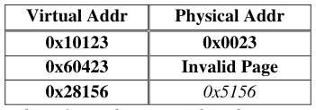

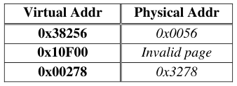

&emsp;Grading: 1pt each, no partial credit

### **Problem 2e\[6pts\]:** Consider the same multi-level memory management scheme. Once again,

assume that the page-table base pointer = 0x2000 and that the CPU is in user-mode. Please return 
the results from the following load/store instructions.  Addresses are virtual. The return value for 
load is an 8-bit data value or an error, while the return value for a store is either “**ok**” or an error. 
For errors, please specify which type of error (either “invalid page” or “access violation”). When 
the result is not an error, indicate the new value for the PTE after the access is complete. The first 
two results are given:

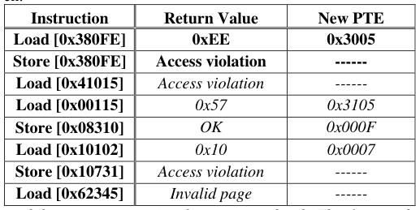

&emsp;Note: keep in mind that we are accessing things at user-level.  This fact results in the “access 
&emsp;violation” for **Load\[0x41015\]**, for instance. Also, for **Store \[0x08310\]**, we accepted “access 
&emsp;violation,” which is the result if you look at the write bit in the top level page table. 
&emsp;Grading: ½ pt. each box for non-errors, 1 pt. each row if error.

### **Problem 2f\[2pts\]:** Suppose that there are two processes loaded on the ready queue. Process A has

page-table base pointer = 0x2000.  Process B has page-table base pointer = 0x2F00. Give the 
physical address of a data page that is shared read-write (RW) between processes A and B? Is this 
data page mapped at the same place in the virtual address spaces of the two processes?  Explain. 
&emsp;Page 0x51 (addresses 0x5100-0x51FF) are shared RW between the two processes. 
&emsp;The page is mapped at different places in the two address spaces, as they appear at different offsets into 
&emsp;the top level page tables. 
&emsp;Grading: 1 pt. for the correct page, ½ pt. for “No”, ½ pt. for explanation. Partial credit was given for 
&emsp;0x2800 (which is not a data page, but the second-level page table shared by the two processes.)

Page 6/17

---

**Page 7**

CS 162 Fall 2007 Midterm Exam II December 3rd, 2007

&emsp;&emsp;&emsp;&emsp;&emsp;&emsp;&emsp;&emsp;**Virtual Address Format**

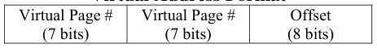

&emsp;&emsp;&emsp;&emsp;&emsp;&emsp;&emsp;&emsp;**Page Table Entry (PTE)**

&emsp;&emsp;&emsp;&emsp;&emsp;&emsp;&emsp;&emsp;**Physical Memory**

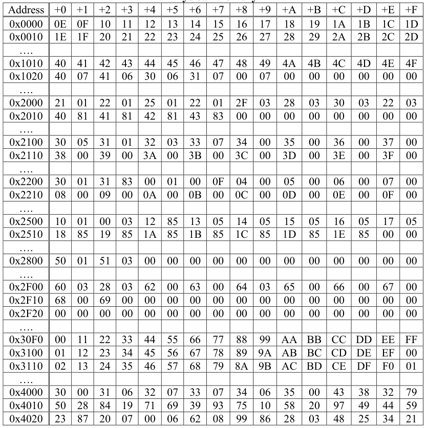

Page 7/17

---

**Page 8**

CS 162 Fall 2007 Midterm Exam II December 3rd, 2007

### **Problem 2g\[4pts\]:** For the following problem, assume a hypothetical machine with 4 pages

of physical memory and 7 pages of virtual memory. Given the access pattern: 
&emsp;&emsp;`A B C D E F C A A F F G A B G D F F` 
Indicate in the following table which pages are mapped to which physical pages for each of the 
following policies.  Assume that a blank box matches the element to the left. We have given the 
FIFO policy as an example.

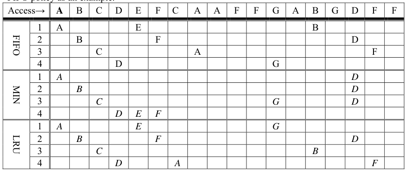

&emsp;For MIN, we accepted the final D in any of the first three pages. 
&emsp;Grading: 2 pts. each for MIN and LRU; -1 for each error.

### **Problem 2i\[3pts\]:** What is a precise exception and why would we want a software TLB fault to

generate a precise exception? 
&emsp;A precise exception is one where the state of the machine is preserved as if the program 
&emsp;executed up to the offending instruction. All previous instruction have completed, and the 
&emsp;offending instruction and all following instructions act as if they had not even started. 
&emsp;We would like the hardware to generate a precise exception on a software TLB fault because it 
&emsp;makes implementation of the fault handler easier. The fault handler simply restarts execution at 
&emsp;the offending instruction (easy).  It does not need to figure out the state of the system and 
&emsp;potentially rollback or complete execution (in software) of partially completed instructions. 
&emsp;Grading: 1.5 pt. for each part.

Page 8/17

---

**Page 9**

CS 162 Fall 2007 Midterm Exam II December 3rd, 2007

### Problem 3: File Systems \[20pts\]

Please keep your answers short (one or two sentences per question-mark). We may not give credit 
for long answers.

### **Problem 3a\[2pts\]:** What is spatial locality and which type of file access pattern exploits spatial

locality? 
&emsp;Spatial locality is accessing a location that is close to or next to recently accessed location.  Sequential 
&emsp;access of a file exploits spatial locality. 
&emsp;Grading: 1 point for definition and 1 point for access pattern.

### **Problem 3b\[2pts\]:** Which component of disk access time is the disk scheduling algorithm trying to

minimize? 
&emsp;The disk scheduling algorithm is attempting to minimize overall time wasted to moving the disk arm (i.e. 
&emsp;it optimizes seek time). 
&emsp;Grading: 2 point for seek time or 1 point for some reasonable explanation of another component.

### **Problem 3c\[3pts\]:** How does a Journaled file system improve the durability of data on disk? Give

two reasons why a journaled file system would have higher performance than a file system that 
forced every block to the disk immediately, while at the same time giving the same or better 
durability. 
&emsp;Journaled file systems keep a log of changes to the file system; this log is forced to disk so that if a crash 
&emsp;occurs the file system can recover all the transactions that haven’t been committed properly to the disk. 
&emsp;&emsp;1\) Since only modifications are forced to the log, the total traffic forced to disk might be a lot 
&emsp;&emsp;&emsp;smaller than if every modified block must be sent to disk. 
&emsp;&emsp;2\) The log has great spatial locality (written on a set of consecutive sectors. Consequently, it can 
&emsp;&emsp;&emsp;be forced to disk with little or no head  movement. 
&emsp;&emsp;3\) When the file system is actually updated, the scheduler can order requests for higher efficiency – 
&emsp;&emsp;&emsp;since the correctness depends on the log, not the order of updates to the rest of the disk. 
&emsp;Grading: 1 point for explanation of Journaled and 1 point each for reasons.

### **Problem 3d\[2pts\]:** Name at least two ways in which the buffer cache is used to improve

performance for file systems. 
&emsp;1\) Reads can be from cache instead of disk 
&emsp;2\) Allow delayed writes to disk, thereby permitting better disk scheduling an/or temporary files to be 
&emsp;&emsp;created and destroyed without even being written to disk. 
&emsp;3\) Used to cache kernel resources such as disk blocks and name translations

Page 9/17

---

**Page 10**

CS 162 Fall 2007 Midterm Exam II December 3rd, 2007

### **Problem 3e\[2pts\]:** The Fast File System (FFS) of Berkeley 4.2 Unix utilized “Skip Sector

Positioning” to improve performance. Explain what “Skip Sector Positioning” is and why this 
optimization may no longer be important. 
&emsp;Skip sector positioning placed successive sectors of a file on every other sector (or with multiple sectors 
&emsp;between). This helps to avoid the situation in which the processor must do so much work after reading 
&emsp;each sector that it misses the next sector and has to wait for a complete revolution. Modern disk 
&emsp;controllers have track buffers that  keep data from a complete track in memory, thereby eliminating the 
&emsp;need for sector interleaving

### **Problem 3f\[3pts\]:** The Network File System (NFS) uses a “stateless” protocol between clients and

servers. What does this mean? Name one advantage and one disadvantage of stateless filesystem 
protocols. 
&emsp;&emsp;All the requests to the NFS server are self-contained: they include all the arguments required for 
&emsp;&emsp;execution and do not assume that information is maintained between successive server requests. 
&emsp;&emsp;Advantage: Server can crash and restart transparently to the client. 
&emsp;&emsp;Disadvantage: Cannot track which clients are caching data, thus making it difficult to get clean 
&emsp;&emsp;caching semantics. 
&emsp;&emsp;Grading: 1 point for explanation, 1 for advantage and 1 for disadvantage.

### **Problem 3j\[6pts\]:** Suppose that a new disk technology provided access times that are of the same

order of magnitude as memory access times.  What, if anything, must be changed in the following 
three OS components to take advantage of the quicker access time?  If something doesn’t change, 
be very specific why it doesn’t change.  If it will change, contrast these changes with current 
implementation and be as specific as possible in your answers (i.e. identify what would change and 
why). 
&emsp;1\. **Process Scheduler** 
&emsp;&emsp;Scheduler deals with processes at task level with arrival and run times so while run time might 
&emsp;&emsp;change the scheduler does not need change. 
&emsp;2\. **Memory Management** 
&emsp;&emsp;Write through instead of write back since it’s cheaper to go to disk.  Less need to prefetch and 
&emsp;&emsp;instead save on the cost of getting unused memory location.  Do more on-demand paging instead of 
&emsp;&emsp;having to rely on predicting access pattern and missing.  Mainly, allows memory management to 
&emsp;&emsp;balance hit cost and miss cost instead of focusing on increasing hit rates only. 
&emsp;**3. Device Driver for the new disk** 
&emsp;&emsp;Use polling instead of interrupt for new disk device driver since it will be in heavy use due to lower 
&emsp;&emsp;access.  Or no change to the structure of the device driver from OS point of view. 
Grading: 2 points for good reasoning for change or no change with some modification if there is a change. 
1.5 points for good explanation of the choice to modify or not.  1 point for incomplete reasoning but in the 
right direction.

Page 10/17

---

**Page 11**

CS 162 Fall 2007 Midterm Exam II December 3rd, 2007

&emsp;&emsp;&emsp;&emsp;&emsp;&emsp;&emsp;&emsp;**\[ This page intentionally left blank \]**

Page 11/17

---

**Page 12**

CS 162 Fall 2007 Midterm Exam II December 3rd, 2007

### Problem 4: Network File Server \[35 pts\]

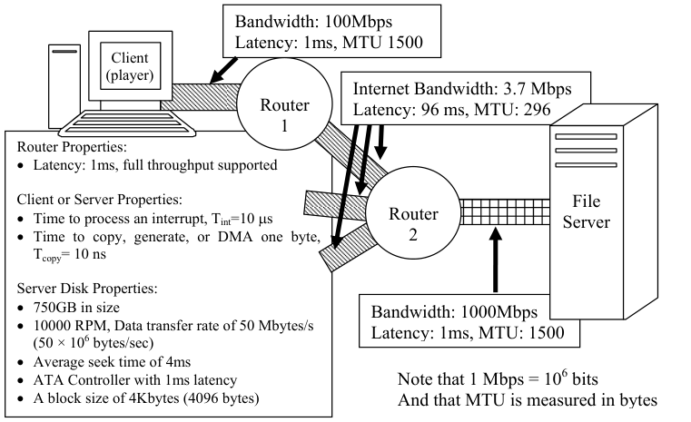

&emsp;The above figure illustrates a network in which one client interacts with a server to display 
video files. Each link is characterized by its Bandwidth, one-way Latency (for the first bit to arrive), 
and Maximum Transfer Unit (MTU) in bytes. All links are full-duplex (can handle traffic in both 
directions at full bandwidth). Each router is highly pipelined and will start forwarding a packet to 
an output port 1ms after it receives the first bit of the packet.  Assume that no packets will be lost. 
&emsp;Both the video player (on the client) and file server run at user level.  To display a video, the 
client opens a TCP connection to the server, sends multiple requests, then waits for the response. 
Assume that the time to setup the connection is negligible relative to the overall viewing time. 
&emsp;To send data over the network, a user-level process issues a write system call on a socket.  The 
OS will copy the data to a kernel buffer (inside the socket). Then, the TCP routines generate 
headers (by copying them from templates) and use DMA to copy the completed packet to the 
network controller. Immediately after receiving all of the data for a packet, the network controller 
sends it. Afterwards, it generates an interrupt (one per packet). 
&emsp;At the destination, the network controller DMAs the packet to memory, then interrupts the 
CPU. Subsequently, the TCP routines transmit an acknowledgement (ACK) back to the sender. For 
simplicity, you may treat ACKs as if they are zero bytes long. After sending an ACK, the OS copies 
the received data into user-level buffer of the receiving user-level process. 
&emsp;A user-level process reads data from the disk by executing a read() system call with a user-level 
buffer for the results. The OS splits read requests into chunks that consist of sequential blocks on 
the same track and that are 16 blocks or less in size.  It queues requests in the device driver request 
queue (DDRQ). Whenever the disk controller finishes reading a chunk of data into kernel memory, 
the controller generates an interrupt, causing the OS to dequeue the next request from the DDQ. 
The OS then copies data from kernel memory into the user’s buffer and returns from read().

Page 12/17

---

**Page 13**

CS 162 Fall 2007 Midterm Exam II December 3rd, 2007

### **Problem 4a\[3pts\]:** What is the maximum amount of data that the client or server can send in each

packet while avoiding fragmentation along the way?  Remember that the TCP+IP header is 40 
bytes. Explain. 
&emsp;&emsp;Since the minimum MTU along the path is 296, and the header is 40 bytes, the maximum amount of 
&emsp;&emsp;data that the client or server can send in each packet is 296-40 = 256 bytes. 
&emsp;&emsp;Grading:1pt for minimum  MTU, 1 pt for subtracting header, 1 for some explanation

### **Problem 4b\[2pts\]:** Explain how the client or server could automatically discover the answer to 4a:

&emsp;&emsp;The sending end starts with large packets with the “no fragment” flag set in the header and slowly 
&emsp;&emsp;reduces the size until packets start making it through without being dropped. 
&emsp;&emsp;Grading: 1 pt for plausible endpoint-generated query, 1 pt for mentioning no frag bit

### **Problem 4c\[2pts\]:** Under ideal circumstances (and ignoring interrupt and copying overheads and

window sizes), what is the maximum data bandwidth that could be sent from the server to the client 
without dropping packets, assuming that the server utilizes the mechanism in 4b? Explain. 
&emsp;&emsp;Assuming that we use the maximum packet size from 4a (i.e. 296) which contains 256 bytes of data 
&emsp;&emsp;in it, we can compute the fraction of the 3.7 Mbps that we have in the middle link as:  3.7 Mbps μ 
&emsp;&emsp;(256/296) = 3.2 Mbps 
&emsp;&emsp;Grading: 1pt identifying bottleneck bandwidth, 1 pt for scaling by correct fraction

### **Problem 4d\[3pts\]:** Assume that a maximal sized packet (as in 4a) is sent from the TCP send buffer

of the server to the TCP receive buffer of the client. Compute the total roundtrip latency from the 
point at which the server invokes the device driver to send the packet until it receive the ACK via 
an interrupt. Hint: don’t forget the interrupt at the receiving side and the DMA mechanism into and 
out of the network. 
&emsp;Note that the fact that the router is pipelined (see description above) implies that the router begins 
&emsp;routing toward the output port even before it has received the complete packet.  This simplifies things so 
&emsp;that we only have to track latencies of packets through the router as 1ms. At the receiving side, we 
&emsp;technically need to wait for the packet to be completely received before we start DMAing it into kernel 
&emsp;memory. 
&emsp;Also, we said that the ACK is zero length.  If this is truly zero, then there is no header 
&emsp;generation/transmission latency.  Otherwise, we need to generate headers. There are two different 
&emsp;options here: Ack latency (zero) or Ack latency (header) here. 
&emsp;We translate to ms here. 10ns=10-5ms, 10μ = 10-2ms. 1Gps=1012bits/ms 100Mbps=1011bits/ms 
&emsp;Message latency =    \[Genheader+DMAkernel→network\]+\[Link2+Route2+Linkmiddle+Route1+Link1\]+ 
\[Receiveserver+DMAnetwork→kernel+Intmessage\] 
=(40μ10-5ms+296μ10-5ms\] + \[1ms+1ms+96ms+1ms+1ms\]+ 
\[(296μ8 bits)/(1011bits/ms)+296μ10-5ms+10-2ms\]  ≅ 100.02ms 
&emsp;Ack latency (zero) =    \[Link2+Route2+Linkmiddle+Route1+Link1\]+Intack = 100.01 ms 
&emsp;Ack latency(header)= \[Genheader+DMAkernel→network\]+Ack latency(zero)+ 
\[Receiveclient+DMAnetwork→kernel\] 
&emsp;&emsp;&emsp;&emsp;&emsp;&emsp;&emsp;&emsp;=\[40μ10-5ms+40μ10-5ms\]+100.01ms+ 
&emsp;&emsp;&emsp;&emsp;&emsp;&emsp;&emsp;\[(40μ8)/(1012bits/ms)+40μ10-5ms\] ≅ 100.01ms 
&emsp;Total Answer ≅ 200.03ms 
&emsp;Grading: 1 point on right track, -2 for missing all network components, -1 point for missing components 
&emsp;of basic 200ms roundtrip, -½ for missing DMAs, -½ for missing ints, -½  for interrupt on send (not in 
&emsp;critical path), -½ for copy into kernel (already in TCP buffer), -½ math error

Page 13/17

---

**Page 14**

CS 162 Fall 2007 Midterm Exam II December 3rd, 2007

### **Problem 4e\[3pts\]:** What TCP window size is necessary to achieve the bandwidth of 4c without

dropping packets in the network? Use simple constants and values that you computed for 4a-4d. 
Explain.  Make sure that you correct for units. 
&emsp;&emsp;What is needed here is the bandwidth-latency product, where the latency is the roundtrip latency. 
&emsp;&emsp;The result will be the total amount of data that needs to be “in the network” before reception of the 
&emsp;&emsp;first ACK. Here, the window size is in data bytes (not including header) so, we use the data 
&emsp;&emsp;bandwidth, not total bandwidth.  Also, we must correct for the fact that (4d) was computed in ms. 
&emsp;&emsp;Notice how all of the units cancel out properly! (we want bytes) 
&emsp;&emsp;&emsp;&emsp;&emsp;Window size  ≅ (4c)μ(4d)μ(10-3s/ms) / (8bits/byte) 
&emsp;&emsp;&emsp;&emsp;&emsp;&emsp;&emsp;&emsp;≅ (3.2μ106bit/s)μ(200.03ms)μ (10-3s/ms)μ (0.125 bytes/bit) 
&emsp;&emsp;&emsp;&emsp;&emsp;&emsp;&emsp;&emsp;≅ 80012 bytes 
&emsp;&emsp;Grading: -1 use incorrect bandwidth (unless consistent with 4c), -1 missed converting bits to bytes 
&emsp;&emsp;(unless give answer with units of “b,” which means bits, -1 for not following directions (using only 
&emsp;&emsp;values from 4a through 4d or simple constants).

### **Problem 4f\[6pts\]:** Suppose that video files are laid out in 64K (65536 bytes) chunks on the disk

(i.e. 64K in successive sectors on a track). Compute the overhead for reading such a 64K chunk 
from a random place on the disk.  Assume that the disk controller automatically DMAs the data to 
kernel memory in a fashion that is overlapped with reading it from the disk (so that you do not have 
to worry about DMA for this operation). After finishing, the controller generates an interrupt; the 
interrupt routine may submit another request to the controller (if one is queued on the DDRQ). 
Assume the disk parameters given above (repeated here): 
&emsp;• 750GB in size 
&emsp;• 10000 RPM, Data transfer rate of 50 Mbytes/s (50 × 106 bytes/sec) 
&emsp;• Average seek time of 4ms 
&emsp;• ATA Controller with 1ms controller initiation time 
&emsp;• A block size of 4Kbytes (4096 bytes) 
What is the total time to read 64K chunk from a random place on the disk into memory including 
the interrupt? Hint: there are 5 terms here including the interrupt! 
Timeserver = Timecontroller+Timeseek+Timerotate+Timetransfer+TimeInt 
= 1ms + 4ms + 
&emsp;&emsp;&emsp;&emsp;&emsp;½ \[ 60 s/min μ 1000 ms/s / 10000 rev/min \] + 
&emsp;&emsp;&emsp;&emsp;&emsp;65536 bytes / \[(50 × 106 bytes/sec) μ 0.001 sec/ms\] + 0.01 ms 
&emsp;&emsp;&emsp;&emsp;&emsp;= 8.01ms + 1.31ms = 9.32ms 
&emsp;&emsp;Grading: 1 pt for each of 5 terms, 1 pt for calculation (can lose if have a unit conversion problem, 
&emsp;&emsp;like forgetting to convert from sec to ms or something similar, other reasons).

Page 14/17

---

**Page 15**

CS 162 Fall 2007 Midterm Exam II December 3rd, 2007

### **Problem 4g\[3pts\]:** Now, assume that the video player works by sending requests for 64KB

(=65536 bytes) at a time to the video server.  Assuming that these requests are pipelined for 
maximum bandwidth, at what rate must it send these requests to achieve the bandwidth of 4c? 
Numreq/client = **(**3.2 μ 106 bits / sec μ 0.125 bytes/bit ) / 65536 bytes/req = 6.1 req/sec 
&emsp;&emsp;Grading: 1 pt if mostly on track, -1 pt for forgetting bits/byte conversion, -1 pt neglecting to use 
&emsp;&emsp;value from 4c.

### **Problem 4h\[4pts\]:** Compute the total processor overhead for satisfying a 64K request at the server.

Processor overhead includes (1) interrupts, (2) header generation overhead and (3) copying 
overhead.  Note that generating a byte of header is as expensive as copying.   Processor overhead 
does not include DMA or disk controller actions since these are overlapped with the CPU.  The data 
portion of a request message is 16 bytes. 
&emsp;We translate to ms here. 10ns=10-5ms, 10μ = 10-2ms. 1Gps=1012bits/ms 100Mbps=1011bits/ms 
&emsp;Overhead =  Request\[ Intrequest+Copyrequest\] +Disk\[Intdisk +Copyfilesystem→user\]+ 
&emsp;Send\[Copyuser→socket + 256 μ Genheader +256μIntnetwork \]+ Acks\[256μIntnetwork\] 
=  Request\[10-2 + 16 μ 10-5 \] + Disk\[ 10-2 + 65536 μ 10-5\] + 
Send\[ 65536 μ 10-5 + 256 μ (40 μ 10-5) + 256μ10-2 \] +Acks \[256μ10-2 \] 
= 0.01016ms + 0.75536ms + 3.31776ms + 2.56ms = 6.6438ms ≅ 6.64ms 
&emsp;Since TCP might generate less than one ack/packet,  we can say that the result is at least \> 4.08ms (the 
&emsp;above number without the ACK interrupt term of 2.56ms). 
&emsp;Note: We don’t include the interrupt/header generation for the Ack to the request because Acks will 
&emsp;likely ride the data packets going back to the client.  We didn’t take off points if you included these. 
&emsp;Grading: we didn’t require the ack interrupts, although they are technically overhead. Roughly, we gave 
&emsp;1 point for Request overhead, 1 pt for Disk overhead (especially copy from kerne→user), 2 points for 
&emsp;Send, divided into 1 point for user→ kernel copy for send and 1 point for packet generation of headers 
&emsp;and packet interrupts.

### **Problem 4i\[4pts\]:** Suppose that we wanted to handle 300 clients each at a request rate as given in

(4g).  Assume that multiple clients connect through network resources that are independent up to 
router #2. Each client would have its own user-level process working on its behalf. How many disks 
would we need to handle this rate? What else would need to be upgraded to handle this rate? 
&emsp;Number of requests / sec that disk can handle: (1000 ms / s) / (9.32 ms / req) = 107.3 req/s 
&emsp;Number of clients/disk = (107.3 req/sec) / (6.1 req/s/client) = 17.6 clients 
&emsp;300 clients / 17.6 clients/disk = 17.05 disks ⇒ we need 18 disks to meet the full demand. 
&emsp;Would need to upgrade network: 
&emsp;300 clients μ 3.7 Mbps/client = 1.11μ109 bps \> 1Gbps! 
&emsp;Would need to upgrade processor: 
&emsp;&emsp;Since overhead/req = 6.64ms, 300clients μ 6.1req/client = 18300 req/s 
&emsp;&emsp;&emsp;&emsp;⇒ request rate would require .00664 μ 18300 = 121sec of processor time / sec! 
&emsp;Grading : 3 points for computing number of disks, 1 point for pointing out and justifying one upgrade. 
&emsp;-1 pt for wrong disk BW (like simply using 50MBps) ; -1pt for computation error ; 
&emsp;-½ point for naming an upgrade without giving justification ; Also, a couple of people said that 
&emsp;memory would need to be upgraded, however, the memory requirements of this application are 
&emsp;minimal – and you would have no way to know how much memory was there to start with.

Page 15/17

---

**Page 16**

CS 162 Fall 2007 Midterm Exam II December 3rd, 2007

### **Problem 4j\[5pts\]:** Returning to our single-disk server, assume that 15 clients connect through

&emsp;network resources that are independent up to router #2.  Each client has its own user-level 
&emsp;process working on its behalf. Assume that all 15 clients send requests at a rate of (4g). If the 
&emsp;disk response distribution can be described with C=1.5 and the aggregate network request rate 
&emsp;can be described as exponential, what is the average length of  the disk device driver request 
&emsp;queue (DDRQ)?  Hint: the service time for the disk is the time between requests to the disk 
&emsp;controller when the DDRQ is full. Possibly useful formulas include: 
&emsp;&emsp;&emsp;&emsp;&emsp;&emsp;&emsp;&emsp;1   1 
&emsp;&emsp;&emsp;&emsp;&emsp;&emsp;&emsp;&emsp;∑=∑=   (   ) 
&emsp;&emsp;&emsp;&emsp;&emsp;&emsp;&emsp;&emsp;=−=n   n   2 
&emsp;&emsp;TVariance:     TTMean Service: σ2   T 
&emsp;&emsp;&emsp;&emsp;&emsp;&emsp;&emsp;&emsp;iserveri   server 
&emsp;&emsp;&emsp;&emsp;&emsp;&emsp;&emsp;&emsp;nni   1   i   1 
&emsp;&emsp;&emsp;&emsp;&emsp;&emsp;&emsp;&emsp;1Cu⎞⎛⎛+   ⎞ 
&emsp;&emsp;TT⎜⎟⎜⎟M/G/1 queue: =××   Little’s law:  Lq=λ × Tq 
&emsp;&emsp;&emsp;&emsp;&emsp;&emsp;&emsp;&emsp;21u⎝⎠⎝qserver   −   ⎠

Solution: The important thing about solving this problem is figuring out what equations to 
&emsp;&emsp;&emsp;&emsp;&emsp;&emsp;use and which numbers to plug in. Since we are looking at the DDRQ queue, the 
&emsp;&emsp;&emsp;&emsp;&emsp;&emsp;service time is the time for one chunk (64KB) to be grabbed from the disk and to 
&emsp;&emsp;&emsp;&emsp;&emsp;&emsp;generate an interrupt. This service time is exactly what we computed in (4f). The 
&emsp;&emsp;&emsp;&emsp;&emsp;&emsp;processor overhead from (4h) is overlapped with these hardware-generated 
&emsp;&emsp;&emsp;&emsp;&emsp;&emsp;numbers, so is not included.  Note that we can get average service time directly 
&emsp;&emsp;&emsp;&emsp;&emsp;&emsp;from (4f), so don’t need to use the formula for “Mean Service” given above. 
The arrival rate (λ) includes 15 clients worth of requests, so is the result of 
&emsp;&emsp;&emsp;&emsp;&emsp;&emsp;multiplying (4g) by 15. 
λ = Numclients μ Numreq/client = 15 × (4g) = 15 x 6.1req/sec = 91.5req/sec 
Timeserver = (4f) = 9.32ms/req (overhead from 4h is overlapped and not counted) 
u  = l μ Timeserver 
&emsp;&emsp;&emsp;&emsp;&emsp;= 91.5req/sec μ 9.32ms/req μ 0.001 s/ms ≅  0.853 (No UNITs!) 
Tq = (9.32ms/req μ 0.001s/ms) μ ½(1+1.5)μ\[0.853/(1-0.853)\] 
= 0.0676 
Lq = (15μ6.1)μ 0.0676 = 6.1854 
⇒ Average queue length = 6.1854

&emsp;&emsp;Grading: 1 point for identifying formulas that get you all the way to the answer; 1pt for λ; 
&emsp;&emsp;1pt for u; 1pt for Timeserver; 1 point for calculation. 
&emsp;&emsp;Note that we gave you credit for using numbers that you computed previously, even if they 
&emsp;&emsp;were incorrect. However, we gave -1pt if you computed a value for u that was \> 1 but didn’t 
&emsp;&emsp;say anything about it (i.e.  didn’t point out that you must have made a mistake). 
&emsp;&emsp;Also, you could use -1pt for failing to correct for units (i.e. ms/s etc).

Page 16/17

---

**Page 17**

CS 162 Fall 2007 Midterm Exam II December 3rd, 2007

&emsp;&emsp;&emsp;&emsp;&emsp;&emsp;&emsp;&emsp;**\[ Scratch Page (feel free to remove) \]**

Page 17/17

