# Berkeley CS162 Fall 2008: Midterm 1: Questions

> Copied from the original: <https://hkn.eecs.berkeley.edu/exams/course/cs/162>. Text and figures are taken from the PDF as is; nothing was answered or rewritten. The original PDF is in this folder.

---

**Page 1**

&emsp;&emsp;&emsp;&emsp;&emsp;&emsp;&emsp;&emsp;University of California, Berkeley 
&emsp;&emsp;&emsp;&emsp;&emsp;&emsp;&emsp;&emsp;College of Engineering 
&emsp;&emsp;&emsp;&emsp;&emsp;&emsp;&emsp;&emsp;Computer Science Division ⎯ EECS 
&emsp;Fall 2008                John Kubiatowicz 
&emsp;&emsp;&emsp;&emsp;&emsp;&emsp;&emsp;&emsp;Midterm I 
&emsp;&emsp;&emsp;&emsp;&emsp;&emsp;&emsp;&emsp;October 15th, 2008 
&emsp;&emsp;&emsp;&emsp;&emsp;&emsp;&emsp;CS162: Operating Systems and Systems Programming

General Information: 
This is a **closed book** exam.  You are allowed 1 page of **hand-written** notes (both sides).  You 
have 3 hours to complete as much of the exam as possible. Make sure to read all of the questions 
first, as some of the questions are substantially more time consuming. 
Write all of your answers directly on this paper.  Make your answers as concise as possible. On 
programming questions, we will be looking for performance as well as correctness, so think through 
your answers carefully.  If there is something about the questions that you believe is open to 
interpretation, please ask us about it!

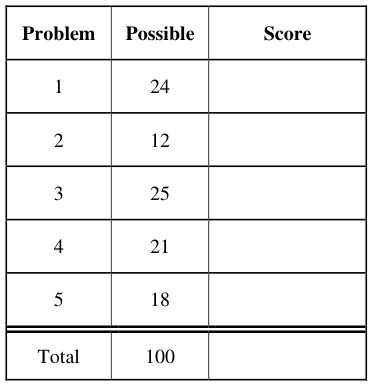

&emsp;Page 1/21

---

**Page 2**

CS 162 Fall 2008 Midterm Exam I        October 15, 2008

&emsp;&emsp;&emsp;&emsp;&emsp;&emsp;&emsp;&emsp;\[ This page left for π \]

&emsp;&emsp;&emsp;&emsp;3.141592653589793238462643383279502884197169399375105820974944

Page 2/21

---

**Page 3**

CS 162 Fall 2008 Midterm Exam I        October 15, 2008

### Problem 1: Short Answer \[24pts\]

### **Problem 1a\[2pts\]:** Give at least two reasons why the following implementation of a condition

variable is incorrect (assume that MySemi is a semaphore initialized to 0): 
Wait()     { MySemi.P(); } 
Signal() { MySemi.V(); }

### **Problem 1b\[4pts\]:** What is the difference between Mesa and Hoare scheduling for monitors?

Include passing of locks between signaler and signalee, scheduling of CPU resources, and impact 
on programmer.

### **Problem 1c\[3pts\]:** The SRTF algorithm requires knowledge of the future. Why is that? Name two

ways to approximate the information required to implement this algorithm.

### **Problem 1d\[3pt\]:** What is priority donation? What sort of information must the OS track to allow it

to perform priority donation?

Page 3/21

---

**Page 4**

CS 162 Fall 2008 Midterm Exam I        October 15, 2008

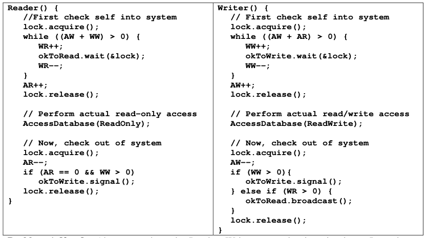

### **Problem 1e\[3pts\]:**  Above, we show the Readers-Writers example given in class.  It used two

condition variables, one for waiting readers and one for waiting writers. Suppose that all of the 
following requests arrive in very short order (while R1 and R2 are still executing): 
Incoming stream: R1 R2 W1 W2 R3 R4 R5 W3 R6 W4 W5 R7 R8 W6 R9 
In what order would the above code process the above requests? If you have a group of requests 
that are equivalent (unordered), indicate this clearly by surrounding them with braces ‘{}’.  You can 
assume that the wait queues for condition variables are FIFO in nature (i.e. signal() wakes up the 
oldest thread on the queue). Explain how you got your answer.

Page 4/21

---

**Page 5**

CS 162 Fall 2008 Midterm Exam I        October 15, 2008

### **Problem 1f\[4pts\]:**

Suppose that you were to redesign the code in (1e). What is the minimum number of condition 
variables that we would we need in order to handle the above requests in an order that guarantees 
that a read always returns the results of writes that have arrived before it but not after it? (Another 
way to say this is that the reads and writes occur in the order in which they arrive, while still 
allowing groups of reads that arrive together to occur simultaneously.) Provide a two or three 
sentence sketch of your scheme (do not try to write code!).

### **Problem 1g\[3pts\]:** What are exceptions? Name two different types of exceptions and give an

example of each type:

### **Problem 1h\[2pts\]:** What was the problem with the Therac-25? Your answer should involve one of

the topics of the class.

Page 5/21

---

**Page 6**

CS 162 Fall 2008 Midterm Exam I        October 15, 2008

### Problem 2: TRUE/FALSE \[12 pts\]

In the following, it is important that you EXPLAIN your answer in TWO SENTENCES OR LESS 
(Answers longer than this may not get credit!).  Also, answers without an explanation GET NO 
CREDIT.

### **Problem 2a\[2pts\]:**  The kernel on a multiprocessor can use the local disabling of interrupts (within

one CPU) to produce critical sections between the OSs on different CPUs. 
&emsp;&emsp;True / False 
Explain:

### **Problem 2b\[2pts\]:** When designing a multithreaded application, you must use synchronization

primitives to make sure that the threads do not overwrite each other’s registers. 
&emsp;&emsp;True / False 
Explain:

### **Problem 2c\[2pts\]:** A system that provides segmentation without paging can fragment the physical

address space, forcing the operating system to waste physical memory. 
&emsp;&emsp;True / False 
Explain:

### **Problem 2d\[2pts\]:** A user-level library implements each system call by first executing a “transition

to kernel mode” instruction. The library routine then calls an appropriate subroutine in the kernel. 
&emsp;&emsp;True / False 
Explain:

### **Problem 2e\[2pts\]:** The difference between processes and threads is purely historical.

&emsp;&emsp;True / False 
Explain:

### **Problem 2f\[2pts\]:** Round robin scheduling provides a latency improvement over FCFS scheduling

for interactive jobs. 
&emsp;&emsp;True / False 
Explain:

Page 6/21

---

**Page 7**

CS 162 Fall 2008 Midterm Exam I        October 15, 2008

&emsp;&emsp;&emsp;&emsp;&emsp;&emsp;&emsp;&emsp;\[ This page intentionally left blank \]

Page 7/21

---

**Page 8**

CS 162 Fall 2008 Midterm Exam I        October 15, 2008

### Problem 3: Atomic Synchronization Primitives \[25 pts\]

In class, we discussed a number of atomic hardware primitives that are available on modern 
architectures. In particular, we discussed “test and set” (TSET), SWAP, and “compare and swap” 
(CAS). They can be defined as follows (let “expr” be an expression, “&addr” be an address of a 
memory location, and “M\[addr\]” be the actual memory location at address addr):

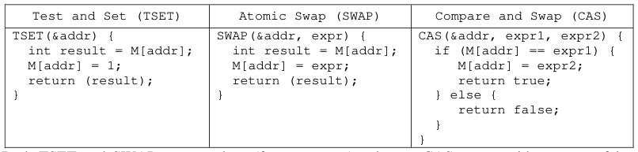

Both TSET and SWAP return values (from memory), whereas CAS returns either true or false. 
Note that our &addr notation is similar to a reference in c++, and means that the &addr argument 
must be something that can be stored into (an “lvalue”). For instance, TSET could be used to 
implement a spin-lock acquire as follows: 
&emsp;`int lock = 0; // lock is free` 
`// Later: acquire lock` 
`while (TSET(lock));` 
CAS is general enough as an atomic operation that it can be used to implement both TSET and 
SWAP. For instance, consider the following implementation of TSET with CAS: 
&emsp;`TSET(&addr) {` 
`int temp;` 
`do {` 
`temp = M[addr];` 
`} while (!CAS(addr,temp,1));` 
`return temp;` 
`}`

### **Problem 3a\[3pts\]:**

Show how to implement a spinlock acquire with a single while loop using CAS instead of TSET. 
You must only fill in the arguments to CAS below: 
`// Initialization` 
`int lock = 0; // Lock is free`

`// acquire lock` 
`while ( !CAS(           ,          ,         )`    `);`

Page 8/21

---

**Page 9**

CS 162 Fall 2008 Midterm Exam I        October 15, 2008

### **Problem 3b\[2pts\]:**

Show how SWAP can be implemented using CAS. Don’t forget the return value.

`SWAP(&addr, reg1) {`

`}`

### **Problem 3c\[3pts\]:**

With spinlocks, threads spin in a loop (busy waiting) until the lock is freed. In class we argued that 
spinlocks were a bad idea because they can waste a lot of processor cycles. The alternative is to put a 
waiting process to sleep while it is waiting for the lock (using a blocking lock). Contrary to what we 
implied in class, there are cases in which spinlocks would be more efficient than blocking locks. Give a 
circumstance in which this is true and explain why a spinlock is more efficient.

Page 9/21

---

**Page 10**

CS 162 Fall 2008 Midterm Exam I        October 15, 2008

An object such as a queue is considered “lock-free” if multiple processes can operate on this object 
simultaneously without requiring the use of locks, busy-waiting, or sleeping. In this problem, we 
are going to construct a lock-free FIFO queue using the atomic CAS operation. This queue needs 
both an `Enqueue` and `Dequeue` method. 
We are going to do this in a slightly different way than normally.  Rather than `Head` and `Tail` 
pointers, we are going to have “`PrevHead`” and `Tail` pointers.  `PrevHead` will point at the last 
object returned from the queue.  Thus, we can find the head of the queue (for dequeuing). If we 
don’t have to worry about simultaneous Enqueue or Dequeue operations, the code is 
straightforward (ignore the null-pointer exception for the Dequeue() operation for now):

`// Holding cell for an entry` 
`class QueueEntry {` 
`QueueEntry next = null;` 
`Object stored;` 
`QueueEntry(Object newobject) {` 
`stored = newobject;` 
`}` 
`}` 
`// The actual Queue (not yet lock free!)` 
`class Queue {` 
`QueueEntry prevHead = new QueueEntry(null);` 
`QueueEntry tail = prevHead;` 
`void Enqueue(Object newobject)  {` 
`QueueEntry newEntry = new QueueEntry(newobject);` 
`QueneEntry oldtail = tail;` 
`tail = newEntry;` 
`oldtail.next = newEntry;` 
`}` 
`Object Dequeue() {` 
`QueueEntry oldprevHead = prevHead;` 
`QueueEntry nextEntry = oldprevHead.next;` 
`prevHead = nextEntry;` 
`return nextEntry.stored;` 
`}` 
`}`

### **Problem 3d\[3pts\]:**

For this non-multithreaded code, draw the state of a queue with 2 queued items on it:

Page 10/21

---

**Page 11**

CS 162 Fall 2008 Midterm Exam I        October 15, 2008

### **Problem 3e\[3pts\]:**

For each of the following potential context switch points, state whether or not a context switch at that point 
could cause incorrect behavior of Enqueue(); Explain! 
`void Enqueue(Object newobject)  {` 
`1`    `QueueEntry newEntry = new QueueEntry(newobject);`

`2`    `QueueEntry oldtail = tail;` 
`3`    `tail = newEntry;` 
`oldtail.next = newEntry;` 
`}` 
Point 1:

Point 2:

Point 3:

### **Problem 3f\[4pts\]:**

Rewrite code for `Enqueue()`, using the `CAS()` operation, such that it will work for any number of 
simultaneous Enqueue and Dequeue operations.  You should never need to busy wait.  **Do not use locking** 
**(i.e. don’t use a test-and-set lock).** The solution is tricky but can be done in a few lines. We will be grading 
on conciseness. Do not use more than one `CAS()` or more than 10 lines total (including the function 
declaration at the beginning).  Hint: wrap a do-while around vulnerable parts of the code identified above. 
`void Enqueue(Object newobject)  {` 
`QueueEntry newEntry = new QueueEntry(newobject);` 
`// Insert code here`

`}`

Page 11/21

---

**Page 12**

CS 162 Fall 2008 Midterm Exam I        October 15, 2008

### **Problem 3g\[3pts\]:**

For each of the following potential context switch points, state whether or not a context switch at that point 
could cause incorrect behavior of Dequeue(); Explain!

`Object Dequeue() {` 
`1`    `QueueEntry oldprevHead = prevHead;`

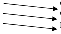

`2`    `QueueEntry nextEntry = oldprevHead.next;` 
`3`    `prevHead = nextEntry;` 
`return nextEntry.stored;` 
`}`

Point 1:

Point 2:

Point 3:

### **Problem 3h\[4pts\]:**

Rewrite code for `Dequeue()`, using the `CAS()` operation, such that it will work for any number of 
simultaneous Enqueue and Dequeue operations.  You should never need to busy wait.  **Do not use locking** 
**(i.e. don’t use a test-and-set lock).** The solution can be done in a few lines. We will be grading on 
conciseness. Do not use more than one `CAS()` or more than 10 lines total (including the function declaration 
at the beginning).  Hint: wrap a do-while around vulnerable parts of the code identified above. 
&emsp;`Object Dequeue() {` 
`// Insert code here`

`}`

Page 12/21

---

**Page 13**

CS 162 Fall 2008 Midterm Exam I        October 15, 2008

### Problem 4: Deadlock\[21 pts\]

### **Problem 4a\[5pts\]:**

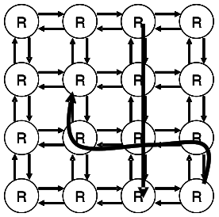

The figure at the right illustrates a 2D mesh of network routers. 
Each router is connected to each of its neighbors by two 
network links (small arrows), one in each direction. Messages 
are routed from a source router to a destination router and can 
stretch through the network (i.e. consume links along the route 
from source to destination). Messages can cross inside routers. 
&emsp;Assume that no network link can service more than one 
message at a time, and that each message must consume a 
continuous set of channels (like a snake). Messages always 
make progress to the destination and never wrap back on 
themselves. The figure shows two messages (thick arrows). 
&emsp;Assume that each router or link has a very small amount of buffer space and that each message 
can be arbitrarily long. Show a situation (with a drawing) in which messages are deadlocked and 
can make no further progress.  Explain how each of the four conditions of deadlock are satisfied by 
your example. Hint: Links are the limited resources in this example.

### **Problem 4b\[3pts\]:**

Define a routing policy that avoids deadlocks in the network of (4a). Name one of the four 
conditions that is no longer possible, given your routing policy. Explain.

### **Problem 4c\[3pts\]:**

Suppose that each router node contains sufficient queue space to hold complete messages (assume 
infinite space, if you like). Why is it impossible for deadlocks such as in (4a) to occur? Name one 
of  the four conditions that is no longer possible, given infinite queue space in the router. Explain.

Page 13/21

---

**Page 14**

CS 162 Fall 2008 Midterm Exam I        October 15, 2008

### **Problem 4d\[4pts\]:**

Suppose that we have the following resources: A, B, C and threads T1, T2, T3, T4.  The total 
number of each resource is:

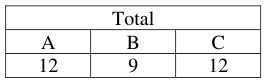

Further, assume that the processes have the following maximum requirements and current 
allocations:

Is the system in a safe state? If “yes”, show a non-blocking sequence of thread executions. 
Otherwise, provide a proof that the system is unsafe. Show all steps, intermediate matrices, etc.

Page 14/21

---

**Page 15**

CS 162 Fall 2008 Midterm Exam I        October 15, 2008

### **Problem 4e\[3pts\]:**

Assume that we start with a system in the state of (4d). Suppose that T1 asks for 2 more copies of 
resource A.  Can the system grant this if it wants to avoid deadlock? Explain.

### **Problem 4f\[3pts\]:**

Assume that we start with a system in the state of (4d). What is the maximum number of additional 
copies of resources (A, B, and C) that T1 can be granted in a single request without risking 
deadlock? Explain.

Page 15/21

---

**Page 16**

CS 162 Fall 2008 Midterm Exam I        October 15, 2008

&emsp;&emsp;&emsp;&emsp;&emsp;&emsp;&emsp;&emsp;\[ This page intentionally left blank \]

Page 16/21

---

**Page 17**

CS 162 Fall 2008 Midterm Exam I        October 15, 2008

### Problem 5: Address Translation \[18 pts\]

### **Problem 5a\[3pts\]:**

Suppose we have a 32-bit processor (with 32-bit virtual addresses) and 8 KB pages. Assume that it 
can address up to 2 TB (terabytes) of DRAM; 1TB = 1024 GB = (1024)2 MB. Assume that we need 
4 permissions bits in each page table entry (PTE), namely Valid (V), Writable (W), Accessed (A), 
and Dirty (D). Show the format of a PTE, assuming that each page should be able to hold an integer 
number of PTEs. If you have extra bits in the PTE, you can mark them as “unused”. Explain.

### **Problem 5b\[5pts\]:**

Assume that we wish to build a two-level page table for the processor from (5a) in which each piece 
of the page table consumes exactly a page (no more, no less). We may end up wasting space as a 
result. Draw and label a figure showing how a virtual address gets mapped into a physical address. 
Show the format of the page table (complete with access checks), the virtual address, and physical 
address. Minimize pieces of the page table that consume less than a page (and thus waste space).

.

Page 17/21

---

**Page 18**

CS 162 Fall 2008 Midterm Exam I        October 15, 2008

### **Problem 5c\[3pts\]:**

Consider a multi-level memory management scheme using the following format for virtual 
addresses:

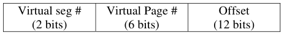

Virtual addresses are translated into physical addresses of the following form:

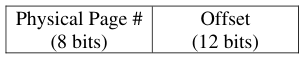

Page table entries (PTE) are 16 bits in the following format, stored in big-endian form in memory 
(i.e. the MSB is first byte in memory):

1\) How big is a page? Explain.

2\) What is the maximum amount of virtual memory supported by this scheme? Explain

3\) What is the maximum amount of physical memory supported by this scheme? Explain

### **Problem 5d\[7pts\]:** Assume the memory translation scheme from (5c). Use the Segment Table and

Physical Memory table given on the next page to predict what will happen with the following 
load/store instructions. Addresses are virtual. The return value for a load is an 8-bit data value or an 
error, while the return value for a store is either “**ok**” or an error. If there is an error, make sure to 
say which error. Possibilities are: “**bad segment**” (invalid segment), “**segment overflow**” (address 
outside range of segment), or “**access violation**” (page invalid, or attempt to write a read only 
page).  A few answers are given:

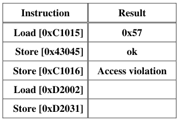

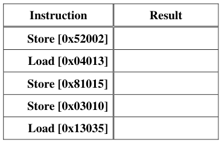

Page 18/21

---

**Page 19**

&emsp;CS 162 Fall 2008 Midterm Exam I        October 15, 2008

&emsp;&emsp;&emsp;&emsp;&emsp;&emsp;&emsp;&emsp;**Segment Table (Max Segment=3)**

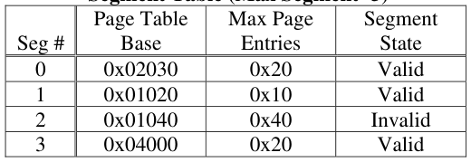

&emsp;&emsp;&emsp;&emsp;&emsp;&emsp;&emsp;&emsp;**Physical Memory**

&emsp;Page 19/21

---

**Page 20**

CS 162 Fall 2008 Midterm Exam I        October 15, 2008

&emsp;&emsp;&emsp;&emsp;&emsp;&emsp;&emsp;&emsp;\[ This page intentionally left blank \]

Page 20/21

---

**Page 21**

CS 162 Fall 2008 Midterm Exam I        October 15, 2008

&emsp;&emsp;&emsp;&emsp;&emsp;&emsp;&emsp;&emsp;\[ This page left for scratch \]

Page 21/21

