# Berkeley CS162 Fall 2008: Midterm 1: Official solutions

> Copied from the original: <https://hkn.eecs.berkeley.edu/exams/course/cs/162>. Text and figures are taken from the PDF as is; nothing was answered or rewritten. The original PDF is in this folder.

---

**Page 1**

&emsp;&emsp;&emsp;&emsp;&emsp;&emsp;&emsp;&emsp;University of California, Berkeley 
&emsp;&emsp;&emsp;&emsp;&emsp;&emsp;&emsp;&emsp;College of Engineering 
&emsp;&emsp;&emsp;&emsp;&emsp;&emsp;&emsp;&emsp;Computer Science Division ⎯ EECS 
&emsp;Fall 2008                John Kubiatowicz 
&emsp;&emsp;&emsp;&emsp;&emsp;&emsp;&emsp;&emsp;Midterm I 
&emsp;&emsp;&emsp;&emsp;&emsp;&emsp;&emsp;&emsp;SOLUTIONS 
&emsp;&emsp;&emsp;&emsp;&emsp;&emsp;&emsp;&emsp;October 15th, 2008 
&emsp;&emsp;&emsp;&emsp;&emsp;&emsp;&emsp;CS162: Operating Systems and Systems Programming

General Information: 
This is a **closed book** exam.  You are allowed 1 page of **hand-written** notes (both sides).  You 
have 3 hours to complete as much of the exam as possible. Make sure to read all of the questions 
first, as some of the questions are substantially more time consuming. 
Write all of your answers directly on this paper.  Make your answers as concise as possible. On 
programming questions, we will be looking for performance as well as correctness, so think through 
your answers carefully.  If there is something about the questions that you believe is open to 
interpretation, please ask us about it!

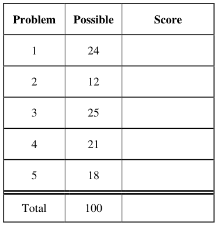

&emsp;Page 1/21

---

**Page 2**

CS 162 Fall 2008 Midterm Exam I        October 15, 2008

&emsp;&emsp;&emsp;&emsp;&emsp;&emsp;&emsp;&emsp;\[ This page left for π \]

&emsp;&emsp;&emsp;&emsp;3.141592653589793238462643383279502884197169399375105820974944

Page 2/21

---

**Page 3**

CS 162 Fall 2008 Midterm Exam I        October 15, 2008

### Problem 1: Short Answer \[24pts\]

### **Problem 1a\[2pts\]:** Give at least two reasons why the following implementation of a condition

variable is incorrect (assume that MySemi is a semaphore initialized to 0): 
Wait()     { MySemi.P(); } 
Signal() { MySemi.V(); } 
&emsp;Some answers: 
&emsp;&emsp;•    Semaphores are commutative, while condition variables are not.  Practically speaking, if 
&emsp;&emsp;&emsp;someone executes MySemi.V() followed by MySemi.P(), the latter will not wait. In contrast, 
&emsp;&emsp;&emsp;execution of Signal() before Wait() should have no impact on Wait(). 
&emsp;&emsp;• 
&emsp;&emsp;&emsp;The above implementation of Wait() will deadlock the system if it goes to sleep on MySemi.P() 
&emsp;&emsp;&emsp;(since it will go to sleep while holding the monitor lock).

### **Problem 1b\[4pts\]:** What is the difference between Mesa and Hoare scheduling for monitors?

Include passing of locks between signaler and signalee, scheduling of CPU resources, and impact 
on programmer. 
&emsp;For Mesa scheduling, the signaler keeps the lock and CPU, while the signaled thread is simply put on 
&emsp;the ready queue and will run at a later time. Further, a programmer with Mesa scheduled monitors must 
&emsp;recheck the condition after being awoken from a Wait() operation \[ i.e. they need a while loop around 
&emsp;the execution of Wait(). For Hoare scheduling, the signaler gives the lock and CPU to the signaled 
&emsp;thread which begins running until it releases the lock, at which point the signaler regains the lock and 
&emsp;CPU. A programmer with Hoare scheduled monitors does not need to recheck the condition after being 
&emsp;awoken, since they know that the code after the Wait() is executed immediately after the Signal() \[i.e. 
&emsp;they do not need a while loop around the execution of Wait()\].

### **Problem 1c\[3pts\]:** The SRTF algorithm requires knowledge of the future. Why is that? Name two

ways to approximate the information required to implement this algorithm. 
&emsp;SRTF stands for “Shortest Remaining Time First” and needs knowledge of the future to know which of 
&emsp;the threads on the ready queue will run for the shortest time. Ways to approximate this include: 
&emsp;&emsp;1\. Using a prediction mechanism like a Kalman filter or exponential filter to predict the future 
&emsp;&emsp;&emsp;given information about the past. 
&emsp;&emsp;2\. With a multi-level scheduler. Short tasks migrate to the top queue, while long ones migrate to 
&emsp;&emsp;&emsp;the bottom queue.

### **Problem 1d\[3pt\]:** What is priority donation? What sort of information must the OS track to allow it

to perform priority donation? 
&emsp;Priority donation is the process of avoiding priority inversion by giving (“donating”) priority from a 
&emsp;high-priority blocked thread to a lower-priority thread holding a lock needed by the high-priority 
&emsp;thread. The OS must keep trace of lock acquisition and release operations and associate them with 
&emsp;threads in order to perform this optimization.

Page 3/21

---

**Page 4**

CS 162 Fall 2008 Midterm Exam I        October 15, 2008

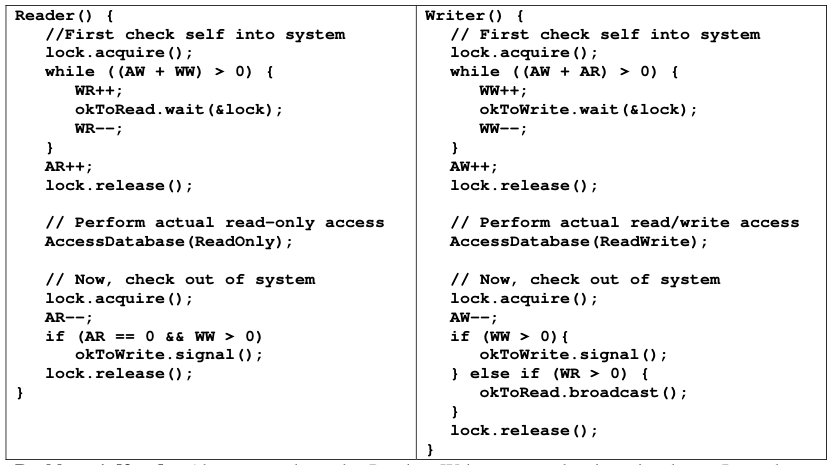

### **Problem 1e\[3pts\]:**  Above, we show the Readers-Writers example given in class.  It used two

condition variables, one for waiting readers and one for waiting writers. Suppose that all of the 
following requests arrive in very short order (while R1 and R2 are still executing): 
Incoming stream: R1 R2 W1 W2 R3 R4 R5 W3 R6 W4 W5 R7 R8 W6 R9 
In what order would the above code process the above requests? If you have a group of requests 
that are equivalent (unordered), indicate this clearly by surrounding them with braces ‘{}’.  You can 
assume that the wait queues for condition variables are FIFO in nature (i.e. signal() wakes up the 
oldest thread on the queue). Explain how you got your answer. 
&emsp;Assuming that the requests all come in during the processing of R1 and R2, then all of the Write requests 
&emsp;will be queued on `okToWrite` and all of the read requests will be queued on `okToRead`. On exit of R1 
&emsp;and R2, the above code will proceed to execute each of the write requests, one at a time, in the order in 
&emsp;which they arrived (see our assumption about the wait queues for the condition variables).  We know this 
&emsp;because both the `Reader()` and `Writer()` code on exit will signal the next waiting writer, if they 
&emsp;exist. After all of the writers are gone, the `Writer()` code will broadcast to wakeup all of the 
&emsp;`Readers()`, who will be able to run in parallel (see entry code of `Reader()`). 
&emsp;Answer: {R1, R2}, W1, W2, W3, W4, W5, W6, {R3, R4, R5, R6, R7, R8, R9}

Page 4/21

---

**Page 5**

CS 162 Fall 2008 Midterm Exam I        October 15, 2008

### **Problem 1f\[4pts\]:**

Suppose that you were to redesign the code in (1e). What is the minimum number of condition 
variables that we would we need in order to handle the above requests in an order that guarantees 
that a read always returns the results of writes that have arrived before it but not after it? (Another 
way to say this is that the reads and writes occur in the order in which they arrive, while still 
allowing groups of reads that arrive together to occur simultaneously.) Provide a two or three 
sentence sketch of your scheme (do not try to write code!). 
&emsp;We accepted a couple of answers here: 
&emsp;1\) The truly correct one is: 1! We only need a single condition variable on which to put threads to sleep. 
&emsp;We put the scheduling logic into a state variables manipulated by the monitor lock. Here, we assume that 
&emsp;each incoming request is assigned a sequentially increasing integer before it is put to sleep.  This allows 
&emsp;us to divide all of the requests into phases.  Each phase is either a read phase or a write phase and 
&emsp;includes a contiguous range of integers. When a new request arrives, we see whether it is compatible 
&emsp;(same type of request) with the phase at the end of the queue, in which case we increase the last integer 
&emsp;for that phase, or incompatible with the phase at the end of the queue, in which case we allocate a new 
&emsp;entry to the queue and place the new request into the new bin. 
&emsp;&emsp;This information is sufficient to allow us to schedule each phase sequentially.  If the head phase is a 
&emsp;read phase, we can wakeup all threads in that phase. If the head phase is a write phase, we can wake 
&emsp;them up one at a time. 
&emsp;2\) A less optimal solution (not the “minimum number”) would be to have a queue of condition variables, 
&emsp;one for each phase of threads (readers or writers). For each incoming request, you would check the last 
&emsp;phase – if it matches the request type, you would put the request to sleep on the condition variables at 
&emsp;the end of the queue. If it doesn’t match the request type, you would allocate a new condition variable to 
&emsp;place at the end of the queue (i.e. create a new phase).

### **Problem 1g\[3pts\]:** What are exceptions? Name two different types of exceptions and give an

example of each type: 
&emsp;Exceptions are interruptions in the flow of execution. There are two types of exceptions that we talked 
&emsp;about in class synchronous (traps) and and asynchronous (interrupts). Examples of synchronous 
&emsp;exceptions are: system calls, bad instruction exceptions, division by zero, page faults. Examples of 
&emsp;asynchronous exceptions are device interrupts of all sorts.

### **Problem 1h\[2pts\]:** What was the problem with the Therac-25? Your answer should involve one of

the topics of the class. 
&emsp;The Therac-25 was a medical device for doing radiation therapy. Due to race conditions in its software, 
&emsp;it ended up killing a number of patients through overdoses. Among other things, if the operator typed too 
&emsp;fast while setting up a radiation session, it would exhibit the bug.

Page 5/21

---

**Page 6**

CS 162 Fall 2008 Midterm Exam I        October 15, 2008

### Problem 2: TRUE/FALSE \[12 pts\]

In the following, it is important that you EXPLAIN your answer in TWO SENTENCES OR LESS 
(Answers longer than this may not get credit!).  Also, answers without an explanation GET NO 
CREDIT.

### **Problem 2a\[2pts\]:**  The kernel on a multiprocessor can use the local disabling of interrupts (within

one CPU) to produce critical sections between the OSs on different CPUs.

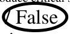

&emsp;&emsp;Explain: 
&emsp;&emsp;&emsp;&emsp;&emsp;&emsp;&emsp;&emsp;Disabling interrupts on one CPU doesn’t affect other CPUs. Consequently, other 
&emsp;&emsp;&emsp;&emsp;&emsp;&emsp;&emsp;&emsp;CPUs keep executing when a single one has interrupts disabled.

### **Problem 2b\[2pts\]:** When designing a multithreaded application, you must use synchronization

primitives to make sure that the threads do not overwrite each other’s registers.

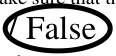

&emsp;&emsp;Explain: 
&emsp;&emsp;&emsp;&emsp;&emsp;&emsp;&emsp;&emsp;Registers are kept in the TCB and are private to each thread. Consequently, one 
&emsp;&emsp;&emsp;&emsp;&emsp;&emsp;&emsp;&emsp;thread will not overwrite another thread’s register under normal circumstances.

### **Problem 2c\[2pts\]:** A system that provides segmentation without paging can fragment the physical

address space, forcing the operating system to waste physical memory.

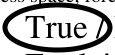

&emsp;&emsp;Explain: 
&emsp;&emsp;&emsp;&emsp;&emsp;&emsp;&emsp;&emsp;The physical chunks of memory are the same size as the virtual chunks of 
&emsp;&emsp;&emsp;&emsp;&emsp;&emsp;&emsp;&emsp;memory. Consequently, the physical address space can become fragmented as 
&emsp;&emsp;&emsp;&emsp;&emsp;&emsp;&emsp;&emsp;the OS attempts to fit segments into the physical address space.

### **Problem 2d\[2pts\]:** A user-level library implements each system call by first executing a “transition

to kernel mode” instruction. The library routine then calls an appropriate subroutine in the kernel.

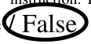

&emsp;&emsp;Explain: 
&emsp;&emsp;&emsp;&emsp;&emsp;&emsp;&emsp;&emsp;If this were true, user-level code could execute anything it wanted – a serious 
&emsp;&emsp;&emsp;&emsp;&emsp;&emsp;&emsp;&emsp;security violation. Instead, syscalls use a trap instruction that simultaneously 
&emsp;&emsp;&emsp;&emsp;&emsp;&emsp;&emsp;&emsp;changes to kernel mode and jumps to well-defined places in the kernel.

### **Problem 2e\[2pts\]:** The difference between processes and threads is purely historical.

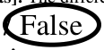

&emsp;&emsp;Explain: 
&emsp;&emsp;&emsp;&emsp;&emsp;&emsp;&emsp;&emsp;A process is a combination of an address space and a set of threads. Thus, 
&emsp;&emsp;&emsp;&emsp;&emsp;&emsp;&emsp;&emsp;threads are the execution context portion of a process.

### **Problem 2f\[2pts\]:** Round robin scheduling provides a latency improvement over FCFS scheduling

for interactive jobs.

&emsp;&emsp;Explain: 
&emsp;&emsp;&emsp;&emsp;&emsp;&emsp;&emsp;&emsp;By timeslicing jobs, RR scheduling avoids the problem FCFS in which interactive 
&emsp;&emsp;&emsp;&emsp;&emsp;&emsp;&emsp;&emsp;jobs can get stuck behind long-running jobs.

Page 6/21

---

**Page 7**

CS 162 Fall 2008 Midterm Exam I        October 15, 2008

&emsp;&emsp;&emsp;&emsp;&emsp;&emsp;&emsp;&emsp;\[ This page intentionally left blank \]

Page 7/21

---

**Page 8**

CS 162 Fall 2008 Midterm Exam I        October 15, 2008

### Problem 3: Atomic Synchronization Primitives \[25 pts\]

In class, we discussed a number of atomic hardware primitives that are available on modern 
architectures. In particular, we discussed “test and set” (TSET), SWAP, and “compare and swap” 
(CAS). They can be defined as follows (let “expr” be an expression, “&addr” be an address of a 
memory location, and “M\[addr\]” be the actual memory location at address addr):

Both TSET and SWAP return values (from memory), whereas CAS returns either true or false. 
Note that our &addr notation is similar to a reference in c++, and means that the &addr argument 
must be something that can be stored into (an “lvalue”). For instance, TSET could be used to 
implement a spin-lock acquire as follows: 
&emsp;`int lock = 0; // lock is free` 
`// Later: acquire lock` 
`while (TSET(lock));` 
CAS is general enough as an atomic operation that it can be used to implement both TSET and 
SWAP. For instance, consider the following implementation of TSET with CAS: 
&emsp;`TSET(&addr) {` 
`int temp;` 
`do {` 
`temp = M[addr];` 
`} while (!CAS(addr,temp,1));` 
`return temp;` 
`}`

### **Problem 3a\[3pts\]:**

Show how to implement a spinlock acquire with a single while loop using CAS instead of TSET. 
You must only fill in the arguments to CAS below: 
`// Initialization` 
`int lock = 0; // Lock is free`

`// acquire lock` 
`while ( !CAS(`    `lock`     `,`     `0`     `,`    `1`     `) );`

Page 8/21

---

**Page 9**

CS 162 Fall 2008 Midterm Exam I        October 15, 2008

### **Problem 3b\[2pts\]:**

Show how SWAP can be implemented using CAS. Don’t forget the return value.

`SWAP(&addr, reg1) {`

`Object return;` 
`do {` 
`return = M[addr];` 
`} while (!CAS(addr, return, reg1));`

`}`

### **Problem 3c\[3pts\]:**

With spinlocks, threads spin in a loop (busy waiting) until the lock is freed. In class we argued that 
spinlocks were a bad idea because they can waste a lot of processor cycles. The alternative is to put a 
waiting process to sleep while it is waiting for the lock (using a blocking lock). Contrary to what we 
implied in class, there are cases in which spinlocks would be more efficient than blocking locks. Give a 
circumstance in which this is true and explain why a spinlock is more efficient. 
&emsp;If the expected wait time of the lock is very short (such as because the lock is rarely contested or the 
&emsp;critical sections are very short), then it is possible that a spin lock will waste many fewer cycles than 
&emsp;putting threads to sleep/waking them up. The important issue is that the expected wait time must be less 
&emsp;than the time to put a thread to sleep and wake it up. 
&emsp;Short expected wait times are possible to capitalize on, for instance, in a multiprocessor because waiting 
&emsp;threads can be stalled on other processors while the lock-holder makes progress. Spin-locks are much 
&emsp;less useful in a uniprocessor because the lock-holder is sleeping while the waiter is spinning. 
&emsp;Some people mentioned I/O.  However, you would have had to come up with a specific example of locks 
&emsp;in use between a thread and an I/O operation as well as mentioned interrupts for releasing the lock. 
&emsp;We were looking for mention of (1) expected wait time being important, (2) the length of time for putting 
&emsp;locks to sleep relative to the expected wait time of the lock, (3) a viable scenario such as a 
&emsp;multiprocessor.

Page 9/21

---

**Page 10**

CS 162 Fall 2008 Midterm Exam I        October 15, 2008

An object such as a queue is considered “lock-free” if multiple processes can operate on this object 
simultaneously without requiring the use of locks, busy-waiting, or sleeping. In this problem, we 
are going to construct a lock-free FIFO queue using the atomic CAS operation. This queue needs 
both an `Enqueue` and `Dequeue` method. 
We are going to do this in a slightly different way than normally.  Rather than `Head` and `Tail` 
pointers, we are going to have “`PrevHead`” and `Tail` pointers.  `PrevHead` will point at the last 
object returned from the queue.  Thus, we can find the head of the queue (for dequeuing). If we 
don’t have to worry about simultaneous Enqueue or Dequeue operations, the code is 
straightforward (ignore the null-pointer exception for the Dequeue() operation for now):

`// Holding cell for an entry` 
`class QueueEntry {` 
`QueueEntry next = null;` 
`Object stored;` 
`QueueEntry(Object newobject) {` 
`stored = newobject;` 
`}` 
`}` 
`// The actual Queue (not yet lock free!)` 
`class Queue {` 
`QueueEntry prevHead = new QueueEntry(null);` 
`QueueEntry tail = prevHead;` 
`void Enqueue(Object newobject)  {` 
`QueueEntry newEntry = new QueueEntry(newobject);` 
`QueneEntry oldtail = tail;` 
`tail = newEntry;` 
`oldtail.next = newEntry;` 
`}` 
`Object Dequeue() {` 
`QueueEntry oldprevHead = prevHead;` 
`QueueEntry nextEntry = oldprevHead.next;` 
`prevHead = nextEntry;` 
`return nextEntry.stored;` 
`}` 
`}`

### **Problem 3d\[3pts\]:**

For this non-multithreaded code, draw the state of a queue with 2 queued items on it: 
&emsp;&emsp;&emsp;tailprevHeadprevHead   tail

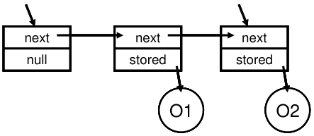

Page 10/21

---

**Page 11**

CS 162 Fall 2008 Midterm Exam I        October 15, 2008

### **Problem 3e\[3pts\]:**

For each of the following potential context switch points, state whether or not a context switch at that point 
could cause incorrect behavior of Enqueue(); Explain! 
`void Enqueue(Object newobject)  {` 
`1`    `QueueEntry newEntry = new QueueEntry(newobject);`

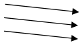

`2`    `QueueEntry oldtail = tail;` 
`3`    `tail = newEntry;` 
`oldtail.next = newEntry;` 
`}` 
Point 1: No. Construction of a QueueEntry is a purely local operation (and does not touch shared state in 
&emsp;&emsp;&emsp;any way). 
Point 2: Yes. An intervening Enqueue() operation will move the shared variable “tail” (and enqueue 
&emsp;&emsp;&emsp;another object). As a result, the subsequent “tail=newEntry” will overwrite the other entry. 
Point 3: No.  At this point in the execution, only the local thread will ever touch “oldtail.next” (since we 
&emsp;&emsp;&emsp;have moved the tail). Thus, we can reconnect at will.  People who worried that the linked list is 
&emsp;&emsp;&emsp;“broken” until this operation can relax. The worse that will happen is that the list appears to be 
&emsp;&emsp;&emsp;shorter than it actually is until execution of “oldtail.next=newEntry,” at which point the new entry 
&emsp;&emsp;&emsp;becomes available for subsequent dequeue.

### **Problem 3f\[4pts\]:**

Rewrite code for `Enqueue()`, using the `CAS()` operation, such that it will work for any number of 
simultaneous Enqueue and Dequeue operations.  You should never need to busy wait.  **Do not use locking** 
**(i.e. don’t use a test-and-set lock).** The solution is tricky but can be done in a few lines. We will be grading 
on conciseness. Do not use more than one `CAS()` or more than 10 lines total (including the function 
declaration at the beginning).  Hint: wrap a do-while around vulnerable parts of the code identified above. 
`void Enqueue(Object newobject)  {` 
`QueueEntry newEntry = new QueueEntry(newobject);` 
`// Insert code here` 
`// Here, ‘tail’ is the shared variable that needs to be` 
`// protected by CAS. We must atomically swap in ‘newEntry’` 
`// to ‘tail’, giving us the old value so that we can link` 
`// it to the new item.` 
`QueueEntry oldtail;` 
`do {` 
`oldtail = tail;`    `// Tentative pointer to tail` 
`} while {!CAS(tail,oldtail,newEntry);` 
`oldtail.net = newEntry;`

`}`

Page 11/21

---

**Page 12**

CS 162 Fall 2008 Midterm Exam I        October 15, 2008

### **Problem 3g\[3pts\]:**

For each of the following potential context switch points, state whether or not a context switch at that point 
could cause incorrect behavior of Dequeue(); Explain!

`Object Dequeue() {` 
`1`    `QueueEntry oldprevHead = prevHead;`

`2`    `QueueEntry nextEntry = oldprevHead.next;` 
`3`    `prevHead = nextEntry;` 
`return nextEntry.stored;` 
`}`

Point 1: Yes. The problem is that an intervening Dequeue() could end up getting the same entry ‘nextEntry’ 
&emsp;&emsp;&emsp;that we are returning; consequently we end up dequeing the same entry multiple times. 
Point 2: Yes. The problem is that an intervening Dequeue() could end up getting the same entry ‘nextEntry’ 
&emsp;&emsp;&emsp;that we are returning; consequently we end up dequeing the same entry multiple times. 
Point 3: No. The nextEntry has already been detached from the queue and is purely local. Thus, all that we 
&emsp;&emsp;&emsp;are doing is removing the stored value from nextEntry for returning it.

### **Problem 3h\[4pts\]:**

Rewrite code for `Dequeue()`, using the `CAS()` operation, such that it will work for any number of 
simultaneous Enqueue and Dequeue operations.  You should never need to busy wait.  **Do not use locking** 
**(i.e. don’t use a test-and-set lock).** The solution can be done in a few lines. We will be grading on 
conciseness. Do not use more than one `CAS()` or more than 10 lines total (including the function declaration 
at the beginning).  Hint: wrap a do-while around vulnerable parts of the code identified above. 
&emsp;`Object Dequeue() {` 
`// Insert code here` 
`// Here, ‘prevHead’ is the shared variable that needs to be` 
`// protected by CAS. We must atomically grab the value of` 
`// prevHead.next and swap it into prevHead. The CAS lets` 
`// us do this operation by making sure that prevHead is` 
`// still equal to oldprevHead at the time that we swap` 
`// in prevHead.next. Note that we have included a check to` 
`// handle empty queues (not required for your solution)` 
`QueueEntry oldprevHead, nextEntry;` 
`do {` 
`oldprevHead = prevHead;` 
`nextEntry = oldprevHead.next;` 
`if (nextEntry == null) // handle empty queue (not required` 
`return null;`    `// for your solution)` 
`} while (!CAS(prevHead, oldprevHead, nextEntry));` 
`return oldprevHead.stored;` 
`}`

Page 12/21

---

**Page 13**

CS 162 Fall 2008 Midterm Exam I        October 15, 2008

### Problem 4: Deadlock\[21 pts\]

### **Problem 4a\[5pts\]:**

The figure at the right illustrates a 2D mesh of network routers. 
Each router is connected to each of its neighbors by two 
network links (small arrows), one in each direction. Messages 
are routed from a source router to a destination router and can 
stretch through the network (i.e. consume links along the route 
from source to destination). Messages can cross inside routers. 
&emsp;Assume that no network link can service more than one 
message at a time, and that each message must consume a 
continuous set of channels (like a snake). Messages always 
make progress to the destination and never wrap back on 
themselves. The figure shows two messages (thick arrows). 
&emsp;Assume that each router or link has a very small amount of buffer space and that each message 
can be arbitrarily long. Show a situation (with a drawing) in which messages are deadlocked and 
can make no further progress.  Explain how each of the four conditions of deadlock are satisfied by 
your example. Hint: Links are the limited resources in this example.

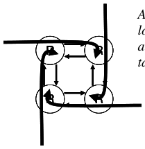

&emsp;&emsp;&emsp;&emsp;&emsp;&emsp;&emsp;&emsp;Answer: The simplest deadlock example is a set of four messages in a 
&emsp;&emsp;&emsp;&emsp;&emsp;&emsp;&emsp;&emsp;loop (as shown in the figure at the left). Each message is blocked 
&emsp;&emsp;&emsp;&emsp;&emsp;&emsp;&emsp;&emsp;attempting to make a counter-clockwise turn by a message utilizing the 
&emsp;&emsp;&emsp;&emsp;&emsp;&emsp;&emsp;&emsp;target channel. Four conditions: 
&emsp;&emsp;&emsp;&emsp;&emsp;&emsp;&emsp;&emsp;1\. Mutual Exclusion: Each channel held by one message at a time 
&emsp;&emsp;&emsp;&emsp;&emsp;&emsp;&emsp;&emsp;2\. Hold and Wait: messages hold channels while waiting to acquire 
&emsp;&emsp;&emsp;&emsp;&emsp;&emsp;&emsp;&emsp;other channels 
&emsp;&emsp;&emsp;&emsp;&emsp;&emsp;&emsp;&emsp;3\. No preemption: Channels can not be preempted from messages 
&emsp;&emsp;&emsp;&emsp;&emsp;&emsp;&emsp;&emsp;after they are acquired by them 
&emsp;&emsp;&emsp;&emsp;&emsp;&emsp;&emsp;&emsp;4\. Circular wait: We have a cycle of waiting here – four messages

### **Problem 4b\[3pts\]:**

Define a routing policy that avoids deadlocks in the network of (4a). Name one of the four 
conditions that is no longer possible, given your routing policy. Explain. 
&emsp;Several answers are possible here.  The one given in class was to force messages to route in the 
&emsp;X direction first, then Y.  This removes the possibility of Circular Wait because it is no longer 
&emsp;possible to have the North→East or South→West turns which would be required in any loop.

### **Problem 4c\[3pts\]:**

Suppose that each router node contains sufficient queue space to hold complete messages (assume 
infinite space, if you like). Why is it impossible for deadlocks such as in (4a) to occur? Name one 
of  the four conditions that is no longer possible, given infinite queue space in the router. Explain. 
&emsp;Deadlocks can no longer occur as in (4a) because blocked messages simply absorb into the 
&emsp;queues at the blocking router – thereby freeing up the channels held by them. Clearlyt Hold and 
&emsp;Wait is no longer possible (messages do not hold channels while waiting for others). You might 
&emsp;be able to argue that Circular wait is no longer possible (any cycle would be transient).

Page 13/21

---

**Page 14**

CS 162 Fall 2008 Midterm Exam I        October 15, 2008

### **Problem 4d\[4pts\]:**

Suppose that we have the following resources: A, B, C and threads T1, T2, T3, T4.  The total 
number of each resource is:

Further, assume that the processes have the following maximum requirements and current 
allocations:

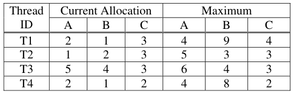

Is the system in a safe state? If “yes”, show a non-blocking sequence of thread executions. 
Otherwise, provide a proof that the system is unsafe. Show all steps, intermediate matrices, etc. 
&emsp;Answer: Yes, this system is in a safe state.

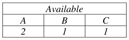

&emsp;To prove this, we first compute the currently free allocations:

&emsp;Further, we compute the number needed by each thread (Maximum – Current Allocation):

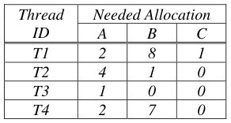

&emsp;Thus, we can see that a possible sequence is: T3, T2, T4, T1:

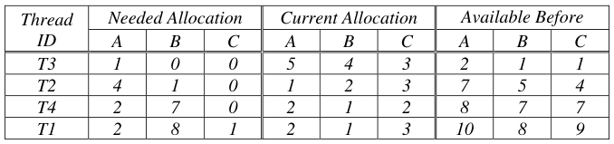

Page 14/21

---

**Page 15**

CS 162 Fall 2008 Midterm Exam I        October 15, 2008

### **Problem 4e\[3pts\]:**

Assume that we start with a system in the state of (4d). Suppose that T1 asks for 2 more copies of 
resource A.  Can the system grant this if it wants to avoid deadlock? Explain. 
&emsp;No.  This cannot be granted.  Assume that T1 gets 2 more of A. 
&emsp;Then, our available allocation is:

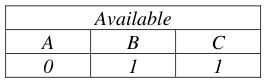

&emsp;Then, looking at our needed allocations, we see:

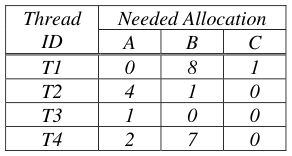

&emsp;At this point, the available allocation is insufficient to start any of the threads, much less find a 
&emsp;safe sequence that finishes all of them.

### **Problem 4f\[3pts\]:**

Assume that we start with a system in the state of (4d). What is the maximum number of additional 
copies of resources (A, B, and C) that T1 can be granted in a single request without risking 
deadlock? Explain.

&emsp;We cannot ask for more than (A,B,C)=(2,1,1) since this is all that is available. However, the 
&emsp;previous problem showed that A must be \< 2. Further, note that the resources given to T1 are 
&emsp;tied up until the very end of the execution (look at sequence in 4d). 
&emsp;Thus, looking at our safe sequence from 4d, we can see that it can still work if it is missing one 
&emsp;A and one C. Just work through it with the first “Available Before” allocation of 1,1,0 instead 
&emsp;of 2,1,1. However, it will not work if it is missing one more B (we would be unable to execute T4 
&emsp;in the sequence), i.e. setting “Available Before” to 1,0,0 prevents the execution of T4. 
&emsp;Thus the maximum number of additional resources that can be requested by T1 is 
&emsp;(A,B,C)=(1,0,1)

Page 15/21

---

**Page 16**

CS 162 Fall 2008 Midterm Exam I        October 15, 2008

&emsp;&emsp;&emsp;&emsp;&emsp;&emsp;&emsp;&emsp;\[ This page intentionally left blank \]

Page 16/21

---

**Page 17**

CS 162 Fall 2008 Midterm Exam I        October 15, 2008

### Problem 5: Address Translation \[18 pts\]

### **Problem 5a\[3pts\]:**

Suppose we have a 32-bit processor (with 32-bit virtual addresses) and 8 KB pages. Assume that it 
can address up to 2 TB (terabytes) of DRAM; 1TB = 1024 GB = (1024)2 MB. Assume that we need 
4 permissions bits in each page table entry (PTE), namely Valid (V), Writable (W), Accessed (A), 
and Dirty (D). Show the format of a PTE, assuming that each page should be able to hold an integer 
number of PTEs. If you have extra bits in the PTE, you can mark them as “unused”. Explain. 
&emsp;Since the PTE must have sufficient bits to address all of the physical pages, we must ask how 
&emsp;many physical pages there are.  2TB = 2×(1024)4=2×240=241.  Total number of pages = 
&emsp;2TB/8KB = 241/213= 228 Consequently, we need 28 bits in the PTE for the physical page 
&emsp;number.  With the 4 other bits, this leads us to a 32 bit PTE (which fits an integral number of 
&emsp;times in an 8KB page (with no wasted bits). Our PTE looks like (bits in any order):

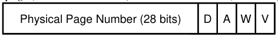

&emsp;&emsp;&emsp;&emsp;&emsp;&emsp;&emsp;&emsp;32 Bits32 Bits

### **Problem 5b\[5pts\]:**

Assume that we wish to build a two-level page table for the processor from (5a) in which each piece 
of the page table consumes exactly a page (no more, no less). We may end up wasting space as a 
result. Draw and label a figure showing how a virtual address gets mapped into a physical address. 
Show the format of the page table (complete with access checks), the virtual address, and physical 
address. Minimize pieces of the page table that consume less than a page (and thus waste space). 
&emsp;Looking at the virtual address, we see that there are 32 – 13 bits = 19 bits of virtual page 
&emsp;number that we need to translate into a physical page number. Each page can hold 8KB/4 = 
&emsp;2048 PTEs.  Thus, one level of the page table can translate 11 bits.  Thus, our 19 bit address 
&emsp;can be divided into an 11 bit piece and an 8 bit piece. Thus, one level of our page table will only 
&emsp;have 256 entries in it, even though we could fit 2048.  To avoid wasting too much space, we will 
&emsp;put the 256 entry chunk into the top-level of the page table (this way we waste a single chunk of 
&emsp;size \[8KB - 256×4\]=7168 bytes). If we put the small chunks at the lower-levels of the page 
&emsp;table, we would waste 2048 \* 7168 bytes. 
&emsp;&emsp;&emsp;&emsp;&emsp;&emsp;&emsp;&emsp;Virtual AddressVirtual Address

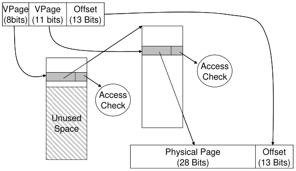

.

&emsp;&emsp;&emsp;&emsp;&emsp;&emsp;&emsp;&emsp;Physical AddressPhysical Address 
Page 17/21

---

**Page 18**

CS 162 Fall 2008 Midterm Exam I        October 15, 2008

### **Problem 5c\[3pts\]:**

Consider a multi-level memory management scheme using the following format for virtual 
addresses:

Virtual addresses are translated into physical addresses of the following form:

Page table entries (PTE) are 16 bits in the following format, stored in big-endian form in memory 
(i.e. the MSB is first byte in memory):

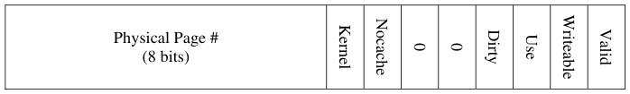

1\) How big is a page? Explain. 
&emsp;We just have to look at the offset of 12 bits. Since 212= 4096, thus pages are 4096 bytes in size. 
2\) What is the maximum amount of virtual memory supported by this scheme? Explain 
&emsp;Since virtual addresses are 20 bits, the maximum amount of virtual memory is 220 =1MB 
3\) What is the maximum amount of physical memory supported by this scheme? Explain 
&emsp;Since physical addresses are 20 bits, the maximum amount of physical memory is 220= 1MB

### **Problem 5d\[7pts\]:** Assume the memory translation scheme from (5c). Use the Segment Table and

Physical Memory table given on the next page to predict what will happen with the following 
load/store instructions. Addresses are virtual. The return value for a load is an 8-bit data value or an 
error, while the return value for a store is either “**ok**” or an error. If there is an error, make sure to 
say which error. Possibilities are: “**bad segment**” (invalid segment), “**segment overflow**” (address 
outside range of segment), or “**access violation**” (page invalid, or attempt to write a read only 
page).  A few answers are given:

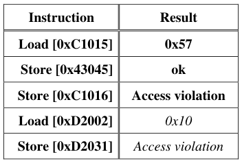

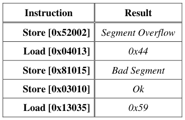

Page 18/21

---

**Page 19**

&emsp;CS 162 Fall 2008 Midterm Exam I        October 15, 2008

&emsp;&emsp;&emsp;&emsp;&emsp;&emsp;&emsp;&emsp;**Segment Table (Max Segment=3)**

&emsp;&emsp;&emsp;&emsp;&emsp;&emsp;&emsp;&emsp;**Physical Memory**

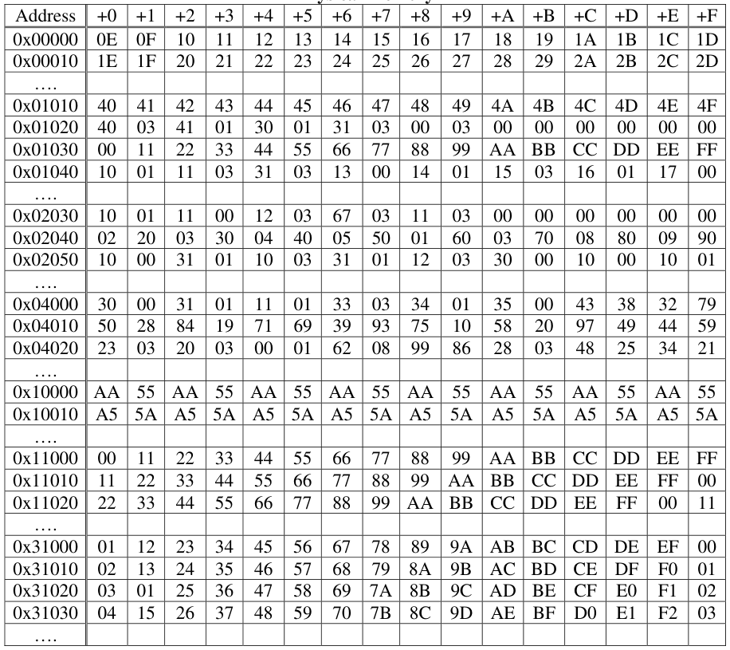

&emsp;Page 19/21

---

**Page 20**

CS 162 Fall 2008 Midterm Exam I        October 15, 2008

&emsp;&emsp;&emsp;&emsp;&emsp;&emsp;&emsp;&emsp;\[ This page intentionally left blank \]

Page 20/21

---

**Page 21**

CS 162 Fall 2008 Midterm Exam I        October 15, 2008

&emsp;&emsp;&emsp;&emsp;&emsp;&emsp;&emsp;&emsp;\[ This page left for scratch \]

Page 21/21

