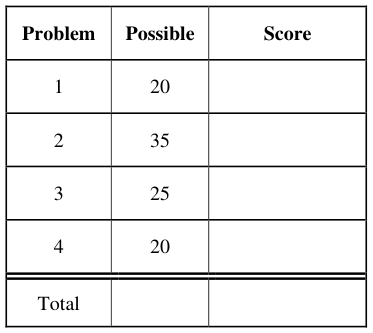
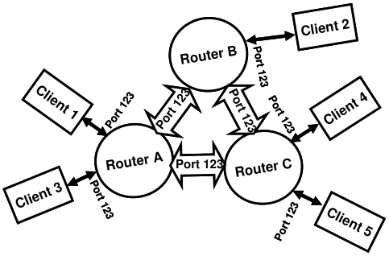
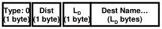
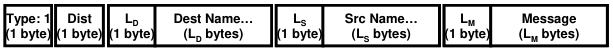
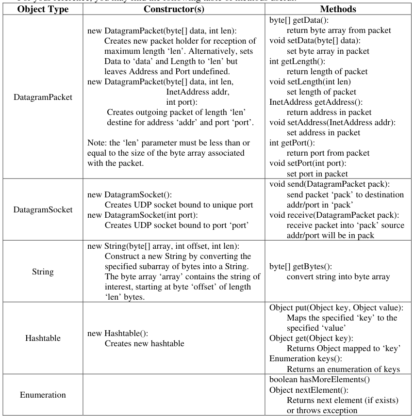

# Berkeley CS162 Fall 2008: Midterm 2: Questions

> Copied from the original: <https://hkn.eecs.berkeley.edu/exams/course/cs/162>. Text and figures are taken from the PDF as is; nothing was answered or rewritten. The original PDF is in this folder.

---

**Page 1**

&emsp;&emsp;&emsp;&emsp;&emsp;&emsp;&emsp;&emsp;University of California, Berkeley 
&emsp;&emsp;&emsp;&emsp;&emsp;&emsp;&emsp;&emsp;College of Engineering 
&emsp;&emsp;&emsp;&emsp;&emsp;&emsp;&emsp;&emsp;Computer Science Division ⎯ EECS 
&emsp;Fall 2008                John Kubiatowicz 
&emsp;&emsp;&emsp;&emsp;&emsp;&emsp;&emsp;&emsp;Midterm II 
&emsp;&emsp;&emsp;&emsp;&emsp;&emsp;&emsp;&emsp;December 3rd, 2008 
&emsp;&emsp;&emsp;&emsp;&emsp;&emsp;&emsp;CS162: Operating Systems and Systems Programming

General Information: 
This is a **closed book** exam.  You are allowed 1 page of **hand-written** notes (both sides).  You 
have 3 hours to complete as much of the exam as possible. Make sure to read all of the questions 
first, as some of the questions are substantially more time consuming. 
Write all of your answers directly on this paper.  Make your answers as concise as possible. On 
programming questions, we will be looking for performance as well as correctness, so think through 
your answers carefully.  If there is something about the questions that you believe is open to 
interpretation, please ask us about it!

&emsp;Page 1/21

---

**Page 2**

CS 162 Fall 2008 Midterm Exam II December 3rd, 2008

&emsp;&emsp;&emsp;&emsp;&emsp;&emsp;&emsp;&emsp;\[ This page left for π \]

&emsp;&emsp;&emsp;&emsp;3.141592653589793238462643383279502884197169399375105820974944

Page 2/21

---

**Page 3**

CS 162 Fall 2008 Midterm Exam II December 3rd, 2008

### Problem 1: True/False \[20 pts\]

In the following, it is important that you EXPLAIN your answer in TWO SENTENCES OR LESS 
(Answers longer than this may not get credit!).  Also, answers without an explanation GET NO 
CREDIT.

### **Problem 1a\[2pts\]:**  The limitation of 65536 ports for UDP and TCP reflects an inherent limitation

of the underlying IP datagram protocol. 
&emsp;&emsp;True / False 
Explain:

### **Problem 1b\[2pts\]:** For disks with constant areal bit density (bits stored/unit area of disk media),

the disk head reads bits at a different rate on the outer tracks than on the inner tracks. 
&emsp;&emsp;True / False 
Explain:

### **Problem 1c\[2pts\]:** The queueing equations given in class cannot be used to analyze the transient

behavior of a website that is suddenly popular, i.e. used to compute waiting times at the moment 
that people start arriving. 
&emsp;&emsp;True / False 
Explain:

### **Problem 1d\[2pts\]:**  The VFS layer handles journaling for Very Large File Systems.

&emsp;&emsp;True / False 
Explain:

### **Problem 1e\[2pts\]:** A RAID 5 system can handle more than one disk failure at a time.

&emsp;&emsp;True / False 
Explain:

Page 3/21

---

**Page 4**

CS 162 Fall 2008 Midterm Exam II December 3rd, 2008

### **Problem 1f\[2pts\]:** The NFS file service requires client state to be maintained at the server.

&emsp;&emsp;True / False 
Explain:

### **Problem 1g\[2pts\]:** TLB lookup (i.e. address translation) must occur prior to checking for data in

the first-level cache. 
&emsp;&emsp;True / False 
Explain:

### **Problem 1h\[2pts\]:** The clock algorithm provides an approximation to a least-recently used (LRU)

page replacement mechanism. 
&emsp;&emsp;True / False 
Explain:

### **Problem 1i\[2pts\]:** The bottom half of a device driver responds to interrupts from the device.

&emsp;&emsp;True / False 
Explain:

### **Problem 1j\[2pts\]:** DNS is a centralized service for translating user-readable names into IP

addresses. 
&emsp;&emsp;True / False 
Explain:

Page 4/21

---

**Page 5**

CS 162 Fall 2008 Midterm Exam II December 3rd, 2008

### Problem 2: Peer-to-Peer Instant Messaging \[35pts\]

&emsp;This problem will investigate the construction of a peer-to-peer communication network built. 
We will utilize instant messaging as our application on top of this network. As you see by the above 
figure, clients connect with individual routers.  Messages transit from a source client to a 
destination client via one or more hops through a router. 
&emsp;In order to make this Instant Messaging client particularly user friendly, we will address 
messages to usernames (that are strings), rather than to IP addresses.  This means that the job of the 
routers is to propagate information about usernames so that messages can be properly routed. 
&emsp;When they first start up, clients will chose a router with which to connect. We will call this 
router the “home router” for the client. The client will then send a “route announcement” message 
to its home router containing the client’s username. The home router will forward these 
announcements to other routers and other clients. Further, the home router will send the identities of 
clients that it knows about to the new client. 
&emsp;To send an Instant Message, a client will produce a packet that includes the username of the 
destination client, their own username (i.e. the source), and a message string. They will transmit this 
message to their home router. The message will be forwarded along the shortest path through 
routers to the message destination. 
&emsp;It is important to note that clients are only allowed to communicate with their home routers, not 
other routers or clients. 
&emsp;&emsp;&emsp;&emsp;&emsp;&emsp;&emsp;&emsp;**3115 1600**   **15 16**   **31** 
&emsp;&emsp;&emsp;&emsp;**IP Ver4IP Ver4**

&emsp;&emsp;&emsp;&emsp;**Time toTime toIP headerIP header** 
&emsp;&emsp;&emsp;&emsp;&emsp;&emsp;&emsp;&emsp;**20 bytes20 bytes** 
&emsp;&emsp;&emsp;&emsp;**Live (hops)Live (hops)** 
&emsp;&emsp;&emsp;&emsp;&emsp;&emsp;&emsp;&emsp;**UDP headerUDP header** 
&emsp;&emsp;&emsp;&emsp;&emsp;&emsp;&emsp;&emsp;**8 bytes8 bytes**

&emsp;We will use UDP/IP for our implementation. The packet format is shown above. UDP/IP 
communication is connectionless. To communicate on a given port, an application simply binds a 
socket to that port, after which it can immediately begin sending and receiving messages on that

Page 5/21

---

**Page 6**

CS 162 Fall 2008 Midterm Exam II December 3rd, 2008

port. Our Instant Message Routers utilize **UDP port 123** for messages from clients and other 
routers.  Clients pick a unique port for their communications. This means that each IP address can 
host a single router, but that multiple clients can coexist on the same IP address. 
&emsp;Our system needs two message types. The data for these messages will be stored in the UDP 
data portion of the UDP datagram. The first byte of the data distinguishes the message type.  Type 0 
is a route advertisement, while Type 1 is an actual Instant Message:

&emsp;&emsp;&emsp;RouteRoute 
&emsp;Advertisement:Advertisement:

&emsp;&emsp;&emsp;InstantInstant 
&emsp;&emsp;Message:Message:

Remember that the UDP/IP header also contains information about which IP address and port was 
the source of the message. 
&emsp;Although we are not going to fully implement our server, we are going to explore the route 
advertisement and routing process in greater detail.

### **Problem 2a\[3pts\]:** What minimum information must be in the routing table of each router and how

should it be indexed to allow Instant Messages to be routed to their destination without 
broadcasting? Explain the process of routing a message to its destination.

### **Problem 2b\[3pts\]:** Assume that the routers are connected in a way that contains cycles (such as

shown above), that routers never crash, and that routers are booted before clients. What is the 
simplest way for routers to handle route advertisement messages so as to produce routing tables that 
route Instant Messages to their destinations without routing them in cycles?  Explain carefully.

Page 6/21

---

**Page 7**

CS 162 Fall 2008 Midterm Exam II December 3rd, 2008

### **Problem 2c\[3pts\]:** Now assume that our goal is to route Instant Messages with the fewest number

of hops, and that some routers may boot after clients (adding shorter paths, for instance). We will 
use the ‘Dist’ parameter of route advertisement messages (Type=0) to indicate how many hops we 
have traveled from the client that we are advertising. Explain how the route advertisement messages 
will propagate through the system (be explicit) and what additional information you will keep in the 
routing tables. Be explicit.

### **Problem 2d\[2pts\]:** What should happen when a new connection between two routers is initiated?

Your answer should be consistent with (2c).

### **Problem 2e\[2pts\]:** Explain how we can utilize the ‘Dist’ field of Instant Messages (Type = 1) to

guard against loops in the routing table, should they occur.

Page 7/21

---

**Page 8**

CS 162 Fall 2008 Midterm Exam II December 3rd, 2008

### **Problem 2 continued: Peer-to-Peer Client**

&emsp;In the following, we are now going to implement our peer-to-peer router in Java. First, we need 
to establish a few things about the UDP sockets interface in Java 
&emsp;. 
&emsp;The Java interface for UDP is straightforward. In fact, it is easier to use the TCP interface. It 
uses a DatagramPacket object to hold the packet. DatagramPacket objects include a byte array for 
data as well as an IP address and port representing either the destination of the message (for 
outgoing messages) or the source IP address and port (for incoming messages). Datagram objects 
are changeable (mutable) after construction (see table, next page). 
&emsp;Use of Java Datagram facilities is straightforward. For instance, a client could send the string 
“Hello world” as a datagram to port 66 of a server called “test.com” in the following way: 
&emsp;&emsp;`DatagramSocket mysock = new DatagramSocket(); // pick unused source port` 
`// Need an array of bytes to send in a datagram` 
`String outs = “Hello World”;` 
`byte[] outbuf = outs.getBytes();` 
`// Need to resolve the address of the server` 
`InetAddress outIP = InetAddress.getByName(“test.com”);` 
`// Construct the outgoing packet` 
`DatagramPacket dp = new DatagramPacket(outbuf, outbuf.length, outIP, 66);` 
`// Send packet to server test.com, port 66` 
`mysock.send(dp);` 
Further, the components of a DatagramPacket can be mutated to send it elsewhere: 
`// send packet to echo.com, port 66` 
`dp.setAddress(InetAddress.getByName(“echo.com”));` 
`mysock.send(dp);` 
To receive messages on a particular port (say 66), we simply bind a socket to a particular port: 
`DatagramSocket serversock = new DatagramSocket(66);  // wait on port 66` 
`// Set up datagram to receive messages` 
`byte buff[] = new byte[256]; // space to receive packet` 
`DatagramPacket rp = new DatagramPacket(buff, buff.length);` 
`// Wait forever until packet is received:` 
`serversock.receive(rp);` 
`// These methods are available after reception:` 
`int length = rp.getLength();`      `// # bytes of data received` 
`InetAddress sourceIP = rp.getAddress();// IP address of sender` 
`int port  = rp.getPort();`        `// Port of sender`

Page 8/21

---

**Page 9**

CS 162 Fall 2008 Midterm Exam II December 3rd, 2008

For your reference, you may find the following table of methods useful:

Page 9/21

---

**Page 10**

CS 162 Fall 2008 Midterm Exam II December 3rd, 2008

The following code implements the IMPacket class to  manipulates information encoded in packets. 
`1. class IMPacket {` 
`2.`     `int Type, Dist;` 
`3.`     `String Dest,Src,Message;` 
`// Construct IMPacket from incoming datagram, assume correct format` 
`4.`     `IMPacket(DatagramPacket inpacket) {` 
`5.`         `byte[] data = inpacket.getData();` 
`6.`         `Type = data[0]; Dist = data[1];` 
`7.`         `inpacket.setLength(2);  // Now at byte #2` 
`8.`         `Dest = extractString(inpacket);` 
`9.`         `if (Type == 1) {` 
`10.`             `Src = extractString(inpacket);` 
`11.`             `Message = extractString(inpacket)` 
`12.`         `}` 
`}` 
`// Take an IMPacket and encode it into a DatagramPacket` 
`// Note that the result depends on Type` 
`13.`     `DatagramPacket encode() {` 
`14.`         `DatagramPacket result = new DatagramPacket(new byte[256],0);` 
`15.`         `/* Encode IMPacket into result */` 
`16.`         `return result;` 
`}` 
`// Using the length as a pointer, extract string from packet` 
`17.`     `String extractString(DatagramPacket pack) {` 
`18.`         `byte[] data = pack.getData();` 
`19.`         `int pos = pack.getLength();` 
`20.`         `int strlen = data[pos];  // Extract string len in bytes` 
`21.`         `pack.setLength(pos+strlen+1); // Move pointer past string` 
`22.`         `return String(data,pos+1,strlen);` 
`}` 
`// Add string in serialized for to end of packet` 
`23.`     `void addString(DatagramPacket pack, String instring) {` 
`24.`         `byte[] data = pack.getData();` 
`25.`         `int pos = pack.getLength();` 
`26.`         `byte[] tempstr = instring.getBytes(); // turn string->byte[]` 
`27.`         `data[pos++] = tempstr.length;     // Place length at begining` 
`28.`         `for (int i = 0; i<tempstr.length; i++)` 
`29.`             `data[pos++]= tempstr[i];` 
`30.`         `pack.setLength(pos);` 
`}` 
`}`

### **Problem 2f\[4pts\]:** Finish the encode function at Line #15. The goal of this function is to turn the

information in an IMPacket into a DatagramPacket. You should not need more than 10 lines. Hint: 
use the provided ‘addString’ function. 
Line 15:

Page 10/21

---

**Page 11**

CS 162 Fall 2008 Midterm Exam II December 3rd, 2008

In order to keep track of nodes communicating with it, each router keeps a list of routers and clients 
that it has received route announcements from. Each entry in the list is a DirectEndpoint object. We 
can tell if we are talking to someone new by using the ‘lookup’ function:

&emsp;&emsp;`If (!DirectEndpoint.lookup(addr,port)) { /* new endpoint */ }` 
We can add a new endpoint with ‘addUnique’. This will add a new entry to the list only it the 
endpoint has not be seen before.  It will then return the unique result.

&emsp;&emsp;`DirectEndpoint newend = DirectEndpoint.addUnique(addr,port);` 
Further, the set of all endpoints can be enumerated with the enumeration interface:

&emsp;&emsp;`Enumeration allEndpoint = DirectEndpoint.elements();` 
`While (allEndpoint.hasMoreElements()) {` 
`DirectEndpoint next = (DirectEndpoint)allEndpoint.nextElemenet();` 
`/* Do Something with next entry*/` 
`}` 
Continuing with our code: 
`31. class DirectEndpoint {` 
`32.`     `InetAddress addr;` 
`33.`     `int port;` 
`// You can enumerate all connections with DirectEndpoint.elements()` 
`34.`     `static Enumeration elements() {` 
`35.`         `// Return enumeration to walk through all unique DirectEndpoints` 
`}` 
`36.`     `static DirectEndpoint lookup(InetAddress addr, int port) {` 
`37.`         `// Return item or null */` 
`}` 
`38.`      `static DirectEndpoint addUnique(InetAddress addr, int port) {` 
`39.`         `// Add DirectEndpoint to list if not present, return unique entry` 
`}` 
`}` 
`// Routing table entry` 
`40. class RouteEntry {` 
`41.`     `DirectEndpoint nextHop;` 
`42.`     `/* Other information */` 
`43.`     `RouteEntry(DirectEndpoint nextHop, /* other info */) {` 
`44.`         `this.nextHop = nextHop;` 
`45.`         `/* Initialize other information */` 
`}` 
`}`

### **Problem 2g\[3pts\]:** We provide a sketch of the DirectEndpoint class. As we show above, a

RouteEntry must contain a DirectEndpoint at minimum (to define the next hop). Finish the 
definition of RouteEntry (line #42, #43, and #45). Your answer to (2c) is relevant: 
Line 42: 
Line 43: 
Line 45:

Page 11/21

---

**Page 12**

CS 162 Fall 2008 Midterm Exam II December 3rd, 2008

Finally, our main server code looks as follows: 
`46. byte[] inarray = new byte[256];` 
`47. DatagramPacket pack = new DatagramPacket(inarray,inarray.length);` 
`48.  HashTable routetable = new HashTable();` 
`49. DatagramSocket socket = /* setup server socket */` 
`while(true) {` 
`50.`     `/* receive next packet */` 
`51.`      `IMPacket newpacket = new IMPacket(pack); // Decode packet` 
`// Produce DirectEndpoint entry for packet source` 
`52.`     `InetAddress addr = pack.getAddress();` 
`53.`     `int port = pack.getPort();` 
`54.`     `DirectEndpoint source = DirectEndpoint.lookup(addr,port);` 
`55.`     `If (!source) {` 
`// New endpoint! Haven’t talked to them before` 
`56.`         `source = DirectEndpoint.addUnique(addr,port);` 
`// New person: tell them about everyone we know about` 
`57.`         `AnnounceRoutes(socket,source,routetable);` 
`}` 
`58.`     `switch (newpacket.type) {` 
`59.`         `case 0:  HandleRoute(socket,newpacket,source,routetable);` 
`60.`                 `break;` 
`61.`         `case 1: HandleIM(socket,newpacket,source,routetable);` 
`62.`                 `break;` 
`}`

### **Problem 2g\[2pts\]:** Handle the setup of the server  socket (line #49):

Line 49:

### **Problem 2h\[2pts\]:** Handle the reception of packets (line #50):

Line 50:

Page 12/21

---

**Page 13**

CS 162 Fall 2008 Midterm Exam II December 3rd, 2008

**H**ere is the code to process route announcements: 
`63.` `void HandleRoute( DatagramSocket socket,` 
`64.`                 `IMPacket newpacket, DirectEndpoint source,` 
`65.`                 `HashTable routetable ) {` 
`66.` 
`67.`     `RouteEntry oldentry = (RouteEntry)routetable.get(newpacket.Dest);` 
`68.`     `if ((oldentry == null) ||` 
`69.`         `/* Other Condition to change entry */ ) {` 
`70.`         `RouteEntry newentry = /* Construct new Entry */` 
`71.`         `routetable.put(newpacket.Dest,newentry);` 
`72.`         `DatagramPacket outpacket; // you will assign to this in 73.` 
`73.`         `/* Construct new route announcement to forward to others */` 
`// Walk through everyone we are talking to directly` 
`74.`         `Enumeration allEndpoint = DirectEndpoint.elements();` 
`75.`         `While (allEndpoint.hasMoreElements()) {` 
`76.`             `DirectEndpoint next =` 
`77.`                 `(DirectEndpoint)allEndpoint.nextElemenet();` 
`78.`             `outpacket.setAddress(next.addr);` 
`79.`             `outpacket.setPort(next.port);` 
`80.`             `socket.send(outpacket);` 
`}` 
`}` 
`}`

### **Problem 2i\[3pts\]:** What is the other condition under which we will propagate a route advertisement

(other than no entry)? Explain and provide code for line #69. Hint: your answer to 2c is relevant, as 
is use of the ‘dist’ parameter to messages. 
Explain: 
Line 69:

### **Problem 2j\[2pts\]:** Construct the new route table entry, line #70:

Line 70:

### **Problem 2k\[2pts\]:** Construct the new route announcement message as a DatagramPacket, line #73.

Hint: you will be using the encode() method of IMPacket. 
Line 73:

Page 13/21

---

**Page 14**

CS 162 Fall 2008 Midterm Exam II December 3rd, 2008

Last, but not least, here is the code to actually forward Instant Messages: 
`81.` `void HandleIM( DatagramSocket socket,` 
`82.`               `IMPacket newpacket, DirectEndpoint source,` 
`83.`               `HashTable routetable ) {` 
`84.`     `RouteEntry entry = (RouteEntry)routetable.get(newpacket.Dest);` 
`85.`     `/* Route Messages */` 
`}`

### **Problem 2l\[4pts\]:** Finally, provide the code that actually routes messages for line #85. This should

have no more than 6 lines.  Hint: stay consistent with your answer to (2e) 
Line 85:

### **Problem 2m\[Extra Credit, 3pts\]:** The code that you have seen so far neglects to connect routers

with one another.  What is the simplest mechanism to connect a set of routers together at boot time? 
Assume that each router starts with an array of Strings that contains DNS names of other routers 
that it should connect with. Show a short loop (no more than 8 lines) that could be run at the time 
that the router boots in order to connect it with other routers.

`String[] PeerRouters = {“first.com”, “second.com”, … };` 
`/* What code goes here? */`

Page 14/21

---

**Page 15**

CS 162 Fall 2008 Midterm Exam II December 3rd, 2008

### Problem 3: I/O devices and File Systems \[25pts\]

Please keep your answers short (one or two sentences per question-mark). We may not give credit 
for long answers.

### **Problem 3a\[3pts\]:** Disk requests come in to the driver for cylinders 8, 24, 20, 5, 41, 8, in that

order. A seek takes 6ms per cylinder. Calculate the total seek time for the above sequence of 
requests assuming the following disk scheduling policy (In all cases, the disk arm is initially at 
cylinder 20).  Explain your answer. 
a) First-come first serve:

b) Closest cylinder next:

c) Elevator algorithm (initially moving upward in cylinder value):

### **Problem 3b\[2pts\]:** Contiguous allocation of files leads to disk fragmentation. Is this internal

fragmentation or external fragmentation? Make an analogy with something we discussed earlier in 
the semester.

### **Problem 3c\[2pts\]:** Name at least two ways in which the buffer cache is used to improve

performance for file systems.

Page 15/21

---

**Page 16**

CS 162 Fall 2008 Midterm Exam II December 3rd, 2008

### **Problem 3d\[2pts\]:** Some operating systems provide a system call called “rename()” that can be

used to give a file a new name.  Assuming that the new directory that holds the name is on the same 
disk partition as the old one, is there any difference between using “rename()” to rename a file and 
just copying the file to a new file with the new name, followed by deleting the old one?  Explain.

### **Problem 3e\[2pts\]:** Continuing question (3d), let’s now assume that we are using “rename()” to

change the name of a file from a directory hosted on one disk to a directory hosted on another disk, 
is there any difference between using this call to rename a file and just copying the file to a new file 
with the new name, folowed by deleting the old one?  Explain.

### **Problem 3f\[2pts\]:** What are the main differences between non-blocking and asynchronous I/O?

### **Problem 3g\[2pts\]:** What UNIX structure keeps track of the sectors allocated to a given file?

Page 16/21

---

**Page 17**

CS 162 Fall 2008 Midterm Exam II December 3rd, 2008

### **Problem 3h\[4pts\]:** Suppose that we have a disk with the following parameters:

&emsp;• 1TB in size 
&emsp;• 7200 RPM, Data transfer rate of 40 Mbytes/s (40 × 106 bytes/sec) 
&emsp;• Average seek time of 6ms 
&emsp;• ATA Controller with 2ms controller initiation time 
&emsp;• A block size of 4Kbytes (4096 bytes) 
What is the average time to read a random block from the disk (assuming no queueing at the 
controller). Show your work.  Hint: there are 4 terms here.  Be very careful of your units!

### **Problem 3i\[2pts\]:** Explain how the 6ms seek time from (3h) would actually have been measured

(by the disk manufacturer) and why a smaller value would be more appropriate when modeling 
many operating systems.

### **Problem 3j  \[4pts\]:** Suppose that the average rate of requests from the operating system is 75 req/s

and is memoryless.  Given your numbers from (3h), what is the typical size of the disk queue 
required to handle this rate? Assume C=1.5 for disk service. What might the operating system do to 
reduce this queuing requirement?

Page 17/21

---

**Page 18**

CS 162 Fall 2008 Midterm Exam II December 3rd, 2008

&emsp;&emsp;&emsp;&emsp;&emsp;&emsp;&emsp;&emsp;**\[ This page intentionally left blank \]**

Page 18/21

---

**Page 19**

CS 162 Fall 2008 Midterm Exam II December 3rd, 2008

### Problem 4: Potpourri \[20pts\]

Please keep your answers short (one or two sentences per question-mark). We may not give credit 
for long answers.

### **Problem 4a\[2pts\]:** What are the advantages and disadvantages of a fully-associative cache?  When

would it make sense to utilize a fully-associative cache?

### **Problem 4b\[3pts\]:** Explain why modern out-of-order processors (i.e. processors that execute

instructions out of order) can still provide precise exceptions.

### **Problem 4c\[3pts\]:** Assume that Alice and Bob have never met. Explain how a certificate authority

(such as Verisign) could help Alice and Bob establish a secure channel between them which proves 
authenticity and maintains privacy.

### **Problem 4d\[3pts\]:** What does Two-phase commit allow you to guarantee? Why does this not

violate the “General’s Paradox”?

Page 19/21

---

**Page 20**

CS 162 Fall 2008 Midterm Exam II December 3rd, 2008

### **Problem 4e\[4pts\]:** How does TCP/IP automatically adjust the rate at which it sends information so

as to maximize bandwidth without overwhelming the slowest link?  What happens if a link along 
the path of a TCP channel is suddenly very popular (thereby providing a small fraction of its 
previous bandwidth)?  Does the TCP channel keep sending at the same rate? Why or why not?

### **Problem 4f\[3pts\]:** Define what CSMA/CD stands for (e.g. in an Ethernet network) and explain

how it adapts to a varying number of simultaneous communications. Why does a system with 
CSMA/CD saturate at a much higher fraction of available bandwidth than the original Aloha radio 
network.

### **Problem 4g\[2pts\]:** Explain what copy-on-write is (with respect to the virtual memory system) and

give at least one instance when it might be useful.

Page 20/21

---

**Page 21**

CS 162 Fall 2008 Midterm Exam II December 3rd, 2008

&emsp;&emsp;&emsp;&emsp;&emsp;&emsp;&emsp;&emsp;**\[ Scratch Page (feel free to remove) \]**

Page 21/21

