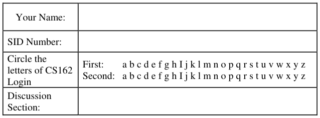
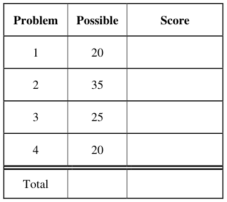
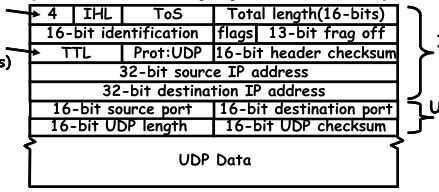

# Berkeley CS162 Fall 2008: Midterm 2: Official solutions

> Copied from the original: <https://hkn.eecs.berkeley.edu/exams/course/cs/162>. Text and figures are taken from the PDF as is; nothing was answered or rewritten. The original PDF is in this folder.

---

**Page 1**

&emsp;&emsp;&emsp;&emsp;&emsp;&emsp;&emsp;&emsp;University of California, Berkeley 
&emsp;&emsp;&emsp;&emsp;&emsp;&emsp;&emsp;&emsp;College of Engineering 
&emsp;&emsp;&emsp;&emsp;&emsp;&emsp;&emsp;&emsp;Computer Science Division ⎯ EECS 
&emsp;Fall 2008                John Kubiatowicz 
&emsp;&emsp;&emsp;&emsp;&emsp;&emsp;&emsp;&emsp;Midterm II 
&emsp;&emsp;&emsp;&emsp;&emsp;&emsp;&emsp;&emsp;SOLUTIONS 
&emsp;&emsp;&emsp;&emsp;&emsp;&emsp;&emsp;&emsp;December 3rd, 2008 
&emsp;&emsp;&emsp;&emsp;&emsp;&emsp;&emsp;CS162: Operating Systems and Systems Programming

General Information: 
This is a **closed book** exam.  You are allowed 1 page of **hand-written** notes (both sides).  You 
have 3 hours to complete as much of the exam as possible. Make sure to read all of the questions 
first, as some of the questions are substantially more time consuming. 
Write all of your answers directly on this paper.  Make your answers as concise as possible. On 
programming questions, we will be looking for performance as well as correctness, so think through 
your answers carefully.  If there is something about the questions that you believe is open to 
interpretation, please ask us about it!

&emsp;Page 1/21

---

**Page 2**

CS 162 Fall 2008 Midterm Exam II December 3rd, 2008

&emsp;&emsp;&emsp;&emsp;&emsp;&emsp;&emsp;&emsp;\[ This page left for π \]

&emsp;&emsp;&emsp;&emsp;3.141592653589793238462643383279502884197169399375105820974944

Page 2/21

---

**Page 3**

CS 162 Fall 2008 Midterm Exam II December 3rd, 2008

### Problem 1: True/False \[20 pts\]

In the following, it is important that you EXPLAIN your answer in TWO SENTENCES OR LESS 
(Answers longer than this may not get credit!).  Also, answers without an explanation GET NO 
CREDIT.

### **Problem 1a\[2pts\]:**  The limitation of 65536 ports for UDP and TCP reflects an inherent limitation

of the underlying IP datagram protocol.

&emsp;&emsp;Explain: This is a limitation of the UDP and TCP protocols.  The underlying IP 
&emsp;&emsp;&emsp;&emsp;&emsp;&emsp;&emsp;&emsp;protocol does not understand ports at all.

### **Problem 1b\[2pts\]:** For disks with constant areal bit density (bits stored/unit area of disk media),

the disk head reads bits at a different rate on the outer tracks than on the inner tracks.

&emsp;&emsp;True / False 
&emsp;&emsp;Explain: The outer tracks are longer than the inner track and contain more bits 
&emsp;&emsp;&emsp;&emsp;&emsp;&emsp;&emsp;&emsp;than the inner tracks.  Dsik spinning at constant speed ⇒  the bits are 
&emsp;&emsp;&emsp;&emsp;&emsp;&emsp;&emsp;&emsp;passing under the read head faster on the outside than inside.

### **Problem 1c\[2pts\]:** The queueing equations given in class cannot be used to analyze the transient

behavior of a website that is suddenly popular, i.e. used to compute waiting times at the moment 
that people start arriving.

&emsp;&emsp;True / False 
Explain: We talked about equations that only work in steady state.

### **Problem 1d\[2pts\]:**  The VFS layer handles journaling for Very Large File Systems.

&emsp;&emsp;Explain: VFS stands for “Virtual File System”. This layer permits multiple types of 
&emsp;&emsp;&emsp;&emsp;&emsp;&emsp;&emsp;&emsp;file systems (including local and remote) to coexist.

### **Problem 1e\[2pts\]:** A RAID 5 system can handle more than one disk failure at a time.

&emsp;&emsp;Explain: The XOR code used in RAID5 only recovers from a single failure at a 
&emsp;&emsp;&emsp;&emsp;&emsp;&emsp;&emsp;&emsp;time. Handling of multiple failures requires a more complex code.

Page 3/21

---

**Page 4**

CS 162 Fall 2008 Midterm Exam II December 3rd, 2008

### **Problem 1f\[2pts\]:** The NFS file service requires client state to be maintained at the server.

&emsp;&emsp;Explain: NFS is a stateless protocol. All information required to process a request 
&emsp;&emsp;&emsp;&emsp;&emsp;&emsp;&emsp;&emsp;is included in the request message.

### **Problem 1g\[2pts\]:** TLB lookup (i.e. address translation) must occur prior to checking for data in

the first-level cache.

&emsp;&emsp;Explain: With physical-mapped caches (where tags are physical addresses), we 
&emsp;&emsp;&emsp;&emsp;&emsp;&emsp;&emsp;&emsp;can perform TLB lookup in parallel with cache lookup by sending page 
&emsp;&emsp;&emsp;&emsp;&emsp;&emsp;&emsp;&emsp;offset portion of the address (doesn’t get translated) to the cache while 
&emsp;&emsp;&emsp;&emsp;&emsp;&emsp;&emsp;&emsp;translation is occuring.  Also, we mentioned virtual-mapped caches 
&emsp;&emsp;&emsp;&emsp;&emsp;&emsp;&emsp;&emsp;(where tags are virtual addresses); in this case, the cache lookup happens 
&emsp;&emsp;&emsp;&emsp;&emsp;&emsp;&emsp;&emsp;before TLB lookup – which only occurs on cache misses.

### **Problem 1h\[2pts\]:** The clock algorithm provides an approximation to a least-recently used (LRU)

page replacement mechanism.

&emsp;&emsp;True / False 
&emsp;&emsp;Explain: The clock algorithm divides pages into “recently used” and “not recently 
&emsp;&emsp;&emsp;&emsp;&emsp;&emsp;&emsp;&emsp;used”, thereby allowing us to replace a “not recently used” page.

### **Problem 1i\[2pts\]:** The bottom half of a device driver responds to interrupts from the device.

&emsp;&emsp;True / False 
&emsp;&emsp;Explain: This is true. The top half of the device drive handles initiating I/O and 
&emsp;&emsp;&emsp;&emsp;&emsp;&emsp;&emsp;&emsp;putting waiting threads to sleep. The bottom half receives the interrupts 
&emsp;&emsp;&emsp;&emsp;&emsp;&emsp;&emsp;&emsp;and wakes waiting threads.

### **Problem 1j\[2pts\]:** DNS is a centralized service for translating user-readable names into IP

addresses.

&emsp;&emsp;Explain: DNS is a distributed service. DNS looksups involve a recursive set of 
&emsp;&emsp;&emsp;&emsp;&emsp;&emsp;&emsp;&emsp;queries (at least 2) starting with the right-most portion of the address (the 
&emsp;&emsp;&emsp;&emsp;&emsp;&emsp;&emsp;&emsp;top-level domain) and working to the left-most portion of the address.

Page 4/21

---

**Page 5**

CS 162 Fall 2008 Midterm Exam II December 3rd, 2008

### Problem 2: Peer-to-Peer Instant Messaging \[35pts\]

&emsp;This problem will investigate the construction of a peer-to-peer communication network built. 
We will utilize instant messaging as our application on top of this network. As you see by the above 
figure, clients connect with individual routers.  Messages transit from a source client to a 
destination client via one or more hops through a router. 
&emsp;In order to make this Instant Messaging client particularly user friendly, we will address 
messages to usernames (that are strings), rather than to IP addresses.  This means that the job of the 
routers is to propagate information about usernames so that messages can be properly routed. 
&emsp;When they first start up, clients will chose a router with which to connect. We will call this 
router the “home router” for the client. The client will then send a “route announcement” message 
to its home router containing the client’s username. The home router will forward these 
announcements to other routers and other clients. Further, the home router will send the identities of 
clients that it knows about to the new client. 
&emsp;To send an Instant Message, a client will produce a packet that includes the username of the 
destination client, their own username (i.e. the source), and a message string. They will transmit this 
message to their home router. The message will be forwarded along the shortest path through 
routers to the message destination. 
&emsp;It is important to note that clients are only allowed to communicate with their home routers, not 
other routers or clients. 
&emsp;&emsp;&emsp;&emsp;&emsp;&emsp;&emsp;&emsp;**3115 1600**   **15 16**   **31** 
&emsp;&emsp;&emsp;&emsp;**IP Ver4IP Ver4**

&emsp;&emsp;&emsp;&emsp;**Time toTime toIP headerIP header** 
&emsp;&emsp;&emsp;&emsp;&emsp;&emsp;&emsp;&emsp;**20 bytes20 bytes** 
&emsp;&emsp;&emsp;&emsp;**Live (hops)Live (hops)** 
&emsp;&emsp;&emsp;&emsp;&emsp;&emsp;&emsp;&emsp;**UDP headerUDP header** 
&emsp;&emsp;&emsp;&emsp;&emsp;&emsp;&emsp;&emsp;**8 bytes8 bytes**

&emsp;We will use UDP/IP for our implementation. The packet format is shown above. UDP/IP 
communication is connectionless. To communicate on a given port, an application simply binds a 
socket to that port, after which it can immediately begin sending and receiving messages on that

Page 5/21

---

**Page 6**

CS 162 Fall 2008 Midterm Exam II December 3rd, 2008

port. Our Instant Message Routers utilize **UDP port 123** for messages from clients and other 
routers.  Clients pick a unique port for their communications. This means that each IP address can 
host a single router, but that multiple clients can coexist on the same IP address. 
&emsp;Our system needs two message types. The data for these messages will be stored in the UDP 
data portion of the UDP datagram. The first byte of the data distinguishes the message type.  Type 0 
is a route advertisement, while Type 1 is an actual Instant Message:

&emsp;&emsp;&emsp;RouteRoute 
&emsp;Advertisement:Advertisement:

&emsp;&emsp;&emsp;InstantInstant 
&emsp;&emsp;Message:Message:

Remember that the UDP/IP header also contains information about which IP address and port was 
the source of the message. 
&emsp;Although we are not going to fully implement our server, we are going to explore the route 
advertisement and routing process in greater detail.

### **Problem 2a\[3pts\]:** What minimum information must be in the routing table of each router and how

should it be indexed to allow Instant Messages to be routed to their destination without 
broadcasting? Explain the process of routing a message to its destination. 
&emsp;**At minimum, the routing table needs to provide a mapping between destination names and** 
&emsp;**the next hop (which is a combination of IP address and port). The table must be indexed in a** 
&emsp;**way that allows looking up the next hop given the destination name; a hash table would be** 
&emsp;**the best option. To route a message, the router simply takes the destination name, looks it up** 
&emsp;**in the routing table, then forwards it to the next hop.** 
&emsp;**NOTE: We were looking for specifics here. Many people seemed to think that distances were** 
&emsp;**required in a minimal routing table to allow routing. Not true – they help us later for** 
&emsp;**computing shortest paths.**

### **Problem 2b\[3pts\]:** Assume that the routers are connected in a way that contains cycles (such as

shown above), that routers never crash, and that routers are booted before clients. What is the 
simplest way for routers to handle route advertisement messages so as to produce routing tables that 
route Instant Messages to their destinations without routing them in cycles?  Explain carefully. 
&emsp;**On receiving a route advertisement, the router looks up the destination name. If the name is** 
&emsp;**already in the routing table, then it drops the new advertisement.  Otherwise, it first adds an** 
&emsp;**entry in the table mapping the name to the source IP/port of the message (i.e. the “nextHop”** 
&emsp;**is where the message came from); it then forwards the message to all routers and clients that** 
&emsp;**it is directly communicating with.** 
&emsp;**There are a number of ways of seeing that there will be no cycles in the routing path.  For** 
&emsp;**instance, since we only add routing table entries once, we can think of them as having a** 
&emsp;**timestamp at the time they were added. As we follow the routing path for a particular** 
&emsp;**destination, we will always route to earlier timestamps – hence, it is not possible for us to end** 
&emsp;**up with a cycle.** 
&emsp;**NOTE: we were looking for specifics here about putting entries into the table, forwarding to** 
&emsp;**other routers, and why there are no cycles in the routes.**

Page 6/21

---

**Page 7**

CS 162 Fall 2008 Midterm Exam II December 3rd, 2008

### **Problem 2c\[3pts\]:** Now assume that our goal is to route Instant Messages with the fewest number

of hops, and that some routers may boot after clients (adding shorter paths, for instance). We will 
use the ‘Dist’ parameter of route advertisement messages (Type=0) to indicate how many hops we 
have traveled from the client that we are advertising. Explain how the route advertisement messages 
will propagate through the system (be explicit) and what additional information you will keep in the 
routing tables. Be explicit. 
&emsp;**Assume that clients will set the Dist parameter of their route advertisement to zero before** 
&emsp;**transmitting it to their home router.  Then, with each hop, the Dist parameter of the message** 
&emsp;**will be incremented.  Consequently, as route advertisement messages are routed through the** 
&emsp;**system, the Dist parameter will say how many hops they have traveled from the client.** 
&emsp;**Now, we will add a “hopCount” parameter to each routing table entry that says how many** 
&emsp;**hops are left to get to the destination. When a route advertisement message arrives at a** 
&emsp;**router, we will check to see if (1) either the destination is not in the table at all (as in 2b) or** 
&emsp;**(2) there is an entry in the table with a larger “hopCount” value than the “Dist” parameter in** 
&emsp;**the route advertisement. If either of these cases are true, we will put the entry in the table with** 
&emsp;**the “Hops” parameter set to the current Dist value, increment the Dist value, then send the** 
&emsp;**advertisement message to everyone we are connected to.** 
&emsp;**NOTE: Again, we were looking for specifics. Some people talked in generalities without** 
&emsp;**really telling us how to implement this idea.**

### **Problem 2d\[2pts\]:** What should happen when a new connection between two routers is initiated?

Your answer should be consistent with (2c). 
&emsp;**Each router should go through its routing table entries and generate route advertisement** 
&emsp;**messages to send to the other router.  When generating these messages, a router will set the** 
&emsp;**“Dist” parameter to be one more than the “hopCount” parameter stored in its routing table** 
&emsp;**entry. On receiving one of these new route advertisements, the router will follow exactly the** 
&emsp;**same algorithm as given in (2c).** 
&emsp;**NOTE: we were looking for people to tell us that (1) entries were exchange, (2) the distance** 
&emsp;**parameters were incremented by 1 before exchanging to account for the additional hop.**

### **Problem 2e\[2pts\]:** Explain how we can utilize the ‘Dist’ field of Instant Messages (Type = 1) to

guard against loops in the routing table, should they occur. 
&emsp;**When generating a new Instant Message, a client will set the Dist field to zero.  Each router** 
&emsp;**will increment this value before sending the message on to the next hop. If the value is ever** 
&emsp;**greater than some maximum value, the message will be dropped.** 
&emsp;**NOTE: A number of people wanted to compare the distance in a packet to distances in the** 
&emsp;**routing table. Unfortunately, if we have cycles in the table, it will be because the table is** 
&emsp;**inconsistent. Consequently, we cannot be sure that we can trust the distance parameters to** 
&emsp;**prevent problems. Instead, better to use a max hop count. Also, people who advocated this** 
&emsp;**idea seemed to forget the fact that the distances in routing tables go DOWN with each hop;** 
&emsp;**thus, any use of these values would have to start by setting the message Dist parameter of new** 
&emsp;**messages to the distance value stored by the home router, then DECREMENTING the** 
&emsp;**parameter with each hop.**

Page 7/21

---

**Page 8**

CS 162 Fall 2008 Midterm Exam II December 3rd, 2008

### **Problem 2 continued: Peer-to-Peer Client**

&emsp;In the following, we are now going to implement our peer-to-peer router in Java. First, we need 
to establish a few things about the UDP sockets interface in Java 
&emsp;. 
&emsp;The Java interface for UDP is straightforward. In fact, it is easier to use the TCP interface. It 
uses a DatagramPacket object to hold the packet. DatagramPacket objects include a byte array for 
data as well as an IP address and port representing either the destination of the message (for 
outgoing messages) or the source IP address and port (for incoming messages). Datagram objects 
are changeable (mutable) after construction (see table, next page). 
&emsp;Use of Java Datagram facilities is straightforward. For instance, a client could send the string 
“Hello world” as a datagram to port 66 of a server called “test.com” in the following way: 
&emsp;&emsp;`DatagramSocket mysock = new DatagramSocket(); // pick unused source port` 
`// Need an array of bytes to send in a datagram` 
`String outs = “Hello World”;` 
`byte[] outbuf = outs.getBytes();` 
`// Need to resolve the address of the server` 
`InetAddress outIP = InetAddress.getByName(“test.com”);` 
`// Construct the outgoing packet` 
`DatagramPacket dp = new DatagramPacket(outbuf, outbuf.length, outIP, 66);` 
`// Send packet to server test.com, port 66` 
`mysock.send(dp);` 
Further, the components of a DatagramPacket can be mutated to send it elsewhere: 
`// send packet to echo.com, port 66` 
`dp.setAddress(InetAddress.getByName(“echo.com”));` 
`mysock.send(dp);` 
To receive messages on a particular port (say 66), we simply bind a socket to a particular port: 
`DatagramSocket serversock = new DatagramSocket(66);  // wait on port 66` 
`// Set up datagram to receive messages` 
`byte buff[] = new byte[256]; // space to receive packet` 
`DatagramPacket rp = new DatagramPacket(buff, buff.length);` 
`// Wait forever until packet is received:` 
`serversock.receive(rp);` 
`// These methods are available after reception:` 
`int length = rp.getLength();`      `// # bytes of data received` 
`InetAddress sourceIP = rp.getAddress();// IP address of sender` 
`int port  = rp.getPort();`        `// Port of sender`

Page 8/21

---

**Page 9**

CS 162 Fall 2008 Midterm Exam II December 3rd, 2008

For your reference, you may find the following table of methods useful:

Page 9/21

---

**Page 10**

CS 162 Fall 2008 Midterm Exam II December 3rd, 2008

The following code implements the IMPacket class to  manipulates information encoded in packets. 
`1. class IMPacket {` 
`2.`     `int Type, Dist;` 
`3.`     `String Dest,Src,Message;` 
`// Construct IMPacket from incoming datagram, assume correct format` 
`4.`     `IMPacket(DatagramPacket inpacket) {` 
`5.`         `byte[] data = inpacket.getData();` 
`6.`         `Type = data[0]; Dist = data[1];` 
`7.`         `inpacket.setLength(2);  // Now at byte #2` 
`8.`         `Dest = extractString(inpacket);` 
`9.`         `if (Type == 1) {` 
`10.`             `Src = extractString(inpacket);` 
`11.`             `Message = extractString(inpacket)` 
`12.`         `}` 
`}` 
`// Take an IMPacket and encode it into a DatagramPacket` 
`// Note that the result depends on Type` 
`13.`     `DatagramPacket encode() {` 
`14.`         `DatagramPacket result = new DatagramPacket(new byte[256],0);` 
`15.`         `/* Encode IMPacket into result */` 
`16.`         `return result;` 
`}` 
`// Using the length as a pointer, extract string from packet` 
`17.`     `String extractString(DatagramPacket pack) {` 
`18.`         `byte[] data = pack.getData();` 
`19.`         `int pos = pack.getLength();` 
`20.`         `int strlen = data[pos];  // Extract string len in bytes` 
`21.`         `pack.setLength(pos+strlen+1); // Move pointer past string` 
`22.`         `return String(data,pos+1,strlen);` 
`}` 
`// Add string in serialized for to end of packet` 
`23.`     `void addString(DatagramPacket pack, String instring) {` 
`24.`         `byte[] data = pack.getData();` 
`25.`         `int pos = pack.getLength();` 
`26.`         `byte[] tempstr = instring.getBytes(); // turn string->byte[]` 
`27.`         `data[pos++] = tempstr.length;     // Place length at begining` 
`28.`         `for (int i = 0; i<tempstr.length; i++)` 
`29.`             `data[pos++]= tempstr[i];` 
`30.`         `pack.setLength(pos);` 
`}` 
`}`

### **Problem 2f\[4pts\]:** Finish the encode function at Line #15. The goal of this function is to turn the

information in an IMPacket into a DatagramPacket. You should not need more than 10 lines. Hint: 
use the provided ‘addString’ function. 
Line 15: 
&emsp;&emsp;&emsp;&emsp;`byte[] data = result.getData();` 
`data[0] = Type; data[1] = Dist;`     `// Add first two bytes` 
`result.setLength(2);` 
`addString(result,Dest);`            `// Add Dest` 
`if (Type==1) {`                `// Ah – Type 1 add Src/Message` 
`addString(result,Src);`        `// Add Src` 
`addString(result,Message);`     `// Add Message` 
`}` 
`NOTE: we cannot just do something like Type.tostring() (or whatever – this is` 
`bad syntax!); converting an integer to a string produces a decimal string,,,`

Page 10/21

---

**Page 11**

CS 162 Fall 2008 Midterm Exam II December 3rd, 2008

In order to keep track of nodes communicating with it, each router keeps a list of routers and clients 
that it has received route announcements from. Each entry in the list is a DirectEndpoint object. We 
can tell if we are talking to someone new by using the ‘lookup’ function:

&emsp;&emsp;`If (!DirectEndpoint.lookup(addr,port)) { /* new endpoint */ }` 
We can add a new endpoint with ‘addUnique’. This will add a new entry to the list only it the 
endpoint has not be seen before.  It will then return the unique result.

&emsp;&emsp;`DirectEndpoint newend = DirectEndpoint.addUnique(addr,port);` 
Further, the set of all endpoints can be enumerated with the enumeration interface:

&emsp;&emsp;`Enumeration allEndpoint = DirectEndpoint.elements();` 
`While (allEndpoint.hasMoreElements()) {` 
`DirectEndpoint next = (DirectEndpoint)allEndpoint.nextElemenet();` 
`/* Do Something with next entry*/` 
`}` 
Continuing with our code: 
`31. class DirectEndpoint {` 
`32.`     `InetAddress addr;` 
`33.`     `int port;` 
`// You can enumerate all connections with DirectEndpoint.elements()` 
`34.`     `static Enumeration elements() {` 
`35.`         `// Return enumeration to walk through all unique DirectEndpoints` 
`}` 
`36.`     `static DirectEndpoint lookup(InetAddress addr, int port) {` 
`37.`         `// Return item or null */` 
`}` 
`38.`      `static DirectEndpoint addUnique(InetAddress addr, int port) {` 
`39.`         `// Add DirectEndpoint to list if not present, return unique entry` 
`}` 
`}` 
`// Routing table entry` 
`40. class RouteEntry {` 
`41.`     `DirectEndpoint nextHop;` 
`42.`     `/* Other information */` 
`43.`     `RouteEntry(DirectEndpoint nextHop, /* other info */) {` 
`44.`         `this.nextHop = nextHop;` 
`45.`         `/* Initialize other information */` 
`}` 
`}`

### **Problem 2g\[3pts\]:** We provide a sketch of the DirectEndpoint class. As we show above, a

RouteEntry must contain a DirectEndpoint at minimum (to define the next hop). Finish the 
definition of RouteEntry (line #42, #43, and #45). Your answer to (2c) is relevant: 
Line 42: 
&emsp;&emsp;&emsp;&emsp;`int hopCount;` 
Line 43: 
&emsp;&emsp;&emsp;&emsp;`int hopCount` 
Line 45: 
&emsp;&emsp;&emsp;&emsp;`this.hopCount = hopCount;`

Page 11/21

---

**Page 12**

CS 162 Fall 2008 Midterm Exam II December 3rd, 2008

Finally, our main server code looks as follows: 
`46. byte[] inarray = new byte[256];` 
`47. DatagramPacket pack = new DatagramPacket(inarray,inarray.length);` 
`48.  HashTable routetable = new HashTable();` 
`49. DatagramSocket socket = /* setup server socket */` 
`while(true) {` 
`50.`     `/* receive next packet */` 
`51.`      `IMPacket newpacket = new IMPacket(pack); // Decode packet` 
`// Produce DirectEndpoint entry for packet source` 
`52.`     `InetAddress addr = pack.getAddress();` 
`53.`     `int port = pack.getPort();` 
`54.`     `DirectEndpoint source = DirectEndpoint.lookup(addr,port);` 
`55.`     `If (!source) {` 
`// New endpoint! Haven’t talked to them before` 
`56.`         `source = DirectEndpoint.addUnique(addr,port);` 
`// New person: tell them about everyone we know about` 
`57.`         `AnnounceRoutes(socket,source,routetable);` 
`}` 
`58.`     `switch (newpacket.type) {` 
`59.`         `case 0:  HandleRoute(socket,newpacket,source,routetable);` 
`60.`                 `break;` 
`61.`         `case 1: HandleIM(socket,newpacket,source,routetable);` 
`62.`                 `break;` 
`}`

### **Problem 2g\[2pts\]:** Handle the setup of the server  socket (line #49):

Line 49: 
&emsp;&emsp;&emsp;&emsp;`new DatagramSocket(123);`

### **Problem 2h\[2pts\]:** Handle the reception of packets (line #50):

Line 50: 
&emsp;&emsp;&emsp;&emsp;`socket.receive(pack);`

Page 12/21

---

**Page 13**

CS 162 Fall 2008 Midterm Exam II December 3rd, 2008

**H**ere is the code to process route announcements: 
`63.` `void HandleRoute( DatagramSocket socket,` 
`64.`                 `IMPacket newpacket, DirectEndpoint source,` 
`65.`                 `HashTable routetable ) {` 
`66.` 
`67.`     `RouteEntry oldentry = (RouteEntry)routetable.get(newpacket.Dest);` 
`68.`     `if ((oldentry == null) ||` 
`69.`         `/* Other Condition to change entry */ ) {` 
`70.`         `RouteEntry newentry = /* Construct new Entry */` 
`71.`         `routetable.put(newpacket.Dest,newentry);` 
`72.`         `DatagramPacket outpacket; // you will assign to this in 73.` 
`73.`         `/* Construct new route announcement to forward to others */` 
`// Walk through everyone we are talking to directly` 
`74.`         `Enumeration allEndpoint = DirectEndpoint.elements();` 
`75.`         `While (allEndpoint.hasMoreElements()) {` 
`76.`             `DirectEndpoint next =` 
`77.`                 `(DirectEndpoint)allEndpoint.nextElemenet();` 
`78.`             `outpacket.setAddress(next.addr);` 
`79.`             `outpacket.setPort(next.port);` 
`80.`             `socket.send(outpacket);` 
`}` 
`}` 
`}`

### **Problem 2i\[3pts\]:** What is the other condition under which we will propagate a route advertisement

(other than no entry)? Explain and provide code for line #69. Hint: your answer to 2c is relevant, as 
is use of the ‘dist’ parameter to messages. 
Explain: 
&emsp;&emsp;&emsp;&emsp;&emsp;`Need to change routing entry if we are hearing about shorter path.` 
Line 69: 
&emsp;&emsp;&emsp;&emsp;&emsp;`(newpacket.Dist < oldentry.hopCount)`

### **Problem 2j\[2pts\]:** Construct the new route table entry, line #70:

Line 70: 
&emsp;&emsp;&emsp;&emsp;&emsp;`new RouteEntry(source,newpacket.Dist);`

### **Problem 2k\[2pts\]:** Construct the new route announcement message as a DatagramPacket, line #73.

Hint: you will be using the encode() method of IMPacket. 
Line 73: 
&emsp;&emsp;&emsp;&emsp;&emsp;`newpacket.Dist++;`             `// Increment distance` 
`outpacket = newpacket.encode();`    `// Encode it.`

Page 13/21

---

**Page 14**

CS 162 Fall 2008 Midterm Exam II December 3rd, 2008

Last, but not least, here is the code to actually forward Instant Messages: 
`81.` `void HandleIM( DatagramSocket socket,` 
`82.`               `IMPacket newpacket, DirectEndpoint source,` 
`83.`               `HashTable routetable ) {` 
`84.`     `RouteEntry entry = (RouteEntry)routetable.get(newpacket.Dest);` 
`85.`     `/* Route Messages */` 
`}`

### **Problem 2l\[4pts\]:** Finally, provide the code that actually routes messages for line #85. This should

have no more than 6 lines.  Hint: stay consistent with your answer to (2e) 
Line 85: 
&emsp;&emsp;&emsp;&emsp;`if ((entry != null) && (newpacket.Dist++ < MAXIMUMHOP)) {` 
`DatagramPacket outpacket = newpacket.encode();` 
`outpacket.setAddress(entry.nextHop.addr);` 
`outpacket.setPort(entry.nextHop.port);` 
`socket.send(outpacket);` 
&emsp;&emsp;&emsp;&emsp;`}`

&emsp;&emsp;&emsp;&emsp;`NOTE: we assume that MAXIMUMHOP is a constant defined somewhere.`

### **Problem 2m\[Extra Credit, 3pts\]:** The code that you have seen so far neglects to connect routers

with one another.  What is the simplest mechanism to connect a set of routers together at boot time? 
Assume that each router starts with an array of Strings that contains DNS names of other routers 
that it should connect with. Show a short loop (no more than 8 lines) that could be run at the time 
that the router boots in order to connect it with other routers. 
`String[] PeerRouters = {“first.com”, “second.com”, … };` 
`/* What code goes here? */` 
`// Put this code after line 49 (setup of server socket);` 
`// Make up a dummy advertisement to tell routers about us` 
`IMPacket dummy = new IMPacket();` 
`// These are defaults anyway, but just thought I’d point them out` 
`Dummy.Type = 0; dummy.Dist = 0; dummy.Dest = “”;` 
`// Go through and announce ourselves/put other router into the table` 
`for (int i=0; i<PeerRouters.length; i++) {` 
`InetAddress addr = InetAddress.getByName(PeerRouters[i]));` 
`dummy.setAddress(addr);` 
`dummy.setPort(123);` 
`socket.send(dummy);` 
`DirectEndpoint.addUnique(addr,123);` 
`}` 
`// Might also want to alter ‘HandleRoute()’ to avoid propagating dummy` 
`// route advertisement messages to other routers (although there would be` 
`// no harm in doing so.`

Page 14/21

---

**Page 15**

CS 162 Fall 2008 Midterm Exam II December 3rd, 2008

### Problem 3: I/O devices and File Systems \[25pts\]

Please keep your answers short (one or two sentences per question-mark). We may not give credit 
for long answers.

### **Problem 3a\[3pts\]:** Disk requests come in to the driver for cylinders 8, 24, 20, 5, 41, 8, in that

order. A seek takes 6ms per cylinder. Calculate the total seek time for the above sequence of 
requests assuming the following disk scheduling policy (In all cases, the disk arm is initially at 
cylinder 20).  Explain your answer. 
a) First-come first serve:   **Sequence is: 20\[starting\], 8, 24, 20, 5, 41, 8.** 
**Time is: \[(20-8)+(24-8)+(24-20)+(20-5)+(41-5)+(41-8)\]\*6ms=696ms** 
b) Closest cylinder next:    **Sequence is: 20\[starting\], 20, 24, 8, 8, 5, 41** 
**Time is: \[(20-20)+(24-20)+(24-8)+(8-8)+(8-5)+(41-5)\]\*6ms=354ms** 
c) Elevator algorithm (initially moving upward in cylinder value): 
**Sequence is: 20\[starting\], 20, 24, 41, 8, 8, 5** 
**Time is: \[(20-20)+(24-20)+(41-24)+(41-8)+(8-8)+(8-5)\]\*6ms=342ms**

### **Problem 3b\[2pts\]:** Contiguous allocation of files leads to disk fragmentation. Is this internal

fragmentation or external fragmentation? Make an analogy with something we discussed earlier in 
the semester. 
&emsp;**This is external fragmentation, since there is space that may not be allocatable. We saw a** 
&emsp;**similar problem with simple segmentation earlier in the term, where we needed contiguous** 
&emsp;**chunks of DRAM memory and may have needed to move processes around to get them.**

### **Problem 3c\[2pts\]:** Name at least two ways in which the buffer cache is used to improve

performance for file systems. 
&emsp;**There are a number of them.  Some are as follows: (1) It allows us to take advantage of** 
&emsp;**temporal locality for reads (i.e. when we read something the second time we do not need to go** 
&emsp;**to the disk); (2) it allows applications to read a smaller amount of data than a complete block;** 
&emsp;**when they ask for more data, it can already be in memory; (3) It can allow us to reorder** 
&emsp;**writes to reduce seek time; (4) It can allow us to read ahead (prefech) data requested by** 
&emsp;**applications to take advantage of sequential access.**

Page 15/21

---

**Page 16**

CS 162 Fall 2008 Midterm Exam II December 3rd, 2008

### **Problem 3d\[2pts\]:** Some operating systems provide a system call called “rename()” that can be

used to give a file a new name.  Assuming that the new directory that holds the name is on the same 
disk partition as the old one, is there any difference between using “rename()” to rename a file and 
just copying the file to a new file with the new name, followed by deleting the old one?  Explain. 
&emsp;**We admit that this might have been a bit confusing (hence our suggestion to think of “mv”** 
&emsp;**instead of the “rename()” call).  At any rate, rename() can be used to change the location of a** 
&emsp;**file from one directory to another.  It does so by altering directory entries but otherwise** 
&emsp;**leaving the file inode and contents along.  Thus, there is a difference: rename() is much more** 
&emsp;**efficient than copying/deleting old file.**

### **Problem 3e\[2pts\]:** Continuing question (3d), let’s now assume that we are using “rename()” to

change the name of a file from a directory hosted on one disk to a directory hosted on another disk, 
is there any difference between using this call to rename a file and just copying the file to a new file 
with the new name, folowed by deleting the old one?  Explain. 
&emsp;**Same announcement during exam as 3d.  Here, since we are crossing from one disk to** 
&emsp;**another, the inodes and datablocks are complete different.  Thus, there is no more efficient** 
&emsp;**way to change the name of a file across file systems than to copy/delete old version.  Expected** 
&emsp;**answer: there is no difference between rename() and copy/delete.**

### **Problem 3f\[2pts\]:** What are the main differences between non-blocking and asynchronous I/O?

&emsp;**Both non-blocking and asynchronous I/O return from the system call without delay. The** 
&emsp;**difference is that non-blocking I/O returns immediately, regardless of the state of the** 
&emsp;**requested I/O operation and could thus perform a partial read or write. The application** 
&emsp;**writer may need to submit a non-blocking I/O operation multiple times to perform a complete** 
&emsp;**I/O operation. Asynchronous I/O, on the other hand, notifies the user later when the** 
&emsp;**operation has completed via a separate mechanism (such as a signal); asynchronous I/O will** 
&emsp;**perform the complete I/O operation before notification.**

### **Problem 3g\[2pts\]:** What UNIX structure keeps track of the sectors allocated to a given file?

&emsp;**The inode structure.**

Page 16/21

---

**Page 17**

CS 162 Fall 2008 Midterm Exam II December 3rd, 2008

### **Problem 3h\[4pts\]:** Suppose that we have a disk with the following parameters:

&emsp;• 1TB in size 
&emsp;• 7200 RPM, Data transfer rate of 40 Mbytes/s (40 × 106 bytes/sec) 
&emsp;• Average seek time of 6ms 
&emsp;• ATA Controller with 2ms controller initiation time 
&emsp;• A block size of 4Kbytes (4096 bytes) 
What is the average time to read a random block from the disk (assuming no queueing at the 
controller). Show your work.  Hint: there are 4 terms here.  Be very careful of your units! 
**We need to be careful to get all of our units correct.  I am going to stick with milliseconds.** 
**Tread**  **= Controller + Seek + Rotational + Xfer Time** 
&emsp;&emsp;&emsp;&emsp;&emsp;&emsp;&emsp;&emsp;ms⎛⎞ 
&emsp;&emsp;&emsp;&emsp;&emsp;&emsp;&emsp;&emsp;60000⎜⎟ 
&emsp;&emsp;&emsp;&emsp;&emsp;&emsp;&emsp;&emsp;14096bytes 
&emsp;&emsp;&emsp;&emsp;&emsp;&emsp;&emsp;&emsp;⎜min   ⎟ 
26msms**=**  +++    **= 12.269 ms** 
&emsp;&emsp;&emsp;&emsp;&emsp;&emsp;&emsp;&emsp;2bytess⎜⎜⎟⎟revolutions⎛⎞⎛⎞ 
&emsp;&emsp;&emsp;&emsp;&emsp;&emsp;&emsp;&emsp;401010⎜⎟⎜720063××−   ⎟ 
&emsp;&emsp;&emsp;&emsp;&emsp;&emsp;&emsp;&emsp;⎝⎠ 
&emsp;&emsp;&emsp;&emsp;&emsp;&emsp;&emsp;&emsp;⎝⎠⎝minsms   ⎠ 
**Tread =12.269ms**

### **Problem 3i\[2pts\]:** Explain how the 6ms seek time from (3h) would actually have been measured

(by the disk manufacturer) and why a smaller value would be more appropriate when modeling 
many operating systems. 
&emsp;**The manufacturer number is computed by averaging the time to seek from one random track** 
&emsp;**to another random track. Typical operating systems managed to use a lot more locality in** 
&emsp;**their access paterns and thus their average seek time will be much lower.**

### **Problem 3j  \[4pts\]:** Suppose that the average rate of requests from the operating system is 75 req/s

and is memoryless.  Given your numbers from (3h), what is the typical size of the disk queue 
required to handle this rate? Assume C=1.5 for disk service. What might the operating system do to 
reduce this queuing requirement? 
&emsp;**This is just a straightforward use of the M/G/1 queue formula from class:** 
&emsp;&emsp;&emsp;&emsp;&emsp;1u 
&emsp;&emsp;&emsp;&emsp;&emsp;&emsp;(   ) 
&emsp;1TserC**Tq=** ×+× 
&emsp;&emsp;&emsp;&emsp;&emsp;21−   u 
&emsp;**Where Tser is the service time from 3h, C=1.5, λ =75req/s, and u=λ×Tser.** 
&emsp;**Since λ=75 req/s, u=λ×Tser=75 req/s×12.269ms×.001s/ms=0.92** 
&emsp;&emsp;&emsp;&emsp;&emsp;&emsp;&emsp;&emsp;1.092 
&emsp;&emsp;&emsp;&emsp;&emsp;&emsp;&emsp;&emsp;(   ) 
&emsp;ms12.26915.1**Tq=** ×+×   **=176.4ms=.1764 s** 
&emsp;&emsp;&emsp;&emsp;&emsp;&emsp;&emsp;&emsp;21.0−   92 
&emsp;**By Little’s law, length of q, Lq=λ×Tq=75 req/s×.1764s = 13.23 requests** 
&emsp;**By exploiting locality, the operating system could reduce Tser and thus the amount of** 
&emsp;**queuing.**

Page 17/21

---

**Page 18**

CS 162 Fall 2008 Midterm Exam II December 3rd, 2008

&emsp;&emsp;&emsp;&emsp;&emsp;&emsp;&emsp;&emsp;**\[ This page intentionally left blank \]**

Page 18/21

---

**Page 19**

CS 162 Fall 2008 Midterm Exam II December 3rd, 2008

### Problem 4: Potpourri \[20pts\]

Please keep your answers short (one or two sentences per question-mark). We may not give credit 
for long answers.

### **Problem 4a\[2pts\]:** What are the advantages and disadvantages of a fully-associative cache?  When

would it make sense to utilize a fully-associative cache? 
&emsp;**The advantages of a fully-associative cache is that it doesn’t suffer from conflict misses;  it** 
&emsp;**can always hold the last N unique memory references, regardless of the reference pattern.** 
&emsp;**The disadvantage of a fully-associative cache is that it is bigger and slower than a direct-** 
&emsp;**mapped cache or a cache with lower than full associativity. It makes sense to utilize a fully-** 
&emsp;**associative cache when the number of entries are small and the cost of conflict misses is high.**

### **Problem 4b\[3pts\]:** Explain why modern out-of-order processors (i.e. processors that execute

instructions out of order) can still provide precise exceptions. 
&emsp;**Modern processors  provide a structure called a “reorder buffer” that helps with branch miss-** 
&emsp;**predictions. The reorder buffer stores the result of instructions that complete out of order and** 
&emsp;**allows them to be complete back in order in chunks.  Effectively, the reorder buffer permits** 
&emsp;**execution results to be flushed back to the point of the exception, thus providing a clean,** 
&emsp;**precise interrupt point.**

### **Problem 4c\[3pts\]:** Assume that Alice and Bob have never met. Explain how a certificate authority

(such as Verisign) could help Alice and Bob establish a secure channel between them which proves 
authenticity and maintains privacy. 
&emsp;**Alice and Bob generate their own public/private key pairs for public key encryption. They** 
&emsp;**then go separately to a certificate authority (CA) to prove their identities and get the CA to** 
&emsp;**sign their public keys. Later, when Alice and Bob try to communicate, they start by providing** 
&emsp;**their public keys and certificates to each other. Once they have established the authenticity of** 
&emsp;**each other’s public keys, they then have a secure channel with which to communicate.** 
&emsp;**\[this is not an efficient channel; for that, they would go the additional step of performing a** 
&emsp;**key-generation protocol using the public keys to produce a shared symmetric key\]**

### **Problem 4d\[3pts\]:** What does Two-phase commit allow you to guarantee? Why does this not

violate the “General’s Paradox”? 
**Two-phase commit allows us to guarantee that all participants will agree to either commit or not** 
**commit some operation; eventually everyone will do the same time. This does not violate the** 
**‘General’s Paradox’ since we make no guarantee about when everyone completes the operation,** 
**merely that it will happen eventually.**

Page 19/21

---

**Page 20**

CS 162 Fall 2008 Midterm Exam II December 3rd, 2008

### **Problem 4e\[4pts\]:** How does TCP/IP automatically adjust the rate at which it sends information so

as to maximize bandwidth without overwhelming the slowest link?  What happens if a link along 
the path of a TCP channel is suddenly very popular (thereby providing a small fraction of its 
previous bandwidth)?  Does the TCP channel keep sending at the same rate? Why or why not? 
&emsp;**It uses the TCP slowstart algorithm. It starts with a small transmission window, then** 
&emsp;**increases the window size by one for each ACK received. When the network starts dropping** 
&emsp;**packets, the slowstart algorithm divides the window size in half, then begins slowly increasing** 
&emsp;**it again. In this way, TCP is able to find the largest window (and thus long-haul bandwidth)** 
&emsp;**that doesn’t cause congestion. If a link suddenly becomes popular, this will cause packets to** 
&emsp;**be delayed or dropped, causing TCP to shrink its window size, thus gracefully adapting to the** 
&emsp;**new restrictions.  Since the window size shrinks, TCP does not keep sending at the same rate.**

### **Problem 4f\[3pts\]:** Define what CSMA/CD stands for (e.g. in an Ethernet network) and explain

how it adapts to a varying number of simultaneous communications. Why does a system with 
CSMA/CD saturate at a much higher fraction of available bandwidth than the original Aloha radio 
network. 
&emsp;**It stands for “Carrier Sense, Multiple Access, Collision Detection”. When sending, the** 
&emsp;**transmitter first figures out whether anyone is already transmitting (‘Carrier Sense’). If not,** 
&emsp;**it sends data, but detects collision (‘Collision Dectection’).** 
&emsp;**This system adapts in the way that it handles collisions: it backs off for a random period of** 
&emsp;**time before trying again. With each unsuccessful attempt, it doubles the expected wait period.** 
&emsp;**Thus, it automatically adjusts the waiting period based on the number of simultaneous** 
&emsp;**transmissions.** 
&emsp;**CSMA/CD saturates at a higher bandwidth because it does a better job of avoiding trashing** 
&emsp;**transmissions that have already started (because of the Carrier Sense) and adapting the** 
&emsp;**waiting time.**

### **Problem 4g\[2pts\]:** Explain what copy-on-write is (with respect to the virtual memory system) and

give at least one instance when it might be useful. 
&emsp;**Copy-on-write is a technique for copying a large chunk of memory from one address space** 
&emsp;**into another. The copied set of memory pages are placed into the page table of the destination** 
&emsp;**process and left in the page table of the source process.  Both set of page table entries are** 
&emsp;**changed to “read-only”.  As long as neither process tries to write to the pages, this result is** 
&emsp;**indistinguishable from an actual copy.  If either the source or destination process attempts to** 
&emsp;**write one of the pages, then we get a page fault, at which point we generate an actual copy** 
&emsp;**page, clean up the page table entries so that they point at the two copies and are marked** 
&emsp;**writable, then allow the write to continue. Thus, we only go to the trouble of copying pages if** 
&emsp;**they will actually be modified by one or the other process.** 
&emsp;**Copy on write is useful for, among other things, supporting a traditional UNIX Fork** 
&emsp;**operation that provides a complete copy of the parent’s address space to the child.**

Page 20/21

---

**Page 21**

CS 162 Fall 2008 Midterm Exam II December 3rd, 2008

&emsp;&emsp;&emsp;&emsp;&emsp;&emsp;&emsp;&emsp;**\[ Scratch Page (feel free to remove) \]**

Page 21/21

