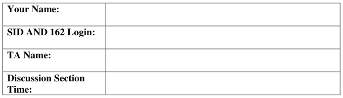
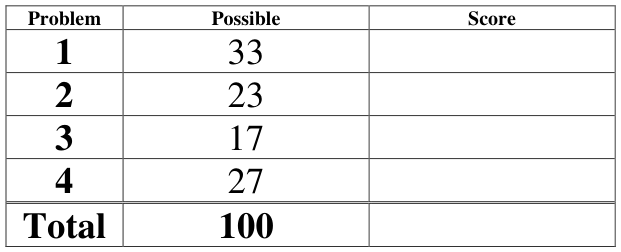

# Berkeley CS162 Spring 2008: Midterm 1: Questions

> Copied from the original: <https://hkn.eecs.berkeley.edu/exams/course/cs/162>. Text and figures are taken from the PDF as is; nothing was answered or rewritten. The original PDF is in this folder.

---

**Page 1**

&emsp;&emsp;&emsp;&emsp;&emsp;&emsp;&emsp;&emsp;University of California, Berkeley 
&emsp;&emsp;&emsp;&emsp;&emsp;&emsp;&emsp;&emsp;College of Engineering 
&emsp;&emsp;&emsp;&emsp;&emsp;&emsp;&emsp;&emsp;Computer Science Division – EECS 
Spring 2008                                     Anthony D. Joseph 
&emsp;&emsp;&emsp;&emsp;&emsp;&emsp;&emsp;&emsp;**Midterm Exam** 
&emsp;&emsp;&emsp;&emsp;&emsp;&emsp;&emsp;&emsp;February 27, 2008 
&emsp;&emsp;&emsp;&emsp;&emsp;&emsp;&emsp;&emsp;CS162 Operating Systems

General Information: 
This is a **closed book and notes** examination. You have 90 minutes to answer as many questions 
as possible.  The number in parentheses at the beginning of each question indicates the number of 
points given to the question; there are 100 points in all. You should read **all** of the questions 
before starting the exam, as some of the questions are substantially more time consuming. 
Write all of your answers directly on this paper.  **Make your answers as concise as possible.** If there 
is something in a question that you believe is open to interpretation, then please ask us about it! 
&emsp;&emsp;&emsp;&emsp;&emsp;&emsp;&emsp;&emsp;**Good Luck!!**

Page 1/12

---

**Page 2**

CS 162 Spring 2008 Midterm Exam        February 27, 2008

1\. (33 points total) Short answer questions: 
&emsp;a. (4 points) True/False and Why? 
&emsp;&emsp;In the operating system environments that we’ve studied so far, an application 
&emsp;&emsp;programmer has to worry about deadlock occurring involving the CPU as a 
&emsp;&emsp;resource. 
&emsp;&emsp;&emsp;&emsp;&emsp;TRUE                    FALSE 
&emsp;&emsp;&emsp;&emsp;&emsp;Why?

&emsp;b. (4 points) True/False and Why? 
&emsp;&emsp;In the operating system environments that we’ve studied so far (i.e., no virtual 
&emsp;&emsp;memory), the operating system has to worry about deadlock occurring involving 
&emsp;&emsp;physical memory as a resource. 
&emsp;&emsp;&emsp;&emsp;&emsp;TRUE                    FALSE 
&emsp;&emsp;&emsp;&emsp;&emsp;Why?

&emsp;c.  (5 points) Disabling interrupts: 
&emsp;&emsp;i) (3 points) Give a two to three sentence description of how interrupts can be 
&emsp;&emsp;&emsp;used to implement critical sections.

&emsp;&emsp;ii) (2 points) Briefly (2-3 sentences) state the problems with implementing critical 
&emsp;&emsp;&emsp;sections using disabling of interrupts.

Page 2/12

---

**Page 3**

CS 162 Spring 2008 Midterm Exam        February 27, 2008

&emsp;d. (8 points) List the four requirements for deadlock.

&emsp;e. (4 points) Briefly explain why when using a Hoare semantic monitors it is 
&emsp;&emsp;sufficient to use “if” statements when checking state variables, while most OS 
&emsp;&emsp;monitor implementations require the use of “while” statements.

&emsp;f. (8 points) In lecture, we discussed using atomic instructions (e.g., test-and-set and 
&emsp;&emsp;swap) to implement spinlocks. With spinlocks, threads spin in a loop (busy 
&emsp;&emsp;waiting) until the lock is freed. We motivated the use of blocking locks and 
&emsp;&emsp;semaphores as an improvement over spinlocks because having threads spin can be 
&emsp;&emsp;very inefficient in terms of processor utilization. However, spinlocks are not 
&emsp;&emsp;always less efficient than blocking locks. In two to three sentences, briefly 
&emsp;&emsp;describe a scenario where spinlocks would be more efficient than blocking locks.

Page 3/12

---

**Page 4**

CS 162 Spring 2008 Midterm Exam        February 27, 2008

2\. (23 points total) Implementing and Using Synchronization Primitives. 
&emsp;a. (6 points) While working on the first project, one of your project partners proposes 
&emsp;&emsp;to use a modified version of Semaphore to implement the condition variable class 
&emsp;&emsp;as follows: 
&emsp;&emsp;`Semaphore.set(0);`        `// Initialize semaphore to 0` 
&emsp;&emsp;`Wait(Lock lock) {` 
&emsp;&emsp;&emsp;&emsp;&emsp;`Semaphore.P(lock); // Special semaphore that` 
&emsp;&emsp;&emsp;&emsp;&emsp;&emsp;&emsp;&emsp;`// releases lock if it waits` 
&emsp;&emsp;`}`

&emsp;&emsp;`Signal() {` 
&emsp;&emsp;&emsp;&emsp;&emsp;`Semaphore.V();` 
&emsp;&emsp;`}` 
&emsp;&emsp;Decide whether you think their proposal will work or not, and briefly, in two to 
&emsp;&emsp;three sentences, explain your decision

Page 4/12

---

**Page 5**

CS 162 Spring 2008 Midterm Exam        February 27, 2008

&emsp;b. (9 points) Another one of your project partners proposes the opposite – to 
&emsp;&emsp;implement semaphores using an unmodified Mesa-style Monitor class. Show a 
&emsp;&emsp;possible implementation of a Semaphore class using monitors. You should 
&emsp;&emsp;provide the initialize(value), P(), and V() operations.

Page 5/12

---

**Page 6**

CS 162 Spring 2008 Midterm Exam        February 27, 2008

&emsp;c. (8 points) Nested Monitors. 
&emsp;&emsp;i) (5 points) In this question, we’ll consider the effects of nesting two monitors, 
&emsp;&emsp;&emsp;M1 and M2: 
&emsp;&emsp;&emsp;&emsp;&emsp; Inside the code in Monitor M1 that manipulates M1’s state variables, 
&emsp;&emsp;&emsp;&emsp;&emsp;&emsp;there is a procedure call into Monitor M2 
&emsp;&emsp;&emsp;&emsp;&emsp; M2 then waits on one of its condition variables (releasing the lock for 
&emsp;&emsp;&emsp;&emsp;&emsp;&emsp;Monitor M2). 
&emsp;&emsp;&emsp;Assuming that M2 does not call any other monitors, including M1, are there 
&emsp;&emsp;&emsp;any problems with nesting monitors in this manner? Use a simple example to 
&emsp;&emsp;&emsp;explain your answer.

&emsp;&emsp;ii) (3 points) Suppose that the wait in M2 also releases the lock for Monitor M1. 
&emsp;&emsp;&emsp;Does your answer for part (i) change or not? Briefly explain your answer.

Page 6/12

---

**Page 7**

CS 162 Spring 2008 Midterm Exam        February 27, 2008

3\. (17 points total) Concurrency problem: Dining Graduate Students. 
&emsp;The Dining Graduate Students problem is as follows. Six graduate students are seated 
&emsp;around a table with a large deep dish pizza in the middle. Graduate students are very 
&emsp;refined and so they eat pizza with forks and knives. But they don’t have a lot of 
&emsp;money, so they have the utensils. There are three forks and three knives in a pile next 
&emsp;to the pizza. Each student uses the following algorithm to eat: 
&emsp;&emsp;&emsp;(1) Pick up a knife 
&emsp;&emsp;&emsp;(2) Pick a fork 
&emsp;&emsp;&emsp;(3) Cut out a slice of pizza and eat it 
&emsp;&emsp;&emsp;(4) Return the knife and fork to the pile 
&emsp;a. (4 points) Specify the correctness constraints. Be succinct and explicit in your 
&emsp;&emsp;answer.

&emsp;b. (5 points) Can deadlock ever occur? Explain your answer in terms of the 
&emsp;&emsp;conditions for deadlock to occur. If deadlock could occur, describe a reasonable 
&emsp;&emsp;deadlock avoidance algorithm. If deadlock cannot occur, explain why not.

Page 7/12

---

**Page 8**

CS 162 Spring 2008 Midterm Exam        February 27, 2008

&emsp;c. (8 points) Implement the `Dine()` method using only semaphores (your solution 
&emsp;&emsp;may not use locks, monitors, or other synchronization primitives). Create a 
&emsp;&emsp;method `Dine()`, which waits until a student has fork and knife and can eat, then 
&emsp;&emsp;calls `Eat()`, and then releases the utensils before returning. Your solution should 
&emsp;&emsp;allow multiple students to eat at the same time (as long as there are sufficient 
&emsp;&emsp;utensils in a pile in the middle of the table). Assume you are given the variables, 
&emsp;&emsp;`forks` and `knifes`, which each starts off initialized to the total number of forks 
&emsp;&emsp;and knives available, respectively. Based on your answer from part 3.b, your 
&emsp;&emsp;solution should avoid deadlock.

Page 8/12

---

**Page 9**

CS 162 Spring 2008 Midterm Exam        February 27, 2008

4\. (27 points total) Operating Systems. 
&emsp;a.  (6 points) What are the two roles of an Operating System. For each role, briefly 
&emsp;&emsp;(one to two sentences) explain the role. 
&emsp;&emsp;i)

&emsp;&emsp;ii)

&emsp;b. (5 points) What private (thread-private) and public (shared between cooperating 
&emsp;&emsp;threads) resources are allocated when a thread is created? How do they differ 
&emsp;&emsp;from those allocated when a process is created?

&emsp;c. (10 points) Draw the life cycle of a thread and label all the transitions:

Page 9/12

---

**Page 10**

CS 162 Spring 2008 Midterm Exam        February 27, 2008

&emsp;d. (6 points) We discussed the Therac-25 in lecture and in an assigned reading. 
&emsp;&emsp;i) What is the Therac-25, and how does it differ from the Therac-20?

&emsp;&emsp;ii) Explain the Therac-25’s problems and the underlying causes.

Page 10/12

---

**Page 11**

CS 162 Spring 2008 Midterm Exam        February 27, 2008

&emsp;No Credit – **Problem X** (000000000000 points) 
**A 2007 Darwin Award Runner Up** 
&emsp;&emsp;“Named in honor of Charles Darwin, the father of evolution, the Darwin Awards 
&emsp;&emsp;commemorate those who improve our gene pool by accidentally removing 
&emsp;&emsp;themselves from it.” (http://www.darwinawards.com/)

The Laptop Still Works! 
\[Confirmed True\] 
(26 February 2007, California) 29-year-old Oscar was driving on Highway 99 near Yuba 
City, when his Honda Accord crossed into oncoming traffic and collided with a Hummer. 
The occupants of the Hummer were not seriously injured. California Highway Patrol 
officers found Oscar’s laptop still running, and plugged into the car’s cigarette lighter. 
Investigators believe that he was using it when his car crossed the center line. 
“Driving is not a time to be practicing your multitasking skills,” remarked CHP 
spokesman Tom Marshall. 
Oscar is not alone. Last year, 510 California drivers were charged with reckless driving 
because they were using a TV, video, or computer monitor. A 2001 CHP study cites cell 
phone use as the top cause of crashes involving distracted drivers, followed by fiddling 
with music. “Anything that distracts you can kill you, whether it’s eating lunch or 
working on a computer,” an AAA spokesman said. 
Oscar was a computer tutor. Hopefully his fatal lesson will teach others to surf on the 
information superhighway, not the asphalt superhighway.

Page 11/12

---

**Page 12**

CS 162 Spring 2008 Midterm Exam        February 27, 2008

&emsp;&emsp;&emsp;&emsp;&emsp;&emsp;&emsp;**This page intentionally left blank**

Page 12/12

