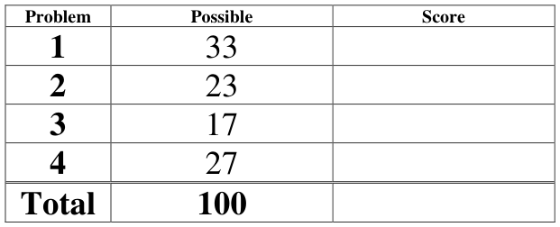
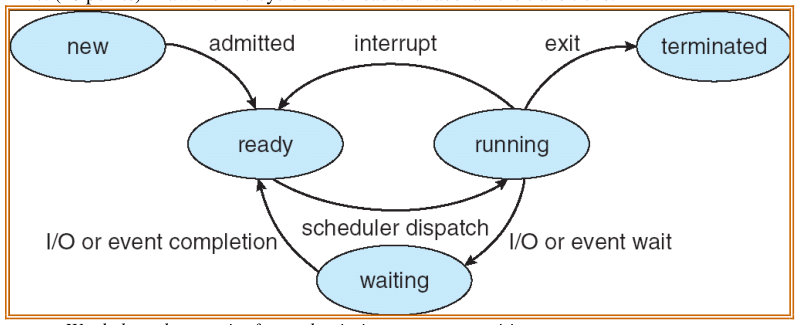

# Berkeley CS162 Spring 2008: Midterm 1: Official solutions

> Copied from the original: <https://hkn.eecs.berkeley.edu/exams/course/cs/162>. Text and figures are taken from the PDF as is; nothing was answered or rewritten. The original PDF is in this folder.

---

**Page 1**

&emsp;&emsp;&emsp;&emsp;&emsp;&emsp;&emsp;&emsp;University of California, Berkeley 
&emsp;&emsp;&emsp;&emsp;&emsp;&emsp;&emsp;&emsp;College of Engineering 
&emsp;&emsp;&emsp;&emsp;&emsp;&emsp;&emsp;&emsp;Computer Science Division – EECS 
Spring 2008                                     Anthony D. Joseph 
&emsp;&emsp;&emsp;&emsp;&emsp;&emsp;&emsp;&emsp;**Midterm Exam Solutions** 
&emsp;&emsp;&emsp;&emsp;&emsp;&emsp;&emsp;&emsp;February 27, 2008 
&emsp;&emsp;&emsp;&emsp;&emsp;&emsp;&emsp;&emsp;CS162 Operating Systems

General Information: 
This is a **closed book and notes** examination. You have 90 minutes to answer as many questions 
as possible.  The number in parentheses at the beginning of each question indicates the number of 
points given to the question; there are 100 points in all. You should read **all** of the questions 
before starting the exam, as some of the questions are substantially more time consuming. 
Write all of your answers directly on this paper.  **Make your answers as concise as possible.** If there 
is something in a question that you believe is open to interpretation, then please ask us about it! 
&emsp;&emsp;&emsp;&emsp;&emsp;&emsp;&emsp;&emsp;**Good Luck!!**

Page 1/18

---

**Page 2**

CS 162 Spring 2008 Midterm Exam        February 27, 2008 
Solutions

1\. (33 points total) Short answer questions: 
&emsp;a. (4 points) True/False and Why? 
&emsp;&emsp;In the operating system environments that we’ve studied so far, an application 
&emsp;&emsp;programmer has to worry about deadlock occurring involving the CPU as a 
&emsp;&emsp;resource. 
&emsp;&emsp;&emsp;&emsp;&emsp;TRUE                    FALSE 
&emsp;&emsp;&emsp;&emsp;&emsp;Why? 
&emsp;&emsp;&emsp;&emsp;&emsp;**FALSE**. The CPU is easily preempted which eliminates one of the four 
&emsp;&emsp;&emsp;&emsp;&emsp;preconditions for deadlock. The correct answer was worth 2 pts and a 
&emsp;&emsp;&emsp;&emsp;&emsp;reasonable explanation that mentioned the OS preempting the CPU was 2 
&emsp;&emsp;&emsp;&emsp;&emsp;pts. Some students incorrectly said there was no waiting while holding the 
&emsp;&emsp;&emsp;&emsp;&emsp;CPU, but a program could busy wait to create a deadlock.

&emsp;b. (4 points) True/False and Why? 
&emsp;&emsp;In the operating system environments that we’ve studied so far (i.e., no virtual 
&emsp;&emsp;memory), the operating system has to worry about deadlock occurring involving 
&emsp;&emsp;physical memory as a resource. 
&emsp;&emsp;&emsp;&emsp;&emsp;TRUE                    FALSE 
&emsp;&emsp;&emsp;&emsp;&emsp;Why? 
&emsp;&emsp;&emsp;&emsp;&emsp;**TRUE**. Physical memory cannot be preempted. Some students mistakenly 
&emsp;&emsp;&emsp;&emsp;&emsp;thought that the resource in question was a lock in memory, instead of 
&emsp;&emsp;&emsp;&emsp;&emsp;simply chunks of memory necessary for process execution. We gave full 
&emsp;&emsp;&emsp;&emsp;&emsp;credit for False answers that said as their justification that OSs we’ve 
&emsp;&emsp;&emsp;&emsp;&emsp;studied do not worry about deadlock and it is the application 
&emsp;&emsp;&emsp;&emsp;&emsp;programmers responsibility.

Page 2/18

---

**Page 3**

CS 162 Spring 2008 Midterm Exam        February 27, 2008 
Solutions 
&emsp;c.  (5 points) Disabling interrupts: 
&emsp;&emsp;i) (3 points) Give a two to three sentence description of how interrupts can be 
&emsp;&emsp;&emsp;used to implement critical sections. 
&emsp;&emsp;&emsp;Disabling interrupts prevents interrupts from involuntarily preempting the 
&emsp;&emsp;&emsp;current thread (2 pts). If the thread does not voluntarily give up control, it can 
&emsp;&emsp;&emsp;run the critical section to completion without interference (1 pt). 
&emsp;&emsp;&emsp;We only gave 1 pt for this problem if the answer described how the 
&emsp;&emsp;&emsp;implementation works with little other explanation about the effects of 
&emsp;&emsp;&emsp;disabling interrupts.

&emsp;&emsp;ii) (2 points) Briefly (2-3 sentences) state the problems with implementing critical 
&emsp;&emsp;&emsp;sections using disabling of interrupts. 
&emsp;&emsp;&emsp;We gave 2 pts for answers that mentioned any of the following – disabling 
&emsp;&emsp;&emsp;interrupts doesn’t work on a multiprocessor can’t be used by user-level 
&emsp;&emsp;&emsp;applications, could allow infinite loops, arbitrarily delay other processes, may 
&emsp;&emsp;&emsp;cause real-time systems to fail, and may cause interrupt buffer overflow. 
&emsp;&emsp;&emsp;We only gave 1 pt for answers that mentioned lesser issues – may lead to 
&emsp;&emsp;&emsp;unfair processor allocations, may cause other processes to wait a while, 
&emsp;&emsp;&emsp;disabling interrupts for a while is bad, and other issues that were either less 
&emsp;&emsp;&emsp;realistic or less well defined.

Page 3/18

---

**Page 4**

CS 162 Spring 2008 Midterm Exam        February 27, 2008 
Solutions

&emsp;d. (8 points) List the four requirements for deadlock. 
&emsp;&emsp;&emsp;Mutual exclusion, non-preemptable resources, hold and wait, circular chain 
&emsp;&emsp;&emsp;of waiting. 
&emsp;&emsp;&emsp;Each requirement was worth 2 points.

&emsp;e. (4 points) Briefly explain why when using a Hoare semantic monitors it is 
&emsp;&emsp;sufficient to use “if” statements when checking state variables, while most OS 
&emsp;&emsp;monitor implementations require the use of “while” statements. 
&emsp;&emsp;&emsp;With Hoare semantic monitors, the signaled thread is guaranteed to receive 
&emsp;&emsp;&emsp;the lock and control immediately, thus the recipient is guaranteed to be able 
&emsp;&emsp;&emsp;to proceed. Most OS monitor implementations only place the signaled thread 
&emsp;&emsp;&emsp;on the ready queue; thus, other threads may run (and access the critical 
&emsp;&emsp;&emsp;section) between the time that the thread is signaled and when it actually runs. 
&emsp;&emsp;&emsp;We deducted 1 pt for only saying something about Hoare and not comparing 
&emsp;&emsp;&emsp;to Mesa/OS monitors, or not emphasizing that another thread can change the 
&emsp;&emsp;&emsp;synchronization condition the initial thread slept on. If the answer was vague 
&emsp;&emsp;&emsp;and didn’t imply an understanding of the IfWhile issue, and was just a 
&emsp;&emsp;&emsp;definition of a Hoare monitor, then it we deducted 2 pts. Extraneous, vague, 
&emsp;&emsp;&emsp;or off-topic answers resulted in another 1 pt deduction.

Page 4/18

---

**Page 5**

CS 162 Spring 2008 Midterm Exam        February 27, 2008 
Solutions 
&emsp;f. (8 points) In lecture, we discussed using atomic instructions (e.g., test-and-set and 
&emsp;&emsp;swap) to implement spinlocks. With spinlocks, threads spin in a loop (busy 
&emsp;&emsp;waiting) until the lock is freed. We motivated the use of blocking locks and 
&emsp;&emsp;semaphores as an improvement over spinlocks because having threads spin can be 
&emsp;&emsp;very inefficient in terms of processor utilization. However, spinlocks are not 
&emsp;&emsp;always less efficient than blocking locks. In two to three sentences, briefly 
&emsp;&emsp;describe a scenario where spinlocks would be more efficient than blocking locks. 
&emsp;&emsp;&emsp;Spinlocks are more efficient when the critical sections are very short (e.g., one 
&emsp;&emsp;&emsp;or a few instructions that increment a shared variable), or when the critical 
&emsp;&emsp;&emsp;section is rarely contested (i.e., Acquire almost always will succeed). 
&emsp;&emsp;&emsp;Spinlocks are more efficient in these cases than, say, semaphores, because the 
&emsp;&emsp;&emsp;overhead to acquire the lock is incredibly low (one instruction). I also 
&emsp;&emsp;&emsp;accepted the multiprocessor answers from the book. 
&emsp;&emsp;&emsp;We deducted 2 points for not mentioning how spinlocks have less overhead 
&emsp;&emsp;&emsp;than other locks (like semaphore). 
&emsp;&emsp;&emsp;We deducted 4 points for not saying when to apply these spinlocks, or -2 
&emsp;&emsp;&emsp;points if it wasn’t clear how your explanation applied to the locking issue, 
&emsp;&emsp;&emsp;especially with respect to the “shortness” or “uncontestedness” of the lock. 
&emsp;&emsp;&emsp;Partial explanations that didn’t answer the question were a 6 point deduction. 
&emsp;&emsp;&emsp;Completely off-topic answers received no credit.

Page 5/18

---

**Page 6**

CS 162 Spring 2008 Midterm Exam        February 27, 2008 
Solutions 
2\. (23 points total) Implementing and Using Synchronization Primitives. 
&emsp;a. (6 points) While working on the first project, one of your project partners proposes 
&emsp;&emsp;to use a modified version of Semaphore to implement the condition variable class 
&emsp;&emsp;as follows: 
&emsp;&emsp;`Semaphore.set(0);`        `// Initialize semaphore to 0` 
&emsp;&emsp;`Wait(Lock lock) {` 
&emsp;&emsp;&emsp;&emsp;&emsp;`Semaphore.P(lock); // Special semaphore that` 
&emsp;&emsp;&emsp;&emsp;&emsp;&emsp;&emsp;&emsp;`// releases lock if it waits` 
&emsp;&emsp;`}`

&emsp;&emsp;`Signal() {` 
&emsp;&emsp;&emsp;&emsp;&emsp;`Semaphore.V();` 
&emsp;&emsp;`}` 
&emsp;&emsp;Decide whether you think their proposal will work or not, and briefly, in two to 
&emsp;&emsp;three sentences, explain your decision 
&emsp;This will not work because Semaphores are commutative, while condition variables 
&emsp;are not. Semaphores have history (their counter), and repeated signal calls will 
&emsp;increment the counter, causing subsequent wait calls to proceed immediately. 
&emsp;Several students said that this implementation would not work because Wait() does 
&emsp;not reacquire the lock after P(lock) is returned. However, the re-acquisition of the 
&emsp;lock was implicit in the P(lock) function, just as the release of the lock was implicit as 
&emsp;well. No credit was given for this answer. 
&emsp;Other students claimed that the implementation wouldn’t work because to call 
&emsp;Signal() you first had to call Wait() and since the initial value of the Semaphore was 
&emsp;0, it would deadlock. However, it is not necessary that Wait() has to be called by a 
&emsp;thread in order to call Signal(). It is only necessary that you possess the lock to 
&emsp;execute either function. No credit was given for this answer. 
&emsp;Some students understood that the Signal() implementation was erroneous because it 
&emsp;incremented the Counter and changed the state of the Condition variable. However, 
&emsp;they failed to explicitly state why this was an issue – i.e., they didn't talk about 
&emsp;commutativity or how calling Signal() would let another thread that called Wait() to 
&emsp;immediately return from the call. We took off either 2 or 3 points depending on the 
&emsp;correctness and quality of the explanation.

Page 6/18

---

**Page 7**

CS 162 Spring 2008 Midterm Exam        February 27, 2008 
Solutions

&emsp;b. (9 points) Another one of your project partners proposes the opposite – to 
&emsp;&emsp;implement semaphores using an unmodified Mesa-style Monitor class. Show a 
&emsp;&emsp;possible implementation of a Semaphore class using monitors. You should 
&emsp;&emsp;provide the initialize(value), P(), and V() operations. 
&emsp;&emsp;`Semaphore {` 
&emsp;&emsp;&emsp;&emsp;&emsp;`int value;` 
&emsp;&emsp;&emsp;&emsp;&emsp;`Lock lock = FREE;` 
&emsp;&emsp;&emsp;&emsp;&emsp;`Condition cond = NULL;`

&emsp;&emsp;&emsp;&emsp;&emsp;`initialize(int initialvalue) {` 
&emsp;&emsp;&emsp;&emsp;&emsp;&emsp;&emsp;`if (initialvalue < 0) throw exception;` 
&emsp;&emsp;&emsp;&emsp;&emsp;&emsp;&emsp;`value = initialvalue;` 
&emsp;&emsp;&emsp;&emsp;&emsp;`}`

&emsp;&emsp;&emsp;&emsp;&emsp;`P() {` 
&emsp;&emsp;&emsp;&emsp;&emsp;&emsp;&emsp;`lock.acquire();` 
&emsp;&emsp;&emsp;&emsp;&emsp;&emsp;&emsp;`while (value == 0)` 
&emsp;&emsp;&emsp;&emsp;&emsp;&emsp;&emsp;&emsp;`cond.wait(lock);` 
&emsp;&emsp;&emsp;&emsp;&emsp;&emsp;&emsp;`value--;` 
&emsp;&emsp;&emsp;&emsp;&emsp;&emsp;&emsp;`lock.release();` 
&emsp;&emsp;&emsp;&emsp;&emsp;`}`

&emsp;&emsp;&emsp;&emsp;&emsp;`V() {` 
&emsp;&emsp;&emsp;&emsp;&emsp;&emsp;&emsp;`lock.acquire();` 
&emsp;&emsp;&emsp;&emsp;&emsp;&emsp;&emsp;`if (++value == 1)` 
&emsp;&emsp;&emsp;&emsp;&emsp;&emsp;&emsp;&emsp;`cond.signal();` 
&emsp;&emsp;&emsp;&emsp;&emsp;&emsp;&emsp;`lock.release();` 
&emsp;&emsp;&emsp;&emsp;&emsp;`}`

Page 7/18

---

**Page 8**

CS 162 Spring 2008 Midterm Exam        February 27, 2008 
Solutions

A correct P() implementation was worth 4 points. A correct V() implementation was 
worth 4 points. A correct initialize() implementation was worth 1 point. 
-1 for not checking if the value passed to initialize was less than 0. 
-1 for not explicitly stating that a lock is acquired/released or for not using the 
synchronized keyword in the method definitions. Any misuse of a lock (e.g., forgetting to 
acquire/release) also incurred -1. 
-2 for using a “while” instead of an “if” in P(). \[However, some people who used “if” 
kept an extra variable that kept track of the number of threads waiting in P() and only 
incremented the value of the semaphore if this variable was zero. This was acceptable\] 
-2 for releasing the lock and THEN trying to use a condition variable 
-2 for failing to call ConditionVar.Signal() in V() 
-2 for disabling/enabling interrupts instead of using locks. 
-2 if your semaphore did not work for corner cases. Some student’s implementations 
allowed P() to be executed twice without blocking, even if the initial value was 1. 
-2 if your P() always blocked, regardless of the value. 
-2 if, for some reason or another your V() call blocked. 
-2 if your V() or P() didn’t increment/decrement the value every time (unless you were 
one of the people who had a working implementation with “if”) 
-2 for any concurrency issues that existed even if locks were used.

Page 8/18

---

**Page 9**

CS 162 Spring 2008 Midterm Exam        February 27, 2008 
Solutions

&emsp;c. (8 points) Nested Monitors. 
&emsp;&emsp;i) (5 points) In this question, we’ll consider the effects of nesting two monitors, 
&emsp;&emsp;&emsp;M1 and M2: 
&emsp;&emsp;&emsp;&emsp;&emsp; Inside the code in Monitor M1 that manipulates M1’s state variables, 
&emsp;&emsp;&emsp;&emsp;&emsp;&emsp;there is a procedure call into Monitor M2 
&emsp;&emsp;&emsp;&emsp;&emsp; M2 then waits on one of its condition variables (releasing the lock for 
&emsp;&emsp;&emsp;&emsp;&emsp;&emsp;Monitor M2). 
&emsp;&emsp;&emsp;Assuming that M2 does not call any other monitors, including M1, are there 
&emsp;&emsp;&emsp;any problems with nesting monitors in this manner? Use a simple example to 
&emsp;&emsp;&emsp;explain your answer. 
&emsp;&emsp;&emsp;&emsp;&emsp;Even though waiting in M2 releases M2’s lock, this situation can result in 
&emsp;&emsp;&emsp;&emsp;&emsp;deadlock as follows: a thread that calls from M1 to M2 will have to hold 
&emsp;&emsp;&emsp;&emsp;&emsp;the M1’s lock (since it is manipulating M1’s condition variables). If the 
&emsp;&emsp;&emsp;&emsp;&emsp;thread that will issue the signal on M2 executes in similar fashion (i.e., 
&emsp;&emsp;&emsp;&emsp;&emsp;calling a function in M1 and then a signal function in M2), it will not be 
&emsp;&emsp;&emsp;&emsp;&emsp;able to complete the function in M1 (since the original thread still holds 
&emsp;&emsp;&emsp;&emsp;&emsp;the lock), and thus, it will not be able to signal the original thread in M2. 
&emsp;&emsp;&emsp;&emsp;&emsp;-5 if you said there is no problem. 
&emsp;&emsp;&emsp;&emsp;&emsp;-3 if you said that there is a problem, but do not give an appropriate 
&emsp;&emsp;&emsp;&emsp;&emsp;explanation. The following quotes are valid examples, but are not relevant 
&emsp;&emsp;&emsp;&emsp;&emsp;to the stated problem and as a result, no credit was given: 
&emsp;&emsp;&emsp;&emsp;&emsp; “M2 sleeps with M1’s lock meaning that M1 cannot proceed until M2 
&emsp;&emsp;&emsp;&emsp;&emsp;&emsp;wakes up.” 
&emsp;&emsp;&emsp;&emsp;&emsp; “What if M2 sleeps with M1’s lock, and then another thread enters M2 
&emsp;&emsp;&emsp;&emsp;&emsp;&emsp;and then attempts to acquire M1’s lock”

Page 9/18

---

**Page 10**

CS 162 Spring 2008 Midterm Exam        February 27, 2008 
Solutions

&emsp;&emsp;ii) (3 points) Suppose that the wait in M2 also releases the lock for Monitor M1. 
&emsp;&emsp;&emsp;Does your answer for part (i) change or not? Briefly explain your answer. 
&emsp;&emsp;&emsp;&emsp;&emsp;Deadlock is no longer a problem, however, this solution would violate 
&emsp;&emsp;&emsp;&emsp;&emsp;mutual exclusion for Monitor M1 and could result in an inconsistent state 
&emsp;&emsp;&emsp;&emsp;&emsp;for the data being protected by M1. 
&emsp;&emsp;&emsp;&emsp;&emsp;-3 if you said there was no problem. 
&emsp;&emsp;&emsp;&emsp;&emsp;-2 or -3 if you said there was the a problem, but didn’t give an appropriate 
&emsp;&emsp;&emsp;&emsp;&emsp;explanation. 
&emsp;&emsp;&emsp;&emsp;&emsp;A common explanation was: 
&emsp;&emsp;&emsp;&emsp;&emsp;&emsp;&emsp;“It is only a problem if M2 doesn’t reacquire M1’s lock as well 
&emsp;&emsp;&emsp;&emsp;&emsp;&emsp;&emsp;when it wakes up.” 
&emsp;&emsp;&emsp;&emsp;&emsp;Unfortunately, it **is** a problem even if M2 did acquire M1’s lock upon 
&emsp;&emsp;&emsp;&emsp;&emsp;waking up. The reason is that if a thread is in M1’s critical code and a 
&emsp;&emsp;&emsp;&emsp;&emsp;call to a method causes the thread to lose its lock when it was not 
&emsp;&emsp;&emsp;&emsp;&emsp;expecting it, then would allow multiple threads to execute in M1’s critical 
&emsp;&emsp;&emsp;&emsp;&emsp;section. Depending on your explanation, you received either 1 point or 
&emsp;&emsp;&emsp;&emsp;&emsp;none at all.

Page 10/18

---

**Page 11**

CS 162 Spring 2008 Midterm Exam        February 27, 2008 
Solutions

3\. (17 points total) Concurrency problem: Dining Graduate Students. 
&emsp;The Dining Graduate Students problem is as follows. Six graduate students are seated 
&emsp;around a table with a large deep dish pizza in the middle. Graduate students are very 
&emsp;refined and so they eat pizza with forks and knives. But they don’t have a lot of 
&emsp;money, so they have the utensils. There are three forks and three knives in a pile next 
&emsp;to the pizza. Each student uses the following algorithm to eat: 
&emsp;&emsp;&emsp;(1) Pick up a knife 
&emsp;&emsp;&emsp;(2) Pick a fork 
&emsp;&emsp;&emsp;(3) Cut out a slice of pizza and eat it 
&emsp;&emsp;&emsp;(4) Return the knife and fork to the pile 
&emsp;a. (4 points) Specify the correctness constraints. Be succinct and explicit in your 
&emsp;&emsp;answer. 
&emsp;&emsp;A graduate student waits for a knife and then a fork (4 points). 
&emsp;&emsp;We gave one point for some other type of related constraint (e.g., you can’t steal 
&emsp;&emsp;utensils, there’s one fork and one knife per diner, etc.) 
&emsp;&emsp;-1 for not stating a student must have both knife and fork before eating. 
&emsp;&emsp;-1 for not stating a student must pick up a knife before picking up a fork. 
&emsp;&emsp;-1 for saying any implementation-dependent details (i.e. thread, lock, and etc.) 
&emsp;&emsp;-1 for each statement that is wrong (i.e. only one student can eat at a time).

&emsp;b. (5 points) Can deadlock ever occur? Explain your answer in terms of the 
&emsp;&emsp;conditions for deadlock to occur. If deadlock could occur, describe a reasonable 
&emsp;&emsp;deadlock avoidance algorithm. If deadlock cannot occur, explain why not. 
&emsp;&emsp;&emsp;Deadlock cannot occur, since the students’ algorithm defines a partial 
&emsp;&emsp;&emsp;ordering for resource acquisition (knives, then forks), and the number of 
&emsp;&emsp;&emsp;knives and forks is equivalent, meaning that acquiring a knife guarantees that 
&emsp;&emsp;&emsp;a fork can be acquired. Thus, there is no circular waiting while holding, 
&emsp;&emsp;&emsp;which violates one of the four preconditions for deadlock to occur. 
&emsp;&emsp;&emsp;-5 for saying yes and not considering the order of picking up a knife before 
&emsp;&emsp;&emsp;fork. 
&emsp;&emsp;&emsp;-4 for saying yes, but acknowledging the picking order has some sort of effect. 
&emsp;&emsp;&emsp;-4 for saying no, but for wrong reasons (i.e., require picking up a knife and 
&emsp;&emsp;&emsp;fork atomically). 
&emsp;&emsp;&emsp;-2 for messing up the order (i.e., fork before knife).

Page 11/18

---

**Page 12**

CS 162 Spring 2008 Midterm Exam        February 27, 2008 
Solutions

&emsp;c. (8 points) Implement the `Dine()` method using only semaphores (your solution 
&emsp;&emsp;may not use locks, monitors, or other synchronization primitives). Create a 
&emsp;&emsp;method `Dine()`, which waits until a student has fork and knife and can eat, then 
&emsp;&emsp;calls `Eat()`, and then releases the utensils before returning. Your solution should 
&emsp;&emsp;allow multiple students to eat at the same time (as long as there are sufficient 
&emsp;&emsp;utensils in a pile in the middle of the table). Assume you are given the variables, 
&emsp;&emsp;`forks` and `knifes`, which each starts off initialized to the total number of forks 
&emsp;&emsp;and knives available, respectively. Based on your answer from part 3.b, your 
&emsp;&emsp;solution should avoid deadlock. 
&emsp;&emsp;The key insight is to set the initial value of the semaphore to the minimum of the 
&emsp;&emsp;total number of forks or knives. Then, each P operation effectively grabs a knife 
&emsp;&emsp;and fork and each V operation relinquishes a knife and fork. 
&emsp;`Semaphore pairs = new Semaphore(min(forks, knives));`

&emsp;`Dine() {` 
&emsp;`pairs.P();`         `// This “acquires” a knife and fork` 
&emsp;`Eat();` 
&emsp;`pairs.V();`         `// This “releases” a knife and fork` 
&emsp;`}` 
&emsp;-8 pts: using other synchronization primitives (i.e., locks, monitors, CVs, interrupts) 
&emsp;-7 pts: didn’t enforce correctness constraint (need knife and fork to eat). 
&emsp;-7 pts:  trying to use a semaphore in an illegal way (e.g., trying to check the value) 
&emsp;-7 pts:  non-working solutions (i.e. non-synchronized code). 
&emsp;-6 pts: only one graduate student can eat at a time. 
&emsp;-5 pts: no call to Eat() 
&emsp;-5 pts: deadlock possible 
&emsp;-5 pts: busy waiting 
&emsp;-5 pts: solution fails if pairs is initially set to some value 
&emsp;-2 pts: messing up the order (i.e., fork before knife). 
&emsp;-1 pts: missing semaphore initializations or values 
&emsp;-1 pts: incorrect semaphore init values (i.e., some people did “Semaphore 
utensilPairs(floor(fork, knife)/2)”) 
&emsp;-1 pt: extraneous/redundant semaphores 
&emsp;-1 pt: didn’t show initialization of semaphore value 
&emsp;-5 – 7 pts: incorrect use of semaphores. Many students defined integer variables to 
explicitly keep track of the number of available knives and forks, and used an “if” or 
“while” statement to look up the variable values – this solution is basically trying to 
implement condition variables using semaphore. Some solutions come close to 
successfully implement a working condition variable using semaphore. However, we took 
off points because this shows a lack of understanding of semaphores. In particular, a 
semaphore already provides these counters implicitly. We took off 5 to 7 points 
depending on how badly semaphores were misused.

Page 12/18

---

**Page 13**

CS 162 Spring 2008 Midterm Exam        February 27, 2008 
Solutions 
&emsp;&emsp;Another solution: 
&emsp;`Int forks`    `= N;`     `// Total number of forks` 
&emsp;`Int knives`    `= N;`     `// Total number of knives` 
&emsp;`Semaphore Lock = new Semaphore (1);    // mutex` 
&emsp;`Semaphore SemF = new Semaphore (forks);  // scheduling` 
&emsp;`Semaphore SemK = new Semaphore (knives);  // scheduling` 
&emsp;`Dine {` 
&emsp;`Lock.P();`        `// This “acquires” mutex` 
&emsp;`SemK.P();`        `// This “acquires” one knife` 
&emsp;`SemF.P();`        `// This “acquires” one fork` 
&emsp;`Lock.V();`        `// This “releases” mutex` 
&emsp;`Eat();` 
&emsp;`SemF.V();`        `// This “releases” one fork` 
&emsp;`SemK.V();`        `// This “releases” one knife`

&emsp;`}`

Page 13/18

---

**Page 14**

CS 162 Spring 2008 Midterm Exam        February 27, 2008 
Solutions

4\. (27 points total) Operating Systems. 
&emsp;a.  (6 points) What are the two roles of an Operating System. For each role, briefly 
&emsp;&emsp;(one to two sentences) explain the role. 
&emsp;&emsp;i) 
&emsp;&emsp;&emsp;Coordinator and Traffic Cop – The OS manages all resources, settles 
&emsp;&emsp;&emsp;conflicting requests for resources, and prevent errors and improper use of the 
&emsp;&emsp;&emsp;computer.

&emsp;&emsp;ii) 
&emsp;&emsp;&emsp;Facilitator – The OS provides facilities that everyone needs, such as standard 
&emsp;&emsp;&emsp;libraries, windowing systems, etc., and helps make application programming 
&emsp;&emsp;&emsp;easier, faster, and less error-prone. 
&emsp;&emsp;&emsp;Also, OS as Illusionist, where the OS hides hardware constraints and gives the 
&emsp;&emsp;&emsp;illusion of a dedicated machine. 
&emsp;&emsp;&emsp;We deducted 1 to 3 points depending on how much the answer for part (ii) 
&emsp;&emsp;&emsp;overlapped the answer for part (i).

&emsp;b. (5 points) What private (thread-private) and public (shared between cooperating 
&emsp;&emsp;threads) resources are allocated when a thread is created? How do they differ 
&emsp;&emsp;from those allocated when a process is created? 
&emsp;&emsp;&emsp;&emsp;&emsp;A thread is allocated a private Thread Control Block which holds a 
&emsp;&emsp;&emsp;&emsp;&emsp;register set, including Program Counter and Stack Pointer (for some 
&emsp;&emsp;&emsp;&emsp;&emsp;architectures, a Frame Pointer), and it is allocated memory for a stack. 
&emsp;&emsp;&emsp;&emsp;&emsp;The thread is also has access to shared memory within an address space, 
&emsp;&emsp;&emsp;&emsp;&emsp;containing code, initialized data, uninitialized data (heap), and file 
&emsp;&emsp;&emsp;&emsp;&emsp;descriptors. 
&emsp;&emsp;&emsp;&emsp;&emsp;A process is allocated a Process Control Block and an address space 
&emsp;&emsp;&emsp;&emsp;&emsp;containing code, initialized data, uninitialized data (heap), file 
&emsp;&emsp;&emsp;&emsp;&emsp;descriptors, and space for threads. 
&emsp;&emsp;&emsp;&emsp;&emsp;We deducted ½ point for each error in how resources are shared or 
&emsp;&emsp;&emsp;&emsp;&emsp;allocated

Page 14/18

---

**Page 15**

CS 162 Spring 2008 Midterm Exam        February 27, 2008 
Solutions

&emsp;c. (10 points) Draw the life cycle of a thread and label all the transitions:

&emsp;&emsp;We deducted one point for each missing state or transition.

Page 15/18

---

**Page 16**

CS 162 Spring 2008 Midterm Exam        February 27, 2008 
Solutions

&emsp;d. (6 points) We discussed the Therac-25 in lecture and in an assigned reading. 
&emsp;&emsp;i) What is the Therac-25, and how does it differ from the Therac-20? 
&emsp;&emsp;&emsp;The Therac-25 is a machine for radiation therapy that produces electron 
&emsp;&emsp;&emsp;beam and X-ray radiation. It differs from the Therac-20 in that it uses only 
&emsp;&emsp;&emsp;software control and safety interlocks in the electron accelerator and electron 
&emsp;&emsp;&emsp;beam/X-ray production process, and software control of dosage. The Therac- 
&emsp;&emsp;&emsp;20 included hardware safety interlocks.

&emsp;&emsp;ii) Explain the Therac-25’s problems and the underlying causes. 
&emsp;&emsp;&emsp;Software errors caused the deaths and injuries of several patients. There were 
&emsp;&emsp;&emsp;a series of race conditions on shared variables and poor software design that 
&emsp;&emsp;&emsp;lead to the machine’s malfunction under certain conditions.

Page 16/18

---

**Page 17**

CS 162 Spring 2008 Midterm Exam        February 27, 2008 
Solutions 
&emsp;No Credit – **Problem X** (000000000000 points) 
**A 2007 Darwin Award Runner Up** 
&emsp;&emsp;“Named in honor of Charles Darwin, the father of evolution, the Darwin Awards 
&emsp;&emsp;commemorate those who improve our gene pool by accidentally removing 
&emsp;&emsp;themselves from it.” (http://www.darwinawards.com/)

The Laptop Still Works! 
\[Confirmed True\] 
(26 February 2007, California) 29-year-old Oscar was driving on Highway 99 near Yuba 
City, when his Honda Accord crossed into oncoming traffic and collided with a Hummer. 
The occupants of the Hummer were not seriously injured. California Highway Patrol 
officers found Oscar’s laptop still running, and plugged into the car’s cigarette lighter. 
Investigators believe that he was using it when his car crossed the center line. 
“Driving is not a time to be practicing your multitasking skills,” remarked CHP 
spokesman Tom Marshall. 
Oscar is not alone. Last year, 510 California drivers were charged with reckless driving 
because they were using a TV, video, or computer monitor. A 2001 CHP study cites cell 
phone use as the top cause of crashes involving distracted drivers, followed by fiddling 
with music. “Anything that distracts you can kill you, whether it’s eating lunch or 
working on a computer,” an AAA spokesman said. 
Oscar was a computer tutor. Hopefully his fatal lesson will teach others to surf on the 
information superhighway, not the asphalt superhighway.

Page 17/18

---

**Page 18**

CS 162 Spring 2008 Midterm Exam        February 27, 2008 
Solutions

&emsp;&emsp;&emsp;&emsp;&emsp;&emsp;&emsp;**This page intentionally left blank**

Page 18/18

