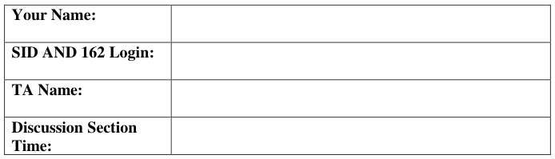
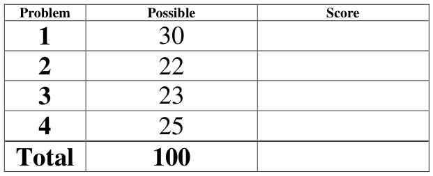
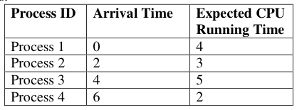
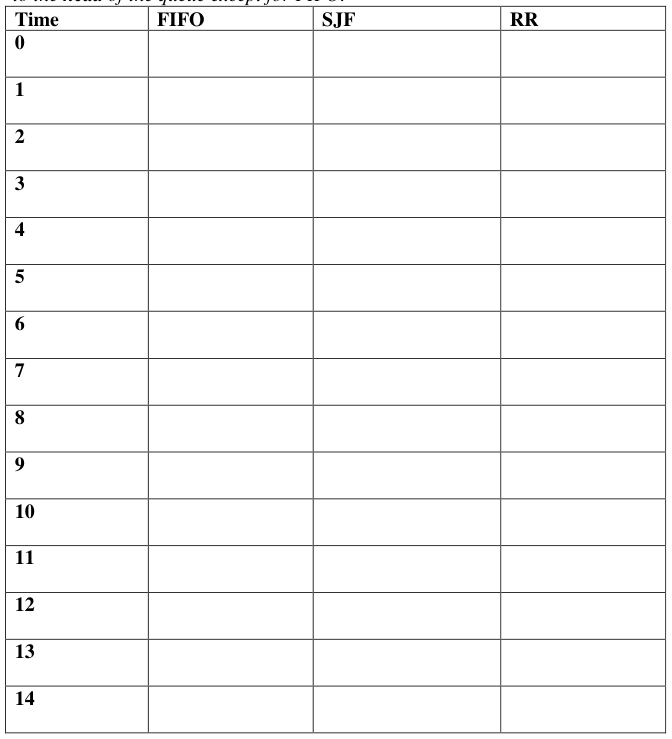
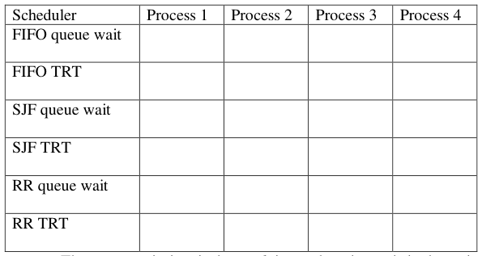

# Berkeley CS162 Spring 2008: Midterm 2: Questions

> Copied from the original: <https://hkn.eecs.berkeley.edu/exams/course/cs/162>. Text and figures are taken from the PDF as is; nothing was answered or rewritten. The original PDF is in this folder.

---

**Page 1**

&emsp;&emsp;&emsp;&emsp;&emsp;&emsp;&emsp;&emsp;University of California, Berkeley 
&emsp;&emsp;&emsp;&emsp;&emsp;&emsp;&emsp;&emsp;College of Engineering 
&emsp;&emsp;&emsp;&emsp;&emsp;&emsp;&emsp;&emsp;Computer Science Division – EECS 
Spring 2008                                     Anthony D. Joseph 
&emsp;&emsp;&emsp;&emsp;&emsp;&emsp;&emsp;&emsp;**Midterm Exam #2** 
&emsp;&emsp;&emsp;&emsp;&emsp;&emsp;&emsp;&emsp;April 16, 2008 
&emsp;&emsp;&emsp;&emsp;&emsp;&emsp;&emsp;&emsp;CS162 Operating Systems

General Information: 
This is a **closed book and notes** examination. You have 90 minutes to answer as many questions 
as possible.  The number in parentheses at the beginning of each question indicates the number of 
points given to the question; there are 100 points in all. You should read **all** of the questions 
before starting the exam, as some of the questions are substantially more time consuming. 
Write all of your answers directly on this paper.  **Make your answers as concise as possible.** If there 
is something in a question that you believe is open to interpretation, then please ask us about it! 
&emsp;&emsp;&emsp;&emsp;&emsp;&emsp;&emsp;&emsp;**Good Luck!!**

Page 1/12

---

**Page 2**

CS 162 Spring 2008 Midterm #2 Exam        April 16, 2008

1\. (30 points total) Short answer questions: 
&emsp;a. (12 points) True/False and Why? 
&emsp;&emsp;i) Small time slices always improve the average completion time of a system. 
&emsp;&emsp;&emsp;&emsp;&emsp;TRUE                    FALSE 
&emsp;&emsp;&emsp;&emsp;&emsp;Why?

&emsp;&emsp;ii) Shortest Job First (SJF) or Shortest Completion Time First (SCTF) scheduling 
&emsp;&emsp;&emsp;is difficult to build on a real operating system. 
&emsp;&emsp;&emsp;&emsp;&emsp;TRUE                    FALSE 
&emsp;&emsp;&emsp;&emsp;&emsp;Why?

&emsp;&emsp;iii) You run a workload using a fixed-size 100 MB (megabyte) buffer cache and 
&emsp;&emsp;&emsp;notice that there are many disk references. If you repartition main memory to 
&emsp;&emsp;&emsp;increase the buffer cache size to 200 MB, the workload may actually run 
&emsp;&emsp;&emsp;significantly slower. 
&emsp;&emsp;&emsp;&emsp;&emsp;TRUE                    FALSE 
&emsp;&emsp;&emsp;&emsp;&emsp;Why?

Page 2/12

---

**Page 3**

CS 162 Spring 2008 Midterm #2 Exam        April 16, 2008

&emsp;&emsp;iv) You profile your file system and notice that over the course of the day the 
&emsp;&emsp;&emsp;system used 6,200 files, whose total size in bytes was 100 times larger than 
&emsp;&emsp;&emsp;the size of the file system’s buffer cache. A cache cannot provide much 
&emsp;&emsp;&emsp;benefit for this type of workload. 
&emsp;&emsp;&emsp;&emsp;&emsp;TRUE                    FALSE 
&emsp;&emsp;&emsp;&emsp;&emsp;Why?

&emsp;b.  (5 points) Roughly order stack, code, and heap segments as to how well you would 
&emsp;&emsp;expect them to perform under a paged VM system that uses LRU page 
&emsp;&emsp;replacement. State the intuitions for your ordering.

&emsp;c. (5 points) You’re hired to develop the next-generation of high performance Web 
&emsp;&emsp;2.0 servers. One of the developers on your team proposes the idea of using disk 
&emsp;&emsp;compression to store data (storing data in compressed disk blocks), but your boss 
&emsp;&emsp;disagrees saying that disk storage is cheap and there’s no reason to use 
&emsp;&emsp;compression. Do you agree with your teammate or your boss? What are the 
&emsp;&emsp;arguments (tradeoffs, benefits, and disadvantages) in favor of or against disk 
&emsp;&emsp;compression?

Page 3/12

---

**Page 4**

CS 162 Spring 2008 Midterm #2 Exam        April 16, 2008

&emsp;d. (8 points) Since high-performance scientific computing applications run on very 
&emsp;&emsp;expensive supercomputers, it is very important to optimize their performance. 
&emsp;&emsp;Consider the following scientific computing function: 
&emsp;&emsp;&emsp;&emsp;&emsp;`MatrixAdd(int a[][], b[][], int n) {` 
&emsp;&emsp;&emsp;&emsp;&emsp;`for (i = 0; i < n; i++)` 
&emsp;&emsp;&emsp;&emsp;&emsp;`for (j = 0; j < n; j++)` 
&emsp;&emsp;&emsp;&emsp;&emsp;`a[j][i] += b[j][i];` 
&emsp;&emsp;&emsp;&emsp;&emsp;`}` 
&emsp;&emsp;The matricies a and b are allocated using the following code: 
&emsp;&emsp;&emsp;&emsp;&emsp;`MatrixAllocate(int n) {` 
&emsp;&emsp;&emsp;&emsp;&emsp;`a = malloc (n * size of *a);` 
&emsp;&emsp;&emsp;&emsp;&emsp;`for (i = 0; i < n; i++)` 
&emsp;&emsp;&emsp;&emsp;&emsp;`a[i] = malloc(n * sizeof a[i]);` 
&emsp;&emsp;&emsp;&emsp;&emsp;`return a;` 
&emsp;&emsp;&emsp;&emsp;&emsp;`}` 
&emsp;&emsp;You observe that the program runs more slowly than expected when calling 
&emsp;&emsp;`MatrixAdd`, so you turn on profiling and notice that the function is causing 
&emsp;&emsp;large numbers of TLB flush operations – much more than expected. Explain the 
&emsp;&emsp;likely cause and implement a simple fix. Also, explain what you generally expect 
&emsp;&emsp;to happen to paging performance when your fix is implemented?

Page 4/12

---

**Page 5**

CS 162 Spring 2008 Midterm #2 Exam        April 16, 2008

2\. (22 points total) Multi-level Address Translation. 
&emsp;a. (10 points) You’re hired by the HAL Corporation to develop their next generation 
&emsp;&emsp;machine, the HAL 2010. It will have a virtual memory architecture with the 
&emsp;&emsp;following parameters: 
&emsp;&emsp;&emsp; Virtual addresses are 48 bits. 
&emsp;&emsp;&emsp; The page size is 32K byte. 
&emsp;&emsp;&emsp; The machine has 128 Terabytes (TB) of real memory (RAM). 
&emsp;&emsp;&emsp; The first- and second-level page tables are stored in real memory. 
&emsp;&emsp;&emsp; All page tables can start only on a page boundary. 
&emsp;&emsp;&emsp; The maximum size of each second-level page table is limited such that it 
&emsp;&emsp;&emsp;&emsp;&emsp;fits in a single page frame 
&emsp;&emsp;&emsp; There are no permission or other extra bits.

&emsp;&emsp;Your job is to draw and label a figure showing how a virtual address gets mapped 
&emsp;&emsp;into a real address. You should list how the various fields of each address are 
&emsp;&emsp;interpreted, including the size in bits of each field, the maximum possible number 
&emsp;&emsp;of entries each table holds, and the maximum possible size in bytes for each table 
&emsp;&emsp;(in bytes). Also, your answer should indicate where checks are made for faults 
&emsp;&emsp;(e.g., invalid addresses).

Page 5/12

---

**Page 6**

CS 162 Spring 2008 Midterm #2 Exam        April 16, 2008

&emsp;b. (6 points) To improve the HAL 2010’s performance, you decide to add a TLB to 
&emsp;&emsp;the HAL 2010’s virtual memory architecture. The TLB will be 4-way set 
&emsp;&emsp;associative and have 1024 rows. Draw and label a diagram of the TLB, showing 
&emsp;&emsp;the size of each field in the TLB. Indicate how bits of the virtual address are used 
&emsp;&emsp;as input to the TLB, and describe the outputs from the TLB. Include a read enable 
&emsp;&emsp;bit and write enable bit for each page in your TLB.

&emsp;c. (3 points) If your Page Table Entries contain R/W enable bits, why do they also 
&emsp;&emsp;need to be included in the TLB?

&emsp;d. (3 points) Your manager is concerned that the page tables for the HAL 2010 
&emsp;&emsp;memory system might become very large, especially if they are sparsely 
&emsp;&emsp;populated. Describe an alternate technique for the virtual memory system to more 
&emsp;&emsp;efficiently store virtual to physical address mappings, and explain how this 
&emsp;&emsp;technique would improve the storage efficiency of the page tables.

Page 6/12

---

**Page 7**

CS 162 Spring 2008 Midterm #2 Exam        April 16, 2008

No Credit – **Problem X** (000000000000 points) 
**Degrees of Matriculation** 
(April 1, 2008, adapted from NY Times Op-Ed Contributor ANDY BOROWITZ) 
FROM: Office of Admissions, Stanford University 
To: Double Legacy Applicant, Class of 2012 
Here at Stanford’s Office of Admissions, we have some very exciting news for you. While your SAT 
scores and grade point average fall below the threshold for acceptance to Stanford’s class of 2012, your 
Stanford parents’ dogged participation in our annual fund-raising appeals — including their generous 
contributions to Stanford’s recombinant DNA lab and IMAX theater — have gained you admission to a 
unique new program called LegacyPlus™. 
With LegacyPlus™, you, the Stanford double legacy, will enjoy all of the perks of students who actually 
got into Stanford — except for the education part. 
As a LegacyPlus™ attendee, you will live on the Stanford campus for the next four years in special 
LegacyPlus™ housing in historic East Palo Alto. You will walk, talk and — on four special ―Common 
Nights‖ a year — dine with real Stanford undergraduates. 
What will you and your fellow LegacyPlus™ enrollees be doing while the actual Stanford Class of 2012 is 
going to lectures, choosing majors and taking exams? A better question would be, ―What won’t you be 
doing?‖ With a jam-packed schedule of specially organized LegacyPlus™ pub crawls, you won’t have time 
to think about all of those classes you won’t be taking. 
And the benefits of LegacyPlus™ don’t end in June 2012, when, in a ceremony scheduled to coincide with 
Stanford commencement, you will receive an authentic-looking Stanford College Certificate of 
Participation™. This diploma-like document, produced by an expensive laser printer, allows you to tap into 
Stanford’s ―old boy network‖ of jobs, fellowships and government positions that have been turned down by 
actual Stanford graduates. 
Some of the additional perks of LegacyPlus™ include: 
&emsp;    Official Stanford TuitionBill™ identical to those paid by parents of the Stanford Class of 2012. 
&emsp;    Permission to root for the Stanford football, hockey and lacrosse teams; complimentary tickets to 
&emsp;&emsp;swim meets. 
&emsp;    15 percent discount on LegacyPlus™ Stanford insignia items, including a car window sticker 
&emsp;&emsp;reading, ―My Child Is at Stanford.‖ 
&emsp;    Special LegacyPlus™ ―Don’t ask, don’t tell‖ policy regarding your use of the words ―Stanford 
&emsp;&emsp;College‖ on your résumé. 
&emsp;    Invitations to LegacyPlus™ class reunions, including such events as the ―Big Game‖ attended by 
&emsp;&emsp;the actual Stanford Class of 2012, which you will view from your hotel via closed-circuit TV. 
&emsp;    And finally, the greatest privilege of all: a lifelong relationship with Stanford’s dedicated network 
&emsp;&emsp;of fund-raising cold-callers. 
So join us, won’t you? Take advantage of this rare opportunity by wiring funds today. (Prices double after 
May 1.) 
LegacyPlus™: The Class, Without the Classes.

Page 7/12

---

**Page 8**

CS 162 Spring 2008 Midterm #2 Exam        April 16, 2008

3\. (23 points total) Filesystems. 
&emsp;a.  (12 points) For each of the following file descriptor data structures, describe: how 
&emsp;&emsp;efficiently this structure handles sequential access of large files, and why. 
&emsp;&emsp;i) Contiguous Allocation:

&emsp;&emsp;ii) Linked Allocation:

&emsp;&emsp;iii) UNIX 4.2BSD inodes:

Page 8/12

---

**Page 9**

CS 162 Spring 2008 Midterm #2 Exam        April 16, 2008

&emsp;b.  (11 points) UNIX filesystems. 
&emsp;&emsp;Consider a UNIX filesystem with the following components: 
&emsp;&emsp;&emsp; Disk blocks are 4096 bytes. Sectors are 512 bytes long. 
&emsp;&emsp;&emsp; All metadata pointers are 32-bits long. 
&emsp;&emsp;&emsp; An inode has 12 direct block pointers, one indirect block pointer and one 
&emsp;&emsp;&emsp;&emsp;&emsp;double-indirect block pointer. The total inode size is 256 bytes. 
&emsp;&emsp;&emsp; Both indirect and double indirect blocks take up an entire disk block. 
&emsp;&emsp;i) (6 points) How much disk space, including metadata and data blocks, is needed 
&emsp;&emsp;&emsp;to store a 4 GB DVD image file? Show your calculation for partial credit.

&emsp;&emsp;ii) (5 points) Assuming that there is not a buffer cache, how many disk reads will 
&emsp;&emsp;&emsp;be required to read only the last byte in this file? To write it? Show your 
&emsp;&emsp;&emsp;calculations for partial credit.

Page 9/12

---

**Page 10**

CS 162 Spring 2008 Midterm #2 Exam        April 16, 2008

4\. (25 points total) CPU Scheduling. Here is a table of processes and their associated 
&emsp;arrival and running times.

&emsp;a. (9 points) Show the scheduling order for these processes under First-In-First-Out 
&emsp;&emsp;(FIFO), Shortest-Job First (SJF), and Round-Robin (RR) with a quantum = 1 time 
&emsp;&emsp;unit. Assume that the context switch overhead is 0 and new processes are added 
&emsp;&emsp;to the **head** of the queue except for FIFO.

Page 10/12

---

**Page 11**

CS 162 Spring 2008 Midterm #2 Exam        April 16, 2008

&emsp;b. (12 points) For each process in each schedule above, indicate the queue wait time 
&emsp;&emsp;and turnaround time (TRT).

&emsp;&emsp;&emsp;&emsp;&emsp;The queue wait time is the total time a thread spends in the wait queue. 
&emsp;&emsp;&emsp;&emsp;&emsp;The turnaround time is defined as the time a process takes to complete 
&emsp;&emsp;&emsp;&emsp;&emsp;after it arrives. 
&emsp;c. (4 points) A FIFO page replacement algorithm replaces the page that was first 
&emsp;&emsp;referenced the longest time ago. Under a workload with temporal reference 
&emsp;&emsp;locality, choosing to replace a page accessed a long time ago seems like a good 
&emsp;&emsp;idea, since it is not likely to be within the current locality being accessed. Does 
&emsp;&emsp;this mean that a FIFO replacement algorithm should approximate a LRU 
&emsp;&emsp;algorithm for workloads with strong locality? Justify your answer with an 
&emsp;&emsp;example.

Page 11/12

---

**Page 12**

CS 162 Spring 2008 Midterm #2 Exam        April 16, 2008

&emsp;&emsp;&emsp;&emsp;&emsp;&emsp;&emsp;**This page intentionally left blank**

Page 12/12

