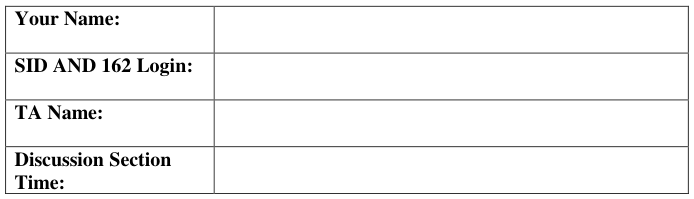
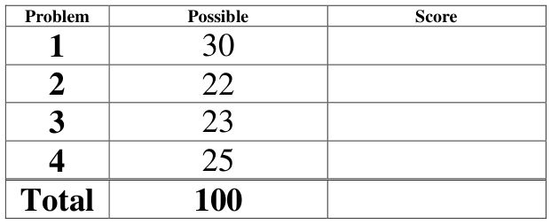
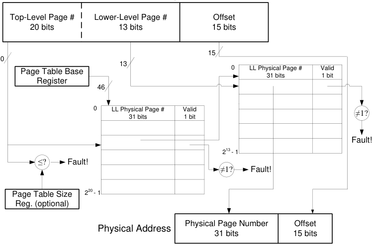
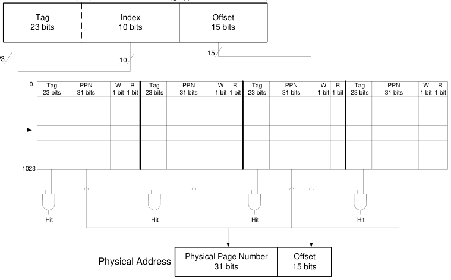
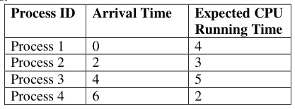
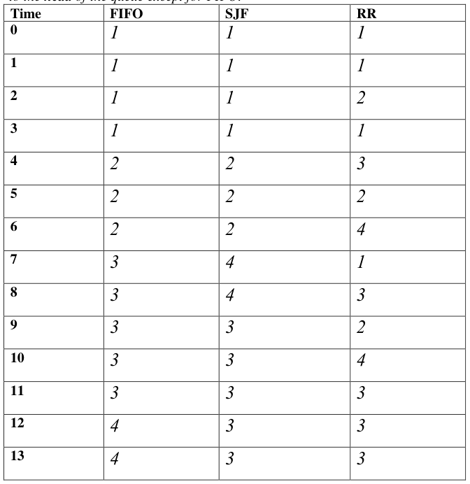
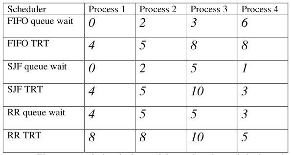

# Berkeley CS162 Spring 2008: Midterm 2: Official solutions

> Copied from the original: <https://hkn.eecs.berkeley.edu/exams/course/cs/162>. Text and figures are taken from the PDF as is; nothing was answered or rewritten. The original PDF is in this folder.

---

**Page 1**

&emsp;&emsp;&emsp;&emsp;&emsp;&emsp;&emsp;&emsp;University of California, Berkeley 
&emsp;&emsp;&emsp;&emsp;&emsp;&emsp;&emsp;&emsp;College of Engineering 
&emsp;&emsp;&emsp;&emsp;&emsp;&emsp;&emsp;&emsp;Computer Science Division – EECS 
Spring 2008                                     Anthony D. Joseph 
&emsp;&emsp;&emsp;&emsp;&emsp;&emsp;&emsp;&emsp;**Midterm Exam #2 Solutions** 
&emsp;&emsp;&emsp;&emsp;&emsp;&emsp;&emsp;&emsp;April 16, 2008 
&emsp;&emsp;&emsp;&emsp;&emsp;&emsp;&emsp;&emsp;CS162 Operating Systems

General Information: 
This is a **closed book and notes** examination. You have 90 minutes to answer as many questions 
as possible.  The number in parentheses at the beginning of each question indicates the number of 
points given to the question; there are 100 points in all. You should read **all** of the questions 
before starting the exam, as some of the questions are substantially more time consuming. 
Write all of your answers directly on this paper.  **Make your answers as concise as possible.** If there 
is something in a question that you believe is open to interpretation, then please ask us about it! 
&emsp;&emsp;&emsp;&emsp;&emsp;&emsp;&emsp;&emsp;**Good Luck!!**

Page 1/19

---

**Page 2**

CS 162 Spring 2008 Midterm #2 Exam        April 16, 2008 
Solutions

1\. (30 points total) Short answer questions: 
&emsp;a. (12 points) True/False and Why? 
&emsp;&emsp;i) Small time slices always improve the average turnaround time of all the 
&emsp;&emsp;&emsp;processes in a system. 
&emsp;&emsp;&emsp;&emsp;&emsp;TRUE                    FALSE 
&emsp;&emsp;&emsp;&emsp;&emsp;Why? 
&emsp;&emsp;&emsp;&emsp;&emsp;**FALSE**. Small time slices will sometimes improve the average response of 
&emsp;&emsp;&emsp;&emsp;&emsp;the system. If the slice is too small, the context switching time will start to 
&emsp;&emsp;&emsp;&emsp;&emsp;dominate the useful computation time and everything (including response 
&emsp;&emsp;&emsp;&emsp;&emsp;time) will suffer. A lot of students gave the example of a Round Robin 
&emsp;&emsp;&emsp;&emsp;&emsp;Scheduler with equal-length processes having a greater TRT than a FIFO 
&emsp;&emsp;&emsp;&emsp;&emsp;scheduler. Although the question did not specifically ask this, enough 
&emsp;&emsp;&emsp;&emsp;&emsp;students (~50%) gave this as an answer so we gave credit for it.

&emsp;&emsp;ii) Shortest Job First (SJF) or Shortest Completion Time First (SCTF) scheduling 
&emsp;&emsp;&emsp;is difficult to build on a real operating system. 
&emsp;&emsp;&emsp;&emsp;&emsp;TRUE                    FALSE 
&emsp;&emsp;&emsp;&emsp;&emsp;Why? 
&emsp;&emsp;&emsp;&emsp;&emsp;**TRUE**. SJF/SCTF scheduling requires knowledge of how much time a 
&emsp;&emsp;&emsp;&emsp;&emsp;process is going to take. This requires future knowledge. You might 
&emsp;&emsp;&emsp;&emsp;&emsp;require a user to specify the maximum amount of time that a process could 
&emsp;&emsp;&emsp;&emsp;&emsp;run (and kill it if it exceeds this amount), then use a variant on SJF/SCTF.

Page 2/19

---

**Page 3**

CS 162 Spring 2008 Midterm #2 Exam        April 16, 2008 
Solutions 
&emsp;&emsp;iii) You run a workload using a fixed-size 100 MB (megabyte) buffer cache and 
&emsp;&emsp;&emsp;notice that there are many disk references for files. If you repartition main 
&emsp;&emsp;&emsp;memory to increase the buffer cache size to 200 MB, the workload may 
&emsp;&emsp;&emsp;actually run significantly slower. 
&emsp;&emsp;&emsp;&emsp;&emsp;TRUE                    FALSE 
&emsp;&emsp;&emsp;&emsp;&emsp;Why? 
&emsp;&emsp;&emsp;&emsp;&emsp;**TRUE**. By decreasing main memory to increase the buffer cache, you may 
&emsp;&emsp;&emsp;&emsp;&emsp;cause processes to need to swap more often, which can decrease 
&emsp;&emsp;&emsp;&emsp;&emsp;performance. Doubling the buffer cache does not entail doubling the block 
&emsp;&emsp;&emsp;&emsp;&emsp;size of the cache itself and no credit was given for such an assumption.

&emsp;&emsp;iv) You profile your file system and notice that over the course of the day the 
&emsp;&emsp;&emsp;system used 6,200 files, whose total size in bytes was 100 times larger than 
&emsp;&emsp;&emsp;the size of the file system’s buffer cache. A cache cannot provide much 
&emsp;&emsp;&emsp;benefit for this type of workload. 
&emsp;&emsp;&emsp;&emsp;&emsp;TRUE                    FALSE 
&emsp;&emsp;&emsp;&emsp;&emsp;Why? 
&emsp;&emsp;&emsp;&emsp;&emsp;**FALSE**. It is possible that at any given time, only a small subset of the 
&emsp;&emsp;&emsp;&emsp;&emsp;files are in use; in this case, that subset can be entirely cached throughout 
&emsp;&emsp;&emsp;&emsp;&emsp;its use.

Page 3/19

---

**Page 4**

CS 162 Spring 2008 Midterm #2 Exam        April 16, 2008 
Solutions 
&emsp;b.  (5 points) Roughly order stack, code, and heap segments as to how well you would 
&emsp;&emsp;expect them to perform in a heavyweight process, paged VM system that uses 
&emsp;&emsp;LRU page replacement. State the intuitions for your ordering. 
&emsp;&emsp;&emsp;&emsp;&emsp;An ideal replacement policy should always throw out the page in memory 
&emsp;&emsp;&emsp;&emsp;&emsp;that will be used the farthest in the future; thus, we use this idea as a 
&emsp;&emsp;&emsp;&emsp;&emsp;metric for gauging the performance of Stack, Code and Heap pages. 
&emsp;&emsp;&emsp;&emsp;&emsp;Heap accesses are extremely random, so even if an LRU policy throws out 
&emsp;&emsp;&emsp;&emsp;&emsp;the least recently used heap page, probabilistically, each heap page has a 
&emsp;&emsp;&emsp;&emsp;&emsp;uniform chance of being chosen next, so LRU is effectively as good as a 
&emsp;&emsp;&emsp;&emsp;&emsp;random replacement policy in this context. 
&emsp;&emsp;&emsp;&emsp;&emsp;Code pages are far less random. They execute sequentially, so it is highly 
&emsp;&emsp;&emsp;&emsp;&emsp;likely that the next instruction one chooses to execute is on the current 
&emsp;&emsp;&emsp;&emsp;&emsp;page. However, Code Pages do have jumps to other functions/library calls 
&emsp;&emsp;&emsp;&emsp;&emsp;that may not have been used in a while and may exist on other pages, so 
&emsp;&emsp;&emsp;&emsp;&emsp;there is still a small chance that LRU evicts the code page that the user 
&emsp;&emsp;&emsp;&emsp;&emsp;program would use in the near future. 
&emsp;&emsp;&emsp;&emsp;&emsp;Stack pages, by definition, work via LIFO (which is conducive to LRU). 
&emsp;&emsp;&emsp;&emsp;&emsp;This means the top of the stack is the most recently used, while the bottom 
&emsp;&emsp;&emsp;&emsp;&emsp;of the stack is the least recently used. It is unlikely that you have an 
&emsp;&emsp;&emsp;&emsp;&emsp;instruction that directly references information that resides in several 
&emsp;&emsp;&emsp;&emsp;&emsp;stack frames above the current one, so the chances of the LRU evicting a 
&emsp;&emsp;&emsp;&emsp;&emsp;stack page that will be referenced next is minimal. If a stack page is 
&emsp;&emsp;&emsp;&emsp;&emsp;evicted, it would be the one all the way at the top of the execution stack, 
&emsp;&emsp;&emsp;&emsp;&emsp;which is likely to be the farthest stack page in the future that will be 
&emsp;&emsp;&emsp;&emsp;&emsp;accessed (since we must return from the chain of function calls to access 
&emsp;&emsp;&emsp;&emsp;&emsp;it). 
&emsp;&emsp;&emsp;&emsp;&emsp;-2 points for having the incorrect ordering 
&emsp;&emsp;&emsp;&emsp;&emsp;-1 point for having an incorrect explanation for Heap Pages 
&emsp;&emsp;&emsp;&emsp;&emsp;-1 point for having an incorrect explanation for Code Pages 
&emsp;&emsp;&emsp;&emsp;&emsp;-1 point for having an incorrect explanation for Stack Pages

Page 4/19

---

**Page 5**

CS 162 Spring 2008 Midterm #2 Exam        April 16, 2008 
Solutions 
&emsp;c. (5 points) You’re hired to develop the next-generation of high performance, 
&emsp;&emsp;electronic book file servers. One of the developers on your team proposes the idea 
&emsp;&emsp;of using disk compression to serve entire large e-books (storing data in 
&emsp;&emsp;compressed disk blocks), but your boss disagrees saying that disk storage is cheap 
&emsp;&emsp;and there’s no reason to use compression. Do you agree with your teammate or 
&emsp;&emsp;your boss? What are the arguments (tradeoffs, benefits, and disadvantages) in 
&emsp;&emsp;favor of or against disk compression? 
&emsp;&emsp;&emsp;Circle the person you agree with: 
&emsp;&emsp;&emsp;TEAMMATE            BOSS 
&emsp;&emsp;&emsp;Tradeoffs, benefits, and disadvantages: 
&emsp;&emsp;&emsp;The problem statement leads to the following conclusions: 
&emsp;&emsp;&emsp;&emsp;&emsp; We are serving entire large e-books which means that clients can only 
&emsp;&emsp;&emsp;&emsp;&emsp;&emsp;request whole books as opposed to requesting specific sections. 
&emsp;&emsp;&emsp;&emsp;&emsp;  Books don't change, so you assume that they remain at a fixed size for 
&emsp;&emsp;&emsp;&emsp;&emsp;&emsp;the remainder of its lifetime (whatever this may be). 
&emsp;&emsp;&emsp;&emsp;&emsp; In general, text compression typically ranges from 80-90% (meaning 
&emsp;&emsp;&emsp;&emsp;&emsp;&emsp;that a 10 MB text file typically shrinks to 1 or 2 MB) 
&emsp;&emsp;&emsp;Given the above restrictions, it makes perfect sense to compress the files. 
&emsp;&emsp;&emsp;Pros: 
&emsp;&emsp;&emsp;&emsp;&emsp; Smaller files have a higher probability of having their blocks allocated 
&emsp;&emsp;&emsp;&emsp;&emsp;&emsp;continuously. 
&emsp;&emsp;&emsp;&emsp;&emsp; Smaller files have less blocks which means less I/Os. Even for the case 
&emsp;&emsp;&emsp;&emsp;&emsp;&emsp;where the blocks are continuous, an uncompressed file can span many 
&emsp;&emsp;&emsp;&emsp;&emsp;&emsp;cylinders and it takes valuable seek time for the head to move from one 
&emsp;&emsp;&emsp;&emsp;&emsp;&emsp;cylinder to the next (because it must accelerate and then decelerate). 
&emsp;&emsp;&emsp;&emsp;&emsp;  Smaller files take less time to transfer over the network. There is a 
&emsp;&emsp;&emsp;&emsp;&emsp;&emsp;reason \*every\* website / file farm stores files in some form of a 
&emsp;&emsp;&emsp;&emsp;&emsp;&emsp;compressed format. The time saved downloading a 100 MB vs. 500 
&emsp;&emsp;&emsp;&emsp;&emsp;&emsp;MB file is not negligible. Media files such as MP3, JPEG or DIVX are 
&emsp;&emsp;&emsp;&emsp;&emsp;&emsp;implicitly compressed. 
&emsp;&emsp;&emsp;Cons: 
&emsp;&emsp;&emsp;&emsp;&emsp; There is some CPU overhead to compression, but this is a ONE-TIME 
&emsp;&emsp;&emsp;&emsp;&emsp;&emsp;cost (i.e. the server compresses the file and stores it on the disk). 
&emsp;&emsp;&emsp;&emsp;&emsp; There is some CPU overhead to decompression, but this is done at the 
&emsp;&emsp;&emsp;&emsp;&emsp;&emsp;client side and doesn't affect the performance of the server. 
&emsp;&emsp;&emsp;&emsp;&emsp;  Storing more books on a single hard drive increases the cost of a 
&emsp;&emsp;&emsp;&emsp;&emsp;&emsp;failed hard drive (i.e. more books are lost), although this can be offset 
&emsp;&emsp;&emsp;&emsp;&emsp;&emsp;via RAID. 
&emsp;&emsp;&emsp;&emsp;&emsp;  A single bit error in a compressed file potentially causes the loss of 
&emsp;&emsp;&emsp;&emsp;&emsp;&emsp;the entire book. A single bit error in the uncompressed file causes a 
&emsp;&emsp;&emsp;&emsp;&emsp;&emsp;malformed character.

Page 5/19

---

**Page 6**

CS 162 Spring 2008 Midterm #2 Exam        April 16, 2008 
Solutions 
&emsp;&emsp;&emsp;Erroneous Statements: 
&emsp;&emsp;&emsp;&emsp;&emsp; Some people assumed the compression was lossy. This doesn't make 
&emsp;&emsp;&emsp;&emsp;&emsp;&emsp;sense in the context of non-media files. 
&emsp;&emsp;&emsp;&emsp;&emsp;  Some people said compression is painfully expensive. CPU cycles vs. 
&emsp;&emsp;&emsp;&emsp;&emsp;&emsp;extra Disk I/O --\> Disk I/O is orders of magnitude more expensive. 
&emsp;&emsp;&emsp;&emsp;&emsp; Some people did not realize that decompression should occur at the 
&emsp;&emsp;&emsp;&emsp;&emsp;&emsp;client end. 
&emsp;&emsp;&emsp;-1 points for not agreeing with your teammate 
&emsp;&emsp;&emsp;-1 points for not mentioning less disk I/Os 
&emsp;&emsp;&emsp;-1 points for not mentioning less network transfer time. 
&emsp;&emsp;&emsp;-1 points for not mentioning that there is CPU overhead with compression (an 
&emsp;&emsp;&emsp;obvious con) 
&emsp;&emsp;&emsp;-3 points for not mentioning \*either\* of the above two pros. 
&emsp;&emsp;&emsp;No credit was given for saying that compression saves more disk space since 
&emsp;&emsp;&emsp;this is implicitly part of the problem statement. 
&emsp;&emsp;&emsp;No credit was given for saying that compression is “complicated” and that 
&emsp;&emsp;&emsp;the “easy way” out is to go with uncompressed data.

&emsp;d. (8 points) Since high-performance scientific computing applications run on very 
&emsp;&emsp;expensive supercomputers, it is very important to optimize their performance. 
&emsp;&emsp;Consider the following scientific computing function: 
&emsp;&emsp;&emsp;&emsp;&emsp;`MatrixAdd(int a[][], int b[][], int n) {` 
&emsp;&emsp;&emsp;&emsp;&emsp;`for (i = 0; i < n; i++)` 
&emsp;&emsp;&emsp;&emsp;&emsp;`for (j = 0; j < n; j++)` 
&emsp;&emsp;&emsp;&emsp;&emsp;`a[j][i] += b[j][i];` 
&emsp;&emsp;&emsp;&emsp;&emsp;`}` 
&emsp;&emsp;The matrices a and b are allocated using the following code: 
&emsp;&emsp;&emsp;&emsp;&emsp;`MatrixAllocate(int n) {` 
&emsp;&emsp;&emsp;&emsp;&emsp;`a = malloc (n * size of *a);` 
&emsp;&emsp;&emsp;&emsp;&emsp;`for (i = 0; i < n; i++)` 
&emsp;&emsp;&emsp;&emsp;&emsp;`a[i] = malloc(n * sizeof a[i]);` 
&emsp;&emsp;&emsp;&emsp;&emsp;`return a;` 
&emsp;&emsp;&emsp;&emsp;&emsp;`}`

Page 6/19

---

**Page 7**

CS 162 Spring 2008 Midterm #2 Exam        April 16, 2008 
Solutions 
&emsp;&emsp;You observe that the program runs more slowly than expected when calling 
&emsp;&emsp;`MatrixAdd`, so you turn on profiling and notice that the function is causing 
&emsp;&emsp;large numbers of TLB flush operations – much more than expected. Explain the 
&emsp;&emsp;likely cause and implement a simple fix. Also, explain what you generally expect 
&emsp;&emsp;to happen to paging performance when your fix is implemented? 
&emsp;&emsp;&emsp;&emsp;&emsp;The inner addition loop will stride through memory in n sized pieces, 
&emsp;&emsp;&emsp;&emsp;&emsp;which will really hurt performance. For example, if n \>= page – size, then 
&emsp;&emsp;&emsp;&emsp;&emsp;every access will touch a different page. The fix is to just swap the loops. 
&emsp;&emsp;&emsp;&emsp;&emsp;You’d expect this to also help paging performance. 
&emsp;&emsp;&emsp;&emsp;&emsp;-2 correct, but extra incorrect stuff 
&emsp;&emsp;&emsp;&emsp;&emsp;-3 didn’t comment on paging performance/got that part wrong 
&emsp;&emsp;&emsp;&emsp;&emsp;-5 didn’t recognize the problem of the stride, but did something to improve 
&emsp;&emsp;&emsp;&emsp;&emsp;spatial locality 
&emsp;&emsp;&emsp;&emsp;&emsp;-5 wrong fix 
&emsp;&emsp;&emsp;&emsp;&emsp;-7 didn’t recognize the stride problem and fix wouldn’t improve spatial 
&emsp;&emsp;&emsp;&emsp;&emsp;locality 
&emsp;&emsp;&emsp;&emsp;&emsp;-8 mentioned something that could improve paging when n is large. 
&emsp;&emsp;&emsp;&emsp;&emsp;Some students decided that it is better to improve spatial locality by 
&emsp;&emsp;&emsp;&emsp;&emsp;mallocing n2 elements in one row. I gave 7 out of 8 points for this 
&emsp;&emsp;&emsp;&emsp;&emsp;explanation (and full credit if they recognized the striding issue with the 
&emsp;&emsp;&emsp;&emsp;&emsp;TLB), unless they made bugs with their malloc statement (in which case I 
&emsp;&emsp;&emsp;&emsp;&emsp;took an additional 2 points off).

Page 7/19

---

**Page 8**

CS 162 Spring 2008 Midterm #2 Exam        April 16, 2008 
Solutions

2\. (22 points total) Multi-level Address Translation. 
&emsp;a. (10 points) You’re hired by the HAL Corporation to develop their next generation 
&emsp;&emsp;machine, the HAL 2010. It will have a virtual memory architecture with the 
&emsp;&emsp;following parameters: 
&emsp;&emsp;&emsp; Virtual addresses are 48 bits. 
&emsp;&emsp;&emsp; The page size is 32K byte. 
&emsp;&emsp;&emsp; The architecture allows a maximum 64 Terabytes (TB) of real memory 
&emsp;&emsp;&emsp;&emsp;&emsp;(RAM). 
&emsp;&emsp;&emsp; The first- and second-level page tables are stored in real memory. 
&emsp;&emsp;&emsp; All page tables can start only on a page boundary. 
&emsp;&emsp;&emsp; Each second-level page table fits exactly in a single page frame. 
&emsp;&emsp;&emsp; **There are only valid bits and no other extra permission, or dirty bits.**

&emsp;&emsp;Your job is to draw and label a figure showing how a virtual address gets mapped 
&emsp;&emsp;into a real address. You should list how the various fields of each address are 
&emsp;&emsp;interpreted, including the size in bits of each field, the maximum possible number 
&emsp;&emsp;of entries each table holds, and the maximum possible size in bytes for each table 
&emsp;&emsp;(in bytes). Also, your answer should indicate where checks are made for faults 
&emsp;&emsp;(e.g., invalid addresses). 
&emsp;&emsp;The first-level page table has 220 (1 million) entries, each of which is 32 bits (31- 
&emsp;&emsp;bit PPN plus valid bit, or 4 bytes), so it has a maximum size of 4 MBytes. 
&emsp;&emsp;Each second-level page table has 8K entries. The page size is 32KB and the 
&emsp;&emsp;second-level PTE has a PPN of 31 bits plus a valid bit, which fits nicely in a 32 
&emsp;&emsp;bit word or 4 bytes. A 32KB page can thus hold 8K 4-byte entries (4 bytes times 
&emsp;&emsp;8K is 32KB). 
&emsp;&emsp;If you didn’t draw a figure, we deducted 3 points. If you didn’t check the valid 
&emsp;&emsp;bits, had the wrong page or offset field widths, your second level page table was 
&emsp;&emsp;the wrong size, you included extra bits in the page tables, or you did not specify 
&emsp;&emsp;the number of page table entries, we deducted 2 points (per error). If you used 
&emsp;&emsp;segments, we deducted five points. If you included extraneous checks, we 
&emsp;&emsp;deducted 1 point.

Page 8/19

---

**Page 9**

CS 162 Spring 2008 Midterm #2 Exam        April 16, 2008 
Solutions

&emsp;Virtual Address 
15   144728   270

Page 9/19

---

**Page 10**

CS 162 Spring 2008 Midterm #2 Exam        April 16, 2008 
Solutions 
&emsp;b. (6 points) To improve the HAL 2010’s performance, you decide to add a TLB to 
&emsp;&emsp;the HAL 2010’s virtual memory architecture. The TLB will be 4-way set 
&emsp;&emsp;associative and have 1024 rows in each set. Draw and label a diagram of the TLB, 
&emsp;&emsp;showing the size of each field in the TLB. Indicate how bits of the virtual address 
&emsp;&emsp;are used as input to the TLB, and describe the outputs from the TLB. Include a 
&emsp;&emsp;read enable bit and write enable bit for each page in your TLB.

&emsp;Virtual Address 
4726   2515   140

Since the TLB has 1,024 rows in each set, and the offset is 15 bits, we need 10 bits to 
index the appropriate row, and we have 23 bits as the tag field. 
If your answer was missing bits in the virtual address (e.g., no tag field) or the size of the 
tag was wrong, we deducted one point. If your answer didn’t include a figure, your index 
and tag scheme was incorrect or missing, or your solution didn’t include four sets, we 
deducted three points for each error. If your answer didn’t include a reasonable index 
scheme or you incorrectly used a 4-way set associative cache, we deducted two points.

Page 10/19

---

**Page 11**

CS 162 Spring 2008 Midterm #2 Exam        April 16, 2008 
Solutions

&emsp;c. (3 points) If your Page Table Entries contain R/W enable bits, why do they also 
&emsp;&emsp;need to be included in the TLB? 
&emsp;&emsp;If an address hits in the TLB, it will bypass looking in the page table. If the R/W 
&emsp;&emsp;bits are only in the page table, we wouldn't be able to check the permissions on 
&emsp;&emsp;pages whose addresses were in the TLB.

&emsp;d. (3 points) Your manager is concerned that the page tables for the HAL 2010 
&emsp;&emsp;memory system might become very large, especially if they are very sparsely 
&emsp;&emsp;populated. Describe an alternate technique for the virtual memory system to more 
&emsp;&emsp;efficiently store virtual to physical address mappings, and explain how this 
&emsp;&emsp;technique would improve the storage efficiency of the page tables. 
&emsp;&emsp;Use an inverted hash table. Size is proportional to the total amount of physical 
&emsp;&emsp;memory and the amount of virtual memory space in use. The correct answer was 
&emsp;&emsp;worth one point, and the explanation was worth two points. Note that we did not 
&emsp;&emsp;accept other schemes as they don’t handle **very** sparse virtual address spaces 
&emsp;&emsp;efficiently.

Page 11/19

---

**Page 12**

CS 162 Spring 2008 Midterm #2 Exam        April 16, 2008 
Solutions 
No Credit – **Problem X** (000000000000 points) 
**Degrees of Matriculation** 
(April 1, 2008, adapted from NY Times Op-Ed Contributor ANDY BOROWITZ) 
FROM: Office of Admissions, Stanford University 
To: Double Legacy Applicant, Class of 2012 
Here at Stanford’s Office of Admissions, we have some very exciting news for you. While your SAT 
scores and grade point average fall below the threshold for acceptance to Stanford’s class of 2012, your 
Stanford parents’ dogged participation in our annual fund-raising appeals — including their generous 
contributions to Stanford’s recombinant DNA lab and IMAX theater — have gained you admission to a 
unique new program called LegacyPlus™. 
With LegacyPlus™, you, the Stanford double legacy, will enjoy all of the perks of students who actually 
got into Stanford — except for the education part. 
As a LegacyPlus™ attendee, you will live on the Stanford campus for the next four years in special 
LegacyPlus™ housing in historic East Palo Alto. You will walk, talk and — on four special ―Common 
Nights‖ a year — dine with real Stanford undergraduates. 
What will you and your fellow LegacyPlus™ enrollees be doing while the actual Stanford Class of 2012 is 
going to lectures, choosing majors and taking exams? A better question would be, ―What won’t you be 
doing?‖ With a jam-packed schedule of specially organized LegacyPlus™ pub crawls, you won’t have time 
to think about all of those classes you won’t be taking. 
And the benefits of LegacyPlus™ don’t end in June 2012, when, in a ceremony scheduled to coincide with 
Stanford commencement, you will receive an authentic-looking Stanford College Certificate of 
Participation™. This diploma-like document, produced by an expensive laser printer, allows you to tap into 
Stanford’s ―old boy network‖ of jobs, fellowships and government positions that have been turned down by 
actual Stanford graduates. 
Some of the additional perks of LegacyPlus™ include: 
&emsp;    Official Stanford TuitionBill™ identical to those paid by parents of the Stanford Class of 2012. 
&emsp;    Permission to root for the Stanford football, hockey and lacrosse teams; complimentary tickets to 
&emsp;&emsp;swim meets. 
&emsp;    15 percent discount on LegacyPlus™ Stanford insignia items, including a car window sticker 
&emsp;&emsp;reading, ―My Child Is at Stanford.‖ 
&emsp;    Special LegacyPlus™ ―Don’t ask, don’t tell‖ policy regarding your use of the words ―Stanford 
&emsp;&emsp;College‖ on your résumé. 
&emsp;    Invitations to LegacyPlus™ class reunions, including such events as the ―Big Game‖ attended by 
&emsp;&emsp;the actual Stanford Class of 2012, which you will view from your hotel via closed-circuit TV. 
&emsp;    And finally, the greatest privilege of all: a lifelong relationship with Stanford’s dedicated network 
&emsp;&emsp;of fund-raising cold-callers. 
So join us, won’t you? Take advantage of this rare opportunity by wiring funds today. (Prices double after 
May 1.) 
LegacyPlus™: The Class, Without the Classes.

Page 12/19

---

**Page 13**

CS 162 Spring 2008 Midterm #2 Exam        April 16, 2008 
Solutions

3\. (23 points total) Filesystems. 
&emsp;a.  (12 points) For each of the following file descriptor data structures, describe: how 
&emsp;&emsp;efficiently this structure handles sequential access of large files, and why. 
&emsp;&emsp;i) Contiguous Allocation: 
&emsp;&emsp;&emsp;-4 for saying that this is not efficient (for accessing). 
&emsp;&emsp;&emsp;-4 for saying the file blocks are fragmented on disk. 
&emsp;&emsp;&emsp;-3 for not acknowledging that the file is allocated as a contiguous portion on 
&emsp;&emsp;&emsp;**disk**. Some students confused disk with memory allocation. Memory access 
&emsp;&emsp;&emsp;time is uniform (at least in the context of our class), so putting a 
&emsp;&emsp;&emsp;-1 for not explaining that there is little seek penalty. You only need 1 seek + 
&emsp;&emsp;&emsp;rotate. 
&emsp;&emsp;&emsp;-1 for incorrect terminology (i.e. pages instead of blocks, logically contiguous 
&emsp;&emsp;&emsp;on disk, and etc.)

&emsp;&emsp;ii) Linked Allocation (not a FAT): 
&emsp;&emsp;&emsp;-4 for saying that this is more efficient than contiguous allocation. 
&emsp;&emsp;&emsp;-3 for not acknowledging that the file blocks are fragmented on disk. 
&emsp;&emsp;&emsp;-1 for not explaining that there is potentially a seek + rotate for reading each 
&emsp;&emsp;&emsp;block. 
&emsp;&emsp;&emsp;-1 for incorrect terminology.

Page 13/19

---

**Page 14**

CS 162 Spring 2008 Midterm #2 Exam        April 16, 2008 
Solutions 
&emsp;&emsp;iii) UNIX 4.2BSD inodes: 
&emsp;&emsp;&emsp;-4 for incorrect description of inodes. 
&emsp;&emsp;&emsp;-3 for not \_explicitly\_ saying that the 4.2 version attempts to allocate data 
&emsp;&emsp;&emsp;blocks contiguously, and it tries to allocate the ptr blocks close together. (A 
&emsp;&emsp;&emsp;lot of students explained what the inode structure is and how it works but 
&emsp;&emsp;&emsp;failed to realize the placement of blocks on disk). 
&emsp;&emsp;&emsp;-1 for not realizing that there may be some seeks and rotates. 
&emsp;&emsp;&emsp;-1 for not realizing that seeks and rotates may be avoided (because blocks 
&emsp;&emsp;&emsp;may be allocated contiguously).

&emsp;b.  (11 points) UNIX filesystems. 
&emsp;&emsp;Consider a UNIX filesystem with the following components: 
&emsp;&emsp;&emsp; Disk blocks are 4096 bytes. Sectors are 512 bytes long. 
&emsp;&emsp;&emsp; All metadata pointers are 32-bits long. 
&emsp;&emsp;&emsp; An inode has 12 direct block pointers, one indirect block pointer and one 
&emsp;&emsp;&emsp;&emsp;&emsp;double-indirect block pointer. The total inode size is 256 bytes. 
&emsp;&emsp;&emsp; Both indirect and double indirect blocks take up an entire disk block. 
&emsp;&emsp;i) (6 points) How much disk space, including metadata and data blocks, is needed 
&emsp;&emsp;&emsp;to store a 4 GB DVD image file? You can leave the answer in symbolic (e.g., 
&emsp;&emsp;&emsp;6MB + 3KB) form– show your calculation for partial credit. 
&emsp;&emsp;&emsp;&emsp;&emsp;Requires 232 bytes of actual data: 1048576 data blocks. 
&emsp;&emsp;&emsp;&emsp;&emsp;1024 block ptrs per indirect block. 
&emsp;&emsp;&emsp;&emsp;&emsp;1,048,564 blocks/1024 = 1024 indirect blocks needed. 
&emsp;&emsp;&emsp;&emsp;&emsp;1 double-indirect block needed. 
&emsp;&emsp;&emsp;&emsp;&emsp;256 bytes for inode. 
&emsp;&emsp;&emsp;&emsp;&emsp;Total: 4,299,165,952 bytes. 
&emsp;&emsp;&emsp;&emsp;&emsp;-2 for not including the actually data (4GB) 
&emsp;&emsp;&emsp;&emsp;&emsp;-1 for not including the inode (256B) 
&emsp;&emsp;&emsp;&emsp;&emsp;-1 for not including the doubly pointer block (1 \* 2^12B = 4KB) 
&emsp;&emsp;&emsp;&emsp;&emsp;-1 for not including the singly (indirect) pointer blocks: 
&emsp;&emsp;&emsp;&emsp;&emsp;&emsp;&emsp;(210 \* 2^12B = 4MB) 
&emsp;&emsp;&emsp;&emsp;&emsp;-1 for each additional term. 
&emsp;&emsp;&emsp;&emsp;&emsp;-1 for not showing steps.

Page 14/19

---

**Page 15**

CS 162 Spring 2008 Midterm #2 Exam        April 16, 2008 
Solutions

&emsp;&emsp;ii) (5 points) Assuming that there is not a buffer cache (i.e., no filesystem 
&emsp;&emsp;&emsp;structures or data are cached), starting from the inumber, how many disk 
&emsp;&emsp;&emsp;accesses will be required to read only the last byte in this file? To instead 
&emsp;&emsp;&emsp;overwrite it? Show your calculations for partial credit. 
&emsp;&emsp;&emsp;&emsp;&emsp;To read: 1 read required for the inode, 1 to read the double indirect block, 
&emsp;&emsp;&emsp;&emsp;&emsp;1 to read indirect, 1 to read the data: 4 disk accesses. 
&emsp;&emsp;&emsp;&emsp;&emsp;To write: 4 reads, plus 1 write = 5 disk accesses. 
&emsp;&emsp;&emsp;&emsp;&emsp;-3 for incorrect # of I/O's for reading. 
&emsp;&emsp;&emsp;&emsp;&emsp;-2 for incorrect # of I/O's for reading but showed somewhat reasonable 
&emsp;&emsp;&emsp;&emsp;&emsp;steps. 
&emsp;&emsp;&emsp;&emsp;&emsp;-2 for not acknowledging that there is an extra I/O for overwriting the last 
&emsp;&emsp;&emsp;&emsp;&emsp;byte (s.t. you have to read the block, and then write back the whole block).

Page 15/19

---

**Page 16**

CS 162 Spring 2008 Midterm #2 Exam        April 16, 2008 
Solutions

4\. (25 points total) CPU Scheduling. Here is a table of processes and their associated 
&emsp;arrival and running times.

&emsp;a. (9 points) Show the scheduling order for these processes under First-In-First-Out 
&emsp;&emsp;(FIFO), Shortest-Job First (SJF), and Round-Robin (RR) with a quantum = 1 time 
&emsp;&emsp;unit. Assume that the context switch overhead is 0 and new processes are added 
&emsp;&emsp;to the **head** of the queue except for FIFO.

Page 16/19

---

**Page 17**

CS 162 Spring 2008 Midterm #2 Exam        April 16, 2008 
Solutions 
&emsp;b. (12 points) For each process in each schedule above, indicate the queue wait time 
&emsp;&emsp;and turnaround time (TRT).

&emsp;&emsp;&emsp;&emsp;&emsp;The queue wait time is the total time a thread spends in the wait queue. 
&emsp;&emsp;&emsp;&emsp;&emsp;The turnaround time is defined as the time a process takes to complete 
&emsp;&emsp;&emsp;&emsp;&emsp;after it arrives. 
&emsp;Part a) 3 points per column, part b) 2 points per row. We deducted one point per 
&emsp;error up to the maximum score for the column/row. We deducted one point for a 
&emsp;wrong overall arrival time. We graded part b) based on your answer for a). 
&emsp;Part a): 
&emsp;&emsp; SJF: -1 preempt poorly.  we told everyone non-preemptable SJF to avoid 
&emsp;&emsp;&emsp;confusion, but even if you preempt, you should have done shortest remaining 
&emsp;&emsp;&emsp;time (SJF-preempt is SRTF), and you get the same answer. 
&emsp;&emsp; SJF: -1 for other errors or swapping processes 3 and 4 
&emsp;&emsp; RR: -1 for poor queue maintenance (not putting new items at the head) or an 
&emsp;&emsp;&emsp;erroneous swap/typo. 
&emsp;&emsp;&emsp;-2 if it was really bad and there was no evidence of a reasonable queue. 
&emsp;Part b): 
&emsp;&emsp; If we couldn’t tell how you got an answer, we deducted .5 points per error 
&emsp;&emsp;&emsp;(and rounded up). 
&emsp;&emsp; If there were systemic problems, such as an off-by-one error or forgetting to 
&emsp;&emsp;&emsp;subtract the arrival time, then we deducted 1 point per row or 2 points 
&emsp;&emsp;&emsp;overall. 
&emsp;&emsp; If you used runtime for TRT, we deducted 3 points overall for this systemic 
&emsp;&emsp;&emsp;mistake. 
&emsp;&emsp; If you swapped two processes within a scheduling type (like 3 and 4 within 
&emsp;&emsp;&emsp;SJF) we deducted 1 point.

Page 17/19

---

**Page 18**

CS 162 Spring 2008 Midterm #2 Exam        April 16, 2008 
Solutions 
&emsp;c. (4 points) A FIFO page replacement algorithm replaces the page that was first 
&emsp;&emsp;referenced the longest time ago. Under a workload with temporal reference 
&emsp;&emsp;locality, choosing to replace a page accessed a long time ago seems like a good 
&emsp;&emsp;idea, since it is not likely to be within the current locality being accessed. Does 
&emsp;&emsp;this mean that a FIFO replacement algorithm should approximate a LRU 
&emsp;&emsp;algorithm for workloads with strong locality? Justify your answer with an 
&emsp;&emsp;example memory reference pattern or string. 
&emsp;&emsp;&emsp;&emsp;&emsp;There are cases when LRU and FIFO act the same way. However, FIFO 
&emsp;&emsp;&emsp;&emsp;&emsp;does not automatically approximate LRU. Suppose you have four page 
&emsp;&emsp;&emsp;&emsp;&emsp;frames and 6 pages. 
&emsp;&emsp;&emsp;&emsp;&emsp;For the access pattern A B C D E F, FIFO and LRU do the same thing. 
&emsp;&emsp;&emsp;&emsp;&emsp;However, for the access pattern ABACADAEAF, FIFO would kick out A 
&emsp;&emsp;&emsp;&emsp;&emsp;to bring in E while LRU would kick out B to bring in E. 
&emsp;&emsp;&emsp;&emsp;&emsp;Hence, the two techniques are not synonymous. The first touched item is 
&emsp;&emsp;&emsp;&emsp;&emsp;not necessarily the item touched longest ago. 
&emsp;&emsp;&emsp;&emsp;&emsp;-4 for nothing or saying Yes, but not making a lot of sense 
&emsp;&emsp;&emsp;&emsp;&emsp;-3 for saying just No, or saying Yes and expressing an understanding of 
&emsp;&emsp;&emsp;&emsp;&emsp;the issues 
&emsp;&emsp;&emsp;&emsp;&emsp;-2 for a Yes answer that presented an argument supporting "No," as if 
&emsp;&emsp;&emsp;&emsp;&emsp;there was a misunderstanding about the term "approximate." 
&emsp;&emsp;&emsp;&emsp;&emsp;-2 for a No answer with no example or a really bad example 
&emsp;&emsp;&emsp;&emsp;&emsp;-1 for a No answer for a bad explanation.

Page 18/19

---

**Page 19**

CS 162 Spring 2008 Midterm #2 Exam        April 16, 2008 
Solutions

&emsp;&emsp;&emsp;&emsp;&emsp;&emsp;&emsp;**This page intentionally left blank**

Page 19/19

