# Berkeley CS162 Fall 2009: Midterm 1: Official solutions

> Copied from the original: <https://hkn.eecs.berkeley.edu/exams/course/cs/162>. Text and figures are taken from the PDF as is; nothing was answered or rewritten. The original PDF is in this folder.

---

**Page 1**

&emsp;&emsp;&emsp;&emsp;&emsp;&emsp;&emsp;&emsp;University of California, Berkeley 
&emsp;&emsp;&emsp;&emsp;&emsp;&emsp;&emsp;&emsp;College of Engineering 
&emsp;&emsp;&emsp;&emsp;&emsp;&emsp;&emsp;&emsp;Computer Science Division  EECS 
&emsp;Fall 2009                    John Kubiatowicz 
&emsp;&emsp;&emsp;&emsp;&emsp;&emsp;&emsp;&emsp;Midterm I 
&emsp;&emsp;&emsp;&emsp;&emsp;&emsp;&emsp;&emsp;SOLUTIONS 
&emsp;&emsp;&emsp;&emsp;&emsp;&emsp;&emsp;&emsp;October 19th, 2009 
&emsp;&emsp;&emsp;&emsp;&emsp;&emsp;&emsp;CS162: Operating Systems and Systems Programming

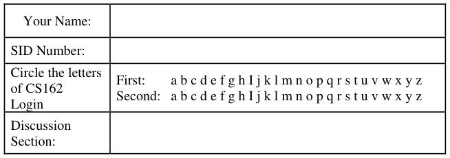

General Information: 
This is a **closed book** exam.  You are allowed 2 pages of notes (both sides).  You may use a 
calculator. You have 3 hours to complete as much of the exam as possible. Make sure to read all of 
the questions first, as some of the questions are substantially more time consuming. 
Write all of your answers directly on this paper.  Make your answers as concise as possible. On 
programming questions, we will be looking for performance as well as correctness, so think through 
your answers carefully.  If there is something about the questions that you believe is open to 
interpretation, please ask us about it!

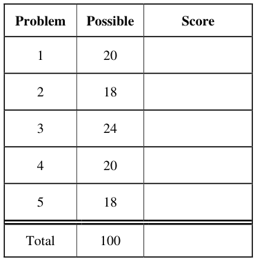

&emsp;Page 1/20

---

**Page 2**

CS 162 Fall 2009 Midterm I October 19th, 2009

&emsp;&emsp;&emsp;&emsp;&emsp;&emsp;&emsp;&emsp;\[ This page left for  \]

3.14159265358979323846264338327950288419716939937510582097494459230781640628620899

Page 2/20

---

**Page 3**

CS 162 Fall 2009 Midterm I October 19th, 2009

### Problem 1: True/False \[20 pts\]

Please EXPLAIN your answer in TWO SENTENCES OR LESS (Answers longer than this may not 
get credit!).  Also, answers without an explanation GET NO CREDIT.

### **Problem 1a\[2pts\]:** Apple was the first company to develop mice and overlapping windows.

Explain: Xerox Parc was the first to develop Mice and Windows

### **Problem 1b\[2pts\]:** A direct mapped cache can sometimes have a higher hit rate than a fully

associative cache with an LRU replacement policy (on the same reference pattern).

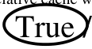

&emsp;&emsp;True / False 
&emsp;&emsp;Explain: A pattern that repeatedly accesses (X+1) sequential memory addresses in 
&emsp;&emsp;&emsp;&emsp;&emsp;&emsp;&emsp;&emsp;a cache with X memory lines will exhibit a higher hit rate in a direct 
&emsp;&emsp;&emsp;&emsp;&emsp;&emsp;&emsp;&emsp;mapped cache than a fully associative cache with an LRU replacement 
&emsp;&emsp;&emsp;&emsp;&emsp;&emsp;&emsp;&emsp;policy.

### **Problem 1c\[2pts\]:** Threads within the same process share the same heap and stack.

&emsp;&emsp;Explain: Each Thread must have its own stack – whether or not it shares a process 
&emsp;&emsp;&emsp;&emsp;&emsp;&emsp;&emsp;&emsp;with another thread.

### **Problem 1d\[2pts\]:** A microkernel-style operating system uses multiple address spaces inside the

operating system – with components such as the file system, network stack, and device drivers all 
running at user level.

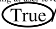

&emsp;&emsp;True / False 
&emsp;&emsp;Explain: By structuring the OS in this way, microkernels prevent different 
&emsp;&emsp;&emsp;&emsp;&emsp;&emsp;&emsp;&emsp;components from being able to crash one another. Example: Mach

### **Problem 1e\[2pts\]:** An operating system that implements on-demand paging on a machine with

software TLB miss handling (such as MIPS) must use an inverted page table.

&emsp;&emsp;Explain: A machine with a software TLB can utilize any format of page table, since 
&emsp;&emsp;&emsp;&emsp;&emsp;&emsp;&emsp;&emsp;the page table walk is handled in software.

Page 3/20

---

**Page 4**

CS 162 Fall 2009 Midterm I October 19th, 2009

### **Problem 1f\[2pts\]:** If the banker's algorithm finds that it's safe to allocate a resource to an existing

thread, then all threads will eventually complete.

&emsp;&emsp;Explain: The banker’s algorithm simply prevents resource-related deadlock. One of 
&emsp;&emsp;&emsp;&emsp;&emsp;&emsp;&emsp;&emsp;the threads could still go into an infinite loop and fail to complete.

### **Problem 1g\[2pts\]:** The Nachos operating system uses Mesa-style condition variables for all

synchronization.

Explain: Nachos uses semaphores and interrupt enable/disable for some things.

### **Problem 1h\[2pts\]:** The lottery scheduler prevents CPU starvation by assigning at least one ticket to

each scheduled thread.

&emsp;&emsp;True / False 
&emsp;&emsp;Explain: By assigning at least one ticket to every thread, the lottery scheduler 
&emsp;&emsp;&emsp;&emsp;&emsp;&emsp;&emsp;&emsp;makes sure that every thread gets at least some CPU time.

### **Problem 1i\[2pts\]:** Multicore chips (i.e. processor chips with more than one CPU on them) are only

here for the short term (next few years) until the transistor feature size reaches 10nm.

&emsp;&emsp;Explain: The issues that caused manufacturers to switch to multicore (too much 
&emsp;&emsp;&emsp;&emsp;&emsp;&emsp;&emsp;&emsp;power dissipation, insufficient instruction-level parallelism) will not go 
&emsp;&emsp;&emsp;&emsp;&emsp;&emsp;&emsp;&emsp;away anytime soon.

### **Problem 1j\[2pts\]:** Thread pools are a useful tool to help prevent the “Slashdot” effect from

crashing Web servers.

&emsp;&emsp;True / False 
&emsp;&emsp;Explain: Utilizing one thread/request in a web server is lower overhead than 
&emsp;&emsp;&emsp;&emsp;&emsp;&emsp;&emsp;&emsp;utilizing one process/request.  By utilizing thread pools, a web server 
&emsp;&emsp;&emsp;&emsp;&emsp;&emsp;&emsp;&emsp;limits the total number of threads executing at any given time, thus 
&emsp;&emsp;&emsp;&emsp;&emsp;&emsp;&emsp;&emsp;preventing an overload (Slashdot effect) from exhausting resources by 
&emsp;&emsp;&emsp;&emsp;&emsp;&emsp;&emsp;&emsp;launching an unbounded number of threads. 
Page 4/20

---

**Page 5**

CS 162 Fall 2009 Midterm I October 19th, 2009

### Problem 2: Synchronization \[18 pts\]

### **Problem 2a\[3pts\]:** Consider a Hash table with the following interface:

&emsp;`1. public class HashTable {` 
`2.`     `public void Put(int Key, int Value) {}` 
`3.`     `public int Get(int Key) {}      // Return 0 if no previous Put() on Key` 
`4.`     `public void Remove(int Key) {}  // No-op if no previous Put() on Key` 
`5. }` 
Assume that `Get()` must return the valid `Value` for any `Key` that has been written by previous 
`Put()` methods.  If a `Put()` method on a given `Key` is happening at the same time as a `Get()` 
method, then the `Get()` method may return an earlier `Value`. In our attempt to make the 
HashTable threadsafe (i.e. usable by multiple threads at the same time), we might decided to make 
all three methods “synchronized” methods (e.g. Java synchronized statements). Would this have 
negative performance implications?  Explain carefully (fully justify your answer; if the answer is 
“yes”, explain why you think you could get better threadsafe performance. If the answer is “no”, 
explain why this is the best threadsafe performance you could expect): 
&emsp;Yes. Hash tables are arranged as a series of buckets with linked lists of Key/Value pairs in each bucket. 
&emsp;Thus, at minimum, each hash bucket could be handled independently—even allowing simultaneous 
&emsp;writes to different hash buckets. A better solution would use a lock-free queue implementation to insert 
&emsp;new items at the beginning of hash buckets. In this implementation, readers and writers to the same hash 
&emsp;bucket would be able to proceed in parallel.  The only snag would be handling “Remove”. Although you 
&emsp;could do this in the lock-free fashion as well, it is tricky.  Simply storing a “0” in the link for the 
&emsp;removed Key will have the correct external behavior.

### **Problem 2b\[2pts\]:** Explain the difference in behavior between `Semaphore.V()` and

`CondVar.signal()` when no threads are waiting in the corresponding semaphore or condition 
variable: 
&emsp;Semaphore.V() will increment the semaphore.  Consequently, a subsequent Semaphore.P() will not wait. 
&emsp;In contrast, CondVar.signal() does nothing if no threads are waiting. Thus a subsequent CondVar.wait() 
&emsp;will always wait.

### **Problem 2c\[3pts\]:** Explain how **Nachos** is able to implement the correct semantics for

`CondVar.signal()` using `Semaphore.V()`. Be explicit and make sure to explain why the 
different of (2b) is not an issue here. 
&emsp;Nachos implements each condition variable as a queue of semaphores, each of which holds a single 
&emsp;sleeping thread. Consequently, executing CondVar.signal() when no threads are sleeping does nothing, 
&emsp;since it encounters an empty queue. When something is sleeping in the condition variable, 
&emsp;CondVar.signal() extracts a single semaphore, then executes a single Semaphore.V() to wake up one 
&emsp;thread.

### **Problem 2d\[2pts\]:** Give two reasons why this is a bad implementation for a lock:

&emsp;&emsp;`lock.acquire() { disable interrupts; }` 
&emsp;&emsp;`lock.release() { enable interrupts; }` 
&emsp;There are a number of reasons why this is a bad implementation for a lock.  (1) It prevents hardware 
&emsp;events from occurring during the critical section, (2) User programs cannot use this lock, (3) It doesn’t 
&emsp;work for data shared between different processors.

Page 5/20

---

**Page 6**

CS 162 Fall 2009 Midterm I October 19th, 2009

### **Problem 2e\[8pts\]:** Suppose that we want a finite synchronized FIFO queue that can handle

&emsp;multiple simultaneous `enqueue()` and `dequeue()`operations.  Assume that `enqueue()` and 
&emsp;`dequeue()` are not allowed to busywait (but rather must sleep) when the queue is either full or 
&emsp;empty respectively. Here is a sketch of an implementation utilizing a circular buffer: 
`1. static final int QUEUESIZE=100;` 
`2. class FIFOQueue {` 
`3.`     `Lock FIFOLock=new Lock();`    `// Methods acquire() and release()` 
`4.`     `CondVar CV1=new CondVar(FIFOLock);// Methods wait(),signal(),broadcast()` 
`5.`     `CondVar CV2=new CondVar(FIFOLock);// Methods wait(),signal(),broadcast()` 
`6.`     `Object FIFO[QUEUESIZE];`     `// Finite circular queue of Objects` 
`7.`     `int head = 0, tail = 0;`     `// Start out “empty”` 
`8.` 
`9.`     `void Enqueue(Object newobject)  {` 
`10.`         `/* Enqueue Method. Spin until can enqueue */` 
`11.`     `}` 
`12.`     `Object Dequeue()  {` 
`13.`         `/* Dequeue Method. Spin until can dequeue */` 
`14.`     `}` 
`15. }` 
Implement the `Enqueue()` and `Dequeue()` methods using monitor synchronization. You should 
enqueue using the tail variable and dequeue at the head. Remember that spin waiting is not allowed. 
You should have no more than 10 lines for each method. Hint: make sure to account for wrapping 
of head and tail pointers and assume Mesa scheduling of the monitors. 
&emsp;&emsp;`void Enqueue(Object newobject)  {` 
`// ANSWER: Here is one implementation:` 
`FIFOLock.acquire();` 
`// While full (cannot add entry to queue), wait` 
`while ((tail+1)%QUEUESIZE == head)` 
`CV1.wait();` 
`FIFO[tail] = newobject;`         `// Add item to queue` 
`tail = (tail+1)%QUEUESIZE;`     `// Expose item to consumer` 
`CV2.signal();`             `// Wake a sleeping consumers` 
`FIFOLock.release();`

&emsp;&emsp;`}` 
&emsp;&emsp;`Object Dequeue()  {` 
`// ANSWER: Here is one implementation:` 
`Object result;` 
`FIFOLock.acquire();` 
`// While empty (cannot get entry from queue), wait` 
`while (head==tail)` 
`CV2.wait();` 
`result = FIFO[head];`         `// Get item from queue` 
`head = (head+1)%QUEUESIZE;`     `// Free up its slot` 
`CV1.signal();`             `// Wake a sleeping producer` 
`FIFOLock.release();` 
`return result;`

&emsp;&emsp;`}` 
Page 6/20

---

**Page 7**

CS 162 Fall 2009 Midterm I October 19th, 2009 
&emsp;&emsp;&emsp;&emsp;&emsp;&emsp;&emsp;&emsp;\[ This page intentionally left blank \]

Page 7/20

---

**Page 8**

CS 162 Fall 2009 Midterm I October 19th, 2009

### Problem 3: Deadlock and the Cephalopod Banquet \[24pts\]

### **Problem 3a\[4pts\]:** Name and explain the four conditions for deadlock**:**

&emsp; Mutual exclusion – Only one thread at a time can hold a given resource 
&emsp; Hold and Wait – Thread holding at least one resource is waiting for another one 
&emsp; No Preemption – Resources are released only voluntarily by the thread holding the 
&emsp;&emsp;resource, after thread is finished with it 
&emsp; Circular Wait – There exists a set {T1, …, Tn} of waiting threads, with T1 waiting for a 
&emsp;&emsp;resource held by T2, T2 waiting for a resource held by T3, …, Tn waiting for a resource 
&emsp;&emsp;held by T1

### **Problem 3b\[2pts\]:** Suppose that we utilize the Banker’s algorithm to determine whether or not to

grant resource requests to threads. The job of the Banker’s algorithm is to keep the system in a 
“SAFE” state. It denies resource requests by putting the requesting thread to sleep if granting the 
request would cause the system to enter an “UNSAFE” state, waking it only when the request could 
be granted safely. What is a SAFE state? 
&emsp;In a safe state, there is some ordering of the threads in the system such that threads can 
&emsp;complete, one after another without deadlocking and without requiring threads to give up 
&emsp;resources that they already have.

### **Problem 3c\[3pts\]:** Explain how the Banker’s algorithm prevents deadlock by removing one or

more of the conditions of deadlock from (3a).  Be explicit. 
&emsp;This question is a bit of a trick question. The four conditions of deadlock from (3a) are 
&emsp;necessary but not sufficient. Thus, while the four conditions will continue to exist individually, 
&emsp;the Banker’s algorithm avoids exactly those configurations of the resource graph that exhibit 
&emsp;non-resolvable cycles consisting of all four of the deadlock conditions from (3a). 
&emsp;Those of you that said that the Banker’s algorithm will eliminate “circular waiting” or “hold 
&emsp;and wait” did not get full credit, since threads may still be put to sleep (by Banker’s algorithm) 
&emsp;while holding resources; since they will be woken up by the Banker’s algorithm when other 
&emsp;threads finally release their resources, the sleeping threads are effectively waiting on these 
&emsp;other threads. However, we did give credit to people who said that the Banker’s algorithm 
&emsp;prevents indefinite circular waiting or hold and wait (or some variant of this statement that 
&emsp;mentions the fact that the conditions do not persist indefinitely).

Page 8/20

---

**Page 9**

CS 162 Fall 2009 Midterm I October 19th, 2009

### **Problem 3d\[4pts\]:** Suppose that we wish to evaluate the current state of the system and declare

&emsp;whether or not it is in a SAFE state. In order to do this, we will need to keep explicit track of the 
&emsp;resources in the system.  In particular, if there were only two types of resource, we could 
&emsp;describe the state of the system with the following data structures: 
&emsp;`class FreeResources {` 
`int FreeResA, FreeResB; // Number of copies of resource that are free` 
`}` 
`/* Per-thread descriptor of thread resources */` 
`class ThreadResources {` 
`int MaxNeededA, MaxNeededB;`    `// Max number copies of resource needed` 
`int CurHeldA, CurHeldB;`      `// Current number resources held` 
`}` 
`ThreadResources[] ThreadRes;` 
Assume that FreeRes and ThreadRes have been initialized to reflect the current state of the system. 
Here is a sketch for how we could check for safety:

&emsp;`1. boolean IsSAFE(FreeResources FreeRes, ThreadResources[] ThreadRes) {` 
`2.`     `Int FreeA = FreeRes.FreeResA, FreeB = FreeRes.FreeResB;` 
`3.`     `boolean[] ThreadFinished = new boolean[ThreadRes.length];` 
`4.`     `int RemainingThreads = ThreadRes.length;` 
`5.`     `boolean finished = false;` 
`6.`     `while (!finished) {` 
`7.`         `finished = true;` 
`8.`         `for (int i = 0; i < ThreadRes.length; i++) {` 
`9.`             `if (!ThreadFinished[i]) {` 
`10.`             `/* Missing Code */` 
`11.`             `}` 
`12.`         `}` 
`13.`     `}` 
`14.`     `return (RemainingThreads == 0); /* SAFE if no threads left */` 
`15. }` 
Provide the missing Code at line 10.  **This code should have no more than 8 lines and should not** 
**alter the external variables (arguments).** Hint: work through the threads that can complete. 
Code for Line 10: 
`if ((ThreadRes[i].MaxNeededA – ThreadRes[i].CurHeldA) <= FreeA)&&` 
`(ThreadRes[i].MaxNeededB – ThreadRes[i].CurHeldB) <= FreeB)) {` 
`ThreadFinished[i] = true;` 
`finished = false;` 
`FreeA += ThreadRes[i].CurHeldA;` 
`FreeB += ThreadRes[i].CurHeldB;` 
`RemainingThreads -= 1;` 
`}`

Page 9/20

---

**Page 10**

CS 162 Fall 2009 Midterm I October 19th, 2009

**The Cephalopod Diners Problem:** Consider a large table with **identical** multi-even-armed 
cephalopods (e.g. octopuses). **In the center is a pile of forks and knives.**  Before eating, each diner 
must have an equal number of forks and knives, one in each arm (e.g. if octopuses are eating, they 
would each need four forks and four knives). The creatures are so busy talking that they can only 
grab one utensil at a time. They also grab utensils in a random order until they have enough utensils 
to eat. After they finish eating, they return all of their utensils at once. Diners are implemented as 
threads that ask for utensils and return them when finished. Consider the following sketch for a 
CephTable class to implement the Cephalopod Diners problem using **monitor synchronization:** 
&emsp;`1.` `class DinerUtensils {` 
&emsp;`2.`     `public int forks,knives;`          `// utensils held by creature` 
&emsp;`3. }`                     `// clearly forks+Knives <= NumArms` 
`4. public class CephTable {` 
`5.`     `Lock lock = new Lock();`            `// acquire(), release()` 
`6.`     `CondVar CV = new CondVar(lock);//wait(),signal(),broadcast();` 
`7.`     `public DinerUtensil[] Diners;`     `// Accounting: utensils for each diner` 
`8.`     `int NumArms;`            `// Number of arms for every diner` 
`9.`     `int IdleForks, IdleKnives;`         `// Number of forks/knives on table` 
`10.` 
`11.`     `public CephTable(int NumDiners, int NumArms, int Forks, int Knives){` 
`12.`         `Diners = new DinerUtensils[NumDiners]; // info about each Diner` 
`13.`         `This.NumArms = NumArms;`         `// Number of arms per Diner` 
`14.`         `This.IdleForks = Forks;`         `// Number Forks on table initially` 
`15.`         `This.IdleKnives = Knives;`     `// Number Knives on table initially` 
`16.`     `}` 
`17.`     `public void GrabUtensil(int CephalopodID, boolean WantFork) {` 
`18.`         `/* Try to grab a utensil from table */` 
`19.`     `}` 
`20.`     `public void DoneEating(int CephalopodID) {` 
`21.`         `/* Return all chopsticks to pile */` 
`22.`         `lock.acquire();` 
`23.`         `IdleForks += Diners[CephalopodID].forks;` 
`24.`         `IdleKnives += Diners[CephalopodID].knives;` 
`25.`         `Diners[CephalopodID].forks = 0;` 
`26.`         `Diners[CephalopodID].knives = 0;` 
`27.`         `CV.broadcast();` 
`28.`         `lock.release();` 
`29.`     `}` 
`30.`     `boolean CephCheck(int CephalopodID, int numforks, int numknives) {` 
`31.`         `/* See if ok to give dinner numforks forks and numknives knives. */` 
`32.`     `}` 
`33. }`

### **Problem 3e\[3pts\]:** In its general form, the Banker’s algorithm makes a decision about whether or

not to allow an allocation request by making multiple passes through the set of resource holders 
(threads). See, for instance, the fact that there are two loops in (3d) to determine safety. Explain 
why a Banker’s algorithm dedicated to the Cephalopod Diners problem, namely the CephCheck() 
routine, could operate with a single pass through the resources holders: 
&emsp;Since every diner (Cephalopod) at a given table has an identical number of arms (and thus resource 
&emsp;requirements), once the Banker’s algorithm has determined that a single Cephalopod can complete, then 
&emsp;we know that they all can complete \[simply put all of its resources back on the table, then there will be 
&emsp;enough on the table for anyone to complete\]. Thus, we need only a single pass through the diners to see 
&emsp;if any of them can complete.

Page 10/20

---

**Page 11**

CS 162 Fall 2009 Midterm I October 19th, 2009

### **Problem 3f\[4pts\]:** Implement the CephCheck method of the CephTable Object, namely fill in code

for line 31 above. This method should implement the Banker’s algorithm: return true if the given 
Cephalopod can be granted ‘`numforks`’ forks and ‘`numknives`’ knives without taking the 
system out of a SAFE state. Do not blindly implement the Banker’s algorithm: this method only 
needs to have the same external behavior as the Banker’s algorithm for this application. Note that 
this method is part of the CephTable Object and thus has access to local variables of that object. 
**This code should not permanently alter the local variables of the CephTable Object (although it** 
**can do so temporarily).** Do not worry about making this routing threadsafe; it will be called with a 
lock held. We will give full credit for a solution that takes a single pass through the diners, partial 
credit for a working solution, and no credit for a solution with more than 15 lines. Hint: it is easier 
to first check the requesting Cephalopod, then the rest. 
Code for Line 31: 
`// First, check to see if we are asking for more utensils than on table.` 
`// Note: the loop at the bottom covers this check; however, we only gave` 
`// credit for omitting this check if you specifically mentioned how it works` 
`if (numforks > IdleForks || numknives > IdleKnives)` 
`return false;` 
`// Next check if current requesting Cephalopod can complete` 
`if ((NumArms/2 - Diners[CephalopodID].forks) <= IdleForks) &&` 
`(NumArms/2 – Diners[CephalopodID].knives) <= IdleKnives))` 
`return true;` 
`//Check every one else (wrong for current requester, but handled above)` 
`for (int loop = 0; loop < Diners.length; loop++)` 
`if ((NumArms/2 – Diners[loop].forks) <= IdleForks – numforks) &&` 
`(NumArms/2 – Diners[loop].knives) <= IdleKnives – numknives))` 
`return true;` 
`return false;`

### **Problem 3g\[4pts\]:** Implement the code for the GrabUtensil() routine, namely fill in code for line 18

above. Its behavior is that it should check to whether or not it is ok to grant the requested type of 
utensil to the caller and if not, sleep until it is ok. This code should call the CephCheck() routine as 
a subroutine and should be threadsafe namely, it should be able to deal with multiple threads 
accessing the state simultaneously. You should implement this routine as a monitor and assume 
Mesa scheduling. It is up to the Cephalopod to eat and subsequently call DoneEating(); you should 
not do that in GrabUtensil(). This routine can be written in 8 lines, but you can use up to 12: 
Code for Line 18: 
&emsp;`// Here is a 10 line version. Get 8 line version by inlining expressions` 
&emsp;`// for numforks and numknives` 
`int numforks = (WantFork?1:0);` 
`int numknives = (WantFork?0:1);` 
`lock.acquire()` 
`while (CephCheck(CephalopodID,  numforks, numknives))` 
`CV.wait();` 
`IdleForks -= numforks;` 
`IdleKnives -= numknives;` 
`Diners[CephalopodID].forks += numforks;` 
`Diners[CephalopodID].knives += numknives;` 
`lock.release();` 
Page 11/20

---

**Page 12**

CS 162 Fall 2009 Midterm I October 19th, 2009

&emsp;&emsp;&emsp;&emsp;&emsp;&emsp;&emsp;&emsp;\[ This page intentionally left blank \]

Page 12/20

---

**Page 13**

CS 162 Fall 2009 Midterm I October 19th, 2009

### Problem 4: Virtual Memory \[20 pts\]

Consider a multi-level memory management scheme with the following format for virtual 
addresses:

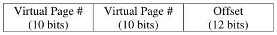

Virtual addresses are translated into physical addresses of the following form:

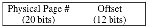

Page table entries (PTE) are 32 bits in the following format, stored in big-endian form in memory 
(i.e. the MSB is first byte in memory):

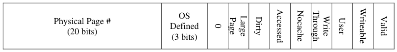

Here, “Valid” means that a translation is valid, “Writeable” means that the page is writeable, “User” 
means that the page is accessible by the User (rather than only by the Kernel). Note: the phrase 
“page table” in the following questions means the multi-level data structure that maps virtual 
addresses to physical addresses.

### **Problem 4a\[2pts\]:** How big is a page? Explain.

&emsp;Since the offset is 12 bits, then a page is 212=4096 bytes. You had to show an actual calculation and 
&emsp;mention the offset to get full credit.

### **Problem 4b\[2pts\]:** Suppose that we want an address space with one physical page at the top of the

address space and one physical page at the bottom of the address space. How big would the page 
table be (in bytes)? Explain. 
&emsp;The page table of interest has two non-null pointers for the first level, pointing at 2 second-level 
&emsp;elements of the page table. Each element is a page in size.  Thus, there are 3 pages = 3  4096 = 12288

### **Problem 4c\[2pts\]:** What is the maximum size of a page table (in bytes) for this scheme? Explain.

&emsp;The maximum page table size has an entry for every virtual address.  Thus -- all pointers non-null at the 
&emsp;top level, each of which points at a second-level element of the page table.  Thus, the total size of the 
&emsp;page table has 1 + 1024 = 1025 page table elements = 1025  4096 = 4198400 bytes.

### **Problem 4d\[2pts\]:** How big would each entry of a fully-associative TLB be for this management

scheme?  Explain. 
&emsp;Each entry of a fully-associative cache needs enough storage for (1) the cache tag and (2) the valid bit. 
&emsp;The tag for a TLB is the virtual page number, which is 20 bits. A valid bit is 1 bit. Thus, the simplest 
&emsp;correct answer for this question is 21 + 32 (size of PTE) = 53 bits. A slightly more sophisticated answer 
&emsp;would recognize that there are 4 bits in the PTE that are not needed by the hardware (bits 8-11). Thus, 
&emsp;one could say that there are 21 + 28 = 49 bits.

Page 13/20

---

**Page 14**

CS 162 Fall 2009 Midterm I October 19th, 2009

### **Problem 4e\[2pts\]:** Sketch the format of the page-table for the multi-level virtual memory

management scheme of (4a). Illustrate the process of resolving an address as well as possible. 
&emsp;We were looking for something like the following diagram: 
&emsp;&emsp;&emsp;&emsp;&emsp;&emsp;&emsp;&emsp;Virtual AddressVirtual Address

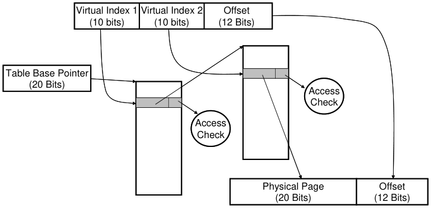

Physical AddressPhysical Address

### **Problem 4f\[10pts\]:** Assume the memory translation scheme from (4a). Use the Physical Memory

table given on the next page to predict what will happen with the following load/store instructions. 
Assume that the base table pointer for the current **user level process** is `0x00200000.` 
Addresses are virtual. The return value for a load is an 8-bit data value or an error, while the return 
value for a store is either “**ok**” or an error. Possible errors are: **invalid, read-only, kernel-only.** 
Hint: Don’t forget that Hexidecimal digits contain 4 bits!

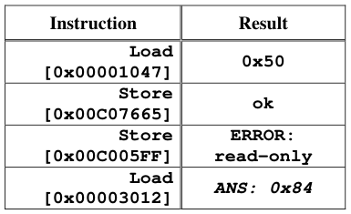

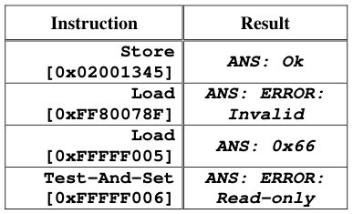

Page 14/20

---

**Page 15**

&emsp;CS 162 Fall 2009 Midterm I October 19th, 2009

&emsp;&emsp;&emsp;&emsp;&emsp;&emsp;&emsp;&emsp;**Physical Memory \[All Values are in Hexidecimal\]**

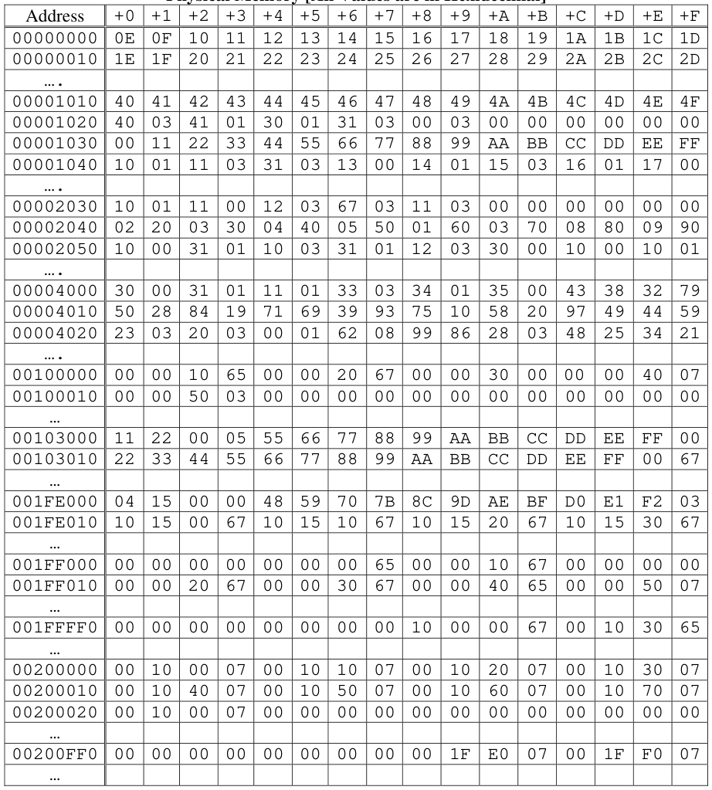

&emsp;Page 15/20

---

**Page 16**

CS 162 Fall 2009 Midterm I October 19th, 2009

### Problem 5: Scheduling \[18pts\]

### **Problem 5a\[2pts\]:** Give two ways in which to predict runtime in order to approximate SRTF:

&emsp;Two options that we gave in class were (1) use a predictive algorithm that uses past behavior to predict 
&emsp;the future (such as a weighted average of the previous prediction and the previous value), (2) use a 
&emsp;scheduling algorithm( such as a multi-level scheduler) that tries to separate short burst applications 
&emsp;from long burst applications and schedules the short-burst applications with higher priority.

### **Problem 5b\[2pts\]:** What scheduling problem did the original Mars rover experience?  What were

the consequences of this problem? 
&emsp;The original Mars rover exhibited a priority inversion problem: A low-priority task grabbed a lock on 
&emsp;the bus; a high-priority task was forced to wait for the bus; further, a medium priority task prevented the 
&emsp;low-priority task from completing.  The result was that the high-priority task made no forward progress; 
&emsp;eventually, a timer went off, decided something was wrong, and rebooted the system. Consequently, the 
&emsp;system kept rebooting.

### **Problem 5c\[3pts\]:**

Five jobs are waiting to be run. Their expected running times are 10, 8, 3, 1, and X. In what order 
should they be run to minimize average completion time? State the scheduling algorithm that 
should be used AND the order in which the jobs should be run. HINT: Your answer will explicitly 
depend on X. 
&emsp;To minimize average completion time, we need to use SRTF.  The answer depends on X in the following 
&emsp;way: 
&emsp;`X, 1, 3, 8, 10`    `if X < 1` 
&emsp;`1, X, 3, 8, 10`  `if 1`   `X < 3` 
&emsp;`1, 3, X, 8, 10`  `if 3`   `X < 8` 
&emsp;`1, 3, 8, X, 10`  `if 8`   `X <10` 
&emsp;`1, 3, 8, 10, X`  `if 10`   `X`

Page 16/20

---

**Page 17**

CS 162 Fall 2009 Midterm I October 19th, 2009

### **Problem 5d\[5pts\]:**

Here is a table of processes and their associated arrival and running times.

Show the scheduling order for these processes under 3 policies: First Come First Serve (FCFS), 
Shortest-Remaining-Time-First (SRTF), Round-Robin (RR) with timeslice quantum = 1. Assume 
that context switch overhead is 0 and that new RR processes are added to the **head** of the queue and 
new FCFS processes are added to the **tail** of the queue.

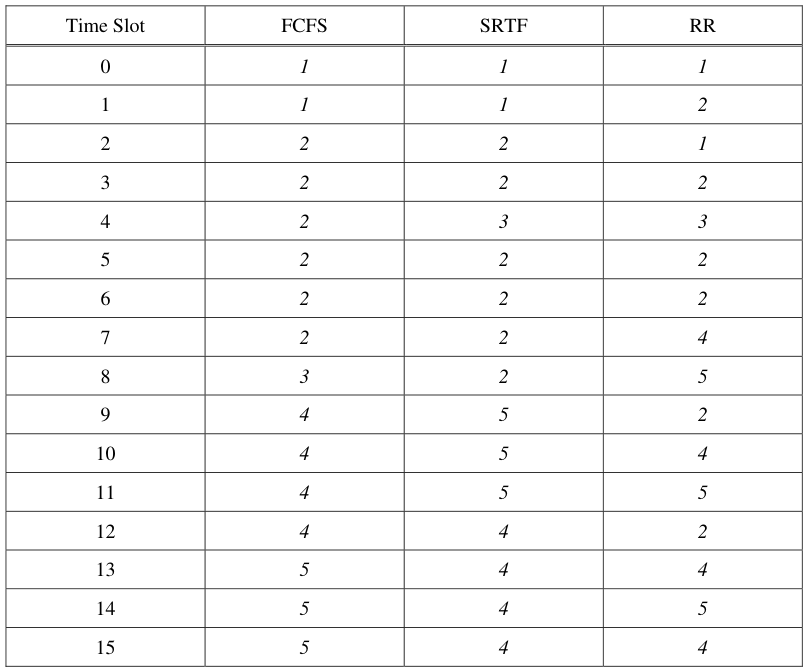

Page 17/20

---

**Page 18**

CS 162 Fall 2009 Midterm I October 19th, 2009

### **Problem 5e\[3pts\]:** Can any of the three scheduling schemes (FCFS, SRTF, or RR) result in

starvation?  If so, how might you fix this? 
&emsp;Yes. SRTF continuously places short jobs in front of long jobs.  Consequently, it is possible for long jobs 
&emsp;to never get a chance to run. 
&emsp;You can fix this by utilizing an algorithm that guarantees that no thread is prevented from making 
&emsp;forward progress.  Example: use a lottery scheduler or a multi-level scheduler that gives a guaranteed 
&emsp;minimum amount of compute time to the lowest-priority (background) tasks. 
&emsp;Note that FCFS and RR don’t really experience starvation (although you might be able to make an 
&emsp;argument that RR has a problem if you always put new jobs at the front of the queue and short jobs 
&emsp;arrive faster than the quantum).

### **Problem 5f\[3pts\]:** Explain why a chess program running against another program on the same

machine might want to perform a lot of superfluous I/O operations. 
&emsp;By executing a lot of superfluous I/O, the chess program might be able to fool a scheduler into thinking 
&emsp;that the chess program is an interactive task that should get more compute cycles.  The net effect would 
&emsp;be that the program performing the superfluous I/O might be able to get more “thinking” done per unit 
&emsp;time that the one that didn’t perform extra I/O.

Page 18/20

---

**Page 19**

CS 162 Fall 2009 Midterm I October 19th, 2009

&emsp;&emsp;&emsp;&emsp;&emsp;&emsp;&emsp;\[Scratch Page: Do not put answers here!\]

Page 19/20

---

**Page 20**

CS 162 Fall 2009 Midterm I October 19th, 2009

&emsp;&emsp;&emsp;&emsp;&emsp;&emsp;&emsp;\[Scratch Page: Do not put answers here!\]

Page 20/20

