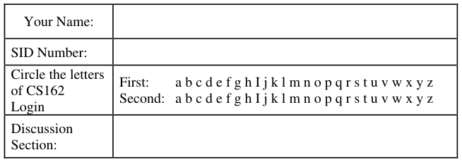
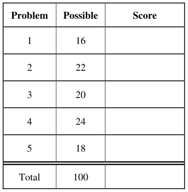
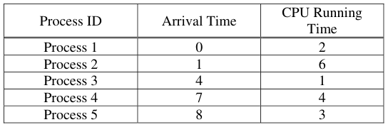
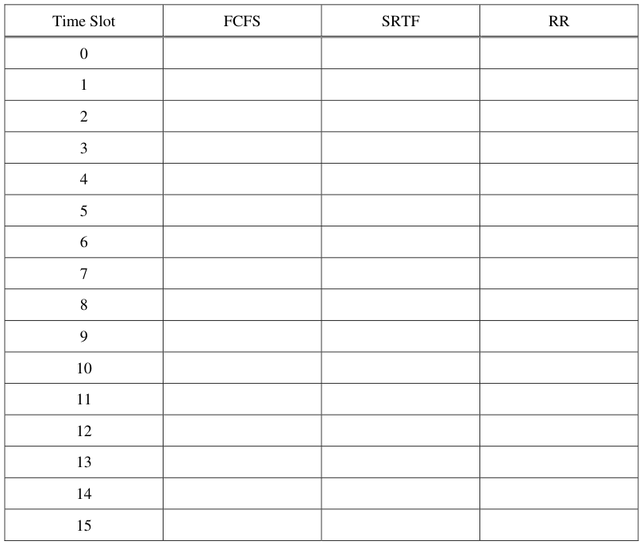
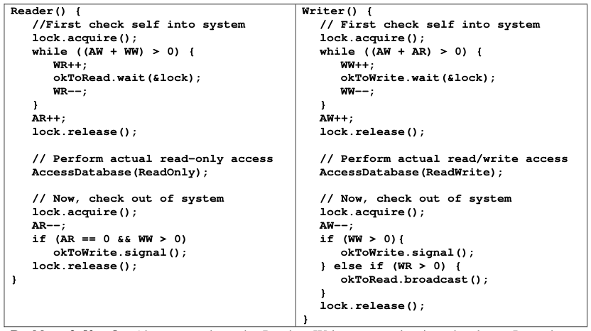
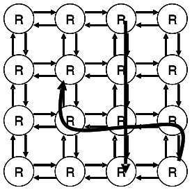
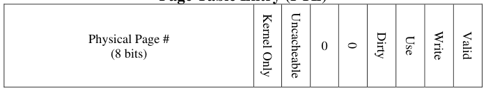
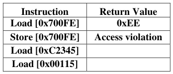
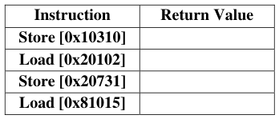
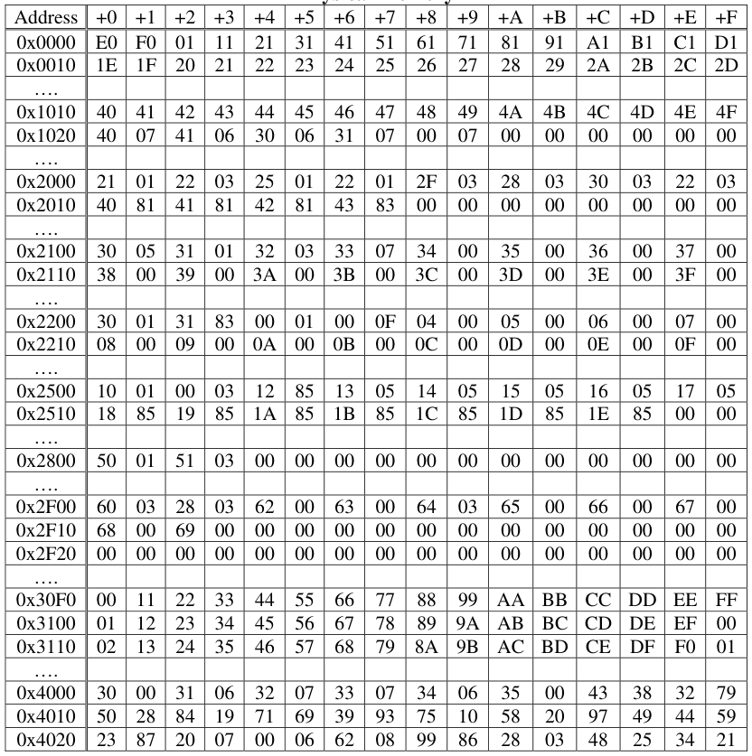

# Berkeley CS162 Fall 2010: Midterm 1: Questions

> Copied from the original: <https://hkn.eecs.berkeley.edu/exams/course/cs/162>. Text and figures are taken from the PDF as is; nothing was answered or rewritten. The original PDF is in this folder.

---

**Page 1**

&emsp;&emsp;&emsp;&emsp;&emsp;&emsp;&emsp;&emsp;University of California, Berkeley 
&emsp;&emsp;&emsp;&emsp;&emsp;&emsp;&emsp;&emsp;College of Engineering 
&emsp;&emsp;&emsp;&emsp;&emsp;&emsp;&emsp;&emsp;Computer Science Division  EECS 
&emsp;Fall 2010                John Kubiatowicz 
&emsp;&emsp;&emsp;&emsp;&emsp;&emsp;&emsp;&emsp;Midterm I 
&emsp;&emsp;&emsp;&emsp;&emsp;&emsp;&emsp;&emsp;October 18th, 2010 
&emsp;&emsp;&emsp;&emsp;&emsp;&emsp;&emsp;CS162: Operating Systems and Systems Programming

General Information: 
This is a **closed book** exam.  You are allowed 2 pages of notes (both sides).  You may use a 
calculator. You have 3 hours to complete as much of the exam as possible. Make sure to read all of 
the questions first, as some of the questions are substantially more time consuming. 
Write all of your answers directly on this paper.  Make your answers as concise as possible. On 
programming questions, we will be looking for performance as well as correctness, so think through 
your answers carefully.  If there is something about the questions that you believe is open to 
interpretation, please ask us about it!

&emsp;Page 1/22

---

**Page 2**

CS 162 Fall 2010 Midterm I October 18th, 2010

&emsp;&emsp;&emsp;&emsp;&emsp;&emsp;&emsp;&emsp;\[ This page left for  \]

3.14159265358979323846264338327950288419716939937510582097494459230781640628620899

Page 2/22

---

**Page 3**

CS 162 Fall 2010 Midterm I October 18th, 2010

### Problem 1: True/False \[16 pts\]

Please EXPLAIN your answer in TWO SENTENCES OR LESS (Answers longer than this may not 
get credit!).  Also, answers without an explanation GET NO CREDIT.

### **Problem 1a\[2pts\]:** The size of an inverted page table grows with the size of the virtual address

space that it is supporting. 
&emsp;&emsp;True / False 
Explain:

### **Problem 1b\[2pts\]:** The term “Core” in “Dump Core” refers to the interior of a machine, since

memories used to be in the middle of room-sized computers. 
&emsp;&emsp;True / False 
Explain:

### **Problem 1c\[2pts\]:** Threads within the same process can share data with one another by passing

pointers to objects on their stacks. 
&emsp;&emsp;True / False 
Explain:

### **Problem 1d\[2pts\]:** Resource cycles always lead to deadlock.

&emsp;&emsp;True / False 
&emsp;&emsp;Explain:

### **Problem 1e\[2pts\]:** Anything that can be done with a monitor can also be done with semaphores.

&emsp;&emsp;True / False 
Explain:

Page 3/22

---

**Page 4**

CS 162 Fall 2010 Midterm I October 18th, 2010

### **Problem 1f\[2pts\]: “**Hyperthreading” is a term used to describe systems with thousands of threads.

&emsp;&emsp;True / False 
Explain:

### **Problem 1g\[2pts\]:** A Lottery Scheduler can be used to implement any other scheduling algorithm

by adjusting the number of tickets that each process holds. 
&emsp;&emsp;True / False 
Explain:

### **Problem 1h\[2pts\]:** A MicroKernel can improve the resilience of a system against bugs in the OS.

&emsp;&emsp;True / False 
Explain:

Page 4/22

---

**Page 5**

CS 162 Fall 2010 Midterm I October 18th, 2010

### Problem 2: Short Answer \[22pts\]

### **Problem 2a\[2pts\]:** What is priority donation and why is it important?

### **Problem 2b\[3pts\]:** Name three ways in which the processor can transition from user mode to

kernel mode.  Can the user execute arbitrary code after transitioning?

### **Problem 2c\[2pts\]:** What happens when an interrupt occurs?  What does the interrupt controller do?

### **Problem 2d\[2pts\]:** Explain how to fool the multi-level feedback scheduler’s heuristics into giving

a long-running task more CPU cycles.

Page 5/22

---

**Page 6**

CS 162 Fall 2010 Midterm I October 18th, 2010

### **Problem 2e\[3pts\]:** What is the difference between Mesa and Hoare scheduling for monitors?

Include passing of locks between signaler and signalee, scheduling of CPU resources, and impact 
on the programmer.

### **Problem 2f\[2pts\]:** What needs to be saved and restored on a context switch between two threads in

the same process?  What if the two threads are in different processes?  Be explicit.

### **Problem 2g\[2pts\]:** List two reasons why overuse of threads is bad (i.e. using too many threads for

different tasks). Be explicit in your answers.

### **Problem 2h\[2pts\]:** As specified, the SRTF algorithm requires knowledge of the future. Name two

ways to approximate the information required to implement this algorithm.

Page 6/22

---

**Page 7**

CS 162 Fall 2010 Midterm I October 18th, 2010

### **Problem 2i\[4pts\]:**

Here is a table of processes and their associated arrival and running times.

Show the scheduling order for these processes under 3 policies: First Come First Serve (FCFS), 
Shortest-Remaining-Time-First (SRTF), Round-Robin (RR) with timeslice quantum = 1. Assume 
that context switch overhead is 0 and that new processes are added to the **head** of the queue except 
for FCFS, where they are added to the tail.

Page 7/22

---

**Page 8**

CS 162 Fall 2010 Midterm I October 18th, 2010 
&emsp;&emsp;&emsp;&emsp;&emsp;&emsp;&emsp;&emsp;\[ This page intentionally left blank \]

Page 8/22

---

**Page 9**

CS 162 Fall 2010 Midterm I October 18th, 2010

### Problem 3: Readers-Writers Access to Database \[20 pts\]

### **Problem 3a\[2pts\]:**  Above, we show the Readers-Writers example given in class.  It used two

condition variables, one for waiting readers and one for waiting writers. Suppose that all of the 
following requests arrive in very short order (while R1 and R2 are still executing): 
Incoming stream: R1 R2 W1 R3 W2 W3 R4 R5 R6 W4 R7 W5 W6 R8 R9 W7 R10 
In what order would the above code process the above requests? If you have a group of requests 
that are equivalent (unordered), indicate this clearly by surrounding them with braces ‘{}’.  You can 
assume that the wait queues for condition variables are FIFO in nature (i.e. signal() wakes up the 
oldest thread on the queue). Explain how you got your answer.

### **Problem 3b\[2pts\]:**  Let us define the logical arrival order by the order in which threads first

acquire the monitor lock. Suppose that we wanted the results of reads and writes to the database to 
be the same as if they were processed one at a time – in their logical arrival order; for example, 
W1 W2 R1 R2 R3 W3 W4 R4 R5 R6 would be processed as W1 W2 {R1 R2 R3} W3 W4 {R4 R5 R6} 
regardless of the speed with which these requests arrive. Explain why the above algorithm does not 
satisfy this constraint.

Page 9/22

---

**Page 10**

CS 162 Fall 2010 Midterm I October 18th, 2010

Assume that our system uses Mesa scheduling and that condition variables have FIFO wait queues. 
Below is a sketch of a solution that uses only two condition variables and that does return results as 
if requests were processed in logical arrival order.  Rather than separate methods for Reader() and 
Writer(), we have a single method which takes a “NewType” variable (0 for read, 1 for write): 
`1. Lock MonitorLock;`           `// Methods: acquire(),release()` 
`2. Condition waitQueue, onDeckQueue;// Methods: wait(),signal(),broadcast()` 
`3. int Queued = 0, onDeck = 0;   // Counts of sleeping threads` 
`4.` `/* Missing code */` 
`5. Accessor (int NewType) {`    `// type = 0 for read, 1 for write` 
`6.`     `/* Monitor to control entry so that one writer or multiple readers */` 
`7.`     `MonitorLock.acquire();` 
`8.`     `/* Missing wait condition */` 
`9.`     `{ Queued++;` 
`10.`         `waitQueue.wait();` 
`11.`         `Queued—;` 
`12.`     `}` 
`13.`     `/* Missing wait condition */` 
`14.`     `{` `onDeck++;` 
`15.`         `onDeckQueue.wait();` 
`16.`         `onDeck--;` 
`17.`     `}` 
`18.`     `/* Missing code */` 
`19.`      `MonitorLock.release();` 
`20.`     `// Perform actual data access` 
`21.`     `AccessDatabase(NewType);` 
`22.`     `/* Missing code */` 
`23. }` 
The `waitQueue` condition variable keeps unexamined requests in FIFO order.  The 
`onDeckQueue` keeps a single request that is currently incompatible with requests that are 
executing.  We want to allow as many parallel requests to the database as possible, subject to the 
constraint of obeying logical arrival order. Here, logical arrival order is defined by the order in 
which requests acquire the lock at line #7.

### **Problem 3c\[2pts\]:** What additional variable(s) (and initialization) do you need at Line #4? Hint:

think about what you need to describe the current set of threads accessing the database in parallel. 
Give explicit code to insert at Line #4 (can be more than one line of actual code).

### **Problem 3d\[2pts\]:** Explain why you might not want to use a “while()” statement in Line #8 –

despite the fact that the system has Mesa scheduling:

Page 10/22

---

**Page 11**

CS 162 Fall 2010 Midterm I October 18th, 2010

### **Problem 3e\[2pts\]:** What is the missing code in Line #8?  Hint: it is a single “if” statement.

### **Problem 3f\[2pts\]:** What is the missing code in Line #13?  This should be a single line of code.

### **Problem 3g\[2pts\]:** What is the missing code in Line #18?  You should not have more than three (3)

actual lines of code.

### **Problem 3h\[3pts\]:** What is the missing code in Line #22?  You should not have more than five (5)

actual lines of code.

### **Problem 3i\[3pts\]:** Suppose that condition variables did not have FIFO ordered wait queues. What

changes would you have to make to your code?  Be explicit (you should not need more than 6 new 
or changed lines). Hint: consider assigning a sequentially increasing ID to each thread.

Page 11/22

---

**Page 12**

CS 162 Fall 2010 Midterm I October 18th, 2010 
&emsp;&emsp;&emsp;&emsp;&emsp;&emsp;&emsp;&emsp;\[ This page intentionally left blank \]

Page 12/22

---

**Page 13**

CS 162 Fall 2010 Midterm I October 18th, 2010

### Problem 4: Deadlock \[24pts\]

### **Problem 4a\[2pts\]:** Suppose that we utilize the Banker’s algorithm to determine whether or not to

grant resource requests to threads. The job of the Banker’s algorithm is to keep the system in a 
“SAFE” state. It denies resource requests by putting the requesting thread to sleep if granting the 
request would cause the system to enter an “UNSAFE” state, waking it only when the request could 
be granted safely. What is a SAFE state?

### **Problem 4b\[4pts\]:**

The figure at the right illustrates a 2D mesh of network routers. 
Each router is connected to each of its neighbors by two 
network links (small arrows), one in each direction. Messages 
are routed from a source router to a destination router and can 
stretch through the network (i.e. consume links along the route 
from source to destination). Messages can cross inside routers. 
&emsp;Assume that no network link can service more than one 
message at a time, and that each message must consume a 
continuous set of channels (like a snake). Messages always 
make progress to the destination and never wrap back on 
themselves. The figure shows two messages (thick arrows). 
&emsp;Assume that each router or link has a very small amount of buffer space and that each message 
can be arbitrarily long. Show a simple situation (with a drawing) in which messages are deadlocked 
and can make no further progress.  Explain how each of the four conditions of deadlock are 
satisfied by your example. Hint: Links are the limited resources in this example.

Page 13/22

---

**Page 14**

CS 162 Fall 2010 Midterm I October 18th, 2010

### **Problem 4c\[3pts\]:**

Define a routing policy that avoids deadlocks in the network of (4b). Prove that deadlocks cannot 
happen when using this routing policy. Hint: assume that a deadlock occurs and show why that 
leads to a contradiction in the presence of your new routing policy.

### **Problem 4d\[3pts\]:** Suppose that we wanted a less restrictive routing policy than your answer to

(4c).  Explain why the Banker’s algorithm is not well adapted to this routing problem.   What could 
you do that was similar in spirit to the Banker’s algorithm to prevent deadlock in networks such as 
(4b), while allowing arbitrary routing of messages?  Why is it unlikely that such an algorithm 
would be used in a real network?

### **Problem 4e\[2pts\]:** Is it possible for a system with a single monitor (i.e one lock with multiple

condition variables) to deadlock?  Explain.

Page 14/22

---

**Page 15**

CS 162 Fall 2010 Midterm I October 18th, 2010

### **Problem 4f\[4pts\]:**

Suppose that we have the following resources: A, B, C and threads T1, T2, T3, T4.  The total 
number of each resource is:

Further, assume that the processes have the following maximum requirements and current 
allocations:

Is the system in a safe state (as defined by the Banker’s algorithm)? If “yes”, show a non-blocking 
sequence of thread executions. Otherwise, provide a proof that the system is unsafe. Show all steps, 
intermediate matrices, etc.

Page 15/22

---

**Page 16**

CS 162 Fall 2010 Midterm I October 18th, 2010

### **Problem 4g\[3pts\]:**

Assume that we start with a system in the state of (4f). Suppose that T1 asks for 2 more copies of 
resource A.  Can the system grant this if it wants to avoid deadlock (i.e. will the result be a SAFE 
state)? Explain.

### **Problem 4h\[3pts\]:**

Assume that we start with a system in the state of (4f). What is the maximum number of additional 
copies of resources (A, B, and C) that T1 can be granted in a single request without risking 
deadlock? Explain.

Page 16/22

---

**Page 17**

CS 162 Fall 2010 Midterm I October 18th, 2010

### Problem 5: Virtual Memory \[18pts\]

Consider a two-level memory management scheme on 24-bit virtual addresses using the following 
format for virtual addresses:

Virtual addresses are translated into 16-bit physical addresses of the following form:

Page table entries are 16 bits in the following format, stored in big-endian form in memory (i.e. the 
MSB is first byte in memory). 
&emsp;&emsp;&emsp;&emsp;&emsp;&emsp;&emsp;&emsp;**Page Table Entry (PTE)**

Note that a virtual-physical translation can fail at any point if an incompatible PTE is encountered. 
Two types of errors can occur during translation: “invalid page” (page is not mapped at all) or 
“access violation” (page exists, but access was illegal).

### **Problem 5a\[2pts\]:** How big is a page? Explain.

### **Problem 5b\[2pts\]:** What is the largest size for a page table with this address space? We are asking

for the total size of both levels of the page table. Explain.

### **Problem 5c\[3pts\]:** What does “TLB” stand for and what is its function?  How big would a TLB

entry be for this system?

Page 17/22

---

**Page 18**

CS 162 Fall 2010 Midterm I October 18th, 2010

### **Problem 5d\[3pts\]:** Sketch the format of the page-table for this multi-level virtual memory

management scheme. Illustrate the process of resolving an address as well as possible.

### **Problem 5e\[2pts\]:** What is “Copy on Write”?  How would you perform Copy on Write with the

Virtual Memory system discussed in this problem?

### **Problem 5f\[6pts\]:** The contents of physical memory are given on the next page. Assume that the

page-table base pointer = 0x2000, and that the CPU is in user-mode. Please return the results from 
the following load/store instructions.  Addresses are virtual. The return value for load is an 8-bit 
data value or an error, while the return value for a store is either “**ok**” or an error. For errors, please 
specify which type of error (either “invalid page” or “access violation”).

Page 18/22

---

**Page 19**

CS 162 Fall 2010 Midterm I October 18th, 2010

&emsp;&emsp;&emsp;&emsp;&emsp;&emsp;&emsp;&emsp;**Virtual Address Format**

&emsp;&emsp;&emsp;&emsp;&emsp;&emsp;&emsp;&emsp;**Page Table Entry (PTE)**

&emsp;&emsp;&emsp;&emsp;&emsp;&emsp;&emsp;&emsp;**Physical Memory**

Page 19/22

---

**Page 20**

CS 162 Fall 2010 Midterm I October 18th, 2010

&emsp;&emsp;&emsp;&emsp;&emsp;&emsp;&emsp;&emsp;\[ This page intentionally left blank\]

Page 20/22

---

**Page 21**

CS 162 Fall 2010 Midterm I October 18th, 2010

&emsp;&emsp;&emsp;&emsp;&emsp;&emsp;&emsp;\[Scratch Page: Do not put answers here!\]

Page 21/22

---

**Page 22**

CS 162 Fall 2010 Midterm I October 18th, 2010

&emsp;&emsp;&emsp;&emsp;&emsp;&emsp;&emsp;\[Scratch Page: Do not put answers here!\]

Page 22/22

