# Berkeley CS162 Fall 2010: Midterm 1: Official solutions

> Copied from the original: <https://hkn.eecs.berkeley.edu/exams/course/cs/162>. Text and figures are taken from the PDF as is; nothing was answered or rewritten. The original PDF is in this folder.

---

**Page 1**

&emsp;&emsp;&emsp;&emsp;&emsp;&emsp;&emsp;&emsp;University of California, Berkeley 
&emsp;&emsp;&emsp;&emsp;&emsp;&emsp;&emsp;&emsp;College of Engineering 
&emsp;&emsp;&emsp;&emsp;&emsp;&emsp;&emsp;&emsp;Computer Science Division  EECS 
&emsp;Fall 2010                    John Kubiatowicz 
&emsp;&emsp;&emsp;&emsp;&emsp;&emsp;&emsp;&emsp;Midterm I 
&emsp;&emsp;&emsp;&emsp;&emsp;&emsp;&emsp;&emsp;SOLUTIONS 
&emsp;&emsp;&emsp;&emsp;&emsp;&emsp;&emsp;&emsp;October 18th, 2010 
&emsp;&emsp;&emsp;&emsp;&emsp;&emsp;&emsp;CS162: Operating Systems and Systems Programming

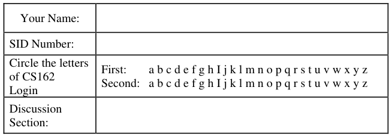

General Information: 
This is a **closed book** exam.  You are allowed 2 pages of notes (both sides).  You may use a 
calculator. You have 3 hours to complete as much of the exam as possible. Make sure to read all of 
the questions first, as some of the questions are substantially more time consuming. 
Write all of your answers directly on this paper.  Make your answers as concise as possible. On 
programming questions, we will be looking for performance as well as correctness, so think through 
your answers carefully.  If there is something about the questions that you believe is open to 
interpretation, please ask us about it!

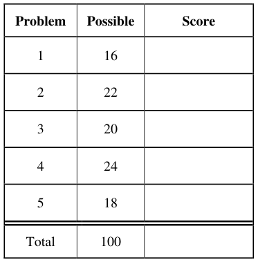

&emsp;Page 1/22

---

**Page 2**

CS 162 Fall 2010 Midterm I October 18th, 2010

&emsp;&emsp;&emsp;&emsp;&emsp;&emsp;&emsp;&emsp;\[ This page left for  \]

3.14159265358979323846264338327950288419716939937510582097494459230781640628620899

Page 2/22

---

**Page 3**

CS 162 Fall 2010 Midterm I October 18th, 2010

### Problem 1: True/False \[16 pts\]

Please EXPLAIN your answer in TWO SENTENCES OR LESS (Answers longer than this may not 
get credit!).  Also, answers without an explanation GET NO CREDIT.

### **Problem 1a\[2pts\]:** The size of an inverted page table grows with the size of the virtual address

space that it is supporting.

Explain: Since an inverted page table holds a hash on entries, it only needs to grow 
with the size of the physical address space.  Entries not found in the 
&emsp;&emsp;&emsp;&emsp;&emsp;&emsp;&emsp;&emsp;inverted page table can be assumed to be invalid.

### **Problem 1b\[2pts\]:** The term “Core” in “Dump Core” refers to the interior of a machine, since

Explain: The term “Core” refers to “core memory”, a type of memory that uses 
&emsp;&emsp;&emsp;&emsp;&emsp;&emsp;&emsp;&emsp;magnetic rings (cores) to store bits of information.

### **Problem 1c\[2pts\]:** Threads within the same process can share data with one another by passing

pointers to objects on their stacks.

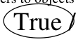

&emsp;&emsp;True / False 
Explain: Since the threads in the same process share an address space, they can 
&emsp;&emsp;&emsp;&emsp;&emsp;&emsp;&emsp;&emsp;all access the same memory (including each other’s stacks).

### **Problem 1d\[2pts\]:** Resource cycles always lead to deadlock.

Explain: No. If there are multiple equivalent resources, then a cycle could exist that 
wasn’t a deadlock: The reason is that some thread that wasn’t a part of the 
cycle could release a resource needed by a thread in the cycle, thereby 
&emsp;&emsp;&emsp;&emsp;&emsp;&emsp;&emsp;&emsp;breaking the cycle.

### **Problem 1e\[2pts\]:** Anything that can be done with a monitor can also be done with semaphores.

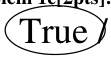

&emsp;&emsp;True / False 
Explain: Since one can construct monitors using semaphores, one could 
&emsp;&emsp;&emsp;&emsp;&emsp;&emsp;&emsp;&emsp;implement any monitor-based algorithm with semaphores by simply 
replacing the monitor implementation (i.e. locks and condition 
variables) with one using semaphores.

Page 3/22

---

**Page 4**

CS 162 Fall 2010 Midterm I October 18th, 2010

### **Problem 1f\[2pts\]: “**Hyperthreading” is a term used to describe systems with thousands of threads.

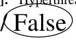

Explain: Hyperthreading refers to a hardware-multithreading technique that 
interleaves a small number of threads on a cycle-by-cycle basis to 
maximize the utilization of the processor pipeline.

### **Problem 1g\[2pts\]:** A Lottery Scheduler can be used to implement any other scheduling algorithm

by adjusting the number of tickets that each process holds.

Explain: A lottery scheduler cannot be used to implement strict priority scheduling.

### **Problem 1h\[2pts\]:** A MicroKernel can improve the resilience of a system against bugs in the OS.

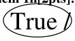

&emsp;&emsp;True / False 
Explain: By isolating components of the system (such as file system, network stack, 
etc.) in their own address spaces, we gain resilience against bugs because 
buggy components are prevented from interfering with other components 
by the address-space isolation.

Page 4/22

---

**Page 5**

CS 162 Fall 2010 Midterm I October 18th, 2010

### Problem 2: Short Answer \[22pts\]

### **Problem 2a\[2pts\]:** What is priority donation and why is it important?

&emsp;Priority donation is the process of promoting the priority of lock holders to be equal to that of 
&emsp;the corresponding lock-waiters in order to prevent priority inversion (a situation in which a 
&emsp;high-priority process ends up waiting on a low-priority process). Priority donation helps to 
&emsp;avoid variety of bad situations that can arise from priority inversion such as livelocks or other 
&emsp;violations of resource usage that result from not adhering to the priority scheme.

### **Problem 2b\[3pts\]:** Name three ways in which the processor can transition from user mode to

kernel mode.  Can the user execute arbitrary code after transitioning? 
&emsp;Some examples include (you only need three): 
&emsp;(1) User executing a yield() system call 
&emsp;(2) User executing an arbitrary system call (such as for I/O) 
&emsp;(3) External interrupt (such as a timer interrupt) 
&emsp;(4) System fault (such as a divide-by-zero or memory error). 
&emsp;(5) Page Fault 
&emsp;No, the user is not able to execute arbitrary code, because all of the entrypoints to the kernel 
&emsp;are carefully enforced by the hardware. To say this another way, the hardware makes sure that 
&emsp;all transitions to kernel mode are accompanied by entry into a well-defined set of entry points.

### **Problem 2c\[2pts\]:** What happens when an interrupt occurs?  What does the interrupt controller do?

&emsp;Assuming that the interrupt is currently enabled, the hardware saves the PC, disables 
&emsp;interrupts, then jumps to an interrupt vector based on the type of interrupt. Typically, the 
&emsp;interrupt handler adjusts which interrupts are enabled and saves all registers (including the 
&emsp;stack pointer) before proceeding to service the interrupt. The interrupt controller provides an 
&emsp;interface that allows the kernel to control which interrupts are enabled.

### **Problem 2d\[2pts\]:** Explain how to fool the multi-level feedback scheduler’s heuristics into giving

a long-running task more CPU cycles. 
&emsp;The multi-level feedback scheduler uses the time between bursts (i.e. between I/O operations) to 
&emsp;distinguish between interactive and background tasks.  Long-running tasks are typically run at 
&emsp;lower priority. By inserting a bunch of I/O (say printfs) into the long-running task, one can fool 
&emsp;the multi-level feedback scheduler into thinking that the long-running tasks is actually 
&emsp;interactive and should be run at higher priority.

Page 5/22

---

**Page 6**

CS 162 Fall 2010 Midterm I October 18th, 2010

### **Problem 2e\[3pts\]:** What is the difference between Mesa and Hoare scheduling for monitors?

Include passing of locks between signaler and signalee, scheduling of CPU resources, and impact 
on the programmer. 
&emsp;For Mesa scheduling, the signaler keeps the lock and CPU, while the signaled thread is simply 
&emsp;put on the ready queue and will run at a later time. Further, a programmer with Mesa 
&emsp;scheduled monitors must recheck the condition after being awoken from a Wait() operation \[ 
&emsp;i.e. they need a while loop around the execution of Wait(). For Hoare scheduling, the signaler 
&emsp;gives the lock and CPU to the signaled thread which begins running until it releases the lock, at 
&emsp;which point the signaler regains the lock and CPU. A programmer with Hoare scheduled 
&emsp;monitors does not need to recheck the condition after being awoken, since they know that the 
&emsp;code after the Wait() is executed immediately after the Signal() \[i.e. they do not need a while 
&emsp;loop around the execution of Wait()\].

### **Problem 2f\[2pts\]:** What needs to be saved and restored on a context switch between two threads in

the same process?  What if the two threads are in different processes?  Be explicit. 
&emsp;Need to save the processor registers, stack pointer, program counter into the TCB of the thread 
&emsp;that is no longer running. Need to reload the same things from the TCB of the new thread. 
&emsp;When the threads are from different processes, need to not only save and restore what was 
&emsp;given above, but you also need to load the pointer for the top-level page-table of the new 
&emsp;address space. You don’t need to save the old pointer, since this will not change and is 
&emsp;already stored in the PCB.

### **Problem 2g\[2pts\]:** List two reasons why overuse of threads is bad (i.e. using too many threads for

different tasks). Be explicit in your answers. 
&emsp;There are many reasons why overusing threads may be bad. For instance: (1) the overhead of 
&emsp;switching will become significant, (2) you would end up using a lot of memory for stacks, (3) the 
&emsp;threads may spend all of their time synchronizing on shared data structures (i.e. sleeping in 
&emsp;locks), (4) You may be more likely to introduce concurrency bugs with increased concurrency.

### **Problem 2h\[2pts\]:** As specified, the SRTF algorithm requires knowledge of the future. Name two

ways to approximate the information required to implement this algorithm. 
&emsp;(1) One can use the past to predict the future by building a model of burst time (e.g. a Kalmann 
&emsp;&emsp;filter or an exponential-averaging filter). 
&emsp;(2) One could build a scheduler structure (such as the multi-level scheduler) that attempts to 
&emsp;&emsp;sort threads into a small number of categories based on their past behavior and using these 
&emsp;&emsp;categories to subsequently assign processor time (i.e. schedule) these threads.

Page 6/22

---

**Page 7**

CS 162 Fall 2010 Midterm I October 18th, 2010

### **Problem 2i\[4pts\]:**

Here is a table of processes and their associated arrival and running times.

Show the scheduling order for these processes under 3 policies: First Come First Serve (FCFS), 
Shortest-Remaining-Time-First (SRTF), Round-Robin (RR) with timeslice quantum = 1. Assume 
that context switch overhead is 0 and that new processes are added to the **head** of the queue except 
for FCFS, where they are added to the tail.

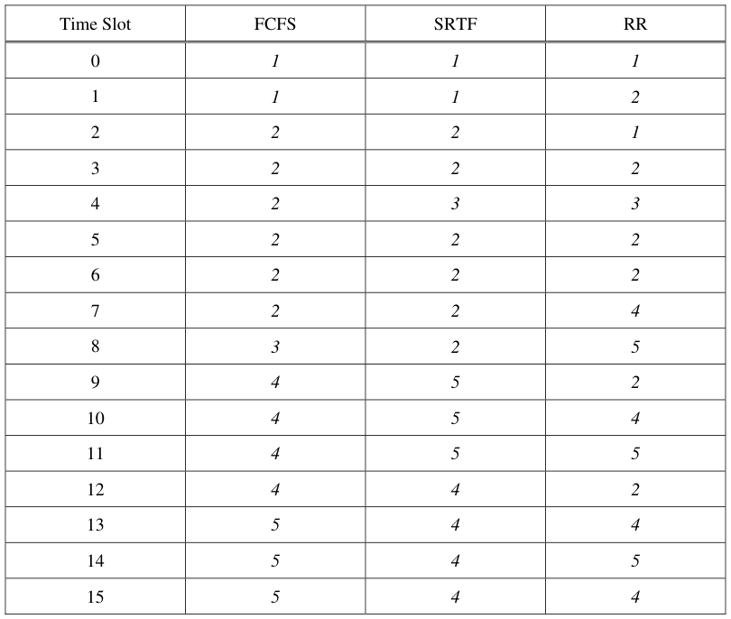

Page 7/22

---

**Page 8**

CS 162 Fall 2010 Midterm I October 18th, 2010 
&emsp;&emsp;&emsp;&emsp;&emsp;&emsp;&emsp;&emsp;\[ This page intentionally left blank \]

Page 8/22

---

**Page 9**

CS 162 Fall 2010 Midterm I October 18th, 2010

### Problem 3: Readers-Writers Access to Database \[20 pts\]

### **Problem 3a\[2pts\]:**  Above, we show the Readers-Writers example given in class.  It used two

condition variables, one for waiting readers and one for waiting writers. Suppose that all of the 
following requests arrive in very short order (while R1 and R2 are still executing): 
Incoming stream: R1 R2 W1 R3 W2 W3 R4 R5 R6 W4 R7 W5 W6 R8 R9 W7 R10 
In what order would the above code process the above requests? If you have a group of requests 
that are equivalent (unordered), indicate this clearly by surrounding them with braces ‘{}’.  You can 
assume that the wait queues for condition variables are FIFO in nature (i.e. signal() wakes up the 
oldest thread on the queue). Explain how you got your answer. 
&emsp;SOLN: Processed as follows: {R1 R2} W1W2 W3 W4 W5 W6 W7 { R3 R4 R5 R6 R7 R8 R9 R10} 
&emsp;Since this algorithm gives precedence to writes over reads, although the first two reads get to 
&emsp;execute together and right away, the remaining reads are deferred until each write is processed 
&emsp;(one at a time).  After all writes are finished, then the reads execute as a group.

### **Problem 3b\[2pts\]:**  Let us define the logical arrival order by the order in which threads first

acquire the monitor lock. Suppose that we wanted the results of reads and writes to the database to 
be the same as if they were processed one at a time – in their logical arrival order; for example, 
W1 W2 R1 R2 R3 W3 W4 R4 R5 R6 would be processed as W1 W2 {R1 R2 R3} W3 W4 {R4 R5 R6} 
regardless of the speed with which these requests arrive. Explain why the above algorithm does not 
satisfy this constraint. 
&emsp;Once it starts buffering items (i.e. putting requests to sleep on condition variables), the above 
&emsp;algorithm does not keep track of the arrival order.  Or, to say it another way, the above 
&emsp;algorithm loses all ordering between buffered reads and buffered writes. Thus, it cannot 
&emsp;guarantee that reads execute after earlier writes and before later writes (as defined by logical 
&emsp;arrival order) unless it never buffers items (in which case it is not really doing anything at all).

Page 9/22

---

**Page 10**

CS 162 Fall 2010 Midterm I October 18th, 2010

&emsp;Assume that our system uses Mesa scheduling and that condition variables have FIFO wait 
&emsp;queues.  Below is a sketch of a solution that uses only two condition variables and that does 
&emsp;return results as if requests were processed in logical arrival order.  Rather than separate 
&emsp;methods for Reader() and Writer(), we have a single method which takes a “NewType” variable 
&emsp;(0 for read, 1 for write): 
`1. Lock MonitorLock;`           `// Methods: acquire(),release()` 
`2. Condition waitQueue, onDeckQueue;// Methods: wait(),signal(),broadcast()` 
`3. int Queued = 0, onDeck = 0;   // Counts of sleeping threads` 
`4.` `/* Missing code */` 
`5. Accessor (int NewType) {`    `// type = 0 for read, 1 for write` 
`6.`     `/* Monitor to control entry so that one writer or multiple readers */` 
`7.`     `MonitorLock.acquire();` 
`8.`     `/* Missing wait condition */` 
`9.`     `{ Queued++;` 
`10.`         `waitQueue.wait();` 
`11.`         `Queued—;` 
`12.`     `}` 
`13.`     `/* Missing wait condition */` 
`14.`     `{` `onDeck++;` 
`15.`         `onDeckQueue.wait();` 
`16.`         `onDeck--;` 
`17.`     `}` 
`18.`     `/* Missing code */` 
`19.`      `MonitorLock.release();` 
`20.`     `// Perform actual data access` 
`21.`     `AccessDatabase(NewType);` 
`22.`     `/* Missing code */` 
`23. }` 
The `waitQueue` condition variable keeps unexamined requests in FIFO order.  The 
`onDeckQueue` keeps a single request that is currently incompatible with requests that are 
executing.  We want to allow as many parallel requests to the database as possible, subject to the 
constraint of obeying logical arrival order. Here, logical arrival order is defined by the order in 
which requests acquire the lock at line #7.

### **Problem 3c\[2pts\]:** What additional variable(s) (and initialization) do you need at Line #4? Hint:

think about what you need to describe the current set of threads accessing the database in parallel. 
Give explicit code to insert at Line #4 (can be more than one line of actual code). 
&emsp;We need to know which type of request is currently occurring and how many of these requests 
&emsp;are occurring in order to adhere to the Readers-Writers conditions (multiple reads or one write 
&emsp;at a time).  Although we can accomplish this requirement in multiple ways, the following works: 
&emsp;`int CurType = 0;` 
&emsp;`int NumAccessing = 0;`

### **Problem 3d\[2pts\]:** Explain why you might not want to use a “while()” statement in Line #8 –

despite the fact that the system has Mesa scheduling: 
&emsp;Because a while loop will potentially reorder requests on the `waitQueue` condition variable – 
&emsp;and we want to keep requests in their original logical arrival order. Thus whatever we do, we 
&emsp;do not want to execute `waitQueue.wait()`more than once per thread.

Page 10/22

---

**Page 11**

CS 162 Fall 2010 Midterm I October 18th, 2010

### **Problem 3e\[2pts\]:** What is the missing code in Line #8?  Hint: it is a single “if” statement.

&emsp;If anyone in the system is waiting, then we want to wait so that we don’t get ahead of others (i.e. 
&emsp;so that we preserve the logical arrival order): 
&emsp;`if (Queued + onDeck > 0)`

### **Problem 3f\[2pts\]:** What is the missing code in Line #13?  This should be a single line of code.

&emsp;If the current request is incompatible with the set of executing requests, then we have to wait: 
&emsp;`while ((NumAccessing > 0) && (NewType == 1 || CurType == 1))` 
&emsp;You could also use an “if” here, but then you would need to conditionalize the 
&emsp;“onDeckQueue.signal()” statement in (3h).

### **Problem 3g\[2pts\]:** What is the missing code in Line #18?  You should not have more than three (3)

actual lines of code. 
&emsp;`NumAccessing++;`       `// Have another thread accessing the database` 
&emsp;`CurType = NewType;    // In case we are first of new group` 
&emsp;`waitQueue.signal();   // Wake up next thread (if they exist)`

### **Problem 3h\[3pts\]:** What is the missing code in Line #22?  You should not have more than five (5)

actual lines of code. 
&emsp;`MonitorLock.acquire();` 
&emsp;`NumAccessing--;`       `// One less accessing` 
&emsp;`onDeckQueue.signal(); // Wake up someone stalled on conflict` 
&emsp;`MonitorLock.release();`

&emsp;If you use an “if” in (3h), then need this instead of the above signaling 
&emsp;`if(NumAccessing ==0)` 
&emsp;`onDeckQueue.signal(); // Wake up someone stalled on conflict`

### **Problem 3i\[3pts\]:** Suppose that condition variables did not have FIFO ordered wait queues. What

changes would you have to make to your code?  Be explicit (you should not need more than 6 new 
or changed lines). Hint: consider assigning a sequentially increasing ID to each thread. 
&emsp;New variables to track sequential IDs added to Line #4: 
&emsp;`int HeadID = 0, TailID = 0;    //(NEW)` 
&emsp;New code for Line #8 (one new line, one changed line): 
&emsp;&emsp;`int MyCurrentID = TailID++;    //(NEW)Next logical ID to new request` 
&emsp;&emsp;`while (MyCurrentID != HeadID) //(CHANGED)` 
&emsp;Finally, code for Line #18 is slightly different (only added 1 line, changed 1 line): 
&emsp;&emsp;`NumAccessing++;`         `//(UNCHANGED LINE)` 
&emsp;&emsp;`CurType = NewType;`      `//(UNCHANGED LINE)` 
&emsp;&emsp;`HeadID++;`      `//(NEW) Next in-order thread can wake` 
&emsp;&emsp;`waitQueue.broadcast(); //(CHANGED) Wake up next thread in order`

Page 11/22

---

**Page 12**

CS 162 Fall 2010 Midterm I October 18th, 2010 
&emsp;&emsp;&emsp;&emsp;&emsp;&emsp;&emsp;&emsp;\[ This page intentionally left blank \]

Page 12/22

---

**Page 13**

CS 162 Fall 2010 Midterm I October 18th, 2010

### Problem 4: Deadlock \[24pts\]

### **Problem 4a\[2pts\]:** Suppose that we utilize the Banker’s algorithm to determine whether or not to

grant resource requests to threads. The job of the Banker’s algorithm is to keep the system in a 
“SAFE” state. It denies resource requests by putting the requesting thread to sleep if granting the 
request would cause the system to enter an “UNSAFE” state, waking it only when the request could 
be granted safely. What is a SAFE state? 
&emsp;In a safe state, there is some ordering of the threads in the system such that threads can 
&emsp;complete, one after another without deadlocking and without requiring threads to give up 
&emsp;resources that they already have.

### **Problem 4b\[4pts\]:**

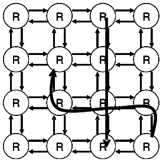

The figure at the right illustrates a 2D mesh of network routers. 
Each router is connected to each of its neighbors by two 
network links (small arrows), one in each direction. Messages 
are routed from a source router to a destination router and can 
stretch through the network (i.e. consume links along the route 
from source to destination). Messages can cross inside routers. 
&emsp;Assume that no network link can service more than one 
message at a time, and that each message must consume a 
continuous set of channels (like a snake). Messages always 
make progress to the destination and never wrap back on 
themselves. The figure shows two messages (thick arrows). 
&emsp;Assume that each router or link has a very small amount of buffer space and that each message 
can be arbitrarily long. Show a simple situation (with a drawing) in which messages are deadlocked 
and can make no further progress.  Explain how each of the four conditions of deadlock are 
satisfied by your example. Hint: Links are the limited resources in this example.

&emsp;&emsp;&emsp;&emsp;&emsp;&emsp;&emsp;&emsp;Answer: The simplest deadlock example is a set of four messages in a

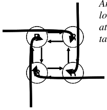

&emsp;&emsp;&emsp;&emsp;&emsp;&emsp;&emsp;&emsp;loop (as shown in the figure at the left). Each message is blocked 
&emsp;&emsp;&emsp;&emsp;&emsp;&emsp;&emsp;&emsp;attempting to make a counter-clockwise turn by a message utilizing the 
&emsp;&emsp;&emsp;&emsp;&emsp;&emsp;&emsp;&emsp;target channel. Four conditions: 
&emsp;&emsp;&emsp;&emsp;&emsp;&emsp;&emsp;&emsp;1\. Mutual Exclusion: Each channel held by one message at a time 
&emsp;&emsp;&emsp;&emsp;&emsp;&emsp;&emsp;&emsp;2\. Hold and Wait: messages hold channels while waiting to acquire 
&emsp;&emsp;&emsp;&emsp;&emsp;&emsp;&emsp;&emsp;other channels 
&emsp;&emsp;&emsp;&emsp;&emsp;&emsp;&emsp;&emsp;3\. No preemption: Channels can not be preempted from messages 
&emsp;&emsp;&emsp;&emsp;&emsp;&emsp;&emsp;&emsp;after they are acquired by them 
&emsp;&emsp;&emsp;&emsp;&emsp;&emsp;&emsp;&emsp;4\. Circular wait: We have a cycle of waiting here – four messages

Page 13/22

---

**Page 14**

CS 162 Fall 2010 Midterm I October 18th, 2010

### **Problem 4c\[3pts\]:**

Define a routing policy that avoids deadlocks in the network of (4b). Prove that deadlocks cannot 
happen when using this routing policy. Hint: assume that a deadlock occurs and show why that 
leads to a contradiction in the presence of your new routing policy. 
&emsp;Several answers are possible here.  The one given in class was to force messages to route in the 
&emsp;X direction first, then Y.  To prove that deadlocks cannot occur, assume that one did occur. 
&emsp;Then, such a deadlock would involve a cycle in messages.  However, such a cycle would involve 
&emsp;at least one message that routed from the Y direction to the X direction (in fact, at least 2 of 
&emsp;them).  Since we have disallowed such a route, this cycle cannot exist.  Thus, no deadlocks can 
&emsp;exist.

### **Problem 4d\[3pts\]:** Suppose that we wanted a less restrictive routing policy than your answer to

(4c).  Explain why the Banker’s algorithm is not well adapted to this routing problem.   What could 
you do that was similar in spirit to the Banker’s algorithm to prevent deadlock in networks such as 
(4b), while allowing arbitrary routing of messages?  Why is it unlikely that such an algorithm 
would be used in a real network? 
&emsp;The problem here is that the resource needs of a message depends on the current location of its 
&emsp;head, while the Banker’s algorithm requires declaration of resource needs prior to routing. The 
&emsp;Banker’s algorithm is so conservative that it would allow only a small number of messages to 
&emsp;be present in the network at the same time. 
&emsp;What one could do is to have each message request its next link from a deadlock-avoider that 
&emsp;checks inflight messages to see if they could still be drained from the network if the link request 
&emsp;were granted. Although this mechanism would be in the spirit of the Banker’s algorithm, it is 
&emsp;very expensive (requires essentially routing all messages to their destinations to decide whether 
&emsp;the system would deadlock).

### **Problem 4e\[2pts\]:** Is it possible for a system with a single monitor (i.e one lock with multiple

condition variables) to deadlock?  Explain. 
&emsp;Yes. The lock provides a guard on the condition variables, which could be involved in a circular 
&emsp;wait condition. The simplest way to see this situation is to construct two semaphores from one 
&emsp;monitor with two condition variables. For instance: 
&emsp;&emsp;`X.p()` `lock.acquire();`    `X.v()` `lock.acquire();` 
&emsp;`while (Xcount = 0)`        `Xcount++;` 
&emsp;`Xcondition.wait();`        `Xcondition.signal()` 
&emsp;`Xcount—;`        `lock.release();` 
&emsp;`lock.release();` 
&emsp;Same for semaphore Y.  Then, set up a circular wait condition: 
&emsp;Thread 1    Thread 2 
&emsp;X.p()    Y.p() 
&emsp;&emsp;&emsp;&emsp;&emsp;&emsp;&emsp;&emsp;X.p() 
&emsp;Y.p()

Page 14/22

---

**Page 15**

CS 162 Fall 2010 Midterm I October 18th, 2010

### **Problem 4f\[4pts\]:**

Suppose that we have the following resources: A, B, C and threads T1, T2, T3, T4.  The total 
number of each resource is:

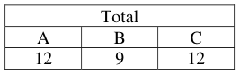

Further, assume that the processes have the following maximum requirements and current 
allocations:

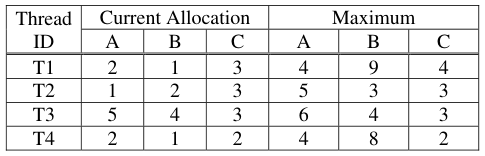

Is the system in a safe state (as defined by the Banker’s algorithm)? If “yes”, show a non-blocking 
sequence of thread executions. Otherwise, provide a proof that the system is unsafe. Show all steps, 
intermediate matrices, etc. 
&emsp;Answer: Yes, this system is in a safe state.

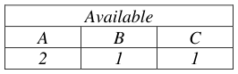

&emsp;To prove this, we first compute the currently free allocations:

&emsp;Further, we compute the number needed by each thread (Maximum – Current Allocation):

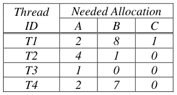

&emsp;Thus, we can see that a possible sequence is: T3, T2, T4, T1:

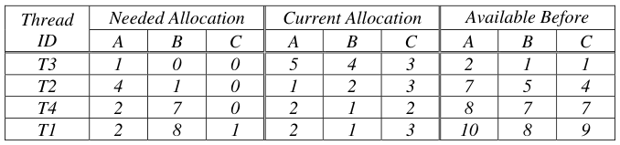

Page 15/22

---

**Page 16**

CS 162 Fall 2010 Midterm I October 18th, 2010

### **Problem 4g\[3pts\]:**

Assume that we start with a system in the state of (4f). Suppose that T1 asks for 2 more copies of 
resource A.  Can the system grant this if it wants to avoid deadlock (i.e. will the result be a SAFE 
state)? Explain. 
&emsp;No.  This cannot be granted.  Assume that T1 gets 2 more of A. 
&emsp;Then, our available allocation is:

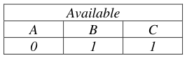

&emsp;Then, looking at our needed

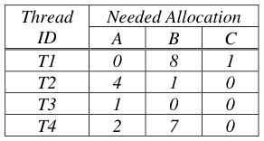

&emsp;allocations, we see:

&emsp;At this point, the available allocation is insufficient to start any of the threads, much less find a 
&emsp;safe sequence that finishes all of them.

### **Problem 4h\[3pts\]:**

Assume that we start with a system in the state of (4f). What is the maximum number of additional 
copies of resources (A, B, and C) that T1 can be granted in a single request without risking 
deadlock? Explain. 
&emsp;We cannot ask for more than (A,B,C)=(2,1,1) since this is all that is available. However, the 
&emsp;previous problem showed that A must be \< 2. Further, note that the resources given to T1 are 
&emsp;tied up until the very end of the execution (look at sequence in 4f). 
&emsp;Thus, looking at our safe sequence from 4f, we can see that it can still work if it is missing one A 
&emsp;and one C. Just work through it with the first “Available Before” allocation of 1,1,0 instead of 
&emsp;2,1,1. However, it will not work if it is missing one more B (we would be unable to execute T4 in 
&emsp;the sequence), i.e. setting “Available Before” to 1,0,0 prevents the execution of T4. 
&emsp;Thus the maximum number of additional resources that can be requested by T1 is 
&emsp;(A,B,C)=(1,0,1)

Page 16/22

---

**Page 17**

CS 162 Fall 2010 Midterm I October 18th, 2010

### Problem 5: Virtual Memory \[18pts\]

Consider a two-level memory management scheme on 24-bit virtual addresses using the following 
format for virtual addresses:

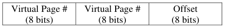

Virtual addresses are translated into 16-bit physical addresses of the following form:

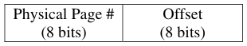

Page table entries are 16 bits in the following format, stored in big-endian form in memory (i.e. the 
MSB is first byte in memory). 
&emsp;&emsp;&emsp;&emsp;&emsp;&emsp;&emsp;&emsp;**Page Table Entry (PTE)**

Note that a virtual-physical translation can fail at any point if an incompatible PTE is encountered. 
Two types of errors can occur during translation: “invalid page” (page is not mapped at all) or 
“access violation” (page exists, but access was illegal).

### **Problem 5a\[2pts\]:** How big is a page? Explain.

&emsp;Pages are 256 bytes in size (2Offset) = (28).

### **Problem 5b\[2pts\]:** What is the largest size for a page table with this address space? We are asking

for the total size of both levels of the page table. Explain. 
&emsp;The largest page table would occur when there is a mapping for all pages in the address space. 
&emsp;All entries would be filled at both levels of the page table. In this double-level page table, there 
&emsp;will be 1 page-table chunk at the top level and 28 page-table chunks at the second level for a 
&emsp;total of 1+28 chunks.  Each chunk has 28×SizeOf(PTE) = 512 bytes. Thus, the total size of the 
&emsp;full page table is:  (1+28) × (512) = 131584.

### **Problem 5c\[3pts\]:** What does “TLB” stand for and what is its function?  How big would a TLB

entry be for this system? 
&emsp;“TLB” stands for Translation Lookahead Buffer. It serves as a cache for translations from the 
&emsp;page table. Each TLB entry would contain a virtual page # (16 bits), a PTE (16 bits), and a 
&emsp;valid bit (1 bit) for a total of 33 bits.  Since there are two zero bits in the PTE, one could argue 
&emsp;that the TLB entry only needs 31 bits.

Page 17/22

---

**Page 18**

CS 162 Fall 2010 Midterm I October 18th, 2010

### **Problem 5d\[3pts\]:** Sketch the format of the page-table for this multi-level virtual memory

management scheme. Illustrate the process of resolving an address as well as possible. 
We were looking for something like this: 
&emsp;&emsp;&emsp;&emsp;&emsp;&emsp;&emsp;&emsp;Virtual Address

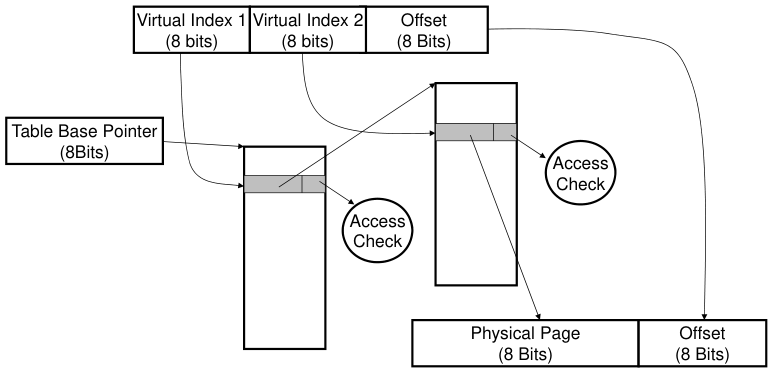

&emsp;&emsp;&emsp;&emsp;&emsp;&emsp;&emsp;&emsp;Physical Address

### **Problem 5e\[2pts\]:** What is “Copy on Write”?  How would you perform Copy on Write with the

Virtual Memory system discussed in this problem? 
&emsp;Copy on Write is a mechanism for making cheap copies of an address space by creating a 
&emsp;duplicate page table that points at the same physical pages as an existing page table. All PTEs 
&emsp;are marked as read-only, allowing any write to be caught; at the point of a write, the target 
&emsp;page can be copied so that each page table points at a unique copy.  As just mentioned, Copy 
&emsp;On Write is accomplished in this Virtual Memory system by setting the PTE to Read-Only so 
&emsp;that the target page can be copied at the first write.

### **Problem 5f\[6pts\]:** The contents of physical memory are given on the next page. Assume that the

page-table base pointer = 0x2000, and that the CPU is in user-mode. Please return the results from 
the following load/store instructions.  Addresses are virtual. The return value for load is an 8-bit 
data value or an error, while the return value for a store is either “**ok**” or an error. For errors, please 
specify which type of error (either “invalid page” or “access violation”).

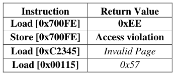

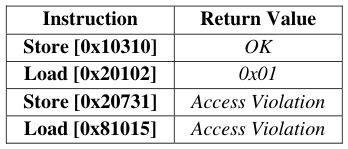

Page 18/22

---

**Page 19**

CS 162 Fall 2010 Midterm I October 18th, 2010

&emsp;&emsp;&emsp;&emsp;&emsp;&emsp;&emsp;&emsp;**Virtual Address Format**

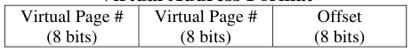

&emsp;&emsp;&emsp;&emsp;&emsp;&emsp;&emsp;&emsp;**Page Table Entry (PTE)**

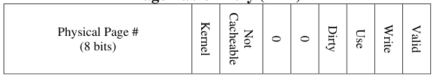

&emsp;&emsp;&emsp;&emsp;&emsp;&emsp;&emsp;&emsp;**Physical Memory**

Page 19/22

---

**Page 20**

CS 162 Fall 2010 Midterm I October 18th, 2010

&emsp;&emsp;&emsp;&emsp;&emsp;&emsp;&emsp;&emsp;\[ This page intentionally left blank\]

Page 20/22

---

**Page 21**

CS 162 Fall 2010 Midterm I October 18th, 2010

&emsp;&emsp;&emsp;&emsp;&emsp;&emsp;&emsp;\[Scratch Page: Do not put answers here!\]

Page 21/22

---

**Page 22**

CS 162 Fall 2010 Midterm I October 18th, 2010

&emsp;&emsp;&emsp;&emsp;&emsp;&emsp;&emsp;\[Scratch Page: Do not put answers here!\]

Page 22/22

