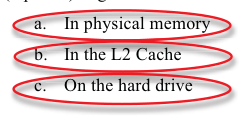
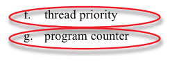
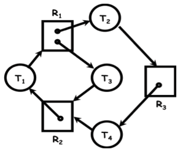
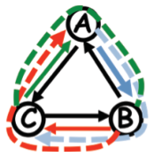
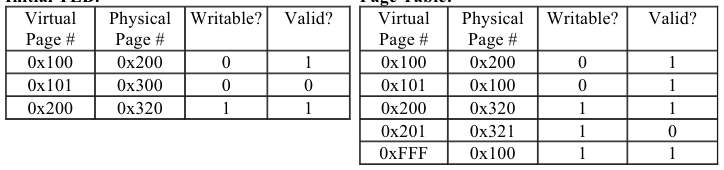
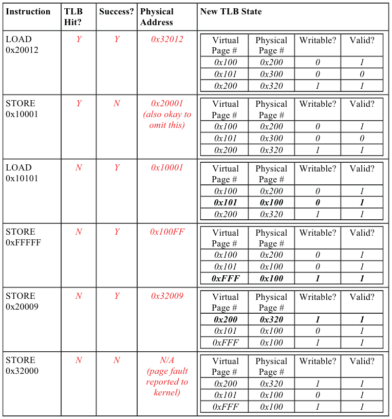
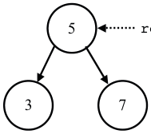
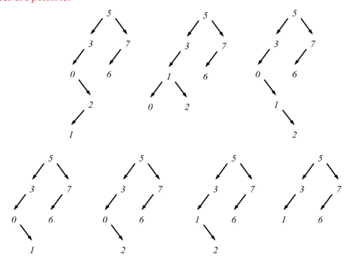

# Berkeley CS162 Spring 2010: Midterm 1: Official solutions

> Copied from the original: <https://hkn.eecs.berkeley.edu/exams/course/cs/162>. Text and figures are taken from the PDF as is; nothing was answered or rewritten. The original PDF is in this folder.

---

**Page 1**

Student Name: \_\_\_\_\_\_\_\_\_\_\_\_\_\_\_\_\_\_\_\_\_\_\_\_\_\_\_\_\_\_\_\_\_\_\_\_\_      SID: \_\_\_\_\_\_\_\_\_\_\_\_\_\_\_\_\_\_\_\_\_

&emsp;&emsp;&emsp;&emsp;&emsp;&emsp;&emsp;&emsp;**University of California at Berkeley** 
&emsp;&emsp;&emsp;&emsp;&emsp;&emsp;&emsp;&emsp;**College of Engineering** 
&emsp;&emsp;&emsp;&emsp;&emsp;**Department of Electrical Engineering and Computer Science**

CS 162    I. Stoica 
Spring 2010

&emsp;&emsp;&emsp;&emsp;&emsp;&emsp;&emsp;&emsp;FIRST MIDTERM EXAMINATION 
&emsp;&emsp;&emsp;&emsp;&emsp;&emsp;&emsp;&emsp;Tuesday, March 9, 2010

INSTRUCTIONS—READ THEM NOW! This examination is CLOSED BOOK/CLOSED NOTES. There 
is no need for calculations, and so you will not require a calculator, Palm Pilot, laptop computer, or other 
calculation aid. Please put them away. You MAY use one 8.5” by 11” double-sided crib sheet, as densely 
packed with notes, formulas, and diagrams as you wish. The examination has been designed for 100 
minutes/100 points (1 point = 1 minute, so pace yourself accordingly). All work should be done on the 
attached pages.

In general, if something is unclear, write down your assumptions as part of your answer. If your 
assumptions are reasonable, we will endeavor to grade the question based on them. If necessary, of course, 
you may raise your hand, and a TA or the instructor will come to you. Please try not to disturb the students 
taking the examination around you.

We will post solutions to the examination as soon as possible, and will grade the examination as soon as 
practical, usually within a week. Requests for regrades should be submitted IN WRITING, explaining why 
you believe your answer was incorrectly graded, within ONE WEEK of the return of the examination in 
class. We try to be fair, and do realize that mistakes can be made during the regarding process. However, 
we are not sympathetic to arguments of the form “I got half the problem right, why did I get a quarter of the 
points?”

\_\_\_\_\_\_\_\_\_\_\_\_\_\_\_\_\_\_\_\_\_\_\_\_\_\_\_\_\_\_\_\_\_\_\_\_\_\_\_\_\_\_     SID: \_\_\_\_\_\_\_\_\_\_\_\_\_\_\_\_\_\_\_\_\_\_\_\_\_\_\_\_\_\_\_ 
(Signature)

\_\_\_\_\_\_\_\_\_\_\_\_\_\_\_\_\_\_\_\_\_\_\_\_\_\_\_\_\_\_\_\_\_\_\_\_\_\_\_\_\_\_                 Discussion Section (Day/Time): \_\_\_\_\_\_\_\_ 
(Name—Please Print!)

CS 162 Midterm    Page 1     March 9, 2010; 3:30-6:30 PM

---

**Page 2**

Student Name: \_\_\_\_\_\_\_\_\_\_\_\_\_\_\_\_\_\_\_\_\_\_\_\_\_\_\_\_\_\_\_\_\_\_\_\_\_      SID: \_\_\_\_\_\_\_\_\_\_\_\_\_\_\_\_\_\_\_\_\_

### **Question 1. (20 points)**

**True or False** (12 points). Instructions: write “true” or “false” after each of the following 
statements (Please give one statement justification for each of your answers). 
&emsp;a.  (2 points) Each physical page belongs to only one process. 
&emsp;&emsp;False, pages can be shared between processes.

&emsp;b. (2 points) Every interrupt changes the CPU from user mode to kernel mode. 
&emsp;&emsp;False, interrupts can happen when the processor is in kernel mode, in which case no 
&emsp;&emsp;switch to kernel mode is made.

&emsp;c. (2 points) All Page Table entries will be invalid directly after a context switch between 
&emsp;&emsp;processes. 
&emsp;&emsp;False, since the kernel maintains a separate page table for each process, the only pages 
&emsp;&emsp;that should have been invalidated since the last time a process was running are those that 
&emsp;&emsp;were evicted (assuming the OS is using a global eviction policy) while another process 
&emsp;&emsp;was running. It could be that case that the context switch away from, and eventually back 
&emsp;&emsp;to this process does not lead to any more additional invalid page table entries.

&emsp;d. (2 points) The CPU scheduling policy that minimizes average completion time can lead 
&emsp;&emsp;to starvation. 
&emsp;&emsp;True, Shortest Remaining Time First (SRTF) is the policy in question, and can lead to 
&emsp;&emsp;starvation (if very short jobs continuously arrive, jobs with a lot of time remaining will 
&emsp;&emsp;never be run, i.e. starve)

&emsp;e. (2 points) If there is only one CPU in the computer, then at most one process can be in 
&emsp;&emsp;the “running” state at any time. 
&emsp;&emsp;True, assuming that the CPU is not multi-core or hyper-threaded. If you assumed that the 
&emsp;&emsp;CPU **was** either of those things (and stated your assumption!) and  said false, you were 
&emsp;&emsp;correct and given credit as well.

&emsp;f. (2 points) The ”Shortest-Job-First” policy always results in the lowest average 
&emsp;&emsp;completion time in a batch system. 
&emsp;&emsp;False, batch systems still support preemption, thus Shortest Remaining Time First 
&emsp;&emsp;(SRTF) would achieve a lower average completion time. If you stated that you assumed 
&emsp;&emsp;batch system meant no preemption, you received full credit.

CS 162 Midterm    Page 2     March 9, 2010; 3:30-6:30 PM

---

**Page 3**

Student Name: \_\_\_\_\_\_\_\_\_\_\_\_\_\_\_\_\_\_\_\_\_\_\_\_\_\_\_\_\_\_\_\_\_\_\_\_\_      SID: \_\_\_\_\_\_\_\_\_\_\_\_\_\_\_\_\_\_\_\_\_

**Multiple Choice, fill in the blank, short answer** (8 points). Instructions: Circle the correct 
option(s), or fill in the blanks below.

&emsp;a.   (2 points) Page Tables can be stored (circle all answers that apply):

&emsp;b. (2 points) Condition variables support the following 3 operations: 
&emsp;&emsp;&emsp;a. \_\_\_\_\_\_\_\_\_sleep()/wait()\_\_\_\_\_\_\_\_\_\_\_ 
&emsp;&emsp;&emsp;b. \_\_\_\_\_\_\_\_notify()/wake()\_\_\_\_\_\_\_\_\_\_\_ 
&emsp;&emsp;&emsp;c. \_\_notifyAll()/wakeAll()/broadcast()\_\_

&emsp;c. (2 points) Of the following items, circle those that are stored in the thread control block.

&emsp;&emsp;&emsp;e. segment table

&emsp;d. (2 points) Processes (or threads) can be in one of three states: **Running**, **Ready**, or 
&emsp;&emsp;**Waiting**. For each of the following examples, write down which state the process (or 
&emsp;&emsp;thread) is in: 
&emsp;&emsp;&emsp;a. Spin-waiting for a variable y to become zero. \_\_\_\_Running\_\_\_\_\_ 
&emsp;&emsp;&emsp;b. Having just completed an I/O, waiting to get scheduled again on the CPU. 
&emsp;&emsp;&emsp;&emsp;&emsp;\_\_\_\_\_\_Ready\_\_\_\_\_\_ 
&emsp;&emsp;&emsp;c. Blocking on a condition variable for some other thread to signal it. 
&emsp;&emsp;&emsp;&emsp;&emsp;\_\_\_\_\_\_Waiting\_\_\_\_\_\_\_

CS 162 Midterm    Page 3     March 9, 2010; 3:30-6:30 PM

---

**Page 4**

Student Name: \_\_\_\_\_\_\_\_\_\_\_\_\_\_\_\_\_\_\_\_\_\_\_\_\_\_\_\_\_\_\_\_\_\_\_\_\_      SID: \_\_\_\_\_\_\_\_\_\_\_\_\_\_\_\_\_\_\_\_\_

### **Question 2.** Threads and Synchronization (20 points)

(a) (4 points) Give two reasons of why disabling interrupts can be a bad way to implement critical 
sections.

\- Code might have a bug, such as an infinite loop, deadlock, priority inversion, etc, which will 
lock up the system.

\- Code might have an error, such as a seg fault, divide-by-zero, etc, which will be ignored.

\- Turning off interrupts on one processor is not enough in a multi-processor system, turning off 
interrupts across all processors in a multi-processor system is either impossible, difficult, or 
incredibly inefficient.

\- If the critical section is long it will not be able to respond to events/interrupts for the rest of the 
system.

(b) (6 points) Assume you are given the CompareAndSwap atomic primitive defined (in C) as 
follows:

`bool CompareAndSwap(int* value, int from, int to) {` 
`if (*value == from) {` 
`*value = to;` 
`return true;` 
`}` 
`return false;` 
`}`

Consider the following implementation of lock acquire using CompareAndSwap: 
`void acquire() {` 
`while(!CompareAndSwap(&value, UNLOCKED, LOCKED));` 
`}`

&emsp;i) Give one reason why this implementation may not be efficient.

&emsp;&emsp;Spin-waiting/busy-waiting, wasting CPU resources instead of sleeping/yielding.

&emsp;ii) Without preemption, is this still a valid implementation of acquire()? Why? (Use no more 
&emsp;&emsp;than two sentences for your explanation.)

&emsp;&emsp;No: if a thread holding a lock yields then another thread that attempts to acquire that 
&emsp;&emsp;lock will spin in an infinite loop causing a deadlock (without preemption the CPU 
&emsp;&emsp;becomes a resource you need to consider for deadlock). Note that even on a multi- 
&emsp;&emsp;processor machine, a deadlock can still occur (it depends on what the threads are doing 
&emsp;&emsp;and how many of them you have!).

CS 162 Midterm    Page 4     March 9, 2010; 3:30-6:30 PM

---

**Page 5**

Student Name: \_\_\_\_\_\_\_\_\_\_\_\_\_\_\_\_\_\_\_\_\_\_\_\_\_\_\_\_\_\_\_\_\_\_\_\_\_      SID: \_\_\_\_\_\_\_\_\_\_\_\_\_\_\_\_\_\_\_\_\_

(c) (8 points) Complete the following implementation of the P() and V() functions for a 
semaphore using condition variables using Mesa semantics.

`void P()  {` 
`lock.acquire();` 
`while(value == 0)` 
`cond.sleep();` 
`value -= 1;` 
`lock.release();` 
`}`

`void V()  {` 
`lock.acquire();` 
`value += 1;` 
`cond.wake();` 
`lock.release();` 
`}`

(d) (2 points) How could you simplify your implementation if you were given condition variables 
that follow Hoare semantics instead of Mesa semantics? Use no more than two sentences to 
explain your answer.

Rather than using a ‘while’ loop in P(), you could use an ‘if’ statement because Hoare semantics 
blocks the thread calling ‘wake’ and passes control immediately to the waiting thread so the 
invariant/condition is guaranteed to be valid.

CS 162 Midterm    Page 5     March 9, 2010; 3:30-6:30 PM

---

**Page 6**

Student Name: \_\_\_\_\_\_\_\_\_\_\_\_\_\_\_\_\_\_\_\_\_\_\_\_\_\_\_\_\_\_\_\_\_\_\_\_\_      SID: \_\_\_\_\_\_\_\_\_\_\_\_\_\_\_\_\_\_\_\_\_

### **Question 3.** Deadlock (20 points)

(a) (4 points) Name the four conditions under which deadlock occurs. 
&emsp;1) 
&emsp;&emsp;&emsp;&emsp;&emsp;Mutual exclusion 
&emsp;2) 
&emsp;&emsp;&emsp;&emsp;&emsp;Hold and wait 
&emsp;3) 
&emsp;&emsp;&emsp;&emsp;&emsp;No preemption 
&emsp;4) 
&emsp;&emsp;&emsp;&emsp;&emsp;Circular wait

(b) Consider the resource allocation graph below consisting of four tasks (T1, T2, T3, and T4) 
and three resources (R1, R2, and R3). R1 has two instances while the other two resources have 
only one instance each. An arrow from a task to a resource denotes the fact that the task requests 
one instance of the resource, while an arrow from a resource to a task denotes the fact that the 
task holds an instance of the resource. Assume that resources cannot be preempted and tasks do 
not voluntary release resources before terminating.

&emsp;i) (4 points) Are the tasks shown in the above resource graph deadlocked? If yes, explain 
&emsp;&emsp;&emsp;how each of the four deadlock conditions is satisfied. (Use one sentence per 
&emsp;&emsp;&emsp;condition.) If not, give a possible sequence in which the tasks execute.

Tasks are in deadlock: 
&emsp;1\) Mutual exclusion: an instance can be used by only one task; 
&emsp;2\) Hold & wait: a task doesn’t release the resource before terminating (from problem 
&emsp;&emsp;formulation); 
&emsp;3\) No preemption: a task cannot be preempted (from problem formulation); 
&emsp;4\) There is a circular waiting pattern: T1!R1!T3!R2!T1; another cycle is 
&emsp;&emsp;T1!R1!T2!R3!T4!R2!T1.

CS 162 Midterm    Page 6     March 9, 2010; 3:30-6:30 PM

---

**Page 7**

Student Name: \_\_\_\_\_\_\_\_\_\_\_\_\_\_\_\_\_\_\_\_\_\_\_\_\_\_\_\_\_\_\_\_\_\_\_\_\_      SID: \_\_\_\_\_\_\_\_\_\_\_\_\_\_\_\_\_\_\_\_\_

&emsp;ii)  (4 points) Assume you are allowed to add an extra instance of either resource R1 or R2. 
&emsp;&emsp;&emsp;Are the tasks deadlocked in this case? If yes, explain how each of the four deadlock 
&emsp;&emsp;&emsp;conditions is satisfied. (Use one sentence per condition.) If not, give a possible 
&emsp;&emsp;&emsp;sequence in each the tasks execute.

&emsp;No deadlock. Assume R2 has an extra instance. 
&emsp;&emsp;&emsp;&emsp;&emsp;• 
&emsp;&emsp;&emsp;&emsp;&emsp;&emsp;T3 acquires the extra instance of R2 and finishes, then release R1 and R2 
&emsp;&emsp;&emsp;&emsp;&emsp;&emsp;instances; 
&emsp;&emsp;&emsp;&emsp;&emsp;• 
&emsp;&emsp;&emsp;&emsp;&emsp;&emsp;T1 acquires an R1 instance and finishes, then releases R1 and R2 instance; 
&emsp;&emsp;&emsp;&emsp;&emsp;• 
&emsp;&emsp;&emsp;&emsp;&emsp;&emsp;T4 acquires an R2 instance and finishes, then releases R2 and R3 instances; 
&emsp;&emsp;&emsp;&emsp;&emsp;• 
&emsp;&emsp;&emsp;&emsp;&emsp;&emsp;T2 acquires the R3 instance and finishes;

(c) Consider the network below implementing wormhole routing between any two nodes. Each 
node is connected to six of its neighbors by two network links, one in each direction. 
Messages are routed from a source node to a destination node and can stretch through the network 
(i.e. consume links along the route from source to destination). Messages can cross inside nodes. 
Assume that no network link can service more than one message at a time, and that each message 
must consume a continuous set of channels (like a snake). 
Hint: You can think about a message as a train that spans multiple links (possible all the way 
from source to destination), and of each link as a one-way rail.

CS 162 Midterm    Page 7     March 9, 2010; 3:30-6:30 PM

---

**Page 8**

Student Name: \_\_\_\_\_\_\_\_\_\_\_\_\_\_\_\_\_\_\_\_\_\_\_\_\_\_\_\_\_\_\_\_\_\_\_\_\_      SID: \_\_\_\_\_\_\_\_\_\_\_\_\_\_\_\_\_\_\_\_\_

&emsp;i)  (4 points) Show a situation (with a drawing) in which messages are deadlocked and can 
&emsp;&emsp;&emsp;make no further progress. Explain how each of the four conditions of deadlock is 
&emsp;&emsp;&emsp;satisfied by your example.

A sends message to C through B, holds A!B and waits for B!C; 
B sends message to A through C, holds B!C and waits for C!A; 
C sends message to B through A, holds C!A and waits for A!B; 
Deadlock conditions: 
&emsp;1\) Mutual exclusion: a link can handle only one message (problem formulation); 
&emsp;2\) Hold & wait: each message holds a link and waits for another above (see above 
&emsp;&emsp;example); 
&emsp;3\) No preemption: message cannot be preempted (this would be equivalent to dropping 
&emsp;&emsp;message); 
&emsp;4\) There is a circular waiting pattern: (see description of above example);

&emsp;ii) (4 points) Define a routing policy that avoids deadlocks in the network of (i). Explain 
&emsp;&emsp;&emsp;using at most two sentences why your routing policy avoids deadlock.

&emsp;&emsp;&emsp;Dimension reordering; first route east – west, then on diagonal northwest – 
&emsp;&emsp;&emsp;southwest. Once a message starts on a diagonal it can never get back on the 
&emsp;&emsp;&emsp;horizontal line (east – west) before reaching the destination.

&emsp;&emsp;&emsp;Note: The following answers did not receive full credit: 
&emsp;&emsp;&emsp;&emsp;&emsp;• 
&emsp;&emsp;&emsp;&emsp;&emsp;&emsp;“Send one packet at a time”. This solution is not only inefficient, but it is 
&emsp;&emsp;&emsp;&emsp;&emsp;&emsp;also incorrect, as even a single message can deadlock itself by forming a 
&emsp;&emsp;&emsp;&emsp;&emsp;&emsp;cycle. 
&emsp;&emsp;&emsp;&emsp;&emsp;• 
&emsp;&emsp;&emsp;&emsp;&emsp;&emsp;“Preempt one message”. This means to drop a message. Also, this does not 
&emsp;&emsp;&emsp;&emsp;&emsp;&emsp;guarantee that the next time the message is sent it won’t get again 
&emsp;&emsp;&emsp;&emsp;&emsp;&emsp;deadlocked.

CS 162 Midterm    Page 8     March 9, 2010; 3:30-6:30 PM

---

**Page 9**

Student Name: \_\_\_\_\_\_\_\_\_\_\_\_\_\_\_\_\_\_\_\_\_\_\_\_\_\_\_\_\_\_\_\_\_\_\_\_\_      SID: \_\_\_\_\_\_\_\_\_\_\_\_\_\_\_\_\_\_\_\_\_

### **Question 4.** CPU Scheduling (20 points)

Your boss asks you to pick a scheduling algorithm to run the following processes: 
&emsp;• 
&emsp;&emsp;P1, which requires 1 hour of CPU time to complete; 
&emsp;• 
&emsp;&emsp;P2, which requires 2 hours of CPU time to complete; 
&emsp;• 
&emsp;&emsp;P3, which requires 1 min of CPU time to complete; 
Assume all processes are ready at the same time. 
&emsp;a) (5 points) Assume you use First Come First Serve (FCFS) to schedule these processes. 
&emsp;&emsp;Which is the schedule with the largest average completion time? Which is the schedule 
&emsp;&emsp;with the smallest average completion times? Compute the average completion time in 
&emsp;&emsp;each case.

&emsp;&emsp;Largest completion time: P2, P1, P3 
&emsp;&emsp;&emsp;• 
&emsp;&emsp;&emsp;&emsp;&emsp;P2 terminates at t=2h = 120min 
&emsp;&emsp;&emsp;• 
&emsp;&emsp;&emsp;&emsp;&emsp;P1 terminates at t = 3h = 180min 
&emsp;&emsp;&emsp;• 
&emsp;&emsp;&emsp;&emsp;&emsp;P3 terminates at t = 3h and 1min = 181min 
&emsp;&emsp;Average completion time = (120min + 180min + 181min)/3 = 160min and 20sec.

&emsp;&emsp;Smallest completion time: P3, P1, P2 
&emsp;&emsp;&emsp;• 
&emsp;&emsp;&emsp;&emsp;&emsp;P2 terminates at t = 1min 
&emsp;&emsp;&emsp;• 
&emsp;&emsp;&emsp;&emsp;&emsp;P1 terminates at t = 61min 
&emsp;&emsp;&emsp;• 
&emsp;&emsp;&emsp;&emsp;&emsp;P3 terminates at t = 181min 
&emsp;&emsp;Average completion time = (1 min + 61 min + 181 min)/3 = 81min.

&emsp;b)  (5 points) Assume you use Round-Robin with a time quanta (slice) of 100ms. What is 
&emsp;&emsp;the completion time of each job in this case? Assume that there is no context switch 
&emsp;&emsp;overhead.

During first 3min each process runs for 1min. Process P3 finishes either after 3min, 2min 59sec 
and 900 ms, or 2min 59 and 800ms, depending on whether in the last round P3 is scheduled the 
last, the second or the first, respectively.

For the next 118min only P1 and P2 run. P1 will finish either after 118+3 = **121** min, or after 
120min and 900ms, depending on whether P1 is scheduled last or first in the last round.

Finally, P2 will continue to run for another 1h and finish at 121min+60min = **181**min.

CS 162 Midterm    Page 9     March 9, 2010; 3:30-6:30 PM

---

**Page 10**

Student Name: \_\_\_\_\_\_\_\_\_\_\_\_\_\_\_\_\_\_\_\_\_\_\_\_\_\_\_\_\_\_\_\_\_\_\_\_\_      SID: \_\_\_\_\_\_\_\_\_\_\_\_\_\_\_\_\_\_\_\_\_

&emsp;c) (5 points) Now assume that P1 arrives at t=0, P2 arrives at time t=10min, and P3 at time 
&emsp;&emsp;t=20min. What will be the completion time of each process when using the Shortest 
&emsp;&emsp;Remaining Time First (SRTF)?

&emsp;&emsp;P1 runs until time t=10min 
&emsp;&emsp;At t=10min, P2 arrives, but P1 will continue running since it has a lower remaining time. 
&emsp;&emsp;At t=20min, P3 arrives and it starts running immediately, by preempting P1 as it has the 
&emsp;&emsp;lowest running time, i.e., 1min 
&emsp;&emsp;At t=21min, P3 will finish, and P1 will start running again. 
&emsp;&emsp;At t=61min, P1 will finish, and P2 will start running. 
&emsp;&emsp;At t=181min, P2 will finish.

&emsp;&emsp;Thus the completion times are: 
&emsp;&emsp;&emsp;• 
&emsp;&emsp;&emsp;&emsp;&emsp;P1: 61-0=61min; 
&emsp;&emsp;&emsp;• 
&emsp;&emsp;&emsp;&emsp;&emsp;P2: 181-10=171min 
&emsp;&emsp;&emsp;• 
&emsp;&emsp;&emsp;&emsp;&emsp;P3: 21-20=1min;

&emsp;d)  (5 points) Assume now that P3 is performing an I/O operation every 10ms and that the 
&emsp;&emsp;I/O operation takes 40ms, but would still take 1 minute to run if it was the only process 
&emsp;&emsp;running. Assume that P1, P2, and P3 are submitted at the same time and you use Round- 
&emsp;&emsp;Robin scheduling (like in part (b)). 
&emsp;&emsp;&emsp;&emsp;&emsp;i) 
&emsp;&emsp;&emsp;&emsp;&emsp;&emsp;&emsp;How long does it take P3 to complete if the time slice is 100ms?

&emsp;&emsp;&emsp;&emsp;&emsp;&emsp;P3 will run for 10ms, after which it waits for the I/O to complete. P1 and P2 
&emsp;&emsp;&emsp;&emsp;&emsp;&emsp;will run for the next 200ms, each using a time slice. After that P3 will run 
&emsp;&emsp;&emsp;&emsp;&emsp;&emsp;again for 10ms and wait for the I/O to complete. Thus, out of 210ms, P3 runs 
&emsp;&emsp;&emsp;&emsp;&emsp;&emsp;for 10ms.

&emsp;&emsp;&emsp;&emsp;&emsp;&emsp;Recall that P3 needs 1min of CPU to complete. This means that it will take 
&emsp;&emsp;&emsp;&emsp;&emsp;&emsp;P3 60sec\*210/10 = 21min to complete.

&emsp;&emsp;&emsp;&emsp;&emsp;&emsp;Other answers that received full credit: 
&emsp;&emsp;&emsp;&emsp;&emsp;&emsp;&emsp;• 
&emsp;&emsp;&emsp;&emsp;&emsp;&emsp;&emsp;&emsp;P3 completion time: 4min and 12sec (this assumes that the total 
&emsp;&emsp;&emsp;&emsp;&emsp;&emsp;&emsp;&emsp;running time of P3 is 1min, out of which 12sec CPU) 
&emsp;&emsp;&emsp;&emsp;&emsp;&emsp;&emsp;• 
&emsp;&emsp;&emsp;&emsp;&emsp;&emsp;&emsp;&emsp;P1 completion time: 121min (for people who solved the problem for 
&emsp;&emsp;&emsp;&emsp;&emsp;&emsp;&emsp;&emsp;P1, instead of P3, due to the typo in this question). 
&emsp;&emsp;&emsp;&emsp;&emsp;&emsp;&emsp;• 
&emsp;&emsp;&emsp;&emsp;&emsp;&emsp;&emsp;&emsp;P1 completion time: 121min and 12sec (this assumes that the total 
&emsp;&emsp;&emsp;&emsp;&emsp;&emsp;&emsp;&emsp;running time of P3 is 1min, out of which 12sec CPU)

&emsp;&emsp;&emsp;&emsp;&emsp;ii) 
&emsp;&emsp;&emsp;&emsp;&emsp;&emsp;&emsp;What time slice length would minimize the completion time of P3?

&emsp;&emsp;&emsp;&emsp;&emsp;20ms. After P3 releases the CPU waiting for I/O operation to complete, P1 and 
&emsp;&emsp;&emsp;&emsp;&emsp;P2 will use their time slices and finish exactly when P3 is ready to execute.

&emsp;&emsp;&emsp;&emsp;&emsp;Other answer that receive full credit: 
&emsp;&emsp;&emsp;&emsp;&emsp;&emsp;• 
&emsp;&emsp;&emsp;&emsp;&emsp;&emsp;&emsp;1h if P1 starts first (for people who solved the problem for P1, instead of 
&emsp;&emsp;&emsp;&emsp;&emsp;&emsp;&emsp;P3, due to the typo in this question).

CS 162 Midterm    Page 10     March 9, 2010; 3:30-6:30 PM

---

**Page 11**

Student Name: \_\_\_\_\_\_\_\_\_\_\_\_\_\_\_\_\_\_\_\_\_\_\_\_\_\_\_\_\_\_\_\_\_\_\_\_\_      SID: \_\_\_\_\_\_\_\_\_\_\_\_\_\_\_\_\_\_\_\_\_

### **Question 5.** Page Tables & TLBs (20 points)

Orange Inc hires you to design the virtual memory system for a new cell phone with 32-bit virtual 
and physical addresses, in which memory is allocated in 2 KB pages. Suppose that you decide to 
use a single-level page table, in which you also store three metadata bits for each page: Writable, 
Executable and Valid.

(a) (4 points) Answer the following questions, briefly explaining your solution: 
&emsp;i) How long, in bits, is a virtual page number? 
&emsp;&emsp;21 bits: a page is 2 KB = 211 bytes, so an offset is 11 bits, so a page nr. is 32-11=21 bits. 
&emsp;ii) How long, in bits, is a physical page number?

&emsp;&emsp;21 bits: same as a virtual page number. 
&emsp;iii) How long, in bits, is an offset within a page? 
&emsp;&emsp;11 bits, since a page is 2 KB = 211 bytes. 
&emsp;iv) How much memory is needed to store the page table of each process?

&emsp;&emsp;Each page table entry contains a 21-bit physical page number plus 3 metadata bits, for a 
&emsp;&emsp;total size of 24 bits = 3 bytes. There are 221 pages in each virtual address space. 
&emsp;&emsp;Therefore, the total size of the page table is 221× 3 bytes = 6 MB.

(b) (4 points) Your manager asks you to consider using a multi-level page table in your design. 
Explain one advantage and one disadvantage of multi-level page tables over single-level page 
tables. (Use no more than four sentences in total.)

**Advantage:** When the address space is sparsely filled, a multi-level page table consumes less 
memory than a single-level one, because index pages at levels beyond the first level don’t need to 
be present for parts of the address space that aren’t used. This is the primary motivation for 
multi-level page tables. We also gave partial credit for less clear-cut but plausible answers, such 
as saying that multi-level page tables make it easier to share large portions of address spaces 
between processes.

**Disadvantage:** Multiple memory accesses are needed for a lookup in a multi-level page table, 
decreasing performance on TLB misses. We gave partial credit for saying that multi-level page 
tables are more complex but not mentioning performance as a disadvantage.

CS 162 Midterm    Page 11     March 9, 2010; 3:30-6:30 PM

---

**Page 12**

Student Name: \_\_\_\_\_\_\_\_\_\_\_\_\_\_\_\_\_\_\_\_\_\_\_\_\_\_\_\_\_\_\_\_\_\_\_\_\_      SID: \_\_\_\_\_\_\_\_\_\_\_\_\_\_\_\_\_\_\_\_\_

(c) (12 points) In this question, you are asked to predict the results of a sequence of memory 
accesses on a machine with a single-level page table and a Translation Lookaside Buffer (TLB). 
Suppose that the machine has 20-bit virtual and physical addresses and 256-byte pages, and that 
the TLB is fully associative and holds 3 entries. The initial contents of the TLB and page table are 
shown on the next page. (For the page table, we show only a subset of the entries; assume that the 
ones not shown are not valid.)

**Initial TLB:**    **Page Table:**

For each memory access in the sequence on the next page, write whether the TLB is hit, whether 
the access succeeds, and, if so, which physical address is accessed. Also show the state of the 
TLB after each access, assuming that TLB entries are replaced using a Least Recently Used 
(LRU) policy. Assume that the TLB is not updated if an invalid page is accessed.

CS 162 Midterm    Page 12     March 9, 2010; 3:30-6:30 PM

---

**Page 13**

Student Name: \_\_\_\_\_\_\_\_\_\_\_\_\_\_\_\_\_\_\_\_\_\_\_\_\_\_\_\_\_\_\_\_\_\_\_\_\_      SID: \_\_\_\_\_\_\_\_\_\_\_\_\_\_\_\_\_\_\_\_\_

In grading this question, we gave 0.5 points for each correctly filled table cell (the TLB counting 
as one cell). We did not penalize students repeatedly for a mistake on one row that is propagated 
onto the next row in a consistent manner.

CS 162 Midterm    Page 13     March 9, 2010; 3:30-6:30 PM

---

**Page 14**

Student Name: \_\_\_\_\_\_\_\_\_\_\_\_\_\_\_\_\_\_\_\_\_\_\_\_\_\_\_\_\_\_\_\_\_\_\_\_\_      SID: \_\_\_\_\_\_\_\_\_\_\_\_\_\_\_\_\_\_\_\_\_

**!"#$%&'()\*)+,-./012**!"#$%&'!()\*%$+%&,-)./!01!23-)\*/4!

The following Java code implements insertion into a binary tree: 
`void insert(Node node, int value) {` 
`if (value <= node.value) {`

`if (node.left == null) {` 
`node.left = new Node(value);` 
&emsp;&emsp;&emsp;&emsp;&emsp;&emsp;&emsp;&emsp;`root` 
`} else {` 
`insert(node.left, value);` 
`}` 
`} else {` 
`if (node.right == null) {` 
`node.right = new Node(value);` 
`} else {` 
`insert(node.right, value);` 
`}` 
`}` 
`}`

Unfortunately, this implementation is not thread-safe. Suppose that we start with a binary tree 
containing the values 3, 5, and 7, organized as shown above, and that we have a reference `root` 
to the root node (the one containing 5). We then launch the two threads below, each of which tries 
to insert two values into the binary tree. What are the possible outcomes after both threads finish? 
Draw each possible resulting tree in a format like the starting tree above. (You may continue on 
the back of this page if necessary.)

Seven trees are possible:

CS 162 Midterm    Page 14     March 9, 2010; 3:30-6:30 PM

