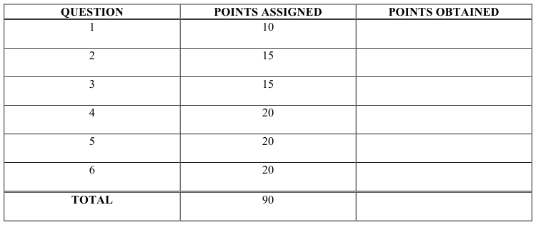
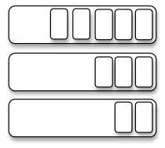
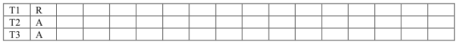
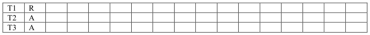
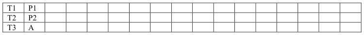
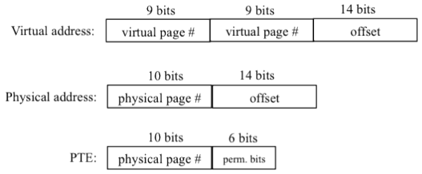
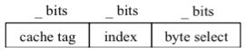
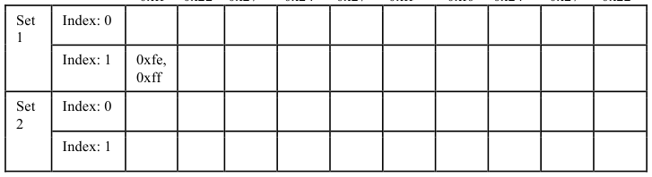

# Berkeley CS162 Spring 2011: Midterm 1: Questions

> Copied from the original: <https://hkn.eecs.berkeley.edu/exams/course/cs/162>. Text and figures are taken from the PDF as is; nothing was answered or rewritten. The original PDF is in this folder.

---

**Page 1**

Student Name: \_\_\_\_\_\_\_\_\_\_\_\_\_\_\_\_\_\_\_\_\_\_\_\_\_\_\_\_\_\_\_\_\_\_\_\_\_      SID: \_\_\_\_\_\_\_\_\_\_\_\_\_\_\_\_\_\_\_\_\_

&emsp;&emsp;&emsp;&emsp;&emsp;&emsp;&emsp;&emsp;**University of California at Berkeley** 
&emsp;&emsp;&emsp;&emsp;&emsp;&emsp;&emsp;&emsp;**College of Engineering** 
&emsp;&emsp;&emsp;&emsp;&emsp;&emsp;**Department of Electrical Engineering and Computer Science**

CS 162    I. Stoica 
Spring 2011 
&emsp;&emsp;&emsp;&emsp;&emsp;&emsp;&emsp;&emsp;FIRST MIDTERM EXAMINATION 
&emsp;&emsp;&emsp;&emsp;&emsp;&emsp;&emsp;&emsp;Wednesday, March 9, 2011

INSTRUCTIONS—READ THEM NOW! This examination is CLOSED BOOK/CLOSED NOTES. There 
is no need for calculations, and so you will not require a calculator, Palm Pilot, laptop computer, or other 
calculation aid. Please put them away. You MAY use one 8.5” by 11” double-sided crib sheet, as densely 
packed with notes, formulas, and diagrams as you wish. The examination has been designed for 80 
minutes/80 points (1 point = 1 minute, so pace yourself accordingly). All work should be done on the 
attached pages. 
In general, if something is unclear, write down your assumptions as part of your answer. If your 
assumptions are reasonable, we will endeavor to grade the question based on them. If necessary, of course, 
you may raise your hand, and a TA or the instructor will come to you. Please try not to disturb the students 
taking the examination around you. 
We will post solutions to the examination as soon as possible, and will grade the examination as soon as 
practical, usually within a week. Requests for regrades should be submitted IN WRITING, explaining why 
you believe your answer was incorrectly graded, within ONE WEEK of the return of the examination in 
class. We try to be fair, and do realize that mistakes can be made during the regarding process. However, 
we are not sympathetic to arguments of the form “I got half the problem right, why did I get a quarter of the 
points?” 
\_\_\_\_\_\_\_\_\_\_\_\_\_\_\_\_\_\_\_\_\_\_\_\_\_\_\_\_\_\_\_\_\_\_\_\_\_\_\_\_\_\_     SID: \_\_\_\_\_\_\_\_\_\_\_\_\_\_\_\_\_\_\_\_\_\_\_\_\_\_\_\_\_\_\_ 
(Signature)

\_\_\_\_\_\_\_\_\_\_\_\_\_\_\_\_\_\_\_\_\_\_\_\_\_\_\_\_\_\_\_\_\_\_\_\_\_\_\_\_\_\_                 Discussion Section (Day/Time): \_\_\_\_\_\_\_\_ 
(Name—Please Print!)

CS 162 Midterm    Page 1     March 9, 2011; 4:00-5:30 PM

---

**Page 2**

Student Name: \_\_\_\_\_\_\_\_\_\_\_\_\_\_\_\_\_\_\_\_\_\_\_\_\_\_\_\_\_\_\_\_\_\_\_\_\_      SID: \_\_\_\_\_\_\_\_\_\_\_\_\_\_\_\_\_\_\_\_\_

### **Question 1.** Miscellaneous (10 points)

For each of the following statements, indicate whether the statement is True or False, and provide a very 
short explanation of your selection (2 points each). 
a.    Several threads can share the same address space.    T             F 
Rationale:

b.    Changing the order of semaphores’ operations in a program does not matter.    T             F 
Rationale:

c.    Paging leads to external fragmentation.    T             F 
Rationale:

d.    FIFO scheduling policy achieves lowest average response time for equal size jobs.    T             F 
Rationale:

e.    LRU exhibits the Belady anomaly.    T             F 
Rationale:

CS 162 Midterm    Page 2     March 9, 2011; 4:00-5:30 PM

---

**Page 3**

Student Name: \_\_\_\_\_\_\_\_\_\_\_\_\_\_\_\_\_\_\_\_\_\_\_\_\_\_\_\_\_\_\_\_\_\_\_\_\_      SID: \_\_\_\_\_\_\_\_\_\_\_\_\_\_\_\_\_\_\_\_\_

### **Question 2.** Deadlock (15 points)

Consider a system with four processes P1, P2, P3, and P4, and two resources, R1, and R2, respectively. 
Each resource has two instances. Furthermore: 
&emsp;\-    P1 allocates an instance of R2, and requests an instance of R1; 
&emsp;\-    P2 allocates an instance of R1, and doesn’t need any other resource; 
&emsp;\-    P3 allocates an instance of R1 and requires an instance of R2; 
&emsp;\-    P4 allocates an instance of R2, and doesn’t need any other resource. 
(5 points each question) 
(a) Draw the resource allocation graph.

(b) Is there a cycle in the graph? If yes name it.

(c) Is the system in deadlock? If yes, explain why. If not, give a possible sequence of executions after 
which every process completes.

CS 162 Midterm    Page 3     March 9, 2011; 4:00-5:30 PM

---

**Page 4**

Student Name: \_\_\_\_\_\_\_\_\_\_\_\_\_\_\_\_\_\_\_\_\_\_\_\_\_\_\_\_\_\_\_\_\_\_\_\_\_      SID: \_\_\_\_\_\_\_\_\_\_\_\_\_\_\_\_\_\_\_\_\_

### **Question 3.** Synchronization (15 points)

&emsp;&emsp;&emsp;&emsp;&emsp;&emsp;&emsp;&emsp;Queue\_

&emsp;&emsp;&emsp;&emsp;&emsp;&emsp;&emsp;&emsp;Queue\_

&emsp;&emsp;&emsp;&emsp;&emsp;&emsp;&emsp;&emsp;Queue\_

Consider a set of queues as shown in the above figure, and the following code that moves an item from a 
queue (denoted “source”) to another queue (denoted “destination”). Each queue can be both a source and a 
destination. 
void AtomicMove (Queue \*source, Queue \*destination) { 
Item thing; /\* thing being transferred \*/ 
if (source == destination) { 
return; // same queue; nothing to move 
} 
source-\>lock.Acquire(); 
destination-\>lock.Acquire(); 
thing = source-\>Dequeue(); 
if (thing != NULL) { 
destination-\>Enqueue(thing); 
} 
destination-\>lock.Release(); 
source-\>lock.Release(); 
} 
Assume there are multiple threads that call AtomicMove() concurrently. (5 points each question) 
&emsp;(a) Give an example involving no more than three queues illustrating a scenario in which 
&emsp;&emsp;AtomicMove() does not work correctly.

CS 162 Midterm    Page 4     March 9, 2011; 4:00-5:30 PM

---

**Page 5**

Student Name: \_\_\_\_\_\_\_\_\_\_\_\_\_\_\_\_\_\_\_\_\_\_\_\_\_\_\_\_\_\_\_\_\_\_\_\_\_      SID: \_\_\_\_\_\_\_\_\_\_\_\_\_\_\_\_\_\_\_\_\_

&emsp;(b) Modify AtomicMove() to work correctly.

&emsp;(c) Assume now that a queue can be either a source or a destination, but not both. Is AtomicMove() 
&emsp;&emsp;working correctly in this case? Use no more than two sentences to explain why, or why not. If not, 
&emsp;&emsp;give a simple example illustrating a scenario in which AtomicMove() does not work correctly.

CS 162 Midterm    Page 5     March 9, 2011; 4:00-5:30 PM

---

**Page 6**

Student Name: \_\_\_\_\_\_\_\_\_\_\_\_\_\_\_\_\_\_\_\_\_\_\_\_\_\_\_\_\_\_\_\_\_\_\_\_\_      SID: \_\_\_\_\_\_\_\_\_\_\_\_\_\_\_\_\_\_\_\_\_

### **Question 4.** Scheduling (20 points)

Consider three threads that arrive at the same time and they are enqueued in the ready queue in the order 
T1, T2, T3. 
Thread T1 runs a four-iteration loop, with each iteration taking one time unit. At the end of each iteration, 
T1 calls yield; as a result, T1 is placed at the end of the ready queue. Threads T2 and T3 both run a two- 
iteration loop, which each iteration taking three time units. At the end of first iteration, T2 synchronizes 
with T3, i.e., T2 cannot start the second iteration before T3 finishes the first iteration, and vice versa. While 
waiting, T2 (T3) is placed in the waiting queue; once T3 (T2) finishes its first iteration, T2 (T3) is placed at 
the end of the ready queue. Each process exits after finishing its loop. 
Assume the system has one CPU. On the timeline below, show how the threads are scheduled using two 
scheduling policies (FCFS and Round Robin). For each unit of time, indicate the state of the thread by 
writing “R” if the thread is running, “A” if the thread is in the ready queue, and “W” if the thread is in the 
waiting queue (e.g., T2 waits for T3 to finish the first iteration, before T2 can run its second iteration). 
(a) (6 points) **FCFS (No-preemption)** FCFS always selects the thread at the head of the ready queue. A 
thread only stops running when it calls yield or waits to synchronize with another thread. What is the 
average completion time? (Each column corresponds to one time unit. The first column is already filled in.)

(b) (6 points) **Round Robin (time quantum = 2 units)** When a thread is preempted it is moved at the end 
of the ready queue. What is average completion time?

**(c) (8 points)** Assume there are two processors P1 and P2 in the system. The scheduler follows the policy 
of FCFS with no preemption.  When the scheduler assigns tasks, always assign a task to P1 before 
assigning to P2. Instead of using “R” to mark running, use “P1” or “P2” to indicate where the task runs. 
What is the average completion time?

CS 162 Midterm    Page 6     March 9, 2011; 4:00-5:30 PM

---

**Page 7**

Student Name: \_\_\_\_\_\_\_\_\_\_\_\_\_\_\_\_\_\_\_\_\_\_\_\_\_\_\_\_\_\_\_\_\_\_\_\_\_      SID: \_\_\_\_\_\_\_\_\_\_\_\_\_\_\_\_\_\_\_\_\_

### **Question 5.** Paging (20 points) Consider a memory architecture using two-level paging for address

translation. The format of the virtual address, physical address, and PTE (page table entry) are bellow:

(4 points each question) 
(a) What is the size of a page?

(b) What is the size of the maximum physical memory?

(c) What is the total memory needed for storing all page tables of a process that uses the entire physical 
memory?

(d) Assume a process that is using 512KB of physical memory. What is the minimum number of page 
tables used by this process? What is the maximum number of page tables this process might use?

(e) Assume that instead of a two-level paging we use an inverted table for address translation. How many 
entries are in the inverted table of a process using 512KB of physical memory?

CS 162 Midterm    Page 7     March 9, 2011; 4:00-5:30 PM

---

**Page 8**

Student Name: \_\_\_\_\_\_\_\_\_\_\_\_\_\_\_\_\_\_\_\_\_\_\_\_\_\_\_\_\_\_\_\_\_\_\_\_\_      SID: \_\_\_\_\_\_\_\_\_\_\_\_\_\_\_\_\_\_\_\_\_

### **Question 6.** Caches (20 points) A tiny system has 1-byte addresses and a 2-way associative cache with four

entries. Each block in the cache holds **two** bytes. The cache controller uses the LRU policy for evicting 
from cache when both rows with the same “index” are full. 
(a) (4 points) Use the figure below to indicate the number of bits in each field.

(b) (6 points) Assume the following access sequence to the memory: 0xff, 0x22, 0x27, 0x24, 0x27, 0xff, 
0xf0, 0x24, 0x27, 0x22.  Fill in the following table with the addresses whose content is in the cache. 
Initially assume the cache is empty. The first entry (i.e., the one corresponding to address 0xff) is filled for 
you. 
0xff     0x22    0x27       0x24      0x27      0xff         0xf0     0x24       0x27      0x22

(c) (4 points) How many cache misses did the access sequence at point (b) cause? What is the hit rate?

(d) (3 points) How many compulsory misses (i.e., misses which could never be avoided) did the access 
pattern at point (b) cause?

(e) (3 points) Assuming the cache access time is 10ns, and that the miss time is 100ns (this includes the 
time to check the cache), what is the average access time assuming the access pattern at point (b)?

CS 162 Midterm    Page 8     March 9, 2011; 4:00-5:30 PM

---

**Page 9**

Student Name: \_\_\_\_\_\_\_\_\_\_\_\_\_\_\_\_\_\_\_\_\_\_\_\_\_\_\_\_\_\_\_\_\_\_\_\_\_      SID: \_\_\_\_\_\_\_\_\_\_\_\_\_\_\_\_\_\_\_\_\_

-­‐	
  Scratch	
  page	
  -­‐

CS 162 Midterm    Page 9     March 9, 2011; 4:00-5:30 PM

