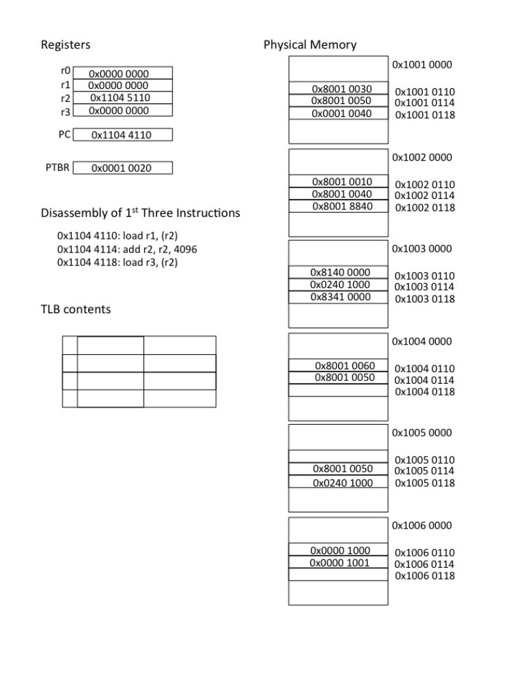

# Berkeley CS162 Fall 2014: Midterm 2: Questions

> Copied from the original: <https://hkn.eecs.berkeley.edu/exams/course/cs/162>. Text and figures are taken from the PDF as is; nothing was answered or rewritten. The original PDF is in this folder.

---

**Page 1**

&emsp;&emsp;&emsp;&emsp;&emsp;&emsp;&emsp;&emsp;**Computer Science 162, Fall 2014** 
&emsp;&emsp;&emsp;&emsp;&emsp;&emsp;&emsp;&emsp;**David Culler** 
&emsp;&emsp;&emsp;&emsp;&emsp;&emsp;&emsp;&emsp;**University of California, Berkeley** 
&emsp;&emsp;&emsp;&emsp;&emsp;&emsp;&emsp;&emsp;**Midterm 2** 
&emsp;&emsp;&emsp;&emsp;&emsp;&emsp;&emsp;&emsp;**November 14, 2014**

&emsp;&emsp;&emsp;&emsp;&emsp;&emsp;&emsp;&emsp;Name

&emsp;&emsp;&emsp;&emsp;&emsp;&emsp;&emsp;&emsp;SID

&emsp;&emsp;&emsp;&emsp;&emsp;&emsp;&emsp;&emsp;Login

&emsp;&emsp;&emsp;&emsp;&emsp;&emsp;&emsp;&emsp;TA Name

&emsp;&emsp;&emsp;&emsp;&emsp;&emsp;&emsp;&emsp;Section Time

This is a closed book exam with one 2-sided page of notes permitted. It is intended to be a 80 minute 
exam. You have 80 minutes to complete it. The number at the beginning of each question indicates the 
points for that question. Write all of your answers directly on this paper. Make your answers as concise 
as possible. If there is something in a question that you believe is open to interpretation, please raise your 
hand to request clarification. When told to open the exam, put your login on every page and check that 
you have them all. (Final page is for reference.) 
&emsp;By my signature below, I swear that this exam is my own work. I have not obtained answers or partial 
answers from anyone. Furthermore, if I am taking the exam early, I promise not to discuss it with anyone 
prior to completion of the regular exam, and otherwise I have not discussed it with anyone who took the 
early alternate exam.

X\_\_\_\_\_\_\_\_\_\_\_\_\_\_\_\_\_\_\_\_\_\_\_\_\_\_\_\_\_\_\_\_\_\_\_\_\_\_\_

&emsp;&emsp;&emsp;&emsp;&emsp;&emsp;&emsp;&emsp;**Grade Table (for instructor use only)** 
&emsp;&emsp;&emsp;&emsp;&emsp;&emsp;&emsp;&emsp;Question   Points   Score 
&emsp;&emsp;&emsp;&emsp;&emsp;&emsp;&emsp;&emsp;1   25 
&emsp;&emsp;&emsp;&emsp;&emsp;&emsp;&emsp;&emsp;2   25 
&emsp;&emsp;&emsp;&emsp;&emsp;&emsp;&emsp;&emsp;3   25 
&emsp;&emsp;&emsp;&emsp;&emsp;&emsp;&emsp;&emsp;4   25 
&emsp;&emsp;&emsp;&emsp;&emsp;&emsp;&emsp;&emsp;Total:   100

---

**Page 2**

Computer Science 162, Fall 2014   Midterm 2 - Page 2 of 16   November 14, 2014

1\. (25 points) **Operating Systems Concepts** 
&emsp;(a) (20 points) Choose **either** true or false for the below questions.   You do not need to provide 
&emsp;&emsp;&emsp;justifications. 
&emsp;&emsp;&emsp;i. (2 points) A thread that wants to signal other threads upon completion of a critical section 
&emsp;&emsp;&emsp;&emsp;should do so with a Condition Variable after releasing the lock. 
&emsp;&emsp;&emsp;&emsp;&emsp;&emsp;⃝True 
&emsp;&emsp;&emsp;&emsp;&emsp;&emsp;⃝False 
&emsp;&emsp;&emsp;ii. (2 points) By using an atomic read-modify-write instruction, a user thread can acquire a lock 
&emsp;&emsp;&emsp;&emsp;without entering the operating system. 
&emsp;&emsp;&emsp;&emsp;&emsp;&emsp;⃝True 
&emsp;&emsp;&emsp;&emsp;&emsp;&emsp;⃝False 
&emsp;&emsp;&emsp;iii. (2 points) With paged virtual address translation threads only share state when they are 
&emsp;&emsp;&emsp;&emsp;within the same process. 
&emsp;&emsp;&emsp;&emsp;&emsp;&emsp;⃝True 
&emsp;&emsp;&emsp;&emsp;&emsp;&emsp;⃝False 
&emsp;&emsp;&emsp;iv. (2 points) With paged virtual memory, an process can be started with none of its code or 
&emsp;&emsp;&emsp;&emsp;data pages being resident in memory. 
&emsp;&emsp;&emsp;&emsp;&emsp;&emsp;⃝True 
&emsp;&emsp;&emsp;&emsp;&emsp;&emsp;⃝False 
&emsp;&emsp;&emsp;v. (2 points) The size of page tables is always much smaller than the size of physical memory. 
&emsp;&emsp;&emsp;&emsp;&emsp;&emsp;⃝True 
&emsp;&emsp;&emsp;&emsp;&emsp;&emsp;⃝False 
&emsp;&emsp;&emsp;vi. (2 points) The offset within the page of a data element is the same in virtual memory page 
&emsp;&emsp;&emsp;&emsp;and physical memory page, regardless of whether a single level or multi-level page table is 
&emsp;&emsp;&emsp;&emsp;used. 
&emsp;&emsp;&emsp;&emsp;&emsp;&emsp;⃝True 
&emsp;&emsp;&emsp;&emsp;&emsp;&emsp;⃝False 
&emsp;&emsp;&emsp;vii. (2 points) With multi-level page tables, the TLB holds translations for each of the level. 
&emsp;&emsp;&emsp;&emsp;&emsp;&emsp;⃝True 
&emsp;&emsp;&emsp;&emsp;&emsp;&emsp;⃝False 
&emsp;&emsp;viii. (2 points) In a Unix-style system user access rights are checked on file read and file write 
&emsp;&emsp;&emsp;&emsp;operations. 
&emsp;&emsp;&emsp;&emsp;&emsp;&emsp;⃝True 
&emsp;&emsp;&emsp;&emsp;&emsp;&emsp;⃝False 
&emsp;&emsp;&emsp;ix. (2 points) Compared to FIFO, disk scheduling using shortest-seek-time first reduces average 
&emsp;&emsp;&emsp;&emsp;seek time but also reduces fairness. 
&emsp;&emsp;&emsp;&emsp;&emsp;&emsp;⃝True 
&emsp;&emsp;&emsp;&emsp;&emsp;&emsp;⃝False 
&emsp;&emsp;&emsp;x. (2 points) If all the operations in a transaction are durably recorded in the log, the transaction 
&emsp;&emsp;&emsp;&emsp;can be applied to the disk store, before the final commit marker is placed in the log. 
&emsp;&emsp;&emsp;&emsp;&emsp;&emsp;⃝True 
&emsp;&emsp;&emsp;&emsp;&emsp;&emsp;⃝False

---

**Page 3**

Computer Science 162, Fall 2014   Midterm 2 - Page 3 of 16   November 14, 2014

&emsp;(b) (5 points) Which of the following is true about File System operation? Select **all** the choices that 
&emsp;&emsp;&emsp;apply. 
&emsp;&emsp;&emsp;&emsp;&emsp;⃝The directory structure can be searched on Open and need not be examined on Read or 
&emsp;&emsp;&emsp;&emsp;&emsp;&emsp;Write. 
&emsp;&emsp;&emsp;&emsp;&emsp;⃝The user FILE \* object contains information about how the file is stored on disk. 
&emsp;&emsp;&emsp;&emsp;&emsp;⃝SCAN has shorter average seek distance than C-SCAN because it services requests while 
&emsp;&emsp;&emsp;&emsp;&emsp;&emsp;the head is moving in either direction. 
&emsp;&emsp;&emsp;&emsp;&emsp;⃝If the transaction log is stored on disk, requests must be written in order, as with FIFO 
&emsp;&emsp;&emsp;&emsp;&emsp;&emsp;scheduling. 
&emsp;&emsp;&emsp;&emsp;&emsp;⃝File Index structures are optimized to handle small and large files in the same manner.

---

**Page 4**

Computer Science 162, Fall 2014   Midterm 2 - Page 4 of 16   November 14, 2014

2\. (25 points) **Page Tables** 
&emsp;The following figure (Figure 1) shows the relevant state of a machine with 32-bit virutal address space 
&emsp;supported by a two-level page table with 4 KB pages. The contents of several of the frames of physical 
&emsp;memory are shown on the right with physical addresses. On the left are several machine registers, 
&emsp;including the PC and the page table base register, which contains the physical frame number of the 
&emsp;root page table. A 4-entry, fully associative TLB is initially all empty. Page table entries have the valid 
&emsp;flag as the most siginificant bit and the physical frame number of valid entries in the low order bits. 
&emsp;Other flags can be assumed to be zero for this problem. 
&emsp;You are to step through the three instructions whose address and dis-assembly is shown in the figure. 
&emsp;(a) (9 points) Describe which bits of the 32-bit virtual address are used for each part of the virtual 
&emsp;&emsp;&emsp;address translation. 
&emsp;&emsp;&emsp;For the address of the first instruction, 0x1104 4110, show the value of each of these bit fields. 
&emsp;&emsp;&emsp;For each of the page table accesses, what is the byte offset of the page table entry that is accessed?

&emsp;(b) (16 points) In the space provided below, you should write down the operation, address, and value 
&emsp;&emsp;&emsp;associated with every memory operation associated with the three instructions. (You will notice 
&emsp;&emsp;&emsp;that the page table entries are word aligned, 32-bit objects, hence the byte offset is 4 times the 
&emsp;&emsp;&emsp;index.)   Also, update the state of the memory, registers, and TLB by over-writing the figure. 
&emsp;&emsp;&emsp;Identify any exceptions that are generated (but do not worry about handling them). 
&emsp;&emsp;&emsp;operation   address   value   comment 
&emsp;&emsp;&emsp;root PT fetch   0x1002 0110   0x8001 0010   Read valid PTE for 2nd level page

---

**Page 5**

Computer Science 162, Fall 2014   Midterm 2 - Page 5 of 16   November 14, 2014

&emsp;&emsp;&emsp;&emsp;&emsp;&emsp;&emsp;&emsp;Figure 1: Figure for question 2.

---

**Page 6**

Computer Science 162, Fall 2014   Midterm 2 - Page 6 of 16   November 14, 2014

3\. (25 points) **File Sytems**

&emsp;Consider the following file system code drawn from Pintos. You may assume all the code is run on intel 
&emsp;x86 **32** bit architechture.

&emsp;#define BLOCK\_SIZE 4096

&emsp;/\* Block device that contains the file system. \*/ 
&emsp;struct block \*fs\_device;

&emsp;/\* Reads sector SECTOR from BLOCK into BUFFER \*/ 
&emsp;void block\_read (struct block \*block, block\_sector\_t sector, void \*buffer);

&emsp;/\* Write sector SECTOR to BLOCK from BUFFER, mark block as not free \*/ 
&emsp;void block\_write (struct block \*block, uint32\_t sector, const void \*buffer)

&emsp;/\* Returns one free block \*/ 
&emsp;long get\_free\_block();

&emsp;/\* Marks given block as free \*/ 
&emsp;void free\_block(long bnum);

&emsp;/\* On-disk inode. 
&emsp;&emsp;Must be exactly BLOCK\_SIZE bytes long. \*/ 
&emsp;struct inode\_disk 
&emsp;&emsp;{ 
&emsp;&emsp;uint32\_t start;   /\* First data sector. \*/ 
&emsp;&emsp;long length;   /\* File size in bytes. \*/ 
&emsp;&emsp;unsigned int magic;   /\* Magic number. \*/ 
&emsp;&emsp;uint32\_t unused\[1021\];   /\* Not used. \*/ 
&emsp;&emsp;};

&emsp;/\* In-memory inode. \*/ 
&emsp;struct inode 
&emsp;&emsp;{ 
&emsp;&emsp;struct list\_elem elem;   /\* Element in inode list. \*/ 
&emsp;&emsp;uint32\_t sector;   /\* Sector number of disk location. \*/ 
&emsp;&emsp;int open\_cnt;   /\* Number of openers. \*/ 
&emsp;&emsp;bool removed;   /\* True if deleted, false otherwise. \*/ 
&emsp;&emsp;int deny\_write\_cnt;   /\* 0: writes ok, \>0: deny writes. \*/ 
&emsp;&emsp;struct inode\_disk data;   /\* Inode content. \*/ 
&emsp;&emsp;}; 
&emsp;(a) (4 points) **In fifteen words or less**, what can you say about how files are allocated on disk in 
&emsp;&emsp;&emsp;this file system. 
&emsp;&emsp;&emsp;Solutions longer than 15 words will receive no credit

---

**Page 7**

Computer Science 162, Fall 2014   Midterm 2 - Page 7 of 16   November 14, 2014

&emsp;(b) (2 points) Recall that in the unix file system inodes had both direct and indirect block pointers. 
&emsp;&emsp;&emsp;We decide in our file system we want our inodes to always be in one of two modes: either the 
&emsp;&emsp;&emsp;maximum amount of direct block pointers or the maximum amount of singly indirect block point- 
&emsp;&emsp;&emsp;ers, but never mixed. Please modify the struct definitions below to allow that behavior. We have 
&emsp;&emsp;&emsp;added the mode field for you. You may delete fields

&emsp;&emsp;&emsp;**Make the minimum number of modificatins necessary for proper functionality, extra-** 
&emsp;&emsp;&emsp;**neous modifications will incur a loss of points**

&emsp;&emsp;&emsp;/\* On-disk inode. 
&emsp;&emsp;&emsp;&emsp;Must be exactly BLOCK\_SIZE bytes long. \*/ 
&emsp;&emsp;&emsp;struct inode\_disk 
&emsp;&emsp;&emsp;{ 
&emsp;&emsp;&emsp;&emsp;uint32\_t mode;   /\* direct or indirect mode \*/

&emsp;&emsp;&emsp;&emsp;\_\_\_\_\_\_\_\_\_\_\_\_\_\_\_\_\_\_\_\_\_\_\_\_\_\_\_\_\_\_\_\_;

&emsp;&emsp;&emsp;&emsp;\_\_\_\_\_\_\_\_\_\_\_\_\_\_\_\_\_\_\_\_\_\_\_\_\_\_\_\_\_\_\_\_;

&emsp;&emsp;&emsp;&emsp;\_\_\_\_\_\_\_\_\_\_\_\_\_\_\_\_\_\_\_\_\_\_\_\_\_\_\_\_\_\_\_\_;

&emsp;&emsp;&emsp;&emsp;long length;   /\* File size in bytes. \*/ 
&emsp;&emsp;&emsp;&emsp;unsigned int magic;   /\* Magic number. \*/ 
&emsp;&emsp;&emsp;&emsp;uint32\_t unused\[1021\];   /\* Not used. \*/ 
&emsp;&emsp;&emsp;};

&emsp;&emsp;&emsp;/\* In-memory inode. \*/ 
&emsp;&emsp;&emsp;struct inode 
&emsp;&emsp;&emsp;{ 
&emsp;&emsp;&emsp;&emsp;struct list\_elem elem;   /\* Element in inode list. \*/ 
&emsp;&emsp;&emsp;&emsp;uint32\_t sector;   /\* Sector number of disk location. \*/ 
&emsp;&emsp;&emsp;&emsp;int open\_cnt;   /\* Number of openers. \*/ 
&emsp;&emsp;&emsp;&emsp;bool removed;   /\* True if deleted, false otherwise. \*/ 
&emsp;&emsp;&emsp;&emsp;int deny\_write\_cnt;   /\* 0: writes ok, \>0: deny writes. \*/ 
&emsp;&emsp;&emsp;&emsp;struct inode\_disk data;   /\* Inode content. \*/

&emsp;&emsp;&emsp;&emsp;\_\_\_\_\_\_\_\_\_\_\_\_\_\_\_\_\_\_\_\_\_\_\_\_\_\_\_\_\_\_\_\_;

&emsp;&emsp;&emsp;&emsp;\_\_\_\_\_\_\_\_\_\_\_\_\_\_\_\_\_\_\_\_\_\_\_\_\_\_\_\_\_\_\_\_;

&emsp;&emsp;&emsp;&emsp;\_\_\_\_\_\_\_\_\_\_\_\_\_\_\_\_\_\_\_\_\_\_\_\_\_\_\_\_\_\_\_\_;

&emsp;&emsp;&emsp;&emsp;\_\_\_\_\_\_\_\_\_\_\_\_\_\_\_\_\_\_\_\_\_\_\_\_\_\_\_\_\_\_\_\_; 
&emsp;&emsp;&emsp;}; 
&emsp;(c) (2 points) What is the maximum theoretical file size in this file system now?

---

**Page 8**

Computer Science 162, Fall 2014   Midterm 2 - Page 8 of 16   November 14, 2014

&emsp;(d) (5 points) Implement the function fblock\_to\_dblock. We have given you a skeleton. You need 
&emsp;&emsp;&emsp;to complete the error checking and the operational parts. 
&emsp;&emsp;&emsp;/\* Converts file\_block\_num (a block offset into the file)   to an absolute disk\_block\_num to 
&emsp;&emsp;&emsp;&emsp;returns -1 in the case of error. 
&emsp;&emsp;&emsp;\*/ 
&emsp;&emsp;&emsp;long 
&emsp;&emsp;&emsp;fblock\_to\_dblock (struct inode \*inode, int file\_block\_num) 
&emsp;&emsp;&emsp;{ 
&emsp;&emsp;&emsp;&emsp;long bnum; 
&emsp;&emsp;&emsp;&emsp;if ( inode-\>data.mode ) {

&emsp;&emsp;&emsp;&emsp;&emsp;&emsp;if (\_\_\_\_\_\_\_\_\_\_\_\_\_\_\_\_\_\_\_\_\_\_\_\_\_\_\_\_\_\_\_ &&

&emsp;&emsp;&emsp;&emsp;&emsp;&emsp;&emsp;\_\_\_\_\_\_\_\_\_\_\_\_\_\_\_\_\_\_\_\_\_\_\_\_\_\_\_\_\_\_\_\_\_\_) {

&emsp;&emsp;&emsp;&emsp;&emsp;&emsp;&emsp;bnum = \_\_\_\_\_\_\_\_\_\_\_\_\_\_\_\_\_\_\_\_\_\_\_\_\_\_\_\_\_\_\_\_\_\_\_\_\_\_\_\_\_\_\_\_\_\_\_\_\_\_\_\_\_\_\_;

&emsp;&emsp;&emsp;&emsp;&emsp;&emsp;} else { 
&emsp;&emsp;&emsp;&emsp;&emsp;&emsp;&emsp;return -1; 
&emsp;&emsp;&emsp;&emsp;&emsp;&emsp;} 
&emsp;&emsp;&emsp;&emsp;} else { 
&emsp;&emsp;&emsp;&emsp;&emsp;&emsp;if (\_\_\_\_\_\_\_\_\_\_\_\_\_\_\_\_\_\_\_\_\_\_\_\_\_\_\_\_\_\_\_\_\_\_\_ &&

&emsp;&emsp;&emsp;&emsp;&emsp;&emsp;&emsp;\_\_\_\_\_\_\_\_\_\_\_\_\_\_\_\_\_\_\_\_\_\_\_\_\_\_\_\_\_\_\_\_\_\_\_\_\_\_) {

&emsp;&emsp;&emsp;&emsp;&emsp;&emsp;&emsp;\_\_\_\_\_\_\_\_\_\_\_\_\_\_\_\_\_\_\_\_\_\_\_\_\_\_\_\_\_\_\_\_\_\_\_\_\_\_\_\_\_\_\_\_\_\_\_;

&emsp;&emsp;&emsp;&emsp;&emsp;&emsp;&emsp;\_\_\_\_\_\_\_\_\_\_\_\_\_\_\_\_\_\_\_\_\_\_\_\_\_\_\_\_\_\_\_\_\_\_\_\_\_\_\_\_\_\_\_\_\_\_\_\_;

&emsp;&emsp;&emsp;&emsp;&emsp;&emsp;&emsp;\_\_\_\_\_\_\_\_\_\_\_\_\_\_\_\_\_\_\_\_\_\_\_\_\_\_\_\_\_\_\_\_\_\_\_\_\_\_\_\_\_\_\_\_\_\_\_;

&emsp;&emsp;&emsp;&emsp;&emsp;&emsp;&emsp;block\_read(\_\_\_\_\_\_\_\_\_\_\_\_\_\_\_\_\_\_\_\_\_\_\_\_\_\_\_\_\_\_\_\_\_\_\_\_\_\_\_\_\_\_\_\_\_\_\_\_\_\_);

&emsp;&emsp;&emsp;&emsp;&emsp;&emsp;&emsp;bnum = \_\_\_\_\_\_\_\_\_\_\_\_\_\_\_\_\_\_\_\_\_\_\_\_\_\_\_\_\_\_\_\_\_\_\_\_\_\_\_\_\_\_\_\_\_\_\_\_\_\_\_\_\_\_\_;

&emsp;&emsp;&emsp;&emsp;&emsp;&emsp;} else { 
&emsp;&emsp;&emsp;&emsp;&emsp;&emsp;&emsp;return -1; 
&emsp;&emsp;&emsp;&emsp;&emsp;&emsp;} 
&emsp;&emsp;&emsp;&emsp;} 
&emsp;&emsp;&emsp;&emsp;return bnum; 
&emsp;&emsp;&emsp;}

---

**Page 9**

Computer Science 162, Fall 2014   Midterm 2 - Page 9 of 16   November 14, 2014

&emsp;(e) (4 points) Now implement inode\_block\_read to support the above implementation. You may 
&emsp;&emsp;&emsp;assume   fblock\_to\_dblock is implemented correctly. 
&emsp;&emsp;&emsp;/\* Tries to read BLOCK\_SIZE bytes from INODE into BUFFER from file\_block\_num 
&emsp;&emsp;&emsp;&emsp;Returns the number of bytes actually read, which may be less 
&emsp;&emsp;&emsp;&emsp;than BLOCK\_SIZE if end of file or and error is reached. 
&emsp;&emsp;&emsp;&emsp;err is filled when an error occurs 
&emsp;&emsp;&emsp;&emsp;\*/ 
&emsp;&emsp;&emsp;long 
&emsp;&emsp;&emsp;inode\_block\_read (struct inode \*inode, void \*buffer\_, int file\_block\_num, int\* err) 
&emsp;&emsp;&emsp;{ 
&emsp;&emsp;&emsp;&emsp;long bytes\_read = BLOCK\_SIZE; 
&emsp;&emsp;&emsp;&emsp;long sector\_idx = fblock\_to\_dblock(inode, file\_block\_num);

&emsp;&emsp;&emsp;&emsp;if (\_\_\_\_\_\_\_\_\_\_\_\_\_\_\_\_\_\_\_\_\_\_\_\_\_\_\_\_\_) {

&emsp;&emsp;&emsp;&emsp;&emsp;&emsp;\_\_\_\_\_\_\_\_\_\_\_\_\_\_\_\_\_\_\_\_\_\_\_\_\_\_\_\_\_\_\_\_;

&emsp;&emsp;&emsp;&emsp;&emsp;&emsp;return 0; 
&emsp;&emsp;&emsp;&emsp;}

&emsp;&emsp;&emsp;&emsp;if (\_\_\_\_\_\_\_\_\_\_\_\_\_\_\_\_\_\_\_\_\_\_\_\_\_\_\_\_\_\_\_\_\_\_\_\_\_\_\_\_\_) {

&emsp;&emsp;&emsp;&emsp;&emsp;&emsp;bytes\_read = \_\_\_\_\_\_\_\_\_\_\_\_\_\_\_\_\_\_\_\_\_\_\_\_\_\_\_\_\_\_\_; 
&emsp;&emsp;&emsp;&emsp;} 
&emsp;&emsp;&emsp;&emsp;block\_read (fs\_device, sector\_idx, buffer); 
&emsp;&emsp;&emsp;&emsp;return bytes\_read; 
&emsp;&emsp;&emsp;}

---

**Page 10**

Computer Science 162, Fall 2014   Midterm 2 - Page 10 of 16   November 14, 2014

&emsp;(f) (4 points) Consider the below implementation of inode\_block\_write. 
&emsp;&emsp;&emsp;/\* Writes BLOCK\_SIZE bytes from BUFFER into INODE, starting at   file\_block\_num\*BLOCK\_SIZE 
&emsp;&emsp;&emsp;all inputs are assumed to be valid and in bounds. Zero pads if file\_block\_num is greater 
&emsp;&emsp;&emsp;than file size. 
&emsp;&emsp;&emsp;\*/

&emsp;&emsp;&emsp;void inode\_write\_block (struct inode \*inode, const void \*buffer\_, int file\_block\_num, int er 
&emsp;&emsp;&emsp;{

&emsp;&emsp;&emsp;&emsp;long bnum = fblock\_to\_dblock(inode, file\_block\_num); 
&emsp;&emsp;&emsp;&emsp;if (file\_block\_num \> inode-\>data.length/BLOCK\_SIZE) { 
&emsp;&emsp;&emsp;&emsp;&emsp;&emsp;void\* zeros = calloc(BLOCK\_SIZE,1); 
&emsp;&emsp;&emsp;&emsp;&emsp;&emsp;for (int i = inode-\>data.length/BLOCK\_SIZE + 1; i \< file\_block\_num; ++i){ 
&emsp;&emsp;&emsp;&emsp;&emsp;&emsp;&emsp;block\_write(fs, fblock\_to\_dblock(inode, i), zeros); 
&emsp;&emsp;&emsp;&emsp;&emsp;&emsp;} 
&emsp;&emsp;&emsp;&emsp;} 
&emsp;&emsp;&emsp;&emsp;block\_write(fs\_device, bnum, buffer); 
&emsp;&emsp;&emsp;&emsp;inode\_recalc\_length(inode); // updates length field if necessary. 
&emsp;&emsp;&emsp;} 
&emsp;&emsp;&emsp;Assuming all inputs to inode\_write\_block are valid and in bounds, **In forty words or less**, 
&emsp;&emsp;&emsp;state whether the above implementation is correct (no explanation necessary), or precisely describe 
&emsp;&emsp;&emsp;the steps necessary to fix the above implementation.

&emsp;(g) (4 points) Given that our superblock has a fixed size inode region 2MB in size Draw a histogram 
&emsp;&emsp;&emsp;on the graph below to reflect the usage pattern that this file system is optimized for. Remember 
&emsp;&emsp;&emsp;to label the values one ach axis so we can interpret your graph properly. Particularly consider the 
&emsp;&emsp;&emsp;maximum attainable values on either axis. 
&emsp;&emsp;&emsp;Number of Files

&emsp;&emsp;&emsp;&emsp;&emsp;&emsp;&emsp;&emsp;File Size

---

**Page 11**

Computer Science 162, Fall 2014   Midterm 2 - Page 11 of 16   November 14, 2014

4\. (25 points) **Syscall Implementation**

&emsp;This question requires you to implement the dup2() syscall. 
&emsp;According to the man page, dup2(int oldfd, int newfd)   makes newfd become the copy of oldfd, 
&emsp;closing newfd first if necessary. After a successful return the old and new file descriptors may be used 
&emsp;interchangeably. If oldfd is not a valid file descriptor, the call fails and newfd is not closed. If oldfd is 
&emsp;a valid file descriptor and newfd has the same value as oldfd, then dup2() does nothing. On success, 
&emsp;these system calls return the new descriptor. On error, -1 is returned. 
&emsp;(a) (3 points) Below is a simple **Linux** C program which uses the dup2() syscall to redirect stdin so 
&emsp;&emsp;&emsp;that executed process greps the word "cs162" from the file "cs162.txt". Fill in the blanks. Assume 
&emsp;&emsp;&emsp;calls to open close and execvp succeed. 
&emsp;&emsp;&emsp;#include \<stdio.h\> 
&emsp;&emsp;&emsp;#include \<unistd.h\> 
&emsp;&emsp;&emsp;#include \<fcntl.h\> 
&emsp;&emsp;&emsp;#include \<sys/types.h\> 
&emsp;&emsp;&emsp;#include \<sys/stat.h\>

&emsp;&emsp;&emsp;int main(int argc, char \*\*argv) 
&emsp;&emsp;&emsp;{ 
&emsp;&emsp;&emsp;char \*grep\_args\[\] = {"grep", "cs162", NULL}; 
&emsp;&emsp;&emsp;int in = open("cs162.txt", O\_RDONLY);

&emsp;&emsp;&emsp;// replace standard input with input file

&emsp;&emsp;&emsp;dup2(\_\_\_\_\_\_\_\_\_\_\_\_\_\_\_\_\_\_\_\_\_\_\_\_\_\_\_\_\_\_\_\_\_\_);

&emsp;&emsp;&emsp;close(in);   // close unused file descriptors 
&emsp;&emsp;&emsp;execvp("grep", grep\_args);   // execute grep 
&emsp;&emsp;&emsp;}

&emsp;(b) (5 points) Suppose you have to implement dup2 in **Pintos**. The following code provides a frame- 
&emsp;&emsp;&emsp;work for the **Pintos** implementation of dup2. You may assume fs\_lock is properly initialized. 
&emsp;&emsp;&emsp;Read it and answer the questions following. 
&emsp;&emsp;&emsp;struct thread 
&emsp;&emsp;&emsp;{ 
&emsp;&emsp;&emsp;&emsp;...   /\* Other members as in your pintos projects \*/

&emsp;&emsp;&emsp;&emsp;/\* Owned by syscall.c. \*/ 
&emsp;&emsp;&emsp;&emsp;struct list fds;   /\* List of open file descriptors. \*/ 
&emsp;&emsp;&emsp;&emsp;int next\_handle;   /\* Look at the sys\_open and sys\_close code 
&emsp;&emsp;&emsp;&emsp;&emsp;&emsp;&emsp;&emsp;in the appendix to figure out its purpose \*/

&emsp;&emsp;&emsp;};

&emsp;&emsp;&emsp;/\* A file descriptor, for binding a file handle to a file object. \*/ 
&emsp;&emsp;&emsp;struct file\_descriptor

---

**Page 12**

Computer Science 162, Fall 2014   Midterm 2 - Page 12 of 16   November 14, 2014

&emsp;&emsp;&emsp;{ 
&emsp;&emsp;&emsp;&emsp;&emsp;struct list\_elem elem;   /\* List element \*/ 
&emsp;&emsp;&emsp;&emsp;&emsp;struct file \*file;   /\* File object \*/ 
&emsp;&emsp;&emsp;&emsp;&emsp;int handle;   /\* File handle \*/ 
&emsp;&emsp;&emsp;};

&emsp;&emsp;&emsp;/\* Returns the file descriptor associated with the given handle. 
&emsp;&emsp;&emsp;&emsp;Returns NULL if HANDLE is not associated with an 
&emsp;&emsp;&emsp;&emsp;open file. \*/

&emsp;&emsp;&emsp;static struct file\_descriptor \*lookup\_fd (int handle) { 
&emsp;&emsp;&emsp;struct thread \*cur = thread\_current (); 
&emsp;&emsp;&emsp;struct list\_elem \*e;

&emsp;&emsp;&emsp;for (e = list\_begin (&cur-\>fds); e != list\_end (&cur-\>fds); 
&emsp;&emsp;&emsp;&emsp;&emsp;e = list\_next (e)) 
&emsp;&emsp;&emsp;&emsp;{ 
&emsp;&emsp;&emsp;&emsp;&emsp;struct file\_descriptor \*fd; 
&emsp;&emsp;&emsp;&emsp;&emsp;fd = list\_entry (e, struct file\_descriptor, elem); 
&emsp;&emsp;&emsp;&emsp;&emsp;if (fd-\>handle == handle) 
&emsp;&emsp;&emsp;&emsp;&emsp;&emsp;return fd; 
&emsp;&emsp;&emsp;&emsp;} 
&emsp;&emsp;&emsp;return NULL; 
&emsp;&emsp;&emsp;} 
&emsp;&emsp;&emsp;static struct lock fs\_lock;

&emsp;&emsp;&emsp;For reference on how these structures can be used to implement the syscalls open and close, refer 
&emsp;&emsp;&emsp;to the appendix. 
&emsp;&emsp;&emsp;i. (3 points) What is the purpose of the lock in the functions sys\_open and sys\_close (given 
&emsp;&emsp;&emsp;&emsp;in the appendix?)

&emsp;&emsp;&emsp;ii. (2 points) What is next\_handle member in struct thread?

&emsp;(c) (15 points) Given this setup, implement the dup2 system call using the skeleton below. Assume 
&emsp;&emsp;&emsp;that the global syscall table calls the required functions, and copies the returned value to the eax 
&emsp;&emsp;&emsp;register. You do not have to set errno. Make sure your code has no memory leaks. You are NOT 
&emsp;&emsp;&emsp;allowed to write more lines of code than the blanks given. Assume calls to malloc succeed, and user 
&emsp;&emsp;&emsp;programs are single-threaded. ( Do not worry about modifying or bound-checking next\_handle 
&emsp;&emsp;&emsp;in this system call ).

---

**Page 13**

Computer Science 162, Fall 2014   Midterm 2 - Page 13 of 16   November 14, 2014

&emsp;&emsp;&emsp;static int sys\_dup2(int oldfd, int newfd) 
&emsp;&emsp;&emsp;&emsp;{ 
&emsp;&emsp;&emsp;&emsp;&emsp;&emsp;/\* Variable initialization 
&emsp;&emsp;&emsp;&emsp;&emsp;&emsp;&emsp;nfd : new file\_descriptor 
&emsp;&emsp;&emsp;&emsp;&emsp;&emsp;&emsp;ofd : old file\_decriptor 
&emsp;&emsp;&emsp;&emsp;&emsp;&emsp;\*/ 
&emsp;&emsp;&emsp;&emsp;&emsp;&emsp;struct file\_descriptor \*nfd, \*ofd;

&emsp;&emsp;&emsp;&emsp;&emsp;&emsp;if (newfd == oldfd) return newfd;   /\* handle special case \*/

&emsp;&emsp;&emsp;&emsp;&emsp;&emsp;ofd = \_\_\_\_\_\_\_\_\_\_\_\_\_\_\_\_\_\_\_\_\_\_\_\_\_\_\_\_\_\_\_;

&emsp;&emsp;&emsp;&emsp;&emsp;&emsp;if (ofd == NULL ) {

&emsp;&emsp;&emsp;&emsp;&emsp;&emsp;\_\_\_\_\_\_\_\_\_\_\_\_\_\_\_\_\_\_\_\_\_\_\_\_\_\_\_\_\_\_\_\_\_\_\_\_\_;

&emsp;&emsp;&emsp;&emsp;&emsp;&emsp;}

&emsp;&emsp;&emsp;&emsp;&emsp;&emsp;nfd = \_\_\_\_\_\_\_\_\_\_\_\_\_\_\_\_\_\_\_\_\_\_\_\_\_\_\_\_\_\_\_;

&emsp;&emsp;&emsp;&emsp;&emsp;&emsp;if (nfd == NULL ) {

&emsp;&emsp;&emsp;&emsp;&emsp;&emsp;\_\_\_\_\_\_\_\_\_\_\_\_\_\_\_\_\_\_\_\_\_\_\_\_\_\_\_\_\_\_\_\_\_\_\_\_\_;

&emsp;&emsp;&emsp;&emsp;&emsp;&emsp;\_\_\_\_\_\_\_\_\_\_\_\_\_\_\_\_\_\_\_\_\_\_\_\_\_\_\_\_\_\_\_\_\_\_\_\_\_;

&emsp;&emsp;&emsp;&emsp;&emsp;&emsp;\_\_\_\_\_\_\_\_\_\_\_\_\_\_\_\_\_\_\_\_\_\_\_\_\_\_\_\_\_\_\_\_\_\_\_\_\_;

&emsp;&emsp;&emsp;&emsp;&emsp;&emsp;} else {

&emsp;&emsp;&emsp;&emsp;&emsp;&emsp;\_\_\_\_\_\_\_\_\_\_\_\_\_\_\_\_\_\_\_\_\_\_\_\_\_\_\_\_\_\_\_\_\_\_\_\_\_;

&emsp;&emsp;&emsp;&emsp;&emsp;&emsp;\_\_\_\_\_\_\_\_\_\_\_\_\_\_\_\_\_\_\_\_\_\_\_\_\_\_\_\_\_\_\_\_\_\_\_\_\_;

&emsp;&emsp;&emsp;&emsp;&emsp;&emsp;\_\_\_\_\_\_\_\_\_\_\_\_\_\_\_\_\_\_\_\_\_\_\_\_\_\_\_\_\_\_\_\_\_\_\_\_\_;

&emsp;&emsp;&emsp;&emsp;&emsp;&emsp;}

&emsp;&emsp;&emsp;&emsp;&emsp;&emsp;\_\_\_\_\_\_\_\_\_\_\_\_\_\_\_\_\_\_\_\_\_\_\_\_\_\_\_\_\_\_\_\_\_\_\_\_\_;

&emsp;&emsp;&emsp;&emsp;&emsp;&emsp;return newfd; 
&emsp;&emsp;&emsp;&emsp;}

---

**Page 14**

Computer Science 162, Fall 2014   Midterm 2 - Page 14 of 16   November 14, 2014

&emsp;(d) (2 points) Consider the user program in part(a) running in Pintos as well as Linux. Why does 
&emsp;&emsp;&emsp;this program work as expected (i.e grep has its input redirected from cs162.txt) in Linux but not 
&emsp;&emsp;&emsp;in Pintos ? (Assume that execvp is replaced by exec in Pintos, and the arguments to exec are 
&emsp;&emsp;&emsp;valid)

---

**Page 15**

Computer Science 162, Fall 2014   Midterm 2 - Page 15 of 16   November 14, 2014

/\*\*\*\*\*\*\*\*\*\*\*\*Reference Syscall Implementation \*\*\*\*\*\*\*\*\*\*\*\*\*\*\*\*\*\*\*\*\*\*\*/

static int sys\_open (const char \*ufile) { 
&emsp;// Copy userspace pointer to kernel space 
&emsp;char \*kfile = copy\_in\_string (ufile); 
&emsp;struct file\_descriptor \*fd; 
&emsp;int handle = -1;

&emsp;fd = malloc (sizeof \*fd); 
&emsp;if (fd != NULL) { 
&emsp;&emsp;&emsp;lock\_acquire (&fs\_lock); 
&emsp;&emsp;&emsp;fd-\>file = filesys\_open (kfile); 
&emsp;&emsp;&emsp;if (fd-\>file != NULL) 
&emsp;&emsp;&emsp;&emsp;{ 
&emsp;&emsp;&emsp;&emsp;struct thread \*cur = thread\_current (); 
&emsp;&emsp;&emsp;&emsp;handle = fd-\>handle = cur-\>next\_handle++; 
&emsp;&emsp;&emsp;&emsp;list\_push\_front (&cur-\>fds, &fd-\>elem); 
&emsp;&emsp;&emsp;&emsp;} 
&emsp;&emsp;&emsp;else 
&emsp;&emsp;&emsp;&emsp;free (fd); 
&emsp;&emsp;&emsp;lock\_release (&fs\_lock); 
&emsp;&emsp;} 
&emsp;palloc\_free\_page (kfile); 
&emsp;return handle; 
}

/\* Close system call. \*/ 
static int 
sys\_close (int handle){ 
struct file\_descriptor \*fd = lookup\_fd (handle); 
lock\_acquire (&fs\_lock); 
file\_close (fd-\>file); 
lock\_release (&fs\_lock); 
list\_remove (&fd-\>elem); 
free (fd); 
return 0; 
}

/\*\*\*\*\*\*\*\*\*\*\*\*\*\*\*\*\*\*\*\*\*\*\*\*\*\*\*\*\*\* String Processing \*\*\*\*\*\*\*\*\*\*\*\*\*\*\*\*\*/ 
char \*strcpy(char \*dest, const char \*src); 
char \*strncpy(char \*dest, const char \*src, size\_t n);

pid\_t wait(int \*status); 
pid\_t waitpid(pid\_t pid, int \*status, int options);

---

**Page 16**

Computer Science 162, Fall 2014   Midterm 2 - Page 16 of 16   November 14, 2014

&emsp;&emsp;&emsp;&emsp;&emsp;**This page has intentionally been left blank**

&emsp;&emsp;&emsp;&emsp;**DO NOT WRITE ANSWERS ON THIS PAGE**

