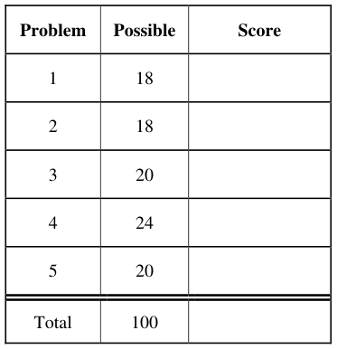
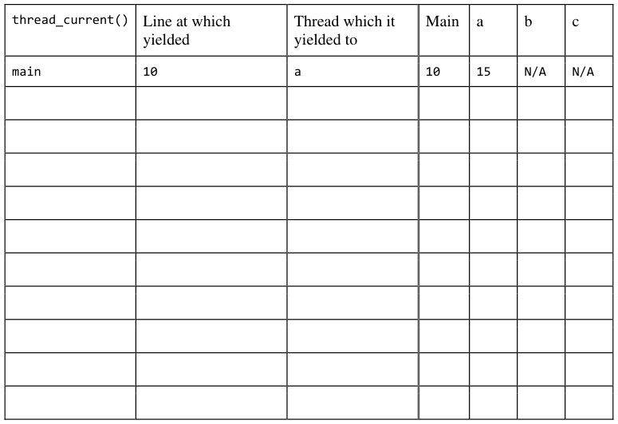
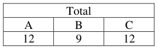
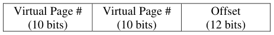
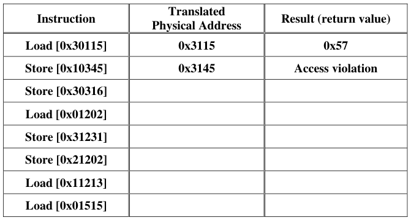
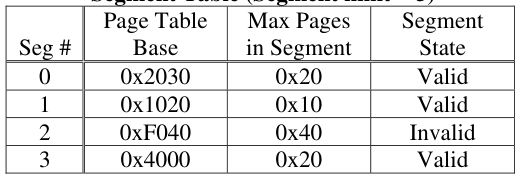

# Berkeley CS162 Fall 2015: Midterm 1: Questions

> Copied from the original: <https://hkn.eecs.berkeley.edu/exams/course/cs/162>. Text and figures are taken from the PDF as is; nothing was answered or rewritten. The original PDF is in this folder.

---

**Page 1**

&emsp;&emsp;&emsp;&emsp;&emsp;&emsp;&emsp;&emsp;University of California, Berkeley 
&emsp;&emsp;&emsp;&emsp;&emsp;&emsp;&emsp;&emsp;College of Engineering 
&emsp;&emsp;&emsp;&emsp;&emsp;&emsp;&emsp;&emsp;Computer Science Division  EECS 
&emsp;John Kubiatowicz 
&emsp;Fall 2015 
&emsp;&emsp;&emsp;&emsp;&emsp;&emsp;&emsp;&emsp;Midterm I 
&emsp;&emsp;&emsp;&emsp;&emsp;&emsp;&emsp;&emsp;October 14th, 2015 
&emsp;&emsp;&emsp;&emsp;&emsp;&emsp;&emsp;CS162: Operating Systems and Systems Programming

General Information: 
This is a **closed book** exam.  You are allowed 1 page of **hand-written** notes (both sides).  You 
have 3 hours to complete as much of the exam as possible. Make sure to read all of the questions 
first, as some of the questions are substantially more time consuming. 
Write all of your answers directly on this paper.  Make your answers as concise as possible. On 
programming questions, we will be looking for performance as well as correctness, so think through 
your answers carefully.  If there is something about the questions that you believe is open to 
interpretation, please ask us about it!

&emsp;Page 1/21

---

**Page 2**

CS 162 Fall 2015 Midterm Exam I        October 14th, 2015

&emsp;&emsp;&emsp;&emsp;&emsp;&emsp;&emsp;&emsp;\[ This page left for  \]

&emsp;&emsp;&emsp;&emsp;3.141592653589793238462643383279502884197169399375105820974944

Page 2/21

---

**Page 3**

CS 162 Fall 2015 Midterm Exam I        October 14th, 2015

### Problem 1: TRUE/FALSE \[18 pts\]

In the following, it is important that you EXPLAIN your answer in TWO SENTENCES OR LESS 
(Answers longer than this may not get credit!).  Also, answers without an explanation GET NO 
CREDIT.

### **Problem 1a\[2pts\]:**  When you type Ctrl+C to quit a program in your terminal, you are actually

sending a SIGINT signal to the program, which makes it quit. 
&emsp;&emsp;True / False 
Explain:

### **Problem 1b\[2pts\]:** The function `pthread_intr_disable()` is a crude but viable way for

user programs to implement an atomic section. 
&emsp;&emsp;True / False 
Explain:

### **Problem 1c\[2pts\]:** If the banker's algorithm finds that it's safe to allocate a resource to an existing

thread, then all threads will eventually complete. 
&emsp;&emsp;True / False 
Explain:

### **Problem 1d\[2pts\]:** The lottery scheduler can be utilized to implement strict priority scheduling.

&emsp;&emsp;True / False 
Explain:

### **Problem 1e\[2pts\]:** Locks can be implemented using semaphores.

&emsp;&emsp;True / False 
Explain:

Page 3/21

---

**Page 4**

CS 162 Fall 2015 Midterm Exam I        October 14th, 2015

### **Problem 1f\[2pts\]:** Two processes can share information by reading and writing from a shared

linked list. 
&emsp;&emsp;True / False 
Explain:

### **Problem 1g\[2pts\]:** In Pintos, a kernel-level stack can grow as large as it needs to be to perform its

functions. 
&emsp;&emsp;True / False 
Explain:

### **Problem 1h\[2pts\]:** Suppose that a shell program wants to execute another program and wait on its

result.  It does this by creating a thread, calling exec from within that thread, then waiting in the 
original thread. 
&emsp;&emsp;True / False 
Explain:

### **Problem 1i\[2pts\]:** A network server in Linux works by calling `bind()` on a socket, and then

calling `listen()` on the socket in a loop to wait for new clients. 
&emsp;&emsp;True / False 
Explain:

Page 4/21

---

**Page 5**

CS 162 Fall 2015 Midterm Exam I        October 14th, 2015

### Problem 2: Short Answer \[18pts\]

### **Problem 2a\[2pts\]:** How does a modern OS regain control of the CPU from a program stuck in an

infinite loop?

### **Problem 2b\[2pts\]:** Is it possible for an interrupt handler (code triggered by a hardware interrupt) to

sleep while waiting for another event?  If so, explain how.  If not, explain why not.

### **Problem 2c\[2pts\]:** Why is it important for system calls to be vectored through the syscall table

(indexed by an integer syscall number) rather than allowing the user to specify a function address to 
be called by the kernel after it transitions to kernel mode?

### **Problem 2d\[3pts\]:** Name two advantages and one disadvantage of implementing a threading

package at user level (e.g. “green threads”) rather than relying on thread scheduling from within the 
kernel.

Page 5/21

---

**Page 6**

CS 162 Fall 2015 Midterm Exam I        October 14th, 2015

### **Problem 2e\[2pts\]:** List two reasons why overuse of threads is bad (i.e. using too many threads for

different tasks). Be explicit in your answers.

### **Problem 2f\[2pts\]:** What was the problem with the Therac-25? Your answer should involve one of

the topics of the class.

### **Problem 2g\[2pts\]:** Why is it possible for a web browser (such as Firefox) to have 2 different tabs

opened to the same website (at the same remote IP address and port) without mixing up content 
directed at each tab?

### **Problem 2h\[3pts\]:** What are some of the hardware differences between kernel mode and user

mode?  Name at least three.

Page 6/21

---

**Page 7**

CS 162 Fall 2015 Midterm Exam I        October 14th, 2015

### Problem 3: Boy-Girl Lock \[20pts\]

A boy-girl lock is a sort of generalized reader-writer lock: in a reader-writer lock there can be any 
number of readers or a single writer (but not both readers and writers at the same time), while in a 
boy-girl lock there can be any number of boys or any number of girls (but not both a boy and a girl 
at the same time).  Assume that we are going to implement this lock at user level utilizing pThread 
monitors (i.e pThread mutexes and condition variables). Note that the assumption here is that we 
will put threads to sleep when they attempt to acquire the lock as a Boy when it is already acquired 
by one or more Girls and vice-versa. You must implement the behavior using condition variable(s). 
Points will be deducted for any spin-waiting behavior. 
Some snippets from POSIX Thread manual pages showing function signatures are shown at end of 
this problem.  They may or may not be useful. 
Our first take at this lock is going to utilize the following structure and enumeration type: 
`/* The basic structure of a boy-girl lock */` 
`struct bglock {` 
`pthread_mutex_t lock;` 
`pthread_cond_t wait_var;` 
`// Simple state variable` 
`int state;` 
`};` 
`/* Enumeration to indicate type of requested lock */` 
`enum bglock_type {` 
`BGLOCK_BOY = 0;` 
`BGLOCK_GIRL = 1;` 
`};` 
`/* interface functions: return 0 on success, error code on failure */` 
`int bglock_init(struct bglock *lock);` 
`int bglock_lock(struct bglock *lock, enum bglock_type type);` 
`int bglock_unlock(struct bglock *lock);`

Note that the lock requestor specifies the type of lock that they want at the time that they make the 
request: 
`/* Request a Boy lock */` 
`if (bglock_lock(mylock, BGLOCK_BOY) {` 
`printf(“Lock request failed!”);` 
`exit(1);` 
`}` 
`/* . . . Code using lock . . . */` 
`/* Release your lock */` 
`bglock_unlock(mylock);`

Page 7/21

---

**Page 8**

CS 162 Fall 2015 Midterm Exam I        October 14th, 2015

### **Problem 3a\[3pts\]:** Complete the following sketch for the initialization function.  Note that

initialization should return zero on success and a non-zero error code on failure (e.g. return the 
failure code, if you encounter one, from the various synchronization functions). Hint: the state of 
the lock is more than just “acquired” or “free”. 
`/* Initialize the BG lock.` 
`*` 
`* Args: pointer to a bglock` 
`* Returns: 0 (success)` 
`*`         `non-zero (errno code from synchronization functions)` 
`*/` 
`int bglock_init(struct bglock *lock) {`

`}`

### **Problem 3b\[5pts\]:** Complete the following sketch for the lock function.  Think carefully about the

state of the lock; when you should wait, when you can grab the lock. 
`/* Grab a BG lock.` 
`*` 
`* Args: (pointer to a bglock, enum lock type)` 
`* Returns: 0 (lock acquired)` 
`*`         `non-zero (errno code from synchronization functions)` 
`*/` 
`int bglock_lock(struct bglock *lock, enum bglock_type type) {`

`}`

Page 8/21

---

**Page 9**

CS 162 Fall 2015 Midterm Exam I        October 14th, 2015

### **Problem 3c\[5pts\]:** Complete the following sketch for the unlock function.

`/* Release a BG lock.` 
`*` 
`* Args: pointer to a bglock` 
`* Returns: 0 (lock acquired)` 
`*`         `non-zero (errno code from synchronization functions)` 
`*/` 
`int bglock_unlock(struct bglock *lock) {`

`}`

### **Problem 3d\[2pts\]:** Consider a group of “nearly” simultaneous arrivals (i.e. they arrive in a period

much quicker than the time for any one thread that has successfully acquired the BGlock to get 
around    to    performing    `bglock_unlock()`).    Assume    that    they    enter    the 
`bglock_lock()`routine in this order: 
&emsp;&emsp;&emsp;&emsp;&emsp;B1, B2, G1, G2, B3, G3, B4, B5, B6, B7 
How will they be grouped?  (Place braces, namely “{}” around requests that will hold the lock 
simultaneously).  This simple lock implementation (with a single state variable) is subject to 
starvation.  Explain.

Page 9/21

---

**Page 10**

CS 162 Fall 2015 Midterm Exam I        October 14th, 2015

### **Problem 3e\[5pts\]:** Suppose that we want to enforce fairness, such that Boy and Girl requests are

divided into phases based on arrival time into the `bglock_lock()` routine.  Thus, for instance, 
an arrival stream of Boys and Girls such as this: 
&emsp;&emsp;&emsp;&emsp;&emsp;&emsp;&emsp;B1, B2, G1, G2, G3, G4, B3, G5, B4, B5 
will get granted in groups such as this: 
&emsp;&emsp;&emsp;&emsp;&emsp;&emsp;&emsp;{B1, B2}, {G1, G2, G3, G4}, {B3}, {G5}, {B4, B5} 
Explain what the minimum changes are that you would need to make to the `bglock` structure to 
meet these requirements and sketch out what you would do during `bglock_init()` and 
`bglock_lock()` and `bglock_unlock()` routines.  You do not need to write actual code, but 
should be explicit about what your `bglock` structure would look like and how you would use its 
fields to accomplish the desired behavior.

Page 10/21

---

**Page 11**

CS 162 Fall 2015 Midterm Exam I        October 14th, 2015

&emsp;&emsp;Assorted POSIX Thread Manual Snippits for Problem 3

`PTHREAD_MUTEX_DESTROY(3P): initialization/destruction of mutexes` 
`int pthread_mutex_destroy(pthread_mutex_t *mutex);` 
`int pthread_mutex_init(pthread_mutex_t *restrict mutex,` 
&emsp;&emsp;&emsp;&emsp;&emsp;&emsp;&emsp;`const pthread_mutexattr_t *restrict attr);` 
`pthread_mutex_t mutex = PTHREAD_MUTEX_INITIALIZER;`

`PTHREAD_MUTEX_LOCK(3P): use of mutex` 
`int pthread_mutex_lock(pthread_mutex_t *mutex);` 
`int pthread_mutex_trylock(pthread_mutex_t *mutex);` 
`int pthread_mutex_unlock(pthread_mutex_t *mutex);`

`PTHREAD_COND_DESTROY(3P): initialization/destruction of condition variables` 
`int pthread_cond_destroy(pthread_cond_t *cond);` 
`int pthread_cond_init(pthread_cond_t *restrict cond,` 
&emsp;&emsp;&emsp;&emsp;&emsp;&emsp;&emsp;`const pthread_condattr_t *restrict attr);` 
`pthread_cond_t cond = PTHREAD_COND_INITIALIZER;`

`PTHREAD_COND_TIMEDWAIT(3P): sleeping on condition variables` 
`int pthread_cond_timedwait(pthread_cond_t *restrict cond,` 
&emsp;&emsp;&emsp;&emsp;&emsp;&emsp;&emsp;`pthread_mutex_t *restrict mutex,` 
&emsp;&emsp;&emsp;&emsp;&emsp;&emsp;&emsp;`const struct timespec *restrict abstime);` 
&emsp;&emsp;&emsp;`int pthread_cond_wait(pthread_cond_t *restrict cond,` 
&emsp;&emsp;&emsp;&emsp;&emsp;&emsp;&emsp;&emsp;`pthread_mutex_t *restrict mutex);`

`PTHREAD_COND_BROADCAST(3P): signaling of threads waiting on condition variables` 
`int pthread_cond_broadcast(pthread_cond_t *cond);` 
`int pthread_cond_signal(pthread_cond_t *cond);`

Page 11/21

---

**Page 12**

CS 162 Fall 2015 Midterm Exam I        October 14th, 2015

### Problem 4: Scheduling and Deadlock \[24 pts\]

### **Problem 4a\[3pts\]:** What is priority inversion and why is it an important problem? Present a

priority inversion scenario in which a lower priority process can prevent a higher-priority process 
from running (assume that there is no priority donation mechanism):

### **Problem 4b\[3pts\]:** How does the Linux CFS (“Completely Fair Scheduler”) scheduler decide

which thread to run next?  What aspect of its behavior is “fair”?  (You can ignore the presence of 
priorities or “nice” values in your answer):

### **Problem 4c\[2pts\]:** Consider the above PintOS test that exercises your priority scheduler.   Assume

that no priority donation has been implemented.  What does it output to the terminal?   Is the output 
affected by priorities in any way?  Explain.

Page 12/21

---

**Page 13**

CS 162 Fall 2015 Midterm Exam I        October 14th, 2015

### **Problem 4d\[5pts\]:** Next, assume that the code from (4c) is executed utilizing priority donation.

Fill in the following table to detail execution.  This table includes 7 columns as following: 
1\) The current executing thread 
2\) Which line this thread was executing when it yielded 
3\) To which thread it yielded 
4-7) The priorities of each thread (N/A if a thread is not created or has exited)

### **Problem 4e\[2pts\]:**  What is printed according to the order of execution in (4d)?  Is the output

affected by priorities in any way?  Explain.

Page 13/21

---

**Page 14**

CS 162 Fall 2015 Midterm Exam I        October 14th, 2015

### **Problem 4f\[4pts\]:**

Suppose that we have the following resources: A, B, C and threads T1, T2, T3, T4.  The total 
number of each resource is:

Further, assume that the processes have the following maximum requirements and current 
allocations:

Is the system in a safe state? If “yes”, show a non-blocking sequence of thread executions. 
Otherwise, provide a proof that the system is unsafe. Show your work and justify each step of your 
answer.

Page 14/21

---

**Page 15**

CS 162 Fall 2015 Midterm Exam I        October 14th, 2015

### **Problem 4g\[3pts\]:**

Assume that we start with a system in the state of (4f). Suppose that T1 asks for 2 more copies of 
resource A.  Can the system grant this if it wants to avoid deadlock? Explain.

### **Problem 4h\[2pts\]:** Assume that a set of threads (T1, T2, … Tn) contend for a set of non-

preemptable resources (R1, R2, … Rm) that may or may not be unique. Name at least two techniques 
to prevent this system from deadlocking:

Page 15/21

---

**Page 16**

CS 162 Fall 2015 Midterm Exam I        October 14th, 2015

&emsp;&emsp;&emsp;&emsp;&emsp;&emsp;&emsp;&emsp;\[ This page intentionally left blank \]

Page 16/21

---

**Page 17**

CS 162 Fall 2015 Midterm Exam I        October 14th, 2015

### Problem 5: Address Translation \[20 pts\]

### **Problem 5a\[3pts\]:** In class, we discussed the “magic” address format for a multi-level page table

on a 32-bit machine, namely one that divided the address as follows:

You can assume that Page Table Entries (PTEs) are 32-bits in size in the following format:

What is particularly “magic” about this configuration?  Make sure that your answer involves the 
size of the page table and explains why this configuration is helpful for an operating system 
attempting to deal with limited physical memory.

### **Problem 5b\[2pts\]:** Modern processors nominally address 64-bits of address space both virtually

and physically (in reality they provide access to less, but ignore that for now).  Explain why the 
page table entries (PTEs) given in (5a) would have to be expanded from 4 bytes and justify how big 
they would it need to be.  Assume that pages are the same size and that the new PTE has similar 
control bits to the version given in (5a).

### **Problem 5c\[2pts\]:** Assuming that we reserve 8-bytes for each PTE in the page table (whether or

not they need all 8 bytes), how would the virtual address be divided for a 64-bit address space? 
Make sure that your resulting scheme has a similar “magic” property as in (5a) and that all levels of 
the page table are the same size—with the exception of the top-level. How many levels of page 
table would this imply?  Explain your answer!

Page 17/21

---

**Page 18**

CS 162 Fall 2015 Midterm Exam I        October 14th, 2015

### **Problem 5d\[3pts\]:** Consider a multi-level memory management scheme using the following format

for virtual addresses, including 2 bits worth of segment ID and an 8-bit virtual page number:

Virtual addresses are translated into 16-bit physical addresses of the following form:

Page table entries (PTE) are 16 bits in the following format, stored in big-endian form in memory 
(i.e. the MSB is first byte in memory):

1\) How big is a page? Explain.

2\) What is the maximum amount of physical memory supported by this scheme? Explain

### **Problem 5e\[10pts\]:** Using the scheme from (5d) and the Segment Table and Physical Memory

table on the next page, state what will happen with the following loads and stores. Addresses below 
are virtual, while base addresses in the segment table are physical. If you can translate the address, 
make sure to place it in the “Physical Address” column; otherwise state “**N/A**”. 
&emsp;The return value for a load is an 8-bit data value or an error, while the return value for a store is 
either “**ok**” or an error. If there is an error, say which error. Possibilities are: “**bad segment**” 
(invalid segment), “**segment overflow**” (address outside segment), or “**access violation**” (page 
invalid/attempt to write a read only page).  A few answers are given:

Page 18/21

---

**Page 19**

&emsp;CS 162 Fall 2015 Midterm Exam I        October 14th, 2015

&emsp;&emsp;&emsp;&emsp;&emsp;&emsp;&emsp;&emsp;**Segment Table (Segment limit = 3)**

&emsp;&emsp;&emsp;&emsp;&emsp;&emsp;&emsp;&emsp;**Physical Memory**

&emsp;Page 19/21

---

**Page 20**

CS 162 Fall 2015 Midterm Exam I        October 14th, 2015

&emsp;&emsp;&emsp;&emsp;&emsp;&emsp;&emsp;&emsp;\[ This page intentionally left blank \]

Page 20/21

---

**Page 21**

CS 162 Fall 2015 Midterm Exam I        October 14th, 2015

&emsp;&emsp;&emsp;&emsp;&emsp;&emsp;&emsp;&emsp;\[ This page left for scratch \]

Page 21/21

