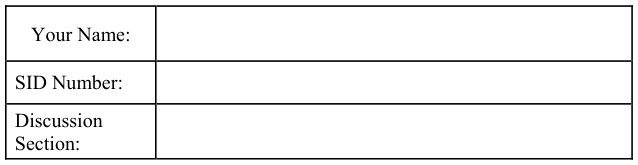
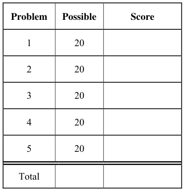
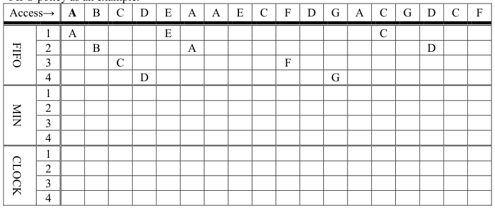

# Berkeley CS162 Fall 2015: Midterm 2: Questions

> Copied from the original: <https://hkn.eecs.berkeley.edu/exams/course/cs/162>. Text and figures are taken from the PDF as is; nothing was answered or rewritten. The original PDF is in this folder.

---

**Page 1**

&emsp;&emsp;&emsp;&emsp;&emsp;&emsp;&emsp;&emsp;University of California, Berkeley 
&emsp;&emsp;&emsp;&emsp;&emsp;&emsp;&emsp;&emsp;College of Engineering 
&emsp;&emsp;&emsp;&emsp;&emsp;&emsp;&emsp;&emsp;Computer Science Division  EECS 
&emsp;Fall 2015                John Kubiatowicz 
&emsp;&emsp;&emsp;&emsp;&emsp;&emsp;&emsp;&emsp;Midterm II 
&emsp;&emsp;&emsp;&emsp;&emsp;&emsp;&emsp;&emsp;November 23rd, 2015 
&emsp;&emsp;&emsp;&emsp;&emsp;&emsp;&emsp;CS162: Operating Systems and Systems Programming

General Information: 
This is a **closed book** exam.  You are allowed 1 page of **hand-written** notes (both sides).  You 
have 3 hours to complete as much of the exam as possible. Make sure to read all of the questions 
first, as some of the questions are substantially more time consuming. 
Write all of your answers directly on this paper.  Make your answers as concise as possible. On 
programming questions, we will be looking for performance as well as correctness, so think through 
your answers carefully.  If there is something about the questions that you believe is open to 
interpretation, please ask us about it!

&emsp;Page 1/17

---

**Page 2**

CS 162 Fall 2015 Midterm Exam II        November 23rd, 2015

&emsp;&emsp;&emsp;&emsp;&emsp;&emsp;&emsp;&emsp;\[ This page left for  \]

&emsp;&emsp;&emsp;&emsp;3.141592653589793238462643383279502884197169399375105820974944

Page 2/17

---

**Page 3**

CS 162 Fall 2015 Midterm Exam II        November 23rd, 2015

### Problem 1: True/False \[20 pts\]

In the following, it is important that you EXPLAIN your answer in TWO SENTENCES OR LESS 
(Answers longer than this may not get credit!).  Also, answers without an explanation GET NO 
CREDIT.

### **Problem 1a\[2pts\]:**  The basic IP protocol is able to route messages directly from a process on one

machine to a process on another machine. 
&emsp;&emsp;True / False 
Explain:

### **Problem 1b\[2pts\]:** A fully-associative cache always has a lower or equal miss rate as a direct-

mapped cache of the same size. 
&emsp;&emsp;True / False 
Explain:

### **Problem 1c\[2pts\]:** A “memoryless” probability distribution is often used as a model for the total

arrival rate of events when many independent sources of such events are combined together. 
&emsp;&emsp;True / False 
Explain:

### **Problem 1d\[2pts\]:**  In the Pintos kernel, if you call intr\_disable() and then dereference a NULL

pointer, your kernel will be stuck in an infinite loop, because the page fault trap cannot reach the 
CPU when interrupts are disabled. 
&emsp;&emsp;True / False 
Explain:

### **Problem 1e\[2pts\]:** The first-level processor cache can prevent correct functioning of memory-

mapped I/O operations. 
&emsp;&emsp;True / False 
Explain:

Page 3/17

---

**Page 4**

CS 162 Fall 2015 Midterm Exam II        November 23rd, 2015

### **Problem 1f\[2pts\]:** The best way for the operating system to register incoming messages from a

high-speed network is via a combination of interrupts and polling. 
&emsp;&emsp;True / False 
Explain:

### **Problem 1g\[2pts\]:** “Marshalling” is the process by which network packets from different TCP/IP

streams are merged together on a single Ethernet connection. 
&emsp;&emsp;True / False 
Explain:

### **Problem 1h\[2pts\]:** “Shingled Magnetic Recording” (SMR) increases the density of information on

a hard disk by layering tracks on top of one another. 
&emsp;&emsp;True / False 
Explain:

### **Problem 1i\[2pts\]:**  A Kindle filled with books is heavier than an empty Kindle.

&emsp;&emsp;True / False 
Explain:

### **Problem 1j\[2pts\]:**  The Elevator Algorithm is used to schedule I/O requests for SSD drives.

&emsp;&emsp;True / False 
Explain:

Page 4/17

---

**Page 5**

CS 162 Fall 2015 Midterm Exam II        November 23rd, 2015

### Problem 2: Short Answer \[20pts\]

For the following questions, please provide as short an answer as you can that actually answers the 
question. In most cases, this means one or two sentences.  We reserve the right to take off points for 
answers that are not concise.

### **Problem 2a\[3pts\]:** What is a SLAB allocator? Name two advantages of using a SLAB allocator.

### **Problem 2b\[2pts\]:** In Pintos, what is the significance of the PHYS\_BASE constant?

### **Problem 2c\[3pts\]:** Why is it important for the page fault exception to be precise?  Make sure that

you define “precise exception” in your answer.

### **Problem 2d\[3pts\]:** What is the guarantee provided by two-phase commit?  Why doesn’t it violate

the General’s Paradox?

Page 5/17

---

**Page 6**

CS 162 Fall 2015 Midterm Exam II        November 23rd, 2015

### **Problem 2e\[2pts\]:** Explain how the Clock Algorithm provides an approximation to the LRU

replacement algorithm.

### **Problem 2f\[2pts\]:** What are the purposes of the Top and Bottom halves of a device driver?

### **Problem 2g\[3pts\]:** Suppose the grep program is invoked under Pintos with the following command

line: grep help cs162-midterm.txt. Using a diagram for illustration, explain what the call stack will 
look like when the starts. How much total memory will be needed to set up this stack?

### **Problem 2h\[2pts\]:** You may have noticed that user-programs in Pintos do not use malloc.  Is there

something fundamental about the Pintos kernel that prevents them from doing dynamic memory 
allocation?

Page 6/17

---

**Page 7**

CS 162 Fall 2015 Midterm Exam II        November 23rd, 2015

&emsp;&emsp;&emsp;&emsp;&emsp;**Problem #3: Designing a Disk Array \[20pts\]**

Suppose that we build a disk subsystem to handle a high rate of I/O by coupling many disks 
together.  Properties of this system are as follows: 
&emsp; Uses 4TiB disks that rotate at 10,000 RPM, have a data transfer rate of 40 MBytes/s (for 
&emsp;&emsp;each disk), and have a 5ms average seek time, 4 KiByte sector size 
&emsp; Has a SCSI interface with a 2ms controller command time. 
&emsp; The file system has a 32 KiByte block size 
&emsp; Has a total of 20 disks 
Each disk can handle only one request at a time, but each disk in the system can be handling a 
different request.  The data is not striped (all I/O for each request has to go to one disk).  Note: Sizes 
are in powers of 2, bandwidths are in powers of 10.

### **Problem 3a\[3pts\]:** What is the average service time to retrieve a single disk sector from a random

location on a single disk, assuming no queuing time? What is the achievable bandwidth if all 
requests are for random sectors on one disk?

### **Problem 3b\[2pts\]:** Suppose we consider block-sized requests instead of sector-sized requests. How

does the bandwidth calculated in (3a) improve? Hint: you should be able to reuse parts of (3a).

### **Problem 3c\[3pts\]:** Give one advantage and two disadvantages to using 32 KiB blocks for the

filesystem instead of the native 4KiB sector size.

Page 7/17

---

**Page 8**

CS 162 Fall 2015 Midterm Exam II        November 23rd, 2015

### **Problem 3d\[2pts\]:** What is the average number of I/Os per second (IOPS) that the whole disk

system can handle (assuming that I/O requests are 32KiB at a time, evenly distributed among the 
drives, and uncorrelated with one another)?

### **Problem 3e\[2pts\]:** Now, suppose that we decide to improve the system by using new, better disks.

For the same total price as the original disks, you can get 12 disks that have 1 TiB each, rotate at 
12000 RPM, transfer at 50MB/s and have a 4ms seek time. 
What is the average unloaded service time to read a block from a single disk?

### **Problem 3f\[2pts\]:** What is the average number of IOPS in the new system?

Page 8/17

---

**Page 9**

CS 162 Fall 2015 Midterm Exam II        November 23rd, 2015

### **Problem 3g\[4pts\]:** Treat the entire system as a M/M/m queue (that is, a system with m servers

rather than one), where each disk is a server.  All requests are in a single queue.  Assume that both 
systems receive an average of 1200 I/O requests per second. Assume that any disk can service any 
request. 
What is the mean response time of the old system?  The new one?  You might find the following 
equation for an M/M/m queue useful: 
&emsp;&emsp;&emsp;&emsp;&emsp;&emsp;&emsp;&emsp;   Time 
&emsp;&emsp;&emsp;&emsp;&emsp;Server Utilization ()   server 
&emsp;&emsp;&emsp;&emsp;&emsp;&emsp;&emsp;&emsp;1   m 
&emsp;&emsp;&emsp;&emsp;&emsp;&emsp;&emsp;&emsp;Time/m 
&emsp;&emsp;&emsp;&emsp;&emsp;&emsp;&emsp;&emsp;server 
&emsp;&emsp;&emsp;&emsp;&emsp;&emsp;&emsp;&emsp; 
&emsp;&emsp;&emsp;&emsp;&emsp;TimeTime 
&emsp;&emsp;&emsp;&emsp;&emsp;&emsp;&emsp;&emsp; 
&emsp;&emsp;&emsp;&emsp;&emsp;&emsp;&emsp;m1queueserver   

### **Problem 3h\[2pts\]:** Which system has a lower average response time?  Why?

Page 9/17

---

**Page 10**

CS 162 Fall 2015 Midterm Exam II        November 23rd, 2015

&emsp;&emsp;&emsp;&emsp;&emsp;&emsp;&emsp;&emsp;**\[ This page intentionally left blank \]**

Page 10/17

---

**Page 11**

CS 162 Fall 2015 Midterm Exam II        November 23rd, 2015

### Problem 4: File Systems \[20pts\]

Please keep your answers short (one or two sentences per question-mark). We may not give credit 
for long answers.

### **Problem 4a\[3pts\]:** Rather than writing updated files to disk immediately when they are closed,

many UNIX systems use a delayed write-behind policy in which dirty disk blocks are flushed to 
disk once every 30 seconds.   List two advantages and one disadvantage of such a scheme: 
Advantage 1: 
Advantage 2: 
Disadvantage:

### **Problem 4b\[2pts\]:** What is a “Journaled” filesystem and how does it improve the durability of data

on a disk relative to a system such as (4a).

### **Problem 4c\[3pts\]:** Assuming that nothing is cached in memory, that disk blocks are 1K bytes and

that all directories are less than 1K bytes in size, how many disk reads are required to read the first 
byte of the file  **/classes/cs162/midterm2/solutions.txt** in the Fast File system? Explain!

### **Problem 4d\[2pts\]:** Explain how the UNIX BSD 4.1 inode structure supports both small files (e.g. a

couple of KB) and large files (e.g. up to some number of GB). Which type of file can be accessed 
with the lowest overhead?

Page 11/17

---

**Page 12**

CS 162 Fall 2015 Midterm Exam II        November 23rd, 2015

### **Problem 4e\[3pts\]:** The Berkeley FFS (from BSD 4.2) introduced the idea of cylinder groups.

What are they and what are two advantages of such groups?

### **Problem 4f\[3pts\]:** How does the structure of NTFS differ from that of the Unix File system?

### **Problem 4g\[4pts\]:** At a particular point in time, the buffer cache has dirty data that needs to be

flushed to disk.  Suppose that the identities of these blocks can be listed in \[track:sector\] form as 
follows: 
\[10:5\], \[22:9\], \[11:6\], \[2:10\], \[20:5\], \[32:4\], \[32:5\], \[6:7\] 
Assume that the disk head is currently positioned over track 20.  What is the sequence of writes 
under the following disk scheduling algorithms: 
&emsp;&emsp;a) Shortest Seek Time First:

&emsp;&emsp;b) Scan (initially moving upwards):

Page 12/17

---

**Page 13**

CS 162 Fall 2015 Midterm Exam II        November 23rd, 2015

### Problem 5: Potpourri \[20pts\]

### **Problem 5a\[6pts\]:** Each thread in Pintos has a thread ID and a name.  However, this information is

not currently available to user programs.  We would like to create a new syscall, SYS\_INFO, to 
access this information.  Here is the function declaration for our new syscall, which would appear in 
`lib/user/syscall.h:` 
&emsp;`/* Returns the current user process’s TID.` 
&emsp;`* Also stores the current user process’s name into NAME. */` 
&emsp;`int info(char name[16]);` 
We have provided the relevant parts of the thread struct, along with a function that will verify the 
validity of user-specified pointers. 
&emsp;`struct thread` 
`{` 
`tid_t tid;` 
`char name[16];` 
`…` 
`}` 
&emsp;`/* Checks that P to P+SIZE-1 is a valid user buffer.` 
&emsp;`* Kills the current thread if it is invalid. */` 
&emsp;`void exit_thread_if_invalid(void *p, size_t size);` 
Please fill in the syscall\_handler function so that it safely handles the SYS\_INFO syscall. Add no 
more than 8 lines (you can write it with less): 
&emsp;`static void` 
&emsp;`syscall_handler (struct intr_frame *f)` 
&emsp;`{` 
&emsp;`uint32_t *args = ((uint32_t *) f->esp);`

&emsp;`if (                               ) { // Check if this is SYS_INFO`

&emsp;`} else {` 
&emsp;`// code for ALL other syscalls will go here` 
&emsp;`}` 
&emsp;`}`

Page 13/17

---

**Page 14**

CS 162 Fall 2015 Midterm Exam II        November 23rd, 2015

### **Problem 5b\[5pts\]:** Assume that we have a 32-bit processor with both a 32-bit virtual address space

and a 32-bit physical address space.  Also assume an 8KB, 2-way set-associative cache that is 
physically addressed and has 64 byte cache lines.  Finally, assume a 4KB page size for virtual 
memory. 
Draw a block-diagram (hardware circuit) showing how 32-bits from the processor is used to look 
up data in the cache.  Make sure to include blocks for the TLB lookup, cache RAM lookup (both 
banks), and tag match hardware.  All “wires” should have a width noted that indicates how many 
bits are placed together in the wire.

### **Problem 5c\[2pts\]:** Can the above system perform a TLB lookup in parallel with the cache lookup?

Explain.

Page 14/17

---

**Page 15**

CS 162 Fall 2015 Midterm Exam II        November 23rd, 2015

### **Problem 5d\[2pts\]:** In a typical cache, the tag-bits are pulled from the top (most significant bits) of

the address, while index and offset bits are pulled from less significant bits.  Why wouldn’t it make 
sense to take the cache index from the most significant bits?  Explain in detail.

### **Problem 5e\[5pts\]:** For the following problem, assume a hypothetical machine with 4 pages

of physical memory and 7 pages of virtual memory. Given the access pattern: 
&emsp;&emsp;`A B C D E A A E C F D G A C G D C F` 
Indicate in the following table which pages are mapped to which physical pages for each of the 
following policies.  Assume that a blank box matches the element to the left. We have given the 
FIFO policy as an example.

Page 15/17

---

**Page 16**

CS 162 Fall 2015 Midterm Exam II        November 23rd, 2015

&emsp;&emsp;&emsp;&emsp;&emsp;&emsp;&emsp;&emsp;**\[ This page intentionally left blank \]**

Page 16/17

---

**Page 17**

CS 162 Fall 2015 Midterm Exam II        November 23rd, 2015

&emsp;&emsp;&emsp;&emsp;&emsp;&emsp;&emsp;&emsp;**\[ Scratch Page (feel free to remove) \]**

Page 17/17

