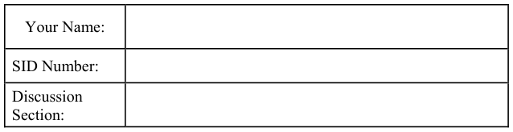
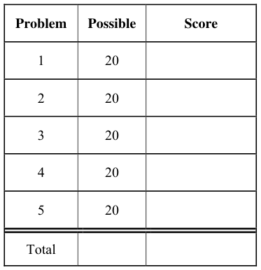
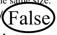
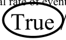
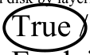
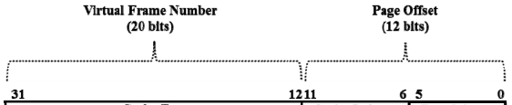
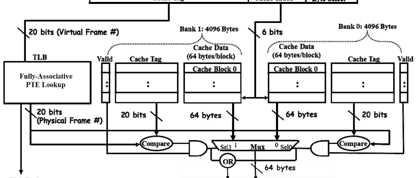
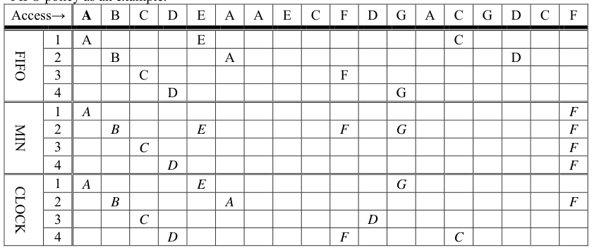

# Berkeley CS162 Fall 2015: Midterm 2: Official solutions

> Copied from the original: <https://hkn.eecs.berkeley.edu/exams/course/cs/162>. Text and figures are taken from the PDF as is; nothing was answered or rewritten. The original PDF is in this folder.

---

**Page 1**

&emsp;&emsp;&emsp;&emsp;&emsp;&emsp;&emsp;&emsp;University of California, Berkeley 
&emsp;&emsp;&emsp;&emsp;&emsp;&emsp;&emsp;&emsp;College of Engineering 
&emsp;&emsp;&emsp;&emsp;&emsp;&emsp;&emsp;&emsp;Computer Science Division  EECS 
&emsp;Fall 2015                John Kubiatowicz 
&emsp;&emsp;&emsp;&emsp;&emsp;&emsp;&emsp;&emsp;Midterm II 
&emsp;&emsp;&emsp;&emsp;&emsp;&emsp;&emsp;&emsp;SOLUTIONS 
&emsp;&emsp;&emsp;&emsp;&emsp;&emsp;&emsp;&emsp;November 23rd, 2015 
&emsp;&emsp;&emsp;&emsp;&emsp;&emsp;&emsp;CS162: Operating Systems and Systems Programming

General Information: 
This is a **closed book** exam.  You are allowed 1 page of **hand-written** notes (both sides).  You 
have 3 hours to complete as much of the exam as possible. Make sure to read all of the questions 
first, as some of the questions are substantially more time consuming. 
Write all of your answers directly on this paper.  Make your answers as concise as possible. On 
programming questions, we will be looking for performance as well as correctness, so think through 
your answers carefully.  If there is something about the questions that you believe is open to 
interpretation, please ask us about it!

&emsp;Page 1/17

---

**Page 2**

CS 162 Fall 2015 Midterm Exam II        November 23rd, 2015

&emsp;&emsp;&emsp;&emsp;&emsp;&emsp;&emsp;&emsp;\[ This page left for  \]

&emsp;&emsp;&emsp;&emsp;3.141592653589793238462643383279502884197169399375105820974944

Page 2/17

---

**Page 3**

CS 162 Fall 2015 Midterm Exam II        November 23rd, 2015

### Problem 1: True/False \[20 pts\]

In the following, it is important that you EXPLAIN your answer in TWO SENTENCES OR LESS 
(Answers longer than this may not get credit!).  Also, answers without an explanation GET NO 
CREDIT.

### **Problem 1a\[2pts\]:**  The basic IP protocol is able to route messages directly from a process on one

&emsp;&emsp;Explain: The basic IP protocol is only able to route from machine to machine, 
&emsp;&emsp;because it only contains IP addresses. For process-to-process routing, one needs to use a 
&emsp;&emsp;protocol that includes ports such as TCP/IP or UDP/IP.

### **Problem 1b\[2pts\]:** A fully-associative cache always has a lower or equal miss rate as a direct-

mapped cache of the same size.

&emsp;&emsp;Explain: A very simple pattern violates this statement: consider a direct mapped 
&emsp;&emsp;cache of size X.  Then, cycle through a loop which accesses X+1 consecutive addresses over 
&emsp;&emsp;and over.  The fully-associative cache will miss every time, whereas a direct mapped cache 
&emsp;&emsp;will only miss twice per loop.

### **Problem 1c\[2pts\]:** A “memoryless” probability distribution is often used as a model for the total

arrival rate of events when many independent sources of such events are combined together.

&emsp;&emsp;True / False 
&emsp;&emsp;Explain: A large number of independent sources of events that are combined 
&emsp;&emsp;together often appears memoryless.

### **Problem 1d\[2pts\]:**  In the Pintos kernel, if you call intr\_disable() and then dereference a NULL

pointer, your kernel will be stuck in an infinite loop, because the page fault trap cannot reach the 
CPU when interrupts are disabled.

&emsp;&emsp;Explain: Page-fault traps are unaffected by disabling interrupts since they are 
&emsp;&emsp;synchronous exceptions (a completely different mechanism from asynchronous interrupts.

### **Problem 1e\[2pts\]:** The first-level processor cache can prevent correct functioning of memory-

mapped I/O operations.

&emsp;&emsp;True / False 
&emsp;&emsp;Explain: Memory-mapped I/O uses standard load/store operations to communicate 
&emsp;&emsp;with devices.  Consequently, any caching of information can yield stale information to the 
&emsp;&emsp;device driver (on loads) or prevent commands from reaching the device (on stores). 
Page 3/17

---

**Page 4**

CS 162 Fall 2015 Midterm Exam II        November 23rd, 2015

### **Problem 1f\[2pts\]:** The best way for the operating system to register incoming messages from a

high-speed network is via a combination of interrupts and polling.

&emsp;&emsp;True / False 
&emsp;&emsp;Explain: Since network events are bursty, it is important to use an interrupt to 
&emsp;&emsp;register the first packet of a burst.  Then, polling is utilized to make sure that all packets of 
&emsp;&emsp;the current burst are emptied from the device before returning from the interrupt (to avoid 
&emsp;&emsp;interrupt overhead on each packet – which would be too much processor overhead at the 
&emsp;&emsp;high-speed rate).

### **Problem 1g\[2pts\]:** “Marshalling” is the process by which network packets from different TCP/IP

streams are merged together on a single Ethernet connection.

&emsp;&emsp;Explain: Marshalling is the process of gathering arguments together for a remote 
&emsp;&emsp;procedure call (RPC). Often, this process includes normalizing the byte order and/or 
&emsp;&emsp;encoding to network standard format.

### **Problem 1h\[2pts\]:** “Shingled Magnetic Recording” (SMR) increases the density of information on

a hard disk by layering tracks on top of one another.

&emsp;&emsp;True / False 
&emsp;&emsp;Explain: The process of writing data affects a wider swath of disk than necessary 
&emsp;&emsp;for preserving bits.  Thus, an SMR disk partially overlays tracks on one another (like 
&emsp;&emsp;shingles on a roof) to increase the density of tracks.

### **Problem 1i\[2pts\]:**  A Kindle filled with books is heavier than an empty Kindle.

&emsp;&emsp;True / False 
&emsp;&emsp;Explain: This statement is true according to Prof Kubi: half of the bits (either 1s or 
&emsp;&emsp;0s) are in a higher energy state than the completely erased state.  Thus, the net effect is a 
&emsp;&emsp;gain in weight (using E=mc2).  However, this gain is unmeasurable (10-18 grams) and 
&emsp;&emsp;requires that other aspects of the Kindle be returned to their initial state (temperature, 
&emsp;&emsp;battery charge, etc).

### **Problem 1j\[2pts\]:**  The Elevator Algorithm is used to schedule I/O requests for SSD drives.

&emsp;&emsp;Explain: The elevator algorithm is only useful when there are significant access 
&emsp;&emsp;costs (such as seek) that can be improved by rearranging requests.  Since SSDs do not have 
&emsp;&emsp;seek times, the elevator algorithm would not be helpful.

Page 4/17

---

**Page 5**

CS 162 Fall 2015 Midterm Exam II        November 23rd, 2015

### Problem 2: Short Answer \[20pts\]

For the following questions, please provide as short an answer as you can that actually answers the 
question. In most cases, this means one or two sentences.  We reserve the right to take off points for 
answers that are not concise.

### **Problem 2a\[3pts\]:** What is a SLAB allocator? Name two advantages of using a SLAB allocator.

&emsp;A SLAB allocator is an allocator customized for one particular object type (bringing with it a 
&emsp;custom version of “malloc” and “free”).  A SLAB allocator has at least these two advantages: 
&emsp;(1) Reduction in internal fragmentation of memory: since all objects are the same size, it can 
&emsp;&emsp;pack them tightly and allocate chunks of memory that are large enough to reduce wasted 
&emsp;&emsp;memory to any chosen level of fragmentation. 
&emsp;(2) Reduction in object initialization cost: it can return previously initialized objects to the user.

### **Problem 2b\[2pts\]:** In Pintos, what is the significance of the PHYS\_BASE constant?

&emsp;This is the beginning of kernel virtual memory (i.e. is above the maximum user virtual address). 
&emsp;The virtual address at PHYS\_BASE maps physical page 0 (i.e. base of physical memory)

### **Problem 2c\[3pts\]:** Why is it important for the page fault exception to be precise?  Make sure that

you define “precise exception” in your answer. 
&emsp;A precise exception is one which has a well-defined instruction in the execution stream for 
&emsp;which the processor state is as if (1) all prior instructions have finished and committed their 
&emsp;results to registers/memory and (2) the given instruction and all following instructions have not 
&emsp;started nor committed results. 
&emsp;If the page fault exception is precise, it is easy for the operating system to restart a user 
&emsp;program after a page fault.

### **Problem 2d\[3pts\]:** What is the guarantee provided by two-phase commit?  Why doesn’t it violate

the General’s Paradox? 
&emsp;The guarantee is that only one of two things happen atomically: (1) All players (coordinator 
&emsp;and all workers) will eventually commit or (2) All players (coordinator and all workers) will 
&emsp;eventually abort.  Two-phase commit does not violate the General’s Paradox because it does 
&emsp;not specify that commit or abort operations will occur simultaneously, merely that the will 
&emsp;eventually happen.

Page 5/17

---

**Page 6**

CS 162 Fall 2015 Midterm Exam II        November 23rd, 2015

### **Problem 2e\[2pts\]:** Explain how the Clock Algorithm provides an approximation to the LRU

replacement algorithm. 
&emsp;The Clock Algorithm divides pages into two categories “active” and “inactive”.  This division 
&emsp;provides an approximation to LRU because it allows the replacement algorithm to choose an 
&emsp;old (inactive) page to replace (rather than the more exact “oldest page”).

### **Problem 2f\[2pts\]:** What are the purposes of the Top and Bottom halves of a device driver

(standard, non-Linux definition)? 
&emsp;The top half of a device driver provides a standardized I/O interface to the rest of the kernel. 
&emsp;Further, it represents code in which user processes can sleep while waiting for I/O to complete. 
&emsp;The bottom half of a device driver responds to interrupts from the device and subsequent 
&emsp;removal/insertion of information into the hardware.  The bottom half will trigger a wakeup of 
&emsp;sleeping processes (in the top half) as necessary.

### **Problem 2g\[3pts\]:** Suppose the grep program is invoked under Pintos with the following command

line: grep help cs162-midterm.txt. Using a diagram for illustration, explain what the call stack will 
look like when the program starts. How much total memory will be needed to set up this stack? 
&emsp;Address    Name    Data    Type 
&emsp;0xBFFFFFEE    argv\[2\]\[…\]    cs162-midterm.txt\\0    char\[18\] 
&emsp;0xBFFFFFE9    argv\[1\]\[…\]    help\\0    char\[5\] 
&emsp;0xBFFFFFE4    argv\[0\]\[…\]    grep\\0    char\[5\] 
&emsp;0xBFFFFFE0    argv\[3\]    0    char \* 
&emsp;0xBFFFFFDC    argv\[2\]    0xBFFFFFEE    char \* 
&emsp;0xBFFFFFD8    argv\[1\]    0xBFFFFFE9    char \* 
&emsp;0xBFFFFFD4    argv\[0\]    0xBFFFFFE4    char \* 
&emsp;0xBFFFFFD0    argv    0xBFFFFFD4    char \*\* 
&emsp;0xBFFFFFCC    argc    3    int 
&emsp;0xBFFFFFC8    return address    0    (void (\*)()) 
&emsp;This stack needs a total of 56 bytes.

### **Problem 2h\[2pts\]:** You may have noticed that user-programs in Pintos do not use malloc.  Is there

something fundamental about the Pintos kernel that prevents them from doing dynamic memory 
allocation? 
&emsp;Pintos does not provide the equivalent of an `sbrk()` system call on which to support dynamic 
&emsp;memory allocation (on which to build the equivalent of `malloc()`).

Page 6/17

---

**Page 7**

CS 162 Fall 2015 Midterm Exam II        November 23rd, 2015

&emsp;&emsp;&emsp;&emsp;&emsp;**Problem #3: Designing a Disk Array \[20pts\]**

Suppose that we build a disk subsystem to handle a high rate of I/O by coupling many disks 
together.  Properties of this system are as follows: 
&emsp; Uses 4TiB disks that rotate at 10,000 RPM, have a data transfer rate of 40 MBytes/s (for 
&emsp;&emsp;each disk), and have a 5ms average seek time, 4 KiByte sector size 
&emsp; Has a SCSI interface with a 2ms controller command time. 
&emsp; The file system has a 32 KiByte block size 
&emsp; Has a total of 20 disks 
Each disk can handle only one request at a time, but each disk in the system can be handling a 
different request.  The data is not striped (all I/O for each request has to go to one disk).  Note: Sizes 
are in powers of 2, bandwidths are in powers of 10.

### **Problem 3a\[3pts\]:** What is the average service time to retrieve a single disk sector from a random

location on a single disk, assuming no queuing time? What is the achievable bandwidth if all 
requests are for random sectors on one disk? 
&emsp;Service Time = Queuing + Controller + Seek + ½ rotational + transfer = 
&emsp;0 + 2ms + 5ms + ½ × (60000 ms/min)/10000 R/min + (4096bytes/40×106bytes/s)×103ms/s= 
&emsp;2ms + 5ms + 3ms + 0.1024ms  10.1 ms 
&emsp;BW = (4096 bytes/10.1ms) ×1000ms/s= 405.5 KB/s

### **Problem 3b\[2pts\]:** Suppose we consider block-sized requests instead of sector-sized requests. How

does the bandwidth calculated in (3a) improve? Hint: you should be able to reuse parts of (3a). 
&emsp;Only the transfer time changes.  So, Service time = 
&emsp;&emsp;10ms + 32768bytes/(40×106bytes/s)×103ms/s 10.8 ms 
&emsp;BW = 32768 bytes/10.8ms×1000ms/s = 3.034 MB/s

### **Problem 3c\[3pts\]:** Give one advantage and two disadvantages to using 32 KiB blocks for the

filesystem instead of the native 4KiB sector size. 
&emsp;Advantage: Higher BW off disk 
&emsp;Disadvantages: (1) more fragmentation for small files, (2) wasted disk BW for small accesses 
&emsp;(even for large files), since you must always read/write 32KiB at a time.

Page 7/17

---

**Page 8**

CS 162 Fall 2015 Midterm Exam II        November 23rd, 2015

### **Problem 3d\[2pts\]:** What is the average number of I/Os per second (IOPS) that the whole disk

system can handle (assuming that I/O requests are 32KiB at a time, evenly distributed among the 
drives, and uncorrelated with one another)? 
&emsp;IOPS = 20 × IOPS(1 disk) = 20 × (1/10.8ms)×1000ms/s = 1852 IOPS

### **Problem 3e\[2pts\]:** Now, suppose that we decide to improve the system by using new, better disks.

For the same total price as the original disks, you can get 12 disks that have 1 TiB each, rotate at 
12000 RPM, transfer at 50MB/s and have a 4ms seek time. 
What is the average unloaded service time to read a block from a single disk? 
&emsp;ServiceTime = 2ms+4ms+½(60000 ms/min)/12000 R/min+32768/(50×106bytes/s)×1000ms/s= 
&emsp;2ms + 4ms + 2.5ms + 0.65536ms  9.16ms

### **Problem 3f\[2pts\]:** What is the average number of IOPS in the new system?

&emsp;IOPS = 12 × (1/9.16ms)×1000ms/s = 1310 IOPS

Page 8/17

---

**Page 9**

CS 162 Fall 2015 Midterm Exam II        November 23rd, 2015

### **Problem 3g\[4pts\]:** Treat the entire system as a M/M/m queue (that is, a system with m servers

rather than one), where each disk is a server.  All requests are in a single queue.  Assume that both 
systems receive an average of 1200 I/O requests per second. Assume that any disk can service any 
request. 
What is the mean response time of the old system?  The new one?  You might find the following 
equation for an M/M/m queue useful: 
&emsp;&emsp;&emsp;&emsp;&emsp;&emsp;&emsp;&emsp;   Time 
&emsp;&emsp;&emsp;&emsp;&emsp;Server Utilization ()   server 
&emsp;&emsp;&emsp;&emsp;&emsp;&emsp;&emsp;&emsp;1   m 
&emsp;&emsp;&emsp;&emsp;&emsp;&emsp;&emsp;&emsp;Time/m 
&emsp;&emsp;&emsp;&emsp;&emsp;&emsp;&emsp;&emsp;server 
&emsp;&emsp;&emsp;&emsp;&emsp;&emsp;&emsp;&emsp; 
&emsp;&emsp;&emsp;&emsp;&emsp;TimeTime 
&emsp;&emsp;&emsp;&emsp;&emsp;&emsp;&emsp;&emsp; 
&emsp;&emsp;&emsp;&emsp;&emsp;&emsp;&emsp;m1queueserver   

&emsp;Old system:     Timeserver = 10.8ms/IO× 10-3s/ms = 0.0108 s/IO 
&emsp;&emsp;&emsp;&emsp;&emsp;&emsp;&emsp;= ×Tserver/m = 1200 IOPS × (0.0108s/IO)/20 = 0.648(no units!) 
&emsp;Timequeue = 0.0108 s/IO × \[0.648/(1-0.648)\]/20  1×10-3s/IO=1 ms/IO 
&emsp;Timesystem = Timequeue + Timeserver = 10.8ms/IO + 1ms/IO = 11.8 ms/IO 
&emsp;New system:    Timeserver = 9.16ms × 10-3ms/s = 0.00916 s/IO 
&emsp;= ×Tserver/m = 1200 IOPS ×(0.00916s/IO) / 12 = 0.916 (no units!) 
&emsp;Timequeue = 0.00916 s/IO ×\[0.916/(1-0.916)\]/12  0.908s/IO = 8.3 ms/IO 
&emsp;Timesystem = Timequeue + Timeserver = 9.16 ms/IO + 8.3ms  17.5ms

### **Problem 3h\[2pts\]:** Which system has a lower average response time?  Why?

&emsp;The old system has a lower average response time.  Even though the new system uses faster 
&emsp;disks, there are fewer of them.  This is a case where parallelism of the disk heads is more 
&emsp;important than raw speed of the disks.

Page 9/17

---

**Page 10**

CS 162 Fall 2015 Midterm Exam II        November 23rd, 2015

&emsp;&emsp;&emsp;&emsp;&emsp;&emsp;&emsp;&emsp;**\[ This page intentionally left blank \]**

Page 10/17

---

**Page 11**

CS 162 Fall 2015 Midterm Exam II        November 23rd, 2015

### Problem 4: File Systems \[20pts\]

Please keep your answers short (one or two sentences per question-mark). We may not give credit 
for long answers.

### **Problem 4a\[3pts\]:** Rather than writing updated files to disk immediately when they are closed,

many UNIX systems use a delayed write-behind policy in which dirty disk blocks are flushed to 
disk once every 30 seconds.   List two advantages and one disadvantage of such a scheme: 
&emsp;&emsp;Advantage 1: Writes can be merged/rearranged for better disk performance (e.g. for 
&emsp;&emsp;&emsp;&emsp;&emsp;&emsp;&emsp;elevator scheduling). 
&emsp;&emsp;Advantage 2: Temporary files can be created/deleted without ever going to disk. 
Disadvantage: Data can be lost if system crashes before data pushed to disk

### **Problem 4b\[2pts\]:** What is a “Journaled” filesystem and how does it improve the durability of data

on a disk relative to a system such as (4a). 
&emsp;A Journaled file system pushes all meta-data (and possibly data in the right mode) to the 
&emsp;journal (i.e. an on-disk log) before ever modifying the on-disk image of the file system or 
&emsp;reporting that an operation is complete. In this way, the user knows for sure that the file system 
&emsp;will come up in a consistent state whenever it crashes. Further, if data is put into the journal, 
&emsp;the user will never be confused into thinking that that data has been made durable on disk when 
&emsp;it resides only in memory.

### **Problem 4c\[3pts\]:** Assuming that nothing is cached in memory, that disk blocks are 1K bytes and

that all directories are less than 1K bytes in size, how many disk reads are required to read the first 
byte of the file  **/classes/cs162/midterm2/solutions.txt** in the Fast File system? Explain! 
&emsp;To answer this question, we have to walk through all the lookups.  Each directory lookup 
&emsp;requires two disk blocks to be read: one disk read for the inode and one for the first block of the 
&emsp;directory.  Further, after we find out the inode of the file, we need two reads to get to the first 
&emsp;byte of data (one for the inode and one for the first block).  So: 
&emsp;Ans = 4 directories × 2 blocks/directory + 2 blocks = 10 blocks.

### **Problem 4d\[2pts\]:** Explain how the UNIX BSD 4.1 inode structure supports both small files (e.g. a

couple of KB) and large files (e.g. up to some number of GB). Which type of file can be accessed 
with the lowest overhead? 
&emsp;The BSD 4.1 inode structure contains direct pointers to the first 10 blocks of the file (direct 
&emsp;pointers), thus supporting files \< 10 blocks in size very efficiently.  Further, because it has 
&emsp;indirect, doubly-indirect, and triply-indirect pointers, it can support much larger files.  Clearly, 
&emsp;the small files (\< 10 blocks) are accessed with low overhead, since they can be accessed with a 
&emsp;single disk lookup (after the inode is pulled into memory).

Page 11/17

---

**Page 12**

CS 162 Fall 2015 Midterm Exam II        November 23rd, 2015

### **Problem 4e\[3pts\]:** The Berkeley FFS (from BSD 4.2) introduced the idea of cylinder groups.

What are they and what are two advantages of such groups? 
&emsp;Cylinder groups are groups of consecutive cylinders that are treated together for block 
&emsp;allocation and include their own set of inodes in addition to data blocks. Two advantages of 
&emsp;using block groups include (1) reliability – if a different part of the disk is damaged (i.e. a 
&emsp;different cylinder), then files on this cylinder are intact (including both inodes and blocks).  (2) 
&emsp;performance, it is much quicker to have the inodes and blocks that they reference on close 
&emsp;cylinders (/tracks).

### **Problem 4f\[3pts\]:** How does the structure of NTFS differ from that of the Unix File system?

&emsp;Rather than directories/files consisting of separate inodes/blocks, the NTFS system utilizes a 
&emsp;database called the Master File Table and groups of consecutive blocks called “extents”. 
&emsp;Every file has at least one Master File Table record; for small files, these records contain 
&emsp;everything about the file: meta-data, filename, and data. There is no need for separate directory 
&emsp;entries, inodes, or data blocks. Thus, NTFS is more efficient at representing small files than the 
&emsp;Unix FFS. For large files, NTFS utilizes big variable-sized chunks of memory in extents, which 
&emsp;is also potentially more efficient than the FFS,  but which can be subject to fragmentation.

### **Problem 4g\[4pts\]:** At a particular point in time, the buffer cache has dirty data that needs to be

flushed to disk.  Suppose that the identities of these blocks can be listed in \[track:sector\] form as 
follows: 
\[10:5\], \[22:9\], \[11:6\], \[2:10\], \[20:5\], \[32:4\], \[32:5\], \[6:7\] 
Assume that the disk head is currently positioned over track 20.  What is the sequence of writes 
under the following disk scheduling algorithms: 
&emsp;&emsp;a) Shortest Seek Time First: 
&emsp;&emsp;&emsp;ANS: \[20:5\], \[22:9\], \[32:4\], \[32:5\], \[11:6\], \[10:5\], \[6:7\], \[2:10\] 
&emsp;&emsp;In breaking the tie between \[32:4\] and \[32:5\] we pick sector order, so that we can pull them 
&emsp;&emsp;consecutively from the disk without extra rotations.

&emsp;&emsp;b) Scan (initially moving upwards): 
&emsp;&emsp;&emsp;ANS: \[20:5\], \[22:9\], \[32:4\], \[32:5\], \[11:6\], \[10:5\], \[6:7\], \[2:10\] 
In this case, both SSTF and Scan yield the same result.

Page 12/17

---

**Page 13**

CS 162 Fall 2015 Midterm Exam II        November 23rd, 2015

### Problem 5: Potpourri \[20pts\]

### **Problem 5a\[6pts\]:** Each thread in Pintos has a thread ID and a name.  However, this information is

not currently available to user programs.  We would like to create a new syscall, SYS\_INFO, to 
access this information.  Here is the function declaration for our new syscall, which would appear in 
`lib/user/syscall.h:` 
&emsp;`/* Returns the current user process’s TID.` 
&emsp;`* Also stores the current user process’s name into NAME. */` 
&emsp;`int info(char name[16]);` 
We have provided the relevant parts of the thread struct, along with a function that will verify the 
validity of user-specified pointers. 
&emsp;`struct thread` 
`{` 
`tid_t tid;` 
`char name[16];` 
`…` 
`}` 
&emsp;`/* Checks that P to P+SIZE-1 is a valid user buffer.` 
&emsp;`* Kills the current thread if it is invalid. */` 
&emsp;`void exit_thread_if_invalid(void *p, size_t size);` 
Please fill in the syscall\_handler function so that it safely handles the SYS\_INFO syscall. Add no 
more than 8 lines (you can write it with less): 
&emsp;`static void` 
&emsp;`syscall_handler (struct intr_frame *f)` 
&emsp;`{` 
&emsp;`uint32_t *args = ((uint32_t *) f->esp);` 
&emsp;`exit_thread_if_invalid(args,4);`

&emsp;`if (``args[0] == SYS_INFO` `) { // Check if this is SYS_INFO` 
&emsp;`exit_thread_if_invalid(args,8)` 
&emsp;`exit_thread_if_invalid(args[1],16);` 
&emsp;`memcpy(args[1],thread_current()->name,16);` 
`f->eax=thread_current()->tid;` 
&emsp;`} else {` 
&emsp;`// code for ALL other syscalls will go here` 
&emsp;`}` 
&emsp;`}`

Page 13/17

---

**Page 14**

CS 162 Fall 2015 Midterm Exam II        November 23rd, 2015

### **Problem 5b\[5pts\]:** Assume that we have a 32-bit processor with both a 32-bit virtual address space

and a 32-bit physical address space.  Also assume an 8KB, 2-way set-associative cache that is 
physically addressed and has 64 byte cache lines.  Finally, assume a 4KB page size for virtual 
memory. 
Draw a block-diagram (hardware circuit) showing how 32-bits from the processor is used to look 
up data in the cache.  Make sure to include blocks for the TLB lookup, cache RAM lookup (both 
banks), and tag match hardware.  All “wires” should have a width noted that indicates how many 
bits are placed together in the wire.

### **Problem 5c\[2pts\]:** Can the above system perform a TLB lookup in parallel with the cache lookup?

Explain. 
&emsp;Yes.  The untranslated parts of the address (i.e. page offset) are sufficient to do the cache 
&emsp;lookup; only the tag  is translated. Said differently, the cache index comes from within the page 
&emsp;offset bits.

Page 14/17

---

**Page 15**

CS 162 Fall 2015 Midterm Exam II        November 23rd, 2015

### **Problem 5d\[2pts\]:** In a typical cache, the tag-bits are pulled from the top (most significant bits) of

the address, while index and offset bits are pulled from less significant bits.  Why wouldn’t it make 
sense to take the cache index from the most significant bits?  Explain in detail. 
&emsp;Because the resulting cache would not work well for systems with spatial locality that extended 
&emsp;beyond the cache-line. For instance, with the index in the normal place, a set of accesses to an 
&emsp;array that was bigger than a cache-line size could still fit into the cache (many different index 
&emsp;values would be in use).  In contrast, if the index were placed at the top of the address, the index 
&emsp;bits would tend to stay constant when accessing such an array.  Thus, ever array access that 
&emsp;changed cache lines would automatically conflict with every other cache line.

### **Problem 5e\[5pts\]:** For the following problem, assume a hypothetical machine with 4 pages

of physical memory and 7 pages of virtual memory. Given the access pattern: 
&emsp;&emsp;`A B C D E A A E C F D G A C G D C F` 
Indicate in the following table which pages are mapped to which physical pages for each of the 
following policies.  Assume that a blank box matches the element to the left. We have given the 
FIFO policy as an example.

Note on answer: for Min, the final F can be placed anywhere, since there is insufficient information 
for MIN to choose a page to eject.

Page 15/17

---

**Page 16**

CS 162 Fall 2015 Midterm Exam II        November 23rd, 2015

&emsp;&emsp;&emsp;&emsp;&emsp;&emsp;&emsp;&emsp;**\[ This page intentionally left blank \]**

Page 16/17

---

**Page 17**

CS 162 Fall 2015 Midterm Exam II        November 23rd, 2015

&emsp;&emsp;&emsp;&emsp;&emsp;&emsp;&emsp;&emsp;**\[ Scratch Page (feel free to remove) \]**

Page 17/17

