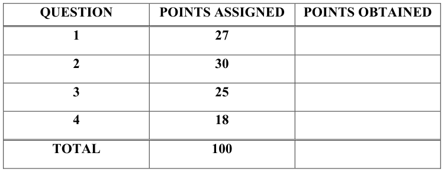
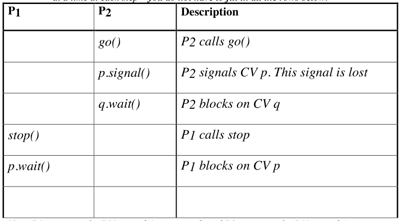
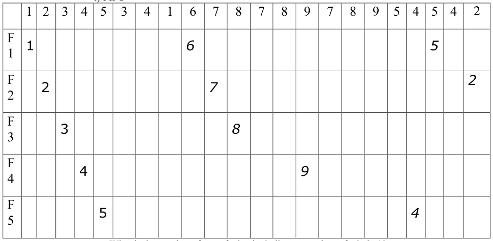
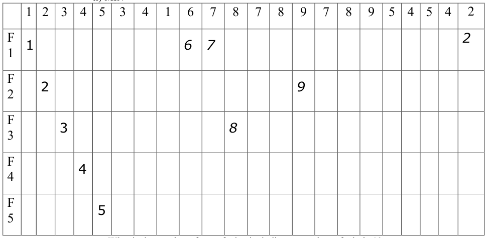
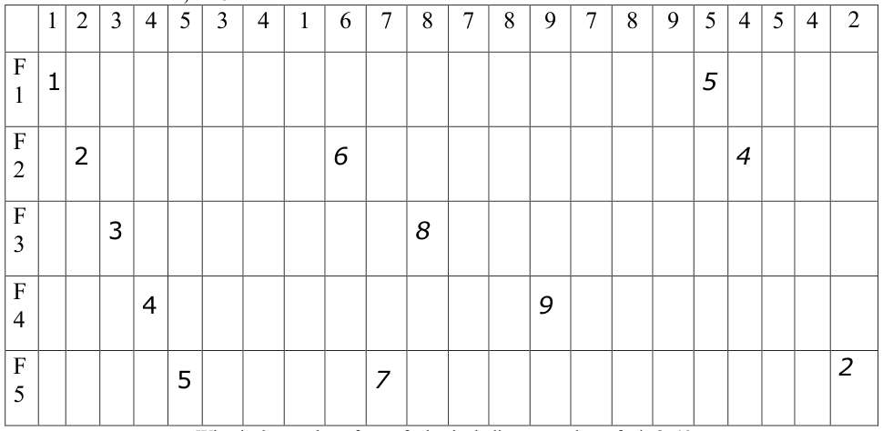
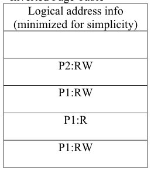
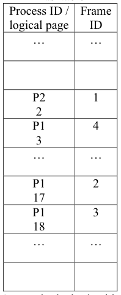
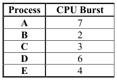
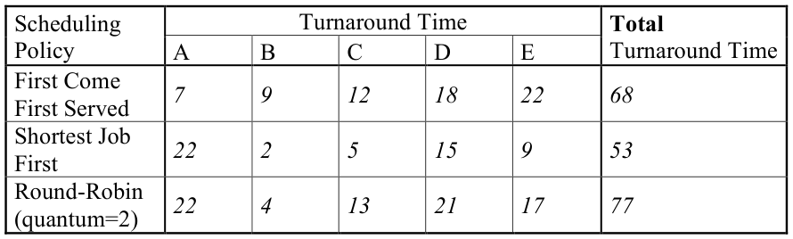

# Berkeley CS162 Fall 2016: Midterm 2: Official solutions

> Copied from the original: <https://hkn.eecs.berkeley.edu/exams/course/cs/162>. Text and figures are taken from the PDF as is; nothing was answered or rewritten. The original PDF is in this folder.

---

**Page 1**

&emsp;&emsp;&emsp;&emsp;&emsp;&emsp;&emsp;&emsp;University of California, Berkeley 
&emsp;&emsp;&emsp;&emsp;&emsp;&emsp;&emsp;&emsp;College of Engineering 
&emsp;&emsp;&emsp;&emsp;&emsp;&emsp;&emsp;&emsp;Computer Science Division – EECS 
Fall 2016                                 Anthony D. Joseph 
&emsp;&emsp;&emsp;&emsp;&emsp;&emsp;&emsp;&emsp;**Midterm Exam #2 Solutions** 
&emsp;&emsp;&emsp;&emsp;&emsp;&emsp;&emsp;&emsp;October 25, 2016 
&emsp;&emsp;&emsp;&emsp;&emsp;&emsp;&emsp;&emsp;CS162 Operating Systems

General Information: 
This is a **closed book and one 2-sided handwritten note** examination. You have 80 minutes to 
answer as many questions as possible.  The number in parentheses at the beginning of each 
question indicates the number of points for that question. You should read **all** of the questions 
before starting the exam, as some of the questions are substantially more time consuming. 
Write all of your answers directly on this paper.  **Make your answers as concise as possible.** If there 
is something in a question that you believe is open to interpretation, then please ask us about it! 
&emsp;&emsp;&emsp;&emsp;&emsp;&emsp;&emsp;&emsp;**Good Luck!!**

Page 1/17

---

**Page 2**

CS 162 Fall 2016 Midterm Exam #2        October 25, 2016 
**Solutions NAME: \_\_\_\_\_\_\_\_\_\_\_\_\_\_\_\_\_\_\_\_\_\_\_\_\_\_\_\_\_\_\_\_\_\_\_\_\_\_\_** 
1.(27 points total) True/False and Why? 
&emsp;a.(12 points) True/False and Why? **CIRCLE YOUR ANSWER.** 
&emsp;&emsp;i)It is possible for a FCFS scheduler to achieve a lower average turnaround time 
&emsp;&emsp;&emsp;(the time a process takes to complete after it arrives) than a Round Robin 
&emsp;&emsp;&emsp;scheduler, even if you assume there is no context switching overhead. 
&emsp;&emsp;&emsp;&emsp;&emsp;TRUE                    FALSE 
&emsp;&emsp;&emsp;&emsp;&emsp;**Why?** 
&emsp;&emsp;&emsp;&emsp;&emsp;**TRUE**. Three examples: cache is shared with Round Robin, not FCFS; the 
&emsp;&emsp;&emsp;&emsp;&emsp;jobs could arrive in order shortest to largest, reducing FCFS to SRTF; 
&emsp;&emsp;&emsp;&emsp;&emsp;jobs could all be the same length, with that length being longer than the 
&emsp;&emsp;&emsp;&emsp;&emsp;RR quanta. The correct answer was worth 1 point and the justification 
&emsp;&emsp;&emsp;&emsp;&emsp;was worth an additional 2 points.

&emsp;&emsp;ii)8MB 2-way set-associative cache with a Most Recently Used (MRU) 
&emsp;&emsp;&emsp;replacement policy will always have better or equal cache performance when 
&emsp;&emsp;&emsp;compared to a 4MB direct-mapped cache. 
&emsp;&emsp;&emsp;&emsp;&emsp;TRUE                    FALSE 
&emsp;&emsp;&emsp;&emsp;&emsp;**Why?** 
&emsp;&emsp;&emsp;&emsp;&emsp;**TRUE**. A larger cache and higher degree of associativity cache will have 
&emsp;&emsp;&emsp;&emsp;&emsp;a higher hit rate than a smaller direct cache (fewer capacity and conflict 
&emsp;&emsp;&emsp;&emsp;&emsp;misses). The correct answer was worth 1 points and the justification was 
&emsp;&emsp;&emsp;&emsp;&emsp;worth an additional 2 points.

Page 2/17

---

**Page 3**

CS 162 Fall 2016 Midterm Exam #2        October 25, 2016 
**Solutions NAME: \_\_\_\_\_\_\_\_\_\_\_\_\_\_\_\_\_\_\_\_\_\_\_\_\_\_\_\_\_\_\_\_\_\_\_\_\_\_\_**

&emsp;&emsp;iii)Suppose we have a multithreaded process that accesses (reads and writes) to 
&emsp;&emsp;&emsp;an external database, and it avoids race conditions by having each thread 
&emsp;&emsp;&emsp;acquire a lock global variable before accessing the database. Using this 
&emsp;&emsp;&emsp;approach, we can run two instances of this process accessing the same 
&emsp;&emsp;&emsp;database at the same time. 
&emsp;&emsp;&emsp;&emsp;&emsp;TRUE                    FALSE 
&emsp;&emsp;&emsp;&emsp;&emsp;**Why?** 
&emsp;&emsp;&emsp;&emsp;&emsp;**FALSE**. A lock in one process instance will not affect the other process. 
&emsp;&emsp;&emsp;&emsp;&emsp;The correct answer was worth 1 points and the justification was worth an 
&emsp;&emsp;&emsp;&emsp;&emsp;additional 2 points.

&emsp;&emsp;iv)If the Banker’s algorithm will not approve a resource request, and the resource 
&emsp;&emsp;&emsp;request is processed, then system necessarily will enter deadlock. 
&emsp;&emsp;&emsp;&emsp;&emsp;TRUE                    FALSE 
&emsp;&emsp;&emsp;&emsp;&emsp;**Why?** 
&emsp;&emsp;&emsp;&emsp;&emsp;**FALSE**. Banker’s algorithm only guarantees that a system is in a safe 
&emsp;&emsp;&emsp;&emsp;&emsp;state. If a system is in an unsafe state, deadlock may or may not occur. The 
&emsp;&emsp;&emsp;&emsp;&emsp;correct answer was worth 1 points and the justification was worth an 
&emsp;&emsp;&emsp;&emsp;&emsp;additional 2 points.

Page 3/17

---

**Page 4**

CS 162 Fall 2016 Midterm Exam #2        October 25, 2016 
**Solutions NAME: \_\_\_\_\_\_\_\_\_\_\_\_\_\_\_\_\_\_\_\_\_\_\_\_\_\_\_\_\_\_\_\_\_\_\_\_\_\_\_**

&emsp;b.(15 points) Short answer. 
&emsp;&emsp;i)(4 points) Briefly, in two to three sentences, explain how having a combination 
&emsp;&emsp;&emsp;of I/O-bound processes and CPU-bound processes maximizes system 
&emsp;&emsp;&emsp;utilization. 
&emsp;&emsp;&emsp;We want to keep all parts of the system busy, so if you can have some 
&emsp;&emsp;&emsp;processes using the CPU while others wait on I/O, then the system will be 
&emsp;&emsp;&emsp;more utilized. In general, systems are underutilized (there are a lot of wasted 
&emsp;&emsp;&emsp;cycles both on I/O devices as well as CPU).

&emsp;&emsp;ii)(4 points) Briefly, in two to three sentences, explain how given a set of jobs 
&emsp;&emsp;&emsp;and their arrival and execution times, you could quickly (O(n) time) determine 
&emsp;&emsp;&emsp;if FCFS would produce a schedule that is optimal in terms of average 
&emsp;&emsp;&emsp;completion time. 
&emsp;&emsp;&emsp;If the arrival order and execution times would yield a FCFS schedule that is 
&emsp;&emsp;&emsp;identical to SRTCF, then the FCFS schedule would be optimal.

&emsp;&emsp;iii)(4 points) Briefly, in two to three sentences, explain when a hard real-time 
&emsp;&emsp;&emsp;scheduling system, such as Earliest Deadline First, will **not** be able to meet all 
&emsp;&emsp;&emsp;deadlines.

Page 4/17

---

**Page 5**

CS 162 Fall 2016 Midterm Exam #2        October 25, 2016 
**Solutions NAME: \_\_\_\_\_\_\_\_\_\_\_\_\_\_\_\_\_\_\_\_\_\_\_\_\_\_\_\_\_\_\_\_\_\_\_\_\_\_\_** 
&emsp;&emsp;&emsp;If more tasks are submitted than the system has resources, then EDF will be 
&emsp;&emsp;&emsp;unable to provide a schedule that meets deadlines.

&emsp;&emsp;iv)(3 points) Early Intel processors such as the 8086 did not support dual-mode 
&emsp;&emsp;&emsp;operation. Briefly, in two to three sentences, explain whether you can or 
&emsp;&emsp;&emsp;cannot implement virtual memory and address spaces on such systems. If so, 
&emsp;&emsp;&emsp;explain how. If not, explain why not. 
&emsp;&emsp;&emsp;No, special instructions are unprotected and any process could change 
&emsp;&emsp;&emsp;address translation information. We also accepted a yes answer if you clearly 
&emsp;&emsp;&emsp;explained how a virtual machine could be used to emulate the behavior of 
&emsp;&emsp;&emsp;dual mode operation.

Page 5/17

---

**Page 6**

CS 162 Fall 2016 Midterm Exam #2        October 25, 2016 
**Solutions NAME: \_\_\_\_\_\_\_\_\_\_\_\_\_\_\_\_\_\_\_\_\_\_\_\_\_\_\_\_\_\_\_\_\_\_\_\_\_\_\_** 
2.(30 points total) Deadlock. 
&emsp;a.(8 points) What are the four requirements for deadlock? Provide a brief one 
&emsp;&emsp;sentence explanation of each requirement. 
&emsp;**#1** 
&emsp;&emsp;Mutual exclusion: at least one resource must be held in a non-sharable mode.

&emsp;**#2** 
&emsp;&emsp;Hold and wait: a process must be holding at least one resource and waiting to 
&emsp;&emsp;acquire additional resources that are currently being held by other processes.

&emsp;**#3** 
&emsp;&emsp;No preemption: a resource can be released only voluntarily by the process 
&emsp;&emsp;holding it.

&emsp;**#4** 
&emsp;&emsp;Circular wait: A set {P0, P1, ..., Pn} of waiting process must exist such that P0 
&emsp;&emsp;is waiting for a resource held by P1, P1 is waiting for a resource held by P2, ... 
&emsp;&emsp;Pn-1 is waiting for a resource held by Pn, and Pn is waiting for a resource held 
&emsp;&emsp;by P0.

Page 6/17

---

**Page 7**

CS 162 Fall 2016 Midterm Exam #2        October 25, 2016 
**Solutions NAME: \_\_\_\_\_\_\_\_\_\_\_\_\_\_\_\_\_\_\_\_\_\_\_\_\_\_\_\_\_\_\_\_\_\_\_\_\_\_\_** 
&emsp;b. (6 points) Consider the following resource allocation policy: 
&emsp;&emsp;Requests for and releases of resources are allowed at any time. If a request for 
&emsp;&emsp;resources cannot be satisfied because the resources are not available, then we 
&emsp;&emsp;check any processes that are blocked, waiting for resources. If they have the 
&emsp;&emsp;desired resources, then these resources are taken away from them and are given to 
&emsp;&emsp;the requesting process. The vector of resources for which the waiting process is 
&emsp;&emsp;waiting is increased to include the resources that were taken away. If the 
&emsp;&emsp;resources needed by a blocked process become available, the process is put back 
&emsp;&emsp;on the ready queue. 
&emsp;&emsp;For example, consider a system with three resource types and the vector Available 
&emsp;&emsp;initialized to (4,2,2). 
&emsp;&emsp;&emsp;• If process P0 asks for (2,2,1), it gets them. 
&emsp;&emsp;&emsp;• If P1 asks for (1,0,1), it gets them. 
&emsp;&emsp;&emsp;• Then, if P0 asks for (0,0,1), it is blocked (resource not available). 
&emsp;&emsp;&emsp;• If P2 now asks for (2,0,0), it gets the available one (1,0,0) and one that 
&emsp;&emsp;&emsp;&emsp;&emsp;was allocated to P0 (since P0 is blocked). P0’s Allocation vector goes 
&emsp;&emsp;&emsp;&emsp;&emsp;down to (1,2,1), and its Need vector goes up to (1,0,1). 
&emsp;&emsp;ii)With this resource allocation policy, can deadlock occur? If so, give an 
&emsp;&emsp;&emsp;example. If not, which necessary condition cannot occur? 
&emsp;&emsp;&emsp;Deadlock cannot occur because preemption exists, which removes one of the 
&emsp;&emsp;&emsp;preconditions for deadlock.

&emsp;&emsp;iii)Can starvation occur? 
&emsp;&emsp;&emsp;Yes. A process may never acquire all the resources it needs if they are 
&emsp;&emsp;&emsp;continuously preempted by a series of requests.

Page 7/17

---

**Page 8**

CS 162 Fall 2016 Midterm Exam #2        October 25, 2016 
**Solutions NAME: \_\_\_\_\_\_\_\_\_\_\_\_\_\_\_\_\_\_\_\_\_\_\_\_\_\_\_\_\_\_\_\_\_\_\_\_\_\_\_** 
&emsp;c. (7 points total) Consider a monitor implemented as follows: 
&emsp;&emsp;condition  p,  q;        //  p  and  q  are  initialized  for  you 
&emsp;&emsp;lock  mutex  =  FREE;

&emsp;&emsp;void  stop(void)  {     void  go(void);  { 
&emsp;&emsp;&emsp;&emsp;&emsp;......       ...... 
&emsp;&emsp;&emsp;&emsp;&emsp;p.wait(&mutex);       p.signal(); 
&emsp;&emsp;&emsp;&emsp;&emsp;......       q.wait(&mutex); 
&emsp;&emsp;&emsp;&emsp;&emsp;q.signal();     } 
&emsp;&emsp;} 
&emsp;&emsp;Suppose two processes P1 and P2 use the monitor in the following way: 
&emsp;&emsp;**P1:**  while  (TRUE)  {     **P2:**  while  (TRUE)  { 
&emsp;&emsp;&emsp;&emsp;&emsp;......       ...... 
&emsp;&emsp;&emsp;&emsp;&emsp;stop();     go(); 
&emsp;&emsp;&emsp;&emsp;&emsp;......     ...... 
&emsp;&emsp;}                         } 
&emsp;&emsp;i)(5 points) Show that deadlock can occur by listing an execution sequence 
&emsp;&emsp;&emsp;ending in deadlock with explanation for each step. Only one process can run 
&emsp;&emsp;&emsp;at a time at each step – **you do not have to fill in all the rows below**.

Now, P1 is waiting for P2’s signal (i.e., p.signal) and P2 is waiting for P1’s signal (i.e., 
q.signal). Thus, we have a circular waiting, and, hence a deadlock.. 
&emsp;&emsp;ii)(2 points) Can starvation occur? 
&emsp;&emsp;&emsp;Yes. Deadlock implies starvation.

Page 8/17

---

**Page 9**

CS 162 Fall 2016 Midterm Exam #2        October 25, 2016 
**Solutions NAME: \_\_\_\_\_\_\_\_\_\_\_\_\_\_\_\_\_\_\_\_\_\_\_\_\_\_\_\_\_\_\_\_\_\_\_\_\_\_\_** 
&emsp;d. (9 points) There are 5 lawyers sitting at a round dinner table. Lawyers repeat 
&emsp;&emsp;(forever) the following three things in order: (1) think, (2) eat, and (3) sleep. Each 
&emsp;&emsp;lawyer has a bowl of rice in front of them and a chopstick between each plate. 
&emsp;&emsp;**A lawyer must have two chopsticks to be able to eat!** A lawyer can only 
&emsp;&emsp;acquire the chopstick to the left of their plate and the chopstick to the right of their 
&emsp;&emsp;plate; they cannot reach across the table to use other chopsticks. When they are 
&emsp;&emsp;done eating, they put down (release) the two chopsticks for someone else to use. 
&emsp;&emsp;Below is code that attempts to solve this problem. Each lawyer will call this 
&emsp;&emsp;method with the parameter (0 to 4) indicating the lawyer’s seat number. 
&emsp;&emsp;**Unfortunately, this code can deadlock.** 
&emsp;&emsp;Your task is to fix this code so it cannot get stuck and so that more than one 
&emsp;&emsp;lawyer can eat at the same time – **your solution cannot use any other** 
&emsp;&emsp;**synchronization primitives.** 
&emsp;&emsp;The constructor is called once in the main function, and then 5 lawyer threads are 
&emsp;&emsp;created, each one executing the Go() method. Think(),  Eat(), 
&emsp;&emsp;and Sleep()  are already written and you don’t know how long they take to run.

&emsp;&emsp;Lawyers()  { 
&emsp;&emsp;for  (int  i=0;  i\<=4;  i++)  chopstick\[i\]  =  new  Semaphore(1); 
&emsp;&emsp;} 
&emsp;&emsp;void  Go(int  p)  { 
&emsp;&emsp;while  (1)  { 
&emsp;&emsp;Think(); 
&emsp;&emsp;//  By  having  every  other  philosopher 
&emsp;&emsp;//  get  the  chopsticks  in  the  opposite 
&emsp;&emsp;//  order,  we  break  the  cyclic  dependency 
&emsp;&emsp;if  (p%2  ==  0)  { 
&emsp;&emsp;//  Grab  left,  then  grab  right

&emsp;&emsp;chopstick\[p\].P(); 
&emsp;&emsp;chopstick\[(p  +  1)  %  5\].P();

&emsp;&emsp;}  else  { 
&emsp;&emsp;//-­‐-­‐-­‐Grab  right,  then  grab  left

Page 9/17

---

**Page 10**

CS 162 Fall 2016 Midterm Exam #2        October 25, 2016 
**Solutions NAME: \_\_\_\_\_\_\_\_\_\_\_\_\_\_\_\_\_\_\_\_\_\_\_\_\_\_\_\_\_\_\_\_\_\_\_\_\_\_\_** 
&emsp;&emsp;chopstick\[(p  +  1)  %  5\].P(); 
&emsp;&emsp;chopstick\[p\].P(); 
&emsp;&emsp;} 
&emsp;&emsp;Eat(); 
&emsp;&emsp;chopstick\[p\].V(); 
&emsp;&emsp;chopstick\[(p  +  1)  %  5\].V(); 
&emsp;&emsp;Sleep(); 
&emsp;&emsp;} 
&emsp;&emsp;} 
&emsp;&emsp;} 
&emsp;&emsp;Note that we accepted any solution in which at least one lawyer acquired the 
&emsp;&emsp;chopsticks in reverse order also was correct.

Page 10/17

---

**Page 11**

&emsp;&emsp;&emsp;&emsp;CS 162 Fall 2016 Midterm Exam #2        October 25, 2016 
&emsp;&emsp;&emsp;&emsp;**Solutions NAME: \_\_\_\_\_\_\_\_\_\_\_\_\_\_\_\_\_\_\_\_\_\_\_\_\_\_\_\_\_\_\_\_\_\_\_\_\_\_\_** 
&emsp;&emsp;&emsp;&emsp;3.(25 points total) Memory Management. 
&emsp;&emsp;&emsp;&emsp;&emsp;&emsp;a.(12 pts) Consider the following string of memory references in terms of requested 
&emsp;&emsp;&emsp;&emsp;&emsp;&emsp;&emsp;page number: 1, 2, 3, 4, 5, 3, 4, 1, 6, 7, 8, 7, 8, 9, 7, 8, 9, 5, 4, 5, 4, 2.

&emsp;&emsp;&emsp;&emsp;&emsp;&emsp;&emsp;Fill in the table below with using the FIFO, MIN and LRU (Least Recently Used) 
&emsp;&emsp;&emsp;&emsp;&emsp;&emsp;&emsp;page replacement algorithms for memory with five frames by filling in the table 
&emsp;&emsp;&emsp;&emsp;&emsp;&emsp;&emsp;with page numbers. The top row is the string of memory references, and each row 
&emsp;&emsp;&emsp;&emsp;&emsp;&emsp;&emsp;contains the page numbers that reside in each physical frame F1 – F5 after each 
&emsp;&emsp;&emsp;&emsp;&emsp;&emsp;&emsp;memory reference. For readability purposes, please only fill in the table entries 
&emsp;&emsp;&emsp;&emsp;&emsp;&emsp;&emsp;that have changed and leave the unchanged entries blank. If several pages meet 
&emsp;&emsp;&emsp;&emsp;&emsp;&emsp;&emsp;the replacement criteria, replace the one with the smallest frame number. 
&emsp;&emsp;&emsp;&emsp;&emsp;&emsp;&emsp;i)FIFO

&emsp;&emsp;&emsp;&emsp;&emsp;&emsp;&emsp;&emsp;What is the number of page faults, including compulsory faults?  12

&emsp;&emsp;&emsp;&emsp;Page 11/17

---

**Page 12**

&emsp;&emsp;&emsp;&emsp;CS 162 Fall 2016 Midterm Exam #2        October 25, 2016 
&emsp;&emsp;&emsp;&emsp;**Solutions NAME: \_\_\_\_\_\_\_\_\_\_\_\_\_\_\_\_\_\_\_\_\_\_\_\_\_\_\_\_\_\_\_\_\_\_\_\_\_\_\_** 
&emsp;&emsp;&emsp;&emsp;&emsp;&emsp;&emsp;ii)MIN

&emsp;&emsp;&emsp;&emsp;&emsp;&emsp;&emsp;&emsp;What is the number of page faults, including compulsory faults?  10 
&emsp;&emsp;&emsp;&emsp;&emsp;&emsp;&emsp;iii)LRU

&emsp;&emsp;&emsp;&emsp;&emsp;&emsp;&emsp;&emsp;What is the number of page faults, including compulsory faults?  12

&emsp;&emsp;&emsp;&emsp;Page 12/17

---

**Page 13**

CS 162 Fall 2016 Midterm Exam #2        October 25, 2016 
**Solutions NAME: \_\_\_\_\_\_\_\_\_\_\_\_\_\_\_\_\_\_\_\_\_\_\_\_\_\_\_\_\_\_\_\_\_\_\_\_\_\_\_** 
&emsp;b.(4 points) Some operating systems provide a virtual copy operation: 
&emsp;&emsp;VirtualCopy(proc,  addr1,  addr2,  len), 
&emsp;&emsp;where data of length len starting at location addr1 in the caller’s address space 
&emsp;&emsp;is “copied” to process proc’s address space starting at location addr2. Assume 
&emsp;&emsp;that addr1, addr2, and len are multiples of the page size. Assuming a page- 
&emsp;&emsp;table-based virtual memory system, explain how we can efficiently implement 
&emsp;&emsp;VirtualCopy so as to minimize the amount of copying required. Note that after 
&emsp;&emsp;Virtual  Copy completes, the two processes will **not** share writes to the data. 
&emsp;&emsp;We could use copy-on-write:, the page-table entries for the pages of the source (in 
&emsp;&emsp;the calling process starting at location addr1 for len bytes) is copied into page 
&emsp;&emsp;table entries for process proc’s address space starting at location addr2. The 
&emsp;&emsp;pages are marked “copy on write” (if not done so already) and their reference 
&emsp;&emsp;counts are incremented by one (they would of course start at one when the pages 
&emsp;&emsp;are first allocated). The page-table entries in both processes are marked read- 
&emsp;&emsp;only. Now, while both processes merely read the pages, they continue to share 
&emsp;&emsp;them. But if either process attempts to modify the page, the attempt is trapped by 
&emsp;&emsp;the OS, a new page is allocated and the old is copied into it, the page table entry 
&emsp;&emsp;for the modifying process is set to point to the new page and is set to read-write 
&emsp;&emsp;with a reference count of 1, and the reference count of the original page is 
&emsp;&emsp;decremented by 1. If this reference count is now zero, its (single) page-table entry 
&emsp;&emsp;is changed to read-write.

Page 13/17

---

**Page 14**

CS 162 Fall 2016 Midterm Exam #2        October 25, 2016 
**Solutions NAME: \_\_\_\_\_\_\_\_\_\_\_\_\_\_\_\_\_\_\_\_\_\_\_\_\_\_\_\_\_\_\_\_\_\_\_\_\_\_\_** 
&emsp;c.(9 points total) Inverted Page Tables. Assume we have a simple, demand paging 
&emsp;&emsp;environment, with no segmentation. Processes P 1 and P 2 both have logical 
&emsp;&emsp;memory addresses in the range 0 . . . 99, inclusive. The page size is 5. The hash 
&emsp;&emsp;table portion of the structure uses a hash function which simply calculates the 
&emsp;&emsp;index by adding the numerical portion of the process identifier and the logical 
&emsp;&emsp;page number. Note that this is a really bad hash function because it requires a 
&emsp;&emsp;large hash table, but for our exercise, it is sufficient. The hash table and the 
&emsp;&emsp;inverted page table shown are below. 
&emsp;&emsp;&emsp;&emsp;&emsp;&emsp;&emsp;&emsp;Inverted Page Table 
Hashtable

&emsp;&emsp;&emsp;&emsp;&emsp;&emsp;&emsp;&emsp;Index 
&emsp;&emsp;&emsp;&emsp;&emsp;&emsp;&emsp;&emsp;0 
… 
&emsp;&emsp;&emsp;&emsp;&emsp;&emsp;&emsp;&emsp;1 
3 
&emsp;&emsp;&emsp;&emsp;&emsp;&emsp;&emsp;&emsp;2 
4

&emsp;&emsp;&emsp;&emsp;&emsp;&emsp;&emsp;&emsp;3 
5 
&emsp;&emsp;&emsp;&emsp;&emsp;&emsp;&emsp;&emsp;4 
… 
18 
19 
… 
30 
&emsp;&emsp;Arrows in the hash table indicate chaining of entries when a hash conflict has 
&emsp;&emsp;occurred. Empty entries in the IPT indicate the associated physical frames are not 
&emsp;&emsp;allocated.

Page 14/17

---

**Page 15**

CS 162 Fall 2016 Midterm Exam #2        October 25, 2016 
**Solutions NAME: \_\_\_\_\_\_\_\_\_\_\_\_\_\_\_\_\_\_\_\_\_\_\_\_\_\_\_\_\_\_\_\_\_\_\_\_\_\_\_** 
&emsp;&emsp;i)(6 points) Calculate the physical addresses for the following logical addresses 
&emsp;&emsp;&emsp;where the number after the colon is the logical address (**not the logical page**). 
&emsp;&emsp;&emsp;Assume the first page of a process is page number 0, and that a mechanism 
&emsp;&emsp;&emsp;exists to find a free frame in memory.. 
&emsp;&emsp;&emsp;Show your work for these calculations for partial credit – what calculations 
&emsp;&emsp;&emsp;and table lookups were necessary to determine the actual address in memory 
&emsp;&emsp;&emsp;from the logical address. 
&emsp;&emsp;&emsp;(1)P1:17 
&emsp;&emsp;&emsp;&emsp;&emsp;Logical page 17/5 = 3 offset = 2. hash table index = 3 + 1, follow chain to 
&emsp;&emsp;&emsp;&emsp;&emsp;entry 5. From lookup, logical frame = 4. Address = (frame)∗(frame size) 
&emsp;&emsp;&emsp;&emsp;&emsp;\+ offset = 4 ∗ 5 + 2 = 22

&emsp;&emsp;&emsp;(2)P1:92 
&emsp;&emsp;&emsp;&emsp;&emsp;Logical page = 18. offset = 2. Hash table index = 19. From lookup logical 
&emsp;&emsp;&emsp;&emsp;&emsp;frame = 3. Address = 17

&emsp;&emsp;&emsp;(3)P1:111 
&emsp;&emsp;&emsp;&emsp;&emsp;Exception, memory reference out of range.

&emsp;&emsp;ii)(3 points) When process P2 attempts to read logical address 97, what happens? 
&emsp;&emsp;&emsp;Specifically, describe the changes in the data structures, and what the process 
&emsp;&emsp;&emsp;perceives of these changes. 
&emsp;&emsp;&emsp;This causes a page fault. Frame 0 is allocated, and the entry in the IPT is 
&emsp;&emsp;&emsp;updated with the logical address information for P2 frame 19. Next the

Page 15/17

---

**Page 16**

CS 162 Fall 2016 Midterm Exam #2        October 25, 2016 
**Solutions NAME: \_\_\_\_\_\_\_\_\_\_\_\_\_\_\_\_\_\_\_\_\_\_\_\_\_\_\_\_\_\_\_\_\_\_\_\_\_\_\_** 
&emsp;&emsp;&emsp;hashtable entry at index 21 (19 + 2) is mapped from P2:19 to frame 0. After 
&emsp;&emsp;&emsp;this processing is complete, the P2 resumes execution as before.

Page 16/17

---

**Page 17**

&emsp;&emsp;CS 162 Fall 2016 Midterm Exam #2        October 25, 2016 
&emsp;&emsp;**Solutions NAME: \_\_\_\_\_\_\_\_\_\_\_\_\_\_\_\_\_\_\_\_\_\_\_\_\_\_\_\_\_\_\_\_\_\_\_\_\_\_\_** 
&emsp;&emsp;4.(18 points total) Scheduling. Five processes A, B, C, D and E arrive in this order at the 
&emsp;&emsp;&emsp;&emsp;same time with the following CPU bursts.

&emsp;&emsp;&emsp;&emsp;&emsp;Fill in the entries of the following table with turnaround times and total 
&emsp;&emsp;&emsp;&emsp;&emsp;turnaround time for each indicated scheduling policy and each process. Ignore 
&emsp;&emsp;&emsp;&emsp;&emsp;context switching overhead. Turnaround time is defined as the time a process 
&emsp;&emsp;&emsp;&emsp;&emsp;takes to complete after it arrives.

&emsp;&emsp;Scratch space:

&emsp;&emsp;Page 17/17

