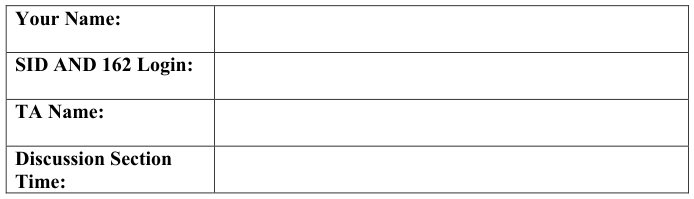

# Berkeley CS162 Fall 2016: Midterm 3: Official solutions

> Copied from the original: <https://hkn.eecs.berkeley.edu/exams/course/cs/162>. Text and figures are taken from the PDF as is; nothing was answered or rewritten. The original PDF is in this folder.

---

**Page 1**

&emsp;&emsp;&emsp;&emsp;&emsp;&emsp;&emsp;&emsp;University of California, Berkeley 
&emsp;&emsp;&emsp;&emsp;&emsp;&emsp;&emsp;&emsp;College of Engineering 
&emsp;&emsp;&emsp;&emsp;&emsp;&emsp;&emsp;&emsp;Computer Science Division – EECS 
Fall 2016                                 Anthony D. Joseph 
&emsp;&emsp;&emsp;&emsp;&emsp;&emsp;&emsp;&emsp;**Midterm Exam #3 Solutions** 
&emsp;&emsp;&emsp;&emsp;&emsp;&emsp;&emsp;&emsp;November 30, 2016 
&emsp;&emsp;&emsp;&emsp;&emsp;&emsp;&emsp;&emsp;CS162 Operating Systems

General Information: 
This is a **closed book and three 2-sided handwritten notes** examination. You have 80 minutes 
to answer as many questions as possible.  The number in parentheses at the beginning of each 
question indicates the number of points for that question. You should read **all** of the questions 
before starting the exam, as some of the questions are substantially more time consuming. 
Write all of your answers directly on this paper.  **Make your answers as concise as possible.** If there 
is something in a question that you believe is open to interpretation, then please ask us about it! 
&emsp;&emsp;&emsp;&emsp;&emsp;&emsp;&emsp;&emsp;**Good Luck!!**

Page 1/12

---

**Page 2**

CS 162 Fall 2016 Midterm Exam #3        November 30, 2016 
**Solutions NAME: \_\_\_\_\_\_\_\_\_\_\_\_\_\_\_\_\_\_\_\_\_\_\_\_\_\_\_\_\_\_\_\_\_\_\_\_\_\_\_** 
1.(34 points total) Short answer. 
&emsp;a.(12 points) True/False and Why? **CIRCLE YOUR ANSWER.** 
&emsp;&emsp;i)The Pintos and BSD 4.2 Fast File Systems use a linked-list on-disk data 
&emsp;&emsp;&emsp;structure to track the allocation of inodes and data blocks. 
&emsp;&emsp;&emsp;&emsp;&emsp;TRUE                    FALSE 
&emsp;&emsp;&emsp;&emsp;&emsp;**Why?** 
&emsp;&emsp;&emsp;&emsp;&emsp;**FALSE**. FFS uses bitmaps (introduced in BSD 4.1) to track the allocation 
&emsp;&emsp;&emsp;&emsp;&emsp;of inodes and data blocks. The correct answer was worth 1 point and the 
&emsp;&emsp;&emsp;&emsp;&emsp;justification was worth an additional 2 points.

&emsp;&emsp;ii)Two processes communicating via a mailbox could be considered an example 
&emsp;&emsp;&emsp;of a producer-consumer model of process cooperation. 
&emsp;&emsp;&emsp;&emsp;&emsp;TRUE                    FALSE 
&emsp;&emsp;&emsp;&emsp;&emsp;**Why?** 
&emsp;&emsp;&emsp;&emsp;&emsp;**TRUE**. The mailbox provides a queue, which is equivalent to the buffer in 
&emsp;&emsp;&emsp;&emsp;&emsp;producer-consumer. The correct answer was worth 1 points and the 
&emsp;&emsp;&emsp;&emsp;&emsp;justification was worth an additional 2 points.

&emsp;&emsp;iii)A remote procedure call requires network access. 
&emsp;&emsp;&emsp;&emsp;&emsp;TRUE                    FALSE 
&emsp;&emsp;&emsp;&emsp;&emsp;**Why?** 
&emsp;&emsp;&emsp;&emsp;&emsp;**FALSE**. A remote procedure call can occur between two processes on the 
&emsp;&emsp;&emsp;&emsp;&emsp;**same** system. The correct answer was worth 1 points and the justification 
&emsp;&emsp;&emsp;&emsp;&emsp;was worth an additional 2 points.

Page 2/12

---

**Page 3**

CS 162 Fall 2016 Midterm Exam #3        November 30, 2016 
**Solutions NAME: \_\_\_\_\_\_\_\_\_\_\_\_\_\_\_\_\_\_\_\_\_\_\_\_\_\_\_\_\_\_\_\_\_\_\_\_\_\_\_**

&emsp;&emsp;iv)If machines were guaranteed not to crash, we would not need two-phase 
&emsp;&emsp;&emsp;commit: the coordinator could, in one phase, decide whether a distributed 
&emsp;&emsp;&emsp;transaction would commit, and then instruct the workers to apply their piece 
&emsp;&emsp;&emsp;of the transaction. 
&emsp;&emsp;&emsp;&emsp;&emsp;TRUE                    FALSE 
&emsp;&emsp;&emsp;&emsp;&emsp;**Why?** 
&emsp;&emsp;&emsp;&emsp;&emsp;**FALSE**. The point to the first phase of 2PC is to see whether all of the 
&emsp;&emsp;&emsp;&emsp;&emsp;machines agree to the proposed transaction. The correct answer was 
&emsp;&emsp;&emsp;&emsp;&emsp;worth 1 points and the justification was worth an additional 2 points.

&emsp;b.(4 points) Briefly, in two to three sentences, explain what a DMA controller does 
&emsp;&emsp;and what benefit it provides. 
&emsp;&emsp;A **Direct Memory Access** controller is used to move data between memory and an 
&emsp;&emsp;I/O device. By using a DMA controller, the CPU can offload the reading and 
&emsp;&emsp;writing of data to/from I/O devices..

&emsp;c.(9 points) Abstraction layers. 
&emsp;&emsp;i)(2 points) Let us explore how abstraction layers help in the design of an 
&emsp;&emsp;&emsp;operating system. Give a concrete example of a use of abstraction layers in an 
&emsp;&emsp;&emsp;operating system. 
&emsp;&emsp;&emsp;Many examples, including device drivers, filesystems, networking stacks

&emsp;&emsp;ii)(4 points) Briefly, in one to two sentences, explain the advantages of using the 
&emsp;&emsp;&emsp;abstraction layers in your example. 
&emsp;&emsp;&emsp;&emsp;&emsp;• You can separate different parts of the system software, if each layer 
&emsp;&emsp;&emsp;&emsp;&emsp;&emsp;uses only the next lower layer. 
&emsp;&emsp;&emsp;&emsp;&emsp;• It may be easier to prove system correctness, perform debugging, etc.

Page 3/12

---

**Page 4**

CS 162 Fall 2016 Midterm Exam #3        November 30, 2016 
**Solutions NAME: \_\_\_\_\_\_\_\_\_\_\_\_\_\_\_\_\_\_\_\_\_\_\_\_\_\_\_\_\_\_\_\_\_\_\_\_\_\_\_** 
&emsp;&emsp;&emsp;&emsp;&emsp;• You can gain some degree of system independence, if only the lowest 
&emsp;&emsp;&emsp;&emsp;&emsp;&emsp;layers access hardware directly. 
&emsp;&emsp;&emsp;&emsp;&emsp;• In general, better management of large programs, but note that 
&emsp;&emsp;&emsp;&emsp;&emsp;&emsp;layering is not the same as modularization or component-based 
&emsp;&emsp;&emsp;&emsp;&emsp;&emsp;designs. 
&emsp;&emsp;&emsp;&emsp;&emsp;• More generality of the functions. 
&emsp;&emsp;&emsp;&emsp;&emsp;• Easier to develop the design concepts.

&emsp;&emsp;iii)(3 points) Briefly, in one to two sentences, explain a disadvantage of using the 
&emsp;&emsp;&emsp;abstraction layers in your example. 
&emsp;&emsp;&emsp;Layering can reduce performance

&emsp;d.(9 points) Networking: Two computers, A and B, are connected by a network link 
&emsp;&emsp;that runs at 1 Gigabit per second (1 x 109 bits/second). The one-way propagation 
&emsp;&emsp;delay from A to B (and vice versa) is 20 milliseconds. Assume the following 
&emsp;&emsp;conditions: 
&emsp;&emsp;&emsp;• The link does not drop or duplicate packets 
&emsp;&emsp;&emsp;• Processing time at the two endpoints is zero 
&emsp;&emsp;&emsp;• A sends B 625-byte packets – the 625 bytes includes all headers, framing, 
&emsp;&emsp;&emsp;&emsp;&emsp;and inter-packet spacing 
&emsp;&emsp;i)(3 points) What is the maximum number of 625-byte packets per second that A 
&emsp;&emsp;&emsp;could in principle send into the wire? You can leave your answer in 
&emsp;&emsp;&emsp;unsimplified form. 
&emsp;&emsp;109 bits/second x 1 byte/8 bits \* 1 packet/625 bytes = 200,000 packets/second.

Page 4/12

---

**Page 5**

CS 162 Fall 2016 Midterm Exam #3        November 30, 2016 
**Solutions NAME: \_\_\_\_\_\_\_\_\_\_\_\_\_\_\_\_\_\_\_\_\_\_\_\_\_\_\_\_\_\_\_\_\_\_\_\_\_\_\_**

&emsp;&emsp;ii)(6 points) Now, consider the above link and the following protocol, and 
&emsp;&emsp;&emsp;assume that all packets are again 625 bytes. In the protocol, A sends 4,000 
&emsp;&emsp;&emsp;packets into the network as quickly as it can and then waits for a one-byte 
&emsp;&emsp;&emsp;ACK from B. Whenever A receives an ACK from B, A immediately sends 
&emsp;&emsp;&emsp;another 4000 packets into the network. Meanwhile, B ACKs packet 1, packet 
&emsp;&emsp;&emsp;4001, packet 8001, etc. That is, B ACKs every 4,000 packets starting with the 
&emsp;&emsp;&emsp;first one in a burst by A. 
&emsp;&emsp;&emsp;What is the long-term throughput of this protocol, expressed as both (1) bits 
&emsp;&emsp;&emsp;per second and (2) a percentage of the link’s bandwidth? You can leave your 
&emsp;&emsp;&emsp;answer in unsimplified form. Briefly explain your answers. 
&emsp;&emsp;&emsp;The bandwidth-delay product is 109 bits/second x 20 milliseconds = 2.5 
&emsp;&emsp;&emsp;Megabytes = 4000 packets of size 625 bytes. If A sent 4000 packets every 20 
&emsp;&emsp;&emsp;milliseconds, it would fully use the link. However, from the protocol 
&emsp;&emsp;&emsp;description, we know that the protocol sends 4000 packets every 40 
&emsp;&emsp;&emsp;milliseconds (because the round-trip time is 40 milliseconds, and that’s how 
&emsp;&emsp;&emsp;long it takes for A to get B’s ACK). Thus, the throughput is one-half the link’s 
&emsp;&emsp;&emsp;bandwidth, or 500 x 108 bits/second.

Page 5/12

---

**Page 6**

CS 162 Fall 2016 Midterm Exam #3        November 30, 2016 
**Solutions NAME: \_\_\_\_\_\_\_\_\_\_\_\_\_\_\_\_\_\_\_\_\_\_\_\_\_\_\_\_\_\_\_\_\_\_\_\_\_\_\_** 
2.(35 points total) Filesystems. 
&emsp;a.(4 points) One of the innovations of the BSD FFS is that it tries to allocate large 
&emsp;&emsp;files in long contiguous chunks. Assuming that a disk transfers at a peak rate of 
&emsp;&emsp;100 MByte/s, and that a combined seek and rotation take, on average, a total of 20 
&emsp;&emsp;milliseconds. What is the **minimum** size of each contiguous run of a large file, in 
&emsp;&emsp;order to achieve 75% of peak transfer rate for large files when they are accessed 
&emsp;&emsp;sequentially? 
&emsp;&emsp;The seek/rotation takes 20 milliseconds, so to achieve a 75% peak transfer rate, 
&emsp;&emsp;we need to spend 4/3 of the seek/rotation time transferring data, which is 60 ms: 
&emsp;&emsp;60 x 10-3 seconds x 100 x 106 bytes/seconds = 6,000 x 10-3 bytes = 6 Mbytes

&emsp;b.(15 points) Large files. We have seen different filesystems that support fairly large 
&emsp;&emsp;files. Now let’s see just how large a file various types of filesystems can support. 
&emsp;&emsp;Assume, for all of the questions in this part, that filesystem blocks are 4 KBytes. 
&emsp;&emsp;Show your solutions in unsimplified form for partial credit. 
&emsp;&emsp;i)(3 points) Consider a really simple filesystem, **directfs**, where each inode only 
&emsp;&emsp;&emsp;has 10 direct pointers, each of which can point to a single file block. Direct 
&emsp;&emsp;&emsp;pointers are 32 bits in size (4 bytes). What is the maximum file size for 
&emsp;&emsp;&emsp;**directfs**? 
&emsp;&emsp;&emsp;The maximum **directfs** file size is 10 x 4 KByte = 40 KByte

&emsp;&emsp;ii)(3 points) Consider a filesystem, called **extentfs**, with a construct called an 
&emsp;&emsp;&emsp;extent. Extents have a pointer (base address) and a length (in blocks). Assume 
&emsp;&emsp;&emsp;the length field is 8 bits (1 byte). Assuming that an inode has exactly one 
&emsp;&emsp;&emsp;extent. What is the maximum file size for **extentfs**? 
&emsp;&emsp;&emsp;The maximum **extentfs** file size is (28 – 1) x 4 KByte = 255 x 4 KByte = 1 
&emsp;&emsp;&emsp;MByte

Page 6/12

---

**Page 7**

CS 162 Fall 2016 Midterm Exam #3        November 30, 2016 
**Solutions NAME: \_\_\_\_\_\_\_\_\_\_\_\_\_\_\_\_\_\_\_\_\_\_\_\_\_\_\_\_\_\_\_\_\_\_\_\_\_\_\_**

&emsp;&emsp;iii)(3 points) Consider a filesystem that uses direct pointers, but also adds indirect 
&emsp;&emsp;&emsp;pointers and double-indirect pointers. We call this filesystem, **indirectfs**. 
&emsp;&emsp;&emsp;Specifically, an inode within **indirectfs** has 1 direct pointer, l indirect pointer, 
&emsp;&emsp;&emsp;and 1 doubly-indirect pointer field. Pointers, as before, are 4 bytes (32 bits) in 
&emsp;&emsp;&emsp;size. What is the maximum file size for **indirectfs**? 
&emsp;&emsp;&emsp;The maximum **indirectfs** file size is (1 + 1024 + (1024 x 1024)) x 4 KByte = 
&emsp;&emsp;&emsp;4 GB + 4100 KByte

&emsp;&emsp;iv)(3 points) Consider a compact file system, called **compactfs**, tries to save as 
&emsp;&emsp;&emsp;much space as possible within the inode. Thus, to point to files, it stores only a 
&emsp;&emsp;&emsp;single 32-bit pointer to the first block of the file. However, blocks within 
&emsp;&emsp;&emsp;**compactfs** store 4,092 bytes of user data and a 32-bit next field (much like a 
&emsp;&emsp;&emsp;linked list), and thus can point to a subsequent block (or to NULL, indicating 
&emsp;&emsp;&emsp;there is no more data). First, draw a picture of an inode and a file that is 10 
&emsp;&emsp;&emsp;KBytes in size. 
&emsp;&emsp;&emsp;&emsp;&emsp;&emsp;&emsp;inode 
&emsp;&emsp;&emsp;&emsp;&emsp;&emsp;&emsp;® data        ® data     ® data

&emsp;&emsp;v)(3 points) What is the maximum file size for **compactfs** (assuming no other 
&emsp;&emsp;&emsp;restrictions on file sizes)? 
&emsp;&emsp;&emsp;The maximum **compactfs** file size is 232 x 4 KByte – 232 x 4 byte = 16 TByte

Page 7/12

---

**Page 8**

CS 162 Fall 2016 Midterm Exam #3        November 30, 2016 
**Solutions NAME: \_\_\_\_\_\_\_\_\_\_\_\_\_\_\_\_\_\_\_\_\_\_\_\_\_\_\_\_\_\_\_\_\_\_\_\_\_\_\_** 
&emsp;c.(5 points) File system crash recovery. 
&emsp;&emsp;The Linux journaling file system writes the content of all modified disk blocks to 
&emsp;&emsp;the log. Your friend Bob considers such logging to be wasteful since copying the 
&emsp;&emsp;content of modified disk blocks to the log doubles the amount of disk writes for 
&emsp;&emsp;each logged file system operation. 
&emsp;&emsp;Bob decides to implement a more efficient journaling file system. In particular, he 
&emsp;&emsp;decides to only record an operation’s name and parameter in the log file instead of 
&emsp;&emsp;recording the content of all modified blocks. For example, for an operation that 
&emsp;&emsp;creates file “/d/f”, the file system would append the transaction record of the 
&emsp;&emsp;form \[create “/d/f”\] to the log. Bob’s file system ensures that the corresponding 
&emsp;&emsp;transaction record is written to the log before the modified disk blocks are flushed 
&emsp;&emsp;to disk. Upon crash and recovery, Bob’s file system re-executes the logged file 
&emsp;&emsp;system operations and truncates the log. 
&emsp;&emsp;Bob’s new logging mechanism is certainly more efficient since each transaction 
&emsp;&emsp;record is much smaller than that with Linux’s logging. Is his design also correct? 
&emsp;&emsp;Specifically, can it recover a file system correctly from crashes? Explain your 
&emsp;&emsp;reasoning and give concrete examples. 
&emsp;&emsp;Ben’s design is not correct. Performing a filesystem action requires multiple steps 
&emsp;&emsp;and a crash in the middle of the process will leave the filesystem in an 
&emsp;&emsp;inconsistent state. For example, an unlink operation has to update the inode 
&emsp;&emsp;freemap and block freemap.

&emsp;d. (3 points) Your friend suggests doubling the Pintos block size from 512 bytes to 
&emsp;&emsp;1,024 bytes, since that means you will be able to reach twice as much data from 
&emsp;&emsp;the direct pointers (as a result, medium sized files could fit entirely within the 
&emsp;&emsp;direct region). Why might it be a bad idea to increase the block size? 
&emsp;&emsp;Increasing the minimum disk transfer unit could lead to internal fragmentation.

Page 8/12

---

**Page 9**

CS 162 Fall 2016 Midterm Exam #3        November 30, 2016 
**Solutions NAME: \_\_\_\_\_\_\_\_\_\_\_\_\_\_\_\_\_\_\_\_\_\_\_\_\_\_\_\_\_\_\_\_\_\_\_\_\_\_\_** 
&emsp;e.(4 points) Suppose you wanted to implement hard links in Pintos. One thing you 
&emsp;&emsp;have to add is a count to ensure you only delete sectors that have no links 
&emsp;&emsp;remaining. Which struct would be the best choice to add this count? Explain your 
&emsp;&emsp;choice. 
&emsp;&emsp;The count needs to persist on disk, so you could modify struct  inode\_disk.

&emsp;f. (4 points) The NFS authors had a goal of transparency. They wanted applications 
&emsp;&emsp;to be unable to distinguish whether a file system was (a) a remote file system 
&emsp;&emsp;served from an NFS server; or (b) a typical, local Unix file system. They did not 
&emsp;&emsp;succeed (in fact, their goal was impossible). Briefly state one way in which 
&emsp;&emsp;application code can experience different behavior when interacting with a remote 
&emsp;&emsp;NFS file system versus a local Unix file system. Your answer should be in terms 
&emsp;&emsp;of what application code sees, rather than in terms of what a global observer sees. 
&emsp;&emsp;Latency can be lower (if the server has as large buffer cache for reads or NVRAM 
&emsp;&emsp;for writes) or worse (if the server is on the other side of the world); operations 
&emsp;&emsp;can hang; reads and writes can suddenly fail because another client on another 
&emsp;&emsp;machine deleted the file; close() can return an error (if the server runs out of 
&emsp;&emsp;space when the client flushes its write cache). 
&emsp;&emsp;Note that we did not accept examples where you only said that a file could change 
&emsp;&emsp;due to a remote write, as a local file can also change due to other processes 
&emsp;&emsp;writing the file. We accepted examples where you explicitly stated that there could 
&emsp;&emsp;be inconsistent views of an NFS file due to polling or caching.

Page 9/12

---

**Page 10**

CS 162 Fall 2016 Midterm Exam #3        November 30, 2016 
**Solutions NAME: \_\_\_\_\_\_\_\_\_\_\_\_\_\_\_\_\_\_\_\_\_\_\_\_\_\_\_\_\_\_\_\_\_\_\_\_\_\_\_** 
3\. (16 points total) Cybersecurity. 
&emsp;a.(8 pts) For each of the following terms, provide a one sentence definition: 
&emsp;&emsp;i)Authentication 
&emsp;&emsp;Proving the identity of an entity to another entity.

&emsp;&emsp;ii)Data integrity 
&emsp;&emsp;Ensuring that data is not changed from source to destination or after being 
&emsp;&emsp;written on a storage device.

&emsp;&emsp;iii)Symmetric encryption 
&emsp;&emsp;An encipher/decipher algorithm that relies on a single, shared secret key.

&emsp;&emsp;iv)Asymmetric encryption 
&emsp;&emsp;An encipher/decipher algorithm that relies on a private key and a public key.

&emsp;b.(2 points) Briefly, in one to two sentences, explain the role of a nonce. 
&emsp;&emsp;A nonce is used in cryptographic protocols to prevent replay attacks.

&emsp;c.(2 points) Briefly, in one to two sentences, explain the role of a HMAC. 
&emsp;&emsp;A Hash-based Message Authentication Code is a cryptographically secure hash 
&emsp;&emsp;function that is used to create secure message digests. It takes the input message 
&emsp;&emsp;and a key.

&emsp;d.(4 points) Consider two approaches to delegating your access privileges to a server: 
&emsp;&emsp;• Give your login name and password, so that the server can authenticate to a 
&emsp;&emsp;&emsp;third party as you, or

Page 10/12

---

**Page 11**

CS 162 Fall 2016 Midterm Exam #3        November 30, 2016 
**Solutions NAME: \_\_\_\_\_\_\_\_\_\_\_\_\_\_\_\_\_\_\_\_\_\_\_\_\_\_\_\_\_\_\_\_\_\_\_\_\_\_\_** 
&emsp;&emsp;• Give the server a capability (e.g., your Kerberos ticket) to act as you. 
&emsp;&emsp;From a security standpoint, which approach is superior? Briefly explain why. 
&emsp;&emsp;The second approach is superior because while both approaches allow the server 
&emsp;&emsp;to act as you, but the second approach allows you to limit the time period and 
&emsp;&emsp;rights of what can be done as you. With your password, the server can become 
&emsp;&emsp;you whenever it wants. With a capability, the server can do only what you 
&emsp;&emsp;specified and only for as long as the capability is valid.

Page 11/12

---

**Page 12**

CS 162 Fall 2016 Midterm Exam #3        November 30, 2016 
**Solutions NAME: \_\_\_\_\_\_\_\_\_\_\_\_\_\_\_\_\_\_\_\_\_\_\_\_\_\_\_\_\_\_\_\_\_\_\_\_\_\_\_** 
4.(15 points total) Queuing Theory. 
&emsp;Consider a single server/single queue (M/M/1) system: 
&emsp;&emsp;• 5 jobs per second arrive to the server 
&emsp;&emsp;• The server is capable of executing 8 jobs per second. 
&emsp;**Write your answers in unsimplified form.** 
&emsp;a.(3 pts) Calculate server utilization (u). 
&emsp;&emsp;&emsp;Since λ= 5 and µ = 8, u = λ/µ = 0.625 = 62.5%

&emsp;b.(3 pts) Calculate how long it takes the server to execute one job (Tser). 
&emsp;&emsp;&emsp;Tser = 1/8 = 0.125 seconds

&emsp;c. (3 pts) Calculate the amount of time spent in the queue (Tq). 
&emsp;&emsp;Tq = u/(µ- λ) = 0.208333 seconds

&emsp;d.(3 pts) Calculate the number of jobs in the queue (Lq). 
&emsp;&emsp;Lq = p2/(1-p) = 1.041667

&emsp;e.(3 pts) Calculate the amount of time a job spends in the system (Tsys). 
&emsp;&emsp;&emsp;Tsys = Tq + Tser = 0.3333 seconds

Page 12/12

