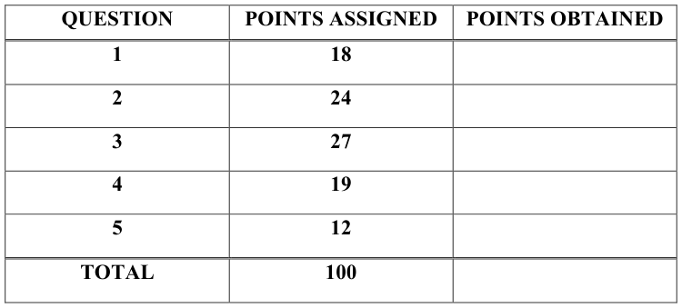
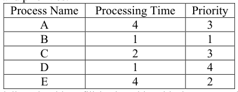
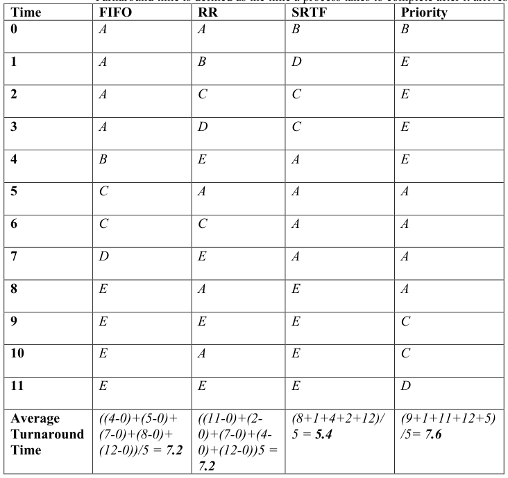
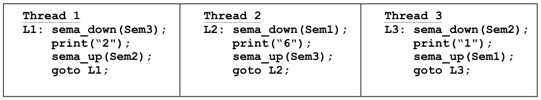
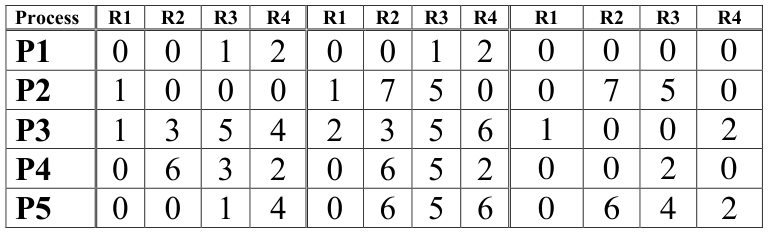
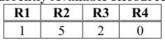

# Berkeley CS162 Spring 2016: Midterm 1: Official solutions

> Copied from the original: <https://hkn.eecs.berkeley.edu/exams/course/cs/162>. Text and figures are taken from the PDF as is; nothing was answered or rewritten. The original PDF is in this folder.

---

**Page 1**

&emsp;&emsp;&emsp;&emsp;&emsp;&emsp;&emsp;&emsp;University of California, Berkeley 
&emsp;&emsp;&emsp;&emsp;&emsp;&emsp;&emsp;&emsp;College of Engineering 
&emsp;&emsp;&emsp;&emsp;&emsp;&emsp;&emsp;&emsp;Computer Science Division – EECS 
Spring 2016                                 Anthony D. Joseph 
&emsp;&emsp;&emsp;&emsp;&emsp;&emsp;&emsp;&emsp;**Midterm Exam #1 Solutions** 
&emsp;&emsp;&emsp;&emsp;&emsp;&emsp;&emsp;&emsp;March 9, 2016 
&emsp;&emsp;&emsp;&emsp;&emsp;&emsp;&emsp;&emsp;CS162 Operating Systems

General Information: 
This is a **closed book and one 2-sided handwritten note** examination. You have 80 minutes to 
answer as many questions as possible.  The number in parentheses at the beginning of each 
question indicates the number of points for that question. You should read **all** of the questions 
before starting the exam, as some of the questions are substantially more time consuming. 
Write all of your answers directly on this paper.  **Make your answers as concise as possible.** If there 
is something in a question that you believe is open to interpretation, then please ask us about it! 
&emsp;&emsp;&emsp;&emsp;&emsp;&emsp;&emsp;&emsp;**Good Luck!!**

Page 1/14

---

**Page 2**

CS 162 Spring 2016 Midterm Exam #1        March 9, 2016 
**Solutions NAME: \_\_\_\_\_\_\_\_\_\_\_\_\_\_\_\_\_\_\_\_\_\_\_\_\_\_\_\_\_\_\_\_\_\_\_\_\_\_\_** 
1\. (18 points total) Short answer 
&emsp;a. (9 points) True/False and Why? **CIRCLE YOUR ANSWER.** 
&emsp;&emsp;i) If every thread acquires locks in the same order (for example, sema\_down(A); 
&emsp;&emsp;&emsp;sema\_down(X);	
  sema\_down(Y)), deadlock cannot occur. 
&emsp;&emsp;&emsp;&emsp;&emsp;TRUE                    FALSE 
&emsp;&emsp;&emsp;&emsp;&emsp;**Why?** 
&emsp;&emsp;&emsp;&emsp;&emsp;**TRUE**. If all the threads acquire locks in the same order there is no 
&emsp;&emsp;&emsp;&emsp;&emsp;circular waiting. The correct answer was worth 1 point and the 
&emsp;&emsp;&emsp;&emsp;&emsp;justification was worth an additional 2 points.

&emsp;&emsp;ii) It is safe to call sema\_up() or lock\_release() from an interrupt handler in 
&emsp;&emsp;&emsp;Pintos, because they cannot cause the current thread to sleep. 
&emsp;&emsp;&emsp;&emsp;&emsp;TRUE                    FALSE 
&emsp;&emsp;&emsp;&emsp;&emsp;**Why?** 
&emsp;&emsp;&emsp;&emsp;&emsp;**FALSE**. Lock release should only be called by the holder of the lock. The 
&emsp;&emsp;&emsp;&emsp;&emsp;correct answer was worth 1 points and the justification was worth an 
&emsp;&emsp;&emsp;&emsp;&emsp;additional 2 points.

Page 2/14

---

**Page 3**

CS 162 Spring 2016 Midterm Exam #1        March 9, 2016 
**Solutions NAME: \_\_\_\_\_\_\_\_\_\_\_\_\_\_\_\_\_\_\_\_\_\_\_\_\_\_\_\_\_\_\_\_\_\_\_\_\_\_\_** 
&emsp;&emsp;iii) The function getchar(), which reads a character from standard input, can 
&emsp;&emsp;&emsp;sometimes run without making any system calls. 
&emsp;&emsp;&emsp;&emsp;&emsp;TRUE                    FALSE 
&emsp;&emsp;&emsp;&emsp;&emsp;**Why?** 
&emsp;&emsp;&emsp;&emsp;&emsp;**TRUE**. While getchar() returns a single character at a time to its 
&emsp;&emsp;&emsp;&emsp;&emsp;caller, it may receive multiple characters from the kernel. The correct 
&emsp;&emsp;&emsp;&emsp;&emsp;answer was worth 1 points and the justification was worth an additional 2 
&emsp;&emsp;&emsp;&emsp;&emsp;points.

&emsp;b. (6 points) Kernels. 
&emsp;&emsp;i) Briefly, in two to three sentences, explain what a kernel panic is and why it 
&emsp;&emsp;&emsp;causes a system crash. 
&emsp;&emsp;&emsp;A kernel panic occurs when the kernel encounters an internal error or 
&emsp;&emsp;&emsp;exception that it cannot recover from, such as a failed assertion or an attempt 
&emsp;&emsp;&emsp;to dereference a NULL pointer. Since the system cannot function without the 
&emsp;&emsp;&emsp;kernel, and there is nothing to allow the kernel to recover, the system crashes.

&emsp;&emsp;ii) Briefly, in two to three sentences, explain the two mechanisms used by the 
&emsp;&emsp;&emsp;Operating System kernel to prevent user programs from overwriting kernel 
&emsp;&emsp;&emsp;data structures. 
&emsp;&emsp;&emsp;(1) Address spaces prevent user programs from overwriting kernel data 
&emsp;&emsp;&emsp;&emsp;&emsp;structures. 
&emsp;&emsp;&emsp;(2) Dual-Mode Operation prevents user programs from changing the 
&emsp;&emsp;&emsp;&emsp;&emsp;translation data structures.

Page 3/14

---

**Page 4**

CS 162 Spring 2016 Midterm Exam #1        March 9, 2016 
**Solutions NAME: \_\_\_\_\_\_\_\_\_\_\_\_\_\_\_\_\_\_\_\_\_\_\_\_\_\_\_\_\_\_\_\_\_\_\_\_\_\_\_** 
&emsp;&emsp;&emsp;(3) System calls use a dispatch table to control access to kernel routines. 
&emsp;&emsp;&emsp;(4) System calls sanity check their arguments.

&emsp;c. (3 points) Briefly, in two to three sentences, explain why the space shuttle failed to 
&emsp;&emsp;launch on April 10, 1981 – be specific but brief in your answer. 
&emsp;&emsp;&emsp;As described in Garman’s “The Bug Heard 'round the World,” paper, due to 
&emsp;&emsp;&emsp;software changes, the PASS could with low probability (1 in 67) incorrectly 
&emsp;&emsp;&emsp;initialize the system time. This resulted in the PASS being one cycle out of 
&emsp;&emsp;&emsp;synchronization with the BFS. This caused the first shuttle launch to abort 20 
&emsp;&emsp;&emsp;minutes prior to the scheduled launch. The bug points out the challenges of 
&emsp;&emsp;&emsp;building and maintaining real-time systems, even when hundreds of 
&emsp;&emsp;&emsp;programmers are involved and hundreds of hours are spent on testing. 
&emsp;&emsp;&emsp;We deducted 1.5 points for answers that did not specify that the problem was 
&emsp;&emsp;&emsp;a synchronization error between the two sets of computers, and for answers 
&emsp;&emsp;&emsp;that included incorrect errors (e.g., priority inversion or deadlock).

Page 4/14

---

**Page 5**

CS 162 Spring 2016 Midterm Exam #1        March 9, 2016 
**Solutions NAME: \_\_\_\_\_\_\_\_\_\_\_\_\_\_\_\_\_\_\_\_\_\_\_\_\_\_\_\_\_\_\_\_\_\_\_\_\_\_\_** 
2\.  (24 points total) Scheduling. Consider the following set of processes, with associated 
&emsp;processing times and priorities:

&emsp;&emsp;For each scheduling algorithm, fill in the table with the process that is running on the 
&emsp;&emsp;CPU (for timeslice-based algorithms, assume a 1 unit timeslice). Notes: 
&emsp;&emsp;&emsp;•    A smaller priority number implies a higher priority. 
&emsp;&emsp;&emsp;•    For RR and Priority, assume that an arriving thread is run at the beginning of its 
&emsp;&emsp;&emsp;&emsp;&emsp;arrival time, if the scheduling policy allows it. 
&emsp;&emsp;&emsp;•    All of the processes arrive at time 0 in the order Process A, B, C, D, E. 
&emsp;&emsp;&emsp;•    Assume the currently running thread is not in the ready queue while it is running. 
&emsp;&emsp;&emsp;•    Turnaround time is defined as the time a process takes to complete after it arrives

Page 5/14

---

**Page 6**

CS 162 Spring 2016 Midterm Exam #1        March 9, 2016 
**Solutions NAME: \_\_\_\_\_\_\_\_\_\_\_\_\_\_\_\_\_\_\_\_\_\_\_\_\_\_\_\_\_\_\_\_\_\_\_\_\_\_\_** 
&emsp;&emsp;Each column was graded separately with the same breakdown of 6 points. The 
&emsp;&emsp;sequence was 4 of the 5 points and the turnaround time was 2 of the 5 points. 
&emsp;&emsp;-0 Correct 
&emsp;&emsp;-4 Major errors in schedule. The answer provided was not one of the common 
&emsp;&emsp;misinterpretations. 
&emsp;&emsp;-2 Minor errors in schedule. The answer provided is one of the common 
&emsp;&emsp;misinterpretations or has a small mistake in it. 
&emsp;&emsp;-2 Incorrect turnaround time. We did not double penalize here. If you provided 
&emsp;&emsp;the correct turnaround time according to your schedule, you received full credit 
&emsp;&emsp;for the final two points.

3\. (27 points total) Synchronization 
&emsp;a. (5 points) Consider the following procedure written in C: 
&emsp;&emsp;**struct	
  X**	
  data; 
&emsp;&emsp;**struct	
  X**	
  `*`getX(**const	
  char**	
  key\[\])	
  { 
&emsp;&emsp;computeDatafromKey(key,	
  &data); 
&emsp;&emsp;//	
  a	
  value,	
  based	
  on	
  key,	
  is	
  computed 
&emsp;&emsp;//	
  	
  and	
  stored	
  in	
  data 
&emsp;&emsp;**return**	
  &data; 
&emsp;&emsp;} 
&emsp;&emsp;i) (2 points) In a single-threaded program, one would call getX to obtain an item 
&emsp;&emsp;&emsp;of type struct X, based on the value of key. Briefly, in one or two sentences, 
&emsp;&emsp;&emsp;explain what problems would occur if one used getX in a multithreaded 
&emsp;&emsp;&emsp;program? 
&emsp;&emsp;&emsp;Since data is statically allocated, if multiple threads call getX they will 
&emsp;&emsp;&emsp;overwrite the value stored in data.

Page 6/14

---

**Page 7**

CS 162 Spring 2016 Midterm Exam #1        March 9, 2016 
**Solutions NAME: \_\_\_\_\_\_\_\_\_\_\_\_\_\_\_\_\_\_\_\_\_\_\_\_\_\_\_\_\_\_\_\_\_\_\_\_\_\_\_** 
&emsp;&emsp;ii) (3 points) Rewrite getX to address the problem you mentioned in 3.a.i. 
&emsp;&emsp;&emsp;**struct	
  X**	
  \*getX(**const	
  char**	
  key\[\])	
  { 
&emsp;&emsp;&emsp;&emsp;&emsp;The solution is to allocate a structure from the heap: 
&emsp;&emsp;&emsp;struct	
  X	
  \*newdata	
  =	
  malloc(sizeof(struct	
  X)); 
&emsp;&emsp;&emsp;computeDatafromKey(key,	
  &newdata); 
&emsp;&emsp;&emsp;//	
  a	
  value,	
  based	
  on	
  key,	
  is	
  computed 
&emsp;&emsp;&emsp;//	
  and	
  stored	
  in	
  data 
&emsp;&emsp;&emsp;return	
  newdata;

&emsp;&emsp;`}`

Page 7/14

---

**Page 8**

CS 162 Spring 2016 Midterm Exam #1        March 9, 2016 
**Solutions NAME: \_\_\_\_\_\_\_\_\_\_\_\_\_\_\_\_\_\_\_\_\_\_\_\_\_\_\_\_\_\_\_\_\_\_\_\_\_\_\_** 
&emsp;b.  (15 points) Consider a multithreaded operating system that includes monitors and 
&emsp;&emsp;condition variables with the following primitives: 
&emsp;&emsp;mon\_t	
  \*mon\_create()	
     /\*	
  Creates	
  a	
  new	
  monitor	
  \*/ 
&emsp;&emsp;void	
  mon\_lock(mon\_t	
  \*m)	
  /\*	
  Acquires	
  the	
  monitor’s	
  lock	
  \*/ 
&emsp;&emsp;void	
  mon\_release(mon\_t	
  \*m)	
     /\*	
  Releases	
  the	
  monitor’s	
  lock	
  \*/

&emsp;&emsp;cv\_t	
  \*cv\_create(mon\_t	
  \*m)	
     /\*	
  Creates	
  a	
  condition	
  variable 
&emsp;&emsp;&emsp;&emsp;&emsp;&emsp;&emsp;&emsp;associated	
  with	
  monitor	
  m	
  \*/ 
&emsp;&emsp;void	
  cv\_wait(cv\_t	
  \*cv)	
   /\*	
  Blocks	
  on	
  the	
  condition	
  variable	
  \*/ 
&emsp;&emsp;void	
  cv\_signal(cv\_t	
  \*cv)	
     /\*	
  Wakes	
  a	
  thread	
  waiting	
  on	
  cv	
  \*/ 
&emsp;&emsp;void	
  cv\_broadcast(cv\_t	
  \*cv)	
  /\*	
  Wakes	
  all	
  threads	
  waiting	
  on	
  cv	
  \*/ 
&emsp;&emsp;Your task is to implement general purpose semaphores under this system. 
&emsp;&emsp;typedef	
  struct	
  { 
&emsp;&emsp;mon\_t	
  \*m; 
&emsp;&emsp;cv\_t	
  \*c; 
&emsp;&emsp;int	
  value; 
&emsp;&emsp;}	
  sema\_t; 
&emsp;&emsp;You may use these syscalls: malloc(), free(), sbrk(), open(), close(), read(), write()

&emsp;&emsp;sema\_t	
  \*sema\_create(int	
  initval)	
  { 
&emsp;&emsp;sema\_t	
  \*s; 
&emsp;&emsp;if	
  (initval	
  \<	
  0)	
  return	
  NULL; 
&emsp;&emsp;s	
  =	
  (sema\_t	
  \*)	
  malloc(sizeof(sema\_t)); 
&emsp;&emsp;s-­‐\>m	
  =	
  mon\_create(); 
&emsp;&emsp;s-­‐\>c	
  =	
  cv\_create(s-­‐\>m); 
&emsp;&emsp;s-­‐\>value	
  =	
  initval; 
&emsp;&emsp;return	
  s;

&emsp;&emsp;}

Page 8/14

---

**Page 9**

&emsp;CS 162 Spring 2016 Midterm Exam #1        March 9, 2016 
&emsp;**Solutions NAME: \_\_\_\_\_\_\_\_\_\_\_\_\_\_\_\_\_\_\_\_\_\_\_\_\_\_\_\_\_\_\_\_\_\_\_\_\_\_\_**

&emsp;&emsp;&emsp;&emsp;void	
  sema\_down(sema\_t	
  \*s) 
&emsp;&emsp;&emsp;&emsp;{ 
&emsp;&emsp;&emsp;&emsp;mon\_lock(s-­‐\>m); 
&emsp;&emsp;&emsp;&emsp;while	
  (s-­‐\>value	
  \<=	
  0)	
  cv\_wait(s-­‐\>c); 
&emsp;&emsp;&emsp;&emsp;s-­‐\>value-­‐-­‐; 
&emsp;&emsp;&emsp;&emsp;mon\_release(s-­‐\>m);

&emsp;&emsp;&emsp;&emsp;}

&emsp;&emsp;&emsp;&emsp;void	
  sema\_up(sema\_t	
  \*s) 
&emsp;&emsp;&emsp;&emsp;{ 
&emsp;&emsp;&emsp;&emsp;mon\_lock(s-­‐\>m); 
&emsp;&emsp;&emsp;&emsp;s-­‐\>value++; 
&emsp;&emsp;&emsp;&emsp;cv\_signal(s-­‐\>c); 
&emsp;&emsp;&emsp;&emsp;mon\_release(s-­‐\>m);

&emsp;&emsp;&emsp;&emsp;}

&emsp;&emsp;&emsp;c. (7 points)  Consider the following three threads in a concurrent program that uses 
&emsp;&emsp;&emsp;&emsp;semaphores Sem1, Sem2, and Sem3.

&emsp;Page 9/14

---

**Page 10**

CS 162 Spring 2016 Midterm Exam #1        March 9, 2016 
**Solutions NAME: \_\_\_\_\_\_\_\_\_\_\_\_\_\_\_\_\_\_\_\_\_\_\_\_\_\_\_\_\_\_\_\_\_\_\_\_\_\_\_** 
&emsp;&emsp;i) (4 points) Are there initial values that can be given to the semaphores so that 
&emsp;&emsp;&emsp;the threads cooperate to print a string that begins with 16216216216216? If 
&emsp;&emsp;&emsp;so, give the initial values (tell which value is to be used for which semaphore). 
&emsp;&emsp;&emsp;&emsp;&emsp;Yes. Initialize the semaphores as follows: Sem1=0, Sem2=1, Sem3=0

&emsp;&emsp;ii) (3 points) Suppose the initial values are Sem1=2, Sem2=6, Sem3=1. Is it 
&emsp;&emsp;&emsp;possible for the threads to cooperate to produce a string that begins with 
&emsp;&emsp;&emsp;1122622? Explain your answer. 
&emsp;&emsp;&emsp;&emsp;&emsp;No

Page 10/14

---

**Page 11**

CS 162 Spring 2016 Midterm Exam #1        March 9, 2016 
**Solutions NAME: \_\_\_\_\_\_\_\_\_\_\_\_\_\_\_\_\_\_\_\_\_\_\_\_\_\_\_\_\_\_\_\_\_\_\_\_\_\_\_** 
4\. (19 points) Coding questions. 
&emsp;a. (13 points) We would like to implement the Unix utility, tee, which reads data 
&emsp;&emsp;from standard input and writes that data to standard output, as well as all of the 
&emsp;&emsp;files that are passed on the command line. For example, if you run the following 
&emsp;&emsp;command in bash: 
$	
  echo	
  "CS162	
  is	
  the	
  best!"	
  \|	
  tee	
  letter\_to\_mom.txt	
  personal\_motto.txt 
&emsp;&emsp;Then, tee would print out “CS162	
  is	
  the	
  best!” to the terminal (standard 
&emsp;&emsp;output), and it would also store “CS162	
  is	
  the	
  best!” into a file named 
&emsp;&emsp;“letter\_to\_mom.txt” and a file named “personal\_motto.txt”. 
&emsp;&emsp;i) (7 points) We have started writing the code for you. Fill in the **blank spots** in 
&emsp;&emsp;&emsp;the following code: 
char	
  buffer\[1024\]; 
int	
  main(int	
  argc,	
  char	
  \*\*argv)	
  { 
int	
  files\[argc\]; 
files\[0\]	
  = 
stdout**\_\_\_\_\_\_\_\_\_\_\_\_\_\_\_\_\_\_\_\_\_\_\_\_\_\_\_\_\_\_\_\_\_\_\_\_**; 
for	
  (int	
  i	
  =	
  1;	
  i	
  \<	
  argc;	
  i++)	
  { 
files\[i\]	
  =	
  fileno(fopen(argv\[i\],	
  "w")); 
} 
while	
  (1)	
  { 
int	
  error	
  =	
  read(stdin,	
  buffer,	
  1024 
**\_\_\_\_\_\_\_\_\_\_\_\_\_\_\_\_\_\_\_\_\_\_**\_**\_\_\_\_**); 
if	
  (error	
  \<=	
  0)	
  break; 
for	
  (int	
  i	
  =	
  0;	
  i	
  \<	
  argc;	
  i++)	
  { 
write(files\[i\],	
  buffer,	
  error 
**\_\_\_\_\_\_\_\_\_\_\_\_\_\_\_\_\_\_\_\_\_\_**\_\_\_**\_\_\_\_\_\_\_\_\_\_\_**); 
} 
} 
return	
  0; 
} 
&emsp;&emsp;ii) (2 points) What does this program do if we cannot open one of the destination 
&emsp;&emsp;&emsp;files? 
&emsp;&emsp;&emsp;The program will silently ignore the error.

Page 11/14

---

**Page 12**

CS 162 Spring 2016 Midterm Exam #1        March 9, 2016 
**Solutions NAME: \_\_\_\_\_\_\_\_\_\_\_\_\_\_\_\_\_\_\_\_\_\_\_\_\_\_\_\_\_\_\_\_\_\_\_\_\_\_\_**

&emsp;&emsp;iii) (2 points) In our first for loop, what would change if we started the for loop at 
&emsp;&emsp;&emsp;i = 0? 
&emsp;&emsp;&emsp;We would overwrite the application binary(!) and not print the output to 
&emsp;&emsp;&emsp;stdout.

&emsp;&emsp;iv) (2 points) What does this program do if the same destination file appears more 
&emsp;&emsp;&emsp;than once on the command line? 
&emsp;&emsp;&emsp;The correct output would appear in the file because each file descriptor has 
&emsp;&emsp;&emsp;its own position in the file.

&emsp;b. (6 points) Pintos questions. 
&emsp;&emsp;i) (3 points) Will the Pintos implementation of semaphores work on a 
&emsp;&emsp;&emsp;multiprocessor machine? Explain why they will work, or explain how you 
&emsp;&emsp;&emsp;could fix them. 
&emsp;&emsp;&emsp;No. Disabling interrupts only works with a single processor. We would need 
&emsp;&emsp;&emsp;to use atomic instructions like CAS.

&emsp;&emsp;ii) (3 points) In Pintos, how does the thread\_current() function find the 
&emsp;&emsp;&emsp;address of the currently running thread’s TCB? (If you did not have access to 
&emsp;&emsp;&emsp;this function, how could you get the address of the current thread’s TCB?) 
&emsp;&emsp;&emsp;Just take the stack pointer and page-align it (mask off the last 12 bits). We 
&emsp;&emsp;&emsp;have mentioned several times in class that the thread struct shares a page 
&emsp;&emsp;&emsp;with the stack.

Page 12/14

---

**Page 13**

CS 162 Spring 2016 Midterm Exam #1        March 9, 2016 
**Solutions NAME: \_\_\_\_\_\_\_\_\_\_\_\_\_\_\_\_\_\_\_\_\_\_\_\_\_\_\_\_\_\_\_\_\_\_\_\_\_\_\_**

5\. (12 points total) Resource Allocation. 
&emsp;Suppose we have the following snapshot of a system with five processes (P1, P2, P3, 
&emsp;P4, P5) and 4 resources (R1, R2, R3, R4). There are no outstanding queued 
&emsp;unsatisfied requests. 
&emsp;**Current Allocation           Max Need              Still Needs**

&emsp;&emsp;&emsp;&emsp;&emsp;&emsp;&emsp;&emsp;**Currently Available Resources**

&emsp;a. (8 points) Is this system currently in a SAFE, UNSAFE, or deadlocked state? 
&emsp;&emsp;Explain your answer and if possible, give an execution order. 
&emsp;&emsp;The system is in a SAFE state – P1 can run at any time, so a possible execution 
&emsp;&emsp;path is P1, P4, P2, P3, P5. We accepted any valid execution order.

Page 13/14

---

**Page 14**

CS 162 Spring 2016 Midterm Exam #1        March 9, 2016 
**Solutions NAME: \_\_\_\_\_\_\_\_\_\_\_\_\_\_\_\_\_\_\_\_\_\_\_\_\_\_\_\_\_\_\_\_\_\_\_\_\_\_\_** 
&emsp;b. (4 points) If a request from process P2 arrives for (0, 4, 2, 0), can the request be 
&emsp;&emsp;granted immediately? Explain your answer and if possible, give an execution 
&emsp;&emsp;order. 
&emsp;&emsp;Yes. P1 can run at any time, one possible execution path is P1, P3, P4, P5, P2. 
&emsp;&emsp;We accepted any valid execution order

Page 14/14

