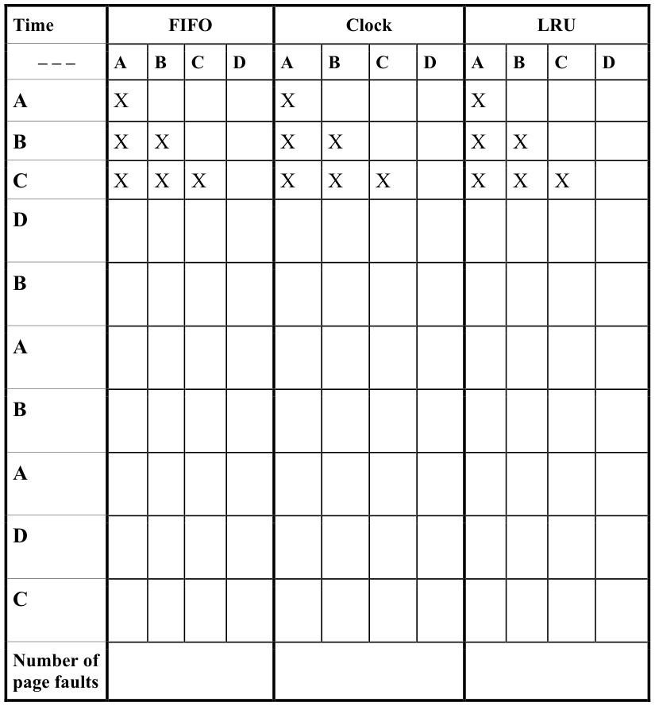

# Berkeley CS162 Spring 2016: Midterm 2: Questions

> Copied from the original: <https://hkn.eecs.berkeley.edu/exams/course/cs/162>. Text and figures are taken from the PDF as is; nothing was answered or rewritten. The original PDF is in this folder.

---

**Page 1**

&emsp;&emsp;&emsp;&emsp;&emsp;&emsp;&emsp;&emsp;University of California, Berkeley 
&emsp;&emsp;&emsp;&emsp;&emsp;&emsp;&emsp;&emsp;College of Engineering 
&emsp;&emsp;&emsp;&emsp;&emsp;&emsp;&emsp;&emsp;Computer Science Division – EECS 
Spring 2016                                 Anthony D. Joseph 
&emsp;&emsp;&emsp;&emsp;&emsp;&emsp;&emsp;&emsp;**Midterm Exam #2** 
&emsp;&emsp;&emsp;&emsp;&emsp;&emsp;&emsp;&emsp;April 20, 2016 
&emsp;&emsp;&emsp;&emsp;&emsp;&emsp;&emsp;&emsp;CS162 Operating Systems

General Information: 
This is a **closed book and one 2-sided handwritten note** examination. You have 80 minutes to 
answer as many questions as possible.  The number in parentheses at the beginning of each 
question indicates the number of points for that question. You should read **all** of the questions 
before starting the exam, as some of the questions are substantially more time consuming. 
Write all of your answers directly on this paper.  **Make your answers as concise as possible.** If there 
is something in a question that you believe is open to interpretation, then please ask us about it! 
&emsp;&emsp;&emsp;&emsp;&emsp;&emsp;&emsp;&emsp;**Good Luck!!**

Page 1/10

---

**Page 2**

CS 162 Spring 2016 Midterm Exam #2        April 20, 2016 
**NAME: \_\_\_\_\_\_\_\_\_\_\_\_\_\_\_\_\_\_\_\_\_\_\_\_\_\_\_\_\_\_\_\_\_\_\_\_\_\_\_** 
1\. (12 points total) True/False and Why? **CIRCLE YOUR ANSWER AND WRITE** 
&emsp;**AN EXPLANATION (no credit will be given if no explanation is provided).** 
&emsp;a. In addition to greatly reducing the overall failure probability, moving from a single 
&emsp;&emsp;hard drive to using RAID 1 (mirroring) can also increase the throughput of small 
&emsp;&emsp;random reads. 
&emsp;&emsp;&emsp;&emsp;&emsp;TRUE                    FALSE 
&emsp;&emsp;&emsp;&emsp;&emsp;**Why?**

&emsp;b. The TCP transport protocol provides a reliable, in-order bytestream abstraction. 
&emsp;&emsp;&emsp;&emsp;&emsp;TRUE                    FALSE 
&emsp;&emsp;&emsp;&emsp;&emsp;**Why?**

&emsp;c. The Byzantine failure model allows arbitrary behavior by a faulty system 
&emsp;&emsp;component. 
&emsp;&emsp;&emsp;&emsp;&emsp;TRUE                    FALSE 
&emsp;&emsp;&emsp;&emsp;&emsp;**Why?**

&emsp;d. Remote Procedure Calls provide identical semantics to local calls. 
&emsp;&emsp;&emsp;&emsp;&emsp;TRUE                    FALSE 
&emsp;&emsp;&emsp;&emsp;&emsp;**Why?**

Page 2/10

---

**Page 3**

CS 162 Spring 2016 Midterm Exam #2        April 20, 2016 
**NAME: \_\_\_\_\_\_\_\_\_\_\_\_\_\_\_\_\_\_\_\_\_\_\_\_\_\_\_\_\_\_\_\_\_\_\_\_\_\_\_** 
2\. (26 points total) Memory and I/O. 
&emsp;a. (12 points) For each statement, **CIRCLE** the address translation scheme(s) for 
&emsp;&emsp;which the statement is true. 
&emsp;&emsp;i) (4 points) A process cannot directly read or write another process’ memory. 
&emsp;&emsp;&emsp;Assume there is no mmap() operation. 
&emsp;&emsp;&emsp;&emsp;&emsp;No translation 
&emsp;&emsp;&emsp;&emsp;&emsp;Base and Bound 
&emsp;&emsp;&emsp;&emsp;&emsp;Segmentation 
&emsp;&emsp;&emsp;&emsp;&emsp;Paging

&emsp;&emsp;ii) (4 points) External fragmentation may occur. 
&emsp;&emsp;&emsp;&emsp;&emsp;No translation 
&emsp;&emsp;&emsp;&emsp;&emsp;Base and Bound 
&emsp;&emsp;&emsp;&emsp;&emsp;Segmentation 
&emsp;&emsp;&emsp;&emsp;&emsp;Paging

&emsp;&emsp;iii) (4 points) Part of the process’ stack could be swapped out to disk while the 
&emsp;&emsp;&emsp;process continues to execute using the rest of the stack. Assume the stack is 
&emsp;&emsp;&emsp;located in a typical location for the type of address translation in use. 
&emsp;&emsp;&emsp;&emsp;&emsp;No translation 
&emsp;&emsp;&emsp;&emsp;&emsp;Base and Bound 
&emsp;&emsp;&emsp;&emsp;&emsp;Segmentation 
&emsp;&emsp;&emsp;&emsp;&emsp;Paging

Page 3/10

---

**Page 4**

CS 162 Spring 2016 Midterm Exam #2        April 20, 2016 
**NAME: \_\_\_\_\_\_\_\_\_\_\_\_\_\_\_\_\_\_\_\_\_\_\_\_\_\_\_\_\_\_\_\_\_\_\_\_\_\_\_**

&emsp;b. (10 points) Consider a system with the following specifications: 
&emsp;&emsp;• 46-bit virtual address space 
&emsp;&emsp;• Page size of 8 KBytes 
&emsp;&emsp;• Page table entry size of 4 Bytes 
&emsp;&emsp;• Every page table is required to fit into a single page 
&emsp;&emsp;How many levels of page tables would be required to map the entire virtual 
&emsp;&emsp;address space? 
&emsp;&emsp;In the space below, document the format of a virtual address under this translation 
&emsp;&emsp;scheme. Briefly explain your rationale.

&emsp;c. (4 points) Briefly explain, in four sentences or less, what is DMA **and** why DMA 
&emsp;&emsp;enables a system to more efficiently handle I/O devices.

Page 4/10

---

**Page 5**

&emsp;CS 162 Spring 2016 Midterm Exam #2        April 20, 2016 
&emsp;**NAME: \_\_\_\_\_\_\_\_\_\_\_\_\_\_\_\_\_\_\_\_\_\_\_\_\_\_\_\_\_\_\_\_\_\_\_\_\_\_\_** 
&emsp;3\.  (24 points total) Demand Paging. 
&emsp;&emsp;&emsp;a. (18 points) Consider a demand paging system with 3 pages of physical memory. 
&emsp;&emsp;&emsp;&emsp;When a page fault occurs, we use a page replacement algorithm to make space 
&emsp;&emsp;&emsp;&emsp;for the new page by evicting a page from memory. Using the FIFO, Clock 
&emsp;&emsp;&emsp;&emsp;Algorithm, and LRU page replacement algorithms, mark which pages will be in 
&emsp;&emsp;&emsp;&emsp;physical memory **after** each page request. The first 3 rows for each algorithm are 
&emsp;&emsp;&emsp;&emsp;pre-filled for you.

&emsp;Page 5/10

---

**Page 6**

CS 162 Spring 2016 Midterm Exam #2        April 20, 2016 
**NAME: \_\_\_\_\_\_\_\_\_\_\_\_\_\_\_\_\_\_\_\_\_\_\_\_\_\_\_\_\_\_\_\_\_\_\_\_\_\_\_**

&emsp;b. (4 points) When a page fault occurs and a page is evicted, what entries in which 
&emsp;&emsp;data structures must the OS invalidate?

&emsp;c. (2 points) In the Nth chance page replacement algorithm, explain the purpose of the 
&emsp;&emsp;parameter N. Consider the effects of a small or large N.

Page 6/10

---

**Page 7**

CS 162 Spring 2016 Midterm Exam #2        April 20, 2016 
**NAME: \_\_\_\_\_\_\_\_\_\_\_\_\_\_\_\_\_\_\_\_\_\_\_\_\_\_\_\_\_\_\_\_\_\_\_\_\_\_\_** 
4\.  (22 points total) Disks and File Systems. 
&emsp;a. (6 points) Name two performance-improving features that are provided by modern 
&emsp;&emsp;disk controllers. For each of the features you name, briefly explain the benefit 
&emsp;&emsp;consequences of a disk controller that does not provide that feature. 
&emsp;&emsp;i) Feature #1 – Benefits and consequences if it is not provided:

&emsp;&emsp;ii) Feature #2 – Benefits and consequences if it is not provided:

&emsp;b. (5 points) If a disk subsystem receives an average of 10 requests per second and 
&emsp;&emsp;each request has an average response time of 500ms, how many requests are in 
&emsp;&emsp;the subsystem on average? Explain your answer.

&emsp;c. (4 points) The FAT file system eliminates external fragmentation by allocating disk 
&emsp;&emsp;space in block-sized units. Considering that fact, briefly explain why 
&emsp;&emsp;defragmentation is still sometimes necessary.

Page 7/10

---

**Page 8**

CS 162 Spring 2016 Midterm Exam #2        April 20, 2016 
**NAME: \_\_\_\_\_\_\_\_\_\_\_\_\_\_\_\_\_\_\_\_\_\_\_\_\_\_\_\_\_\_\_\_\_\_\_\_\_\_\_** 
&emsp;d. (3 points) In the UNIX 4.2 BSD FFS, inodes have direct pointers, a singly indirect 
&emsp;&emsp;pointer, a doubly indirect pointer, and a triply indirect pointer. The maximum file 
&emsp;&emsp;size supported by this inode type is approximately the same as the maximum file 
&emsp;&emsp;size supported by an inode with only a triply indirect pointer. Briefly explain one 
&emsp;&emsp;disadvantage of an inode design that only uses a triply indirect pointer instead of a 
&emsp;&emsp;combination of pointers (other than the slightly reduced maximum file size).

&emsp;e. (4 points) Briefly, in one to three sentences, explain the purpose of the journal in a 
&emsp;&emsp;journaling file system?

Page 8/10

---

**Page 9**

CS 162 Spring 2016 Midterm Exam #2        April 20, 2016 
**NAME: \_\_\_\_\_\_\_\_\_\_\_\_\_\_\_\_\_\_\_\_\_\_\_\_\_\_\_\_\_\_\_\_\_\_\_\_\_\_\_** 
5\.  (16 points total) Pintos coding question: Verifying user pointers. 
&emsp;Your project group is tasked with implementing a new syscall for Pintos. This syscall 
&emsp;takes a linked list as one of its arguments, and your responsibility is to create a 
&emsp;function that checks the validity of the linked list, so the syscall handler can safely 
&emsp;dereference it. The value of head may be NULL, if the list is empty. This is function 
&emsp;signature of your syscall:

&emsp;&emsp;void	
  foo(struct	
  node	
  \*head); 
&emsp;&emsp;We have also defined the structure of the node struct, as well as 
&emsp;&emsp;exit\_thread\_if\_invalid(), a function that will verify the validity of user- 
&emsp;&emsp;specified pointers.

&emsp;&emsp;struct	
  node 
&emsp;&emsp;{ 
&emsp;&emsp;int	
  number; 
&emsp;&emsp;char	
  buffer\[16\]; 
&emsp;&emsp;struct	
  node	
  \*next; 
&emsp;&emsp;//	
  If	
  this	
  is	
  the	
  last	
  node,	
  next	
  =	
  NULL 
&emsp;&emsp;};

&emsp;&emsp;/\*	
  Checks	
  that	
  P	
  to	
  P+SIZE-­‐1	
  is	
  a	
  valid	
  user	
  buffer. 
&emsp;&emsp;Kills	
  the	
  current	
  thread	
  if	
  it	
  is	
  invalid.	
  \*/ 
&emsp;&emsp;void	
  exit\_thread\_if\_invalid(void	
  \*p,	
  size\_t	
  size);

&emsp;&emsp;uint32\_t	
  SYS\_FOO	
  =	
  60;	
  	
  //	
  The	
  syscall	
  number	
  for	
  foo() 
&emsp;&emsp;Fill in the syscall\_handler() function **on the next page** so that it safely 
&emsp;&emsp;handles the SYS\_FOO syscall.

Page 9/10

---

**Page 10**

CS 162 Spring 2016 Midterm Exam #2        April 20, 2016 
**NAME: \_\_\_\_\_\_\_\_\_\_\_\_\_\_\_\_\_\_\_\_\_\_\_\_\_\_\_\_\_\_\_\_\_\_\_\_\_\_\_**

static	
  void 
syscall\_handler	
  (struct	
  intr\_frame	
  \*f) 
{ 
uint32\_t\*	
  args	
  =	
  ((uint32\_t\*)	
  f-­‐\>esp);

//	
  Check	
  if	
  this	
  is	
  SYS\_FOO 
if	
  (**\_\_\_\_\_\_\_\_\_\_\_\_\_\_\_\_\_\_\_\_\_\_\_\_\_\_\_\_\_\_\_\_\_\_\_\_**)	
  {

//	
  This	
  will	
  actually	
  handle	
  SYS\_FOO, 
//	
  	
  	
  assuming	
  arguments	
  are	
  valid 
handle\_foo(args,	
  &f-­‐\>eax); 
}	
  else	
  { 
//	
  Code	
  for	
  ALL	
  other	
  syscalls	
  will	
  go	
  here. 
} 
}

Page 10/10

