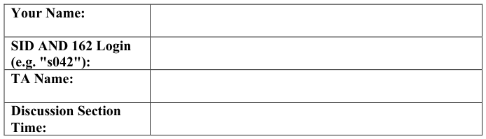
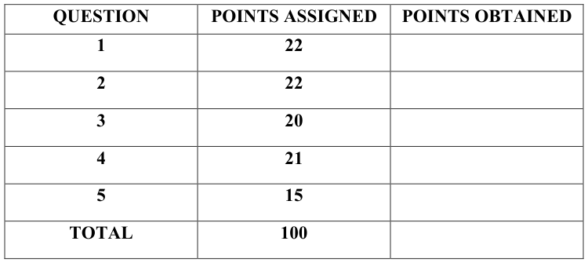
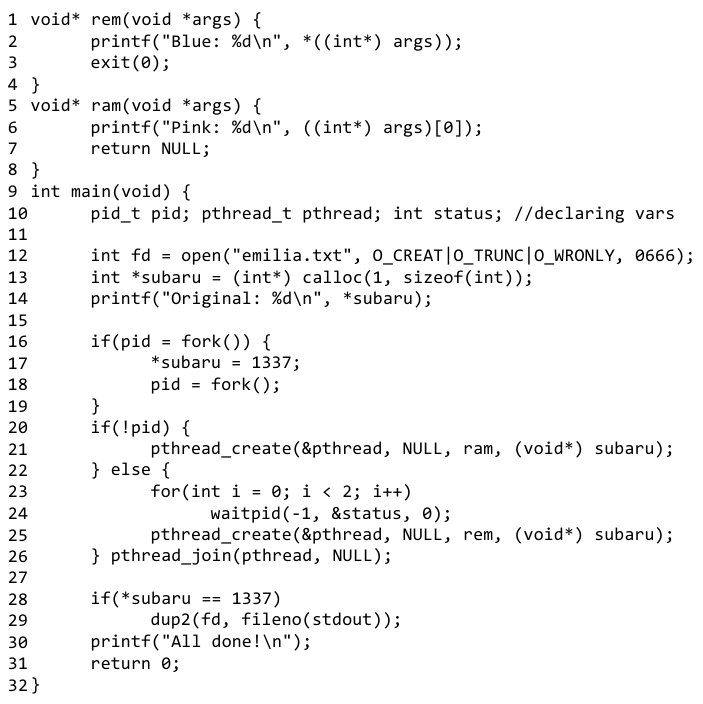
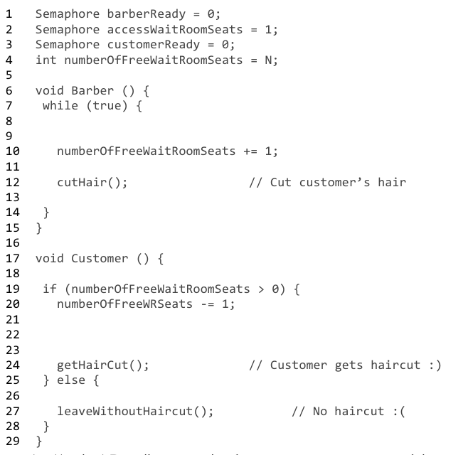
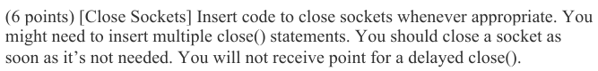
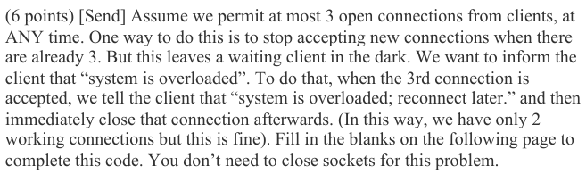
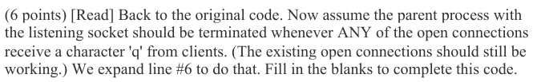
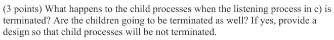

# Berkeley CS162 Fall 2017: Midterm 1: Questions

> Copied from the original: <https://hkn.eecs.berkeley.edu/exams/course/cs/162>. Text and figures are taken from the PDF as is; nothing was answered or rewritten. The original PDF is in this folder.

---

**Page 1**

CS 162 Fall 2017, 1st Exam         September 28, 2017

&emsp;&emsp;&emsp;&emsp;&emsp;&emsp;&emsp;&emsp;University of California, Berkeley 
&emsp;&emsp;&emsp;&emsp;&emsp;&emsp;&emsp;&emsp;College of Engineering 
&emsp;&emsp;&emsp;&emsp;&emsp;&emsp;&emsp;&emsp;Computer Science Division – EECS 
Fall 2017                                Ion Stoica 
&emsp;&emsp;&emsp;&emsp;&emsp;&emsp;&emsp;&emsp;**First Midterm Exam** 
&emsp;&emsp;&emsp;&emsp;&emsp;&emsp;&emsp;&emsp;September 28, 2017 
&emsp;&emsp;&emsp;&emsp;&emsp;&emsp;&emsp;&emsp;CS162 Operating Systems

General Information: 
This is a **closed book and one 2-sided handwritten note** examination. You have 80 minutes to 
answer as many questions as possible.  The number in parentheses at the beginning of each 
question indicates the number of points for that question. You should read **all** of the questions 
before starting the exam, as some of the questions are substantially more time consuming. 
Write all of your answers directly on this paper.  **Make your answers as concise as possible.** If there 
is something in a question that you believe is open to interpretation, then please ask us about it! 
&emsp;&emsp;&emsp;&emsp;&emsp;&emsp;&emsp;&emsp;**Good Luck!!**

Page 1/12

---

**Page 2**

CS 162 Fall 2017, 1st Exam         September 28, 2017

**P1** (22 points total) True/False and Why? **CIRCLE YOUR ANSWER**. For each 
question: 1 point for true/false correct, 1 point for explanation. An explanation cannot 
exceed 2 sentences. 
&emsp;a) The order in which you declare the members of struct thread in Pintos 
&emsp;&emsp;matters. 
&emsp;&emsp;&emsp;&emsp;&emsp;TRUE                    FALSE 
&emsp;&emsp;Why?

&emsp;b) If one thread closes a file descriptor, then it will be closed for all threads in the 
&emsp;&emsp;system, regardless of the process they are belonging to. 
&emsp;&emsp;&emsp;&emsp;&emsp;TRUE                    FALSE 
&emsp;&emsp;Why?

&emsp;c) The only way a thread can modify another thread’s stack variable is if the thread 
&emsp;&emsp;is passed the address of that variable as an argument during creation. 
&emsp;&emsp;&emsp;&emsp;&emsp;TRUE                    FALSE 
&emsp;&emsp;Why?

Page 2/12

---

**Page 3**

CS 162 Fall 2017, 1st Exam         September 28, 2017

&emsp;d) A binary semaphore (i.e., a semaphore which can only take values 0 and 1; if the 
&emsp;&emsp;semaphore is 1 and you increment it, its value remains 1) is semantically 
&emsp;&emsp;equivalent to a lock. 
&emsp;&emsp;&emsp;&emsp;&emsp;TRUE                    FALSE 
&emsp;&emsp;Why?

&emsp;e) When you call fputs(string, outfile), the content of “string” is immediately 
&emsp;&emsp;written to “outfile” on disk. 
&emsp;&emsp;&emsp;&emsp;&emsp;TRUE                    FALSE 
&emsp;&emsp;Why?

&emsp;f) The function pthread\_yield() will always ensure that another thread gets to run. 
&emsp;&emsp;&emsp;&emsp;&emsp;TRUE                    FALSE 
&emsp;&emsp;Why?

&emsp;g) Hardware interrupts can be used to implement locks. 
&emsp;&emsp;&emsp;&emsp;&emsp;TRUE                    FALSE 
&emsp;&emsp;Why?

Page 3/12

---

**Page 4**

CS 162 Fall 2017, 1st Exam         September 28, 2017

&emsp;h) When a thread is performing an I/O operation, such as read(), the thread is busy- 
&emsp;&emsp;waiting until the operation completes. 
&emsp;&emsp;&emsp;&emsp;&emsp;TRUE                    FALSE 
&emsp;&emsp;Why?

&emsp;i) When a hardware interrupt occurs, the kernel enqueues the interrupt and serves it 
&emsp;&emsp;when the current running thread completes. 
&emsp;&emsp;&emsp;&emsp;&emsp;TRUE                    FALSE 
&emsp;&emsp;Why?

&emsp;j) With a monitor, the program can call wait() in the critical section on a condition 
&emsp;&emsp;variable associated to that monitor. 
&emsp;&emsp;&emsp;&emsp;&emsp;TRUE                    FALSE 
&emsp;&emsp;Why?

&emsp;k) Context switching between two threads belonging to the same process is less 
&emsp;&emsp;expensive than context switching between two threads belonging to two different 
&emsp;&emsp;processes. 
&emsp;&emsp;&emsp;&emsp;&emsp;TRUE                    FALSE 
&emsp;&emsp;Why?

Page 4/12

---

**Page 5**

CS 162 Fall 2017, 1st Exam         September 28, 2017

**P2** (22 points) **Re: Zero – Starting Life in Another Process:** Consider the following C 
program. Assume that all system calls succeed when possible.

&emsp;a) (4 points) Including the original process, how many processes are created? 
&emsp;&emsp;Including the original thread, how many threads are created?

Page 5/12

---

**Page 6**

CS 162 Fall 2017, 1st Exam         September 28, 2017

&emsp;b) (6 points) Provide all possible outputs in standard output. If there are multiple 
&emsp;&emsp;possibilities, put each in its own box. You may not need all the boxes.

&emsp;c) (4 points) Provide all possible contents of emilia.txt. If there are multiple 
&emsp;&emsp;possibilities, put each in its own box. You may not need all the boxes.

&emsp;d) (4 points) Suppose we deleted line 28, how would the contents of emilia.txt 
&emsp;&emsp;change (if they do)?

&emsp;e) (4 points) What if, in addition to doing the change in part (d), we also move line 
&emsp;&emsp;12 (where we open the file descriptor) between lines 19 and 20? What would 
&emsp;&emsp;emilia.txt look like then?

Page 6/12

---

**Page 7**

CS 162 Fall 2017, 1st Exam         September 28, 2017

**P3** (20 points) **Synch Art Online – Ordinal Scale:** 
&emsp;a) (8 points) \[Spinlock using swap\] In lectures, you learnt how to implement locks 
&emsp;&emsp;using test & set. Your task here is to implement locks using the swap primitive. 
&emsp;&emsp;To recapitulate, swap has the following semantics, and is executed atomically:

void swap(int \*a, int \*b) { 
&emsp;&emsp;int temp = \*a; 
&emsp;&emsp;\*a = \*b; 
&emsp;&emsp;\*b = temp; 
} 
You have to implement Initialize, Acquire and Release for the lock operations. It is OK to 
busy wait.

void Initialize(int\* lock) {

}

void Acquire(int\* lock) {

}

void Release(int\* lock) {

}

Page 7/12

---

**Page 8**

CS 162 Fall 2017, 1st Exam         September 28, 2017

&emsp;b) (8 points) \[Sleeping Barber Problem\] A barber shop has one barber chair, and a 
&emsp;&emsp;waiting room with **N** chairs. The barber goes to sleep if there are no customers. If 
&emsp;&emsp;a customer arrives, and the barber chair along with all **N** chairs in the waiting 
&emsp;&emsp;room are occupied, he leaves the shop. Otherwise, the customer sits on the 
&emsp;&emsp;waiting room chair and waits. If the barber is asleep in his chair, the customer 
&emsp;&emsp;wakes up the barber. 
&emsp;&emsp;Consider that the barber and each of the customers are independent, concurrent 
&emsp;&emsp;threads. Fill in the following blanks to ensure that the barber and the customers 
&emsp;&emsp;are synchronized and deadlock free. Assume each semaphore has P() and V() 
&emsp;&emsp;functions available as semaphore.P() and semaphore.V():

&emsp;c)  (4 points) Describe a scenario where a customer can get starved, i.e., get stuck 
&emsp;&emsp;waiting in the waiting room forever. Briefly outline a way to fix this.

Page 8/12

---

**Page 9**

CS 162 Fall 2017, 1st Exam         September 28, 2017

**P4** (21 points total) **Networking is an Important Skill!:** The code below implements a 
server that handles multiple connections. (We ignore disconnections and other socket 
errors, as well as fork() failure. You could also ignore those failures when answering the 
following questions.)

0  int pid = getpid() 
1  bind(sockfd, (struct sockaddr \*) &serv\_addr, sizeof(serv\_addr)) 
2  listen(sockfd,5); 
3  while (1) { 
4    newsockfd = accept(sockfd, (struct sockaddr \*) &cli\_addr, 
&clilen); 
5    if (fork() == 0) { 
6       // do some communication; 
7       exit(0); 
8    } else { 
9       if (some condition) break; 
10   } 
11 }

&emsp;&emsp;Example: After line 1: close(sockfd)  # note this example might be incorrect

Page 9/12

---

**Page 10**

CS 162 Fall 2017, 1st Exam         September 28, 2017

&emsp;int count = 0; 
&emsp;int status; 
&emsp;while (1) { 
&emsp;&emsp;while (count \> 2) {

&emsp;&emsp;} 
&emsp;&emsp;newsockfd = accept(sockfd, (struct sockaddr \*) &cli\_addr, 
&emsp;&clilen); 
&emsp;&emsp;count++;

&emsp;&emsp;if (fork() == 0) {

&emsp;} else { 
&emsp;\# do some communication 
&emsp;} 
&emsp;exit(0); 
&emsp;&emsp;} else { 
&emsp;&emsp;if (some condition) break; 
&emsp;&emsp;} 
&emsp;}

&emsp;char reqbuf\[MAXREQ\]; 
&emsp;while (1) {

&emsp;}

Page 10/12

---

**Page 11**

CS 162 Fall 2017, 1st Exam         September 28, 2017

**P5** (15 points) **Back to Our Scheduled Programming:** Consider three processes P1, P2, 
and P3, being scheduled by a preemptive scheduler. Assume each process has a single 
kernel thread, and the context switching between two processes is 100 usec, while the 
time slice is 10ms. 
&emsp;a) (5 points) Assume that none of the processes perform I/O operations or waits for a 
&emsp;&emsp;signal, i.e., the kernel context switch a process only when its time slice expires 
&emsp;&emsp;(using the timer interrupt). What is the scheduling overhead of the system, i.e., the 
&emsp;&emsp;total context switching time over the total time the CPU is busy?

&emsp;b) (5 points) Assume that one process is performing an I/O every 1 ms after it is 
&emsp;&emsp;scheduled, and the scheduler is using round-robin. What is the scheduling 
&emsp;&emsp;overhead of the system now?

&emsp;c) (5 points) Now assume that all processes share a critical section that takes much 
&emsp;&emsp;longer than a times slice, and they use busy-waiting to implement mutual 
&emsp;&emsp;exclusion. Assume that at any given time there is one process in the critical 
&emsp;&emsp;section, and the scheduler is using the round-robin discipline. What is the 
&emsp;&emsp;percentage of time the CPU is doing useful work (the only useful work in this 
&emsp;&emsp;case is performed in the critical section.)

Page 11/12

---

**Page 12**

CS 162 Fall 2017, 1st Exam         September 28, 2017

Page 12/12

