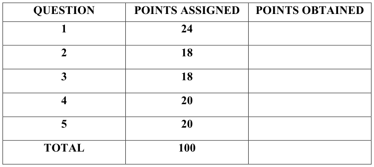
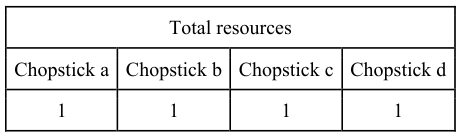
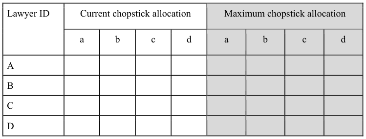
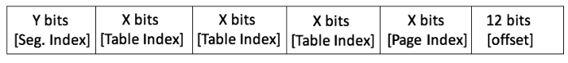
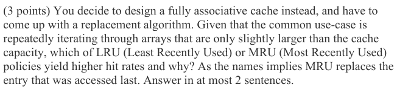
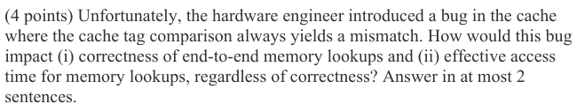
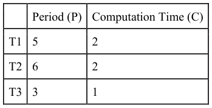
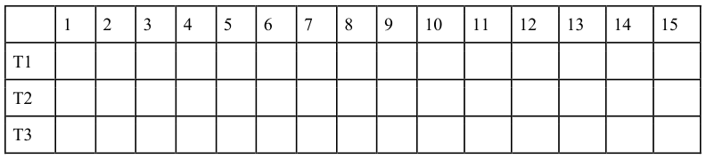

# Berkeley CS162 Fall 2017: Midterm 2: Questions

> Copied from the original: <https://hkn.eecs.berkeley.edu/exams/course/cs/162>. Text and figures are taken from the PDF as is; nothing was answered or rewritten. The original PDF is in this folder.

---

**Page 1**

CS 162 Fall 2017, 2nd Midterm Exam                October 23, 2017

&emsp;&emsp;&emsp;&emsp;&emsp;&emsp;&emsp;&emsp;University of California, Berkeley 
&emsp;&emsp;&emsp;&emsp;&emsp;&emsp;&emsp;&emsp;College of Engineering 
&emsp;&emsp;&emsp;&emsp;&emsp;&emsp;&emsp;&emsp;Computer Science Division – EECS 
Fall 2017                                Ion Stoica 
&emsp;&emsp;&emsp;&emsp;&emsp;&emsp;&emsp;&emsp;**Second Midterm Exam** 
&emsp;&emsp;&emsp;&emsp;&emsp;&emsp;&emsp;&emsp;October 23, 2017 
&emsp;&emsp;&emsp;&emsp;&emsp;&emsp;&emsp;&emsp;CS162 Operating Systems

General Information: 
This is a **closed book and one 2-sided handwritten note** examination. You have 80 minutes to 
answer as many questions as possible.  The number in parentheses at the beginning of each 
question indicates the number of points for that question. You should read **all** of the questions 
before starting the exam, as some of the questions are substantially more time consuming. 
Write all of your answers directly on this paper.  **Make your answers as concise as possible.** If there 
is something in a question that you believe is open to interpretation, then please ask us about it! 
&emsp;&emsp;&emsp;&emsp;&emsp;&emsp;&emsp;&emsp;**Good Luck!!**

Page 1/10

---

**Page 2**

CS 162 Fall 2017, 2nd Midterm Exam                October 23, 2017

**P1** (24 points total) True/False and Why? **CIRCLE YOUR ANSWER**. For each 
question: 1 point for true/false correct, 2 points for explanation. An explanation cannot 
exceed 2 sentences. 
&emsp;a) Adding a TLB will always improve memory access latency. 
&emsp;&emsp;&emsp;&emsp;&emsp;TRUE                    FALSE 
&emsp;&emsp;Why?

&emsp;b) Memory protection can be implemented without using an address translation 
&emsp;&emsp;mechanism. 
&emsp;&emsp;&emsp;&emsp;&emsp;TRUE                    FALSE 
&emsp;&emsp;Why?

&emsp;c) Segmentation does not change the value of the bits in the offset field of the virtual 
&emsp;&emsp;address when translating to a physical address. 
&emsp;&emsp;&emsp;&emsp;&emsp;TRUE                    FALSE 
&emsp;&emsp;Why?

&emsp;d) Two distinct page tables can have the same page table entry despite existing in 
&emsp;&emsp;separate processes. 
&emsp;&emsp;&emsp;&emsp;&emsp;TRUE                    FALSE 
&emsp;&emsp;Why?

Page 2/10

---

**Page 3**

CS 162 Fall 2017, 2nd Midterm Exam                October 23, 2017

&emsp;e) Priority scheduling can lead to starvation. 
&emsp;&emsp;&emsp;&emsp;&emsp;TRUE                    FALSE 
&emsp;&emsp;Why?

&emsp;f) Under demand paging, if we think of memory as a cache for disk, conflict misses 
&emsp;&emsp;are not possible. 
&emsp;&emsp;&emsp;&emsp;&emsp;TRUE                    FALSE 
&emsp;&emsp;Why?

&emsp;g) Each syscall has its own unique entry in the interrupt vector in Pintos. 
&emsp;&emsp;&emsp;&emsp;&emsp;TRUE                    FALSE 
&emsp;&emsp;Why?

&emsp;h) Priority donation is a method of preventing deadlocks. 
&emsp;&emsp;&emsp;&emsp;&emsp;TRUE                    FALSE 
&emsp;&emsp;Why?

Page 3/10

---

**Page 4**

CS 162 Fall 2017, 2nd Midterm Exam                October 23, 2017

**P2** (18 points) **Synch Art Online II – Lawyer's Rosario:** In the dining lawyers problem, 
four lawyers sit around a table, with IDs A-D from left to right. There is a chopstick 
between each lawyer, so that chopstick a is to the left of lawyer A, and so on. The 
chopsticks loop around (e.g. the right chopstick of lawyer D is chopstick a). Each lawyer 
thinks and then eats, repeatedly. To eat, each lawyer needs two chopsticks. Each lawyer 
can only reach the chopstick immediately to their left and right (e.g., lawyer A needs 
chopsticks a and b).

&emsp;a) (5 points) Fill out the maximum chopstick allocation table (aka only the right, 
&emsp;&emsp;shaded half of the table). More precisely, for every lawyer indicate the chopsticks 
&emsp;&emsp;it needs to acquire in order to eat. 
&emsp;b) (5 points) Fill out the current chopstick allocation table (the left half of the table) 
&emsp;&emsp;so that we are in an unsafe state, that is, a state in which none of the lawyers can 
&emsp;&emsp;proceed, so all are starving. In addition, give a sequence of requests that will lead 
&emsp;&emsp;to the unsafe state you filled in in the table. Each request should be a pair of a 
&emsp;&emsp;lawyer and the requested chopstick.

Page 4/10

---

**Page 5**

CS 162 Fall 2017, 2nd Midterm Exam                October 23, 2017

&emsp;c) (5 points) Consider the order of requests that led to the unsafe state at point (b), 
&emsp;&emsp;but now use the Banker algorithm to avoid getting into the unsafe state. Give the 
&emsp;&emsp;order in which the lawyers will finish eating.

&emsp;d) (3 points) Suppose we implemented each lawyer as a thread and we use a critical 
&emsp;&emsp;section for every chopstick (i.e., a chopstick can be picked or dropped only within 
&emsp;&emsp;its critical section).  Suppose we do not use the banker’s algorithm, and instead 
&emsp;&emsp;detect the deadlock and break it by abruptly “killing” a thread (lawyer). However, 
&emsp;&emsp;to our surprise this doesn’t break the deadlock. What happened?

Page 5/10

---

**Page 6**

CS 162 Fall 2017, 2nd Midterm Exam                October 23, 2017

**P3** (18 points) **Address Translation for RAM (& Rem):** Suppose we have split our 64- 
bit Virtual Address Space as follows:

&emsp;a)  (2 points) How big is a page in this system?

&emsp;b) (4 points) Assume that the page tables are divided into page-sized chunks (so that 
&emsp;&emsp;they can be paged to disk). How many PTEs are fit in a page table? What is the 
&emsp;&emsp;value of X?

&emsp;c) (3 points) What is the size of the segment index (Y)? How many segments can the 
&emsp;&emsp;system have?

&emsp;d) (4 points) What would be the format of a PTE (page table entry)? Show the 
&emsp;&emsp;format of including bits required to support the clock algorithm for page 
&emsp;&emsp;replacement and copy-on-write optimizations, i.e., a dirty bit, a valid bit, and used 
&emsp;&emsp;bit. (Assume: 64-bit Physical Address space)

&emsp;e) (5 points) If a user’s heap segment is completely full, how much space is taken up 
&emsp;&emsp;by the page tables for this segment? (It is fine if you just provide the numerical 
&emsp;&emsp;expression without calculating the final result.)?

Page 6/10

---

**Page 7**

CS 162 Fall 2017, 2nd Midterm Exam                October 23, 2017

**P4** (20 points total) **Caching – Bad Day at Work:** Your company designs caches for 
servers with 32-bit addresses. You are designing a 1KB cache with 32B blocks, and your 
hardware designer suggests a 64-way set associative cache. 
&emsp;a) (4 points) Why would 64-way set associativity not make sense for the cache?

Page 7/10

---

**Page 8**

CS 162 Fall 2017, 2nd Midterm Exam                October 23, 2017

&emsp;e) (4 points) Your hardware engineer fixes the bug in (d) but quite unsurprisingly, 
&emsp;&emsp;introduces yet another bug, where the cache randomly reads the valid bit of any 
&emsp;&emsp;cache entry as 0 with probability p. In other words, if a cache entry is valid, the 
&emsp;&emsp;cache will assume this entry is invalid with probability p. On the other hand, if the 
&emsp;&emsp;cache entry is invalid, the cache will correctly assume it is invalid. The memory 
&emsp;&emsp;access time is 40 ns, cache access time is 10ns, and probability of finding an entry 
&emsp;&emsp;in cache (before reading valid bit) is 0.9. If effective access time (after reading the 
&emsp;&emsp;valid bit) is 41 ns, what is the value of probability p?

&emsp;f) (0 points) Would you fire your hardware engineer?

Page 8/10

---

**Page 9**

CS 162 Fall 2017, 2nd Midterm Exam                October 23, 2017

**P5** (20 points) **Real-Time Exam Scheduling:** Assume 3 threads with period (P) and 
computation time per period (C) defined as below:

Assume all threads arrive at time 0. 
&emsp;a) (5 points) Fill out the table below according to the Earliest Deadline First 
&emsp;&emsp;scheduling algorithm.  As the name implies, EDF schedules the ready thread with 
&emsp;&emsp;the earliest deadline, where a thread is ready, if the requested computation, C, in 
&emsp;&emsp;the current period has not been satisfied yet. Fill out a box with an ‘X’ if the 
&emsp;&emsp;thread of that row is running at the time of the column. If two threads have the 
&emsp;&emsp;same deadline, break ties in numerical order i.e., T1 takes precedence before T2. 
&emsp;&emsp;A time slice is one time unit (the table below shows the first 15 time slices). 
&emsp;&emsp;Threads can only be preempted at time slice boundaries.

&emsp;b) (1 point) Were any of the deadlines missed? If so, give the thread(s) and time 
&emsp;&emsp;period(s) during which the deadline was not met.

Page 9/10

---

**Page 10**

CS 162 Fall 2017, 2nd Midterm Exam                October 23, 2017

&emsp;c) (5 points) Now consider Rate Monotonic (RM), another real-time scheduler 
&emsp;&emsp;which always schedules the thread with the highest ratio C/P. In other words RM 
&emsp;&emsp;is a fixed priority scheduler where the priority of a thread is C/P, and highest 
&emsp;&emsp;priority thread are scheduled first, i.e., T1 is scheduled before T2 if C1/P1 \> 
&emsp;&emsp;C2/P2.  Given the RM scheduler, fill in the table below assuming the same 
&emsp;&emsp;threads as in (a). Ties are again broken by the thread number with the lower 
&emsp;&emsp;number running first, and threads can be preempted at the time slice boundaries.

&emsp;d) (1 point) Were any of the deadlines in the previous part missed? If so, give the 
&emsp;&emsp;thread(s) and time period(s) during which the deadline was not met.

&emsp;e) (5 points) Now consider Round-Robin (RR), where each thread is scheduled for a 
&emsp;&emsp;time slices in a round-robin fashion, T1, T2, T3, T1, T2, … If a thread is not 
&emsp;&emsp;ready (i.e., its request in a time period has been already satisfied), the thread is 
&emsp;&emsp;simply skipped and the next time slice is allocated to the next ready thread. Fill in 
&emsp;&emsp;the table below assuming the same threads as in (a).

&emsp;f) (1 point) Were any of the deadlines in the previous part missed? If so, give the 
&emsp;&emsp;thread(s) and time period(s) during which the deadline was not met.

&emsp;g) (2 points) Assume the three tasks at A are running forever. Does EDF guarantee 
&emsp;&emsp;that all the deadlines will be always met? Why, or why not? No more than 2 
&emsp;&emsp;sentences.

Page 10/10

