# Berkeley CS162 Fall 2017: Midterm 3: Questions

> Copied from the original: <https://hkn.eecs.berkeley.edu/exams/course/cs/162>. Text and figures are taken from the PDF as is; nothing was answered or rewritten. The original PDF is in this folder.

---

**Page 1**

CS 162 Fall 2017, 3rd Midterm Exam                November 29, 2017

&emsp;&emsp;&emsp;&emsp;&emsp;&emsp;&emsp;&emsp;University of California, Berkeley 
&emsp;&emsp;&emsp;&emsp;&emsp;&emsp;&emsp;&emsp;College of Engineering 
&emsp;&emsp;&emsp;&emsp;&emsp;&emsp;&emsp;&emsp;Computer Science Division – EECS 
Fall 2017                                Ion Stoica 
&emsp;&emsp;&emsp;&emsp;&emsp;&emsp;&emsp;&emsp;**Third Midterm Exam** 
&emsp;&emsp;&emsp;&emsp;&emsp;&emsp;&emsp;&emsp;November 29, 2017 
&emsp;&emsp;&emsp;&emsp;&emsp;&emsp;&emsp;&emsp;CS162 Operating Systems

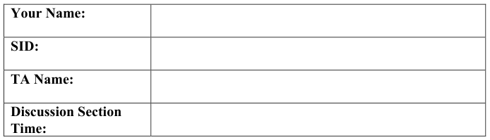

General Information: 
This is a **closed book and one 2-sided handwritten note** examination. You have 80 minutes to 
answer as many questions as possible.  The number in parentheses at the beginning of each 
question indicates the number of points for that question. You should read **all** of the questions 
before starting the exam, as some of the questions are substantially more time consuming. 
Write all of your answers directly on this paper.  **Make your answers as concise as possible.** If there 
is something in a question that you believe is open to interpretation, then please ask us about it! 
&emsp;&emsp;&emsp;&emsp;&emsp;&emsp;&emsp;&emsp;**Good Luck!!**

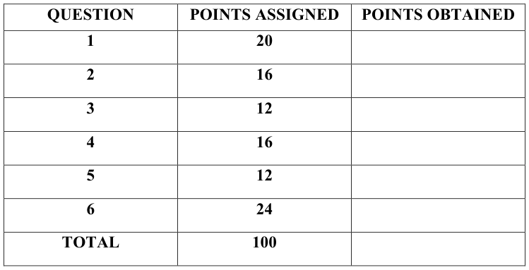

Page 1/12

---

**Page 2**

CS 162 Fall 2017, 3rd Midterm Exam                November 29, 2017

**P1** (20 points total) True/False and Why? **CIRCLE YOUR ANSWER**. For each question: 1 
point for true/false correct, 1 point for explanation. An explanation cannot exceed 2 sentences. 
&emsp;a) As the size of the read operations decreases the effective bandwidth of an SSD in bits/sec 
&emsp;&emsp;also decreases. 
&emsp;&emsp;&emsp;&emsp;&emsp;TRUE                    FALSE 
&emsp;&emsp;Why?

&emsp;b) File permissions are stored in the File Allocation Table in FAT32 filesystems. 
&emsp;&emsp;&emsp;&emsp;&emsp;TRUE                    FALSE 
&emsp;&emsp;Why?

&emsp;c) Finger tables are not necessary for the correctness of Chord (e.g. correct lookup of keys). 
&emsp;&emsp;&emsp;&emsp;&emsp;TRUE                    FALSE 
&emsp;&emsp;Why?

&emsp;d) According to Little's Law, the number of customers/jobs in the system depends on the 
&emsp;&emsp;type of arrival distribution. 
&emsp;&emsp;&emsp;&emsp;&emsp;TRUE                    FALSE 
&emsp;&emsp;Why?

&emsp;e) On a remote procedure call, the client code must first marshal the arguments before 
&emsp;&emsp;passing them into the RPC, which then passes them to a client stub that handles sending 
&emsp;&emsp;them to the remote server. 
&emsp;&emsp;&emsp;&emsp;&emsp;TRUE                    FALSE 
&emsp;&emsp;Why?

Page 2/12

---

**Page 3**

CS 162 Fall 2017, 3rd Midterm Exam                November 29, 2017

&emsp;f) Storing inodes in the same cylinder group as their underlying files improves performance 
&emsp;&emsp;compared to storing them all in the outermost cylinders. 
&emsp;&emsp;&emsp;&emsp;&emsp;TRUE                    FALSE 
&emsp;&emsp;Why?

&emsp;g) According to the end-to-end principle presented in this class, there is sometimes a benefit 
&emsp;&emsp;to implementing functionality at a lower layer. 
&emsp;&emsp;&emsp;&emsp;&emsp;TRUE                    FALSE 
&emsp;&emsp;Why?

&emsp;h) “Best effort” packet delivery ensures that packets are delivered reliably and in-order. 
&emsp;&emsp;&emsp;&emsp;&emsp;TRUE                    FALSE 
&emsp;&emsp;Why?

&emsp;i) Log structured file systems generally perform much better on random writes than random 
&emsp;&emsp;reads. 
&emsp;&emsp;&emsp;&emsp;&emsp;TRUE                    FALSE 
&emsp;&emsp;Why?

&emsp;j) NTFS stores file data through fixed-size blocks organized into lists or trees in records in 
&emsp;&emsp;the Master File Table. 
&emsp;&emsp;&emsp;&emsp;&emsp;TRUE                    FALSE 
&emsp;&emsp;Why?

Page 3/12

---

**Page 4**

CS 162 Fall 2017, 3rd Midterm Exam                November 29, 2017

**P2** (16 points) **Short Answers:** 
a) (8 points) \[Anime Party Synchronization\] A party has two types of attendees: Rem fans and 
Emilia fans, and neither really likes each other. Each can try to enter, or can exit, at any time. 
However, any fan first checks in with a bouncer (your monitor synchronization) before entering 
the party. If an absolute majority of one type of fan exists inside the party, then the bouncer 
allows all majority fans in. Minority fans are only allowed to enter if they would not create a tie 
or flip the majority in the party, otherwise they are blocked outside. Example: if there were 5 
Rem fans in the party and they held majority, only up to 4 Emilia fans would be allowed in and 
the rest would block, while any number of Rem fans would be allowed in. 
Additional Notes: 
&emsp;• Blocked and exited fans outside the party do not count for determining majorities. In a tie 
&emsp;&emsp;there is no majority. 
&emsp;• Fans should never hang (e.g. as soon as the minority ties or become the majority in the 
&emsp;&emsp;party, their blocked friends should enter). 
&emsp;• Fans cannot be blocked from exiting or forced to exit. 
Implement this as a synchronization monitor using the following struct definition. Do not modify 
the struct or attempt to add lines of code beyond that provided. Inefficiency is acceptable, the 
priority is correctness:

typedef struct { 
struct lock lock; //lock.acquire(), lock.release() 
struct cv rem\_cv; //cv.wait(&lock), cv.signal(), cv.broadcast() 
struct cv emilia\_cv; 
int rem\_fans; 
int emilia\_fans; 
} party\_monitor;

rem\_fan\_enter(party\_monitor\* re) { 
re-\>lock.acquire(); 
\_\_\_\_\_\_\_\_\_\_\_\_\_\_\_\_\_\_\_\_\_\_\_\_\_\_\_\_\_\_ 
&emsp;&emsp;\_\_\_\_\_\_\_\_\_\_\_\_\_\_\_\_\_\_\_\_\_\_\_\_\_\_\_\_\_\_ 
&emsp;&emsp;\_\_\_\_\_\_\_\_\_\_\_\_\_\_\_\_\_\_\_\_\_\_\_\_\_\_\_\_\_\_ 
re-\>lock.release(); 
} 
rem\_fan\_exit(party\_monitor\* re) { 
re-\>lock.acquire(); 
\_\_\_\_\_\_\_\_\_\_\_\_\_\_\_\_\_\_\_\_\_\_\_\_\_\_\_\_\_\_ 
&emsp;&emsp;\_\_\_\_\_\_\_\_\_\_\_\_\_\_\_\_\_\_\_\_\_\_\_\_\_\_\_\_\_\_ 
re-\>lock.release() 
}

Page 4/12

---

**Page 5**

CS 162 Fall 2017, 3rd Midterm Exam                November 29, 2017

emilia\_fan\_enter(party\_monitor\* re) { 
re-\>lock.acquire(); 
\_\_\_\_\_\_\_\_\_\_\_\_\_\_\_\_\_\_\_\_\_\_\_\_\_\_\_\_\_\_ 
&emsp;&emsp;\_\_\_\_\_\_\_\_\_\_\_\_\_\_\_\_\_\_\_\_\_\_\_\_\_\_\_\_\_\_ 
&emsp;&emsp;\_\_\_\_\_\_\_\_\_\_\_\_\_\_\_\_\_\_\_\_\_\_\_\_\_\_\_\_\_\_ 
re-\>lock.release(); 
} 
emilia\_fan\_exit(party\_monitor\* re) { 
re-\>lock.acquire(); 
\_\_\_\_\_\_\_\_\_\_\_\_\_\_\_\_\_\_\_\_\_\_\_\_\_\_\_\_\_\_ 
&emsp;&emsp;\_\_\_\_\_\_\_\_\_\_\_\_\_\_\_\_\_\_\_\_\_\_\_\_\_\_\_\_\_\_ 
re-\>lock.release() 
} 
b) (8 points) \[Supply & Demand Paging\] Fill in the table below assuming the LRU and Clock 
page replacement policies. There are 4 frames of physical memory. The left column indicates the 
frame number, and each entry to the right contains the page that resides in the corresponding 
physical frame, after each memory reference (we have already filled in the row corresponding to 
accessing A). For clock, tick the hand first before checking the use bit on a fault. For readability 
purposes, **only fill in the table entries that have changed and leave unchanged entries blank**.

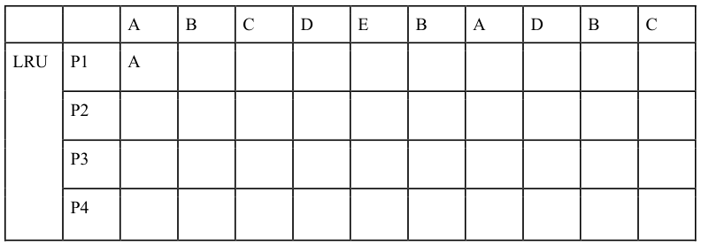

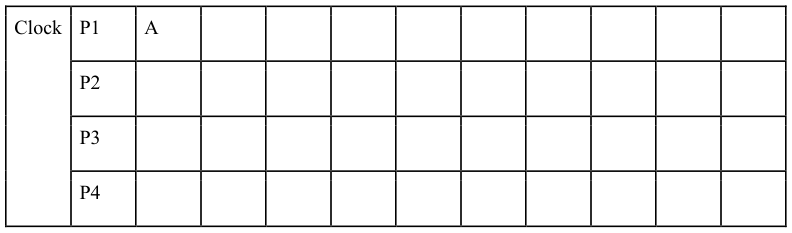

Page 5/12

---

**Page 6**

CS 162 Fall 2017, 3rd Midterm Exam                November 29, 2017

**P3** (12 points) **Filesystem Magica:** Madoka Kaname is building a filesystem for Project 3. She 
implements a thread-safe write-back cache. She also implements extensible files and directories 
using her modified inode definition. For thread safety, she makes sure that a thread grabs a 
corresponding per-inode lock when it extends a file, and when it reads or writes a directory. 
Madoka decides to implement a move syscall, which moves a file from directory to directory:

move(inode \*dir1, inode \*dir2, char \*filename) { 
lock\_acquire(dir1-\>lock); 
lock\_acquire(dir2-\>lock);  // Assume no deadlocks. 
struct dir\_entry entry; 
bool exists = lookup(dir1, filename, &entry); 
if (exists) { 
block\_sector\_t file\_inode\_sector = entry.sector; 
erase\_directory\_entry(dir1, entry);  // Writes to buffer cache. 
add\_directory\_entry(dir2, filename, file\_inode\_sector);  // Writes to 
buffer cache. 
} 
lock\_release(dir2-\>lock); 
lock\_release(dir1-\>lock); 
}

**A user program:** 
// Assume all syscalls succeed 
create(“/hello/world”, 12); 
mv(“/hello/world”, “/goodbye/world”); //enters move() through syscall 
printf(“done!”); 
&emsp;a) (4 points) To test her filesystem’s reliability, Madoka runs the above user program and 
&emsp;&emsp;pulls the power after seeing the “done!” message. She finds that neither /hello/ nor 
&emsp;&emsp;/goodbye/ have her file! What happened? (1 sentence)

&emsp;b) (4 points) By modifying the move function, how can Madoka make sure that at least one 
&emsp;&emsp;of the directories has a file named “world” after a crash? (1 sentence)

&emsp;c) (4 points) By modifying the filesystem design, how can Madoka make sure that exactly 
&emsp;&emsp;one of the directories has a file named “world” after a crash? (1 sentence)

Page 6/12

---

**Page 7**

CS 162 Fall 2017, 3rd Midterm Exam                November 29, 2017

**P4** (16 points) **No Game No Commit:** Consider the 2-phase commit protocol with a coordinator 
C and 3 workers W1, W2, W3. Assume: 
&emsp;• C communicates with W1, W2, W3 in parallel 
&emsp;• C timeout latency is 1s 
&emsp;• latency for sending/receiving messages from C to W1-W3, and for logging messages at 
&emsp;&emsp;W1-W3 are shown below (assume all other latencies are negligible):

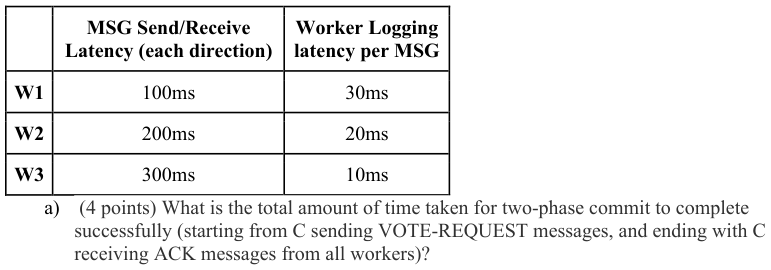

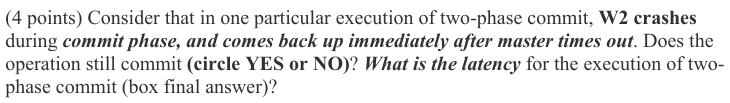

&emsp;&emsp;&emsp;&emsp;&emsp;YES                     NO

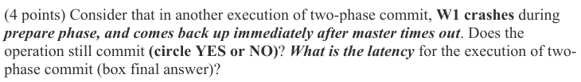

&emsp;&emsp;&emsp;&emsp;&emsp;YES                     NO

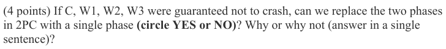

&emsp;&emsp;&emsp;&emsp;&emsp;YES                     NO

Page 7/12

---

**Page 8**

CS 162 Fall 2017, 3rd Midterm Exam                November 29, 2017

**P5** (12 points) **CS168 Except Not Multiple Choice:** Consider a TCP connection, such that: 
&emsp;• the sender sends 1800 bytes worth of data; 
&emsp;• the receiver’s initial advertised window is 1000 bytes; 
&emsp;• the maximum packet size is 500 bytes; 
&emsp;• the receiving process consumes each packet p that contains in-sequence bytes right after 
&emsp;&emsp;the ack for p is sent (by the receiver), and before the receiver receives the next packet; 
&emsp;&emsp;note that if packet p does not contain in-sequence bytes (i.e., the previous packet has not 
&emsp;&emsp;been received) that receiving process does not consume p. 
&emsp;• the sender can send all data before the first ack is received, of course, modulo the size of 
&emsp;&emsp;the advertised window and of the sender window. 
&emsp;a) (4 points) Assume no packets are lost. Draw the time diagram of the packet delivery. For 
&emsp;&emsp;each packet indicates the bytes sent in that packet, and for each ack packet show the 
&emsp;&emsp;sequence number of the next expected byte, and the advertised window (denoted 
&emsp;&emsp;advWin).

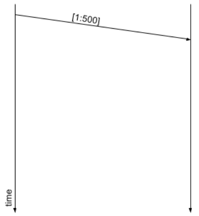

&emsp;b) (4 points) Assume now the 1st packet is lost and none of the other packets are lost 
&emsp;&emsp;afterwards.  Draw the time diagram of the packet delivery. For each packet indicates the 
&emsp;&emsp;bytes sent in that packet, and for each ack packet show the sequence number of the next 
&emsp;&emsp;expected byte, and the advertised window.

Page 8/12

---

**Page 9**

CS 162 Fall 2017, 3rd Midterm Exam                November 29, 2017

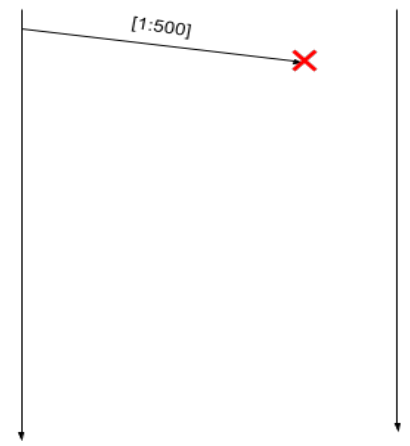

&emsp;c) (4 points) Assume now that the advertised window is 1200 bytes, and the 1st and 2nd 
&emsp;&emsp;packets are received by the receiver in reverse order, i.e., the receiver gets 2nd packet 
&emsp;&emsp;before the 1st packet. No packets are lost, and no other packets or acks are reordered. 
&emsp;&emsp;Draw the time diagram of the packet delivery. For each packet indicates the bytes sent in 
&emsp;&emsp;that packet, and for each ack packet show the sequence number of the next expected byte, 
&emsp;&emsp;and the advertised window.

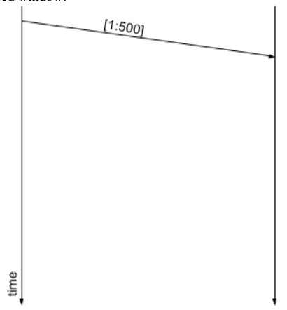

Page 9/12

---

**Page 10**

CS 162 Fall 2017, 3rd Midterm Exam                November 29, 2017

**P6** (24 points) **Sword Art I/O:** You're excited to download the 1st episode of Sword Art Online 
(SAO) from Netflix. Your client (browser) connects with the master server in the nearest Netflix 
datacenter, which coordinates many worker servers. The workers store an unreplicated 
distributed key-value store mapping "TV Show Title" -\> video file. 
a) \[Queuing & Networking\] Assume all network links have 80 gigabits/second (10 gigabytes/s) 
&emsp;of bandwidth. The latency between you and any server in the datacenter is 100 ms, while the 
&emsp;latency between servers in the datacenter is 10 ms. Assume that all requests and responses 
&emsp;except for the video itself are negligible (~0 bytes) in size, and all arrivals & service times 
&emsp;are memoryless. The video is 1 gigabyte in size. Assume in parts i), ii), & iii) that the master 
&emsp;cached the video (no communication with workers). 
&emsp;&emsp;i.    (2 points) What is the network round trip time (from your sending the request to 
&emsp;&emsp;&emsp;getting the video), ignoring queueing and processing delays?

&emsp;ii.    (3 points) Assume the master has a service time of 10ms and 25 requests arrive per 
&emsp;&emsp;&emsp;second. Assuming steady state, what is the utilization, time spent in the queue, and 
&emsp;&emsp;&emsp;the length of the master’s queue?

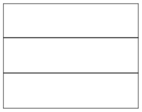

u

Tq

Lq

&emsp;iii.    (3 points) SAO turns out to be very popular, and the arrival rate jumps to 162 requests 
&emsp;&emsp;&emsp;per second (service time is still 10ms). Assuming steady state, what is the utilization, 
&emsp;&emsp;&emsp;time spent in queue, and length of the master’s queue?

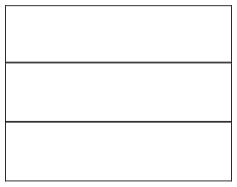

u

Tq

Lq

Page 10/12

---

**Page 11**

CS 162 Fall 2017, 3rd Midterm Exam                November 29, 2017

&emsp;iv.    Assume the master no longer caches the video and you query the distributed key- 
&emsp;&emsp;&emsp;value store iteratively. 
&emsp;&emsp;&emsp;&emsp;&emsp;α)  (1 point) What is the network round trip time, ignoring processing & 
&emsp;&emsp;&emsp;&emsp;&emsp;queuing delays?

&emsp;&emsp;&emsp;&emsp;&emsp;β)  (2 points) Consider the utilization, queuing time, & service time in part ii): 
&emsp;&emsp;&emsp;&emsp;&emsp;uold, Tq, Tser. In the master, express the new utilization unew in terms of uold and 
&emsp;&emsp;&emsp;&emsp;&emsp;compute the new queuing time Tnew in terms of Tq and/or Tser.

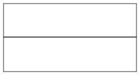

&emsp;&emsp;&emsp;&emsp;&emsp;unew

&emsp;&emsp;&emsp;&emsp;&emsp;Tnew

&emsp;v.    Assume the master no longer caches the video and you query the distributed key- 
&emsp;&emsp;&emsp;value store recursively. 
&emsp;&emsp;&emsp;&emsp;&emsp;α)  (1 point) What is the network round trip time, ignoring processing & 
&emsp;&emsp;&emsp;&emsp;&emsp;queuing delays?

&emsp;&emsp;&emsp;&emsp;&emsp;β)  (2 points) Consider the utilization, queuing time, & service time in part ii): 
&emsp;&emsp;&emsp;&emsp;&emsp;uold, Tq, Tser. In the master, express the new utilization unew in terms of uold and 
&emsp;&emsp;&emsp;&emsp;&emsp;compute the new queuing time Tnew in terms of Tq and/or Tser. Assume it takes 
&emsp;&emsp;&emsp;&emsp;&emsp;the same time to service either a client or a worker.

&emsp;&emsp;&emsp;&emsp;&emsp;unew

&emsp;&emsp;&emsp;&emsp;&emsp;Tnew

&emsp;vi.    (2 points) You want to download your SAO episode as fast as possible. Do you prefer 
&emsp;&emsp;&emsp;recursive or iterative queries? Explain briefly in 1 sentence.

&emsp;vii.    (2 points) Suppose you now want to download all 50 episodes of SAO in a batch as 
&emsp;&emsp;&emsp;fast as possible rather than just 1 episode. Do you prefer recursive or iterative 
&emsp;&emsp;&emsp;queries? Explain briefly in 1 sentence.

Page 11/12

---

**Page 12**

CS 162 Fall 2017, 3rd Midterm Exam                November 29, 2017

b) \[Disk Latency\] Within a single worker server, a disk has the following characteristics: 
&emsp;• 1ms controller delay 
&emsp;• 1ms seek time 
&emsp;• 30000 rpm rotation speed 
&emsp;• 1 megabyte/s transfer rate 
&emsp;• 10 kilobyte sector size 
&emsp;&emsp;&emsp;i.    (3 points) Compute the average rotation time, transfer time, and average total time 
&emsp;&emsp;&emsp;&emsp;&emsp;to read 1 sector. Ignore queuing delay.

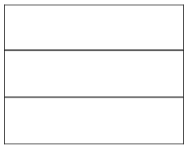

Rotation

Transfer

Total

&emsp;&emsp;&emsp;ii.    Schedule the I/O operations using the following disk scheduling algorithms. The 
&emsp;&emsp;&emsp;&emsp;&emsp;arm is initially over cylinder 35. Assume SCAN and C-SCAN begin by traversing 
&emsp;&emsp;&emsp;&emsp;&emsp;ascending cylinder numbers, and ignore rotational delay. List the operations 
&emsp;&emsp;&emsp;&emsp;&emsp;scheduling order from left to right.

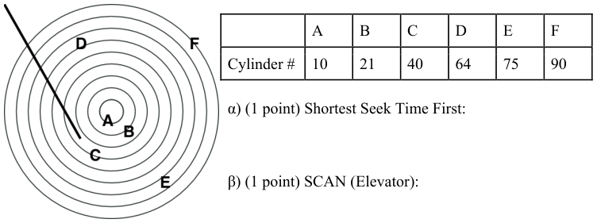

&emsp;&emsp;&emsp;&emsp;&emsp;&emsp;&emsp;&emsp;γ) (1 point) C-SCAN: 
&emsp;&emsp;&emsp;&emsp;&emsp;&emsp;&emsp;&emsp;C, D, E, F, A, B

Page 12/12

