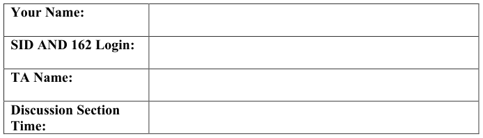
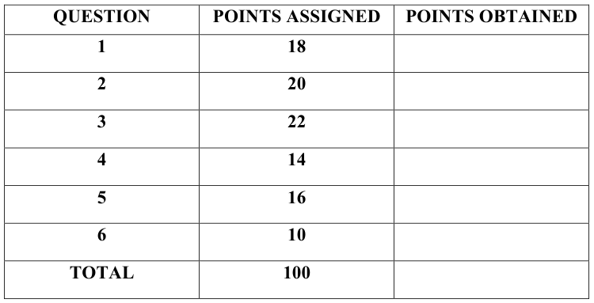
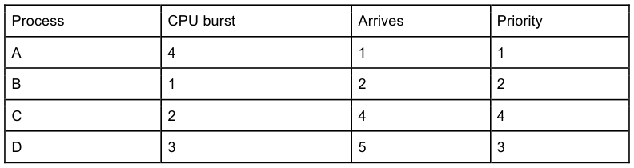
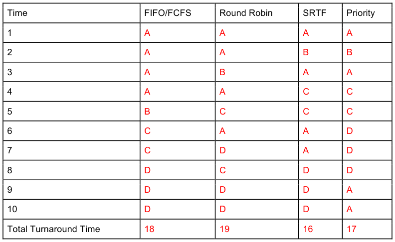

# Berkeley CS162 Spring 2017: Midterm 1: Official solutions

> Copied from the original: <https://hkn.eecs.berkeley.edu/exams/course/cs/162>. Text and figures are taken from the PDF as is; nothing was answered or rewritten. The original PDF is in this folder.

---

**Page 1**

CS 162 Spring 2017, 1st Midterm Exam                                     February 27, 2017

&emsp;&emsp;&emsp;&emsp;&emsp;&emsp;&emsp;&emsp;University of California, Berkeley 
&emsp;&emsp;&emsp;&emsp;&emsp;&emsp;&emsp;&emsp;College of Engineering 
&emsp;&emsp;&emsp;&emsp;&emsp;&emsp;&emsp;&emsp;Computer Science Division – EECS 
Spring 2017                                Ion Stoica 
&emsp;&emsp;&emsp;&emsp;&emsp;&emsp;&emsp;&emsp;**First Midterm Exam** 
&emsp;&emsp;&emsp;&emsp;&emsp;&emsp;&emsp;&emsp;February 27, 2017 
&emsp;&emsp;&emsp;&emsp;&emsp;&emsp;&emsp;&emsp;CS162 Operating Systems

General Information: 
This is a **closed book and one 2-sided handwritten note** examination. You have 80 minutes to 
answer as many questions as possible.  The number in parentheses at the beginning of each 
question indicates the number of points for that question. You should read **all** of the questions 
before starting the exam, as some of the questions are substantially more time consuming. 
Write all of your answers directly on this paper.  **Make your answers as concise as possible.** If there 
is something in a question that you believe is open to interpretation, then please ask us about it! 
&emsp;&emsp;&emsp;&emsp;&emsp;&emsp;&emsp;&emsp;**Good Luck!!**

Page 1/13

---

**Page 2**

CS 162 Spring 2017, 1st Midterm Exam                                     February 27, 2017

**P1** (18 points total) True/False and Why? **CIRCLE YOUR ANSWER**. For each 
question: 1 point for true/false correct, 2 point for explanation. An explanation cannot 
exceed 2 sentences. 
&emsp;a) You can use a socket to communicate between two processes on the **same** 
&emsp;&emsp;machine. 
&emsp;&emsp;&emsp;&emsp;&emsp;TRUE                    FALSE 
&emsp;&emsp;Why? 
&emsp;&emsp;A socket is an interface for interprocess communication.  It is irrelevant if the two 
&emsp;&emsp;processes are on remote computers, or on the same one.

&emsp;b) If you wanted to close one thread in a multithreaded process, the best choice 
&emsp;&emsp;would be to call exit(0). 
&emsp;&emsp;&emsp;&emsp;&emsp;TRUE                    FALSE 
&emsp;&emsp;Why? 
&emsp;&emsp;exit(0) will exit the entire process, which will also close all the other threads in 
&emsp;&emsp;the process.

&emsp;c) Incrementing an integer value can always be performed atomically. 
&emsp;&emsp;&emsp;&emsp;&emsp;TRUE                    FALSE 
&emsp;&emsp;Why? 
&emsp;&emsp;Increment requires a load, add, store that may be split.

Page 2/13

---

**Page 3**

CS 162 Spring 2017, 1st Midterm Exam                                     February 27, 2017

&emsp;d) Locks can be implemented by leveraging interrupts on single processor computers. 
&emsp;&emsp;&emsp;&emsp;&emsp;TRUE                    FALSE 
&emsp;&emsp;Why? 
&emsp;&emsp;Just disable interrupts before acquiring and releasing locks.

&emsp;e) Accessing a variable stored in a thread’s individual stack is always thread-safe. 
&emsp;&emsp;&emsp;&emsp;&emsp;TRUE                    FALSE 
&emsp;&emsp;Why? 
&emsp;&emsp;Could pass the address of this variable to another thread.

&emsp;f) Switching the order of two P() semaphore primitives can lead to deadlock (recall 
&emsp;&emsp;that sem.P() decrements semaphore value, “sem”, and blocks if it is 0). 
&emsp;&emsp;&emsp;&emsp;&emsp;TRUE                    FALSE 
&emsp;&emsp;Why? 
&emsp;&emsp;If one P() is used to acquire a lock, and another one to wait(), we can get deadlock 
&emsp;&emsp;if the  wait() happens in the critical section without releasing the lock (see slide 1, 
&emsp;&emsp;in lecture 9).

Page 3/13

---

**Page 4**

CS 162 Spring 2017, 1st Midterm Exam                                     February 27, 2017

**P2** (20 points) **C Programming and Sockets:** The code below implements a trivial echo 
server that reads arbitrary data into reqbuf from a client on consockfd socket descriptor, 
and then sends this data back to the client on the same socket descriptor (we ignore 
disconnections and other socket errors).

1 void server(int consockfd) { 
2   char reqbuf\[MAXREQ\]; 
3   int n; 
4   while (1) { 
5      n = read(consockfd, reqbuf, MAXREQ); /\* Recv \*/ 
6      n = write(consockfd, reqbuf, strlen(reqbuf)); /\* echo\*/ 
7   } 
8 } 
Please recall that the last argument of read(), MAXREQ, is the maximum number of 
bytes it can read (usually the size of reqbuf), and it returns the number of bytes it reads, 
n, which can be smaller than MAXREQ. 
Please answer the following questions. Answering a question may require you to add, 
delete, or modify the code above. If that’s the case, please specify the # of the line being 
modified or deleted. If you need to add code, please specify the #’s of the lines between 
which the code needs to be added (e.g., “add code between lines #4 and #5”). 
&emsp;a) (6 points) Assume the client always sends strings, i.e., ‘\\0’ terminated sequence 
&emsp;&emsp;of characters. What can go wrong in the previous code? Provide a fix by 
&emsp;&emsp;specifying the changes to the above code.

The received string might not be null terminated which can result into sending garbage, 
as strlen(reqbuf) may exceed MAXREQ size in this case. The server might also crash as 
it might try to read from unallocated addresses. 
**Solution 1**: 
Between lines 4-5: memset(reqbuf, 0, MAXREQ); 
Line #5: n = read(consockfd, reqbuf, MAXREQ-1); /\* Recv \*/ 
Line #6: n = write(consockfd, reqbuf, strlen(reqbuf) + 1); /\* Add NULL 
terminator \*/ 
**Solution 2**: 
Line #6: n = write(consockfd, reqbuf, n);

Page 4/13

---

**Page 5**

CS 162 Spring 2017, 1st Midterm Exam                                     February 27, 2017

&emsp;b) (6 points) Assume the client sends a buffer that can contain ‘\\0’ characters. What 
&emsp;&emsp;can go wrong in the previous code? Provide a fix by specifying the changes to the 
&emsp;&emsp;above code. 
The problem is that if there is a ‘\\0’ character in the message, the server will not echo the 
characters beyond it. 
Line #6: n = write(consockfd, reqbuf, n); /\* echo\*/

&emsp;c) (8 points) Assume the server needs to exit when receiving the string “quit”. Re- 
&emsp;&emsp;write the server() code to implement this functionality. 
This solution finds “quit” anywhere in the message and works across messages, i.e., if 
one message ends with “qu”, and the next one starts with “it”, the server will exit.

void server(int consockfd) { 
char reqbuf\[MAXREQ\]; 
int n; 
char \*q = “quit”; 
int k = 0; 
int i; 
while (1) { 
n = read(consockfd, reqbuf, MAXREQ); /\* Recv \*/ 
for (i = 0; i \< n; i++) { 
if (q\[k\] == reqbuf\[i\]) { 
k++; 
if (strlen(q) == k) { 
// found “quit” matching; note this works across messages 
exit(0); 
} 
} else { 
// no match; re-initialize k = 0 
k = 0; 
} 
} 
n = write(consockfd, reqbuf, n); /\* echo\*/ 
} 
}

Page 5/13

---

**Page 6**

CS 162 Spring 2017, 1st Midterm Exam                                     February 27, 2017

**P3** (22 points) **Producer/Consumer:** Consider the following code that implements 
a synchronized unbounded queue using monitors that we went over in lecture:

1\.  Lock lock; 
2\.  Condition dataready; 
3\.  Queue queue;

4\.  AddToQueue(item) { 
5\.    lock.Acquire();  // Get Lock 
6\.    queue.enqueue(item);  // Add item 
7\.    dataready.signal();  // Signal any waiters 
8\.    lock.Release();  // Release Lock 
9\.  }

10\. RemoveFromQueue() { 
11\.   lock.Acquire();  // Get Lock 
12\.   while (queue.isEmpty()) { 
13\.     dataready.wait(&lock); // If nothing, sleep 
14\.   } 
15\.   item = queue.dequeue();  // Get next item 
16\.   lock.Release();  // Release Lock 
17\.   return(item); 
18\. } 
Please answer the following questions. 
&emsp;a) (6 points) Assume that we have multiple producers running AddToQueue() and 
&emsp;&emsp;multiple consumers running RemoveFromQueue(). Do you need to make any 
&emsp;&emsp;changes to the code? If yes, specify the changes in the above code by indicating 
&emsp;&emsp;the line you need to modify, the line #’s between which you need to add new 
&emsp;&emsp;code, or the line # you need to delete. If not, use no more than two sentences to 
&emsp;&emsp;explain why.

We don’t need to make any changes, as the code already handles multiple producers and 
consumers.

Page 6/13

---

**Page 7**

CS 162 Spring 2017, 1st Midterm Exam                                     February 27, 2017

&emsp;b) (10 points) Change the code to implement a bounded queue, i.e., make sure that 
&emsp;&emsp;the producer cannot write when the queue is full. Add your changes in the empty 
&emsp;&emsp;space of the code below.

**Solution 1 (assuming .isFull() primitive):**

1\.  Lock lock; 
2\.    Condition dataready; 
Condition queueready; 
3\.    Queue queue;

AddToQueue(item) { 
lock.Acquire();  // Get Lock 
while (queue.isFull()) { 
queueready.wait(&lock); // If nothing, sleep 
} 
queue.enqueue(item);  // Add item 
dataready.signal();  // Signal any waiters 
lock.Release();  // Release Lock 
}

RemoveFromQueue() { 
lock.Acquire();  // Get Lock 
while (queue.isEmpty()) { 
dataready.wait(&lock); // If nothing, sleep 
} 
item = queue.dequeue();  // Get next item 
queueready.signal();  // Signal any waiters 
lock.Release();  // Release Lock 
return(item); 
}

Page 7/13

---

**Page 8**

CS 162 Spring 2017, 1st Midterm Exam                                     February 27, 2017

**Solution 2:**

1\.  Lock lock; 
2\.    Condition dataready; 
Condition queueready; 
3\.    Queue queue; 
int queuesize = 0;

AddToQueue(item) { 
lock.Acquire();  // Get Lock 
while (queueuesize == N) { 
queueready.wait(&lock); // If nothing, sleep 
} 
queuesize++; 
queue.enqueue(item);  // Add item 
dataready.signal();  // Signal any waiters 
lock.Release();  // Release Lock 
}

RemoveFromQueue() { 
lock.Acquire();  // Get Lock 
while (queue.isEmpty()) { 
dataready.wait(&lock); // If nothing, sleep 
} 
item = queue.dequeue();  // Get next item 
queuesize--; 
queueready.signal();  // Signal any waiters 
lock.Release();  // Release Lock 
return(item); 
}

Page 8/13

---

**Page 9**

CS 162 Spring 2017, 1st Midterm Exam                                     February 27, 2017

&emsp;c) (6 points) Implement a new function, ReadFromQueue(), which uses the 
&emsp;&emsp;function “item = queue.read()” to read an item from the queue without 
&emsp;&emsp;removing it.

ReadFromQueue() { 
lock.Acquire();  // Get Lock 
while (queue.isEmpty()) { 
dataready.wait(&lock); // If nothing, sleep 
} 
item = queue.read();  // Get next item 
lock.Release();  // Release Lock 
return(item); 
}

Page 9/13

---

**Page 10**

CS 162 Spring 2017, 1st Midterm Exam                                     February 27, 2017

**P4** (14 points total) **CPU Scheduling:** Consider the following **single-threaded** processes, 
and their arrival times, CPU bursts and their priorities (a process with a higher priority 
number has priority over a process with lower priority number):

Please note: 
&emsp;• Priority scheduler is preemptive. 
&emsp;• Newly arrived processes are scheduled last for RR. When the RR quanta expires, 
&emsp;&emsp;the currently running thread is added at the end of to the ready list before any 
&emsp;&emsp;newly arriving threads. 
&emsp;• Break ties via priority in Shortest Remaining Time First (SRTF). 
&emsp;• If a process arrives at time x, they are ready to run at the beginning of time x. 
&emsp;• Ignore context switching overhead. 
&emsp;• The quanta for RR is 1 unit of time. 
&emsp;• Total turnaround time is the time a process takes to complete after it arrives. 
Given the above information please fill in the following table.

Page 10/13

---

**Page 11**

CS 162 Spring 2017, 1st Midterm Exam                                     February 27, 2017

**P5** (16 points) **Synchronization:** Next Saturday is the international day of Poker. As the 
owner of the largest poker website worldwide you expect a large number of games being 
played (and finishing) at any point in time in your website. Consider that players can play 
more than one game at a time and any two players can play against each other in more 
than one game simultaneously. For simplicity, we consider each game has exactly **two** 
players. 
The backend system of your poker website contains the following multi-threaded code.

queue     games\_finished\_queue; 
lock\_t    games\_finished\_lock; 
semaphore games\_to\_process\_sem;

typedef struct Game { 
.... 
} Game;

typedef struct Player { 
lock\_t lock; 
uint64\_t n\_chips; 
uint64\_t unique\_id; 
} Player;

void finish\_game(Game\* game) { 
lock\_acquire(&games\_finished\_lock); 
enqueue(&games\_finished\_queue, game); 
lock\_release(&games\_finished\_lock); 
sema\_up(&games\_to\_process\_sem); 
}

void process\_finished\_games() { 
lock\_acquire(&games\_finished\_lock); 
sema\_down(&games\_to\_process\_sem); 
Game\* g = pop\_queue\_front(&games\_finished\_queue); 
move\_chips(g-\>player1, g-\>player2, g-\>n\_chips); 
lock\_release(&games\_finished\_lock); 
}

void move\_chips(Player\* player1, Player\* player2, uint64\_t n\_chips) { 
lock\_acquire(&player1-\>lock); 
lock\_acquire(&player2-\>lock);

player1-\>n\_chips -= n\_chips; 
player2-\>n\_chips += n\_chips;

lock\_release(&player2-\>lock); 
lock\_release(&player1-\>lock); 
}

Page 11/13

---

**Page 12**

CS 162 Spring 2017, 1st Midterm Exam                                     February 27, 2017

&emsp;a) (6 points) Identify two places in the code where deadlock can occur. If deadlock 
&emsp;&emsp;occurs, use no more than two sentences to explain why it occurs. 
First, in process\_finished\_games sema\_down can make thread wait on a critical 
section. 
Second, move\_chips can deadlock if two players play against each other 
simultaneously. This can lead to two concurrent calls with the same (but swapped) 
players/arguments. 
&emsp;&emsp;move\_chips(player1, player2, n1) 
&emsp;&emsp;move\_chips(player2, player1, n2) 
**Note: The second deadlock() assumes that move\_chips() is called from another** 
**function not shown in the code. Since this was unclear we gave full credit to people** 
**who did not identify this second deadlock.** 
&emsp;b) (10 points) Use the space bellow to change process\_finished\_games() and 
&emsp;&emsp;move\_chips () (or copy if correct) to ensure no deadlocks can occur. Explain 
&emsp;&emsp;succinctly why no deadlock can occur with the newly modified code. Note: a 
&emsp;&emsp;single lock at the beginning and end of move\_chips is not an accepted solution.

void process\_finished\_games() { 
// acquire semaphore outside of critical section 
sema\_down(&games\_to\_process); 
lock\_acquire(&games\_finished); 
Game\* g = pop\_queue\_front(&games\_finished\_queue); 
move\_chips(g-\>player1, g-\>player2, g-\>n\_chips); 
lock\_release(games\_finished); 
}

void move\_chips(Player\* player1, Player\* player2, uint64\_t n\_chips) { 
// acquire locks in well defined order 
if (player1-\>unique\_id \< player2-\>unique\_id) { 
lock\_acquire(&player1-\>lock); 
lock\_acquire(&player2-\>lock); 
} else { 
lock\_acquire(&player2-\>lock); 
lock\_acquire(&player1-\>lock); 
} 
player1-\>n\_chips -= n\_chips; 
player2-\>n\_chips += n\_chips;

lock\_release(&player1-\>lock); 
lock\_release(&player2-\>lock); 
} 
**Note: We gave full credit to people who did not identify move\_chips() as a deadlock** 
**at (a) and who did not provide the fix here, again, due to confusing text.**

Page 12/13

---

**Page 13**

CS 162 Spring 2017, 1st Midterm Exam                                     February 27, 2017

**P6**. (10 points) **Syscalls:** Please answer the following questions. 
&emsp;a) (4 points) **Syscall dispatch**. Suppose there is a function “foo()” in kernel 
&emsp;&emsp;memory at address 0xA000 that requires full privileges to run. The kernel would 
&emsp;&emsp;like to allow userspace threads to use this function. How can the user thread cause 
&emsp;&emsp;foo() to run? For now, we assume that foo() takes no arguments and has no 
&emsp;&emsp;return value. (HINT: x86 provides an instruction "INT N" that sends interrupt #N 
&emsp;&emsp;to the CPU where N is between 0-255.)

&emsp;This isn’t the only right answer, but it is the simplest (the answers to part 2 would 
&emsp;also work here): The kernel would pick a free interrupt number (for concreteness, 
&emsp;let’s say “2”). It would then fill in “0xA000” into the IVT entry #2. The user would 
&emsp;cause interrupt 2 to enter the kernel. Finally, foo() would use the “return from 
&emsp;interrupt” instruction to return control to the user.

&emsp;b) \\ (4 points) **Syscall execution**. Suppose instead of just one function, we wanted to 
&emsp;&emsp;support an arbitrary number of system calls (potentially even thousands). Would 
&emsp;&emsp;your approach in part 1 still work? If not, what changes would you need to make? 
&emsp;The fundamental problem is that there are a limited number of interrupts. Writing Yes 
&emsp;or No was not worth any points unless you identified the correct reason. This is 
&emsp;because depending on your implementation either yes or no could be correct. 
&emsp;There could be several right answers to this. 
&emsp;(Fully correct) Similar to Linux: You pass the syscall number in a register (or on the 
&emsp;user stack) and then use a known interrupt. This interrupt handler then gets the 
&emsp;request number and looks up the function in a table. 
&emsp;Another accepted solution was to use a sequence of interrupts to determine an 
&emsp;appropriate syscall. (e.g. calling INT 1 then INT 2 then INT 3 corresponds to syscall 
&emsp;5000)

&emsp;c)  (3 points) **Pintos Kernel Stack.** In Pintos, would foo() use the user’s stack? If 
&emsp;&emsp;not, where does it keep its stack?

&emsp;In Pintos, the kernel does not use the user’s stack. Instead it reserves a portion of the 
&emsp;TCB for the associated kernel stack.

Page 13/13

