# Berkeley CS162 Spring 2017: Midterm 2: Official solutions

> Copied from the original: <https://hkn.eecs.berkeley.edu/exams/course/cs/162>. Text and figures are taken from the PDF as is; nothing was answered or rewritten. The original PDF is in this folder.

---

**Page 1**

CS 162 Spring 2017, 2nd Midterm Exam                                     March 21, 2017

&emsp;&emsp;&emsp;&emsp;&emsp;&emsp;&emsp;&emsp;University of California, Berkeley 
&emsp;&emsp;&emsp;&emsp;&emsp;&emsp;&emsp;&emsp;College of Engineering 
&emsp;&emsp;&emsp;&emsp;&emsp;&emsp;&emsp;&emsp;Computer Science Division – EECS 
Spring 2017                                Ion Stoica 
&emsp;&emsp;&emsp;&emsp;&emsp;&emsp;&emsp;&emsp;**Second Midterm Exam** 
&emsp;&emsp;&emsp;&emsp;&emsp;&emsp;&emsp;&emsp;March 21, 2017 
&emsp;&emsp;&emsp;&emsp;&emsp;&emsp;&emsp;&emsp;CS162 Operating Systems

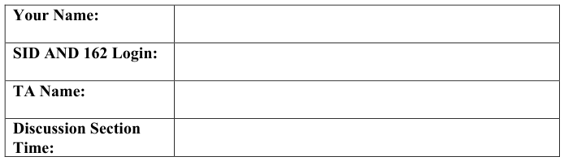

General Information: 
This is a **closed book and one 2-sided handwritten note** examination. You have 80 minutes to 
answer as many questions as possible.  The number in parentheses at the beginning of each 
question indicates the number of points for that question. You should read **all** of the questions 
before starting the exam, as some of the questions are substantially more time consuming. 
Write all of your answers directly on this paper.  **Make your answers as concise as possible.** If there 
is something in a question that you believe is open to interpretation, then please ask us about it! 
&emsp;&emsp;&emsp;&emsp;&emsp;&emsp;&emsp;&emsp;**Good Luck!!**

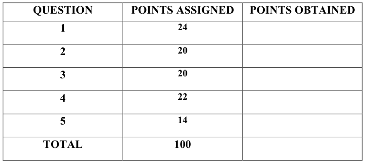

Page 1/15

---

**Page 2**

CS 162 Spring 2017, 2nd Midterm Exam                                     March 21, 2017

**P1** (24 points total) True/False and Why? **CIRCLE YOUR ANSWER**. For each 
question: 1 point for true/false correct, 2 point for explanation. An explanation cannot 
exceed 2 sentences.

&emsp;a) A multilevel page table hierarchy will always take less storage space than a single 
&emsp;&emsp;level page table, given the same virtual address space size. 
&emsp;&emsp;&emsp;&emsp;&emsp;TRUE                    **FALSE** 
&emsp;&emsp;Why? 
&emsp;&emsp;When all pages in the virtual memory are allocated, a single level page table will 
&emsp;&emsp;take less space, as all its PTEs will be used. While this will also be true in the case 
&emsp;&emsp;of a multilevel page table hierarchy, in this case you need additional storage for 
&emsp;&emsp;the page table at the first level.

&emsp;b) Forcing all threads to request resources in the same order (e.g., resource A before 
&emsp;&emsp;B, B before C, and so on) will prevent deadlock. 
&emsp;&emsp;&emsp;&emsp;&emsp;**TRUE**                    FALSE 
&emsp;&emsp;Why?

&emsp;&emsp;Imposing a strict order prevents a cycle.

Page 2/15

---

**Page 3**

CS 162 Spring 2017, 2nd Midterm Exam                                     March 21, 2017

&emsp;c) Increasing the size of a cache always decreases the number of total cache misses, 
&emsp;&emsp;all things held constant (replacement policy, workload, associativity). 
&emsp;&emsp;&emsp;&emsp;&emsp;TRUE                    **FALSE** 
&emsp;&emsp;Why?

&emsp;&emsp;Recall the Belady’s anomaly.

&emsp;d) Adding a TLB may make process context switching slower. 
&emsp;&emsp;&emsp;&emsp;&emsp;**TRUE**                    FALSE 
&emsp;&emsp;Why?

&emsp;&emsp;Each process has its own TLB. Thus, the process needs to flush the TLB on 
&emsp;&emsp;context switching which will lead to increasing the context switching time.

&emsp;e) It is not possible to share memory between two processes when using multiple- 
&emsp;&emsp;level page tables. 
&emsp;&emsp;&emsp;&emsp;&emsp;TRUE                    **FALSE** 
&emsp;&emsp;Why?

Two PTEs in the page tables of the two processes can point to the same physical page.

Page 3/15

---

**Page 4**

CS 162 Spring 2017, 2nd Midterm Exam                                     March 21, 2017

&emsp;f) Round-robin scheduling has always a higher average response time than shortest- 
&emsp;&emsp;job-first. 
&emsp;&emsp;&emsp;&emsp;&emsp;TRUE                    **FALSE** 
&emsp;&emsp;Why? 
&emsp;&emsp;If all jobs have the same size and quanta is larger than the job size, then both RR 
&emsp;&emsp;and SJF will have the same average response times.

&emsp;g) One way to respond to thrashing is to kill a process. 
&emsp;&emsp;&emsp;&emsp;&emsp;**TRUE**                    FALSE 
&emsp;&emsp;Why? 
&emsp;&emsp;Yes. By killing a process we free the memory and we give a chance to other 
&emsp;&emsp;processes to fit their working sets in memory.

&emsp;h) With uniprogramming, applications can access any physical address. 
&emsp;&emsp;&emsp;&emsp;&emsp;**TRUE**                    FALSE 
&emsp;&emsp;Why? 
&emsp;&emsp;In the case of uniporgramming there is a single application running on the 
&emsp;&emsp;machine and there is no memory protection.

Page 4/15

---

**Page 5**

CS 162 Spring 2017, 2nd Midterm Exam                                     March 21, 2017

**P2** (20 points) **Demand Paging:** Consider the following sequence of page accesses: 
&emsp;&emsp;&emsp;&emsp;&emsp;&emsp;&emsp;&emsp;A, B, D, C, B, A, B, A 
&emsp;a) (10 points) Fill in the table below assuming the FIFO, LRU, and MIN page 
&emsp;&emsp;replacement policies. There are 3 frames of physical memory. The top row 
&emsp;&emsp;indicates the frame number, and each entry below contains the page that resides in 
&emsp;&emsp;the corresponding physical frame, after each memory reference (we have already 
&emsp;&emsp;filled in the row corresponding to accessing A). For readability purposes, **only fill** 
&emsp;&emsp;**in the table entries that have changed and leave unchanged entries blank.** If 
&emsp;&emsp;there are several pages that meet the replacement criteria, break ties using the 
&emsp;&emsp;lexicographical order, i.e., A takes priority over B, B over C, and C over D.

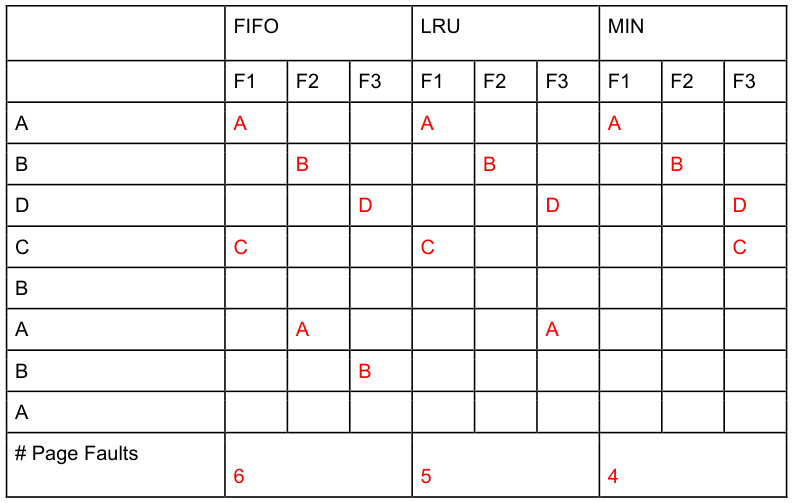

Page 5/15

---

**Page 6**

CS 162 Spring 2017, 2nd Midterm Exam                                     March 21, 2017

&emsp;b) (4 points) Give a sequence of page accesses in which LRU will generate a page 
&emsp;&emsp;fault on every access. 
&emsp;If the pattern was ABCDABCDABCD….. And there were only 3 pages in physical 
&emsp;memory, then you would get a page fault on every access.

&emsp;c) (3 points) Demand paging can be thought of as using main memory as a cache for 
&emsp;&emsp;disk. Fill in the properties of this cache: 
&emsp;&emsp;&emsp;a. Associativity: fully associative 
&emsp;&emsp;&emsp;b. Write-through/write-back? : write-back 
&emsp;&emsp;&emsp;c. Block Size (assume 32-bit addresses, 4-byte words, and 4KB pages) ? : 
&emsp;&emsp;&emsp;&emsp;&emsp;4KB, 1 page

&emsp;d) (3 points) The Nth chance replacement algorithm relies on a parameter N. Why 
&emsp;&emsp;might one choose a large N value? Why might one choose a small N value? 
&emsp;Choose a large N value for a better approximation of LRU. Choose a small N value 
&emsp;for efficiency; a large N value would take a long time to evict a page b/c many loops 
&emsp;required.

Page 6/15

---

**Page 7**

CS 162 Spring 2017, 2nd Midterm Exam                                     March 21, 2017

**P3** (20 points) **Caching:** Assume an 8KB cache with 32B blocks, on a machine that uses 
32-bit virtual and physical addresses. 
&emsp;a) (6 points) Specify the **size** and **name** of each field (i.e., cache tag, cache index, 
&emsp;&emsp;and byte select / offset) in the physical address for the following cache types: 
&emsp;&emsp;&emsp;a. Direct Mapped 
31                                                                                                                         0

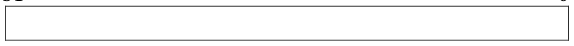

31                                       12                                       4                                    0

&emsp;&emsp;&emsp;b. Fully associative 
31                                                                                                                         0

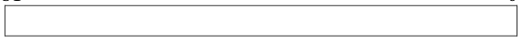

31                                                                                4                                    0

&emsp;&emsp;&emsp;c. Four-way associative 
31                                                                                                                         0

31                                       10                                       4                                    0

Page 7/15

---

**Page 8**

CS 162 Spring 2017, 2nd Midterm Exam                                     March 21, 2017

&emsp;b)  (11 points) You’ve finished implementing your cache, which ended up being a 2- 
&emsp;&emsp;Way Set Associative cache that uses an LRU replacement policy. To test it out, 
&emsp;&emsp;you try the following sequence of reads and writes:

&emsp;&emsp;read  from   0x705F3140 
&emsp;&emsp;write 0x1 to 0x705F3140 
&emsp;&emsp;write 0x2 to 0x705F3150 
&emsp;&emsp;write 0x2 to 0x705F3148 
&emsp;&emsp;write 0x3 to 0x707A2150 
&emsp;&emsp;write 0x3 to 0x035F2154 
&emsp;&emsp;read  from   0x705F3140 
&emsp;&emsp;Recall that caching happens at the block level, i.e., the unit of transfer between 
&emsp;&emsp;cache and main memory is one block. Also, assume that a write leads to caching 
&emsp;&emsp;the data, the same as a read. Initially, assume the cache is empty. Please answer 
&emsp;&emsp;the following questions: 
&emsp;&emsp;&emsp;a. (5 points) How many misses does the above access pattern exhibit? 
For a 2-way associative cache we have: 
31                                       11                                       4                                    0

These are the tag/index/offset for each address: 
0x705F3140: (tag = 0x705F3, index = 0xA, offset = 0x0) 
0x705F3150: (tag = 0x705F3, index = 0xA, offset = 0x10) 
0x705F3148: (tag = 0x705F3, index = 0xA, offset = 0x8) 
0x707A2150: (tag = 0x707A2, index = 0xA, offset = 0x10) 
0x035F2154: (tag = 0x035F2, index = 0xA, offset = 0x14) 
Since all addresses have the same index all accesses are in the same associative set.

read  from   0x705F3140 # cache block (tag = 0x705F3, index = 0xA) 
write 0x1 to 0x705F3140 # hit block (tag = 0x705F3, index = 0xA) 
write 0x2 to 0x705F3150 # hit block (tag = 0x705F3, index = 0xA) 
write 0x2 to 0x705F3148 # hit block (tag = 0x705F3, index = 0xA) 
write 0x3 to 0x707A2150 # cache block (tag = 0x707A2, index = 0xA) 
write 0x3 to 0x035F2154 # cache block (tag = 0x035F2, index = 0xA) 
\# evict block (tag = 0x705F3, index = 0xA) 
\# according to LRU policy 
read  from   0x705F3140 # cache block (tag = 0x705F3, index = 0xA) 
\# evict block (tag = 0x707A2, index = 0xA) 
\# according to LRU policy

Page 8/15

---

**Page 9**

CS 162 Spring 2017, 2nd Midterm Exam                                     March 21, 2017

Every “cache” is a miss, so we have **4 misses**.

&emsp;&emsp;&emsp;b. (3 points) Assume the cache is a write-through cache. How many writes 
&emsp;&emsp;&emsp;&emsp;&emsp;are taking place between cache an memory?

&emsp;&emsp;Every write results in writing to main memory, so we have **5 writes** to 
&emsp;&emsp;memory.

&emsp;&emsp;&emsp;c. (3 points) Assume that cache is a write-back cache. How many writes are 
&emsp;&emsp;&emsp;&emsp;&emsp;taking place between cache and memory?

&emsp;&emsp;The only times we write to memory is when we evict a dirty blocks, so in this 
&emsp;&emsp;case we have only **two writes** to memory.

&emsp;c) (4 points) Now consider that your system has 5ns of latency when accessing 
&emsp;&emsp;cache and 70ns when accessing main memory. What should your application’s 
&emsp;&emsp;average hit rate be in order to have an average memory access latency of 15ns?

&emsp;&emsp;Let HR be the hit rate 0 \<= HR \<= 1 
&emsp;&emsp;HR \* 5ns + (1-HR) \* 75ns  = 15ns 
&emsp;&emsp;5 \* HR + 75 - HR \* 75 = 15

Page 9/15

---

**Page 10**

CS 162 Spring 2017, 2nd Midterm Exam                                     March 21, 2017

&emsp;&emsp;70 \* HR = 60 
&emsp;&emsp;HR = 60/70 ~ 86%

**P4** (22 points) **Address Translation:** Consider a computer with **16 bit** virtual and 
physical addresses. Address translation is implemented by a two-level scheme combining 
segmentation and paging. The page size is **256 bytes**. 
Virtual address format:

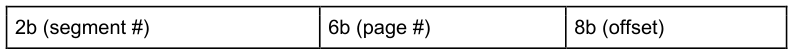

Segment table (Base Address specifies the address of the page table associated with the 
segment, and Limit specifies the total number of bytes in the segment):

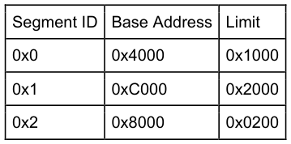

Page Table start address: 0x4000

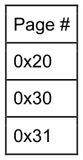

Page Table start address: 0x8000

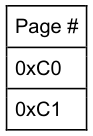

Page Table start address: 0xC000

Page 10/15

---

**Page 11**

CS 162 Spring 2017, 2nd Midterm Exam                                     March 21, 2017

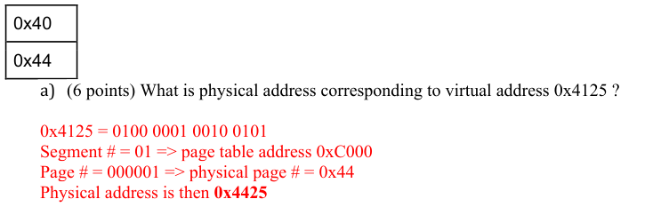

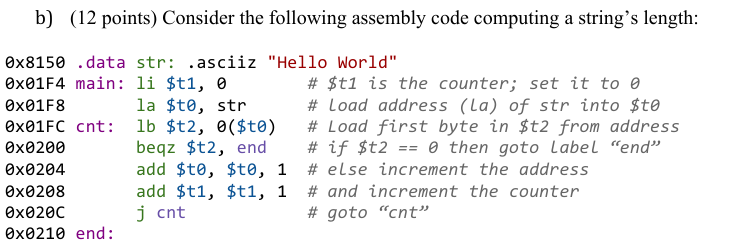

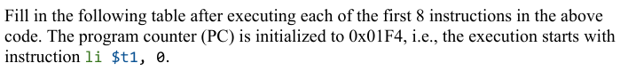

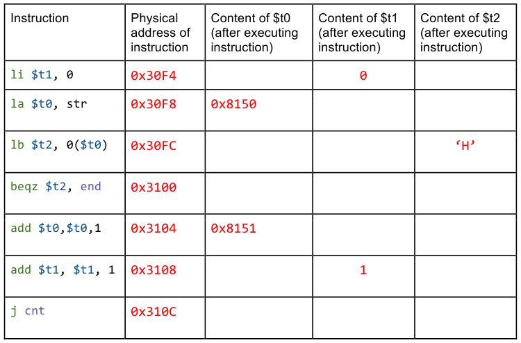

Page 11/15

---

**Page 12**

CS 162 Spring 2017, 2nd Midterm Exam                                     March 21, 2017

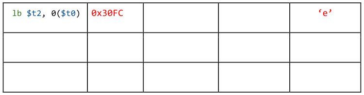

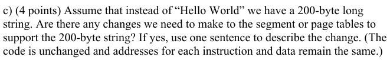

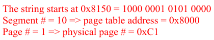

&emsp;&emsp;Since offset is 0x50 (i.e., 80), and the page size is 256 bytes, the 200-byte string 
&emsp;&emsp;doesn’t fit in the page, so we need to allocate an extra physical page.

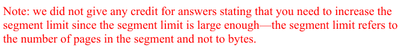

Page 12/15

---

**Page 13**

CS 162 Spring 2017, 2nd Midterm Exam                                     March 21, 2017

**P5** (14 points) **Banker’s Algorithm:** 
&emsp;a) (6 points) Suppose that we have the following resources: A, B, C and threads T1, 
&emsp;&emsp;T2, T3, T4. The total number of instances for each resource is:

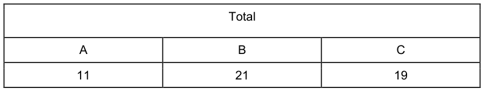

Further, assume that the threads have the following maximum requirements and current 
allocations:

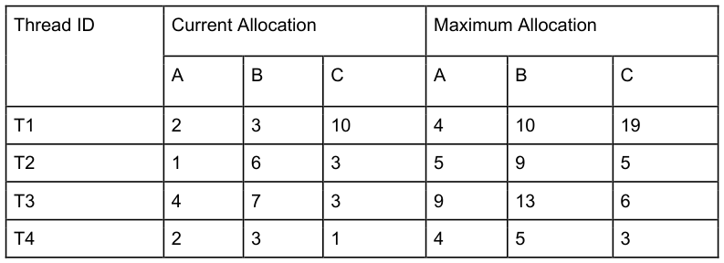

Is the system in a safe state? If “yes”, show a non-blocking sequence of thread 
executions. Otherwise, provide a proof that the system is unsafe. Show your work and 
justify each step of your answer. 
Yes. A safe sequence is: T4 à T2 à T3 à T1

Page 13/15

---

**Page 14**

CS 162 Spring 2017, 2nd Midterm Exam                                     March 21, 2017

&emsp;b) (4 points) Repeat question (a) if the total number of B instances is 20 instead of 
&emsp;&emsp;21. 
&emsp;No, there is no safe sequence because no thread can satisfy its allocation for 
&emsp;resource B.

&emsp;c) (4 points) Give one reason using no more than two sentences of why you might 
&emsp;&emsp;decide **not** to use Banker’s algorithm to avoid deadlock.

&emsp;Banker’s algorithm is slow; needs to re-evaluate on every request. It is hard to 
&emsp;accurately quantify how many resources a system has or how much each process will 
&emsp;actually need.

Page 14/15

---

**Page 15**

CS 162 Spring 2017, 2nd Midterm Exam                                     March 21, 2017

Page 15/15

