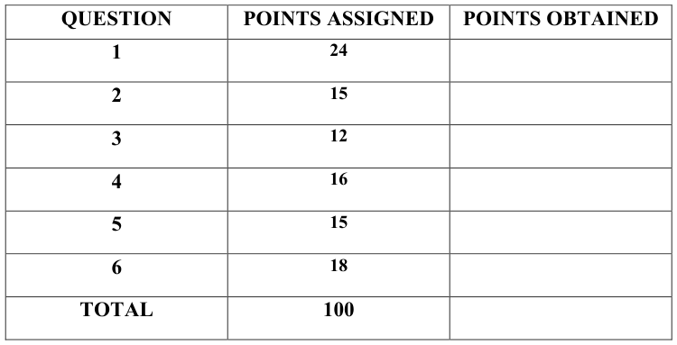
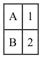
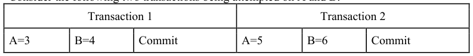
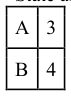
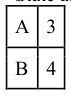
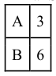
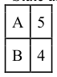
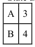
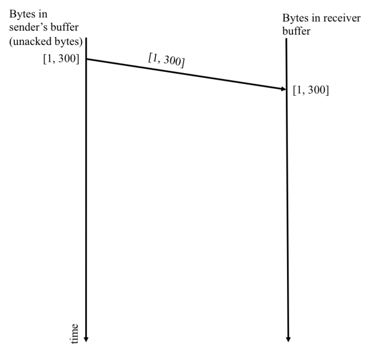

# Berkeley CS162 Spring 2017: Midterm 3: Questions

> Copied from the original: <https://hkn.eecs.berkeley.edu/exams/course/cs/162>. Text and figures are taken from the PDF as is; nothing was answered or rewritten. The original PDF is in this folder.

---

**Page 1**

CS 162 Spring 2017, 3rd Midterm Exam                                     April 24, 2017

&emsp;&emsp;&emsp;&emsp;&emsp;&emsp;&emsp;&emsp;University of California, Berkeley 
&emsp;&emsp;&emsp;&emsp;&emsp;&emsp;&emsp;&emsp;College of Engineering 
&emsp;&emsp;&emsp;&emsp;&emsp;&emsp;&emsp;&emsp;Computer Science Division – EECS 
Spring 2017                                Ion Stoica 
&emsp;&emsp;&emsp;&emsp;&emsp;&emsp;&emsp;&emsp;**Third Midterm Exam** 
&emsp;&emsp;&emsp;&emsp;&emsp;&emsp;&emsp;&emsp;April 24, 2017 
&emsp;&emsp;&emsp;&emsp;&emsp;&emsp;&emsp;&emsp;CS162 Operating Systems

General Information: 
This is a **closed book and one 2-sided handwritten note** examination. You have 80 minutes to 
answer as many questions as possible.  The number in parentheses at the beginning of each 
question indicates the number of points for that question. You should read **all** of the questions 
before starting the exam, as some of the questions are substantially more time consuming. 
Write all of your answers directly on this paper.  **Make your answers as concise as possible.** If there 
is something in a question that you believe is open to interpretation, then please ask us about it! 
&emsp;&emsp;&emsp;&emsp;&emsp;&emsp;&emsp;&emsp;**Good Luck!!**

Page 1/12

---

**Page 2**

CS 162 Spring 2017, 3rd Midterm Exam                                     April 24, 2017

**P1** (24 points total) True/False and Why? **CIRCLE YOUR ANSWER**. For each 
question: 1 point for true/false correct, 2 point for explanation. An explanation cannot 
exceed 2 sentences.

&emsp;a) When two processes mmap() the same region of a file, mmap() will always return 
&emsp;&emsp;the same set of virtual addresses to both processes, which represent a shared 
&emsp;&emsp;region of memory. 
&emsp;&emsp;&emsp;&emsp;&emsp;TRUE                    FALSE 
&emsp;&emsp;Why?

&emsp;b) A TCP sender can overflow the receiver’s buffer. 
&emsp;&emsp;&emsp;&emsp;&emsp;TRUE                    FALSE 
&emsp;&emsp;Why?

Page 2/12

---

**Page 3**

CS 162 Spring 2017, 3rd Midterm Exam                                     April 24, 2017

&emsp;c) A process can wait for all of its children with a single call to wait(&status). 
&emsp;&emsp;&emsp;&emsp;&emsp;TRUE                    FALSE 
&emsp;&emsp;Why?

&emsp;d) Two-Phase Commit does not guarantee all ACID properties (Atomicity, 
&emsp;&emsp;Consistency, Isolation, and Durability). 
&emsp;&emsp;&emsp;&emsp;&emsp;TRUE                    FALSE 
&emsp;&emsp;Why?

&emsp;e) The end-to-end principle states that one should make the lower levels between the 
&emsp;&emsp;higher-level ends as reliable and secure as possible. 
&emsp;&emsp;&emsp;&emsp;&emsp;TRUE                    FALSE 
&emsp;&emsp;Why?

Page 3/12

---

**Page 4**

CS 162 Spring 2017, 3rd Midterm Exam                                     April 24, 2017

&emsp;f) FAT provides slower sequential access to a file than Unix File System. 
&emsp;&emsp;&emsp;&emsp;&emsp;TRUE                    FALSE 
&emsp;&emsp;Why?

&emsp;g) Using quorum consensus a writer can return before the data has been written to all 
&emsp;&emsp;replicas. 
&emsp;&emsp;&emsp;&emsp;&emsp;TRUE                    FALSE 
&emsp;&emsp;Why?

&emsp;h) With consistent hashing (e.g., Chord) if a new node is added to a system 
&emsp;&emsp;consisting of N \> 1 nodes, this will lead to keys from every node to be moved 
&emsp;&emsp;around. 
&emsp;&emsp;&emsp;&emsp;&emsp;TRUE                    FALSE 
&emsp;&emsp;Why?

Page 4/12

---

**Page 5**

CS 162 Spring 2017, 3rd Midterm Exam                                     April 24, 2017

**P2** (15 points) **Transactions.** Consider two variables A and B which are initialized to 1, 
and 2, respectively:

Consider the following two transactions being attempted on A and B:

For the following scenarios, list which ACID property was violated or “none” if the 
transactions obeyed ACID, explain your answer in 1 sentence: 
a) (3 points) Transaction 1 successfully committed, then the computer crashed after step 2 
(B=6) of transaction 2 (but before writing the commit record to the log). 
State after Recovery:

b) (3 points) The transactions were run on two threads (at the same time) and have both 
committed. Note: concurrent transactions may complete in any order. State which order 
your answer assumes (if any). 
State after Recovery:

Page 5/12

---

**Page 6**

CS 162 Spring 2017, 3rd Midterm Exam                                     April 24, 2017

c) (3 points) The transactions were run on two threads (at the same time) and have both 
committed. Note: concurrent transactions may complete in any order. State which order 
your answer assumes (if any). 
Final State:

d) (3 points) **Transaction 1 successfully committed**, then the computer crashed during 
transaction 2 (before commit). 
State after Recovery:

e) (3 points) Both transactions committed (in order txn1,txn2), then the computer 
crashed. 
State after Recovery:

Page 6/12

---

**Page 7**

CS 162 Spring 2017, 3rd Midterm Exam                                     April 24, 2017

**P3** (12 points) **Synchronization**. Consider the following C program.

int thread\_count = 0;

void \*thread\_start(void \*arg) { 
thread\_count++; 
if (thread\_count == 3) { 
char \*argv\[\] = {"/bin/echo", “162 is the best!”, NULL}; 
/\* Replace current process image with a new process image 
\* that runs program pointed by “\*argv” with arguments “argv” \*/ 
execv(\*argv, argv); 
} 
printf("Thread: %d\\n", thread\_count); 
return NULL; 
}

int main(int argc, char \*argv\[\]) { 
int i, status; 
for (i = 0; i \< 2; i++) { 
pid\_t pid = fork(); 
if (pid != 0) { 
thread\_count++; 
wait(&status); 
} 
pthread\_t \*thread = malloc(sizeof(pthread\_t)); 
/\* start new “thread”. The new thread starts execution by invoking 
\* “thread\_start()” with NULL arg. \*/ 
pthread\_create(thread, NULL, &thread\_start, NULL); 
pthread\_join(\*thread, NULL); 
} 
return 0; 
} 
&emsp;&emsp;a) (8 points) Provide one possible output from this C program.

&emsp;&emsp;b) (4 points) Is the output deterministic? If yes, give a short explanation why. If 
&emsp;&emsp;&emsp;no, explain how to make the output deterministic.

Page 7/12

---

**Page 8**

CS 162 Spring 2017, 3rd Midterm Exam                                     April 24, 2017

**P4** (16 points) **Queueing theory** Consider a system with a single queue and a single 
server. The arrival rate of the requests follows a Poisson process, and the service time is 
exponential distributed. Thus, the system implements an M/M/1 queue. Assume that: 
&emsp;•    The utilization U is 50%. 
&emsp;• The average service time Tser = ⅙ seconds. 
&emsp;a) (4 points) What is the average service rate µ and arrival rate ƛ?

&emsp;b) (4 points) What are the average time spent in the queue Tq and the response time?

&emsp;c) (4 points) What is the average length of the queue Lq?

&emsp;d) (4 points) Assume that we add an additional server with the same service time 
&emsp;&emsp;(Tser = ⅙ seconds) to help service our queue. What is the average time spent in 
&emsp;&emsp;the queue Tq and response time for the new system, assuming the same arrival rate 
&emsp;&emsp;as at point (a), and that requests are balanced equally across the two servers?

Page 8/12

---

**Page 9**

CS 162 Spring 2017, 3rd Midterm Exam                                     April 24, 2017

**P5:** (15 points) **Caching and storage**: You have been hired at a hot startup located in 
downtown Berkeley and you are tasked with building a key-value store backed by 
spinning disks. Each disk has the following performance: 
&emsp;•    Bandwidth: 100MB/s 
&emsp;•    Disk controller latency:  1ms 
&emsp;• Average rotational latency: 3ms 
&emsp;• Seek latency: 3ms 
In front of the backing store you have provisioned an in-memory caching layer. The 
performance of this layer is bounded by the capacity of the network, which is 100MB/s. 
Each access to the key-value requests translates into one access into the cache and, if 
there is a cache miss, to one access to one backing disk. Each access results in reading 1 
key-value of 100 KB, which is stored contiguously on the disk (i.e., on adjacent sectors.) 
Ignore the network and cache latency. 
&emsp;a) (5 points) Considering your workload hits the cache 50% of the time, what is the 
&emsp;&emsp;average service time (i.e., the time/latency to retrieve a key-value)?

&emsp;b) (5 points) What is the maximum number of requests (reads) per second that this 
&emsp;&emsp;system can handle?

&emsp;c) (5 points) Now consider that you decide to change your spinning disks with faster 
&emsp;&emsp;SSDs to achieve an average service time (i.e., the time/latency to retrieve a key- 
&emsp;&emsp;value) of 1.25ms. Assume that the SSD controller latency is 1ms, the same as the 
&emsp;&emsp;HDD controller latency. What is the bandwidth of the SSD?

Page 9/12

---

**Page 10**

CS 162 Spring 2017, 3rd Midterm Exam                                     April 24, 2017

**P6** (18 points) **TCP Flow Control.** 
Assume host S uses TCP to send 1000 bytes of data to host R. We make the following 
assumptions: 
&emsp;•    The maximum packet size is 300B. 
&emsp;•    Receiving buffer of R is 500B. 
&emsp;• The delay between the machines is much larger than the time it takes to S to send 
&emsp;&emsp;1KB, i.e, S could send 1KB faster than it takes to hear back an ack from R. 
&emsp;• R consumes the bytes as soon as it receives them (i.e., R’s OS sends data to 
&emsp;&emsp;receiving app as soon as it gets them.) 
a) (6 points) Assume no packet or acknowledgement is lost. Draw the packet diagram 
also indicating the bytes in R’s sending buffer and the bytes in S’s receiving buffer.  The 
first packet with the associated information is drawn for you.

Page 10/12

---

**Page 11**

CS 162 Spring 2017, 3rd Midterm Exam                                     April 24, 2017

b) (6 points) Draw the packet diagram assuming the acknowledgement of the first packet 
is lost. No other packet or acknowledgement is lost.

Page 11/12

---

**Page 12**

CS 162 Spring 2017, 3rd Midterm Exam                                     April 24, 2017

c) (6 points) Draw the packet diagram assuming the third packet from the sender is lost. 
No other packet or acknowledgement is lost.

Page 12/12

